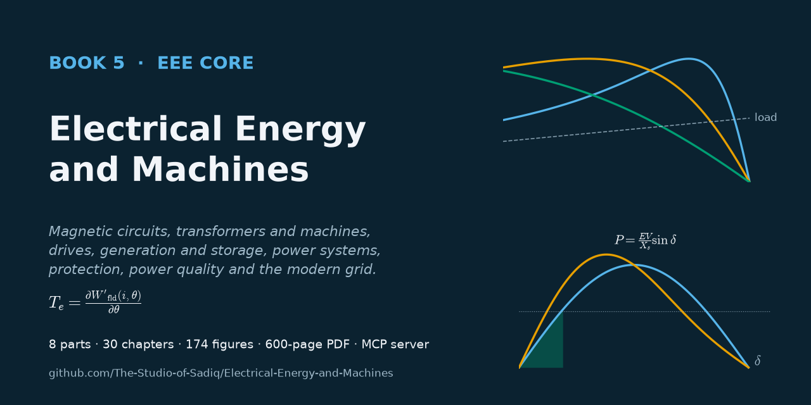

# Electrical Energy and Machines

[](https://github.com/The-Studio-of-Sadiq/Electrical-Energy-and-Machines/actions/workflows/check.yml)
[](https://github.com/The-Studio-of-Sadiq/Electrical-Energy-and-Machines/actions/workflows/release.yml)
[](pdf/Electrical-Energy-and-Machines.pdf)
[](https://github.com/The-Studio-of-Sadiq/Electrical-Energy-and-Machines/wiki)
[](LICENSE)



**Book 5 — The Electrical Energy & Machines Core**

Electrical energy conversion, electromechanical systems, power generation and delivery, and modern energy technologies: magnetic circuits and the physics of conversion, transformers and rotating machines, motor drives, conventional and renewable generation, energy storage, per-unit modelling, load flow, faults and stability, transmission, distribution, protection and high-voltage engineering, power quality, smart grids and renewable integration, energy management, electrical safety and system design.

The book picks up where its siblings stop. [*Engineering Physics*](https://github.com/The-Studio-of-Sadiq/Engineering-Physics) carries Maxwell's equations down to the quasi-static limit, lumped elements and the transformer and gyrator; [*Circuits, Signals and Communications*](https://github.com/The-Studio-of-Sadiq/Circuits-Signals-and-Communications) supplies phasors, AC power, three-phase circuits, transmission-line waves and control theory. This book cites those results with links to the exact sections and spends its pages on what they do not cover: real cores, windings, machines, drives, plants and networks, with the approximations, materials, ratings and failure modes that decide whether they work.

**Read the book as a PDF:** [`pdf/Electrical-Energy-and-Machines.pdf`](pdf/Electrical-Energy-and-Machines.pdf) or from the [latest release](https://github.com/The-Studio-of-Sadiq/Electrical-Energy-and-Machines/releases/latest) · **Wiki:** [chapter guide, figures, tooling](https://github.com/The-Studio-of-Sadiq/Electrical-Energy-and-Machines/wiki)

## Contents

| Part | Chapters |
|---|---|
| [I — Magnetic Circuits and Energy Conversion](part-1-magnetic-circuits-and-energy-conversion/README.md) | 1 Magnetic circuit fundamentals · 2 Electromagnetic induction · 3 Energy conversion principles |
| [II — Transformers and Electrical Machines](part-2-transformers-and-electrical-machines/README.md) | 4 Transformers · 5 DC machines · 6 Induction machines · 7 Synchronous machines · 8 Special electrical machines · 9 Machine design and performance |
| [III — Motor Drives](part-3-motor-drives/README.md) | 10 Drive-system fundamentals · 11 DC motor drives · 12 AC motor drives |
| [IV — Power Generation](part-4-power-generation/README.md) | 13 Power-system structure · 14 Conventional generation · 15 Renewable energy systems · 16 Energy storage |
| [V — Power-System Analysis](part-5-power-system-analysis/README.md) | 17 Per-unit systems and network modelling · 18 Power-flow analysis · 19 Fault analysis · 20 Power-system stability |
| [VI — Transmission, Distribution, and Protection](part-6-transmission-distribution-and-protection/README.md) | 21 Transmission lines · 22 Distribution systems · 23 Power-system protection · 24 High-voltage engineering |
| [VII — Power Quality and Grid Modernization](part-7-power-quality-and-grid-modernization/README.md) | 25 Power quality · 26 Smart grids · 27 Grid integration of renewables · 28 Energy efficiency and management |
| [VIII — Electrical Safety and Engineering Practice](part-8-electrical-safety-and-engineering-practice/README.md) | 29 Electrical safety · 30 Electrical system design |

**Boundary.** This book owns machines, drives, generation, storage, power-system analysis, transmission, distribution, protection, power quality, the modern grid, safety and design. Field physics and thermodynamics belong to *Engineering Physics*, circuit and control theory to *Circuits, Signals and Communications*, semiconductor devices and converter circuit internals to *Electronics & Computing* (see [`TOC.md`](TOC.md#relation-to-the-other-books)).

## Repository layout

| Path | Contents |
|---|---|
| `part-N-*/` | one folder per part: `README.md` is the part opener, `NN-*.md` are the chapters (Markdown, LaTeX math) |
| [`figures/`](figures) | all figures; each `figures/chNN/` folder is generated by `figures/scripts/chNN.py` |
| [`TOC.md`](TOC.md) | master syllabus and boundaries with the other books |
| [`CONTRIBUTING.md`](CONTRIBUTING.md) | house style, including how this book extends *Engineering Physics* |
| [`FIGURES.md`](FIGURES.md) | figure plan: every figure, where it goes and what it shows |
| [`scripts/`](scripts) | PDF, figure, figure-plan, book-check, social-preview and wiki scripts |
| [`docs/`](docs) | social preview image |
| [`.github/`](.github) | CI and release workflows, issue and pull-request templates |
| [`mcp/`](mcp) | an MCP server so Claude and other clients can search, read and typeset the book ([README](mcp/README.md)); Claude Code picks it up from [`.mcp.json`](.mcp.json) |
| [`pdf/`](pdf) | the compiled book |

## Build the PDF

Requires Node.js ≥ 18 and a local Chrome, Edge or Chromium (set `CHROME_PATH` if it is not found automatically).

```bash
npm install
```

```bash
npm run pdf
```

This writes `dist/Electrical-Energy-and-Machines.pdf` (KaTeX-rendered math, clickable contents, PDF bookmarks). Build selected part openers or chapters with:

```bash
node scripts/build-pdf.mjs --parts P2,6,7 --out dist/excerpt.pdf
```

## Figures

Every figure is specified by a `<!-- FIGURE ... -->` marker at the point it belongs in its chapter and drawn by `figures/scripts/chNN.py`. Requires Python 3 with numpy, scipy, matplotlib and schemdraw.

Regenerate all figures (or `python scripts/build-figures.py ch06 ch19` for some):

```bash
npm run figures
```

Place newly drawn figures below their markers:

```bash
node scripts/insert-figures.mjs
```

Regenerate the figure plan [`FIGURES.md`](FIGURES.md):

```bash
npm run figures:plan
```

## MCP server

```bash
claude mcp add electrical-energy -- node /absolute/path/to/this/repo/mcp/server.mjs
```

Tools: `list_contents`, `read_part`, `search_book`, `list_figures`, `get_figure`, `build_pdf`. See [`mcp/README.md`](mcp/README.md).

## Contributing

Corrections, clearer explanations and better figures are welcome. Read [CONTRIBUTING.md](CONTRIBUTING.md) (workflow and house style) and report errors with the **Erratum** issue template. Everyone taking part follows the [Code of Conduct](CODE_OF_CONDUCT.md). Security issues in the tooling: see [SECURITY.md](SECURITY.md). Release history: [CHANGELOG.md](CHANGELOG.md).

CI (`.github/workflows/check.yml`) checks the sources, the figure plan, the MCP server and every figure script on each push; pushing a `v*` tag builds the PDF and publishes a release (`.github/workflows/release.yml`).

## Citation and license

To cite the book, use [CITATION.cff](CITATION.cff) (GitHub's "Cite this repository" button reads it). Content and code are under the [MIT License](LICENSE).
