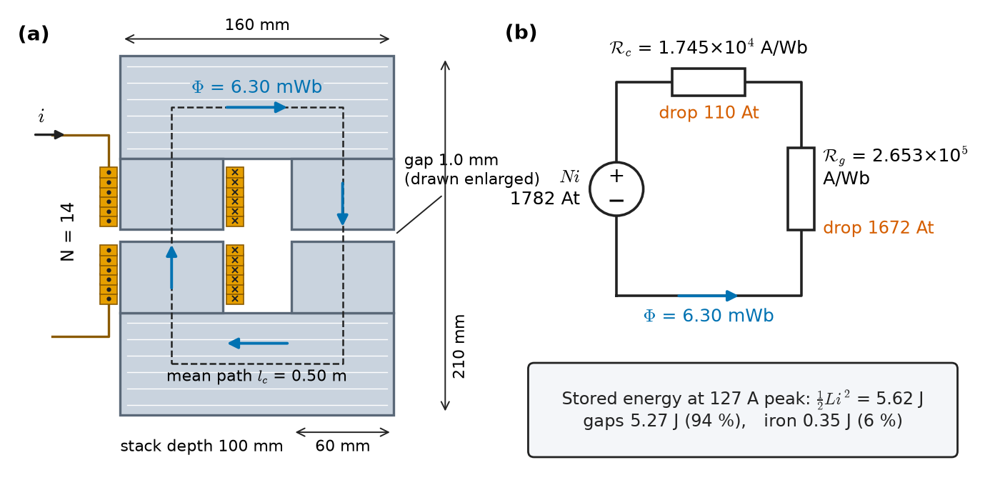
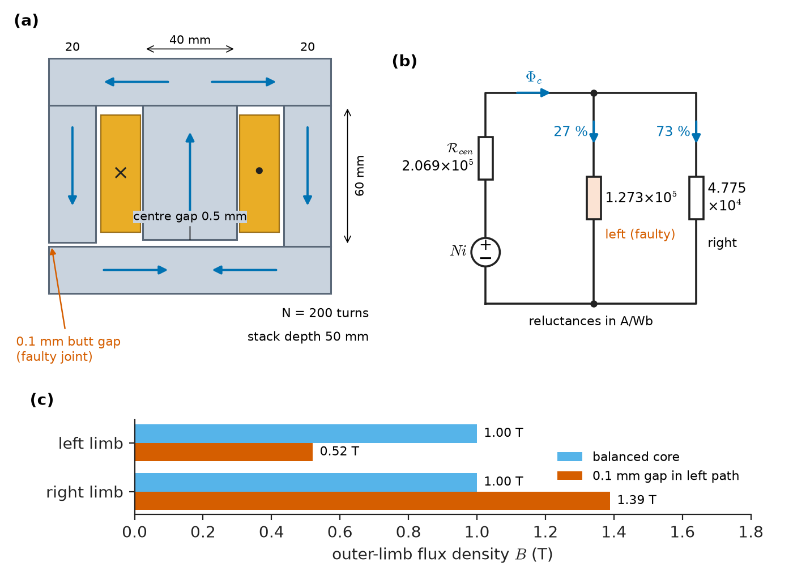
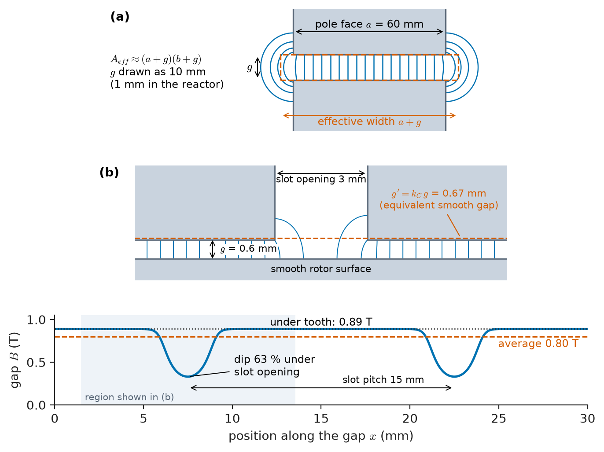
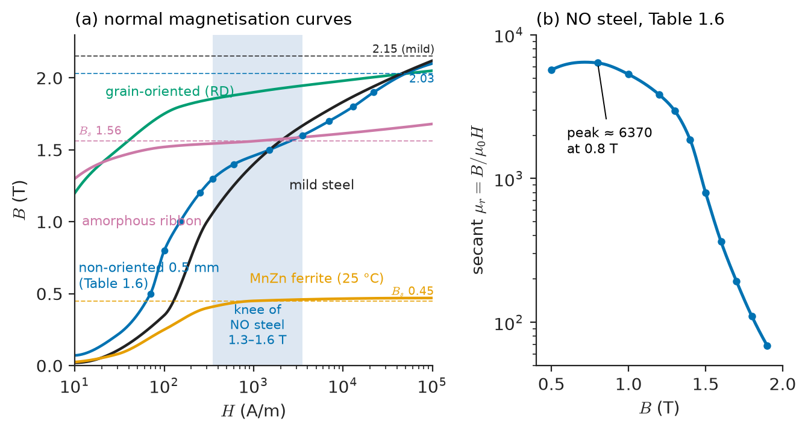
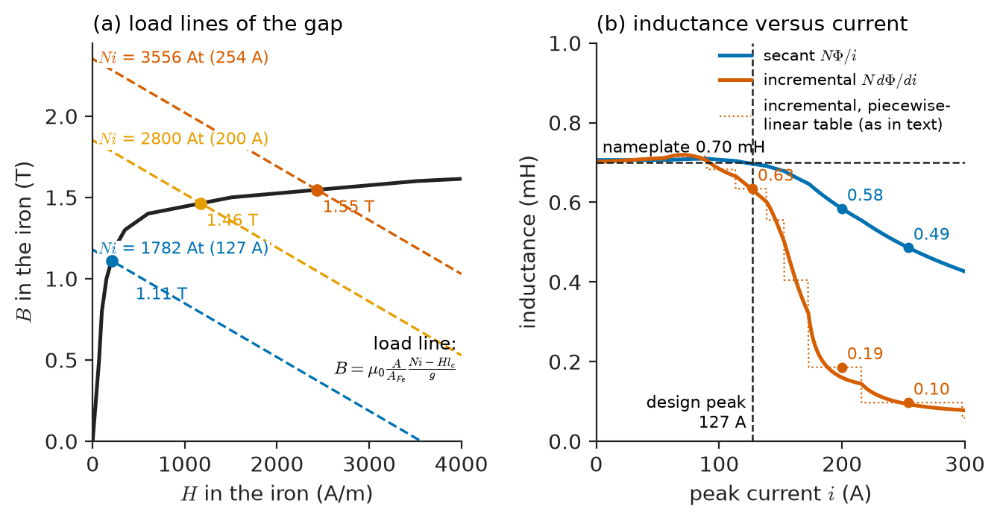

# Chapter 1 — Magnetic Circuit Fundamentals

*Part I · Magnetic Circuits and Energy Conversion*

A data-centre operator installs a 400 V, 50 kvar detuned power-factor-correction bank to keep its utility power factor above 0.95. Each phase has a capacitor in series with an iron-cored reactor whose nameplate reads 0.70 mH at 75 A. For a year nothing happens. Then a new row of servers with uncontrolled rectifier front ends is commissioned, the fifth-harmonic current in the bank rises, and the reactors begin to hum loudly and run hot. A technician measures the inductance at twice rated peak current and finds it 30 % below nameplate. The capacitor bank, designed to be tuned safely below the fifth harmonic, is now tuned closer to it, which draws still more harmonic current, which saturates the reactors further. Nothing in the reactor is broken. Its iron has simply left the straight part of its $B$–$H$ curve, and every number on the nameplate was calculated on the assumption that it never would.

The same calculation, and the same assumption, sits behind every transformer, motor, generator, contactor, current transformer and lifting magnet in this book. This chapter builds the tool used to make it, the **magnetic circuit**, and then shows where it breaks.

> **How do you predict the flux, the inductance and the required ampere-turns of an iron core with air gaps, from its dimensions and material data, without solving a field problem?**
> **Where does the linear reluctance model stop working (leakage, fringing, saturation), and how large are the errors in real devices?**

| Concept | Engineering destination |
|---|---|
| Magnetic flux | Transformer EMF and volts-per-turn, machine flux per pole, flux balance in three-limb cores |
| Magnetic field intensity | Ampere-turn budgets of cores and gaps, current-transformer burden limits |
| Flux density | Design limits of electrical steels, tooth and yoke sizing, magnetic loading of machines |
| Permeability | Material selection (steels, amorphous, ferrite, powder cores), inductance factor of cores |
| Reluctance | Inductor and reactor design, equivalent circuits of cores, reluctance motors |
| Magnetomotive force | Excitation of field windings, magnetising current of transformers and motors |
| Series and parallel paths | Shell-type and three-limb transformer cores, E-cores, flux sharing in machine yokes |
| Air gaps | Gapped reactors, contactor and relay magnets, machine air gaps, energy storage in inductors |
| Fringing | Effective gap area, Carter coefficient of slotted machines, stray loss near gaps |
| Saturation | Inductance collapse in reactors, transformer inrush, over-fluxing limits, open-circuit curves of generators |

**Roadmap.** Flux, and where the physics book hands it over (1.1) → the field intensity and Ampère's law as an ampere-turn budget (1.2) → flux density as the design variable (1.3) → permeability as material data (1.4) → magnetomotive force (1.5) → reluctance and the magnetic circuit (1.6) → series and parallel paths (1.7) → air gaps (1.8) → fringing and leakage (1.9) → saturation, hysteresis and permanent magnets (1.10).

---

## 1.1 Magnetic flux

### Where *Engineering Physics* leaves off

*Engineering Physics* derives Maxwell's equations ([Ch. 11 §11.4](https://github.com/The-Studio-of-Sadiq/Engineering-Physics/blob/main/CHAPTERS/CHAPTER%2011.md)), adds the constitutive relation $\mathbf B=\mu\mathbf H$ for linear media ([Ch. 11 §11.9](https://github.com/The-Studio-of-Sadiq/Engineering-Physics/blob/main/CHAPTERS/CHAPTER%2011.md)), solves magnetostatics and defines inductance as $L=N\Phi/I$ with stored energy $\int B^2/2\mu_0\,dV$ ([Ch. 11 §11.11](https://github.com/The-Studio-of-Sadiq/Engineering-Physics/blob/main/CHAPTERS/CHAPTER%2011.md)), and shows that at 50 or 60 Hz every power device is deep inside the quasi-static limit ([Ch. 11 §11.12](https://github.com/The-Studio-of-Sadiq/Engineering-Physics/blob/main/CHAPTERS/CHAPTER%2011.md); [Ch. 16 §16.10](https://github.com/The-Studio-of-Sadiq/Engineering-Physics/blob/main/CHAPTERS/CHAPTER%2016.md)). It then lumps fields into effort–flow elements and lists a magnetic row whose effort is magnetomotive force and whose flow is the rate of change of flux ([Ch. 17 §17.2](https://github.com/The-Studio-of-Sadiq/Engineering-Physics/blob/main/CHAPTERS/CHAPTER%2017.md)). Those results are taken over here as given. What the physics book does not contain is the engineering model built on them: a core made of a nonlinear, lossy material, cut by air gaps, whose flux leaks and fringes, and whose ampere-turn requirement must be found from a datasheet curve rather than a constant $\mu$. That model, the magnetic circuit, is the subject of this chapter.

### Flux as a conserved quantity in a core

The magnetic flux through a surface $S$ is $\Phi=\int_S\mathbf B\cdot d\mathbf S$, measured in webers (Wb = V·s). Because $\nabla\cdot\mathbf B=0$, the flux leaving any closed surface is zero. For an engineer this has one decisive consequence: **flux behaves like a current that cannot be stored at a junction.** Where a core divides, the fluxes in the branches add up to the flux arriving; where limbs meet, the fluxes sum to zero. This is the magnetic counterpart of Kirchhoff's current law, and unlike its electrical cousin it needs no lumping assumption at all, because no "magnetic charge" exists to accumulate.

What *is* approximate is the assumption that flux stays inside the iron. An electrical conductor is surrounded by insulation that is $10^{20}$ times less conductive; a magnetic core is surrounded by air that is only $10^3$–$10^5$ times less permeable. Some flux therefore always takes paths through air, and the magnetic circuit has to account for it as leakage (Section 1.9).

### Flux linkage

A coil of $N$ turns that all encircle the same flux $\Phi$ has flux linkage $\lambda=N\Phi$ (weber-turns). In real windings different turns link different amounts of flux, and the flux linkage is the sum $\lambda=\sum_k\Phi_k$ over the turns. Flux linkage, not flux, is what Faraday's law turns into voltage (Chapter 2), and it is what a winding "sees" of the core.

**Table 1.1 — Representative flux magnitudes in power equipment (typical).**

| Device | Quantity | Typical value |
|---|---|---|
| 400 kVA, 11 kV/415 V distribution transformer | Flux per limb (peak) | 40–50 mWb |
| 100 MVA generator step-up transformer | Flux per limb (peak) | 0.4–0.6 Wb |
| 15 kW, 4-pole induction motor | Flux per pole (fundamental) | 8–12 mWb |
| 500 MW, 2-pole turbo-generator | Flux per pole | 3–5 Wb |
| 200 A/5 A protection current transformer | Core flux at rated burden | 0.1–1 mWb |
| AC contactor magnet (230 V coil) | Flux in closed magnet | 0.2–0.5 mWb |

The range is six orders of magnitude, yet each value is fixed by the same relation that Chapter 2 develops: the volts per turn of the winding divided by $4.44f$.

---

## 1.2 Magnetic field intensity

### Ampère's law as an ampere-turn budget

The field intensity $\mathbf H$ (A/m) enters through the integral form of Ampère's law, which in the quasi-static limit (displacement current negligible at power frequency) reads

$$
\oint_C\mathbf H\cdot d\mathbf l=I_{\text{enc}}
$$

as derived in [*Engineering Physics*, Ch. 11 §11.4 and §11.11](https://github.com/The-Studio-of-Sadiq/Engineering-Physics/blob/main/CHAPTERS/CHAPTER%2011.md). For a coil of $N$ turns carrying $i$, a closed path through the core links the current $N$ times, so the right-hand side is $Ni$.

The engineering reading of this equation is a **budget**. The ampere-turns $Ni$ supplied by the winding are "spent" along the path: each segment $k$ of length $l_k$ in which $H$ is roughly uniform consumes $H_kl_k$ ampere-turns, and the sum must balance:

$$
Ni=\sum_k H_k\,l_k
$$

A good core is one in which almost the whole budget is spent where it does something useful, usually in an air gap, and almost nothing is wasted in the iron.

### Values and units

$H$ is measured in amperes per metre (often "ampere-turns per metre" in older texts; the turn is dimensionless). In electrical steel at a working flux density of 1.0–1.3 T, $H$ is only 100–400 A/m: a 1 m path costs a few hundred ampere-turns. In an air gap at the same flux density, $H=B/\mu_0\approx0.8$–$1.0\times10^6$ A/m, so a single millimetre of air costs 800–1000 ampere-turns. This contrast, roughly a factor of 3000, is the whole reason magnetic circuits are designed the way they are.

> **Status of the principle: Ampère's circuital law, $\oint\mathbf H\cdot d\mathbf l=Ni$**
> *Fundamental.* It is the Ampère–Maxwell equation in the quasi-static limit; at 50–60 Hz the displacement-current term is smaller than the conduction term by a factor of order $(L/\lambda)^2\sim10^{-12}$ for any power device, so the law is exact for engineering purposes. The approximation lies only in replacing $\oint$ by a sum $\sum H_kl_k$ with uniform $H$ in each segment.

### The segment-uniformity assumption

Replacing the line integral by $\sum H_kl_k$ assumes uniform $H$ along each segment and a well-defined path length. In a rectangular core the flux crowds towards the inner corners, so the mean (centre-line) path is an approximation, good to a few percent when the window is large compared with the limb width. For machine teeth, where $H$ varies strongly along the tooth, designers split the path into many short segments; IEC 60205 defines an effective path length $l_e$ for standard ferrite core shapes so that the one-segment model gives the right answer.

---

## 1.3 Flux density

### The design variable

Flux density $B=\Phi/A$ (tesla, T = Wb/m²) is the quantity designers actually limit, because the material properties (permeability, loss per kilogram, saturation) are all functions of $B$. Choosing $B$ fixes the core cross-section for a given flux: a transformer limb carrying 45 mWb at 1.6 T needs $A=0.045/1.6=0.028$ m² of net iron. Choose 1.8 T and the core is 11 % smaller, but its magnetising current and core loss rise steeply (Section 1.10 and Chapter 3).

**Table 1.2 — Typical working flux densities (peak values unless stated).**

| Location | Typical $B$ | What limits it |
|---|---|---|
| Earth's field | 25–65 µT | — |
| Under a 400 kV line at ground level, full load | 5–30 µT | ICNIRP public reference level 200 µT at 50 Hz |
| Ferrite core of a 100 kHz converter transformer | 0.1–0.3 T | Core loss at high frequency; saturation near 0.4 T at 100 °C |
| Amorphous-core distribution transformer | 1.3–1.4 T | Saturation of the alloy at about 1.56 T |
| Grain-oriented steel, distribution and power transformers | 1.5–1.75 T | Magnetising current, no-load loss, noise, over-excitation margin |
| Induction-motor air gap (fundamental) | 0.7–0.9 T | Magnetising current and tooth saturation |
| Induction-motor stator teeth | 1.5–1.9 T | Saturation and tooth loss |
| Induction-motor stator yoke | 1.2–1.6 T | Core loss |
| Surface-PM motor air gap | 0.8–1.1 T | Magnet remanence and demagnetisation |
| Large turbo-generator air gap | 0.8–1.1 T | Field-winding current and heating |
| Lifting-magnet pole face | 1.2–1.5 T | Saturation of mild steel |
| MRI scanner (superconducting, air-cored) | 1.5–3 T | Conductor critical field and cost |

Iron-cored devices cluster between about 1 and 2 T because that is where the useful range of ferromagnetic materials ends (Section 1.10); a magnet that needs more must use superconductors. The air-gap values of machines are lower than their iron values because every tenth of a tesla in the gap costs magnetising current.

### Uniform and non-uniform $B$

$B=\Phi/A$ is an average: a good one in a transformer limb, a poor one in machine teeth (where flux funnels into a narrow root), at corners, and at joints of stacked cores, where flux crosses between laminations and local densities exceed 2 T. Designers check the narrowest section of each path separately.

### Stacking factor

Laminated cores are built from insulated sheets; the coating and the irregularity of the stack mean that the iron occupies only a fraction $k_s$ of the gross cross-section. Typical stacking factors are 0.95–0.98 for 0.3–0.5 mm steels and 0.80–0.88 for amorphous ribbon about 25 µm thick. The flux density in the iron is $B=\Phi/(k_sA_{\text{gross}})$, while in an adjacent air gap the flux spreads over the gross area.

---

## 1.4 Permeability

### Permeability as material data

In a linear medium $\mathbf B=\mu\mathbf H$ with $\mu=\mu_r\mu_0$ and $\mu_0=4\pi\times10^{-7}$ H/m ([*Engineering Physics*, Ch. 11 §11.9](https://github.com/The-Studio-of-Sadiq/Engineering-Physics/blob/main/CHAPTERS/CHAPTER%2011.md)). The physics book treats $\mu$ as a material constant emerging from electron spin and exchange; the origin of ferromagnetism in iron's unpaired $3d$ electrons is outlined in [*Engineering Physics*, Ch. 5 §5.7](https://github.com/The-Studio-of-Sadiq/Engineering-Physics/blob/main/CHAPTERS/CHAPTER%205.md), and its disappearance above the Curie temperature (770 °C for iron) as a Landau phase transition in [Ch. 10 §10.9](https://github.com/The-Studio-of-Sadiq/Engineering-Physics/blob/main/CHAPTERS/CHAPTER%2010.md). For engineering purposes a ferromagnetic $\mu$ is not a constant. It depends on the flux density, on the history of magnetisation, on frequency, on temperature, on mechanical stress, and on the direction relative to the rolling direction of the sheet. It is read from data, and several different "permeabilities" are in use:

- **Amplitude (secant) permeability** $\mu_a=B/H$ at a point on the normal magnetisation curve. It is what the magnetic circuit uses to compute a reluctance at a given operating point.
- **Initial permeability** $\mu_i$, the limit of $\mu_a$ at very low $B$. It matters for current transformers and sensors that work at low flux density.
- **Maximum permeability** $\mu_{\max}$, the peak of $\mu_a$, usually reached between 0.5 and 1.2 T in electrical steels. Datasheets quote it as a figure of merit.
- **Incremental (differential) permeability** $\mu_\Delta=dB/dH$, the slope of the curve at the operating point. It sets the inductance seen by a small ripple current superimposed on a large DC or low-frequency current, for example in a DC-link choke or a smoothing reactor.

**Table 1.3 — Magnetic materials for power equipment (typical values at room temperature).**

| Material | Relative permeability ($\mu_{r,\max}$ or range) | Saturation $B_s$ (T) | Typical use |
|---|---|---|---|
| Low-carbon (mild) steel, solid | 1000–2000 | 2.0–2.1 | Lifting magnets, DC machine frames, solid rotor poles |
| Non-oriented silicon steel (2–3.5 % Si), 0.35–0.65 mm | 4000–10 000 | 1.95–2.05 | Motors, generators, small transformers |
| Grain-oriented silicon steel (3 % Si), 0.23–0.30 mm, rolling direction | 30 000–80 000 | 2.03 | Distribution and power transformers |
| Cobalt–iron (49 % Co) | 5000–15 000 | 2.3–2.4 | Aircraft generators, high-power-density motors |
| Amorphous iron-based ribbon, about 25 µm | 50 000–600 000 (after annealing) | 1.56 | Low-loss distribution transformers |
| Nanocrystalline ribbon | 20 000–200 000 | 1.2–1.25 | Common-mode chokes, high-frequency transformers, CT cores |
| Manganese–zinc ferrite | 2000–15 000 (initial) | 0.4–0.5 at 25 °C, about 0.35–0.4 at 100 °C | Switch-mode power supplies, 20 kHz–1 MHz |
| Iron-powder and alloy-powder cores | 10–150 (distributed gap) | 1.0–1.5 | PFC and DC-link chokes, output filters |

Two lessons follow. Permeabilities span more than four orders of magnitude, but every one of these materials saturates between 0.4 and 2.4 T. And permeability is the variable that differs most between nominally identical cores: a ±25 % batch spread in $\mu_r$ is normal for ferrites and not unusual for steels. A design whose performance depends strongly on $\mu_r$ is therefore a fragile design, which is one of the reasons for deliberately adding air gaps (Section 1.8).

> **Status of the principle: Linear constitutive law $B=\mu H$ for ferromagnetic cores**
> *Approximate.* Valid for small excursions about an operating point or for a core whose reluctance is dominated by an air gap; it ignores saturation, hysteresis, frequency and temperature dependence, and anisotropy. For electrical steels the secant $\mu_r$ varies by more than a factor of ten between 0.5 T and 1.7 T, so a single value is meaningful only together with the flux density at which it was read.

---

## 1.5 Magnetomotive force

### Definition and engineering meaning

The magnetomotive force (MMF) of a winding is $\mathcal F=Ni$, measured in amperes (often written ampere-turns, At). It is the left-hand side of the ampere-turn budget of Section 1.2: the "effort" that drives flux around the circuit. *Engineering Physics* places it in exactly this role, as the effort variable of the magnetic domain ([Ch. 17 §17.2.2](https://github.com/The-Studio-of-Sadiq/Engineering-Physics/blob/main/CHAPTERS/CHAPTER%2017.md)).

The engineering content of the definition lies in two practical facts.

**Only the net enclosed current counts.** A path that encloses the primary and the secondary windings of a loaded transformer sees $N_1i_1-N_2i_2$, which is small, because the load ampere-turns of the secondary almost cancel those of the primary. The core flux of a transformer is set by the small difference, the **magnetising MMF**, not by the large load currents. This is why a transformer core can be sized for flux and not for load current (Chapter 4).

**Distributed windings produce distributed MMF.** In a machine the winding is spread over many slots, and the MMF is a function of position around the air gap. Its fundamental spatial component, produced by three phases together, is the rotating MMF wave of Chapter 3. The single-number $\mathcal F=Ni$ of this chapter is its one-dimensional ancestor.

### MMF requirements in practice

**Table 1.4 — Typical magnetising MMF and current (as a fraction of rated current).**

| Device | Where the MMF is spent | Magnetising current (% of rated) |
|---|---|---|
| Large power transformer, grain-oriented core | Joints and iron | 0.1–0.5 |
| Distribution transformer, 100–1000 kVA | Joints and iron | 0.5–2 |
| Induction motor, 4-pole, 15–200 kW | Air gap (about 70–85 % of total) | 25–40 |
| Induction motor, 8-pole or more, or small rating | Air gap | 40–60 |
| Salient-pole synchronous generator (field winding) | Air gap | Field current set by excitation system |

The difference between the first two rows and the next two is the air gap. A transformer core has only the unavoidable gaps at its joints; a rotating machine must have a mechanical clearance between rotor and stator, and that clearance dominates its magnetising requirement.

---

## 1.6 Reluctance

### The magnetic Ohm's law

Combine the segment form of Ampère's law, $\mathcal F=\sum H_kl_k$, with $B_k=\mu_kH_k$ and flux continuity $\Phi=B_kA_k$ for a single path:

$$
\mathcal F=\Phi\sum_k\frac{l_k}{\mu_kA_k}=\Phi\,\mathcal R,\qquad \mathcal R_k=\frac{l_k}{\mu_kA_k}
$$

The **reluctance** $\mathcal R$ (A/Wb, or H⁻¹) plays the role of resistance, MMF that of voltage, and flux that of current. Its reciprocal is the **permeance** $\mathcal P=1/\mathcal R$ (H). The relation between a winding's inductance and the reluctance of its path, $L=N^2/\mathcal R=N^2\mathcal P$, is stated and used in [*Circuits, Signals and Communications*, Ch. 5](https://github.com/The-Studio-of-Sadiq/Circuits-Signals-and-Communications/blob/main/part-1-circuit-fundamentals/05-capacitors-and-inductors.md) and is taken as known here. Manufacturers of cores quote the permeance per turn squared as the inductance factor $A_L$.

> **Status of the principle: The magnetic circuit $\mathcal F=\mathcal R\Phi$**
> *Approximate.* It follows from Ampère's law and flux continuity, both exact, plus three assumptions: flux confined to defined paths (no leakage), uniform $B$ and $H$ over each segment, and constant $\mu$ in each segment. It is accurate to a few percent for closed, gapped cores below saturation and fails progressively with leakage, fringing (gap length comparable to pole width) and saturation.

### What the analogy does and does not carry

The electrical analogy is useful because every network method (series and parallel reduction, nodal analysis, Thévenin equivalents) carries over unchanged to linear magnetic circuits. Three differences must be kept in mind.

| Electric circuit | Magnetic circuit | Where the analogy breaks |
|---|---|---|
| Current $I$ (A) | Flux $\Phi$ (Wb) | Flux is not a flow of anything; nothing moves around a DC magnetic circuit |
| EMF $V$ (V) | MMF $\mathcal F$ (A) | — |
| Resistance $R=l/\sigma A$ | Reluctance $\mathcal R=l/\mu A$ | Resistance dissipates; reluctance **stores** energy $\tfrac12\mathcal R\Phi^2$ |
| Conductivity ratio conductor/insulator about $10^{20}$ | Permeability ratio iron/air about $10^3$–$10^5$ | Flux leaks; there is no magnetic insulator |
| Ohm's law linear over many decades | $\mu$ depends on $B$ | Reluctance changes with flux: saturation |

The resistance–reluctance row is worth a second look, because it connects back to *Engineering Physics*. In the effort–flow template the magnetic effort is MMF and the magnetic flow is the *rate of change* of flux, $\dot\Phi$ ([Ch. 17 §17.2.2](https://github.com/The-Studio-of-Sadiq/Engineering-Physics/blob/main/CHAPTERS/CHAPTER%2017.md)). With that pairing a reluctance, $\mathcal F=\mathcal R\Phi=\mathcal R\int\dot\Phi\,dt$, relates effort to the integral of flow: it is a **capacitor-type** (storage) element, with permeance as its capacitance, not a resistor. A winding links the electrical and magnetic domains as $v=N\dot\Phi$ and $\mathcal F=Ni$, which is the gyrator law of [Ch. 17 §17.5](https://github.com/The-Studio-of-Sadiq/Engineering-Physics/blob/main/CHAPTERS/CHAPTER%2017.md) with gyration ratio $N$. A gyrator terminated in a capacitor looks like an inductor, and that is exactly how $L=N^2\mathcal P$ appears. This "gyrator–capacitor" picture is energy-consistent and is used in circuit simulators to model multi-winding magnetics; the familiar "flux as current" picture is simpler for static ampere-turn calculations and is the one used in the rest of this chapter. Both describe the same physics; they differ only in which variable is called the flow.

**Worked example — Reluctance budget of a gapped filter reactor.** The reactor of the opening problem has a laminated non-oriented steel core of gross section $60\times100$ mm ($A=6.0\times10^{-3}$ m²), stacking factor 0.95 (net iron $A_{Fe}=5.7\times10^{-3}$ m²), mean iron path $l_c=0.50$ m, and two air gaps of 1.0 mm each in series ($g=2.0$ mm in total). The winding has $N=14$ turns. Take $\mu_r=4000$ for the iron and neglect fringing for now.

*Reluctances.*

$$
\mathcal R_c=\frac{l_c}{\mu_0\mu_rA_{Fe}}=\frac{0.50}{4\pi\times10^{-7}\times4000\times5.7\times10^{-3}}=1.745\times10^4\ \mathrm{A/Wb}
$$

$$
\mathcal R_g=\frac{g}{\mu_0A}=\frac{2.0\times10^{-3}}{4\pi\times10^{-7}\times6.0\times10^{-3}}=2.653\times10^5\ \mathrm{A/Wb}
$$

The total is $\mathcal R=2.827\times10^5$ A/Wb, of which the gaps contribute 93.8 %: two millimetres of air have fifteen times the reluctance of half a metre of iron.

*Inductance.* $L=N^2/\mathcal R=196/2.827\times10^5=0.693$ mH, which is the nameplate value.

*Operating flux density.* The rated current is 75 A rms; allowing a 20 % margin for harmonic content, the design peak is $75\sqrt2\times1.2=127.3$ A. The flux is $\Phi=Ni/\mathcal R=14\times127.3/2.827\times10^5=6.30$ mWb, giving $B_{Fe}=6.30\times10^{-3}/5.7\times10^{-3}=1.11$ T in the iron and $1.05$ T in the gap. The ampere-turn budget is 1782 At, of which 1672 At are spent in the gaps and 110 At in the iron.

*Where the energy is.* The stored energy at peak current is $\tfrac12Li^2=5.62$ J. Of this, $\tfrac12\mathcal R_g\Phi^2=5.27$ J (94 %) sits in the 12 cm³ of air in the gaps, and only 0.35 J in the 2.85 litres of iron.

*Without the gap.* The same core with no gap would have $L=N^2/\mathcal R_c=11.2$ mH, sixteen times more, but its iron would reach 1.2 T at only 8.5 A. An ungapped core is a good inductor for very small currents and a useless one for a 75 A filter. The gap trades inductance per turn for current capacity, and makes the inductance almost independent of the uncertain $\mu_r$: a 25 % change in $\mu_r$ changes $L$ by only about 2 %.

<!-- FIGURE 1.1 | figures/ch01/fig-1-1-gapped-reactor-and-reluctance-circuit.png | schematic | A gapped filter reactor and its magnetic equivalent circuit: two 1 mm gaps carry 94 % of the reluctance and store 94 % of the energy. | Content: (a) front view of a rectangular laminated core, outer dimensions 160 x 210 mm, limb and yoke width 60 mm (so the mean path is 2 x (100 + 150) mm = 0.50 m), stack depth 100 mm, two 1.0 mm gaps (exaggerated) one in each vertical limb, 14-turn winding on the left limb with current i entering; dashed centre-line labelled mean path lc = 0.50 m; flux arrows around the core labelled Phi = 6.30 mWb. (b) equivalent circuit: MMF source Ni = 1782 At in series with core reluctance Rc = 1.745e4 A/Wb (drop 110 At) and gap reluctance Rg = 2.653e5 A/Wb (drop 1672 At), loop flux Phi. Annotate energy shares: gap 5.27 J, iron 0.35 J. -->

*Figure 1.1 — A gapped filter reactor and its magnetic equivalent circuit: two 1 mm gaps carry 94 % of the reluctance and store 94 % of the energy.*

Figure 1.1 shows the core and its equivalent circuit side by side; the circuit is a single loop because, so far, all flux follows one path.

---

## 1.7 Series and parallel magnetic paths

### The two network laws

With reluctances as elements, a magnetic circuit is solved exactly like a resistive network:

- **Node law (flux continuity).** The fluxes entering a junction of limbs sum to zero, $\sum\Phi_k=0$. This is exact, from $\nabla\cdot\mathbf B=0$.
- **Loop law (Ampère).** Around any closed loop of the core, the sum of MMF drops $\mathcal R_k\Phi_k$ equals the sum of winding MMFs enclosed, $\sum\mathcal R_k\Phi_k=\sum N_ji_j$.

Elements carrying the same flux are in **series**, and their reluctances add. Elements sharing the same MMF drop between two junctions are in **parallel**, and their permeances add. For linear elements, the reduction rules, superposition of the MMFs of several windings, and nodal analysis all apply directly.

### Shell-type and three-limb cores

Real cores are rarely a single loop. The shell-type (E–I) core of Figure 1.2, used for single-phase transformers, chokes and most small mains transformers, carries its winding on the centre limb; the flux returns through two outer limbs in parallel, each of half the centre limb's cross-section. The three-limb core of a three-phase transformer has three windings on three limbs joined by common yokes: each limb's flux returns through the other two, and because the three fluxes of a balanced supply sum to zero, no return limb is needed. A five-limb core adds two unwound outer limbs to provide a return path for zero-sequence flux (Chapter 4).

**Worked example — Flux sharing in an E–I core with a faulty joint.** An E–I core has a centre limb of $40\times50$ mm ($A_c=2.0\times10^{-3}$ m²) and outer limbs of $20\times50$ mm ($A_o=1.0\times10^{-3}$ m²). The centre path (centre limb only) is 60 mm long and contains a deliberate gap of 0.5 mm; each outer path (yoke and outer limb, from the top to the bottom of the centre limb) is 180 mm long. The winding has 200 turns. Take $\mu_r=3000$.

*Balanced core.* The reluctances are

$$
\mathcal R_{cen}=\frac{0.060}{\mu_0\,3000\,A_c}+\frac{0.5\times10^{-3}}{\mu_0A_c}=7.96\times10^3+1.989\times10^5=2.069\times10^5\ \mathrm{A/Wb}
$$

$$
\mathcal R_{out}=\frac{0.180}{\mu_0\,3000\,A_o}=4.775\times10^4\ \mathrm{A/Wb}
$$

The two outer paths are in parallel ($2.387\times10^4$ A/Wb) and in series with the centre: $\mathcal R_{tot}=2.308\times10^5$ A/Wb and $L=N^2/\mathcal R_{tot}=173$ mH. For 1.0 T in the centre limb ($\Phi_c=2.0$ mWb) the current is $\Phi_c\mathcal R_{tot}/N=2.31$ A, and each outer limb carries 1.0 mWb at 1.0 T, exactly as intended by making the outer limbs half as wide.

*One poor joint.* Suppose a badly stacked lamination leaves an effective 0.1 mm butt gap in the left outer path. Its reluctance rises to $4.775\times10^4+0.1\times10^{-3}/(\mu_0A_o)=1.273\times10^5$ A/Wb. At the same 2.31 A the parallel combination is $3.47\times10^4$ A/Wb, the total centre flux falls to 1.91 mWb, and it divides in inverse proportion to the branch reluctances: 27 % (0.52 T) in the faulty limb and 73 % (1.39 T) in the good one. A gap one tenth of a millimetre wide has pushed one outer limb from 1.0 T to 1.39 T, closer to the knee of the curve, where its loss and magnetising current rise. The inductance falls only 4.5 %, to 166 mH, so a simple inductance test would hardly notice; a search-coil flux check on each limb would. Transformer manufacturers use step-lap joints and tight stacking tolerances precisely because joint gaps of a few hundredths of a millimetre already matter.

<!-- FIGURE 1.2 | figures/ch01/fig-1-2-ei-core-series-parallel.png | cross-section | Shell-type E-I core with its reluctance network: the centre-limb flux divides between two parallel outer paths, and a 0.1 mm joint gap in one path skews the division to 27/73. | Content: (a) E-I core outline, centre limb 40 mm wide, outer limbs 20 mm wide, stack depth 50 mm, window height about 60 mm, centre gap 0.5 mm, 200-turn winding on centre limb; flux arrows splitting at the top yoke into left and right return paths. Small marker for a 0.1 mm butt gap in the left outer limb. (b) network: MMF source Ni in series with R_cen = 2.069e5 A/Wb feeding two parallel branches R_out = 4.775e4 A/Wb (right) and 1.273e5 A/Wb (left, faulty). (c) bar chart of outer-limb flux density: balanced 1.00 T and 1.00 T; faulty 0.52 T and 1.39 T. -->

*Figure 1.2 — Shell-type E-I core with its reluctance network: the centre-limb flux divides between two parallel outer paths, and a 0.1 mm joint gap in one path skews the division to 27/73.*

### Several windings and the superposition of MMF

When a core carries more than one winding, each contributes its MMF to every loop that encloses it, with a sign fixed by the winding direction (the physical basis of the dot convention of [*Circuits, Signals and Communications*, Ch. 5](https://github.com/The-Studio-of-Sadiq/Circuits-Signals-and-Communications/blob/main/part-1-circuit-fundamentals/05-capacitors-and-inductors.md)). In a linear core the fluxes superpose; in a saturating core they do not. The same nodal method scales up: an induction motor can be modelled by a network of several hundred tooth, yoke and gap reluctances, iterated for saturation. Such magnetic-equivalent-circuit models run in seconds where finite elements take minutes, and remain the tool of choice for preliminary sizing.

---

## 1.8 Air gaps

### Why gaps dominate

The reluctance ratio of a gap of length $g$ to an iron path of length $l_c$ and the same area is

$$
\frac{\mathcal R_g}{\mathcal R_c}=\mu_r\frac{g}{l_c}
$$

With $\mu_r=4000$, a 1 mm gap is "worth" 4 m of iron. Equivalently, the iron path behaves like an extra gap of length $l_c/\mu_r$, and the total reluctance of a gapped core is approximately $(g+l_c/\mu_r)/(\mu_0A)$. As long as $g\gg l_c/\mu_r$, the inductance is set by geometry, $L\approx\mu_0N^2A/g$, and is insensitive to the material. That is the first reason designers add gaps.

### Four reasons for a gap

1. **Stable inductance.** A reactor or choke must keep its inductance within a few percent despite batch spread, temperature and DC bias in $\mu_r$. A gap that holds 90–98 % of the reluctance achieves that.
2. **Energy storage.** The energy stored in a linear magnetic circuit is $\tfrac12\mathcal R\Phi^2$, distributed in proportion to the reluctances. Since the flux is limited by saturation, the energy a core can store is limited by how much reluctance it contains, which in practice means by its gap volume: $W\approx B^2\,(A g)/(2\mu_0)$. Flyback transformers, boost inductors and DC-link chokes are therefore gapped.
3. **Mechanical clearance.** Any device with moving parts needs a gap: the rotor–stator clearance of a machine, the stroke of a solenoid or contactor, the clearance of a magnetic bearing. These gaps are set by mechanics (shaft deflection, bearing play, thermal growth, manufacturing tolerance), and the magnetic design must live with them.
4. **Less remanence.** A small gap lowers the flux left in a core after switch-off, which helps protection CTs recover from DC offsets (IEC 61869-2 classes PR and TPY).

**Table 1.5 — Typical air gaps in power equipment.**

| Device | Gap (radial or total) | Function |
|---|---|---|
| Transformer core joint (step-lap) | 0.01–0.05 mm effective per joint | Unavoidable; minimised |
| Protection CT, class TPY | 0.1–0.5 mm total | Limit remanence |
| Gapped filter reactor, 50 Hz, tens of amperes | 1–10 mm total, often split into several gaps | Linear inductance, energy storage |
| Induction motor, 1–20 kW | 0.25–0.5 mm | Mechanical clearance, kept small to limit magnetising current |
| Induction motor, 1–5 MW | 1.5–3 mm | Clearance for shaft deflection |
| PM synchronous motor (EV traction) | 0.5–1 mm mechanical, plus 3–6 mm of magnet | Magnet thickness sets the effective gap |
| Salient-pole hydro generator | 15–40 mm | Stability (low synchronous reactance) |
| Large two-pole turbo-generator | 50–120 mm | Stability, cooling-gas flow |
| AC contactor, open | 3–8 mm | Contact stroke |

The bottom half of the table contains a lesson for later chapters. Large synchronous generators have enormous gaps not because they are mechanically necessary but because a large gap lowers the synchronous reactance and improves stability (Chapter 7). The price is a field winding that must supply tens of thousands of ampere-turns per pole.

**Worked example — Choosing the gap of a reactor.** Return to the filter reactor and design it rather than analyse it: required $L=0.75$ mH at a design peak current of 127 A, with $B=1.2$ T in the net iron ($A_{Fe}=5.7\times10^{-3}$ m², gross $A=6.0\times10^{-3}$ m²).

*Turns from flux linkage.* At peak, $Li=N\Phi$, so $N=Li/(B A_{Fe})=0.75\times10^{-3}\times127/(1.2\times5.7\times10^{-3})=13.9$. Round to 14 turns.

*Gap from reluctance.* $\mathcal R=N^2/L=196/0.75\times10^{-3}=2.61\times10^5$ A/Wb. Subtracting the iron's $1.75\times10^4$ A/Wb leaves $2.44\times10^5$ A/Wb for the gaps, i.e. $g=\mathcal R_g\mu_0A=1.84$ mm. The manufacturer rounded up to two standard 1.0 mm spacers (2.0 mm total), trading about 8 % of inductance (0.75 to 0.693 mH, ignoring fringing) for about 9 % more current before the iron reaches 1.2 T (127 to 138 A). That gives the 0.693 mH of the previous example, or 0.711 mH with the fringing correction of the next section: the 0.70 mH on the nameplate.

The two steps, turns from the flux limit and gap from the inductance, are the core of every inductor design procedure. The losses and the temperature rise that then decide whether the core and winding are large enough are the subject of Chapter 3.

### The gap as a source of loss and noise

A gap is not free. The flux fringing out of a gap (Section 1.9) enters the laminations and the winding conductors near it sideways, inducing eddy currents in directions the laminations do not interrupt; local heating near gaps is a common hot-spot in large reactors. The magnetic pressure across a gap, $B^2/2\mu_0$ (about 0.57 MPa at 1.2 T; Chapter 3), pulls the gap faces together at twice the supply frequency and is the main source of the 100 Hz hum of reactors. Large reactors therefore use many small gaps filled with ceramic or glass-fibre spacers, clamped hard, instead of one large gap.

---

## 1.9 Fringing

### What fringing is

At an air gap the flux does not cross straight from face to face. It bulges outward, because nothing confines it, and some of it crosses through the air beside the gap (Figure 1.3a). The effect is to make the gap's effective area larger than the pole face, and its reluctance smaller, than the simple $g/\mu_0A$ predicts. The larger the gap relative to the pole width, the larger the effect.

A widely used engineering correction adds the gap length to each side dimension of a rectangular pole face of size $a\times b$:

$$
A_{\text{eff}}\approx(a+g)(b+g)
$$

For a circular pole of diameter $d$ the analogous rule is $A_{\text{eff}}\approx\pi(d+g)^2/4$. These rules are empirical fits to field solutions and are good to roughly ±10 % for $g/a$ up to about 0.2; for larger ratios the bulging flux spreads further and dedicated fringing-permeance formulas or finite elements are used.

> **Status of the principle: Fringing correction $A_{\text{eff}}\approx(a+g)(b+g)$**
> *Empirical.* A fit to two-dimensional field solutions for gaps between flat, wide pole faces with no nearby iron; adequate for $g/a\lesssim0.2$ and increasingly optimistic for longer gaps, for gaps close to the winding, or where adjacent iron captures the fringing flux.

**Worked example — Fringing in the filter reactor.** Each of the two gaps is 1.0 mm long between faces $60\times100$ mm. The effective area becomes $(60+1)(100+1)=6161$ mm², 2.7 % larger than the face. The gap reluctance falls in proportion, the total reluctance to $2.759\times10^5$ A/Wb, and the inductance rises from 0.693 mH to 0.711 mH, a 2.5 % increase. For this short gap fringing is a small correction. Had the same 2 mm total been a single gap in a core of $20\times20$ mm section, the correction would have been $(22\times22)/(20\times20)=1.21$: a 21 % increase in gap permeance. Fringing matters most in small, heavily gapped cores, which is exactly where ferrite inductor designers meet it.

### The slotted gap: Carter's coefficient

In a rotating machine the gap is bounded on one or both sides by slotted iron (Figure 1.3b). Over a slot opening the gap is effectively much longer; the flux concentrates on the tooth tips. The average gap permeance is lower than that of a smooth gap, and the designer accounts for it by an **effective gap** $g'=k_Cg$, where Carter's coefficient for one slotted surface is

$$
k_C=\frac{\tau_s}{\tau_s-\gamma g},\qquad \gamma=\frac{4}{\pi}\left[\frac{b_s}{2g}\arctan\frac{b_s}{2g}-\ln\sqrt{1+\left(\frac{b_s}{2g}\right)^2}\right]
$$

with $\tau_s$ the slot pitch and $b_s$ the slot opening. The formula comes from a conformal-mapping solution of the two-dimensional field over an infinitely deep slot. When both surfaces are slotted, the product of the two coefficients is a good approximation.

> **Status of the principle: Carter's coefficient**
> *Derived.* An exact conformal-map result for a single, infinitely deep, rectangular open slot facing smooth iron of infinite permeability; the product rule for doubly slotted gaps, finite slot depth and saturated tooth tips are approximations with errors of a few percent in normal designs.

**Worked example — Effective gap of an induction motor.** A 15 kW, four-pole induction motor has a radial gap $g=0.60$ mm. The stator slot pitch is $\tau_s=15$ mm with slot opening $b_s=3.0$ mm; the rotor has $\tau_r=12$ mm and semi-closed slots with a 1.0 mm opening.

*Stator.* $b_s/2g=2.5$, so $\gamma=(4/\pi)[2.5\arctan2.5-\ln\sqrt{7.25}]=2.528$ and $k_{C1}=15/(15-2.528\times0.6)=1.112$.

*Rotor.* $b_r/2g=0.833$, giving $k_{C2}=1.020$.

*Combined.* $k_C=1.112\times1.020=1.135$, so the effective gap is $0.681$ mm. To set up a fundamental gap flux density of 0.80 T across one gap crossing requires $B g'/\mu_0=0.80\times0.681\times10^{-3}/4\pi\times10^{-7}=434$ At instead of the 382 At of a smooth gap. The slots alone cost 13.5 % more magnetising current. Open stator slots, used in medium-voltage motors so that preformed coils can be inserted, can raise $k_C$ to 1.2–1.3, which is one reason those motors have higher magnetising currents; magnetic slot wedges are used to recover part of the loss.

<!-- FIGURE 1.3 | figures/ch01/fig-1-3-fringing-and-carter.png | cross-section | Fringing at a plain gap and at a slotted machine gap. | Content: (a) two flat pole faces 60 mm wide separated by g = 1 mm (drawn exaggerated, say g = 10 mm on a 60 mm face for visibility), flux lines bulging outward at the edges; dashed outline of the effective area (a + g) x (b + g). (b) a slotted stator surface above a smooth rotor surface: slot pitch 15 mm, slot opening 3 mm, gap 0.6 mm; flux lines concentrating on tooth tips; below, a plot of gap flux density B(x) over two slot pitches with a deep dip (about 60 %, from about 0.89 T under the teeth) under each slot opening, average B = 0.80 T, with a dashed line showing the equivalent smooth-gap length g' = kC1 g = 0.67 mm for the stator slotting alone (smooth rotor; the worked example's 0.68 mm includes the rotor slots as well). -->

*Figure 1.3 — Fringing at a plain gap and at a slotted machine gap.*

Figure 1.3 shows both effects: the outward bulge at the edges of a plain gap, and the dip in gap flux density under each slot opening that Carter's coefficient averages out.

### Leakage flux

Fringing is one form of a more general phenomenon: flux that does not follow the intended path. **Leakage flux** links one winding but not another (in a transformer), or crosses the slot from tooth to tooth without crossing the air gap (in a machine), or returns through air around a coil instead of through the gap of an actuator. In the reluctance network it is represented by **leakage permeances** in parallel with the main path.

Leakage is not a nuisance to be eliminated. It gives transformers the short-circuit impedance that limits fault currents (Chapters 4 and 19), gives induction motors the leakage reactance that shapes their torque–speed curve (Chapter 6), and is deliberately enlarged in welding transformers to make them current-limiting. Typical leakage inductances are 4–15 % of rated impedance in distribution and power transformers and 10–20 % (stator plus rotor) in induction motors. They are estimated from approximate formulas for standard slot and winding shapes, because the leakage field occupies air with ill-defined boundaries, and appear in later chapters as leakage reactances.

---

## 1.10 Magnetic saturation

### The $B$–$H$ curve as data

Above about 1.2 T in non-oriented silicon steel, and about 1.7 T in grain-oriented steel, the magnetic domains have almost all rotated into alignment with the field and further alignment becomes progressively harder. The slope $dB/dH$ falls from several thousand times $\mu_0$ towards $\mu_0$ itself. The material's **normal magnetisation curve** (the locus of loop tips of symmetric hysteresis loops, measured to IEC 60404-2 on an Epstein frame or single-sheet tester) is the data the designer uses. Table 1.6 gives a typical curve for a 0.5 mm non-oriented grade of the M400-50A class.

**Table 1.6 — Typical normal magnetisation curve, 0.5 mm non-oriented silicon steel (50 Hz, peak values).**

| $B$ (T) | 0.5 | 0.8 | 1.0 | 1.2 | 1.3 | 1.4 | 1.5 | 1.6 | 1.7 | 1.8 | 1.9 |
|---|---|---|---|---|---|---|---|---|---|---|---|
| $H$ (A/m) | 70 | 100 | 150 | 250 | 350 | 600 | 1500 | 3500 | 7000 | 13 000 | 22 000 |
| Secant $\mu_r$ | 5680 | 6370 | 5310 | 3820 | 2960 | 1860 | 800 | 360 | 190 | 110 | 70 |

Between 1.0 T and 1.6 T the secant permeability falls by a factor of 15 and the field intensity rises by a factor of 23 for a 60 % increase in flux density. The "knee" around 1.3–1.5 T is where most electrical machines are designed to work; it is the compromise between too much iron (low $B$) and too much magnetising current and loss (high $B$). Figure 1.4 plots this curve together with typical curves for grain-oriented steel, amorphous ribbon, ferrite and mild steel.

<!-- FIGURE 1.4 | figures/ch01/fig-1-4-bh-curves-of-core-materials.png | plot | Typical normal magnetisation curves of power core materials, with secant relative permeability. | Content: (a) x-axis H from 10 to 100000 A/m on a log scale, y-axis B 0 to 2.2 T. Curves: grain-oriented steel rolling direction (1.5 T at about 30 A/m, 1.8 T at about 150 A/m, 1.9 T at 1000 A/m); non-oriented 0.5 mm steel using Table 1.6 values; mild steel (1.0 T at 300 A/m, 1.5 T at 1500 A/m, 1.8 T at 8000 A/m); amorphous ribbon saturating near 1.56 T (1.3 T at about 10 A/m); MnZn ferrite saturating near 0.45 T at 25 C. Horizontal dashed lines at the saturation flux densities. Shade the knee region 1.3 to 1.6 T for non-oriented steel. (b) secant relative permeability versus B for non-oriented steel from Table 1.6, log y-axis 50 to 10000, peak near 0.8 T. -->

*Figure 1.4 — Typical normal magnetisation curves of power core materials, with secant relative permeability.*

> **Status of the principle: The normal magnetisation curve**
> *Empirical.* Measured data, reproducible to a few percent for a given grade under the standard test conditions (sinusoidal flux, 50 or 60 Hz, specified temperature, stress-free sample, rolling-direction or mixed-direction strips). It changes with mechanical stress from punching and shrink-fitting, with temperature, with frequency, and with any DC bias, so a core in a finished machine typically needs 10–30 % more MMF than the datasheet curve predicts.

### Solving a saturating magnetic circuit

With a nonlinear iron segment, the magnetic circuit is still a single equation, but it can no longer be solved by dividing MMF by a fixed reluctance. For one iron path and one gap:

$$
Ni=H(B)\,l_c+\frac{B A_{Fe}}{\mu_0A_{g}}\,g
$$

Two methods are standard. **Forward:** choose $B$, read $H(B)$ from the curve, compute the required $Ni$. This is how open-circuit characteristics of generators and magnetising curves of transformers are tabulated. **Inverse:** for a given current, find $B$ by iterating, or graphically by drawing the gap's **load line** $B=\mu_0(A_g/A_{Fe})(Ni-Hl_c)/g$ on the $B$–$H$ plane and finding its intersection with the material curve (Figure 1.5a). A gap makes the load line steep and the operating point stable; without a gap the line is nearly horizontal and the flux becomes extremely sensitive to current near the knee.

**Worked example — Why the reactor lost 30 % of its inductance.** The filter reactor (14 turns, 2.0 mm total gap, $l_c=0.50$ m, $A_{Fe}=5.7\times10^{-3}$ m², $A=6.0\times10^{-3}$ m²) is made of the steel of Table 1.6. Solving the saturating circuit by iteration for increasing peak current gives the following (fringing neglected):

| Peak current (A) | $B_{Fe}$ (T) | Iron MMF (At) | Gap MMF (At) | Secant $L=N\Phi/i$ (mH) |
|---|---|---|---|---|
| 127 (design) | 1.11 | 102 | 1676 | 0.697 |
| 150 | 1.28 | 165 | 1935 | 0.681 |
| 180 | 1.42 | 377 | 2143 | 0.628 |
| 200 | 1.46 | 587 | 2213 | 0.584 |
| 230 | 1.52 | 926 | 2294 | 0.527 |
| 254 (twice design) | 1.55 | 1217 | 2339 | 0.486 |
| 300 | 1.60 | 1778 | 2422 | 0.426 |

Up to the design current, the gap takes 94 % of the MMF and the inductance is essentially the linear value. Once the iron passes 1.4 T its share of the budget grows fast; at twice design current the iron takes 34 % of the MMF and the secant inductance has fallen to 0.486 mH, 30 % below its low-current value, which is what the technician measured. For harmonic ripple riding on a peak, the relevant quantity is the **incremental** inductance $N\,d\Phi/di$, which is lower still: 0.19 mH at 200 A and 0.10 mH at 254 A, one seventh of nameplate. A capacitor bank detuned with a 0.70 mH reactor to a resonance at 189 Hz (3.8 times 50 Hz, 7 % detuning) would, for the ripple component, see its tuning frequency rise as $1/\sqrt{L}$ from 189 Hz to about 370 Hz at 200 A and 510 Hz at 254 A, sweeping straight through the fifth harmonic at 250 Hz that it was meant to stay below. The cure is a reactor specified for the real harmonic duty (IEC 60076-6 covers reactor ratings): a larger core or a longer gap so that $B$ stays below the knee at the maximum expected current, not just at the rated fundamental.

<!-- FIGURE 1.5 | figures/ch01/fig-1-5-saturation-load-line-and-inductance.png | plot | Saturation of the gapped filter reactor: load-line solution and the collapse of secant and incremental inductance with current. | Content: (a) B-H plane, x-axis H 0 to 4000 A/m, y-axis B 0 to about 2.4 T (to show the load-line intercepts); material curve from Table 1.6; three straight load lines for Ni = 1782, 2800 and 3556 At (i = 127, 200, 254 A), each from B-intercept Ni*mu0*A/(g*AFe) on the H = 0 axis down to H = Ni/lc, with operating points at B = 1.11, 1.46, 1.55 T marked. (b) x-axis peak current 0 to 300 A, y-axis inductance 0 to 1.0 mH: secant inductance falling from 0.70 mH (flat to about 130 A) to 0.49 mH at 254 A and 0.43 mH at 300 A; incremental inductance drawn as a smooth curve, plus a dotted piecewise-linear version from the B-H table with the text's points 0.63 mH at 127 A, 0.19 mH at 200 A and 0.10 mH at 254 A marked; horizontal dashed line at nameplate 0.70 mH; vertical dashed line at design peak 127 A. -->

*Figure 1.5 — Saturation of the gapped filter reactor: load-line solution and the collapse of secant and incremental inductance with current.*

Figure 1.5 shows both views: on the left the load lines moving up the curve into the knee, on the right the secant and incremental inductances falling away from nameplate.

### Saturation as a design limit across the power system

The same mechanism sets limits throughout this book:

- **Transformers** are designed at 1.6–1.75 T. A 10 % rise in voltage, or a 10 % fall in frequency, raises the peak flux by about 10 % (Chapter 2) and can double the magnetising current, which is why generators and step-up transformers carry volts-per-hertz protection (IEEE C37.102 describes settings typically between about 1.05 and 1.2 pu V/Hz). Energising a core that holds remanent flux drives it deep into saturation and draws an **inrush current** of 5–12 times rated (Chapter 4).
- **Current transformers** saturate when an offset fault current drives their flux past the knee, and protection relays then see less than the true fault current (Chapter 23).
- **Rotating machines** have nonlinear open-circuit characteristics and operating-point-dependent reactances (Chapters 6 and 7); **drives** hold the flux constant with V/f control and reduce it deliberately in field weakening (Chapter 12).

### Hysteresis and remanence

If the field is reduced after magnetising, $B$ does not retrace the normal curve. It follows a **hysteresis loop**: at $H=0$ a **remanent flux density** $B_r$ remains, and a reverse field equal to the **coercivity** $H_c$ is needed to bring $B$ to zero. For soft electrical steels $H_c$ is only 30–80 A/m and $B_r$ is 0.5–1.2 T, depending on the grade and the peak flux density; for grain-oriented steel $H_c$ is below 10 A/m. Two engineering consequences follow. The area of the loop is energy dissipated per cycle per unit volume, the hysteresis loss treated with the other losses in Chapter 3. And the remanent flux left in a transformer core after de-energisation is what makes the next energisation's inrush current unpredictable.

### Hard materials and the permanent-magnet load line

Materials with very high coercivity are **permanent magnets**. A magnet in a circuit with an air gap operates in the second quadrant of its loop, on the **recoil line** $B=B_r+\mu_0\mu_{rec}H$ with recoil permeability $\mu_{rec}$ of about 1.03–1.10 for modern rare-earth and ferrite magnets. Ampère's law around a loop with no winding, $H_ml_m+H_gg'=0$, together with flux continuity for a surface magnet of the same area as the gap, gives the gap flux density

$$
B_g=\frac{B_r}{1+\mu_{rec}\,g'/l_m}
$$

A sintered NdFeB magnet ($B_r=1.25$ T, $\mu_{rec}=1.05$) 5 mm thick, facing an effective gap of $1.1$ mm, sets up $B_g=1.25/(1+1.05\times1.1/5)=1.02$ T, consistent with the PM-motor row of Table 1.2. The magnet's own field is $H_m=-1.78\times10^5$ A/m, well inside its coercivity at room temperature. The danger lies at high temperature, where the coercivity of NdFeB falls by about 0.5–0.6 % per kelvin, and under stator currents that oppose the magnet: the operating point can then cross the knee of the demagnetisation curve and the magnet loses part of its flux permanently. This is a central design constraint of the PM machines of Chapter 8.

### Where the magnetic circuit stops

With fringing corrections, leakage permeances and a measured $B$–$H$ curve, the magnetic circuit predicts the inductance and magnetising requirement of a transformer or reactor to about 5 %, and of a rotating machine to about 10 %. It fails when the flux paths are not known in advance: saturated teeth pushing flux into slots, long gaps whose fringing reaches neighbouring iron, machine end regions, magnets near demagnetisation. Those cases need finite-element solutions of the magnetostatic equations of [*Engineering Physics*, Ch. 11 §11.11](https://github.com/The-Studio-of-Sadiq/Engineering-Physics/blob/main/CHAPTERS/CHAPTER%2011.md) with the nonlinear $B$–$H$ curve as input; the magnetic circuit remains the check on what such a run should give.

---

## What remains open

| Open question | Where it is answered |
|---|---|
| How does a changing flux produce the voltage of a winding, and how is the inductance of a real, saturable winding defined and measured? | [Chapter 2](02-electromagnetic-induction.md) (electromagnetic induction) |
| How do the energy stored in gaps and the magnetic pressure across them turn into force and torque, and what does magnetisation cost in core loss and heat? | [Chapter 3](03-energy-conversion-principles.md) (energy conversion principles) |
| How do the core flux, magnetising current, leakage and inrush of a transformer follow from its magnetic circuit? | [Chapter 4](../part-2-transformers-and-electrical-machines/04-transformers.md) (transformers) |
| How do the air gap and saturation shape the magnetising reactance and torque of induction and synchronous machines? | Chapters [6](../part-2-transformers-and-electrical-machines/06-induction-machines.md) and [7](../part-2-transformers-and-electrical-machines/07-synchronous-machines.md) |
| How are permanent magnets protected against demagnetisation in traction and servo motors? | [Chapter 8](../part-2-transformers-and-electrical-machines/08-special-electrical-machines.md) (special electrical machines) |
| How are core materials, flux densities and gaps chosen in a complete machine design? | [Chapter 9](../part-2-transformers-and-electrical-machines/09-electrical-machine-design-and-performance.md) (machine design and performance) |
| How do saturating current transformers affect protection? | [Chapter 23](../part-6-transmission-distribution-and-protection/23-power-system-protection.md) (power-system protection) |
| How do harmonic currents and detuned capacitor banks interact on a real network? | [Chapter 25](../part-7-power-quality-and-grid-modernization/25-power-quality.md) (power quality) |
| What in the microstructure of a steel sets its permeability, loss and saturation? | *The Materials Core* (magnetic materials) |

**Next:** Chapter 2 lets the flux change in time and follows Faraday's law from the core into the windings, where it becomes induced voltage, inductance and, once something moves, electromagnetic torque.
