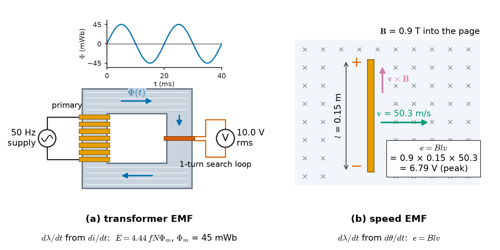
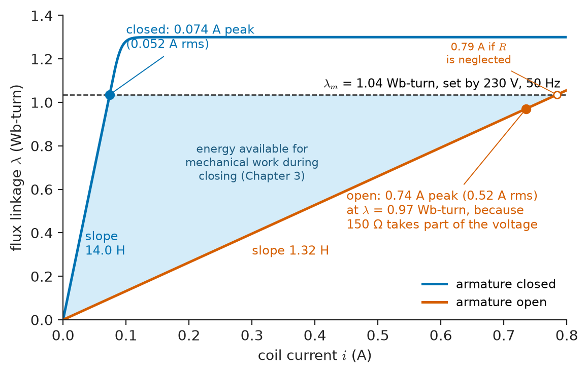
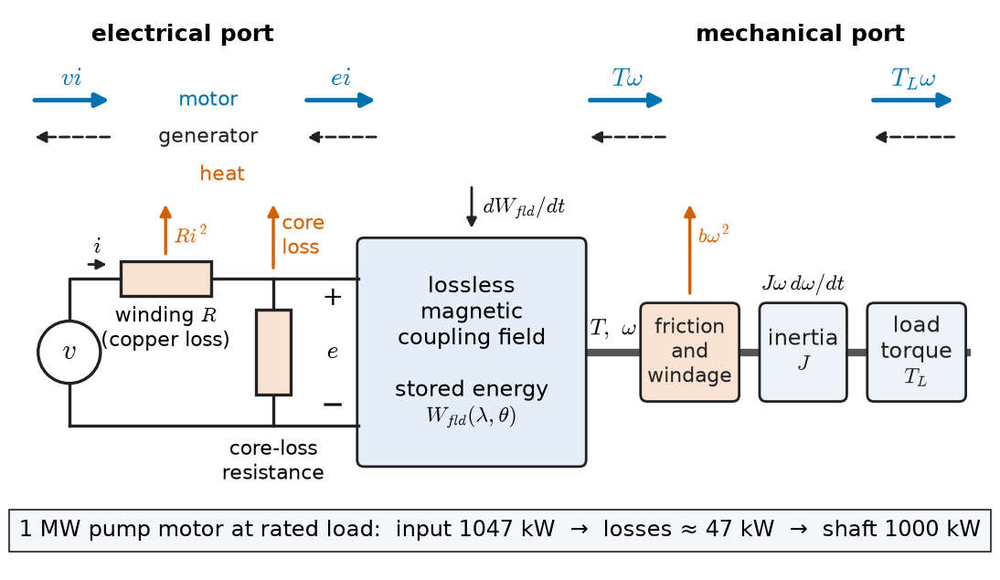
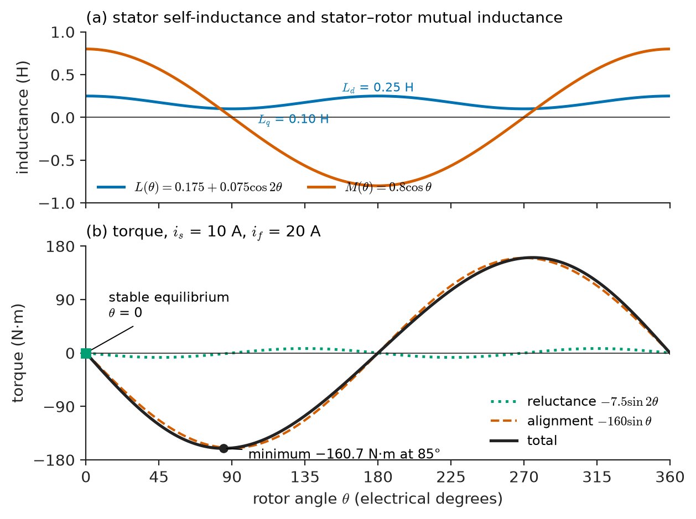
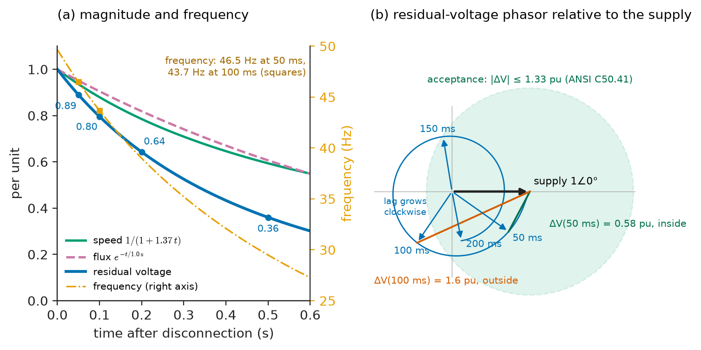

# Chapter 2 — Electromagnetic Induction

*Part I · Magnetic Circuits and Energy Conversion*

A refinery's 6.6 kV pump bus is fed from two transformers, with an automatic transfer scheme that moves the bus to the standby transformer if the normal supply fails. One night a fault upstream opens the normal breaker. The standby breaker should close within 50 ms; a sluggish mechanism makes it 100 ms. In those 50 extra milliseconds nothing seems to happen: the bus voltage, as seen by the transfer relay, has not collapsed at all. It is still above 75 % of nominal, but its frequency has fallen to 44 Hz and its phase has slipped more than 120° behind the incoming supply. When the standby breaker closes, the 1 MW pump motors are reconnected almost in phase opposition. The current surge trips the transformer protection, and the inspection afterwards finds a sheared coupling on one pump and a slipped rotor bar on another. Every one of those numbers follows from two facts: a rotor that carries current traps its flux for about a second after the stator is disconnected (Lenz's law), and a trapped flux carried round by a spinning rotor induces a voltage in the stator (Faraday's law). Industry standards recognise the hazard: ANSI/NEMA C50.41 limits the resultant volts per hertz between motor and incoming supply at reconnection to 1.33 pu.

This chapter turns Faraday's law into the working tool of machine engineering: flux linkage as a function of current and position, induced voltage in real windings and in conductors that were never meant to be part of the circuit, inductances that change with saturation and movement, and the energy balance that produces torque.

> **How does a changing flux linkage, caused by changing current or by motion, produce the voltages that every transformer, generator and motor depends on, and how large are they in real equipment?**
> **When a winding or a rotor moves, where does the electrical energy go, and how does the energy balance of a lossless coupling field yield electromagnetic torque?**

| Concept | Engineering destination |
|---|---|
| Faraday's law | Transformer EMF, generator EMF, volts-per-hertz limits, search coils and flux measurement |
| Lenz's law | Shading rings, eddy-current brakes, damper windings, induction heating, trapped flux in disconnected motors |
| Motional EMF | Back-EMF of motors, generator voltage, DC-machine and PM-machine EMF constants |
| Induced voltage | Over-fluxing, inrush, induced voltages on pipelines and de-energised circuits |
| Self-inductance | Reactors, contactor coils, magnetising and leakage inductances, saturation-dependent inductance |
| Mutual inductance | Transformer coupling, stator–rotor coupling in machines, interference with parallel conductors |
| Energy conversion | The lossless coupling field as the core of every electromechanical model |
| Electromagnetic torque | Reluctance and mutual (alignment) torque, condition for average torque |
| Electromechanical energy balance | Motor and generator power accounting, coast-down, bus-transfer studies |

**Roadmap.** Faraday's law for windings whose flux linkage depends on current and position (2.1) → Lenz's law and its engineering uses (2.2) → motional EMF and its limits (2.3) → induced voltage in windings and in neighbouring conductors (2.4) → self-inductance of real, saturable and moving windings (2.5) → mutual inductance in machines and power systems (2.6) → energy storage in the coupling field (2.7) → torque from the energy balance (2.8) → the full electromechanical energy balance (2.9).

---

## 2.1 Faraday's law

### Where *Engineering Physics* leaves off

*Engineering Physics* derives Faraday's law $\nabla\times\mathbf E=-\partial\mathbf B/\partial t$ ([Ch. 11 §11.4](https://github.com/The-Studio-of-Sadiq/Engineering-Physics/blob/main/CHAPTERS/CHAPTER%2011.md)), integrates it around a loop to obtain $\oint\mathbf E\cdot d\mathbf l=-d\Phi_B/dt$, and shows how, with flux confined to inductors, each inductor's share of the loop EMF is booked as a branch voltage $L\,di/dt$, giving KVL ([Ch. 11 §11.12.2](https://github.com/The-Studio-of-Sadiq/Engineering-Physics/blob/main/CHAPTERS/CHAPTER%2011.md)). The Lorentz force on a moving charge is recovered from the Lagrangian in [Ch. 9 §9.5.2](https://github.com/The-Studio-of-Sadiq/Engineering-Physics/blob/main/CHAPTERS/CHAPTER%209.md), and the motor appears in [Ch. 17 §17.5](https://github.com/The-Studio-of-Sadiq/Engineering-Physics/blob/main/CHAPTERS/CHAPTER%2017.md) as an ideal gyrator with $V=K\omega$ and $\tau=KI$. *Circuits, Signals and Communications* adds the circuit forms $v=L\,di/dt$, mutual inductance and the dot convention ([Ch. 5](https://github.com/The-Studio-of-Sadiq/Circuits-Signals-and-Communications/blob/main/part-1-circuit-fundamentals/05-capacitors-and-inductors.md)). All of these are used here without re-derivation. What they leave out is what a machine engineer needs: windings whose flux linkage depends on current *and* on rotor position, through iron that saturates; the separation of transformer and speed voltages; and the energy accounting that turns a gyrator constant $K$ into a computable function of geometry.

### Flux linkage as the state variable

For a winding of resistance $R$, Faraday's law with the motor (passive) sign convention gives the terminal equation

$$
v=Ri+\frac{d\lambda}{dt}
$$

where $\lambda$ is the total flux linkage of the winding (Chapter 1). This is the one equation from which every winding model in this book starts. Its power is that $\lambda$ can be any function of the variables that shape the field. In an electromechanical device those are the currents in all windings and the position $\theta$ (or $x$) of the moving part:

$$
\lambda=\lambda(i_1,i_2,\dots,\theta)
$$

Differentiating with the chain rule separates two physically different contributions:

$$
\frac{d\lambda}{dt}=\underbrace{\sum_k\frac{\partial\lambda}{\partial i_k}\frac{di_k}{dt}}_{\text{transformer EMF}}+\underbrace{\frac{\partial\lambda}{\partial\theta}\,\omega}_{\text{speed (motional) EMF}}
$$

The **transformer EMF** is present whenever currents change, whether or not anything moves; it is the only term in a transformer or a stationary reactor. The **speed EMF** is present whenever the geometry changes, even with constant currents; it is the back-EMF of a DC motor and the generated voltage of an alternator. Every machine equation in Part II is this decomposition written out for a particular $\lambda(i,\theta)$.

> **Status of the principle: Faraday's law for a winding, $v=Ri+d\lambda/dt$**
> *Fundamental.* It is the integral form of the Maxwell–Faraday equation applied to the closed path formed by the winding conductor and its terminal leads, in the quasi-static limit. It holds for any dependence of $\lambda$ on current, position, saturation and time; what is approximate is only the model chosen for $\lambda(i,\theta)$.

### The two EMF mechanisms side by side

Figure 2.1 contrasts the two mechanisms. On the left, a stationary coil on a core sees its flux change because the current in another coil changes: pure transformer EMF. On the right, a conductor moves through a steady field: pure speed EMF. In a synchronous generator both appear together. The stator flux linkage changes because the rotor field moves (speed EMF) and because the stator currents change (transformer EMF of the armature reaction), and the machine's reactances are the bookkeeping of the transformer-EMF term.

<!-- FIGURE 2.1 | figures/ch02/fig-2-1-transformer-and-speed-emf.png | schematic | The two mechanisms of induced EMF: a stationary coil linking a changing flux (transformer EMF) and a conductor moving through a steady field (speed EMF). | Content: (a) closed laminated core with a primary winding fed from a 50 Hz source and a 1-turn search loop on the opposite limb; sinusoidal flux Phi(t) of peak 45 mWb drawn as an inset; the loop voltmeter reads 10.0 V rms. (b) a straight conductor of active length 0.15 m moving at v = 50.3 m/s through a uniform field B = 0.9 T directed into the page, with the v x B direction and the EMF e = 6.79 V marked with polarity. Caption labels "dlambda/dt from di/dt" under (a) and "dlambda/dt from dtheta/dt" under (b). -->

*Figure 2.1 — The two mechanisms of induced EMF: a stationary coil linking a changing flux (transformer EMF) and a conductor moving through a steady field (speed EMF).*

### Measuring flux by integrating voltage

Faraday's law also gives the most direct way to measure flux in a working device. A **search coil** of $N_s$ turns wound around a limb, a tooth or a yoke carries no current, so its terminal voltage is $N_s\,d\Phi/dt$, and integrating it gives the flux. For sinusoidal flux $\Phi=\Phi_m\sin\omega t$ the RMS voltage is

$$
E=\frac{2\pi}{\sqrt2}fN_s\Phi_m=4.44\,fN_s\Phi_m
$$

The same relation applied to a power winding is the EMF equation of the transformer (Chapter 4) and, with a winding factor, of the AC machine (Chapters 6 and 7).

**Worked example — Search-loop check on a distribution transformer.** A single turn of insulated wire is wrapped around one limb of a 400 kVA, 11 kV/415 V, 50 Hz transformer during a factory test. With rated voltage applied the loop reads 10.0 V rms.

*Flux.* $\Phi_m=E/(4.44fN_s)=10.0/(4.44\times50\times1)=45.0$ mWb. The net limb area is 0.028 m², so $B_m=1.61$ T, a normal design value for grain-oriented steel.

*Volts per turn.* The loop reads the transformer's volts per turn directly. The LV phase voltage is $415/\sqrt3=240$ V, so the LV winding has $240/10.0=24$ turns, and the HV delta winding $11\,000/10.0=1100$ turns.

*Wrong frequency.* A 60 Hz transformer of identical design installed on a 50 Hz system at the same voltage would need $60/50=1.2$ times the flux, $B_m=1.93$ T. Table 1.6 shows that at 1.93 T the steel needs about eight times the field intensity it needs at 1.6 T: the magnetising current would rise many-fold and the no-load loss sharply. A transformer is rated in volts per hertz, not in volts alone.

---

## 2.2 Lenz's law

### The sign as an engineering rule

The minus sign in Faraday's law, read as a rule, is Lenz's law: **a current induced in a closed conductor flows in the direction that opposes the change of flux that produced it.** It is not a separate law. It is the sign of Faraday's law combined with energy conservation: if induced currents reinforced the change, a small disturbance would grow without an energy source.

> **Status of the principle: Lenz's law**
> *Fundamental.* It is the sign of the Maxwell–Faraday equation, enforced by energy conservation. Quantitatively it says nothing that Faraday's law with the correct sign does not already say; its value is as a quick rule for the direction of induced currents and forces.

The engineering consequence is that **flux linked by a closed, low-resistance circuit cannot change quickly.** A shorted winding of inductance $L$ and resistance $R$ holds its flux linkage with a time constant $L/R$; for a perfectly conducting loop the linkage would be frozen. Every application below exploits or fights this tendency.

### Applications that use it

**Shading rings in AC magnets.** The force of an electromagnet is proportional to $B^2$ (Chapter 3), so on AC supply it falls to zero 100 times per second at 50 Hz. The return spring of a contactor then pulls the armature back slightly at every zero, and the contactor chatters. A copper ring embedded in part of each pole face carries an induced current that delays the flux in the shaded part by 60–80°. The two parts of the pole never reach zero force together, and the armature stays sealed. A cracked shading ring is a classic cause of contactor hum and contact wear.

**Eddy-current brakes.** A conductive disc or rail moving through a field carries induced currents that oppose the motion. The braking force is wear-free and independent of wheel–rail adhesion, which is why linear eddy-current rail brakes are fitted to high-speed trains such as the German ICE 3, and why disc-type eddy-current retarders are fitted to heavy trucks and coaches. Their force falls at low speed, so they supplement friction brakes rather than replace them.

**Damper windings.** Salient-pole synchronous machines carry copper or brass bars in their pole faces, short-circuited at the ends. In steady synchronous operation they carry no current; during a disturbance, any relative motion between rotor and stator field induces currents that oppose it, damping rotor oscillations (Chapters 7 and 20).

**Induction heating and induction motors.** Induction furnaces, hardening machines and cooktops use the induced currents for heat. The induction motor uses them for torque: the rotor currents are induced by the stator field sliding past the rotor, and their reaction with that field drags the rotor along (Chapter 6).

**Shielding.** A conductive plate in an AC field carries eddy currents whose field cancels much of the incident field on the far side. Aluminium enclosures around busbars and conductive screens near large reactors reduce stray field and the heating it would cause in nearby steel.

### Applications that fight it

**Laminations.** Induced (eddy) currents in a solid iron core are a loss mechanism. Splitting the core into insulated sheets 0.23–0.65 mm thick interrupts the current paths; Chapter 3 quantifies the loss.

**Trapped flux in disconnected machines.** The rotor cage of an induction motor is a set of shorted, low-resistance loops. When the stator is disconnected, the rotor currents keep the air-gap flux alive and decaying with the rotor's open-circuit time constant, typically 0.3–3 s for motors from tens of kilowatts to several megawatts. The rotor keeps turning, carrying that flux with it, and the stator terminals show a voltage of falling magnitude and frequency. That is the voltage the refinery's transfer scheme reconnected against; Section 2.9 accounts for it.

---

## 2.3 Motional EMF

### The flux-cutting form

For a conductor moving with velocity $\mathbf v$ through a field $\mathbf B$, each charge experiences the magnetic part of the Lorentz force, $q\mathbf v\times\mathbf B$ ([*Engineering Physics*, Ch. 9 §9.5.2](https://github.com/The-Studio-of-Sadiq/Engineering-Physics/blob/main/CHAPTERS/CHAPTER%209.md)). Integrated along the conductor, this force per unit charge is an EMF:

$$
e=\int(\mathbf v\times\mathbf B)\cdot d\mathbf l\qquad\Longrightarrow\qquad e=Blv
$$

for a straight conductor of active length $l$, with $\mathbf v$, $\mathbf B$ and the conductor mutually perpendicular. This "$Blv$" form is the speed-EMF term of Section 2.1 viewed one conductor at a time. For a closed circuit whose shape changes in a steady field it gives exactly the same result as $d\lambda/dt$, and designers use whichever is easier.

> **Status of the principle: Motional EMF $e=Blv$**
> *Derived.* It follows from the Lorentz force on the conductor's charges; for a circuit whose shape changes in a field it agrees with $-d\Phi/dt$. The scalar form assumes uniform $B$ over the active length and mutually perpendicular $\mathbf v$, $\mathbf B$ and conductor.

**Worked example — Back-EMF of a traction PM motor.** An eight-pole surface-PM motor has a rotor radius of 80 mm, an active length of 0.15 m and a sinusoidally distributed gap flux density of peak 0.9 T. At 6000 rpm:

*Speed and frequency.* $\omega_m=2\pi\times6000/60=628.3$ rad/s, so the surface speed is $v=r\omega_m=50.27$ m/s. The electrical frequency is $f=pn/120=8\times6000/120=400$ Hz.

*EMF per conductor.* A conductor under the pole centre sees $e=Blv=0.9\times0.15\times50.27=6.79$ V peak; as the sinusoidal field sweeps past, the conductor EMF is a 400 Hz sinusoid of that amplitude.

*Phase EMF.* With 48 conductors per phase in series and a winding factor of 0.95 (which accounts for conductors that are not all in phase; Chapter 6), the phase EMF is $48\times6.79\times0.95=309$ V peak, 219 V rms.

*Check by flux linkage.* The flux per pole is $\Phi_p=(2/\pi)B_m\tau l$, with pole pitch $\tau=2\pi r/8=62.8$ mm, giving $\Phi_p=5.40$ mWb. With $N_{ph}=24$ series turns, $E=4.44\times400\times24\times0.95\times5.40\times10^{-3}=219$ V rms. The two routes agree, as they must. The EMF constant is $219/628.3=0.348$ V rms per rad/s per phase; Chapter 3 shows that, for current in phase with the EMF, the torque is $T=3EI/\omega_m$, so the same constant times the number of phases is the torque per ampere.

### Where the flux-cutting picture misleads

**Conductors in slots.** In a real machine the conductors lie in slots, and almost all the flux passes through the iron teeth on either side, not through the conductors. A conductor in a slot sits in a field of perhaps 0.05 T, not 0.9 T. Taken literally, $Blv$ with the slot field would predict almost no EMF. The flux-linkage form is immune to the problem: the flux linked by the coil changes as the poles pass, wherever the flux lines physically run, and that is what the coil terminals see. The $Blv$ calculation with the *gap* flux density, as in the example, gives the right total because it is equivalent to the flux-linkage calculation, not because the field at the conductor is 0.9 T. The same is true of force: the torque of a slotted machine acts mostly on the teeth, not on the conductors, yet "$Bli$" with the gap field gives the right total (Chapter 3).

**Homopolar machines and sliding contacts.** In a Faraday disc, or a homopolar generator in which current flows radially in a spinning disc with sliding brushes, the circuit's flux linkage does not obviously change, yet an EMF appears. Here the Lorentz-force form gives the right answer and naïve flux counting does not; the resolution is that the "circuit" includes a moving conductor whose material changes along the current path. Homopolar machines produce very large DC currents at low voltage and are used in pulsed-power and some ship-propulsion research.

**The observer's frame.** An airliner with a 64.8 m wingspan flying at 250 m/s through a 50 µT vertical component of the Earth's field has a motional EMF of $0.81$ V across its wingtips. A voltmeter carried on board reads nothing, because its own leads move through the same field and develop the same EMF. Motional EMF is real but appears only when part of the circuit moves relative to another part, which is exactly the situation inside every rotating machine.

---

## 2.4 Induced voltage

### Volt-seconds set the flux

For a winding with negligible resistance, $v\approx d\lambda/dt$, so the flux linkage is the time integral of the applied voltage:

$$
\lambda(t)=\lambda(0)+\int_0^t v\,dt
$$

This reverses the usual cause-and-effect: **the voltage sets the flux, and the current adjusts to whatever the magnetic circuit needs to carry that flux.** Its consequences run through the whole book.

- **Volts per hertz.** For a sinusoidal voltage of RMS value $V$ and frequency $f$, $\Phi_m=V/(4.44fN)$. Halving the frequency at constant voltage doubles the flux. Variable-frequency drives therefore reduce voltage with frequency (constant V/f) below base speed (Chapter 12), and the 60 Hz transformer of the previous example cannot run at 50 Hz on the same voltage.
- **Energisation and inrush.** If a transformer is switched on at a voltage zero, the integral of the first half-cycle of voltage is twice its steady-state amplitude: the flux swings from $\lambda(0)$ to $\lambda(0)+2\lambda_m$. With remanent flux in the same direction, the peak can reach about $2.8\lambda_m$, far into saturation, and the core draws an inrush current of 5–12 times rated that decays over seconds (Chapter 4).
- **DC offset.** A small DC voltage across a winding integrates without limit. A transformer fed by an inverter with a 1 % DC error, or exposed to geomagnetically induced currents during a solar storm, walks into half-cycle saturation, draws large, distorted magnetising currents and heats its structural steel. Geomagnetically induced currents contributed to the 1989 Hydro-Québec blackout.
- **PWM drives.** An inverter applies rectangular voltage pulses, not sinusoids. The motor flux is still the integral of voltage, so the flux ripple is set by the volt-seconds of each pulse; that is why the switching frequency and DC-link voltage set the current ripple of a drive (Chapter 12).

> **Status of the principle: Flux equals integrated voltage, $\lambda=\int v\,dt$**
> *Derived.* Follows from Faraday's law when the winding resistance drop is negligible; at 50 Hz this holds to within the resistive drop, about 0.1–1 % of rated voltage in transformers and 1–5 % in small motors. It fails at low frequency, where $Ri$ becomes comparable with $v$, which is why V/f drives add an "IR compensation" boost at low speed.

### Induced voltage in conductors that are not part of the circuit

Faraday's law does not care whether the loop was designed as a winding. Any conductor forming a loop with a changing linked flux carries an induced EMF:

- **De-energised circuits beside live ones.** A circuit isolated for maintenance on a double-circuit tower links flux from the energised circuit. If earthed at both ends it forms a loop and carries induced current; if earthed at one end only, the far end floats at an induced voltage that can reach kilovolts. Work procedures (Chapter 29) require earthing at the worksite for this reason.
- **Pipelines and railways.** A buried pipeline or a fence running parallel to a power line links flux of the earth-return currents that flow during an earth fault. The **mutual inductance** of a conductor–earth loop is the subject of Section 2.6, which works the numbers.
- **Cable sheaths.** The metallic sheaths of single-core cables link the flux of the core currents. Sheaths bonded at both ends carry circulating currents and losses; cross-bonding and single-point bonding schemes trade those losses against standing sheath voltages (Chapter 22).

---

## 2.5 Self-inductance

### What the circuit book provides and what it does not

Self-inductance $L=\lambda/i$, the formula $L=N^2/\mathcal R$, the energy $\tfrac12Li^2$ and the practical inductor model are covered in [*Circuits, Signals and Communications*, Ch. 5](https://github.com/The-Studio-of-Sadiq/Circuits-Signals-and-Communications/blob/main/part-1-circuit-fundamentals/05-capacitors-and-inductors.md). That treatment assumes a linear, stationary inductor. Power equipment breaks both assumptions. The inductance of an iron-cored winding depends on current through saturation, and the inductance of a winding on a machine or actuator depends on the position of the moving part. The single constant $L$ has to be replaced by the function $\lambda(i,\theta)$, and several different "inductances" must be distinguished.

### Secant and incremental inductance

At a given operating point, the **secant** (apparent) inductance is $L_s=\lambda/i$, and the **incremental** inductance is $L_\Delta=\partial\lambda/\partial i$. In a linear region they coincide. Beyond the knee, $L_\Delta$ falls much faster than $L_s$. The filter reactor of Chapter 1 had $L_s=0.49$ mH but $L_\Delta=0.10$ mH at twice design current. Which one matters depends on the question:

- the fundamental current drawn by a sinusoidally excited winding is set roughly by $L_s$ at the peak;
- the response to a small ripple or a transient superimposed on an operating point is set by $L_\Delta$;
- the energy stored is the area $\int i\,d\lambda$, which equals $\tfrac12L_si^2$ only in the linear case.

Current-dependent inductance is why the saturated magnetising reactance of a transformer is a poor constant in the equivalent circuit at overvoltage, why DC-link chokes specify inductance "at rated DC current", and why motor manufacturers quote magnetising inductance at rated flux.

### Magnetising and leakage inductance

The flux linked by a winding can be divided into a part that also links other windings (the **magnetising** or mutual flux, mostly in the iron and across the air gap) and a part that links only the winding itself (the **leakage** flux, mostly in air around the coil and in slots). The self-inductance divides accordingly:

$$
L_{11}=L_{\ell1}+L_{m1}
$$

The split matters because the two parts behave differently. The magnetising inductance passes through iron and saturates; the leakage inductance is mostly in air and stays nearly constant until very high currents saturate tooth tips. The magnetising inductance determines the no-load current; the leakage inductance determines the short-circuit current and the voltage drop under load. The equivalent circuits of transformers and induction machines in Chapters 4 and 6 are built on this division.

**Table 2.1 — Typical magnetising and leakage reactances (per unit on the device rating).**

| Device | Magnetising reactance $X_m$ (pu) | Total leakage reactance (pu) |
|---|---|---|
| Distribution transformer, 100–2500 kVA | 50–500 | 0.04–0.07 |
| Power transformer, 100–500 MVA | 200–2000 | 0.10–0.20 |
| Induction motor, 4-pole, 10–200 kW | 2–4 | 0.15–0.25 |
| Induction motor, 2–10 MW | 3–5 | 0.15–0.25 |
| Salient-pole synchronous machine (d-axis) | 0.6–1.2 | 0.1–0.2 |
| Turbo-generator (d-axis) | 1.5–2.5 | 0.1–0.2 |

The contrast between the first two rows and the rest is the air gap again: a transformer's magnetising reactance is hundreds of per unit, a motor's only a few.

### Inductance that depends on position

When the moving part of a device changes the reluctance of the flux path, $L$ becomes a function of position. In a solenoid or contactor, $L$ rises as the gap closes; in a salient-pole rotor, the inductance of a stator coil is maximum when the rotor's pole axis (d-axis) lines up with the coil and minimum when the interpolar axis (q-axis) does. To a good approximation for a salient rotor,

$$
L(\theta)=L_0+L_2\cos2\theta,\qquad L_0=\frac{L_d+L_q}{2},\quad L_2=\frac{L_d-L_q}{2}
$$

The period is 180° because the rotor looks the same to the coil after half a turn. The variation of $L$ with position is what produces reluctance torque (Section 2.8) and is the operating principle of switched-reluctance and synchronous-reluctance motors (Chapter 8).

**Worked example — Inrush and holding current of an AC contactor coil.** A 230 V, 50 Hz contactor coil draws 120 VA at pick-up (armature open) and 12 VA once sealed (armature closed); its resistance is 150 Ω and it has 3000 turns.

*Impedances.* Open: $Z=230^2/120=441$ Ω, $X=\sqrt{441^2-150^2}=415$ Ω, $L_{open}=1.32$ H. Closed: $Z=4408$ Ω, $X=4406$ Ω, $L_{closed}=14.0$ H.

*Currents.* Pick-up current 0.52 A, holding current 0.052 A: a 10:1 ratio, which the control transformer and the PLC output driving the coil must be sized for.

*What the magnetic circuit says.* With a pole area of $3\times10^{-4}$ m², the reluctances $N^2/L$ correspond to equivalent air gaps of 0.24 mm closed and 2.6 mm open. The physical stroke is about 4 mm at each of two poles, 8 mm in total, but leakage and fringing paths in parallel with the open gap raise the open-armature inductance about threefold above the ideal gap value. A magnetic-circuit estimate with the bare 8 mm gap would give 0.42 H and an inrush of about 1.15 A; the real coil draws less than half of that.

*Volt-seconds again.* When closed, the coil voltage sets $\lambda_m=\sqrt2\times230/(2\pi\times50)=1.04$ Wb-turn, so $\Phi_m=0.345$ mWb and $B_m=1.15$ T in the pole. When open, nearly the same flux linkage is needed (0.97 Wb-turn, because the 150 Ω resistance now takes part of the voltage and leaves $0.52\times415=216$ V across the inductance), but the reluctance is ten times larger, so ten times the current flows. The current adapts to the voltage-imposed flux, exactly as Section 2.4 says.

<!-- FIGURE 2.2 | figures/ch02/fig-2-2-contactor-lambda-i-curves.png | plot | Flux-linkage versus current of a contactor coil with armature open and closed: the operating flux linkage is fixed by the voltage, the current by the gap. | Content: x-axis current 0 to 0.8 A, y-axis flux linkage 0 to 1.4 Wb-turn. Curve "closed": slope 14.0 H at the origin. Curve "open": straight line of slope 1.32 H to 0.8 A. Horizontal dashed line at lambda_m = 1.04 Wb-turn labelled "set by 230 V, 50 Hz". Closed curve linear (slope 14.0 H) up to about 1.1 Wb-turn, then bending over towards 1.3 Wb-turn. Operating points marked where each curve meets the dashed line: closed at 0.074 A peak (0.052 A rms), open at 0.74 A peak (0.52 A rms) on the open line just below the dashed line, at 0.97 Wb-turn, annotated that the 150 ohm resistance takes part of the voltage (hollow marker at 0.79 A where the open line would meet 1.04 Wb-turn if R were neglected); secant slopes labelled 14.0 H and 1.32 H. Inset: shaded area between the two curves up to lambda_m labelled "energy available for mechanical work during closing (Chapter 3)". -->

*Figure 2.2 — Flux-linkage versus current of a contactor coil with armature open and closed: the operating flux linkage is fixed by the voltage, the current by the gap.*

Figure 2.2 shows the two characteristics: the voltage fixes the operating flux linkage, and the armature position decides how much current that costs.

---

## 2.6 Mutual inductance

### What carries over and what is new

The coupled-coil equations $\lambda_1=L_{11}i_1+Mi_2$, $\lambda_2=Mi_1+L_{22}i_2$, reciprocity $M_{12}=M_{21}$, the coupling coefficient $k=M/\sqrt{L_{11}L_{22}}\le1$ and the dot convention are taken from [*Circuits, Signals and Communications*, Ch. 5](https://github.com/The-Studio-of-Sadiq/Circuits-Signals-and-Communications/blob/main/part-1-circuit-fundamentals/05-capacitors-and-inductors.md). Three extensions matter for energy conversion.

### Magnetising–leakage form and referral

Write each self-inductance as leakage plus magnetising, and note that both windings share the same magnetising flux path of reluctance $\mathcal R_m$. Then $L_{m1}=N_1^2/\mathcal R_m$, $L_{m2}=N_2^2/\mathcal R_m$ and $M=N_1N_2/\mathcal R_m$, so that

$$
M=\frac{N_2}{N_1}L_{m1}
$$

Referring the second winding to the first by the turns ratio, $i_2'=(N_2/N_1)i_2$, turns the coupled pair into a T-network: two leakage inductances in series arms and one magnetising inductance in the shunt arm. That T-network is the equivalent circuit of the transformer (Chapter 4) and, with a speed-dependent rotor resistance, of the induction motor (Chapter 6). Its parameters are physical: the shunt branch is the core, the series branches are the leakage paths.

### Mutual inductance that depends on position

Between a stator coil and a rotor coil the mutual inductance varies with rotor angle. For coils with sinusoidally distributed conductors,

$$
M(\theta)=M_{\max}\cos\theta
$$

where $\theta$ is the electrical angle between the coil axes. The coupling is maximum when the axes align and reverses sign after 180° electrical. This position-dependent coupling is the mechanism of every synchronous, induction and DC machine: Section 2.8 shows that its derivative $dM/d\theta$ is what produces torque.

### Mutual inductance of earth-return circuits

Two parallel conductors that both return through the earth have a mutual inductance per unit length which, for earth-return circuits at power frequency, is given to engineering accuracy by Carson's simplified formula

$$
M'=\frac{\mu_0}{2\pi}\ln\frac{D_e}{d},\qquad D_e\approx658\sqrt{\rho/f}\ \mathrm{m}
$$

where $d$ is the separation of the conductors, $\rho$ the earth resistivity in Ω·m and $D_e$ the equivalent depth of the earth-return current.

> **Status of the principle: Carson's simplified earth-return mutual inductance**
> *Approximate.* The leading term of Carson's series solution for conductors over a homogeneous earth, valid for separations much smaller than $D_e$ (hundreds of metres at power frequency); layered soil, nearby metallic structures and screening conductors modify it by tens of percent.

**Worked example — Voltage induced on a pipeline during an earth fault.** A steel gas pipeline runs parallel to a 132 kV line for 5 km at a separation of 30 m, in soil of resistivity 100 Ω·m. A single-phase-to-earth fault on the line drives 5 kA through the faulted phase with return through the earth.

*Earth-return depth.* $D_e=658\sqrt{100/50}=931$ m.

*Mutual inductance and reactance.* $M'=2\times10^{-7}\ln(931/30)=0.687$ µH/m, so $\omega M'=2\pi\times50\times0.687\times10^{-6}\times1000=0.216$ Ω/km.

*Induced EMF.* $E=\omega M'\,l\,I=0.216\times5\times5000=5.4$ kV along the pipeline for the duration of the fault.

Five kilovolts appears between the pipeline and remote earth, stressing the pipeline coating and creating touch-voltage hazards at valves and test posts. In practice the earth wires of the line carry part of the return current and screen the pipeline, and the pipeline is fitted with earthing mats and decouplers; standards such as EN 50443 set the permissible levels. The calculation is the mutual-inductance relation $e=M\,di/dt$ of the circuit book, applied to a loop nobody designed.

---

## 2.7 Energy conversion

### The lossless coupling field

An electromechanical device has at least one electrical port, where a winding exchanges power $vi$ with a source, and one mechanical port, where a shaft or plunger exchanges power $T\omega$ or $Fv$ with a load. *Engineering Physics* represents the ideal motor as a gyrator between these ports ([Ch. 17 §17.5](https://github.com/The-Studio-of-Sadiq/Engineering-Physics/blob/main/CHAPTERS/CHAPTER%2017.md)). To compute what the gyrator constant actually is, and to handle devices that store energy in their magnetic field, the device is split as in Figure 2.3:

- the winding resistance, taken out to the electrical side as an external $R$;
- core losses, taken out as an equivalent resistance (Chapter 3);
- friction and windage, taken out to the mechanical side;
- and what remains in the middle, a **lossless coupling field** that stores magnetic energy and exchanges energy with both ports.

All the electromechanical physics is in the coupling field. Because it is lossless and conservative, its stored energy is a function of state only, not of the path by which the state was reached.

<!-- FIGURE 2.3 | figures/ch02/fig-2-3-coupling-field-energy-balance.png | block-diagram | The electromechanical device as a lossless coupling field between an electrical and a mechanical port, with the losses taken outside. | Content: left to right: electrical source v, series block "winding resistance R (copper loss)", shunt block "core-loss resistance", central box "lossless magnetic coupling field, stored energy W_fld(lambda, theta)", then mechanical blocks "friction and windage" and "inertia J" and "load torque T_L". Power arrows on top: v i into the device; R i^2 out as heat; e i into the field; T omega out to the shaft; T_L omega to load. Numbers for the 1 MW pump motor at rated load as an example annotation: input 1047 kW, losses about 47 kW, shaft 1000 kW. Sign convention arrows for motor operation; dashed reversed arrows labelled "generator". -->

*Figure 2.3 — The electromechanical device as a lossless coupling field between an electrical and a mechanical port, with the losses taken outside.*

### Field energy

At a fixed position, the coupling field behaves as an inductor. The electrical energy delivered into it while the flux linkage rises from 0 to $\lambda$ is

$$
W_{fld}(\lambda,\theta)=\int_0^{\lambda}i(\lambda',\theta)\,d\lambda'
$$

which is the area between the $\lambda$–$i$ curve and the $\lambda$ axis (Figure 2.2). For a linear winding this becomes $\lambda^2/2L=\tfrac12Li^2$, and for coupled linear windings $W_{fld}=\tfrac12L_{11}i_1^2+\tfrac12L_{22}i_2^2+Mi_1i_2$, as in the circuit book. For a saturating winding there is no such closed form; the integral is evaluated from the measured or computed curve.

Where in space the energy sits follows from Chapter 1: in a gapped device almost all of it is in the gaps, at density $B^2/2\mu_0$ ([*Engineering Physics*, Ch. 11 §11.8](https://github.com/The-Studio-of-Sadiq/Engineering-Physics/blob/main/CHAPTERS/CHAPTER%2011.md)). That is why force and torque are produced at gaps: Chapter 3 shows that the force density on an iron surface is the magnetic pressure $B^2/2\mu_0$.

### How energy enters and leaves

The electrical energy delivered to the coupling field in time $dt$ is $e\,i\,dt=i\,d\lambda$. The mechanical energy delivered by the field to the shaft is $T\,d\theta$ (or $F\,dx$). Energy conservation for the lossless field is then

$$
i\,d\lambda=dW_{fld}+T\,d\theta
$$

Read in three ways, this equation contains all of electromechanical energy conversion. If nothing moves ($d\theta=0$), all the electrical energy goes into storage, and the device is an inductor. If the flux linkage is held constant ($d\lambda=0$), no electrical energy flows, and any mechanical work is drawn from the stored field energy. And if the device runs in a steady cycle, the field energy returns to its starting value each cycle, so the net electrical energy in equals the net mechanical energy out. Chapter 3 develops this cycle view into the energy-conversion loop of the $\lambda$–$i$ plane.

---

## 2.8 Electromagnetic torque

### Torque from the field energy

Hold the flux linkage constant in the energy balance. Then $i\,d\lambda=0$ and $T\,d\theta=-dW_{fld}$, so

$$
T=-\frac{\partial W_{fld}(\lambda,\theta)}{\partial\theta}\bigg|_{\lambda}
$$

This is the general result. The torque is the rate at which the stored field energy falls as the rotor moves, at constant flux linkage. It holds for saturating materials, provided $W_{fld}$ is computed from the actual $\lambda$–$i$ curves.

### The linear case: torque from inductances

For linear windings it is more convenient to express torque in terms of currents, which are what an engineer controls. Consider two windings whose inductances depend on $\theta$, with currents held constant during a small displacement $d\theta$. The electrical energy delivered is

$$
i_1d\lambda_1+i_2d\lambda_2=i_1^2dL_{11}+i_2^2dL_{22}+2i_1i_2\,dM
$$

while the field energy changes by

$$
dW_{fld}=\tfrac12i_1^2dL_{11}+\tfrac12i_2^2dL_{22}+i_1i_2\,dM
$$

exactly half as much. The other half goes to the shaft. Hence

$$
T=\frac12i_1^2\frac{dL_{11}}{d\theta}+\frac12i_2^2\frac{dL_{22}}{d\theta}+i_1i_2\frac{dM}{d\theta}
$$

> **Status of the principle: Torque from inductance derivatives**
> *Derived.* Follows from energy conservation in the lossless coupling field with linear flux–current relations; the "half to storage, half to work" split at constant current is exact for linear magnetics. With saturation the inductance form is invalid and the energy or co-energy form must be used (Chapter 3).

The three terms have names and engineering destinations:

- **Reluctance torque**, $\tfrac12i^2\,dL/d\theta$, arises because the rotor seeks the position of minimum reluctance (maximum inductance). It needs only one excited winding and a salient rotor, and it acts in the same direction whatever the sign of the current. It drives switched-reluctance and synchronous-reluctance motors and supplements the magnet torque of interior-PM traction motors (Chapter 8).
- **Mutual (alignment) torque**, $i_1i_2\,dM/d\theta$, arises because two excited windings seek alignment of their axes. With $M=M_{\max}\cos\theta$ it is $T=-M_{\max}i_1i_2\sin\theta$. It is the principal torque of DC, induction and synchronous machines.
- In a machine with a round rotor and a uniform air gap, the self-inductances do not depend on $\theta$, and only the mutual term survives.

**Worked example — Reluctance and alignment torque of an elementary machine.** A small salient-pole synchronous machine has a stator coil with $L_d=0.25$ H and $L_q=0.10$ H, so $L_0=0.175$ H and $L_2=0.075$ H. The stator–rotor mutual inductance has peak $M_{\max}=0.8$ H. The stator carries $i_s=10$ A and the field $i_f=20$ A, both DC (a "locked" test).

*Reluctance torque alone* (field open): $T=\tfrac12i_s^2\,dL/d\theta=-L_2i_s^2\sin2\theta$, peak $0.075\times100=7.5$ N·m at $\theta=45°$.

*Alignment torque*: $T=-M_{\max}i_si_f\sin\theta$, peak $0.8\times10\times20=160$ N·m at $\theta=90°$.

*Both together*: $T(\theta)=-160\sin\theta-7.5\sin2\theta$ N·m, with its largest magnitude, 160.7 N·m, near $\theta=85°$. The saliency adds less than 1 % to the peak but shifts the angle at which it occurs, and with a weak field (a lightly excited or under-excited machine) the reluctance term becomes significant. This is the origin of the two-term power–angle curve of salient-pole machines (Chapter 7), which Figure 2.4 previews.

<!-- FIGURE 2.4 | figures/ch02/fig-2-4-inductances-and-torque-vs-angle.png | plot | Position-dependent inductances of an elementary salient-pole machine and the resulting reluctance and alignment torques. | Content: (a) x-axis rotor angle theta 0 to 360 degrees electrical; y-axis inductance in H: L(theta) = 0.175 + 0.075 cos(2 theta) oscillating between 0.10 and 0.25 H with 180-degree period; M(theta) = 0.8 cos(theta) between -0.8 and +0.8 H. (b) same x-axis, y-axis torque -180 to +180 N m: reluctance torque -7.5 sin(2 theta) (dotted), alignment torque -160 sin(theta) (dashed), total (solid) with its minimum of -160.7 N m near 85 degrees marked; stable equilibrium at theta = 0 marked. -->

*Figure 2.4 — Position-dependent inductances of an elementary salient-pole machine and the resulting reluctance and alignment torques.*

### Average torque needs synchronism

In a running machine the currents are AC and the rotor turns, so $\theta=\omega_mt+\delta$ and the currents vary at their own frequencies. The instantaneous torque $i_1i_2\,dM/d\theta$ is then a product of sinusoids at different frequencies, and its time average is zero unless the frequencies match. A machine produces steady average torque only when the speed of the rotor, the frequency of the stator currents and the frequency of the rotor currents satisfy a **synchronism condition**. In a synchronous machine the rotor turns exactly with the stator field; in an induction machine the rotor currents are induced at slip frequency, which makes their field turn in synchronism with the stator field whatever the rotor speed; in a DC machine the commutator does the same mechanically. Chapter 3 shows how a three-phase winding produces the rotating field with which this synchronism is achieved.

### Two pictures of the same torque

The energy method computes the total torque on the rotor. The force on individual current-carrying conductors, $\mathbf F=i\mathbf l\times\mathbf B$, gives the same total for conductors in a smooth air gap, and with the gap field and the full rotor current it also gives the right total for slotted rotors, for the same reason that $Blv$ gave the right EMF in Section 2.3. Where the two pictures differ is in *where* the force acts: on the teeth in a slotted machine, on the conductors in a slotless one. That matters for mechanical design (tooth vibration, coil bracing) but not for the torque itself.

---

## 2.9 Electromechanical energy balance

### The complete balance

Put back the losses that were taken outside the coupling field. For a device with one winding and one rotating shaft, multiplying the terminal equation by $i$ and adding the mechanical equation gives, at every instant,

$$
vi=\underbrace{Ri^2}_{\text{copper loss}}+\underbrace{\frac{dW_{fld}}{dt}}_{\text{field storage}}+\underbrace{J\omega\frac{d\omega}{dt}}_{\text{kinetic storage}}+\underbrace{b\omega^2}_{\text{friction}}+\underbrace{T_L\omega}_{\text{load}}
$$

with core loss added as a further term when it matters. This is the lumped power balance of [*Engineering Physics*, Ch. 17 §17.9](https://github.com/The-Studio-of-Sadiq/Engineering-Physics/blob/main/CHAPTERS/CHAPTER%2017.md) with an inductor whose inductance depends on position and a rotational mechanical system of the kind treated in [Ch. 19 §19.2](https://github.com/The-Studio-of-Sadiq/Engineering-Physics/blob/main/CHAPTERS/CHAPTER%2019.md). For several windings, the first two terms become sums.

> **Status of the principle: Electromechanical energy balance**
> *Fundamental.* It is energy conservation applied to the electrical, magnetic and mechanical subsystems, valid instant by instant for any device in the quasi-static regime; the only modelling choices are how losses are represented and whether the field energy is computed from linear or saturating characteristics.

In steady operation the two storage terms average to zero and the balance reduces to the familiar statement that input power equals losses plus output. During transients, the storage terms dominate. The pump-motor transfer of the opening is a case where the storage terms are *all* that is left.

**Worked example — Where the energy is when a pump motor is disconnected.** The refinery pump motors are rated 1 MW, 6.6 kV, 1490 rpm (four-pole), efficiency 95.5 %, power factor 0.88. Each drives a pump; the combined inertia is 30 kg·m². The magnetising current is 25 % of rated current, and the rotor open-circuit time constant is 1.0 s.

*Rated and magnetising current.* $I=10^6/(\sqrt3\times6600\times0.955\times0.88)=104$ A, so $I_m=26.0$ A. The per-phase magnetising reactance is $X_m=3811/26.0=146$ Ω, and $L_m=0.466$ H.

*Field energy.* $W_{fld}=3\times\tfrac12L_m(\sqrt2I_m)^2=947$ J, about 1 kJ.

*Kinetic energy.* $\omega_m=2\pi\times1490/60=156.0$ rad/s, so $W_{kin}=\tfrac12J\omega_m^2=365$ kJ, 386 times the field energy.

*After disconnection.* With the stator open, no electrical power flows ($vi=0$ at the terminals). The magnetic energy, trapped by the rotor cage (Lenz), decays into rotor $I^2R$ loss with the 1.0 s time constant. The kinetic energy drains into the pump load: with load torque proportional to speed squared and equal to the rated 6.41 kN·m at full speed, the motor decelerates at 214 rad/s² initially. The terminal voltage is the speed EMF of the trapped flux, proportional to flux times speed. Integrating the two decays:

| Time after disconnection | Speed (pu) | Flux (pu) | Residual voltage (pu) | Frequency (Hz) | Phase slip behind supply |
|---|---|---|---|---|---|
| 50 ms | 0.94 | 0.95 | 0.89 | 46.5 | 35° |
| 100 ms | 0.88 | 0.90 | 0.80 | 43.7 | 124° |
| 200 ms | 0.79 | 0.82 | 0.64 | 39.0 | 439° (79° after a full slip cycle) |
| 500 ms | 0.59 | 0.61 | 0.36 | 29.5 | many cycles |

*Consequence.* At 50 ms the phasor difference between the 1.0 pu supply and the 0.89 pu residual voltage 35° out of phase is 0.58 pu, well inside the 1.33 pu limit of ANSI/NEMA C50.41. At 100 ms the residual voltage is still 0.80 pu but 124° out of phase, and the difference is about 1.6 pu: reconnection drives a current and a transient torque larger than a direct-on-line start, which is what broke the coupling. Fast transfer schemes therefore close within 3–6 cycles, or wait for the residual voltage to fall below about 0.25–0.3 pu before a "residual-voltage" transfer, or use in-phase monitoring to close at the next phase coincidence. The energy bookkeeping explains the time scales: the 1 kJ of field energy fixes how long the voltage persists, and the 365 kJ of kinetic energy, drained by the load, fixes how fast its phase slips.

<!-- FIGURE 2.5 | figures/ch02/fig-2-5-residual-voltage-after-disconnection.png | plot | Residual voltage of a disconnected 1 MW, 6.6 kV pump motor: magnitude, frequency and phase relative to the lost supply. | Content: (a) x-axis time 0 to 0.6 s; y-axis per unit 0 to 1.1: speed curve 1/(1 + 1.37 t) (0.94 at 50 ms, 0.88 at 100 ms, 0.59 at 500 ms), flux curve exp(-t/1.0 s), residual voltage as their product (0.89, 0.80, 0.64, 0.36 at 0.05, 0.1, 0.2, 0.5 s). Right axis frequency 25 to 50 Hz (46.5 Hz at 50 ms, 43.7 Hz at 100 ms). (b) polar plot of residual-voltage phasor relative to the supply at t = 0, 50, 100, 150, 200 ms, spiralling inward; circle of radius 1.33 pu centred on the supply phasor tip shaded as the ANSI C50.41 acceptance region; vector difference at 50 ms (0.58 pu) inside, at 100 ms (1.6 pu) outside. -->

*Figure 2.5 — Residual voltage of a disconnected 1 MW, 6.6 kV pump motor: magnitude, frequency and phase relative to the lost supply.*

Figure 2.5 plots the decay. Every curve in it is one term of the energy balance: flux, governed by the rotor's trapped field energy; speed, governed by the stored kinetic energy and the load; and voltage, their product through Faraday's law.

### Generator and motor in one equation

The energy balance does not distinguish motors from generators. In a generator, $T_L$ is negative (the prime mover drives the shaft), $T\omega$ is negative, and $vi$ is negative: electrical power leaves the terminals. Regenerative braking of a train, a lift or an EV, and the descent of a loaded mine hoist, are the same equation with the signs of the mechanical terms reversed. Chapter 3 uses that observation to treat electrical-to-mechanical and mechanical-to-electrical conversion as one process, and then asks what the losses in the balance cost in efficiency and temperature.

---

## What remains open

| Open question | Where it is answered |
|---|---|
| How is force and torque computed when the iron saturates, and what is co-energy? | [Chapter 3](03-energy-conversion-principles.md) (energy conversion principles) |
| How does a three-phase winding create the rotating field needed for average torque? | [Chapter 3](03-energy-conversion-principles.md); [Chapter 6](../part-2-transformers-and-electrical-machines/06-induction-machines.md) |
| How do the EMF equation, magnetising and leakage inductances and inrush appear in the transformer equivalent circuit? | [Chapter 4](../part-2-transformers-and-electrical-machines/04-transformers.md) (transformers) |
| How do the EMF and torque constants of DC and PM machines follow from their windings? | Chapters [5](../part-2-transformers-and-electrical-machines/05-dc-machines.md) and [8](../part-2-transformers-and-electrical-machines/08-special-electrical-machines.md) |
| How do salient-pole reluctance torque and excitation shape the synchronous machine's power–angle curve? | [Chapter 7](../part-2-transformers-and-electrical-machines/07-synchronous-machines.md) (synchronous machines) |
| How are motor bus transfers and motor contributions to faults handled in system studies? | Chapters [19](../part-5-power-system-analysis/19-fault-analysis.md) and [23](../part-6-transmission-distribution-and-protection/23-power-system-protection.md) |
| How are induced voltages on de-energised circuits and parallel infrastructure controlled during work? | Chapters [24](../part-6-transmission-distribution-and-protection/24-high-voltage-engineering.md) and [29](../part-8-electrical-safety-and-engineering-practice/29-electrical-safety.md) |
| How do drives keep volts per hertz and flux under control? | [Chapter 12](../part-3-motor-drives/12-ac-motor-drives.md) (AC motor drives) |

**Next:** Chapter 3 generalises the torque of this chapter to saturating devices through co-energy, builds the rotating magnetic field, and follows the losses in the energy balance through to efficiency and temperature.
