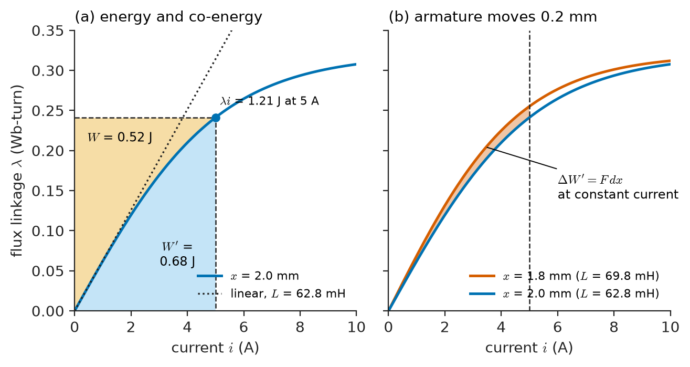
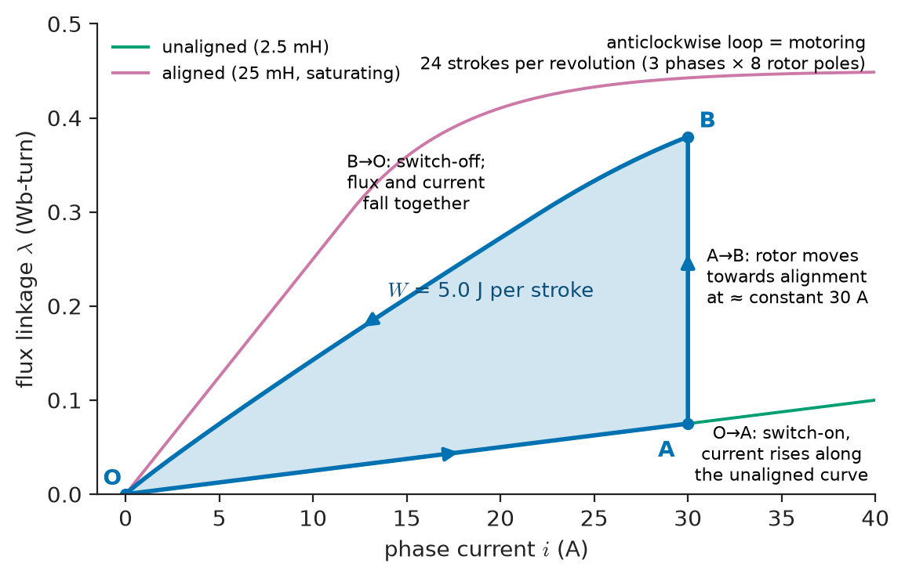
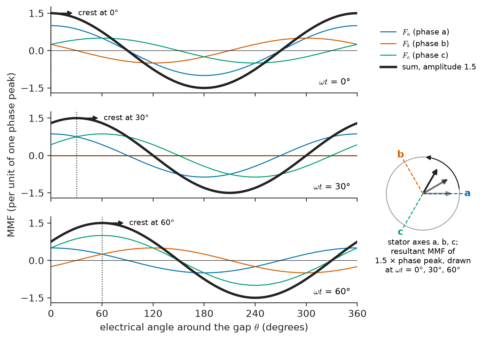
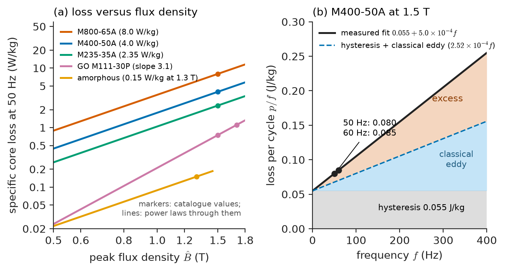
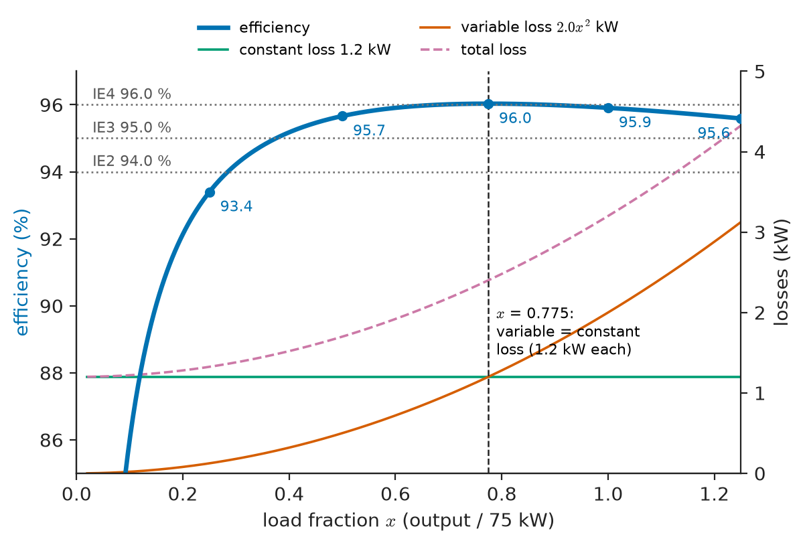
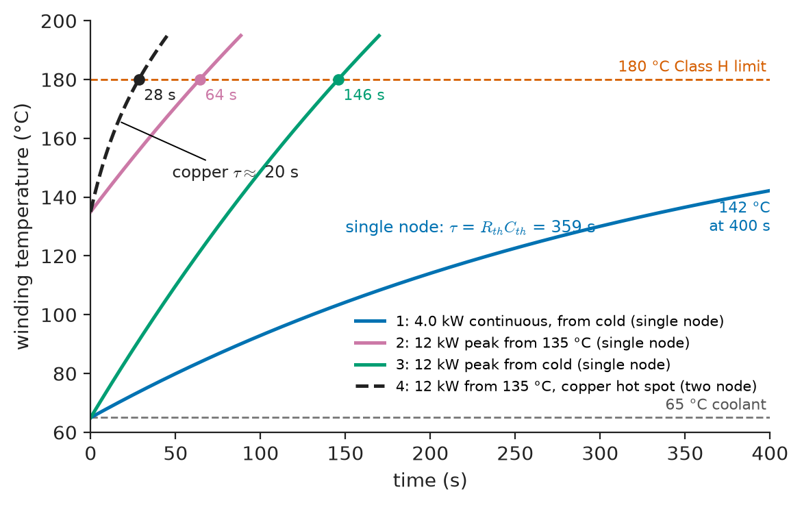

# Chapter 3 — Energy Conversion Principles

*Part I · Magnetic Circuits and Energy Conversion*

An electric-vehicle traction motor is specified with two power ratings: 200 kW "peak" for 30 seconds and 100 kW "continuous". Nothing in the motor changes between the two: the same magnets, the same windings, the same iron, the same inverter. A battery-electric bus motor of similar construction is rated 160 kW continuous because its duty, hours of stop-start city driving, never lets it cool down. A 100 kW industrial pump motor that would do the same job in a factory weighs four times as much. The torque a given volume of machine can produce is set by magnetic and electric loading; how long it can produce that torque is set by how fast its losses can be carried away before the winding insulation reaches its temperature limit. Every machine rating in this book is, in the end, a thermal rating.

This chapter assembles the principles that connect those facts: how force and torque are produced (and computed when the iron saturates), how a three-phase winding creates the rotating field that makes continuous rotation possible, where the losses come from, and how losses become efficiency and temperature.

> **How do electromagnetic devices convert energy in either direction, and how are force and torque computed from co-energy in real, saturating geometries?**
> **Where do the losses come from, and how do they set efficiency, temperature rise and the rating of a machine?**

| Concept | Engineering destination |
|---|---|
| Electrical-to-mechanical conversion | Motor sizing from air-gap shear stress; torque per rotor volume of industrial, traction and marine motors |
| Mechanical-to-electrical conversion | Generators, regenerative braking in EVs, trains, lifts and mine hoists |
| Force and torque production | Lifting magnets, contactors, magnetic bearings, reluctance and alignment torque |
| Magnetic co-energy | Force in saturating actuators, finite-element force calculation |
| Energy balance | Energy-conversion loops of switched-reluctance and stepper motors, plant energy accounting |
| Rotating magnetic fields | Induction, synchronous and PM machines; synchronous speed; reversal; space harmonics |
| Loss mechanisms | Copper, hysteresis, eddy-current, excess, mechanical and stray losses; lamination choice |
| Efficiency | IE efficiency classes, maximum-efficiency loading, life-cycle energy cost |
| Thermal constraints | Insulation classes, temperature-rise limits, short-time ratings, insulation life |

**Roadmap.** Motor action and what sets torque per volume (3.1) → generator action and regeneration (3.2) → co-energy (3.3) → force and torque in linear and saturating devices (3.4) → the energy balance over a conversion cycle (3.5) → the rotating magnetic field (3.6) → loss mechanisms (3.7) → efficiency (3.8) → thermal constraints and ratings (3.9).

---

## 3.1 Electrical-to-mechanical conversion

### Where *Engineering Physics* leaves off

*Engineering Physics* gives the electromagnetic energy density and the Poynting vector ([Ch. 11 §11.8](https://github.com/The-Studio-of-Sadiq/Engineering-Physics/blob/main/CHAPTERS/CHAPTER%2011.md)), the lumped power balance ([Ch. 17 §17.9](https://github.com/The-Studio-of-Sadiq/Engineering-Physics/blob/main/CHAPTERS/CHAPTER%2017.md)), and the motor as an ideal gyrator, $V=K\omega$, $\tau=KI$, with equal EMF and torque constants ([Ch. 17 §17.5](https://github.com/The-Studio-of-Sadiq/Engineering-Physics/blob/main/CHAPTERS/CHAPTER%2017.md)); thermodynamics and the thermal-resistance network come from [Ch. 10 §10.5–10.6](https://github.com/The-Studio-of-Sadiq/Engineering-Physics/blob/main/CHAPTERS/CHAPTER%2010.md), [Ch. 14 §14.7](https://github.com/The-Studio-of-Sadiq/Engineering-Physics/blob/main/CHAPTERS/CHAPTER%2014.md) and [Ch. 19 §19.6](https://github.com/The-Studio-of-Sadiq/Engineering-Physics/blob/main/CHAPTERS/CHAPTER%2019.md). Chapter 2 of this book opened the gyrator into a lossless coupling field and derived torque from inductance derivatives for linear devices. This chapter adds what an engineer needs beyond that: force from co-energy when the iron saturates, the rotating field that turns alignment torque into continuous rotation, the loss mechanisms that the ideal gyrator omits, and the thermal limit that makes those losses decisive. The ideal gyrator has no size, no losses and no temperature; real machines are defined by all three.

### Power crosses the air gap

In a motor, electrical power enters the stator and mechanical power leaves the rotor, with nothing but air between them. The power crosses the gap as electromagnetic energy flow: the axial electric field of the stator conductors and the circumferential gap field give the Poynting vector of [*Engineering Physics*, Ch. 11 §11.8](https://github.com/The-Studio-of-Sadiq/Engineering-Physics/blob/main/CHAPTERS/CHAPTER%2011.md) a radial component whose integral over the gap surface is the **air-gap power**, the same quantity as the speed-EMF power $e\,i$ of Chapter 2. The field picture explains why all the torque passes through a gap a millimetre thick: the radial and circumferential components of $\mathbf B$ there exert a tangential stress on the rotor surface.

### Air-gap shear stress and the sizing equation

That tangential stress, averaged over the rotor surface, is the **air-gap shear stress** $\sigma$ (N/m² or Pa). For a rotor of diameter $D$ and active length $L$, the tangential force is $\sigma\pi DL$, acting at radius $D/2$:

$$
T=\sigma\,\pi DL\,\frac D2=2\sigma\,V_r,\qquad V_r=\frac{\pi D^2L}{4}
$$

Torque is proportional to rotor volume, with the shear stress as the constant of proportionality. Power is torque times speed, so for a given power a faster machine is smaller, which is why traction motors run at 10 000–20 000 rpm through a reduction gear and why aircraft generators run at 12 000–24 000 rpm.

The shear stress is itself the product of the two loadings a designer chooses: the **magnetic loading** (the peak gap flux density $\hat B$, limited by saturation of the teeth to about 0.7–1.1 T) and the **electric loading** $A$ (RMS ampere-conductors per metre of gap circumference, limited by cooling). For sinusoidal distributions, $\sigma\approx A\hat B\cos\varphi/\sqrt2$, where $\varphi$ is the angle between the current and EMF distributions. With $A=50$ kA/m and $\hat B=0.9$ T in phase, $\sigma=31.8$ kPa.

**Table 3.1 — Typical air-gap shear stress, continuous rating.**

| Machine type | Cooling | Shear stress (kPa) |
|---|---|---|
| Small industrial induction motor, 1–20 kW | Totally enclosed, fan-cooled | 8–20 |
| Industrial induction motor, 100 kW–5 MW | Air, open or enclosed | 15–35 |
| Traction PM motor (EV, rail) | Liquid jacket, oil spray | 30–60 continuous, up to about 100 for seconds |
| Direct-drive wind generator, 3–15 MW | Air or liquid | 40–60 |
| Large turbo-generator | Hydrogen and direct water cooling | 80–130 |

The table is a table of cooling methods. The magnetic loading barely changes from row to row, because every machine uses steel that saturates near 2 T; the electric loading changes fivefold, because it is set by how much copper loss per square metre of gap surface the cooling can remove.

> **Status of the principle: Torque proportional to rotor volume, $T=2\sigma V_r$**
> *Derived.* An exact consequence of defining $\sigma$ as the average tangential stress on the rotor surface; the engineering content lies in the empirical ranges of $\sigma$ in Table 3.1, which encode saturation and cooling limits and hold only for the stated cooling method and duty.

**Worked example — Sizing an EV traction motor.** A traction motor must deliver 310 N·m peak. With a liquid-cooled design capable of $\sigma=45$ kPa at peak, the rotor volume is $V_r=T/2\sigma=310/(2\times45\times10^3)=3.44\times10^{-3}$ m³. With $L=D$, $D=(4V_r/\pi)^{1/3}=164$ mm. Compare a 15 kW, four-pole, fan-cooled industrial motor with a 160 mm × 160 mm rotor: it delivers $15\,000/(2\pi\times1460/60)=98.1$ N·m, a shear stress of only 15.2 kPa. The traction motor's rotor is about the same size and gives three times the torque; it is the cooling that differs, and the price is that the traction motor can sustain its peak only for seconds (Section 3.9).

---

## 3.2 Mechanical-to-electrical conversion

### One set of equations, two directions

Nothing in the coupling-field model of Chapter 2 prefers motoring. If the shaft is driven so that the mechanical power $T\omega$ flows *into* the field, the electrical power $e\,i$ flows out of the terminals: the device is a generator. The same machine changes role from instant to instant in a drive, according to the sign of $T\omega$; Chapter 10 maps the four quadrants of drive operation.

The reciprocity that makes this possible is the equality of EMF and torque constants. For the lossless coupling field, the electrical power absorbed by the speed EMF equals the mechanical power delivered, $e\,i=T\omega$. With $e=K\omega$ this gives $T=Ki$: the constant in V·s/rad is numerically equal to the constant in N·m/A. For a three-phase machine with current in phase with the EMF, $T=3EI/\omega_m$; for the PM motor of Chapter 2, with $E/\omega_m=0.348$ V rms per rad/s per phase, the torque is 1.045 N·m per ampere of RMS phase current.

> **Status of the principle: Equality of EMF and torque constants**
> *Derived.* Follows from energy conservation in the lossless coupling field; it holds exactly for the air-gap (internal) EMF and electromagnetic torque at any operating point. Measured terminal constants differ by the resistive and leakage drops, by core loss and friction, and, under heavy load, by saturation and armature reaction, which reduce the torque per ampere by 5–20 % in compact PM machines.

### Generators in the energy system

Mechanical-to-electrical conversion is the source of nearly all grid electricity (Chapters 7, 14 and 15). Large generators convert at 98–99 %, so plant efficiency is decided by the thermodynamic cycle upstream, bounded by the Carnot limit of [*Engineering Physics*, Ch. 10 §10.6](https://github.com/The-Studio-of-Sadiq/Engineering-Physics/blob/main/CHAPTERS/CHAPTER%2010.md), not by the electrical machine.

### Regeneration

Motors become generators every time a vehicle or a load is braked electrically: trains, trams, lifts, cranes, mine hoists, EVs and, increasingly, industrial centrifuges and test rigs. The energy is returned to a battery, a DC link with a braking resistor, or the grid.

**Worked example — Regenerative braking of an EV.** An 1800 kg car decelerates from 90 km/h (25 m/s) at 3 m/s² using only its traction motor (road load neglected). The wheel radius is 0.33 m and the reduction gear ratio 9.0.

*Force and power at the wheels.* $F=ma=5400$ N; at 25 m/s the braking power is $Fv=135$ kW.

*Motor operating point.* Wheel speed $25/0.33=75.8$ rad/s; motor speed $9.0\times75.8=682$ rad/s (6510 rpm); motor torque $5400\times0.33/9.0=198$ N·m, negative (generating). The motor is working at a high-power generating point well inside its peak rating.

*Energy.* The kinetic energy is $\tfrac12mv^2=562.5$ kJ (0.156 kWh). With a motor efficiency of 94 %, inverter 97 % and battery charging 96 %, the energy stored is $562.5\times0.875=492$ kJ, or 0.137 kWh per stop. The stop takes 8.3 s.

In stop-start urban driving with dozens of such stops per hour, regeneration recovers a substantial fraction of the traction energy. The losses that keep it from 100 %, about 70 kJ per stop here, appear as heat in the motor, inverter and battery, and are one reason city-bus motors need the high continuous rating of the opening example.

---

## 3.3 Magnetic co-energy

### Definition

Chapter 2 computed torque from the field energy $W_{fld}(\lambda,\theta)=\int_0^\lambda i\,d\lambda'$ at constant flux linkage. In practice it is the current, not the flux linkage, that a designer specifies and a drive controls. The natural function of current is the **co-energy**

$$
W'_{fld}(i,\theta)=\int_0^{i}\lambda(i',\theta)\,di'
$$

which is the area between the $\lambda$–$i$ curve and the $i$ axis. Energy and co-energy together fill the rectangle $\lambda i$:

$$
W_{fld}+W'_{fld}=\lambda i
$$

(Figure 3.1a). Co-energy is the Legendre transform of energy with respect to the pair $(\lambda,i)$, the same operation that turns a Lagrangian into a Hamiltonian; it has no direct physical meaning as "stored energy", but its derivatives give force directly in terms of current.

For a linear device $\lambda=Li$, the curve is a straight line and the two triangles are equal: $W_{fld}=W'_{fld}=\tfrac12Li^2$. For a saturating device the curve bends over, the co-energy exceeds the energy, and the distinction matters.

> **Status of the principle: Co-energy $W'_{fld}=\lambda i-W_{fld}$**
> *Derived.* A definition by Legendre transform; its usefulness rests on the energy balance of the lossless coupling field. Like the field energy it is a state function only for a lossless (non-hysteretic) characteristic; with hysteresis, energy and co-energy are path-dependent and the force must be computed from the field directly.

### Force from co-energy

Insert $W_{fld}=\lambda i-W'_{fld}$ into the energy balance $i\,d\lambda=dW_{fld}+T\,d\theta$ of Chapter 2. The $i\,d\lambda$ terms cancel and

$$
dW'_{fld}=\lambda\,di+T\,d\theta\qquad\Longrightarrow\qquad T=\frac{\partial W'_{fld}(i,\theta)}{\partial\theta}\bigg|_{i}
$$

and for linear motion $F=\partial W'_{fld}(i,x)/\partial x$ at constant current. The two formulas, from energy at constant $\lambda$ and from co-energy at constant $i$, give the same instantaneous force; they differ only in which variable is held fixed in the derivative. The co-energy form is the one used in practice, including inside finite-element programs, which compute co-energy at two nearby positions with the same currents and difference them.

For several windings, $W'_{fld}=\int\sum_k\lambda_k\,di_k$ along any path in current space (all paths give the same answer for a lossless field), and for linear windings it reduces to the inductance form of Chapter 2.

---

## 3.4 Force and torque production

### Force on an iron surface: the magnetic pressure

Apply co-energy to the simplest actuator, a magnet of pole area $A$ pulling an armature across a gap $x$, with the iron reluctance neglected: $L=\mu_0N^2A/x$ for one gap, and

$$
F=\frac{\partial}{\partial x}\left(\tfrac12L(x)i^2\right)=-\frac{\mu_0N^2Ai^2}{2x^2}=-\frac{B^2A}{2\mu_0}
$$

using $B=\mu_0Ni/x$. The negative sign means the force acts to close the gap. The magnitude per unit area, $B^2/2\mu_0$, is the **magnetic pressure**, the normal component of the Maxwell stress of [*Engineering Physics*, Ch. 11 §11.8.1](https://github.com/The-Studio-of-Sadiq/Engineering-Physics/blob/main/CHAPTERS/CHAPTER%2011.md) at an iron surface. Field lines behave like stretched elastic bands that pull iron surfaces together.

> **Status of the principle: Magnetic pressure $F/A=B^2/2\mu_0$**
> *Derived.* From the co-energy of a gap (or equivalently the Maxwell stress tensor) for flux crossing normally between iron surfaces of very high permeability; it is accurate when the gap is short compared with the pole width and fringing is small, and it becomes an overestimate where fringing spreads the flux beyond the pole face.

**Table 3.2 — Magnetic pressure at representative flux densities.**

| $B$ (T) | 0.4 | 0.8 | 1.2 | 1.6 | 2.0 |
|---|---|---|---|---|---|
| $B^2/2\mu_0$ (kPa) | 64 | 255 | 573 | 1019 | 1592 |
| Equivalent load (tonnes per m²) | 6.5 | 26 | 58 | 104 | 162 |

**Worked example — An industrial lifting magnet.** A scrap-yard lifting magnet has two pole faces of 0.05 m² each, both in the flux path. At 1.2 T in the gap the holding force is

$$
F=\frac{B^2(2A)}{2\mu_0}=\frac{1.2^2\times0.10}{2\times4\pi\times10^{-7}}=57.3\ \mathrm{kN}
$$

about 5.8 tonnes. With 1 mm effective gaps at each pole (paint, scale and surface roughness), the MMF needed to drive 1.2 T across both gaps is $B(2g)/\mu_0=1910$ At, plus the iron. If the load is rusty, uneven scrap and the gaps grow to 3 mm at the same MMF, the gap flux density falls to 0.40 T and the force to 6.4 kN, one ninth. The force falls as the inverse square of the gap: lifting-magnet ratings always assume clean, flat, thick steel, and are derated heavily for scrap, thin sheet and hot material (whose permeability falls towards the Curie point).

### Force in a saturating actuator

In a saturating device, the inductance form $\tfrac12i^2\,dL/dx$ is wrong, and the error is large exactly where actuators are designed to work. Figure 3.1b illustrates why: the co-energy at a given current no longer grows as $i^2$ once the iron saturates.

**Worked example — Saturation and the force of a plunger magnet.** A plunger magnet has $N=500$ turns, pole area $4\times10^{-4}$ m², and a gap $x=2$ mm, giving an unsaturated inductance $L(x)=\mu_0N^2A/x=62.8$ mH. Its iron saturates near 1.6 T, so the flux linkage cannot exceed about $\lambda_s=NB_sA=0.32$ Wb-turn. A simple model that reproduces both limits is

$$
\lambda(i,x)=\lambda_s\tanh\frac{L(x)\,i}{\lambda_s}
$$

whose co-energy is $W'=(\lambda_s^2/L(x))\ln\cosh(L(x)i/\lambda_s)$. Differentiating numerically with respect to $x$ at constant current gives:

| Current (A) | Pole $B$ (T) | Force, co-energy (N) | Force, linear $\tfrac12i^2\,dL/dx$ (N) | Ratio |
|---|---|---|---|---|
| 1 | 0.31 | 15.4 | 15.7 | 0.98 |
| 2 | 0.60 | 58.3 | 62.8 | 0.93 |
| 5 | 1.21 | 261 | 393 | 0.66 |
| 10 | 1.54 | 487 | 1571 | 0.31 |

Below about 0.6 T the linear formula is adequate. At 1.2 T it overestimates the force by half, and at 1.5 T by a factor of three: doubling the current from 5 A to 10 A gains less than a factor of two in force, not a factor of four. At 5 A the field energy is 0.52 J and the co-energy 0.68 J; the difference is the saturation. Contactor, solenoid-valve and relay designers therefore size coils from co-energy calculations (or finite-element runs) on the real $B$–$H$ curve, never from $\tfrac12i^2\,dL/dx$ with a constant $L$.

<!-- FIGURE 3.1 | figures/ch03/fig-3-1-energy-and-coenergy.png | plot | Energy and co-energy in the lambda-i plane, and the work done when a saturating plunger magnet moves. | Content: (a) x-axis current 0 to 10 A, y-axis flux linkage 0 to 0.35 Wb-turn; curve lambda = 0.32 tanh(0.0628 i / 0.32) for x = 2 mm; at i = 5 A (lambda = 0.241) shade the area left of the curve as W = 0.52 J and the area below the curve as W' = 0.68 J, dashed rectangle lambda i = 1.21 J. Dotted straight line slope 62.8 mH for the linear model. (b) same axes with two curves, x = 2.0 mm and x = 1.8 mm (L = 69.8 mH); shaded sliver between them up to i = 5 A labelled "Delta W' = F dx at constant current". -->

*Figure 3.1 — Energy and co-energy in the lambda-i plane, and the work done when a saturating plunger magnet moves.*

### Torque in rotating machines

The same two terms found in Chapter 2 appear in every machine: **alignment torque** between two excited windings (or a winding and a magnet), and **reluctance torque** between an excited winding and a salient iron rotor. Table 3.3 places the machines of Part II on that map.

**Table 3.3 — Torque mechanisms in electrical machines.**

| Machine | Main torque | Secondary torque | Chapter |
|---|---|---|---|
| DC machine | Alignment (armature–field), held at 90° by the commutator | Small reluctance | 5 |
| Induction machine | Alignment between stator field and induced rotor currents | — | 6 |
| Round-rotor synchronous | Alignment (stator–field winding) | — | 7 |
| Salient-pole synchronous | Alignment | Reluctance, 10–25 % of rated | 7 |
| Surface PM synchronous | Alignment (stator–magnet) | Cogging (zero average) | 8 |
| Interior PM (EV traction) | Alignment | Reluctance, often 30–50 % at peak torque | 8 |
| Synchronous and switched reluctance | Reluctance only | — | 8 |

---

## 3.5 Energy balance

### The conversion cycle in the $\lambda$–$i$ plane

A machine in steady operation goes through a repeating cycle. Over one cycle the coupling field returns to its initial state, so its stored energy and co-energy return to their initial values, and the energy balance of Chapter 2, $\oint i\,d\lambda=\oint dW_{fld}+\oint T\,d\theta$, reduces to

$$
W_{mech}=\oint i\,d\lambda
$$

The mechanical work per cycle is the **area enclosed** by the trajectory of the operating point in the $\lambda$–$i$ plane. A trajectory traversed anticlockwise (with $\lambda$ on the vertical axis and $i$ on the horizontal) converts electrical to mechanical energy; traversed clockwise it generates.

> **Status of the principle: Work per cycle equals the enclosed $\lambda$–$i$ area**
> *Fundamental.* A direct consequence of energy conservation for a lossless coupling field over a closed cycle; it holds for any degree of saturation. When core hysteresis is present, the enclosed area of a stationary (non-moving) cycle is the hysteresis loss instead of work, and the two must be separated.

### Switched-reluctance and stepper motors

The cycle view is the natural description of the switched-reluctance motor (SRM), which has no magnets and no rotor winding. Each phase is switched on as a rotor pole approaches alignment and off before it gets there. The flux linkage builds along the unaligned (low-inductance) curve, the rotor moves towards alignment at roughly constant current, and when the phase is switched off the flux linkage falls back to zero along a path inside the aligned (saturated) curve, because the rotor has not yet reached full alignment (Figure 3.2). The enclosed area is the work per stroke. Because the aligned curve saturates, the loop is "fatter" than the linear case would allow, and SRMs are deliberately designed to saturate.

**Worked example — Power of a switched-reluctance motor from its loop area.** A three-phase 12/8 SRM (12 stator poles, 8 rotor poles) has an energy-conversion loop of area 5.0 J per stroke at its rated current. Each phase strokes once for each rotor pole passing, so there are $3\times8=24$ strokes per revolution.

*Average torque.* $T_{av}=W\times24/(2\pi)=5.0\times24/2\pi=19.1$ N·m.

*Power at 3000 rpm.* $P=T_{av}\omega=19.1\times314.2=6.0$ kW, with $24\times50=1200$ strokes per second.

The torque is fixed by loop area and pole count; speed multiplies it into power. The torque ripple, from the discrete strokes, is the SRM's main drawback and the reason it is used where robustness and high temperature matter more than smoothness (mining, aerospace starter-generators, some EVs and household appliances).

<!-- FIGURE 3.2 | figures/ch03/fig-3-2-srm-energy-conversion-loop.png | plot | Energy-conversion loop of one phase of a 12/8 switched-reluctance motor between its unaligned and aligned magnetisation curves. | Content: x-axis phase current 0 to 40 A, y-axis flux linkage 0 to 0.5 Wb-turn. Unaligned curve: straight line of slope 2.5 mH. Aligned curve: slope about 25 mH up to 0.30 Wb-turn at 12 A, then saturating to 0.45 Wb-turn at 40 A. Operating trajectory: O to A along the unaligned line up to 30 A (switch-on and current rise), A to B at nearly constant 30 A as the rotor moves towards alignment (lambda rising to about 0.38 Wb-turn), B back to O after switch-off along a curve lying well inside (to the right of) the aligned characteristic, because the rotor is not yet fully aligned; it is drawn so that the loop encloses the text's 5.0 J (a return along the aligned curve itself would enclose about 7.4 J). Enclosed area shaded and labelled "W = 5.0 J per stroke"; arrows showing anticlockwise traversal; label "24 strokes per revolution". -->

*Figure 3.2 — Energy-conversion loop of one phase of a 12/8 switched-reluctance motor between its unaligned and aligned magnetisation curves.*

### Energy balance with losses

Adding the losses taken outside the coupling field gives the steady-state power balance used for every motor, generator and transformer test:

$$
P_{in}=P_{out}+P_{Cu}+P_{core}+P_{fw}+P_{stray}
$$

The losses are named by where they occur: copper (winding) loss, core loss, friction and windage, and stray load loss. In a generator, input and output swap roles. Section 3.7 treats each term; Section 3.8 turns the balance into efficiency.

---

## 3.6 Rotating magnetic fields

### The problem the rotating field solves

Chapter 2 showed that a machine produces average torque only when its fields are in synchronism. A DC machine maintains that with a mechanical commutator. AC machines do it electromagnetically: a set of stationary windings fed with phase-displaced currents produces a magnetic field that **rotates**, and the rotor (magnetised, excited or induced) is dragged along with it. The rotating field is the reason three-phase power dominates industry, as [*Circuits, Signals and Communications*, Ch. 10](https://github.com/The-Studio-of-Sadiq/Circuits-Signals-and-Communications/blob/main/part-2-transient-and-ac-analysis/10-three-phase-circuits.md) notes from the circuit side. Here it is built from the windings.

### From three pulsating fields to one rotating field

A distributed winding of one phase produces an MMF around the gap whose fundamental spatial component is $\mathcal F_a(\theta,t)=\hat{\mathcal F}_{ph}\,(i_a/\hat I)\cos\theta$, where $\theta$ is the electrical angle around the gap measured from the axis of phase $a$. This is a standing wave: fixed in space, pulsating in time. Phases $b$ and $c$ are displaced by 120° and 240° electrical in space. Feed them with a balanced set $i_a=\hat I\cos\omega t$, $i_b=\hat I\cos(\omega t-120°)$, $i_c=\hat I\cos(\omega t-240°)$. Each phase contributes

$$
\hat{\mathcal F}_{ph}\cos(\omega t-k\,120°)\cos(\theta-k\,120°)=\frac{\hat{\mathcal F}_{ph}}{2}\Big[\cos(\theta-\omega t)+\cos(\theta+\omega t-k\,240°)\Big],\qquad k=0,1,2
$$

The first terms are identical for all three phases and add. The second terms form a balanced three-phase set in $k$ and sum to zero. The result is

$$
\mathcal F(\theta,t)=\frac32\hat{\mathcal F}_{ph}\cos(\theta-\omega t)
$$

a sinusoidal MMF wave of **constant amplitude**, 1.5 times the peak of one phase, whose crest travels around the gap at $d\theta/dt=\omega$ electrical radians per second (Figure 3.3).

> **Status of the principle: Rotating MMF of a balanced three-phase winding**
> *Derived.* An exact trigonometric consequence of three sinusoidally distributed windings displaced by 120° electrical carrying balanced sinusoidal currents. Real windings in slots add space harmonics, unbalanced currents add a backward-rotating component, and inverter supplies add time harmonics; these superpose on the fundamental forward wave rather than destroying it.

### Synchronous speed and poles

A winding with $p$ poles repeats its pattern $p/2$ times around the gap, so one electrical cycle moves the field by $2/p$ of a revolution. The field rotates at the **synchronous speed**

$$
n_s=\frac{120f}{p}\ \text{rpm}
$$

1500 rpm for a four-pole machine at 50 Hz, 1800 rpm at 60 Hz, 3000 rpm for two poles at 50 Hz. Synchronous machines run exactly at $n_s$; induction machines run slightly below it, the difference being the slip (Chapter 6).

### Amplitude and magnetising current

For a phase with $N_{ph}$ series turns and winding factor $k_w$ (Chapter 6), the fundamental MMF per pole of one phase is $\hat{\mathcal F}_{ph}=(4/\pi)(k_wN_{ph}/p)\,\hat I$, so the rotating wave has amplitude

$$
\hat{\mathcal F}=\frac32\cdot\frac4\pi\cdot\frac{k_wN_{ph}}{p}\,\hat I
$$

Combining this with the gap reluctance of Chapter 1 gives the magnetising current of an AC machine from its dimensions.

**Worked example — Magnetising current of a 15 kW induction motor.** The 15 kW, 400 V, star-connected, four-pole motor of Chapter 1 has $D=L=160$ mm, an air gap of 0.60 mm, Carter coefficient 1.135, $N_{ph}=96$ series turns per phase and $k_w=0.925$. The design gap flux density is 0.80 T peak. Allow 25 % extra MMF for the iron (saturation factor 1.25).

*Required MMF per pole.* $\hat{\mathcal F}=\hat Bgk_Ck_{sat}/\mu_0=0.80\times0.60\times10^{-3}\times1.135\times1.25/(4\pi\times10^{-7})=542$ At.

*Magnetising current.* $\hat I=542/[1.5\times(4/\pi)\times0.925\times96/4]=12.8$ A peak, 9.0 A rms.

*Check against voltage.* The flux per pole is $(2/\pi)\hat B\tau L$ with $\tau=\pi D/4=125.7$ mm, i.e. 10.2 mWb, and the phase EMF is $4.44\times50\times96\times0.925\times0.0102=202$ V, about 0.87 of the 231 V phase voltage, a typical allowance for the stator leakage and resistance drops. The rated current at 91 % efficiency and 0.85 power factor is 28.0 A, so the magnetising current is 32 % of rated, inside the range of Table 1.4. Half of the MMF, and so half of that current, would disappear if the gap were halved, which is why induction-motor gaps are as small as manufacturing and bearing tolerances allow.

<!-- FIGURE 3.3 | figures/ch03/fig-3-3-rotating-mmf.png | plot | The three phase MMFs and their sum at three instants: a constant-amplitude wave travelling around the gap. | Content: x-axis electrical angle theta around the gap 0 to 360 degrees; y-axis MMF in per unit of one phase peak, -1.6 to +1.6. Three panels for omega t = 0, 30 and 60 degrees. In each, thin curves for Fa, Fb, Fc (cosine standing waves scaled by ia, ib, ic) and a thick curve for the sum, always of amplitude 1.5, with its crest at theta = 0, 30 and 60 degrees respectively; arrow showing the crest advancing. Small inset: phasor-like diagram of the stator with axes a, b, c at 0, 120, 240 degrees and the resultant MMF vector rotating. -->

*Figure 3.3 — The three phase MMFs and their sum at three instants: a constant-amplitude wave travelling around the gap.*

### Reversal, unbalance and single-phase supply

Three practical results follow from the same algebra.

- **Reversal.** Swapping any two supply leads reverses the phase sequence and the wave rotates at $-\omega$; this is how every three-phase motor is reversed.
- **Unbalance.** Unequal currents can be resolved into positive- and negative-sequence sets (Chapter 19). The negative-sequence currents produce a field rotating backwards at synchronous speed, which induces double-frequency currents in the rotor and heats it. As a rule of thumb from NEMA MG 1, the percentage increase in winding temperature rise is about twice the square of the percentage voltage unbalance, 8 % for a 2 % unbalance, which is why IEC 60034-26 and NEMA MG 1 derate motors on unbalanced supplies (Chapter 25).
- **Single phase.** A single winding gives a pulsating field, which by the same identity is two half-amplitude fields rotating in opposite directions, so a single-phase motor needs an auxiliary, phase-shifted winding to start (Chapter 6).

### Space harmonics

Windings in a finite number of slots also produce space harmonics of order $h=6k\pm1$ (triplens cancel): the 5th rotates backwards at one fifth of synchronous speed, the 7th forwards at one seventh. They cause parasitic torques, noise and loss, and can make an induction motor "crawl" near one seventh of synchronous speed; distributed, short-pitched windings suppress them at a small cost in fundamental (Chapter 6).

---

## 3.7 Loss mechanisms

Every conversion loses a few percent of the power that passes through it, and those few percent are what heat the machine. Table 3.4 lists the mechanisms, Figure 3.4 shows the core-loss data, and the rest of this section explains each.

**Table 3.4 — Loss mechanisms in electrical machines and transformers.**

| Loss | Physical mechanism | Depends on | Typical share of total loss, 75 kW induction motor |
|---|---|---|---|
| Stator copper ($I^2R$) | Joule heating in windings | Current squared, winding temperature, frequency (skin and proximity) | 30–40 % |
| Rotor copper or aluminium | Joule heating in cage or rotor winding | Rotor current squared (slip) | 15–25 % |
| Core: hysteresis | Domain-wall motion, irreversible magnetisation | $f$, $B^{1.6\text{–}2}$, material | 10–20 % |
| Core: eddy current (classical and excess) | Induced currents in laminations | $f^2B^2$, lamination thickness, resistivity | 5–15 % |
| Friction and windage | Bearing friction, air drag, cooling fan | Speed (roughly cubic for fans) | 5–15 % |
| Stray load loss | Leakage-flux eddy currents, harmonic fields, surface losses | Load current squared | 10–20 % |

### Copper loss

The Joule loss in a winding is $I^2R$, with three corrections that matter in practice.

**Temperature.** Copper resistivity rises by 0.393 %/K; a winding at 155 °C has 1.53 times its 20 °C resistance. Efficiencies and losses are therefore always quoted at a reference temperature (IEC 60034-2-1 corrects test results to a reference coolant temperature of 25 °C plus the measured rise).

**Skin and proximity effect.** At 50 Hz the skin depth in copper is 9.3 mm, larger than most conductors, so the AC resistance is close to the DC value. But large bars in slots (the deep-bar rotors of induction motors, the stator bars of large generators) carry current crowded towards the slot opening by the slot-leakage field, and the AC resistance of a deep bar can be several times its DC value at 50 Hz. In EV motors with rectangular "hairpin" conductors running at 400–1000 Hz (skin depth 3.3–2.1 mm), the AC loss factor can reach 1.5–3 at top speed.

**Current harmonics.** Inverter ripple currents add to the RMS current and, at high frequency, see a higher resistance.

### Hysteresis loss

Each cycle of magnetisation traverses the hysteresis loop of Chapter 1, and the enclosed area is energy dissipated per cycle per unit volume. The loss per unit mass at frequency $f$ and peak flux density $\hat B$ is described empirically by the Steinmetz law

$$
p_h=k_hf\hat B^{\alpha},\qquad \alpha\approx1.6\text{–}2.0
$$

with $k_h$ and $\alpha$ fitted to material data. Hysteresis loss is proportional to frequency; it dominates the core loss of electrical steels at 50–60 Hz.

> **Status of the principle: Steinmetz hysteresis-loss law**
> *Empirical.* A power-law fit to measured loop areas, valid for sinusoidal flux within the fitted ranges of $\hat B$ (typically 0.5–1.7 T) and frequency; it fails for minor loops and DC-biased flux, for which corrected forms (the improved generalised Steinmetz equation) or loss maps are used.

### Eddy-current loss

The changing flux induces a voltage around every closed path in the lamination (Chapter 2); the resulting currents dissipate power in the steel's resistivity. For a thin sheet of thickness $d$, resistivity $\rho$ and density $\delta$, with sinusoidal flux uniform across the thickness (sheet thinner than the skin depth), Faraday's and Ohm's laws give the **classical eddy-current loss**

$$
p_c=\frac{\pi^2d^2f^2\hat B^2}{6\rho\,\delta}\ \ \mathrm{W/kg}
$$

> **Status of the principle: Classical eddy-current loss in a lamination**
> *Derived.* From Faraday's law and Ohm's law in a thin sheet with uniform flux; valid while the sheet is thinner than the skin depth (about 0.5–1.5 mm in electrical steel at 50 Hz, falling as $1/\sqrt f$). Measured eddy losses are typically 1.5–3 times larger because of domain-wall motion (the "excess" or "anomalous" loss), which the formula omits.

The $d^2f^2$ dependence explains lamination practice. Thin, high-resistivity laminations cost money (more sheets, more coating, more punching), so each application uses the thickest sheet it can afford.

**Worked example — Choosing lamination thickness for 50 Hz and 400 Hz.** Silicon steel with $\rho=0.48$ µΩ·m and $\delta=7650$ kg/m³ is operated at $\hat B=1.5$ T. The classical eddy loss is:

| Thickness (mm) | 50 Hz (W/kg) | 400 Hz (W/kg) |
|---|---|---|
| 0.50 | 0.63 | 40.3 |
| 0.35 | 0.31 | 19.8 |
| 0.20 | 0.10 | 6.5 |
| 0.10 | 0.025 | 1.6 |

At 50 Hz a 0.5 mm sheet loses only 0.63 W/kg to classical eddies, a small part of the roughly 4 W/kg total of an M400-50A grade: hysteresis dominates, and thinner sheet buys little. At 400 Hz, the frequency of aircraft electrical systems, the same sheet would lose 40 W/kg to classical eddies alone. Aircraft generators and transformers therefore use 0.1–0.2 mm laminations, often of cobalt–iron for its higher saturation, and EV traction motors, whose fundamental reaches 600–1000 Hz at top speed, use 0.20–0.27 mm "thin-gauge" non-oriented steels.

**Worked example — Separating hysteresis and eddy loss by a two-frequency test.** An Epstein test of a non-oriented steel at 1.5 T gives 4.0 W/kg at 50 Hz and 5.1 W/kg at 60 Hz. Write the loss per cycle as $p/f=k_h'+k_e'f$ (hysteresis constant per cycle, eddy proportional to frequency). The two measurements give $p/f=0.0800$ and $0.0850$ J/kg, so $k_e'=5.0\times10^{-4}$ J·s/kg and $k_h'=0.055$ J/kg. At 50 Hz, hysteresis is $0.055\times50=2.75$ W/kg and total eddy loss $5\times10^{-4}\times2500=1.25$ W/kg. The classical formula gives only 0.63 W/kg for a 0.5 mm sheet; the other 0.62 W/kg is excess loss. The method is approximate, because it lumps the excess loss (which grows as $f^{1.5}$) into the $f^2$ term, but it shows clearly what thinner laminations can and cannot do: they reduce the 1.25 W/kg, not the 2.75 W/kg.

**Table 3.5 — Typical specific core loss of electrical steels and alloys.**

| Material and grade | Thickness (mm) | Loss at 1.5 T, 50 Hz (W/kg) | Loss at 1.0 T, 400 Hz (W/kg) | Application |
|---|---|---|---|---|
| Non-oriented M800-65A | 0.65 | 8.0 (max) | — | Small, low-cost motors |
| Non-oriented M400-50A | 0.50 | 4.0 (max) | 35–45 | General-purpose motors |
| Non-oriented M235-35A | 0.35 | 2.35 (max) | 18–24 | High-efficiency motors, generators |
| Thin non-oriented (e.g. NO20) | 0.20 | 2.2–2.6 | 12–16 | EV traction, high-speed machines |
| Grain-oriented M111-30P (rolling direction) | 0.30 | about 0.75 (1.11 at 1.7 T) | — | Distribution and power transformers |
| Amorphous iron-based ribbon | 0.025 | about 0.15 at 1.3 T | 2–5 | Low-loss distribution transformers |

The grade designation of non-oriented steels (EN 10106 and IEC 60404-8-4) encodes the guaranteed maximum loss: M400-50A means at most 4.00 W/kg at 1.5 T and 50 Hz, in 0.50 mm sheet. Punching, welding, shrink-fitting into a frame and non-sinusoidal (PWM) flux all raise the loss in a finished machine above the Epstein value; a "building factor" of 1.3–2.0 is usual for motors and 1.1–1.3 for transformer cores.

<!-- FIGURE 3.4 | figures/ch03/fig-3-4-core-loss-data.png | plot | Specific core loss of electrical steels: loss versus flux density at 50 Hz, and the split of loss per cycle into hysteresis and eddy components. | Content: (a) log-log plot, x-axis peak B 0.5 to 1.8 T, y-axis loss 0.02 to 60 W/kg at 50 Hz; curves for M800-65A (8.0 W/kg at 1.5 T), M400-50A (4.0 W/kg at 1.5 T), M235-35A (2.35 W/kg at 1.5 T), grain-oriented M111-30P (0.75 W/kg at 1.5 T, 1.11 at 1.7 T) and amorphous (0.15 W/kg at 1.3 T), drawn as power laws through the catalogue points: slope 2 on log-log axes for the non-oriented grades and amorphous ribbon, slope 3.1 for grain-oriented steel (fixed by its two catalogue points, 0.75 and 1.11 W/kg at 1.5 and 1.7 T, as GO loss rises steeply towards saturation). (b) loss per cycle p/f in J/kg versus frequency 0 to 400 Hz for M400-50A at 1.5 T: straight line from 0.055 J/kg at f = 0 (hysteresis intercept) with slope 5e-4 J s/kg, points at 50 Hz (0.080) and 60 Hz (0.085) marked; dashed line for classical eddy component alone (slope 2.5e-4); shaded gap labelled excess loss. -->

*Figure 3.4 — Specific core loss of electrical steels: loss versus flux density at 50 Hz, and the split of loss per cycle into hysteresis and eddy components.*

### Mechanical and stray losses

**Friction and windage** come from bearings, air drag on the rotor and the cooling fan, roughly 0.5–1 % of rating in two-pole machines and less in slower ones; they are measured from a no-load run at different voltages (IEC 60034-2-1). **Stray load losses** are the catch-all for losses caused by load current outside the windings' $I^2R$: eddy currents in end-region structures and frame driven by leakage flux, high-frequency rotor surface losses from slot harmonics, and circulating currents in parallel strands. They are difficult to calculate, are determined in tests by the residual-loss method or assigned a standard allowance of 0.5–2.5 % of input depending on rating, and they are the reason that a motor's calculated and measured efficiencies differ.

A transformer has the same core and copper losses but no mechanical loss, and its load loss includes eddy losses in windings and tank driven by leakage flux (Chapter 4). Dielectric loss, $\omega CV^2\tan\delta$, matters only in high-voltage insulation, where it is a diagnostic quantity (Chapter 24).

---

## 3.8 Efficiency

### Definition and the loss-summation method

Efficiency is $\eta=P_{out}/P_{in}=P_{out}/(P_{out}+P_{loss})$. Above a few kilowatts it is not measured by subtracting two nearly equal power readings (0.5 % error in each would let a 95 % motor read anywhere from 94 % to 96 %); IEC 60034-2-1 and IEEE 112 determine each loss separately and sum them, and transformers are treated the same way from their open- and short-circuit tests (IEC 60076-1, Chapter 4).

### Constant and variable losses

The losses split into those that do not depend on load (core loss, friction and windage at constant speed and voltage) and those that rise with the square of load current (copper and stray load losses). With constant loss $P_0$, full-load variable loss $P_{v}$, rated output $P_r$, and load fraction $x$ (approximately the current in per unit at constant voltage and power factor):

$$
\eta(x)=\frac{xP_r}{xP_r+P_0+x^2P_{v}}
$$

Setting $d\eta/dx=0$ gives the maximum at

$$
x_{\max}=\sqrt{P_0/P_v}
$$

the load at which variable loss equals constant loss.

> **Status of the principle: Maximum efficiency where variable loss equals constant loss**
> *Derived.* Exact for the two-component loss model above; approximate in a real machine because core loss and power factor change slightly with load and friction loss with speed. It is used to set the design point of transformers and motors to their expected load profile.

**Worked example — Efficiency curve of a 75 kW pump motor.** A 75 kW, four-pole premium-efficiency motor has constant losses of 1.2 kW (core 0.9 kW, friction and windage 0.3 kW) and full-load variable losses of 2.0 kW.

*Full-load efficiency.* $75/(75+1.2+2.0)=95.9$ %, just under the IE4 minimum of 96.0 %; a slightly better rotor would be needed for certification.

*Maximum efficiency.* $x_{\max}=\sqrt{1.2/2.0}=0.775$, where the losses are $1.2+2.0\times0.6=2.4$ kW and $\eta=96.0$ %.

*Part load.* At 50 % load, $\eta=95.7$ %; at 25 %, 93.4 %. Figure 3.5 plots the curve: flat between about 50 % and 100 % load, falling steeply below 25 %. Motors are deliberately designed with their maximum efficiency at 75–80 % load, because that is where most of them run.

<!-- FIGURE 3.5 | figures/ch03/fig-3-5-efficiency-versus-load.png | plot | Efficiency and losses of a 75 kW premium-efficiency motor versus load, with maximum efficiency where variable and constant losses are equal. | Content: x-axis load fraction 0 to 1.25; left y-axis efficiency 85 to 97 %; right y-axis losses 0 to 5 kW. Efficiency curve eta = 75x/(75x + 1.2 + 2.0x^2): 93.4 % at 0.25, 95.7 % at 0.5, peak 96.0 % at 0.775, 95.9 % at 1.0, 95.6 % at 1.25. Loss curves: constant 1.2 kW (horizontal), variable 2.0x^2 kW, total. Vertical dashed line at x = 0.775 where the constant and variable loss curves cross. Horizontal dotted lines at the IEC 60034-30-1 minimum full-load efficiencies for 75 kW 4-pole: IE2 94.0 %, IE3 95.0 %, IE4 96.0 %. -->

*Figure 3.5 — Efficiency and losses of a 75 kW premium-efficiency motor versus load, with maximum efficiency where variable and constant losses are equal.*

### Efficiency classes

IEC 60034-30-1 defines efficiency classes IE1 (standard) to IE4 (super-premium) for line-operated motors from 0.12 kW to 1000 kW, and IEC TS 60034-30-2 adds IE5 for variable-speed motors. Minimum regulations follow them: in the European Union, Regulation (EU) 2019/1781 requires IE3 for most motors from 0.75 kW to 1000 kW and IE4 for those from 75 kW to 200 kW; the US Department of Energy and many other jurisdictions impose comparable levels (NEMA Premium is roughly IE3).

**Table 3.6 — Minimum full-load efficiency, four-pole 50 Hz motors (IEC 60034-30-1).**

| Rated output | IE1 | IE2 | IE3 | IE4 |
|---|---|---|---|---|
| 1.1 kW | 75.0 % | 81.4 % | 84.1 % | 87.2 % |
| 11 kW | 87.6 % | 89.8 % | 91.4 % | 93.3 % |
| 75 kW | 92.7 % | 94.0 % | 95.0 % | 96.0 % |

**Table 3.7 — Typical full-load efficiencies across the energy chain.**

| Converter | Typical efficiency |
|---|---|
| Large generator, 100–1000 MW | 98.5–99.0 % |
| Power transformer, 100–1000 MVA | 99.5–99.8 % |
| Distribution transformer, 400 kVA (EU Tier 2) | 98.8–99.2 % |
| Induction motor, 75 kW, IE3 | about 95 % |
| Induction motor, 1 kW, IE3 | about 84 % |
| PM traction motor, best operating region | 95–97 % |

Small machines are the inefficient ones. At equal current density and flux density, doubling every linear dimension doubles the electric loading (deeper slots carry more current per metre of gap), so the torque rises sixteenfold while the losses, proportional to the volume of copper and iron, rise only eightfold: output scales roughly as the fourth power of size, losses as the third. Large machines are efficient; small ones are where efficiency regulation earns its money.

**Worked example — What two efficiency classes are worth.** A 75 kW pump in a water-treatment plant runs 6000 h/yr at close to full load. Replacing an IE2 motor (94.0 %) with an IE4 motor (96.0 %) reduces the input from $75/0.940=79.79$ kW to $75/0.960=78.13$ kW, a saving of 1.66 kW, or 9970 kWh/yr. At an industrial tariff of USD 0.12 per kWh, that is about USD 1200 per year, comparable to the price difference between the two motors, which is therefore recovered in a year or two. Over a 15-year life the motor's electricity bill is more than a hundred times its purchase price, which is why life-cycle cost (Chapter 28), not purchase price, is the basis of motor selection. Where the pump's flow can be reduced by speed control instead of throttling, a variable-speed drive saves far more than any efficiency class (Chapters 12 and 28).

---

## 3.9 Thermal constraints

### From losses to temperature

Every watt of loss becomes heat that must flow from where it is produced, through insulation and iron, to a coolant: the surrounding air, a water jacket, oil or hydrogen. The steady-state temperature rise of each part is the heat flow times the thermal resistance of its path, and the transient response is governed by the thermal capacitances along the way. The network of conduction, convection and radiation resistances is the one built in [*Engineering Physics*, Ch. 14 §14.7](https://github.com/The-Studio-of-Sadiq/Engineering-Physics/blob/main/CHAPTERS/CHAPTER%2014.md) and [Ch. 19 §19.6](https://github.com/The-Studio-of-Sadiq/Engineering-Physics/blob/main/CHAPTERS/CHAPTER%2019.md); its laws are taken from there. What this book adds is the limit: how hot the winding may get, and why.

### Insulation classes and temperature-rise limits

The weakest material in a machine is the organic winding insulation (enamel, impregnating resin, slot liners, mica tapes with resin binders). IEC 60085 classifies insulation systems by the temperature at which they give an acceptable life; IEC 60034-1 then sets the permitted winding temperature rise above a 40 °C coolant, measured by the resistance method, leaving a margin for the hot spot inside the winding.

**Table 3.8 — Thermal classes and permitted winding temperature rise (typical values for medium machines, resistance method, 40 °C coolant).**

| Thermal class (IEC 60085) | Letter | Maximum hot-spot temperature | Permitted rise (IEC 60034-1) |
|---|---|---|---|
| 130 | B | 130 °C | 80 K |
| 155 | F | 155 °C | 105 K |
| 180 | H | 180 °C | 125 K |

A common industrial practice is to build motors with Class F insulation but design them for a Class B rise of 80 K, leaving 25 K of margin that is spent on longer life, on operation in hotter climates, or on service factor. Ratings assume altitude up to 1000 m and coolant up to 40 °C; above these, IEC 60034-1 requires derating, because thinner air cools less.

Oil-immersed transformers are governed by a different rule set (IEC 60076-2 and IEC 60076-7): a top-oil rise of 60 K, average winding rise of 65 K, and a reference hot-spot temperature of 98 °C for thermally upgraded paper, at which the insulation ages at its normal rate.

### Insulation life

The chemical degradation of organic insulation is a thermally activated process. Its rate follows the Arrhenius law, and over the working range this reduces to the engineering rule that **life halves for every 8–10 K of additional temperature** for machine insulation (Montsinger's rule), and for every 6 K for transformer paper above its reference temperature (IEC 60076-7).

> **Status of the principle: Insulation life halves per 8–10 K**
> *Empirical.* A linearisation of Arrhenius-type ageing fitted to accelerated-life tests of insulation systems (IEC 60216, IEC 60034-18); the halving interval depends on the material, and the rule ignores other ageing factors (partial discharge, vibration, moisture, thermal cycling) that often limit life in practice.

A winding that runs 10 K hotter than its design temperature for its whole life lasts about half as long. One that runs 10 K cooler lasts about twice as long. This is why voltage unbalance, poor ventilation, high ambient and supply harmonics, each worth only a few kelvin, matter so much to plant maintenance.

### Thermal time constants and short-time ratings

The thermal capacitance of a machine lets it carry more than its continuous loss for a limited time. With a single-node model of thermal resistance $R_{th}$ and capacitance $C_{th}$, the temperature rise under constant loss $P$ approaches $PR_{th}$ exponentially with time constant $\tau=R_{th}C_{th}$:

$$
\Delta T(t)=PR_{th}+\left(\Delta T_0-PR_{th}\right)e^{-t/\tau}
$$

The time to reach a limit $\Delta T_{\max}$ from an initial rise $\Delta T_0$ is $t=\tau\ln[(PR_{th}-\Delta T_0)/(PR_{th}-\Delta T_{\max})]$.

**Worked example — Why the EV motor's peak rating lasts tens of seconds.** The traction motor of Section 3.1 is liquid-cooled with coolant at 65 °C and Class H insulation (180 °C limit), so the allowable winding rise is 115 K. At its 100 kW continuous rating it dissipates 4.0 kW.

*Thermal resistance.* $R_{th}=115/4000=0.0288$ K/W, the value that makes 4.0 kW the continuous loss limit.

*Thermal capacitance.* The windings and stator core that heat together have an effective mass of about 25 kg at 500 J/(kg·K): $C_{th}=12.5$ kJ/K, and $\tau=0.0288\times12\,500=359$ s.

*Peak operation.* At 200 kW peak, the losses rise to about 12 kW (copper loss rises with the square of the higher torque current). The final rise would be $12\,000\times0.0288=345$ K, far beyond the limit. Starting from a rise of 70 K after normal driving, the time to reach 115 K is

$$
t=359\ln\frac{345-70}{345-115}=64\ \mathrm{s}
$$

and from a cold start, 146 s.

*Where the single node fails.* The copper alone, about 8 kg with a resistance of a few thousandths of a kelvin per watt to the stator iron, has its own time constant of roughly 20 s. Under a heavy overload the copper hot spot runs ahead of the stator iron, and the single-node model is optimistic. Manufacturers therefore use lumped-parameter thermal networks with 10–100 nodes, calibrated by test with embedded thermocouples, and quote peak ratings of 10–30 s, not 64 s. The 30 s peak rating of the opening example reflects exactly this.

<!-- FIGURE 3.6 | figures/ch03/fig-3-6-thermal-transient-ev-motor.png | plot | Winding temperature of an EV traction motor under continuous and peak loss: single-node model and copper hot spot. | Content: x-axis time 0 to 400 s; y-axis winding temperature 60 to 200 C. Horizontal dashed line at 180 C (Class H limit) and at 65 C (coolant). Curve 1: continuous 4.0 kW from cold (65 C), rising exponentially towards 180 C with single-node tau = 359 s (about 142 C at 400 s). Curve 2: peak 12 kW starting at 135 C, single-node model reaching 180 C at t = 64 s. Curve 3: peak 12 kW from cold (65 C), reaching 180 C at t = 146 s. Curve 4 (dashed): two-node model copper hot spot under 12 kW from 135 C, reaching 180 C at about 28 s. The two-node parameters are illustrative, chosen to match the text's description: copper node 8 kg at 385 J/(kg K) with 0.0065 K/W to the iron (time constant about 20 s), remaining capacitance and resistance chosen so the totals equal the single-node 12.5 kJ/K and 0.0288 K/W, 85 % of the 12 kW dissipated in the copper, initial state the steady state giving a 70 K winding rise. Label time constants 359 s and about 20 s. -->

*Figure 3.6 — Winding temperature of an EV traction motor under continuous and peak loss: single-node model and copper hot spot.*

Figure 3.6 compares the curves. The continuous rating is a steady-state thermal limit; the peak rating is a transient one, set by the smallest thermal capacitance in the path; and both depend on the coolant, not on the electromagnetic design. Duty cycles that alternate between the two (the S1–S10 duty types of IEC 60034-1) are rated by the temperature they produce, as Chapter 9 explains.

### Thermal constraints across the system

The same logic rates everything else in this book: cables by the $I^2R$ that heats XLPE to 90 °C (Chapter 30), transformers by their oil and winding time constants (Chapter 4), overhead lines by wind and sun, which is why dynamic line rating raises their capacity on cool, windy days (Chapter 21). The electromagnetic design decides the losses; the thermal design decides how many of them can be tolerated.

---

## What remains open

| Open question | Where it is answered |
|---|---|
| How do the coupling-field principles appear in the transformer equivalent circuit, its tests and its efficiency? | [Chapter 4](../part-2-transformers-and-electrical-machines/04-transformers.md) (transformers) |
| How does the rotating field produce slip, torque–speed curves and starting torque in induction motors? | [Chapter 6](../part-2-transformers-and-electrical-machines/06-induction-machines.md) (induction machines) |
| How do alignment and reluctance torque combine in salient-pole synchronous and interior-PM machines? | Chapters [7](../part-2-transformers-and-electrical-machines/07-synchronous-machines.md) and [8](../part-2-transformers-and-electrical-machines/08-special-electrical-machines.md) |
| How are losses, cooling, insulation and duty cycles combined into a machine rating? | [Chapter 9](../part-2-transformers-and-electrical-machines/09-electrical-machine-design-and-performance.md) (machine design and performance) |
| How is the operating point of a drive kept in the efficient, thermally safe region across four quadrants? | Chapters [10](../part-3-motor-drives/10-drive-system-fundamentals.md) and [12](../part-3-motor-drives/12-ac-motor-drives.md) |
| How do generator and plant efficiencies combine into the heat rate of a power station? | [Chapter 14](../part-4-power-generation/14-conventional-generation.md) (conventional generation) |
| How do unbalance and harmonics add losses in motors and transformers on real networks? | [Chapter 25](../part-7-power-quality-and-grid-modernization/25-power-quality.md) (power quality) |
| How are motor efficiency, load profiles and life-cycle cost used in plant energy management? | [Chapter 28](../part-7-power-quality-and-grid-modernization/28-energy-efficiency-and-management.md) (energy efficiency and management) |
| What sets the losses and saturation of steels and the thermal life of insulating materials at the microstructural level? | *The Materials Core* (magnetic and insulating materials) |

**Next:** Part II begins with Chapter 4, where the magnetic circuit, Faraday's law and the loss mechanisms of Part I combine in the simplest and most efficient energy converter of all, the transformer.
