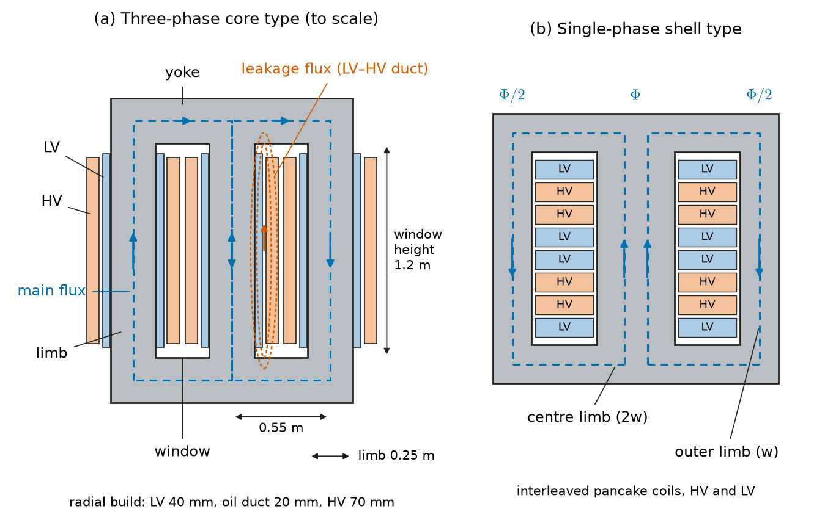
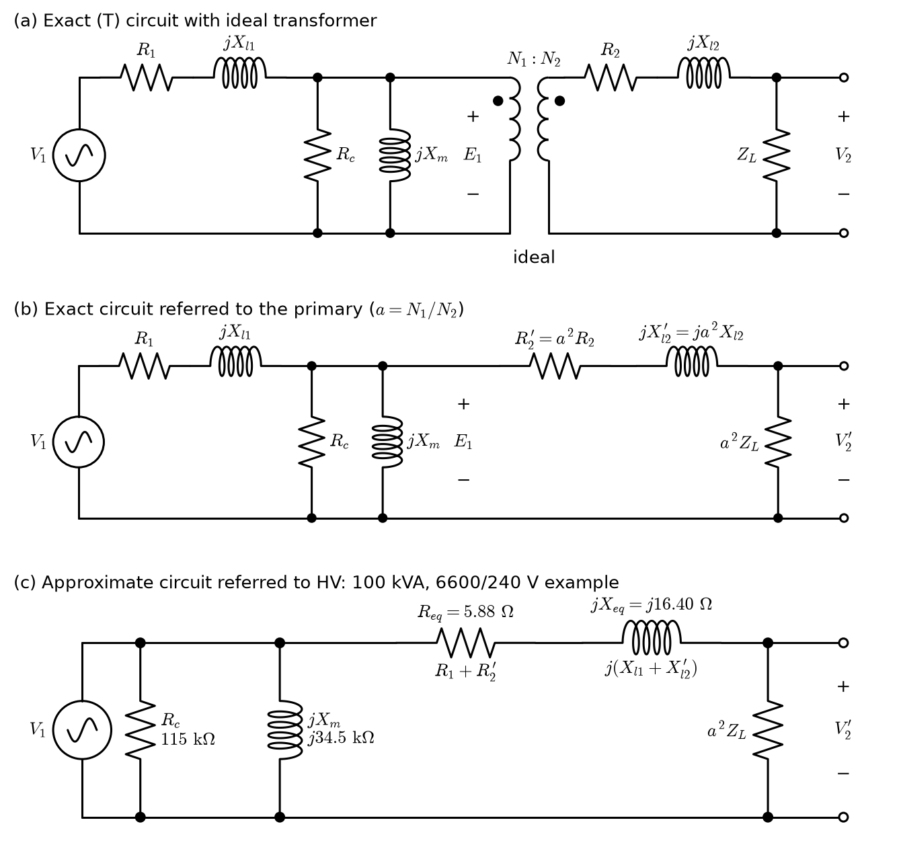
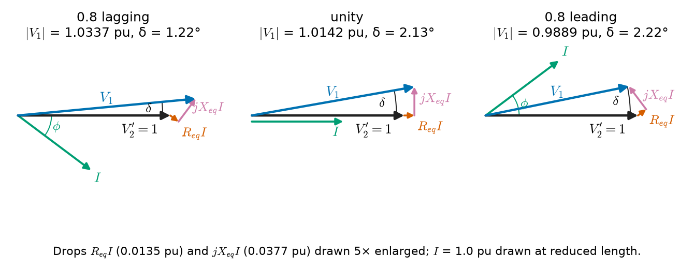
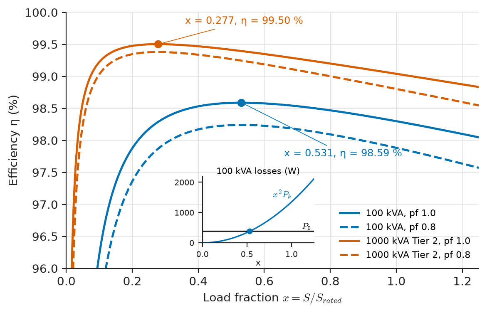
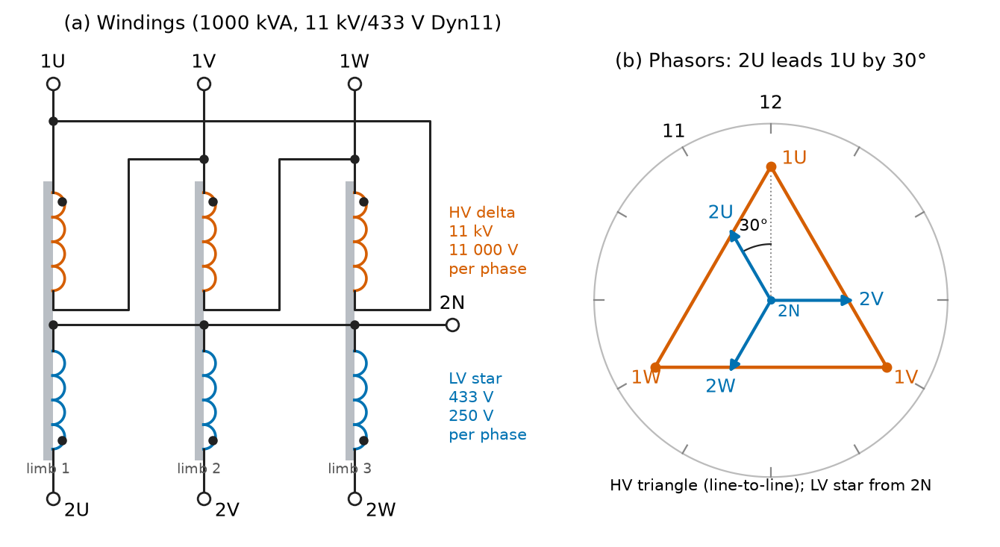
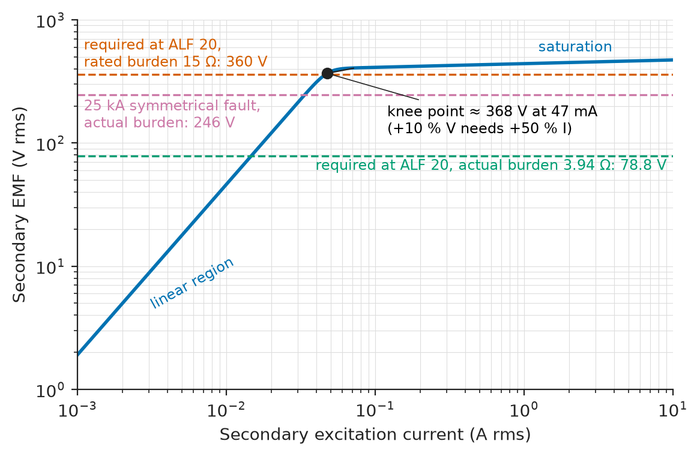

# Chapter 4 — Transformers

*Part II · Transformers and Electrical Machines*

A municipal utility replaces a forty-year-old 1000 kVA distribution transformer that feeds a shopping centre. The old unit never failed, never overheated and still tests healthy, yet the business case for replacing it is easy: its core dissipates about 1.7 kW around the clock, whether the shops are open or not, and its replacement's core dissipates 0.7 kW. That difference alone is nearly 9 MWh a year, and with the lower load losses of the new unit the saving reaches about 12.5 MWh a year, enough to pay for a sizeable part of the new unit over its life. At the other end of the scale, a 400/132 kV substation needs a second 240 MVA transformer to carry a growing city load, and the engineer must check that the new unit, bought from a different manufacturer, will share load with the old one instead of circulating current between them. Between these extremes sit the transformers in wind turbines, data-centre substations, traction supplies and ships, and the instrument transformers that let a relay see a 40 kA fault through a few amperes. The transformer is the most numerous, most efficient and least glamorous machine in the power system; this chapter turns the coupled-coil model into the engineering model that is used to specify, test, load and protect it.

> **How does a real transformer differ from the ideal one, and how are its losses, impedance and regulation measured and used?**
> **What decides whether transformers can share load, how three-phase windings are connected, and when an autotransformer or an instrument transformer is the right device?**

| Concept | Engineering destination |
|---|---|
| Operating principle and construction | Specifying core material, cooling and winding arrangement; reading a nameplate |
| Ideal transformer | Referring impedances across a transformer; per-unit models (Chapter 17) |
| EMF equation | Choosing turns and core area; overfluxing (V/f) protection |
| Equivalent circuit | Load-flow and fault models (Chapters 17–19); efficiency and regulation calculations |
| Phasor diagrams | Understanding why secondary voltage falls with lagging load and can rise with leading load |
| Losses and efficiency | Loss capitalisation in procurement, Ecodesign limits, all-day efficiency |
| Voltage regulation | Tap-changer range, voltage drop at the end of a feeder (Chapter 22) |
| Open- and short-circuit tests | Factory acceptance tests to IEC 60076-1; parameter data for studies |
| Polarity | Correct connection of CTs, parallel units and three-phase banks |
| Parallel operation | Substation expansion, N−1 security, load sharing and circulating current |
| Three-phase transformers | Vector groups (Dyn11, YNd1), earthing, triplen-harmonic paths |
| Autotransformers | 400/275/132 kV interbus units, motor starters, railway autotransformer feeding |
| Instrument transformers | Metering and protection (Chapter 23), CT saturation, VT ferroresonance |

**Roadmap.** Why a transformer works and how it is built (4.1) → the ideal transformer as the starting point (4.2) → turns, flux and frequency (4.3) → the equivalent circuit (4.4) and how its parameters are measured (4.5) → phasor diagrams (4.6) → losses and efficiency (4.7) → voltage regulation (4.8) → polarity (4.9) → parallel operation (4.10) → three-phase transformers (4.11) → autotransformers (4.12) → instrument transformers (4.13).

---

## 4.1 Transformer operating principle

### Two windings, one flux

A transformer is two or more windings linked by a common magnetic core. An alternating voltage applied to the primary drives an alternating flux in the core; the same flux links the secondary and induces in it a voltage in proportion to its turns. Power crosses from one winding to the other through the magnetic field, with no electrical connection and no moving part. Three results from earlier work make this possible, and none of them is re-derived here.

> **Boundary.** Faraday's law in integral form is in [*Engineering Physics*, Ch. 11 §11.4](https://github.com/The-Studio-of-Sadiq/Engineering-Physics/blob/main/CHAPTERS/CHAPTER%2011.md); the transformer as a power-conserving two-port (the TF element of the bond graph) is in [*Engineering Physics*, Ch. 17 §17.5](https://github.com/The-Studio-of-Sadiq/Engineering-Physics/blob/main/CHAPTERS/CHAPTER%2017.md). Mutual inductance, the dot convention, the coupling coefficient and the limit $k\to1$, $L\to\infty$ that yields the ideal transformer are in [*Circuits, Signals and Communications*, Ch. 5 §5.7–5.8](https://github.com/The-Studio-of-Sadiq/Circuits-Signals-and-Communications/blob/main/part-1-circuit-fundamentals/05-capacitors-and-inductors.md). Magnetic circuits, reluctance and saturation are in [Chapter 1](../part-1-magnetic-circuits-and-energy-conversion/01-magnetic-circuit-fundamentals.md), self- and mutual inductance of real windings in [Chapter 2](../part-1-magnetic-circuits-and-energy-conversion/02-electromagnetic-induction.md), and loss mechanisms in [Chapter 3](../part-1-magnetic-circuits-and-energy-conversion/03-energy-conversion-principles.md). This chapter starts from those results and builds the engineering model.

The engineering content lies in how a real transformer differs from perfectly coupled coils: the core needs magnetising current and dissipates power, some flux leaks between the windings, the windings have resistance, the core saturates at high volts per hertz, and the heat must be removed without ageing the insulation.

### Construction

Two core geometries dominate (Figure 4.1). In a **core-type** (core-form) transformer the windings surround the limbs of a rectangular core; a three-phase unit has three limbs joined by top and bottom yokes, with the low-voltage winding nearest the limb and the high-voltage winding concentric outside it. In a **shell-type** (shell-form) transformer the core surrounds the windings, which are arranged as interleaved pancake coils; the geometry gives good short-circuit strength and is used for some large generator step-up and furnace transformers. Distribution transformers are almost all core type; wound-core (rolled ribbon) designs are common for amorphous-metal cores and small pole-mounted units.

The core is built from thin, insulated laminations of grain-oriented silicon steel, stacked with step-lap joints and with the rolling direction along the flux path, so that eddy currents are confined to thin sheets and hysteresis loss is minimised. The windings are copper or aluminium, as round wire, rectangular strip, continuously transposed cable (large units) or foil (LV windings of distribution transformers). The insulation is either mineral or ester oil with paper (liquid-immersed) or epoxy resin and air (dry-type, used indoors in buildings, ships and data centres where fire risk rules out oil).

<!-- FIGURE 4.1 | figures/ch04/fig-4-1-core-and-shell-construction.png | cross-section | Core-type and shell-type transformer construction, showing limbs, yokes, concentric LV and HV windings, main flux and leakage flux. | Content: two side-by-side cross-sections to scale. (a) Three-phase three-limb core-type core, window height 1.2 m, limb diameter 0.25 m, limb centre spacing 0.55 m; on each limb an inner LV winding (radial build 40 mm) and outer HV winding (radial build 70 mm) with a 20 mm oil duct between; dashed lines showing main flux in limbs and yokes and a few leakage-flux lines in the duct between LV and HV. (b) Single-phase shell-type core with a central limb twice the width of the two outer limbs, interleaved pancake coils labelled HV and LV around the central limb, flux splitting into the two outer paths. Labels: limb, yoke, window, LV, HV, main flux, leakage flux. -->

*Figure 4.1 — Core-type and shell-type transformer construction, showing limbs, yokes, concentric LV and HV windings, main flux and leakage flux.*

**Table 4.1 — Core materials for power transformers (typical values at 50 Hz).**

| Material | Thickness | Saturation flux density | Typical design peak flux density | Specific core loss |
|---|---|---|---|---|
| Conventional grain-oriented steel (CGO) | 0.27–0.35 mm | about 2.0 T | 1.55–1.7 T | 1.0–1.3 W/kg at 1.7 T |
| High-permeability GO, domain-refined (HiB, laser-scribed) | 0.18–0.27 mm | about 2.0 T | 1.6–1.75 T | 0.65–0.90 W/kg at 1.7 T |
| Amorphous Fe-based ribbon | about 0.025 mm | 1.56 T | 1.25–1.4 T | 0.1–0.2 W/kg at 1.3 T |
| Non-oriented steel (for comparison; machine laminations) | 0.35–0.65 mm | about 2.0 T | 1.3–1.5 T | 2.5–5 W/kg at 1.5 T |

Amorphous cores cut no-load loss by roughly 60–70 % compared with CGO, at the price of a lower working flux density (a larger, heavier core), higher cost and more audible noise, which is why they are attractive for distribution transformers that spend most of their life lightly loaded.

**Table 4.2 — Representative transformer ratings across the energy field.**

| Application | Rating | Voltages | Notes |
|---|---|---|---|
| Pole-mounted distribution (rural) | 25–100 kVA | 11 kV / 240 V single-phase, or 11 kV / 415 V | Self-protected units common |
| Ground-mounted distribution / unit substation | 315–2500 kVA | 11 kV or 22 kV / 400–433 V, Dyn11 | Buildings, data centres, commercial loads |
| Wind-turbine step-up | 2.5–8 MVA | 0.69–3.3 kV / 33–66 kV | Often in nacelle or tower base, dry-type or ester-filled |
| Solar-plant inverter station | 2.5–6 MVA | 0.6–0.8 kV / 33 kV | Often three-winding with two LV windings |
| Traction (on-board, AC locomotive) | 5–10 MVA | 25 kV / several secondaries | Weight-critical, high flux density, forced oil |
| Generator step-up (GSU) | 100–1300 MVA | 15–27 kV / 220–765 kV, YNd1 or YNd11 | Efficiency about 99.7 % |
| Interbus autotransformer | 240–1000 MVA | 400/132 kV, 400/275 kV, 500/230 kV | With tertiary delta winding |

---

## 4.2 Ideal transformer

### The model and its two rules

The ideal transformer is the limit of perfectly coupled coils on a core of infinite permeability with lossless windings. With turns $N_1$ and $N_2$ and the turns ratio $a=N_1/N_2$, it obeys two rules, taken from [*Circuits, Signals and Communications*, Ch. 5 §5.8](https://github.com/The-Studio-of-Sadiq/Circuits-Signals-and-Communications/blob/main/part-1-circuit-fundamentals/05-capacitors-and-inductors.md):

$$
\frac{V_1}{V_2}=\frac{N_1}{N_2}=a,\qquad \frac{I_1}{I_2}=\frac{1}{a}
$$

with the currents taken as entering the primary dot and leaving the secondary dot. Power in equals power out, $V_1I_1^*=V_2I_2^*$, and no energy is stored. Book 3 states this limit and its status as an approximation; the engineering use made of it here is to move impedances, voltages and currents from one side of a transformer to the other.

### Referring quantities across the transformer

A load $Z_L$ on the secondary appears at the primary as

$$
Z_L'=a^2Z_L
$$

and, conversely, any impedance on the primary side appears on the secondary side divided by $a^2$. This **referral** lets a network that contains transformers be redrawn as a single circuit at one voltage level, which is exactly what the equivalent circuit of Section 4.4 and the per-unit system of [Chapter 17](../part-5-power-system-analysis/17-per-unit-systems-and-network-modeling.md) do.

**Worked example — Referring a cable impedance.** A 1000 kVA, 11 kV/433 V transformer feeds a 400 V switchboard through a cable whose impedance is $0.010+j0.006\ \Omega$ per phase. Seen from the 11 kV side the ratio of phase voltages is the same as the ratio of line voltages for a star–star equivalent, $a=11000/433=25.40$, so the cable referred to 11 kV is $a^2(0.010+j0.006)=645.4\times(0.010+j0.006)=6.45+j3.87\ \Omega$. A few milliohms on the LV side are several ohms at 11 kV; impedances on the low-voltage side of a distribution transformer dominate the fault level at the LV switchboard (Chapter 19) even though they look tiny.

> **Status of the principle: Ideal-transformer rules**
> *Approximate.* Exact for perfect coupling, infinite core permeability and lossless windings; for power transformers the voltage ratio holds to within the regulation (1–6 %) and the current ratio to within the magnetising current (0.1–2 % of rated), and both fail at DC, in saturation and at frequencies where winding capacitance matters.

### Rating

Because the transformer conserves power and its losses depend on current (windings) and voltage (core), its rating is an apparent power, in kVA or MVA, not a real power. The same 1000 kVA transformer can supply 1000 kW at unity power factor or 800 kW at 0.8 lagging with the same winding temperature rise. The rating is fixed by the temperature rise the insulation can tolerate (IEC 60076-2: 65 K average winding rise for mineral-oil units with normal cooling), and the cooling class (ONAN, ONAF, OFAF, ODAF) often gives two or three ratings for one unit, for example 60/80/100 MVA ONAN/ONAF/OFAF.

---

## 4.3 EMF equation

### Turns, flux and frequency

When the core flux is sinusoidal, $\phi=\Phi_m\sin\omega t$, Faraday's law gives a winding EMF $e=N\omega\Phi_m\cos\omega t$, whose RMS value is

$$
E=\frac{2\pi}{\sqrt2}fN\Phi_m=4.44\,fN\Phi_m=4.44\,fNB_mA_c
$$

where $A_c$ is the net (iron) cross-section of the core and $B_m$ the peak flux density. The coefficient 4.44 is $\sqrt2\pi$; it is the form factor 1.11 of a sine wave times 4. Read in the other direction, the equation says that the applied voltage fixes the flux: a transformer connected to a stiff supply runs at the flux density its designer chose, whatever the load, because the primary current adjusts itself to keep the back EMF equal to the supply voltage less a small internal drop.

> **Status of the principle: Transformer EMF equation**
> *Derived.* Follows from Faraday's law for a sinusoidal flux linking all $N$ turns; it holds for the fundamental component even when the magnetising current is distorted, and it fails only if the flux is not sinusoidal (a non-sinusoidal supply voltage, or DC bias from geomagnetic currents or rectifier loads).

### Volts per turn and the design trade-off

The **volts per turn** $E/N=4.44fB_mA_c$ is the designer's central choice. A larger core cross-section means fewer turns of copper for the same voltage (less load loss) but more iron (more no-load loss and weight). Large transformers run at 100–250 V per turn, distribution transformers at 5–20 V per turn. The peak flux density is set by the steel: a working $B_m$ of 1.6–1.7 T leaves a margin below the knee of the $B$–$H$ curve (Chapter 1) for the overvoltage the system may impose.

**Worked example — Turns for a 1000 kVA distribution transformer.** A three-phase 1000 kVA, 11 kV/433 V, 50 Hz, Dyn11 transformer has a net core limb area of $A_c=0.040\ \mathrm{m^2}$, and the designer starts from $B_m=1.7$ T. The LV winding is star-connected, so its phase voltage is $433/\sqrt3=250.0$ V; the HV winding is delta-connected, so its phase voltage is 11 000 V.

At 1.7 T the volts per turn would be $4.44\times50\times1.7\times0.040=15.10$ V, giving $250.0/15.10=16.56$ LV turns. Turns must be whole numbers, so the designer takes $N_2=17$, which gives 14.71 V per turn and an actual peak flux density of $14.71/(4.44\times50\times0.040)=1.656$ T. The HV winding then needs $11000/14.71=748$ turns. The no-load ratio of line voltages is $11000/(748/17)\times\sqrt3=433.0$ V, as required. A ±2×2.5 % off-circuit tap range is obtained by adding or removing $0.025\times748\approx19$ turns per step on the HV winding, which is where taps are placed because the HV current is small.

### Overfluxing

Because $B_m\propto V/f$, a transformer is overfluxed either by overvoltage or by underfrequency. A generator step-up transformer on a unit that is excited while still running up to speed (low $f$) can be driven well into saturation; the magnetising current rises steeply, stray flux heats structural steel and tank walls, and in minutes local hot spots can damage insulation. Generator protection therefore includes a volts-per-hertz (ANSI 24) element, typically alarming at 1.05–1.1 pu V/Hz and tripping on an inverse-time curve up to about 1.2 pu (IEEE C37.106 and C57.12.00 allow continuous operation at 1.05 pu voltage at rated load and 1.1 pu at no load). Geomagnetically induced currents, quasi-DC currents driven through earthed neutrals during geomagnetic storms, cause similar half-cycle saturation.

### Magnetising inrush

When a transformer is energised at a voltage zero, the flux must start from its residual value and rise for half a cycle; the steady-state flux would have been at its negative peak at that instant, so the transient flux reaches up to $2\Phi_m+\Phi_r$, far into saturation. The resulting **inrush current** can reach 8–12 times rated current for distribution transformers and 4–6 times for large units, rich in second harmonic and decaying over 0.1 s to several seconds. Differential protection (Chapter 23) uses the second-harmonic content to tell inrush from an internal fault; controlled (point-on-wave) switching is used for large units and for wind-farm transformers whose sequential energisation would otherwise cause voltage dips.

---

## 4.4 Equivalent circuit

### From ideal to real, element by element

Each departure of the real transformer from the ideal one adds one element to the model (Figure 4.2):

- **Winding resistance** $R_1$, $R_2$: $I^2R$ loss in the conductors, increased at power frequency by eddy currents in the conductors themselves.
- **Leakage reactance** $X_{l1}$, $X_{l2}$: the flux that links one winding but not the other, mainly in the duct between windings. It is nearly linear because its path is mostly through oil or air.
- **Magnetising reactance** $X_m$: the finite permeability of the core means a current is needed to set up the main flux. It is non-linear, rising sharply above about 1.7 T in grain-oriented steel.
- **Core-loss resistance** $R_c$: hysteresis and eddy-current loss in the core, modelled as a resistance across the applied voltage because the loss depends on flux density and hence on voltage.

The exact (T) equivalent circuit places $R_1+jX_{l1}$ in series on the primary, the shunt branch $R_c\parallel jX_m$ across the induced EMF $E_1$, and $R_2+jX_{l2}$ in series on the secondary, connected through an ideal transformer of ratio $a$. Referring the secondary to the primary removes the ideal transformer: $R_2'=a^2R_2$, $X_{l2}'=a^2X_{l2}$, $V_2'=aV_2$, $I_2'=I_2/a$.

<!-- FIGURE 4.2 | figures/ch04/fig-4-2-transformer-equivalent-circuits.png | circuit | Transformer equivalent circuits: exact T circuit with ideal transformer, circuit referred to the primary, and the approximate circuit with the shunt branch moved to the terminals. | Content: three circuits stacked vertically. (a) V1 source, R1 and jXl1 in series, shunt Rc parallel jXm across E1, ideal transformer N1:N2 with dots, R2 and jXl2 in series, load ZL with V2. (b) Same referred to primary: R1, jXl1, shunt Rc parallel jXm, R2' = a^2 R2, jXl2' = a^2 Xl2, load a^2 ZL with V2'. (c) Approximate circuit: shunt Rc parallel jXm at the input terminals, then Req = R1 + R2' and jXeq = Xl1 + Xl2' in series, load. Annotate values for the 100 kVA, 6600/240 V example referred to HV: Req = 5.88 ohm, Xeq = 16.40 ohm, Rc = 115 kilohm, Xm = 34.5 kilohm. -->

*Figure 4.2 — Transformer equivalent circuits: exact T circuit with ideal transformer, circuit referred to the primary, and the approximate circuit with the shunt branch moved to the terminals.*

### The approximate circuit

In a power transformer the shunt branch impedance is 300–3000 times the series impedance, so moving it to the primary terminals changes the series voltage drop by a negligible amount. The result is the **approximate equivalent circuit**: a shunt branch across the supply, and a single series impedance

$$
Z_{eq}=R_{eq}+jX_{eq}=(R_1+a^2R_2)+j(X_{l1}+a^2X_{l2})
$$

feeding the referred load. For load-flow and fault studies even the shunt branch is usually dropped, and the transformer becomes a series impedance (with an off-nominal ratio for tap position) in the network model of Chapter 17.

> **Status of the principle: Approximate transformer equivalent circuit**
> *Approximate.* Assumes linear magnetising and core-loss elements at constant frequency and a shunt branch large compared with the series impedance; it is accurate to a fraction of a per cent for regulation and efficiency at rated voltage and frequency, and it fails for inrush and overfluxing (non-linear $X_m$), for geomagnetic DC bias, for harmonics above a few kHz (winding capacitance), and for lightning surges, where the windings behave as distributed networks (Chapter 24).

### Per-unit values

Expressed in per unit of the transformer's own rating (Chapter 17), the parameters of transformers of very different sizes fall into narrow bands, which is why a missing value can be estimated with confidence.

**Table 4.3 — Typical transformer parameters in per unit on own rating.**

| Rating | Short-circuit impedance $z$ | $X/R$ ratio | No-load current | No-load loss | Load loss at rated current |
|---|---|---|---|---|---|
| 25–100 kVA distribution | 0.035–0.04 | 1–2 | 1.5–2.5 % | 0.15–0.3 % | 1.2–2.0 % |
| 315–2500 kVA distribution | 0.04–0.06 | 3–6 | 0.5–1.5 % | 0.07–0.15 % | 0.8–1.2 % |
| 10–60 MVA primary substation | 0.08–0.12 | 15–30 | 0.2–0.5 % | 0.04–0.08 % | 0.4–0.6 % |
| 100–1000 MVA GSU and interbus | 0.12–0.18 | 40–80 | 0.05–0.3 % | 0.02–0.05 % | 0.2–0.35 % |

IEC 60076-5 sets minimum short-circuit impedances so that the transformer itself limits fault current: 4 % up to 630 kVA, 5 % from 631 to 1250 kVA, 6 % from 1251 to 2500 kVA, 7 % to 6300 kVA, 8 % to 25 MVA, rising to 12.5 % above 63 MVA. Impedance is a deliberate design choice: higher impedance limits fault current but raises voltage regulation and reactive-power consumption.

---

## 4.5 Open-circuit and short-circuit tests

### Separating the shunt and series branches

The equivalent-circuit parameters are measured, not calculated, and two simple tests do it because the shunt and series branches can be separated by choosing the operating condition (IEC 60076-1 calls them the no-load and load-loss measurements).

**Open-circuit (no-load) test.** Rated voltage at rated frequency is applied to one winding, usually the LV, with the other winding open. The current is the no-load current $I_0$, a few per cent of rated or less, so the series drop is negligible and the wattmeter reads the core loss $P_0$. From $V_{oc}$, $I_{oc}$ and $P_{oc}$:

$$
\cos\phi_0=\frac{P_{oc}}{V_{oc}I_{oc}},\qquad R_c=\frac{V_{oc}}{I_{oc}\cos\phi_0},\qquad X_m=\frac{V_{oc}}{I_{oc}\sin\phi_0}
$$

**Short-circuit (load-loss) test.** One winding, usually the LV, is short-circuited, and a reduced voltage is applied to the other until rated current flows. That voltage is only the impedance voltage, 4–15 % of rated, so the core flux is a few per cent of normal and the core loss is negligible: the wattmeter reads the copper loss at rated current. From $V_{sc}$, $I_{sc}$ and $P_{sc}$:

$$
Z_{eq}=\frac{V_{sc}}{I_{sc}},\qquad R_{eq}=\frac{P_{sc}}{I_{sc}^2},\qquad X_{eq}=\sqrt{Z_{eq}^2-R_{eq}^2}
$$

referred to the side on which the measurement is made. The load loss is corrected to the reference temperature (75 °C for oil-immersed units under IEC 60076-1), since copper resistance rises by about 0.39 % per kelvin. The open-circuit test is a Z-parameter measurement in the two-port language of [*Circuits, Signals and Communications*, Ch. 12](https://github.com/The-Studio-of-Sadiq/Circuits-Signals-and-Communications/blob/main/part-3-advanced-network-theory/12-two-port-networks.md).

**Worked example — Parameters from test data.** A single-phase 100 kVA, 6600/240 V, 50 Hz pole-mounted transformer gives:

- Open-circuit test on the LV side: 240 V, 5.5 A, 380 W.
- Short-circuit test on the HV side: 264 V, 15.15 A, 1350 W.

Rated currents are $100000/6600=15.15$ A (HV) and $100000/240=416.7$ A (LV), so the short-circuit test was made at rated current, and the no-load current is $5.5/416.7=1.3$ % of rated.

*Open circuit.* $\cos\phi_0=380/(240\times5.5)=0.288$. The core-loss component of current is $I_c=5.5\times0.288=1.583$ A and the magnetising component $I_m=5.5\sqrt{1-0.288^2}=5.267$ A. Hence $R_c=240/1.583=151.6\ \Omega$ and $X_m=240/5.267=45.57\ \Omega$ on the LV side. With $a=6600/240=27.5$, referred to the HV side these are $R_c=114.6\ \mathrm{k\Omega}$ and $X_m=34.46\ \mathrm{k\Omega}$.

*Short circuit.* $Z_{eq}=264/15.15=17.42\ \Omega$, $R_{eq}=1350/15.15^2=5.88\ \Omega$ and $X_{eq}=\sqrt{17.42^2-5.88^2}=16.40\ \Omega$, all referred to the HV side. The HV base impedance is $6600^2/100000=435.6\ \Omega$, so $z=0.040$, $r=0.0135$ and $x=0.0377$ per unit: a 4 % impedance transformer with an X/R ratio of 2.8, typical for this size (Table 4.3).

The tests separate the two branches but cannot split $R_{eq}$ into $R_1$ and $R_2'$; where the split matters (the exact circuit), a DC resistance measurement of each winding is used, or the two are assumed equal when referred to the same side.

### Accuracy at low power factor

Both tests on large units run at very low power factor (0.02–0.1), where a small instrument-transformer phase error becomes a large power error ([*Circuits, Signals and Communications*, Ch. 9 §9.9](https://github.com/The-Studio-of-Sadiq/Circuits-Signals-and-Communications/blob/main/part-2-transient-and-ac-analysis/09-ac-power.md) quantifies this). Loss measurements on large transformers, which are guaranteed values with financial penalties, use class 0.05–0.1 instrument transformers and phase-corrected digital power analysers.

---

## 4.6 Phasor diagrams

### No load

At no load the primary draws only $I_0$, made up of a core-loss component $I_c$ in phase with the applied voltage and a magnetising component $I_m$ lagging it by 90°, in phase with the flux. Since $I_0$ is small, $V_1\approx E_1$, and the no-load phasor diagram is a voltage phasor with a small current lagging it by about 70–85°. The no-load current is distorted: because the $B$–$H$ curve is non-linear, a sinusoidal flux needs a peaky magnetising current with a large third harmonic (typically 30–50 % of the fundamental magnetising component), which matters for the three-phase connections of Section 4.11.

### On load

On load, the secondary current $I_2$ draws a balancing primary current $I_2'=I_2/a$, and the primary current is $I_1=I_0+I_2'$. Referred to the primary, the voltage equation of the approximate circuit is

$$
V_1=V_2'+I_2'(R_{eq}+jX_{eq})
$$

Figure 4.3 draws this equation for three load power factors at the same current magnitude. With a lagging load, the $jX_{eq}I$ drop has a large component in phase with $V_2'$ (at 0.8 power factor it leads $V_2'$ by only 53°, and it swings into phase as the power factor falls towards zero), so $V_1$ must exceed $V_2'$ by a large margin, and with constant $V_1$ the secondary voltage falls. At unity power factor the reactive drop is in quadrature with $V_2'$ and contributes only a second-order rise in magnitude. With a sufficiently leading load, the reactive drop points backwards, and the secondary voltage can exceed the open-circuit value: this is the source of the voltage rise at the end of a lightly loaded cable network with a large capacitor bank or a PV-heavy feeder exporting reactive power.

<!-- FIGURE 4.3 | figures/ch04/fig-4-3-phasor-diagrams-load-pf.png | phasor | Phasor diagrams of the approximate equivalent circuit referred to the primary for rated current at 0.8 lagging, unity and 0.8 leading power factor. | Content: three panels, same scale. Reference phasor V2' horizontal, length 1.0 pu. Current I at 1.0 pu drawn at -36.9 deg, 0 deg and +36.9 deg respectively. Drop IReq (0.0135 pu, parallel to I) and IjXeq (0.0377 pu, 90 deg ahead of I) drawn tip to tail from the end of V2', exaggerated 5x and labelled so. Resulting V1 drawn from origin. Annotate magnitudes V1 = 1.0337, 1.0142 and 0.9889 pu for V2' = 1 pu. Small angle delta between V1 and V2' marked. -->

*Figure 4.3 — Phasor diagrams of the approximate equivalent circuit referred to the primary for rated current at 0.8 lagging, unity and 0.8 leading power factor.*

---

## 4.7 Losses and efficiency

### Where the losses are

Transformer losses separate into two groups that behave differently with load:

- **No-load loss** $P_0$ (iron or core loss): hysteresis plus eddy-current loss in the core, a function of $B_m$ and $f$ only. It is constant whenever the transformer is energised, which for a distribution transformer means 8760 hours a year.
- **Load loss** $P_k$ (copper loss): $I^2R$ loss in the windings plus stray loss from leakage flux in winding conductors, clamps and tank walls. It varies as the square of the load fraction $x=S/S_{rated}$: $P_{cu}=x^2P_k$.

The separation of core loss into its hysteresis and eddy components, and their dependence on frequency and flux density, are the subject of [Chapter 3](../part-1-magnetic-circuits-and-energy-conversion/03-energy-conversion-principles.md); for transformer work at fixed voltage and frequency $P_0$ is simply the measured no-load loss. Harmonic load currents raise the stray and winding eddy loss roughly as $h^2$ for each harmonic order $h$, which is why transformers feeding data-centre IT loads or variable-speed drives are derated or specified with a K-factor (IEEE C57.110).

### Efficiency and its maximum

At load fraction $x$ and power factor $\cos\phi$,

$$
\eta=\frac{xS_r\cos\phi}{xS_r\cos\phi+P_0+x^2P_k}
$$

Differentiating with respect to $x$ shows the efficiency is greatest when the variable loss equals the fixed loss, $x^2P_k=P_0$, that is at

$$
x_{\eta\max}=\sqrt{\frac{P_0}{P_k}}
$$

> **Status of the principle: Maximum efficiency when copper loss equals core loss**
> *Derived.* Follows from minimising total loss per unit output with a constant loss and a loss proportional to $x^2$; it assumes constant voltage, frequency and power factor, and shifts when load loss is corrected for winding temperature or harmonic content.

A power transformer that runs near full load around the clock (a GSU) is designed with $x_{\eta\max}$ near 0.7–1; a distribution transformer whose average load is 20–40 % of rating is designed with low no-load loss and $x_{\eta\max}$ near 0.3–0.5.

**Worked example — Efficiency of the 100 kVA transformer.** Using $P_0=380$ W and $P_k=1350$ W from Section 4.5:

- Full load, 0.8 power factor: output 80 kW, losses $380+1350=1730$ W, $\eta=80/81.73=97.88$ %.
- Half load, 0.8 power factor: output 40 kW, copper loss $0.25\times1350=337.5$ W, $\eta=40/40.718=98.24$ %.
- Full load, unity power factor: $\eta=100/101.73=98.30$ %.

Maximum efficiency occurs at $x=\sqrt{380/1350}=0.531$, i.e. 53 kVA, where at unity power factor $\eta=53.05/(53.05+0.76)=98.59$ %.

Figure 4.4 shows the efficiency curve of this unit and of the 1000 kVA unit of the next example.

<!-- FIGURE 4.4 | figures/ch04/fig-4-4-efficiency-versus-load.png | plot | Efficiency against load fraction for the 100 kVA (P0 = 380 W, Pk = 1350 W) and 1000 kVA Tier 2 (P0 = 693 W, Pk = 9000 W) transformers at unity and 0.8 power factor, with the maximum-efficiency points marked. | Content: x-axis load fraction 0 to 1.25, y-axis efficiency 96 to 100 percent. Four curves: 100 kVA at pf 1.0 and 0.8 (solid and dashed, blue), 1000 kVA at pf 1.0 and 0.8 (solid and dashed, orange). Markers at x = 0.531 (eta 98.59 percent, 100 kVA pf 1) and x = 0.277 (1000 kVA, eta about 99.50 percent at pf 1). Secondary y-axis or inset: loss components P0 constant and x^2 Pk rising, crossing at the maximum-efficiency point. -->

*Figure 4.4 — Efficiency against load fraction for the 100 kVA (P0 = 380 W, Pk = 1350 W) and 1000 kVA Tier 2 (P0 = 693 W, Pk = 9000 W) transformers at unity and 0.8 power factor, with the maximum-efficiency points marked.*

### All-day efficiency and loss capitalisation

For a transformer with a varying load, the energy efficiency over a day or a year is the useful figure:

$$
\eta_{\text{all-day}}=\frac{\sum S_ix_i\cos\phi_i\,t_i}{\sum S_ix_i\cos\phi_i\,t_i+24P_0+\sum x_i^2P_k\,t_i}
$$

**Worked example — Replacing an old distribution transformer.** A 1000 kVA unit feeding a shopping centre carries 80 % load for 6 h, 50 % for 10 h and 20 % for 8 h each day, at 0.9 power factor. Compare an old unit with $P_0=1.7$ kW, $P_k=10.5$ kW and a new unit meeting the EU Ecodesign Tier 2 limits (Regulation (EU) 548/2014) for 1000 kVA liquid-immersed transformers, $P_0=693$ W and $P_k=9.0$ kW.

Energy delivered per day: $1000\times0.9\times(0.8\times6+0.5\times10+0.2\times8)=900\times11.4=10260$ kWh.

The sum $\sum x_i^2t_i=0.64\times6+0.25\times10+0.04\times8=6.66$ h. New unit: copper-loss energy $9.0\times6.66=59.94$ kWh, core-loss energy $0.693\times24=16.63$ kWh, total 76.57 kWh, $\eta_{\text{all-day}}=99.26$ %. Old unit: $10.5\times6.66=69.93$ kWh plus $1.7\times24=40.8$ kWh, total 110.73 kWh, $\eta_{\text{all-day}}=98.93$ %.

The difference is 34.2 kWh per day, or 12.5 MWh per year; at USD 0.12 per kWh that is about USD 1500 a year, and the loss reduction also frees capacity upstream. Note where the new unit's best efficiency sits: $\sqrt{693/9000}=0.28$, close to the light-load periods that dominate the day. Utilities formalise this trade-off by **loss capitalisation**: each tender is evaluated on purchase price $+\,A\cdot P_0+B\cdot P_k$, where $A$ and $B$ (typically several thousand USD per kW, with $A$ larger than $B$ for distribution units) are the present value of a kilowatt of loss over the transformer's 30–40 year life.

**Table 4.4 — Representative efficiencies at rated load, unity power factor.**

| Transformer | Typical efficiency |
|---|---|
| 25–100 kVA distribution | 98.0–98.8 % |
| 1000 kVA distribution, Ecodesign Tier 2 | 99.0–99.2 % |
| 1000 kVA dry-type cast resin (building, data centre) | 98.8–99.0 % |
| 40 MVA primary substation | 99.4–99.6 % |
| 500 MVA GSU | 99.7–99.8 % |

---

## 4.8 Voltage regulation

### Definition and approximate formula

**Voltage regulation** is the change in secondary voltage from no load to a specified load, with the primary voltage held constant, expressed as a fraction of the full-load secondary voltage:

$$
\text{regulation}=\frac{V_{2,nl}-V_{2,fl}}{V_{2,fl}}
$$

(IEC 60076-1 references it to the rated no-load voltage instead; the difference is second order.) From the phasor equation of Section 4.6, with per-unit resistance $r$ and reactance $x$ and a load at power factor angle $\phi$ (positive for lagging),

$$
\varepsilon\approx r\cos\phi+x\sin\phi+\frac{(x\cos\phi-r\sin\phi)^2}{2}
$$

The first two terms are usually enough; the quadratic term matters only for high-impedance units at unity or leading power factor.

> **Status of the principle: Approximate regulation formula**
> *Approximate.* A Taylor expansion of the phasor equation of the series equivalent circuit; accurate to better than 0.1 % of rated voltage for impedances up to about 15 %, and it ignores the magnetising branch and any change in the load with voltage.

**Worked example — Regulation of the 100 kVA transformer.** With $r=0.0135$ and $x=0.0377$ pu:

- At 0.8 lagging ($\sin\phi=0.6$): first-order $0.0135\times0.8+0.0377\times0.6=3.34$ %; with the quadratic term 3.37 %; an exact phasor solution gives $\lvert V_1\rvert=1.0337$ pu for $V_2'=1$, i.e. 3.37 %.
- At unity power factor: first-order 1.35 %, exact 1.42 %.
- At 0.8 leading: first-order $-1.18$ %, exact $-1.11$ %, a voltage *rise* on load.

A 240 V supply therefore falls by about 8 V from no load to full load at a typical domestic power factor, which is one reason distribution transformers are set with a no-load voltage a few per cent above nominal (433 V for a 400 V system).

### Tap changers

Regulation is compensated by changing the turns ratio. **Off-circuit tap changers** (de-energised tap changers) give a fixed setting, typically ±2×2.5 %, chosen at commissioning or seasonally. **On-load tap changers** (OLTC) switch taps under load through a diverter switch with transition resistors; primary-substation and transmission transformers have ranges of ±10 % to ±15 % in 17–33 steps of 1.25–1.67 %, controlled by an automatic voltage control relay with line-drop compensation (Chapter 22). High-PV distribution networks increasingly fit OLTCs to 11 kV/400 V units too, because reverse power flow raises the voltage at noon.

---

## 4.9 Transformer polarity

### Additive and subtractive polarity

The dot convention of [*Circuits, Signals and Communications*, Ch. 5 §5.7](https://github.com/The-Studio-of-Sadiq/Circuits-Signals-and-Communications/blob/main/part-1-circuit-fundamentals/05-capacitors-and-inductors.md) marks terminals whose voltages rise together. On a power transformer the same information is given by terminal markings: H1/X1 in IEEE practice, 1U/2U (or A/a) in IEC practice, where terminals with the same subscript are instantaneously of the same polarity. Polarity is called **subtractive** when H1 and X1 are physically adjacent (the standard for large transformers, and for distribution transformers above 200 kVA or 8.66 kV in IEEE C57.12.00) and **additive** when H1 is diagonally opposite X1 (the standard for small single-phase distribution transformers in North America). The names come from the test below.

### Polarity test

Connect H1 to the adjacent LV terminal, apply a low AC voltage $V$ across the HV winding and measure the voltage between H2 and the other LV terminal. If the reading is $V-V/a$, the polarity is subtractive; if it is $V+V/a$, additive. A DC kick test (a battery momentarily applied to the HV winding, observing the deflection of a DC voltmeter on the LV winding) gives the same answer and is used on CTs, where a polarity error reverses a differential or directional relay.

Polarity matters wherever transformer voltages or currents are added or compared: paralleling (wrong polarity is a dead short), three-phase banks (Section 4.11), differential and directional relays (Chapter 23), and revenue metering, where one reversed CT makes a three-element meter read a third of the true energy.

---

## 4.10 Parallel operation

Substations parallel transformers to carry a load larger than one unit, to provide N−1 security and to grow capacity in steps. (Data-centre and hospital substations often keep a normally open bus-coupler instead, to limit fault level.)

### Conditions for satisfactory parallel operation

1. **Same polarity** (single-phase) or **same vector group** (three-phase, Section 4.11). This is mandatory: a phase displacement of 30° between secondaries drives a circulating current of about $2\sin15^\circ/(z_A+z_B)$ pu, several times rated.
2. **Same voltage ratio** (within about ±0.5 %, the IEC 60076-1 tolerance on ratio). A difference $\Delta v$ drives a circulating current $\Delta v/(z_A+z_B)$ at no load.
3. **Same per-unit impedance** (within about ±10 %), so that load divides in proportion to rating.
4. **Similar X/R ratio**, so that the currents are in phase and the sum of the two currents equals the load current.
5. **Same phase sequence** (three-phase).

For two transformers with the same ratio, the load divides inversely as the impedances expressed in ohms on a common base, i.e.

$$
\frac{S_A}{S_B}=\frac{S_{rA}/z_A}{S_{rB}/z_B}
$$

where $z_A$, $z_B$ are per unit on their own ratings. A transformer with a lower per-unit impedance takes more than its share.

**Worked example — Sharing between unequal transformers.** A 1000 kVA unit with $z_A=5$ % and a 1600 kVA unit with $z_B=6$ % (same ratio, same X/R) supply 2400 kVA. The "admittance weights" are $1000/0.05=20000$ and $1600/0.06=26667$. Unit A takes $2400\times20000/46667=1029$ kVA, 2.9 % overload; unit B takes 1371 kVA, 86 % of its rating. The largest load the pair can carry without overloading either is $1000\times46667/20000=2333$ kVA, not the 2600 kVA nameplate sum. The fix, if the units cannot be matched, is to accept the derating or to specify the new unit's impedance to match the old one; manufacturers can design to an impedance within a tolerance of ±7.5–10 %.

**Worked example — Circulating current from a ratio mismatch.** Two identical 1000 kVA, 5 % transformers are paralleled with one on a tap 1 % higher than the other. At no load, the circulating current is $0.01/(0.05+0.05)=0.10$ pu, i.e. 10 % of rated current, flowing round the loop and adding about 1 % of rated load loss in each unit ($0.1^2$ of $P_k$) with no useful output. On load it adds vectorially to the load current, overloading one unit while the other runs light. Paralleled units with on-load tap changers are therefore controlled by master–follower or circulating-current-minimisation schemes that keep the taps in step.

---

## 4.11 Three-phase transformers

### Banks and three-phase cores

A three-phase transformation can be made with a **bank** of three single-phase transformers or with a **three-phase unit** on a common core. The common core is lighter, cheaper and more efficient, because in a three-limb core the return flux of each limb flows through the other two (the three fluxes sum to zero), and it occupies less space. Banks are used where a single three-phase unit would exceed transport limits (very large GSUs, 765 kV units) and where a spare single-phase unit gives cheaper security. A **five-limb** core provides return limbs for zero-sequence and third-harmonic flux and reduces the height of the yokes; it is common for large units.

### Connections and vector groups

Each set of windings is connected in star (Y, with N for an accessible neutral), delta (D) or zigzag (Z). The **vector group** of IEC 60076-1 names the HV connection in capitals, the LV connection in lower case and the phase displacement of the LV voltages behind the HV voltages in multiples of 30°, read as a clock number: Dyn11 means delta HV, star LV with neutral brought out, LV leading HV by 30° (or lagging by 330°). The star–delta voltage and current relations themselves come from [*Circuits, Signals and Communications*, Ch. 10 §10.3–10.4](https://github.com/The-Studio-of-Sadiq/Circuits-Signals-and-Communications/blob/main/part-2-transient-and-ac-analysis/10-three-phase-circuits.md); what a transformer adds is the phase shift between windings of different connection and the paths it offers to zero-sequence and triplen-harmonic currents.

<!-- FIGURE 4.5 | figures/ch04/fig-4-5-dyn11-connection-and-vectors.png | schematic | Dyn11 three-phase transformer: winding connections and the HV and LV voltage phasors showing the 30 degree phase displacement. | Content: left, three HV windings connected in delta between terminals 1U, 1V, 1W, each magnetically coupled (drawn vertically aligned on the same limb) to an LV winding; LV windings connected in star with neutral 2N brought out to terminals 2U, 2V, 2W. Right, phasor diagram: HV line-to-line triangle 1U-1V-1W, with 1U at 12 o'clock; LV star phasors 2U, 2V, 2W from the neutral, 2U pointing at 11 o'clock (30 deg ahead). Clock face with 12 and 11 marked. Ratings annotated: 1000 kVA, 11 kV delta / 433 V star, HV phase voltage 11000 V, LV phase voltage 250 V. -->

*Figure 4.5 — Dyn11 three-phase transformer: winding connections and the HV and LV voltage phasors showing the 30 degree phase displacement.*

**Table 4.5 — Common three-phase connections and where they are used.**

| Vector group | Typical use | Why |
|---|---|---|
| Dyn11 (Dyn1 in some countries) | Distribution: 11–33 kV / 400 V | Delta HV traps triplen currents; earthed LV neutral supplies single-phase loads; LV earth faults draw positive-, negative- and zero-sequence current balanced in the delta |
| YNd1 or YNd11 | Generator step-up; wind and solar collector step-up | Earthed HV neutral for the transmission system; delta on the generator side isolates generator from HV earth faults |
| YNyn0 with delta tertiary | Transmission interbus (also as autotransformer) | No phase shift between networks; tertiary provides zero-sequence path, stabilises neutral, can feed reactors or station supply |
| Dd0 | Industrial plants, some rectifier supplies | No neutral needed; can run "open delta" (V–V) at 57.7 % rating with one unit out |
| Yd/Dd pair (30° apart) | 12-pulse rectifiers for drives, HVDC, electrolysers | Cancels 5th and 7th harmonics in the supply |
| ZNyn or zigzag earthing transformer | Creating a neutral on a delta or unearthed system | Low zero-sequence impedance, high positive-sequence impedance |

### Why star–star needs a delta somewhere

A star–star transformer without a neutral connection or delta winding cannot carry the third-harmonic magnetising current that a sinusoidal flux requires, because triplen currents are in phase in all three lines and need a return path. The flux then contains a third harmonic, and in a bank or a five-limb core the phase voltages acquire a third-harmonic component that can exceed 50 % of the fundamental; in a three-limb core the triplen flux is forced out through the tank and heats it. Unbalanced single-phase loads on an unearthed-primary star–star unit also cause the neutral to shift. The remedy is a delta winding somewhere: as the main HV or LV winding, or as a **tertiary** winding (stabilising winding) of about one-third of the unit rating. This is why distribution transformers are Dyn and why star–star interbus units carry a delta tertiary. The zero-sequence equivalent circuits of each connection are developed in [Chapter 19](../part-5-power-system-analysis/19-fault-analysis.md).

### Phase shift and the per-phase model

For balanced studies a three-phase transformer is modelled per phase as a star–star equivalent with the per-phase impedance, plus a phase shift of the vector group. The phase shift is irrelevant within one voltage level, but it matters wherever two paths through different transformers meet: paralleling (Section 4.10), closing a ring between two substations fed from differently connected units, and setting transformer differential protection (Chapter 23), where the relay must compensate the 30° shift and remove the zero-sequence current that the delta winding blocks.

**Worked example — Line currents through a Dyn11 unit.** The 1000 kVA, 11 kV/433 V Dyn11 transformer at full load has LV line (and phase) current $1000000/(\sqrt3\times433)=1333$ A. The HV line current is $1000000/(\sqrt3\times11000)=52.5$ A, and the HV delta winding carries $52.5/\sqrt3=30.3$ A. The check on the turns: winding current ratio $1333/30.3=44.0$, equal to the turns ratio $748/17=44.0$. An LV earth-fault current $I_f$ flows in one LV winding and is balanced by $I_f/44.0$ in the corresponding HV delta winding, which appears in two HV lines in opposite directions, so no zero-sequence current flows at 11 kV; this is why an HV earth-fault relay cannot see an LV earth fault through a Dyn transformer.

---

## 4.12 Autotransformers

### One winding, two voltages

An autotransformer has a single winding per phase with a tap: the lower voltage is taken between the tap and the common end. Part of the winding (the **common** winding) is shared by both circuits; the remainder (the **series** winding) carries only the HV current. For a ratio $a=V_H/V_L>1$, power passes from one side to the other partly by conduction and partly by transformer action. The power actually transformed magnetically, which fixes the size of the core and windings, is

$$
S_{\text{winding}}=S\left(1-\frac{V_L}{V_H}\right)=kS
$$

where $k=1-V_L/V_H$ is the **co-ratio**. For ratios close to 1 the saving is large.

> **Status of the principle: Autotransformer winding rating**
> *Derived.* Follows from the ideal-transformer rules applied to the series and common windings; it neglects magnetising current and losses, and holds only while the two circuits are galvanically connected.

**Worked example — A 400/275 kV interbus autotransformer.** A 500 MVA three-phase interbus unit connects a 400 kV and a 275 kV system. The co-ratio is $k=1-275/400=0.3125$, so the windings are equivalent to a two-winding transformer of $0.3125\times500=156$ MVA. The HV line current at full load is $500\times10^6/(\sqrt3\times400\times10^3)=722$ A and the LV line current 1050 A; the series winding carries 722 A and the common winding the difference, $1050-722=328$ A. The unit is roughly a third of the size, weight and loss of a 500 MVA two-winding transformer, which is decisive when the transport limit on a road or rail route is 250–400 t.

### Limitations

The price of the saving is galvanic connection between the two systems: an earth fault or a surge on the HV side reaches the LV side directly, so both systems must have compatible insulation levels and earthing (both solidly earthed, in practice). The per-unit short-circuit impedance on the throughput rating is roughly $k$ times that of the equivalent two-winding transformer, so fault currents are higher. Autotransformers are therefore used where the ratio is below about 3 and both networks are effectively earthed: 400/132, 400/275, 500/230 and 345/138 kV interbus units; variable-voltage laboratory supplies (the "Variac"); autotransformer motor starters (Chapter 6), where a 65 % or 80 % tap reduces starting current; and 2×25 kV autotransformer traction feeding, where autotransformers every 10–15 km along an electrified railway halve the current in the overhead line and reduce interference in lineside cables.

---

## 4.13 Instrument transformers

### Purpose and boundary

Relays and meters work with standard secondary values: 1 A or 5 A from **current transformers** (CTs) and 100–120 V (line-to-line) from **voltage transformers** (VTs). Instrument transformers scale down the primary quantities, isolate the low-voltage secondary circuits from the high-voltage system, and allow the secondary circuits to be earthed for safety. Their accuracy classes and the effect of phase displacement on power measurement at low power factor are given in [*Circuits, Signals and Communications*, Ch. 9 §9.9](https://github.com/The-Studio-of-Sadiq/Circuits-Signals-and-Communications/blob/main/part-2-transient-and-ac-analysis/09-ac-power.md); their application to protection schemes is developed in [Chapter 23](../part-6-transmission-distribution-and-protection/23-power-system-protection.md). This section explains how they differ from power transformers and where they fail.

### Current transformers

A CT has its primary in series with the circuit, often a single turn (the busbar or cable passing through a ring core), and a secondary of $N_2$ turns feeding a low-impedance burden. It is a transformer operated close to short circuit: the primary current is imposed by the power system, and the secondary current is $I_1/N_2$ less the magnetising current needed to produce the flux that drives the secondary current through its burden. Errors therefore rise with the burden, and with the primary current when the core approaches saturation. Two consequences follow.

- **Never open-circuit a CT secondary under load.** With no secondary current to oppose it, the whole primary current becomes magnetising current; the core saturates every half-cycle and the rapid flux reversals induce peaks of several kilovolts across the open terminals, a shock and insulation hazard. CT secondaries are shorted by test blocks before relays or meters are removed.
- **Metering and protection CTs are different devices.** A metering CT (class 0.2S, 0.5 under IEC 61869-2) is designed to saturate early, to protect the meter during faults. A protection CT (class 5P or 10P, or PX) must reproduce currents up to its **accuracy-limit factor** (ALF) times rated current within 5 % or 10 % composite error, e.g. 5P20: 5 % error at 20 times rated current.

**Worked example — Checking a protection CT.** A 400/1 A, 5P20, 15 VA CT has a secondary winding resistance of 3.0 Ω. Its rated burden is $15/1^2=15\ \Omega$, so at the accuracy limit (20 A secondary) it must develop an EMF of $20\times(3.0+15)=360$ V without saturation. The actual burden is a digital relay (0.2 Ω) and 50 m of 2.5 mm² copper lead each way, $2\times0.050\times7.41=0.74\ \Omega$. At 20 times rated current the required EMF is only $20\times(3.0+0.74+0.2)=78.8$ V, well inside capability; the CT will reproduce symmetrical currents far beyond 20 times rated with the lighter burden. With a 25 kA fault the secondary current is $25000/400=62.5$ A, demanding $62.5\times3.94=246$ V, still inside the 360 V capability for the symmetrical current. The DC offset of a real fault can multiply the flux demand by $1+X/R$, however (a factor of 15 for $X/R=14$), so for fast protection on high-X/R systems the transient performance classes TPX, TPY and TPZ of IEC 61869-2 are used.

<!-- FIGURE 4.6 | figures/ch04/fig-4-6-ct-excitation-and-burden.png | plot | Excitation characteristic of a 400/1 A 5P20 CT with the knee point and the EMF required for rated and actual burden at 20 times rated current. | Content: log-log axes, x-axis secondary excitation current 0.001 to 10 A, y-axis secondary EMF 1 to 1000 V. Excitation curve rising with log-log slope about 1.4 (linear region) through 5 V at 0.002 A and 380 V at 0.05 A, knee at about 368 V and 47 mA, then flattening (saturation) to 450 V at 2 A. Horizontal dashed lines at 360 V labelled "required at ALF 20, rated burden 15 ohm" and 78.8 V labelled "required with actual burden 3.94 ohm", and 246 V labelled "25 kA symmetrical fault". Knee point marked per IEC definition (10 percent voltage rise needs 50 percent current rise). -->

*Figure 4.6 — Excitation characteristic of a 400/1 A 5P20 CT with the knee point and the EMF required for rated and actual burden at 20 times rated current.*

### Voltage transformers

An inductive VT is a small, accurate transformer operated near open circuit; its errors rise with burden. At transmission voltages above about 110 kV a **capacitor voltage transformer** (CVT) is cheaper: a capacitive divider steps the voltage down to 10–20 kV, and a small tuned inductive VT completes the transformation; the same capacitor stack doubles as a coupling capacitor for power-line carrier. CVTs have a transient response that can mislead fast distance relays during faults close to the relay (Chapter 23). Inductive VTs on unearthed or lightly loaded networks can fall into **ferroresonance** with system capacitance, a sustained non-linear oscillation that has destroyed VTs; damping resistors in the open-delta secondary are the usual remedy. In digital substations, low-power instrument transformers (Rogowski coils and dividers, IEC 61869-10 and -11) feed merging units on an IEC 61850 process bus.

**Table 4.6 — Instrument transformer classes (IEC 61869).**

| Class | Device | Ratio error | Phase displacement | Typical use |
|---|---|---|---|---|
| 0.2S | CT | ±0.2 % (from 1 % to 120 % of rated current) | ±10 minutes | Revenue metering at generator and grid connections |
| 0.5 | CT | ±0.5 % at rated current | ±30 minutes | Commercial and industrial metering |
| 5P20 | Protection CT | 5 % composite error at 20 × rated | ±60 minutes at rated | Overcurrent and earth-fault protection |
| PX (Class X) | Protection CT | Defined by knee-point voltage and winding resistance | — | Differential and distance protection |
| 0.2 | VT | ±0.2 % (80–120 % voltage) | ±10 minutes | Revenue metering |
| 3P | VT | ±3 % (5 % voltage to rated voltage factor) | ±120 minutes | Protection |

---

## What remains open

| Open question | Where it is answered |
|---|---|
| How is a transformer represented in per unit, with off-nominal taps, in a network model? | [Chapter 17](../part-5-power-system-analysis/17-per-unit-systems-and-network-modeling.md) |
| How do tap changers and transformer reactive losses enter the load flow? | [Chapter 18](../part-5-power-system-analysis/18-power-flow-analysis.md) |
| What are the zero-sequence circuits of each vector group, and how do they shape earth-fault currents? | [Chapter 19](../part-5-power-system-analysis/19-fault-analysis.md) |
| How are distribution transformers sized and loaded on a feeder? | [Chapter 22](../part-6-transmission-distribution-and-protection/22-distribution-systems.md) |
| How do differential protection, inrush restraint and CT saturation interact? | [Chapter 23](../part-6-transmission-distribution-and-protection/23-power-system-protection.md) |
| How do windings respond to lightning and switching surges, and how is insulation tested? | [Chapter 24](../part-6-transmission-distribution-and-protection/24-high-voltage-engineering.md) |
| How do harmonic currents heat a transformer and how is it derated? | [Chapter 25](../part-7-power-quality-and-grid-modernization/25-power-quality.md) |
| How are cooling, insulation ageing and hot-spot temperature tied to the rating? | [Chapter 9](09-electrical-machine-design-and-performance.md) |
| How is a transformer selected for a building, plant or data centre? | [Chapter 30](../part-8-electrical-safety-and-engineering-practice/30-electrical-system-design.md) |

**Next:** Chapter 5 turns from the static transformer to the first rotating machine, the DC machine, in which the commutator makes a rotating winding behave like a stationary one and torque and speed follow from two simple linear relations.
