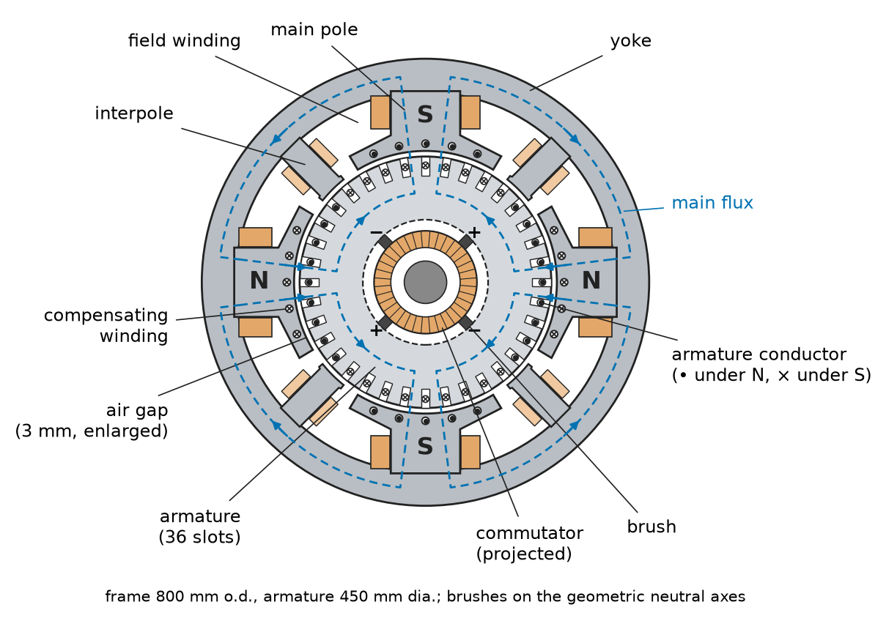
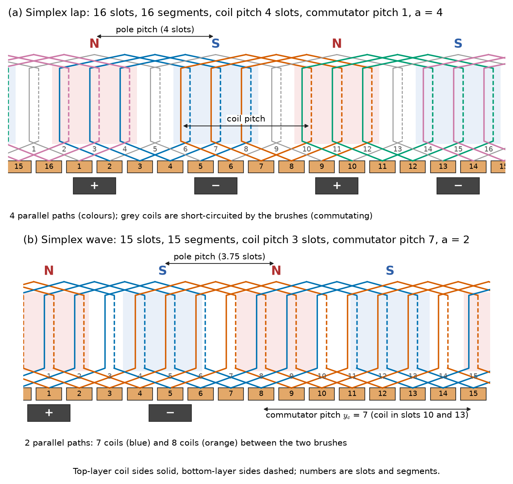
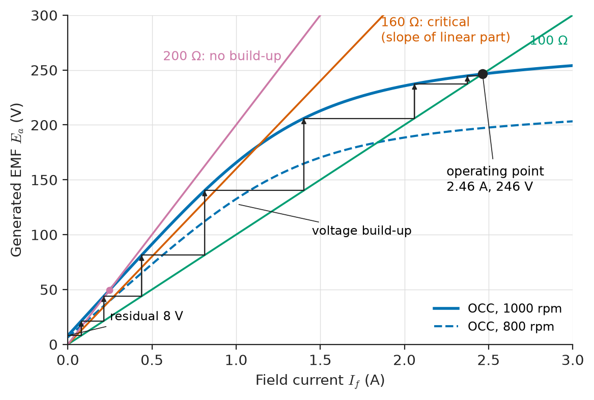
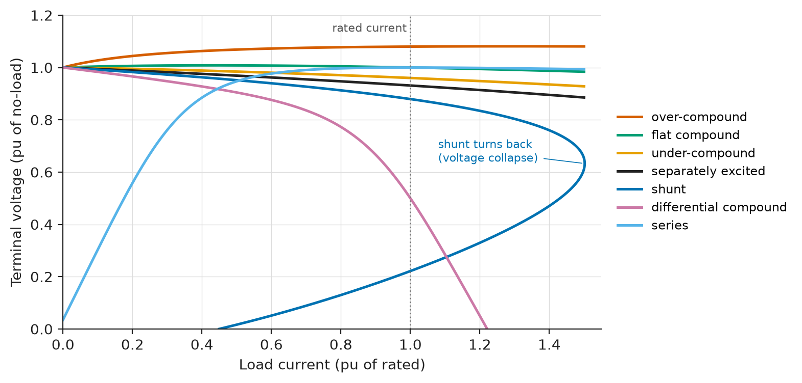
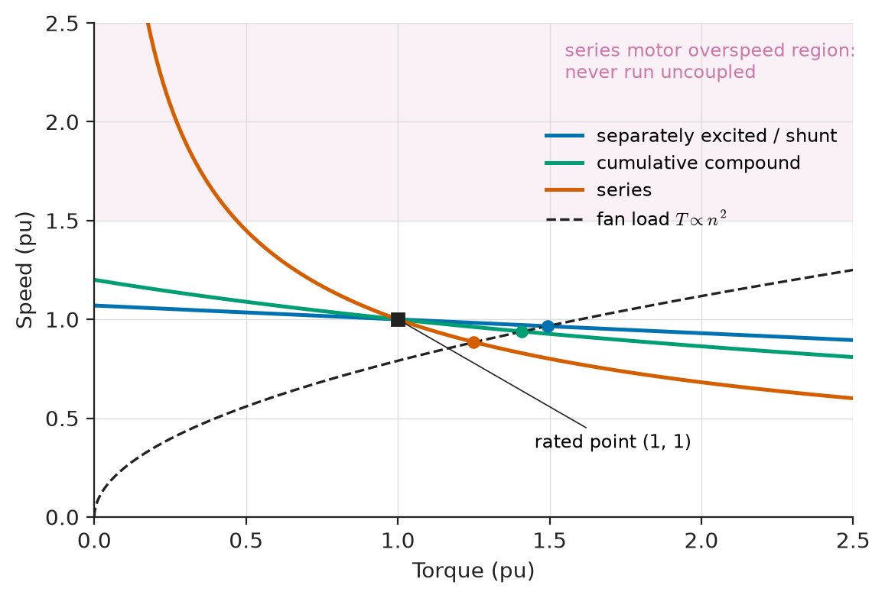
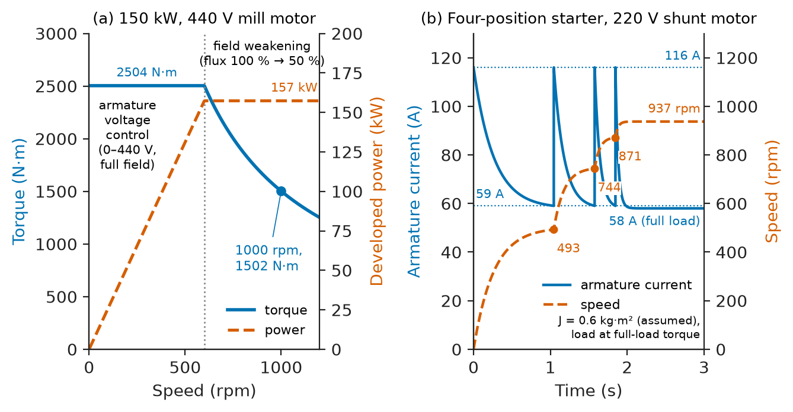

# Chapter 5 — DC Machines

*Part II · Transformers and Electrical Machines*

In an underground coal mine, a 1950s winder still hoists men and coal up a 600 m shaft with a DC motor of more than a megawatt, fed from a thyristor converter that replaced its original motor-generator set. The mine's engineers have been offered an AC drive many times, and they keep the DC machine for reasons a datasheet does not show: full torque from standstill, smooth control down to a crawl, regenerative braking of a descending cage with no extra hardware, and fifty years of maintenance records. At the other end of the size range, every car on the road still starts its engine with a 1–2 kW DC series motor, and millions of small permanent-magnet DC motors drive seats, wipers, pumps and fans. The DC machine has lost most of its industrial market to induction and permanent-magnet machines with power electronics, but it remains the clearest example of electromechanical conversion: two linear equations, $E=k\Phi\omega$ and $T=k\Phi I_a$, describe it completely, and every AC drive in Part III is designed to make an AC machine behave like it.

> **How does a commutator turn the alternating EMF of a rotating coil into DC, and what fixes the EMF and torque of a real machine?**
> **How do the field connections (separate, shunt, series, compound) shape a machine's characteristics, and how is it started, controlled and braked without destroying its commutator?**

| Concept | Engineering destination |
|---|---|
| Construction | Inspecting commutators and brushes; replacing legacy machines in mills, mines and traction |
| Armature windings | Current and voltage ratings; commutation limits; armature reaction |
| EMF and torque equations | Motor constants $K_e$, $K_t$; drive design (Chapter 11); PMDC servo selection |
| Separately excited machines | Rolling-mill, hoist and paper-machine drives; test-bed dynamometers |
| Shunt and series machines | Self-excited generators; traction, cranes and engine starters |
| Compound machines | Legacy generators with flat voltage; elevator and press drives |
| Characteristics | Matching a motor to its load (Chapter 10) |
| Speed control | Armature-voltage and field-weakening regions; constant-torque and constant-power operation |
| Starting | Starting-resistor design; current limits for commutation |
| Braking | Dynamic, plugging and regenerative braking of hoists and vehicles |
| Losses and efficiency | Efficiency testing to IEC 60034-2-1; brush and commutator maintenance |

**Roadmap.** How the machine is built (5.1) → how the armature winding and commutator rectify the EMF (5.2) → the EMF (5.3) and torque (5.4) equations → separately excited (5.5), shunt and series (5.6) and compound (5.7) machines → their characteristics side by side (5.8) → speed control (5.9) → starting (5.10) → braking (5.11) → losses and efficiency (5.12).

---

## 5.1 DC machine construction

### Stator and rotor

A conventional DC machine (Figure 5.1) has a stationary field system and a rotating armature.

- The **yoke** is a steel frame that carries the flux between poles and supports the machine. In machines fed from thyristor or chopper converters, where the current ripples, the yoke is laminated to limit eddy currents.
- The **main poles**, bolted to the yoke, carry the **field windings** (or, in small machines, permanent magnets). Pole shoes spread the flux over the air gap, which is 1–5 mm in industrial machines.
- **Interpoles** (commutating poles), narrow poles between the main poles, carry a winding in series with the armature; they cancel the armature reaction in the commutating zone and induce the voltage that reverses the current in the coils being commutated (Section 5.2).
- **Compensating windings**, set in slots in the main pole faces and also in series with the armature, cancel armature reaction under the poles in large machines and in those that see rapid current changes (rolling mills, hoists).
- The **armature** is a laminated cylinder of non-oriented silicon steel with slots that carry the armature winding. It must be laminated because its iron sees a reversing flux at the frequency $f=pn/120$ as it turns under alternate poles.
- The **commutator** is a cylinder of hard-drawn copper segments insulated from each other by mica, with each segment connected to the junction of two armature coils. **Brushes** of carbon or electrographite, held in brush holders at a set pressure, slide on it and carry the armature current to the external circuit.

<!-- FIGURE 5.1 | figures/ch05/fig-5-1-dc-machine-cross-section.png | cross-section | Cross-section of a four-pole DC machine with interpoles and compensating windings, showing the main flux paths and the brush positions. | Content: circular cross-section, frame outer diameter 800 mm, armature diameter 450 mm, air gap 3 mm exaggerated for clarity. Four main poles at 0, 90, 180, 270 deg alternately N and S with field coils; four interpoles midway at 45, 135, 225, 315 deg. Compensating conductors in pole faces with dot/cross current directions. Armature with 36 slots, conductor currents marked dots under N poles and crosses under S poles. Commutator and four brushes on the geometric neutral axes. Dashed flux lines from N pole through gap, armature, gap, S pole, yoke. Labels: yoke, main pole, field winding, interpole, compensating winding, armature, commutator, brush, air gap. -->

*Figure 5.1 — Cross-section of a four-pole DC machine with interpoles and compensating windings, showing the main flux paths and the brush positions.*

### Where DC machines are still used

**Table 5.1 — Representative DC machine applications and ratings.**

| Application | Type | Typical rating | Status |
|---|---|---|---|
| Automotive engine starter | Series (or PM) motor, 12/24 V | 0.8–3 kW, short-time duty | Universal in internal-combustion vehicles |
| Seat, wiper, pump and fan actuators | Permanent-magnet DC (PMDC) | 5–300 W | Very large volumes; moving to brushless |
| Mine winders, hoists | Separately excited, compensated | 0.5–5 MW, 400–1000 V | Legacy, gradually replaced by AC drives |
| Rolling mills, paper machines | Separately excited, compensated | 0.5–10 MW | Legacy, many still in service |
| Mining haul trucks, older locomotives | Series traction motors | 300–600 kW per motor | Older fleets; new designs AC |
| Forklifts and golf carts | Series or separately excited, 24–80 V | 2–20 kW | Moving to AC induction and PM |
| Electroplating, electrolysis supply (historic) | DC generators | up to several MW | Replaced by rectifiers |
| Laboratory dynamometers, exciters | Separately excited; DC exciters on old alternators | 1 kW–1 MW | Legacy |

The commutator limits the DC machine: it needs brush replacement and commutator maintenance, it cannot be used in flammable or dusty atmospheres without enclosure, it limits peripheral speed (about 40–50 m/s) and the voltage between adjacent segments (about 15–20 V average), and its sparking is a source of interference. These limits are why the induction machine (Chapter 6) and the permanent-magnet machine (Chapter 8) took over once power electronics could provide variable frequency.

---

## 5.2 Armature windings

### Why a commutator is needed

A coil rotating in the field of the poles has an alternating EMF, as [Chapter 2](../part-1-magnetic-circuits-and-energy-conversion/02-electromagnetic-induction.md) showed for motional EMF. The commutator is a mechanical rectifier: as a coil passes from under a north pole to under a south pole, its ends move from one brush to the other, so the EMF it contributes to the external circuit always has the same sign. A single coil gives a rectified sine; a real armature has dozens to hundreds of coils, displaced around the periphery and connected in series between brushes, so the summed EMF has a ripple of well under 1 %.

### Lap and wave windings

The armature coils are connected to the commutator in one of two patterns (Figure 5.2).

- In a **lap winding**, each coil's ends go to adjacent commutator segments, and the winding "laps back" on itself under each pair of poles. A simplex lap winding has as many parallel paths between the brushes as there are poles: $a=p$. It suits low-voltage, high-current machines, because each path carries only $I_a/p$. Paths under different poles can carry unequal currents if the air gaps are unequal, so large lap windings carry **equalising connections** joining points that should be at equal potential.
- In a **wave winding**, each coil's ends go to segments about two pole pitches apart, so the winding passes under every pole before returning near its starting segment. A simplex wave winding has only two parallel paths whatever the number of poles: $a=2$. It suits higher-voltage, lower-current machines and needs only two brush sets (though all are usually fitted).

<!-- FIGURE 5.2 | figures/ch05/fig-5-2-lap-and-wave-windings.png | schematic | Developed (unrolled) diagrams of a simplex lap and a simplex wave winding for a four-pole armature, with commutator segments and brushes. | Content: two panels. (a) Lap winding: 16 slots and 16 commutator segments in a row, four pole faces N S N S shaded above the conductors, coils drawn as loops with ends on adjacent segments (coil pitch 4 slots, i.e. back pitch 9 and front pitch 7 counted in coil sides, commutator pitch 1), four brushes on segments under the pole centres, four parallel paths highlighted in four colours. (b) Wave winding: 15 slots and 15 segments, coil pitch 3 slots, coils with ends on segments 7 apart (commutator pitch 7), winding zigzagging across all four poles, two parallel paths highlighted, two brushes. Labels: pole pitch, coil pitch, commutator pitch, parallel path a. -->

*Figure 5.2 — Developed (unrolled) diagrams of a simplex lap and a simplex wave winding for a four-pole armature, with commutator segments and brushes.*

### Commutation

During the brief time a coil is short-circuited by a brush (about 1 ms in an industrial machine), its current must reverse from $+I_a/a$ to $-I_a/a$. The coil's self- and mutual inductance resists this change with a **reactance voltage** $L\,\Delta i/\Delta t$, and if the reversal is incomplete when the segment leaves the brush, the remaining current is broken as a spark. Sparking erodes the commutator and brushes; severe sparking can grow into a **flashover** around the commutator, a short circuit between brush arms that can wreck the machine. Three measures give good commutation: interpoles, whose field induces a voltage in the commutating coil that cancels the reactance voltage (proportional to $I_a$ because the interpole winding carries armature current); carbon brushes, whose contact resistance helps force the current transfer (resistance commutation); and limits on the rate of change of armature current, which are why DC drives impose current-rise limits of a few times rated current per second.

### Armature reaction

The armature current produces its own MMF, directed along the brush axis, at right angles to the main field. This **armature reaction** distorts the gap field, strengthening one half of each pole and weakening the other. Because the strengthened half saturates, the net flux per pole is reduced (a demagnetising effect of a few per cent at full load), and the magnetic neutral axis shifts, moving the zero-field point away from the brushes and worsening commutation. In small machines without interpoles the brushes were once shifted to the new neutral, which works for only one load and one direction. Interpoles fix the commutating zone, and compensating windings cancel the cross field under the poles, which also keeps the segment-to-segment voltage even and prevents flashover during load transients.

---

## 5.3 EMF generation

### The EMF equation

> **Boundary.** Motional EMF and the force on a current-carrying conductor follow from [*Engineering Physics*, Ch. 11 §11.4](https://github.com/The-Studio-of-Sadiq/Engineering-Physics/blob/main/CHAPTERS/CHAPTER%2011.md); the motor/generator as a gyrator with $K_e=K_t$ is [*Engineering Physics*, Ch. 17 §17.5.3](https://github.com/The-Studio-of-Sadiq/Engineering-Physics/blob/main/CHAPTERS/CHAPTER%2017.md); the DC-motor transfer function and its time constants are [*Engineering Physics*, Ch. 21 §21.8.1](https://github.com/The-Studio-of-Sadiq/Engineering-Physics/blob/main/CHAPTERS/CHAPTER%2021.md). Rotational mechanics ($J\,d\omega/dt=T-T_L$) is [*Engineering Physics*, Ch. 19 §19.2](https://github.com/The-Studio-of-Sadiq/Engineering-Physics/blob/main/CHAPTERS/CHAPTER%2019.md), and force from co-energy is [Chapter 3](../part-1-magnetic-circuits-and-energy-conversion/03-energy-conversion-principles.md). This chapter adds the winding constants, the field connections and the steady-state engineering of real machines.

What a real machine adds is the winding constant. Each of the $Z$ armature conductors, moving at speed $n$ rpm through a field that delivers flux $\Phi$ per pole, cuts $p\Phi$ webers per revolution, so its average EMF is $p\Phi n/60$. Between the brushes, $Z/a$ conductors are in series. The armature EMF is therefore

$$
E_a=\frac{p\,\Phi\,Z\,n}{60\,a}=k\,\Phi\,\omega,\qquad k=\frac{pZ}{2\pi a}
$$

with $\omega=2\pi n/60$ in rad/s. For a machine with constant field, $k\Phi$ is a single number, the **EMF constant** $K_e$ in V·s/rad, which a datasheet for a permanent-magnet motor often gives in V per 1000 rpm.

> **Status of the principle: DC machine EMF equation**
> *Derived.* Follows from motional EMF summed over the conductors in series between brushes; exact for the average EMF, with $\Phi$ the net flux per pole including armature-reaction and saturation effects, which is where it becomes approximate in practice.

**Worked example — EMF of a four-pole armature.** A four-pole armature has 720 conductors and runs at 1200 rpm with a flux of 25 mWb per pole. Lap-wound ($a=4$):

$$
E_a=\frac{4\times0.025\times720\times1200}{60\times4}=360\ \mathrm{V}
$$

Wave-wound ($a=2$) the same armature gives 720 V, with half the current capacity, since each of the two paths must carry $I_a/2$ instead of $I_a/4$. The winding constant is $k=pZ/(2\pi a)=114.6$ for the lap winding, so $k\Phi=2.865$ V·s/rad.

### The magnetisation curve

$E_a$ is proportional to $\Phi$, and $\Phi$ is a non-linear function of the field current through the magnetic circuit of yoke, poles, air gap, teeth and armature core ([Chapter 1](../part-1-magnetic-circuits-and-energy-conversion/01-magnetic-circuit-fundamentals.md)). The **open-circuit characteristic** (OCC, or magnetisation curve), measured by driving the machine at constant speed and recording $E_a$ against field current $I_f$, captures this (Figure 5.3). It starts at a small **residual voltage** (2–5 % of rated) from the remanence of the poles, rises linearly while the air gap dominates the reluctance, and bends over as the iron saturates. Machines are designed to operate just past the knee, where the field current needed is reasonable and the voltage is insensitive to small field changes.

---

## 5.4 Torque production

### The torque equation

The electromagnetic torque follows from the power balance: the electrical power converted, $E_aI_a$, equals the mechanical power $T\omega$. Hence

$$
T=k\,\Phi\,I_a=\frac{pZ}{2\pi a}\,\Phi\,I_a
$$

The **torque constant** $K_t=k\Phi$ in N·m/A is numerically equal to the EMF constant $K_e$ in V·s/rad: this is the gyrator identity of *Engineering Physics* Ch. 17 §17.5.3 with the winding constant made explicit.

> **Status of the principle: DC machine torque equation**
> *Derived.* Follows from the electromechanical energy balance with $E_a=k\Phi\omega$; it gives the electromagnetic (air-gap) torque, from which friction, windage and core-loss torques must be subtracted to get shaft torque.

**Worked example — Torque of the four-pole armature.** With the lap-wound armature of Section 5.3 carrying $I_a=100$ A, $T=2.865\times100=286.5$ N·m. Check through power: $E_aI_a=360\times100=36.0$ kW, and at 1200 rpm ($\omega=125.7$ rad/s), $36000/125.7=286.5$ N·m.

### The two equations together

Combined with Kirchhoff's voltage law on the armature, $V_t=E_a\pm I_aR_a$ (plus for a motor, minus for a generator, with a brush drop of about 2 V for carbon brushes added to the $I_aR_a$ drop in more careful work), the two equations describe all steady-state DC machine behaviour. For a motor with constant flux, eliminating $E_a$ and $I_a$ gives the speed–torque relation

$$
\omega=\frac{V_t}{k\Phi}-\frac{R_a}{(k\Phi)^2}\,T
$$

a straight line drooping from the no-load speed $V_t/k\Phi$ with a slope set by $R_a$. Every speed-control method in Section 5.9 changes one of the three quantities in this equation: $V_t$, $\Phi$ or the armature-circuit resistance.

**Table 5.2 — Typical per-unit parameters of industrial DC machines (on rated armature voltage and current).**

| Rating | Armature-circuit resistance $R_a$ | Full-load speed drop (constant field) | Efficiency at rated load | Field power (% of rating) |
|---|---|---|---|---|
| 1–10 kW | 0.06–0.10 pu | 5–10 % | 80–87 % | 3–5 % |
| 10–100 kW | 0.03–0.06 pu | 3–6 % | 87–92 % | 1.5–3 % |
| 100 kW–1 MW | 0.015–0.03 pu | 1.5–3 % | 92–95 % | 1–1.5 % |
| above 1 MW | 0.008–0.015 pu | about 1 % | 95–97 % | 0.5–1 % |

---

## 5.5 Separately excited machines

### Connection and equations

In a **separately excited** machine the field winding is supplied from an independent source, today almost always a small controlled rectifier. The armature and field equations are uncoupled:

$$
V_f=R_fI_f,\qquad \Phi=\Phi(I_f)\ \text{from the OCC},\qquad V_t=E_a+I_aR_a\ \text{(motor)}
$$

so the flux can be set independently of the load. This is the connection used for every large industrial DC drive: rolling mills, paper machines, mine winders, test-bed dynamometers. With a permanent-magnet field the machine is a PMDC motor, which behaves as a separately excited machine with fixed flux.

### As a generator

Driven at constant speed with constant field, a separately excited generator's terminal voltage falls with load by the armature resistance drop and the armature-reaction loss of flux:

$$
V_t=E_a(I_f,\omega)-I_aR_a-\Delta E_{ar}(I_a)
$$

The fall from no load to full load is typically 5–10 % (Figure 5.4). The historical **Ward–Leonard** system used an AC motor driving a separately excited generator whose output fed the armature of a separately excited motor; controlling the generator field gave smooth, reversible, regenerative armature-voltage control. The thyristor converter replaced the generator from the 1960s onwards, and Chapter 11 develops the converter-fed drive.

### As a motor

With constant field and supply, a separately excited motor has the drooping straight-line speed–torque characteristic of Section 5.4, with speed falling 1–10 % from no load to full load depending on size (Table 5.2). This stiff characteristic, independent of load, and the ability to control speed through $V_t$ and $\Phi$ separately, are what made it the standard adjustable-speed drive before vector-controlled AC drives.

---

## 5.6 Shunt and series machines

### Shunt connection

In a **shunt** machine the field winding is connected in parallel with the armature, across the terminals. The field has many turns of fine wire and draws 1–5 % of rated current. With a constant supply voltage, a shunt motor is indistinguishable from a separately excited one: $I_f=V_t/R_f$ is constant, and the speed falls slightly with load.

**Worked example — Speed regulation of a shunt motor.** A 220 V shunt motor has $R_a=0.25\ \Omega$ and $R_f=110\ \Omega$. At no load it draws 5 A and runs at 1000 rpm; at full load it draws 60 A. Neglecting armature reaction, find the full-load speed and torque.

The field current is $220/110=2.0$ A, so the armature current is 3 A at no load and 58 A at full load. The back EMFs are $E_0=220-3\times0.25=219.25$ V and $E_{fl}=220-58\times0.25=205.5$ V. With constant flux, speed is proportional to back EMF:

$$
n_{fl}=1000\times\frac{205.5}{219.25}=937.3\ \mathrm{rpm}
$$

a speed regulation of $(1000-937.3)/937.3=6.7$ %. The developed power is $205.5\times58=11.92$ kW and the developed torque $11919/(937.3\times2\pi/60)=121.4$ N·m. Armature reaction would weaken the flux slightly at full load and raise the speed a little, which in practice often makes the speed regulation smaller than this estimate. If it raises the speed above no-load speed, the characteristic rises with load and the drive can become unstable, which is one reason for a light series "stabilising" winding on shunt motors.

### Self-excitation of a shunt generator

A shunt generator supplies its own field. Driven at speed, the residual voltage drives a small field current; if that current increases the flux (correct field polarity), the voltage rises, increasing the field current further, until the operating point settles where the OCC crosses the **field-resistance line** $V=R_{f,total}I_f$ (Figure 5.3). Three conditions must hold for the voltage to build up:

1. There must be residual magnetism. A machine that has lost it is "flashed" with a battery across the field.
2. The field connection must aid the residual flux; reversed, the voltage collapses to zero.
3. The field-circuit resistance must be below the **critical field resistance**, the slope of the linear part of the OCC. At a given resistance there is likewise a critical speed below which the machine will not build up.

<!-- FIGURE 5.3 | figures/ch05/fig-5-3-occ-and-self-excitation.png | plot | Open-circuit characteristic of a 220 V shunt generator at 1000 rpm with field-resistance lines showing voltage build-up and the critical field resistance. | Content: x-axis field current 0 to 3 A, y-axis generated EMF 0 to 300 V. OCC curve starting at residual voltage 8 V, linear slope 160 ohm up to about 1.0 A (168 V), knee near 1.4 A (205 V), reaching 240 V at 2.2 A and 255 V at 3.0 A. Straight lines through origin: field-resistance line 100 ohm crossing OCC near 2.46 A, 246 V (operating point, marked); critical resistance line 160 ohm tangent to the linear part; 200 ohm line crossing only near origin (no build-up). Staircase arrows from the residual voltage up to the operating point. OCC at 800 rpm drawn dashed (EMF scaled by 0.8). -->

*Figure 5.3 — Open-circuit characteristic of a 220 V shunt generator at 1000 rpm with field-resistance lines showing voltage build-up and the critical field resistance.*

A shunt generator's terminal voltage falls more steeply with load than a separately excited one, because the falling terminal voltage also reduces the field current. Beyond a certain current, the characteristic turns back on itself: a short circuit collapses the voltage and the current settles at a value set by the residual voltage alone. This made the shunt generator self-protecting against short circuits but unsuitable as a stiff supply without a voltage regulator.

### Series connection

In a **series** machine the field winding carries the armature current. It has a few turns of heavy conductor, with resistance comparable to that of the armature. Below saturation the flux is proportional to the current, $\Phi\approx cI_a$, so

$$
T\approx kc\,I_a^2,\qquad \omega\approx\frac{V_t-I_a(R_a+R_{se})}{kc\,I_a}
$$

The torque rises with the square of current, and the speed falls steeply as load increases and rises steeply as it decreases. The series motor is a natural traction motor: it gives very high starting torque from a limited current, and at high speed it automatically reduces its torque, delivering an approximately constant power over a wide range. Its danger is that at light load the speed rises without limit: a series motor must never be started or run uncoupled from its load, and series motors driving belts or ropes are fitted with overspeed protection.

**Worked example — A series traction motor under changing load.** A 600 V series motor of a mine locomotive has a total armature-plus-field resistance of 0.3 Ω and runs at 800 rpm drawing 100 A. The locomotive then meets a gradient that doubles the load torque. Assuming an unsaturated magnetic circuit ($\Phi\propto I_a$):

Torque doubles when the current rises by $\sqrt2$, to 141.4 A. The back EMFs are $600-100\times0.3=570$ V and $600-141.4\times0.3=557.6$ V. Since $n\propto E_a/\Phi\propto E_a/I_a$,

$$
n_2=800\times\frac{557.6}{570}\times\frac{100}{141.4}=553\ \mathrm{rpm}
$$

The developed power rises only from 57.0 kW to 78.9 kW (38 %) while the torque doubles (680 N·m to 1361 N·m). A shunt motor in the same situation would hold speed and double its power and current. If instead the load falls until the motor draws 30 A, the same equations give 2765 rpm, an overspeed of nearly 3.5 times; in practice friction and windage limit it, but the example shows why a series motor is never run light.

---

## 5.7 Compound machines

### Cumulative and differential compounding

A **compound** machine has both a shunt field and a series field on each main pole. In a **cumulative** compound machine the series field aids the shunt field; in a **differential** compound machine it opposes it. The shunt field may be connected across the armature alone (**short shunt**) or across the armature and series field (**long shunt**); the difference in performance is small.

### Compound generators

In a cumulative compound generator, the series field adds flux in proportion to load current, compensating the armature resistance drop and armature reaction. By choosing the series turns (often with a diverter resistor across the series field to trim them), the designer can make the generator:

- **flat-compounded**: same terminal voltage at no load and full load;
- **over-compounded**: terminal voltage rising with load, to compensate the drop in the feeder to a distant load (historically used for DC tramway and mine feeders);
- **under-compounded**: voltage falling somewhat with load.

A differential compound generator has a steeply drooping characteristic, which gives an approximately constant current: it was used for arc-welding generators.

### Compound motors

A cumulative compound motor combines a definite no-load speed (from the shunt field) with a strong torque rise under load (from the series field). Its speed falls more than a shunt motor's under load, which suits loads with heavy torque peaks and a flywheel, such as presses, shears and reciprocating compressors: the speed drop lets the flywheel deliver its stored energy and smooths the current drawn from the supply. Differential compound motors are unstable under heavy load (the series field can overpower the shunt field and reverse the torque) and are not used.

---

## 5.8 Characteristics

### Generator external characteristics

The **external characteristic** of a generator is its terminal voltage against load current at constant speed and constant field-circuit setting. Figure 5.4 compares the connections for machines with the same no-load voltage.

<!-- FIGURE 5.4 | figures/ch05/fig-5-4-generator-external-characteristics.png | plot | External characteristics of DC generators at constant speed: separately excited, shunt, over-, flat- and under-compounded, differential compound and series. | Content: x-axis load current 0 to 1.5 pu, y-axis terminal voltage 0 to 1.2 pu. Curves all starting at 1.0 pu at zero current (except series starting near 0.05 pu): separately excited falling to 0.93 at 1 pu; shunt falling to 0.88 at 1 pu and bending back sharply to collapse near 1.5 pu (turn-back drawn); flat compound 1.0 at 1 pu; over-compound rising to 1.08; under-compound 0.96; differential compound falling to 0.5 at 1 pu and near zero at 1.2 pu (near-constant current); series rising from residual to a maximum of 1.0 near 1.0 pu then falling. Vertical dotted line at rated current 1.0 pu. -->

*Figure 5.4 — External characteristics of DC generators at constant speed: separately excited, shunt, over-, flat- and under-compounded, differential compound and series.*

### Motor speed–torque characteristics

For motors the useful characteristic is speed against torque at rated supply voltage (Figure 5.5):

- **Separately excited and shunt**: nearly constant speed, falling 2–10 % to full load. Suits fans, machine tools, conveyors, and any load that needs a defined speed.
- **Series**: very high speed at light load, high torque at low speed; approximately $T\propto1/\omega^2$ in the unsaturated range. Suits traction, cranes, hoists and engine starters, where high breakaway torque matters and the load is always connected.
- **Cumulative compound**: between the two, with a definite no-load speed.

<!-- FIGURE 5.5 | figures/ch05/fig-5-5-motor-speed-torque.png | plot | Speed against torque at rated voltage for separately excited (or shunt), cumulative compound and series DC motors of equal rating. | Content: x-axis torque 0 to 2.5 pu, y-axis speed 0 to 2.5 pu. Shunt: straight line from 1.07 pu at zero torque to 1.0 at 1 pu and about 0.90 at 2.5 pu. Compound: from 1.2 pu at zero torque to 1.0 at 1 pu to about 0.81 at 2.5 pu, curving. Series: hyperbola-like curve, 2.5 pu speed near 0.18 pu torque, 1.0 pu at 1.0 pu torque, 0.60 at 2.5 pu. Rated point (1,1) marked. Shaded region above 1.5 pu speed labelled "series motor overspeed region: never run uncoupled". Secondary sketch of a fan load torque proportional to speed squared crossing all three. -->

*Figure 5.5 — Speed against torque at rated voltage for separately excited (or shunt), cumulative compound and series DC motors of equal rating.*

The intersection of a motor's characteristic with the load's torque–speed curve sets the operating point; whether that point is stable depends on the relative slopes, a question developed with load characteristics in [Chapter 10](../part-3-motor-drives/10-drive-system-fundamentals.md).

**Table 5.3 — Comparison of DC motor connections.**

| Property | Separately excited / shunt | Series | Cumulative compound |
|---|---|---|---|
| Speed regulation (no load to full load) | 2–10 % | 50–100 %+ (very soft) | 10–25 % |
| Starting torque at 2 × rated current | about 2 × rated | about 3–4 × rated (below saturation) | 2.5–3 × rated |
| No-load speed | Defined | Dangerously high | Defined |
| Speed control | Excellent: armature voltage and field | Series resistance, field diverter, series–parallel | Armature voltage, shunt field |
| Typical loads | Mills, machine tools, winders, paper | Traction, cranes, starters | Presses, shears, compressors, elevators (historic) |

---

## 5.9 Speed control

### Three control quantities

From $\omega=(V_t-I_aR_a)/k\Phi$, speed can be changed by the armature voltage, the field flux or the armature-circuit resistance.

**Armature-voltage control.** Reducing $V_t$ at full field lowers the no-load speed in proportion while keeping the slope of the characteristic: a family of parallel lines. The motor can deliver rated torque (rated $I_a$ at full flux) at any speed from zero to base speed, so this is the **constant-torque region**. It is efficient because no power is dissipated in series resistors. The variable armature voltage came first from Ward–Leonard generators and now from thyristor converters or choppers (Chapter 11).

**Field weakening.** Reducing $I_f$ above base speed (at full armature voltage) reduces $\Phi$ and raises speed. At rated armature current the torque falls in proportion to $\Phi$ while speed rises in inverse proportion, so the power stays roughly constant: the **constant-power region**. The range is limited by commutation (weaker main field means relatively stronger armature reaction) and mechanical speed limits to typically 2:1 to 4:1 above base speed. Field weakening has a long time constant (the field inductance is large, $L_f/R_f$ of 0.5–3 s), so it is used for slow speed changes.

**Armature-resistance control.** Inserting resistance in the armature circuit steepens the speed–torque line and reduces speed at a given torque. It is simple but wasteful: at half speed with rated torque, about half the input power is burned in the resistor. It survives in small series-motor drives (older forklifts, cranes) and as a starting method (Section 5.10).

> **Status of the principle: Constant-torque and constant-power regions**
> *Approximate.* Follows from the EMF and torque equations with armature current held at its thermal limit; it assumes linear magnetics and ignores the reduced cooling of self-ventilated motors at low speed, which in practice requires a derating or a separately driven fan below about 50 % speed.

**Worked example — Armature-voltage and field control of a mill motor.** A 440 V, 150 kW separately excited mill motor has $R_a=0.04\ \Omega$, rated armature current 370 A and base speed 600 rpm.

At base speed, $E_a=440-370\times0.04=425.2$ V and $\omega=62.83$ rad/s, so $k\Phi=425.2/62.83=6.767$ V·s/rad and the rated electromagnetic torque is $6.767\times370=2504$ N·m (developed power 157.3 kW; the 150 kW rating is the shaft output after rotational losses).

*Armature-voltage control.* At $V_t=220$ V and rated torque (still 370 A), $E_a=220-14.8=205.2$ V and $\omega=205.2/6.767=30.32$ rad/s, i.e. 290 rpm. Note that halving the voltage gives a little less than half the speed, because the $I_aR_a$ drop is a constant 14.8 V.

*Field weakening.* To run at 1000 rpm (104.7 rad/s) with 440 V and rated armature current, $k\Phi$ must fall to $425.2/104.7=4.060$ V·s/rad, i.e. 60 % of its full-field value. The torque available at rated current is $4.060\times370=1502$ N·m, and the developed power is still 157.3 kW: constant power. Figure 5.6 shows the resulting capability curve.

<!-- FIGURE 5.6 | figures/ch05/fig-5-6-capability-and-starting.png | plot | Capability of the 150 kW, 440 V mill motor under armature-voltage and field control, and the armature current and speed during resistor starting of the 220 V shunt motor. | Content: two panels. (a) x-axis speed 0 to 1200 rpm, y-axis torque 0 to 3000 N m (left) and power 0 to 200 kW (right). Torque constant at 2504 N m from 0 to 600 rpm (constant-torque region, armature voltage 0 to 440 V), then falling as 2504 x 600/n to 1252 N m at 1200 rpm (constant-power region, flux 100 percent down to 50 percent). Power rising linearly to 157 kW at 600 rpm then flat. Labels "armature-voltage control" and "field weakening". Point at 1000 rpm, 1502 N m marked. (b) four-step starter: x-axis time 0 to 3 s, armature current sawtooth between 116 A and 59 A at switching instants, final settling at 58 A; speed rising in segments with switching at 493, 744 and 871 rpm, settling at 937 rpm. -->

*Figure 5.6 — Capability of the 150 kW, 440 V mill motor under armature-voltage and field control, and the armature current and speed during resistor starting of the 220 V shunt motor.*

### Series-motor control

Series motors are controlled by series resistance, by a **field diverter** (a resistor in parallel with the series field, which weakens the field and raises speed) and, in traction, by **series–parallel control**: two motors are started in series, each seeing half the line voltage, and switched to parallel at about half speed, halving the resistor losses during acceleration. Choppers replaced resistor control on DC rapid-transit vehicles from the 1970s, saving 20–30 % of traction energy on stop–start services.

---

## 5.10 Starting

### Why a starter is needed

At standstill the back EMF is zero, so on full voltage the armature current is limited only by $R_a$: $I_{st}=V_t/R_a$. With $R_a$ of 0.02–0.1 pu, this is 10–50 times rated current, which would flash over the commutator, trip the supply and shock the mechanical drive train. The commutator limits the safe current to 1.5–2.5 times rated during starting. A DC motor is therefore started either with reduced armature voltage (a converter that ramps the voltage, the method used by every modern drive) or with series resistance cut out in steps as the motor accelerates and the back EMF builds up.

### Designing a resistor starter

With a step starter, the current is allowed to swing between an upper limit $I_1$ and a lower limit $I_2$. At each switching instant the speed, and hence the back EMF, is unchanged, so the resistances of successive steps satisfy $R_{k+1}/R_k=I_2/I_1$. Starting from $R_1=V_t/I_1$ and ending at $R_a$, the number of steps $m$ satisfies

$$
\left(\frac{I_1}{I_2}\right)^m=\frac{R_1}{R_a}
$$

**Worked example — A four-position starter.** For the 220 V shunt motor of Section 5.6 ($R_a=0.25\ \Omega$, full-load armature current 58 A), the starting current is limited to 2 × full load, $I_1=116$ A. Then $R_1=220/116=1.897\ \Omega$ and $R_1/R_a=7.59$. With $I_2$ at about full-load current, $I_1/I_2=2$ and $m=\ln7.59/\ln2=2.92$, so three resistor sections are needed. Adjusting the ratio so that exactly three steps fit, $I_1/I_2=7.59^{1/3}=1.965$, and the lower switching current is $I_2=116/1.965=59.0$ A. The total armature-circuit resistances on the successive positions are 1.897, 0.965, 0.491 and 0.25 Ω, so the three sections are 0.932, 0.474 and 0.241 Ω. The switching instants occur when the back EMF reaches $220-59.0\times R_k$: 108.0 V, 163.0 V and 191.0 V, i.e. 493, 744 and 871 rpm on the motor's 219.25 V-per-1000-rpm characteristic (Figure 5.6b).

Manual faceplate starters include a **no-volt release** (a holding coil that returns the arm to "off" if the supply fails, so that the motor cannot restart on full voltage) and an **overload release**. A shunt motor must never lose its field while running: with $\Phi$ reduced to the residual value, the speed tries to rise without limit and the armature current becomes very large. Field-failure (field-loss) relays trip DC drives on loss of field current for this reason.

---

## 5.11 Braking

### Three ways to brake electrically

Electrical braking makes the machine act as a generator, converting the kinetic or potential energy of the load into electrical energy. It is used to stop quickly, to hold speed on a descending load (hoists, haul trucks on downgrades, trains on gradients) and to recover energy.

**Dynamic (rheostatic) braking.** The armature is disconnected from the supply and connected to a braking resistor, with the field kept energised. The machine generates, driving current through the resistor and producing a braking torque $k\Phi I_a$. As the speed falls, so do the EMF, the current and the torque, so dynamic braking alone does not hold a load at standstill. Mining haul trucks of 200–400 t use dynamic braking (with large blower-cooled resistor grids rated at several megawatts) to descend ramps without wearing out friction brakes.

**Plugging (reverse-current braking).** The armature connections are reversed while the motor runs, so the supply voltage and back EMF add. A large resistor must be inserted to limit current. The braking torque remains even at zero speed, so the motor will reverse unless disconnected there; plugging is used where fast reversal is the goal (rolling-mill reversing tables, crane travel) and is energy-wasteful: both the kinetic energy and the energy drawn from the supply are burned in the resistor.

**Regenerative braking.** If the back EMF exceeds the supply voltage (the load drives the motor above its no-load speed, or the armature voltage is reduced quickly by a converter), the armature current reverses and power returns to the supply. No switching is required on a stiff DC supply. The receiving system must be able to absorb the power: a DC traction line needs another train, a stationary energy store or an inverting substation to accept it; a single-quadrant thyristor bridge cannot invert current and needs a second, antiparallel bridge (Chapter 11).

> **Status of the principle: Electrical braking requires generator operation**
> *Fundamental.* By energy conservation, a braking torque from the machine means mechanical power entering it, which must leave as electrical power to a resistor, a store or the supply; the method only decides where the energy goes.

**Worked example — Braking the mill motor on a mine hoist.** The 440 V, 150 kW motor of Section 5.9 ($k\Phi=6.767$ V·s/rad at full field, $R_a=0.04\ \Omega$, rated $I_a=370$ A) drives a hoist that is lowering a load at 600 rpm.

*Dynamic braking at rated current.* At 600 rpm the EMF is 425.2 V. To hold 370 A, the total circuit resistance must be $425.2/370=1.149\ \Omega$, so the braking resistor is $1.109\ \Omega$. The braking torque is the rated 2504 N·m, the resistor dissipates $370^2\times1.109=151.8$ kW and the armature 5.5 kW. As the cage slows, the current and torque fall in proportion to speed unless resistance is cut out in steps.

*Plugging at rated speed.* With the armature reversed, the driving voltage is $440+425.2=865.2$ V. To limit the current to twice rated (740 A) the circuit needs $865.2/740=1.169\ \Omega$, an external resistor of 1.129 Ω; the initial braking torque is 5008 N·m, and the supply as well as the load feed power into the resistor.

*Regenerative braking.* With the armature connected to the 440 V supply and full field, current reverses when the load drives the motor above its no-load speed. For rated regenerative current, $E_a=440+370\times0.04=454.8$ V, i.e. 642 rpm; the machine then returns $440\times370=162.8$ kW to the supply. The hoist settles at a lowering speed only 3.4 % above its full-field no-load speed of $440/6.767=65.0$ rad/s (621 rpm), and 7 % above base speed, with no resistor at all, the reason DC winders were naturally regenerative long before AC drives could be.

---

## 5.12 Losses and efficiency

### Loss components

The losses of a DC machine are grouped by how they vary with load (the physics of each mechanism is in [Chapter 3](../part-1-magnetic-circuits-and-energy-conversion/03-energy-conversion-principles.md)):

- **Armature-circuit copper loss** $I_a^2R_a$, including the interpole, compensating and series windings: varies as the square of load.
- **Brush contact loss**: approximately a constant voltage drop of about 2 V total for carbon or electrographite brushes (1 V per brush set), so $2I_a$ watts: varies linearly with load.
- **Field copper loss** $V_fI_f$: constant for a shunt or separately excited machine at a given field setting.
- **Core loss**: hysteresis and eddy loss in the armature teeth and core, where the flux reverses at $f=pn/120$; depends on flux and speed, so it is constant at a given speed and field.
- **Friction and windage loss**: bearing friction, brush friction on the commutator (a significant part in DC machines) and air resistance; depends on speed.
- **Stray-load loss**: extra loss from armature reaction distorting the flux and from eddy currents in conductors; conventionally taken as about 1 % of output when not measured.

Core loss and friction and windage together are the **rotational losses**, measured by running the machine as an unloaded motor at rated speed and flux and subtracting the small armature copper loss (Swinburne's test). Efficiency tests on DC machines are made to IEC 60034-2-1 by direct input–output measurement or by summation of separated losses.

### Efficiency and its maximum

As for the transformer, the efficiency of a constant-flux, constant-speed machine is greatest when the load-dependent loss equals the constant loss, i.e. when $I_a^2R_a\approx P_{field}+P_{rot}$.

**Worked example — Efficiency of the 220 V shunt motor.** The motor of Section 5.6 ($V_t=220$ V, line current 60 A at full load, $R_a=0.25\ \Omega$, field current 2 A, armature current 3 A at no load) has:

- input power: $220\times60=13.20$ kW;
- field copper loss: $220\times2=440$ W;
- armature copper loss: $58^2\times0.25=841$ W;
- brush loss: $2\times58=116$ W;
- rotational loss from the no-load test: $E_0I_{a0}=219.25\times3=658$ W (assumed constant, as the speed changes only 6 %);
- stray-load loss, 1 % of output: 111 W.

The output is $13200-440-841-116-658-111=11034$ W, an efficiency of 83.6 %. The constant losses total $440+658=1098$ W, so maximum efficiency (ignoring the small brush and stray terms) occurs at $I_a=\sqrt{1098/0.25}=66$ A, slightly above full load: the machine was designed for its best efficiency near rated output.

**Table 5.4 — Loss distribution at rated load (typical, % of input).**

| Loss | 10 kW machine | 500 kW machine |
|---|---|---|
| Armature-circuit copper | 5–7 % | 2–3 % |
| Brush contact | 0.5–1 % | 0.3–0.5 % |
| Field copper | 3–4 % | 1–1.5 % |
| Core | 2–3 % | 1–1.5 % |
| Friction and windage | 1–2 % | 0.5–1 % |
| Stray load | 0.5–1 % | 0.5–1 % |
| **Efficiency** | **83–88 %** | **92–95 %** |

A DC machine of a given rating is typically 2–4 percentage points less efficient than an IE3 induction motor of the same rating (Chapter 6), mainly because of the field loss and the commutator. Permanent-magnet DC motors avoid the field loss, which is why they dominate below about 1 kW.

---

## What remains open

| Open question | Where it is answered |
|---|---|
| How does a converter-fed DC drive control armature current, speed and regeneration? | [Chapter 11](../part-3-motor-drives/11-dc-motor-drives.md) |
| How are load characteristics, stability of the operating point and four-quadrant operation analysed? | [Chapter 10](../part-3-motor-drives/10-drive-system-fundamentals.md) |
| How does the rotor-inertia dynamics of a DC motor appear in a speed loop? | [*Engineering Physics*, Ch. 21 §21.8.1](https://github.com/The-Studio-of-Sadiq/Engineering-Physics/blob/main/CHAPTERS/CHAPTER%2021.md); [*Circuits, Signals and Communications*, Ch. 33–35](https://github.com/The-Studio-of-Sadiq/Circuits-Signals-and-Communications/blob/main/part-7-control-system-fundamentals/33-dynamic-system-modeling.md) |
| How does an AC machine produce torque without a commutator? | [Chapter 6](06-induction-machines.md) and [Chapter 7](07-synchronous-machines.md) |
| Which machines replaced the PMDC motor (brushless DC, universal motor)? | [Chapter 8](08-special-electrical-machines.md) |
| How are machine temperature rise, insulation class and duty cycle linked to rating? | [Chapter 9](09-electrical-machine-design-and-performance.md) |
| How are motor efficiency and replacement decisions made in plants? | [Chapter 28](../part-7-power-quality-and-grid-modernization/28-energy-efficiency-and-management.md) |

**Next:** Chapter 6 replaces the commutator with a rotating magnetic field and the brushed armature with a short-circuited cage, giving the induction motor, the machine that drives most of the world's pumps, fans and compressors.
