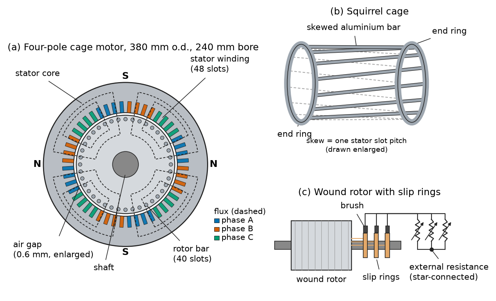
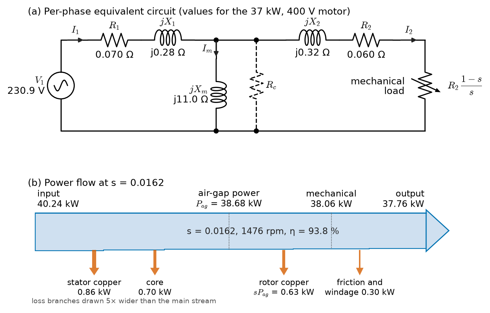
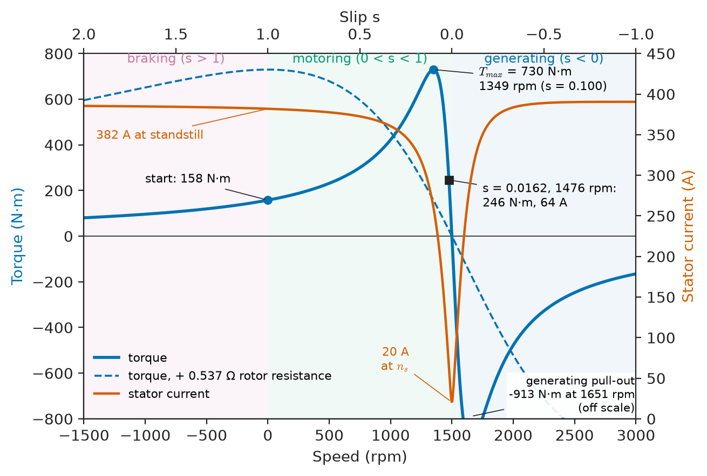
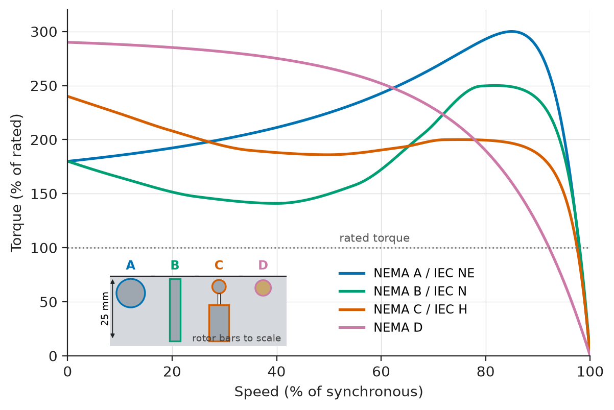
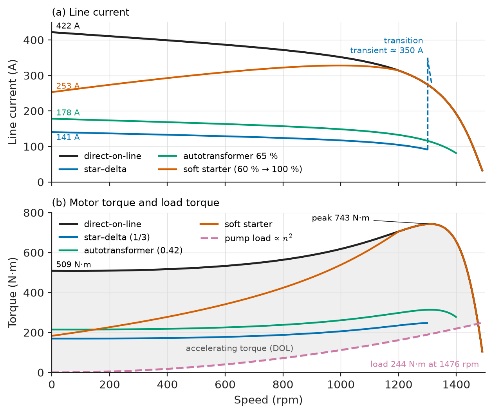
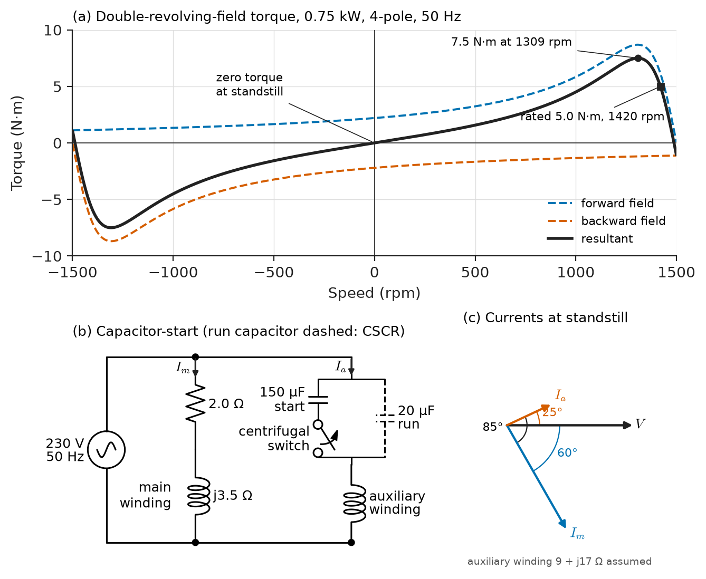

# Chapter 6 — Induction Machines

*Part II · Transformers and Electrical Machines*

A water utility installs a new 37 kW borehole pump at a remote site fed by a 250 kVA pole-mounted transformer. On the first start the motor turns, the lights in the pump house dip, and the contactor drops out; on the second attempt the motor reaches speed but the transformer's LV fuse blows ten minutes later. The motor is healthy; the problem is that an induction motor started direct-on-line draws six to seven times its rated current at a power factor of 0.4 for several seconds, and the installation was not designed for it. In a chemical plant across the country, an energy audit finds that half the site's electricity goes to induction motors driving pumps and fans through throttling valves and dampers, and that variable-speed operation would save a third of it. Electric motors, most of them induction motors, use about two-thirds of industrial electricity and some 45 % of all electricity worldwide (IEA estimates); their starting, their speed control, their efficiency class and their selection are among the most consequential decisions an electrical engineer makes.

> **How does a short-circuited rotor produce torque from a rotating field, and what does the slip tell us about the machine's currents, losses and efficiency?**
> **How is an induction motor started without disturbing the supply, controlled in speed without wasting energy, and selected for its load?**

| Concept | Engineering destination |
|---|---|
| Three-phase induction principle | Pumps, fans, compressors, conveyors, crushers, mills; induction generators |
| Rotating magnetic field | Synchronous speed, direction of rotation, pole-changing motors |
| Slip | Reading nameplates; rotor heating; slip measurement for load estimation |
| Equivalent circuit | Predicting current, power factor, efficiency; drive tuning (Chapter 12) |
| Torque–speed characteristics | Matching to load; design classes; stall and pull-out protection |
| Starting methods | Voltage dip limits, star–delta, soft starters, VFDs, wound-rotor resistance |
| Speed control | VFD energy savings on pumps and fans; DFIG wind turbines (Chapter 15) |
| Losses and efficiency | IE classes, IEC 60034-30-1, Ecodesign rules, life-cycle cost |
| Single-phase induction motors | Domestic appliances, small pumps, HVAC fans |
| Motor selection | Duty, enclosure, cooling, insulation, hazardous areas, efficiency, standards |

**Roadmap.** How the machine works and is built (6.1) → the rotating field and synchronous speed (6.2) → slip (6.3) → the per-phase equivalent circuit and power flow (6.4) → the torque–speed curve (6.5) → starting (6.6) → speed control (6.7) → losses and efficiency (6.8) → single-phase motors (6.9) → selecting a motor (6.10).

---

## 6.1 Three-phase induction principle

### Torque from induced current

Three-phase currents in a stator winding produce a magnetic field that rotates at synchronous speed (Section 6.2). A rotor that turns more slowly than the field is swept by it; Faraday's law ([*Engineering Physics*, Ch. 11 §11.4](https://github.com/The-Studio-of-Sadiq/Engineering-Physics/blob/main/CHAPTERS/CHAPTER%2011.md)) induces EMFs in the rotor conductors, the short-circuited rotor circuit carries currents, and the force on those currents in the field drags the rotor along in the direction of the field. The rotor can never quite reach synchronous speed while motoring, because at synchronism there would be no relative motion, no induced current and no torque. The difference between field speed and rotor speed, the **slip**, is what makes the machine work, and nearly every property of the induction motor is a function of it.

> **Boundary.** Faraday's and Ampère's laws are taken from [*Engineering Physics*, Ch. 11 §11.4](https://github.com/The-Studio-of-Sadiq/Engineering-Physics/blob/main/CHAPTERS/CHAPTER%2011.md); balanced three-phase sources, phase sequence and star–delta relations from [*Circuits, Signals and Communications*, Ch. 10](https://github.com/The-Studio-of-Sadiq/Circuits-Signals-and-Communications/blob/main/part-2-transient-and-ac-analysis/10-three-phase-circuits.md); the rotating magnetic field from distributed windings, force and torque from co-energy and the loss mechanisms from [Chapter 3](../part-1-magnetic-circuits-and-energy-conversion/03-energy-conversion-principles.md); and the transformer equivalent circuit from [Chapter 4](04-transformers.md). This chapter treats the induction machine as a transformer with a rotating, short-circuited secondary.

### Construction

The **stator** is a laminated core of non-oriented silicon steel (0.35–0.65 mm) with slots carrying a distributed three-phase winding, connected in star or delta. The **rotor** is also laminated and takes one of two forms (Figure 6.1):

- A **squirrel-cage rotor** has bars of aluminium (die-cast, in motors up to a few hundred kilowatts) or copper (brazed, in large motors and in premium-efficiency designs) in the rotor slots, short-circuited at each end by end rings. It has no insulation, no slip rings and no brushes, so it is cheap, rugged and almost maintenance-free. More than 90 % of induction motors are cage motors.
- A **wound rotor** (slip-ring rotor) carries a three-phase winding like the stator's, brought out through slip rings and brushes to external resistors or a converter. It allows the rotor resistance to be changed for starting and speed control and is used for very high-inertia loads (large mills, crushers, cement kilns), hoists, and as the **doubly fed induction generator** (DFIG) of variable-speed wind turbines.

The air gap is as small as manufacturing allows (0.3–0.5 mm in small motors, 1–3 mm in large ones), because the magnetising current that sets up the field rises in proportion to the gap length (Chapter 1), and magnetising current is reactive current that lowers the power factor.

<!-- FIGURE 6.1 | figures/ch06/fig-6-1-cage-and-wound-rotor.png | cross-section | Cross-section of a four-pole cage induction motor and the two rotor types: a squirrel cage with end rings and a wound rotor with slip rings. | Content: (a) radial cross-section, stator outer diameter 380 mm, bore 240 mm, air gap 0.6 mm exaggerated, 48 stator slots with three-phase distributed winding coloured by phase A, B, C, 40 rotor slots with closed bars, shaft 60 mm. Dashed four-pole flux lines crossing the gap. (b) isometric sketch of a squirrel cage removed from its laminations: aluminium bars skewed by one stator slot pitch, two end rings. (c) wound rotor with three slip rings and brushes connected to a star-connected external three-phase resistor. Labels: stator core, stator winding, air gap, rotor bar, end ring, slip ring, brush, external resistance. -->

*Figure 6.1 — Cross-section of a four-pole cage induction motor and the two rotor types: a squirrel cage with end rings and a wound rotor with slip rings.*

**Table 6.1 — Induction motors across the energy field (representative).**

| Application | Typical rating | Supply | Notes |
|---|---|---|---|
| Building HVAC fans and pumps | 0.75–75 kW | 400 V, 50 Hz (480 V, 60 Hz in North America) | Mostly VFD-fed; IE3/IE4 |
| Data-centre chilled-water pumps, cooling-tower fans | 15–200 kW | 400–690 V | VFD-fed, often N+1 redundancy |
| Water and wastewater pumping | 5 kW–5 MW | 400 V to 11 kV | Large units at 3.3–11 kV |
| Mining conveyors, crushers, mills | 100 kW–10 MW | 690 V to 11 kV | Wound rotor or VFD for high-inertia starts |
| Oil and gas compressors | 0.5–20 MW | 6.6–13.8 kV | Ex-rated (IEC 60079) where gas may be present |
| Ship thrusters and pumps | 50 kW–3 MW | 440–690 V, 60 Hz; 6.6 kV | IEC 60092, marine classification rules |
| EV traction (e.g. some Tesla and Audi drivetrains) | 100–300 kW | 350–800 V DC via inverter | Copper rotor, 15–18 krpm, liquid-cooled |
| Small wind and micro-hydro induction generators | 10 kW–2 MW | 400–690 V | Grid-connected, slightly above synchronous speed |

---

## 6.2 Rotating magnetic field

### Synchronous speed

[Chapter 3](../part-1-magnetic-circuits-and-energy-conversion/03-energy-conversion-principles.md) showed that three windings displaced by 120 electrical degrees in space, carrying balanced three-phase currents displaced by 120° in time, produce an air-gap MMF wave of constant amplitude, $\tfrac32$ times the peak MMF of one phase, rotating at one pole pair per cycle. For a winding with $p$ poles fed at frequency $f$, the field turns at the **synchronous speed**

$$
n_s=\frac{120f}{p}\ \ \mathrm{rpm},\qquad \omega_s=\frac{4\pi f}{p}\ \ \mathrm{rad/s}
$$

> **Status of the principle: Rotating field from a balanced three-phase winding**
> *Derived.* Follows from superposition of three sinusoidally distributed MMFs carrying balanced currents; real windings in slots add space harmonics, and unbalanced supplies add a backward-rotating component, both treated below.

**Table 6.2 — Synchronous speeds.**

| Poles | 50 Hz | 60 Hz | Typical full-load speed at 50 Hz | Typical use |
|---|---|---|---|---|
| 2 | 3000 rpm | 3600 rpm | 2950–2980 rpm | Centrifugal pumps, compressors, blowers |
| 4 | 1500 rpm | 1800 rpm | 1460–1490 rpm | The general-purpose standard |
| 6 | 1000 rpm | 1200 rpm | 960–990 rpm | Fans, conveyors, mixers |
| 8 | 750 rpm | 900 rpm | 720–740 rpm | Slow fans, mills, crushers |
| 12 | 500 rpm | 600 rpm | 485–495 rpm | Large slow compressors (often synchronous instead) |

The direction of rotation follows the phase sequence ([*Circuits, Signals and Communications*, Ch. 10 §10.2](https://github.com/The-Studio-of-Sadiq/Circuits-Signals-and-Communications/blob/main/part-2-transient-and-ac-analysis/10-three-phase-circuits.md)): swapping any two supply leads reverses the field and the motor. Commissioning checklists include a "bump test" for this reason, because a pump or compressor run backwards can be damaged in seconds.

### Real windings and their harmonics

A practical stator winding is distributed over several slots per pole per phase and short-pitched (coil span about 5/6 of a pole pitch) to make the MMF as sinusoidal as possible. The remaining space harmonics (5th, 7th, 11th, 13th, and slot harmonics) rotate at $n_s/h$ forwards or backwards and produce parasitic torques. The 7th-harmonic asynchronous torque can produce a dip in the torque–speed curve near one-seventh of synchronous speed, where a heavily loaded motor may "crawl"; slot-harmonic synchronous torques can make a motor "cog" at standstill. Designers avoid these by choosing stator and rotor slot numbers that do not coincide and by **skewing** the rotor bars by about one stator slot pitch.

An unbalanced supply adds a negative-sequence field rotating backwards at $n_s$. The rotor sees it at a slip of about $2-s$, i.e. at nearly twice supply frequency, where the rotor resistance is high because of skin effect, so a small negative-sequence voltage drives a large negative-sequence current. A 1 % voltage unbalance causes about 6–10 % current unbalance; NEMA MG 1 requires derating above 1 % voltage unbalance (to about 0.75 at 5 %), and IEC 60034-1 limits continuous operation to 1 % negative-sequence voltage. Unbalance itself is treated in [Chapter 25](../part-7-power-quality-and-grid-modernization/25-power-quality.md).

---

## 6.3 Slip

### Definition and rotor frequency

The **slip** is the speed of the field relative to the rotor, as a fraction of synchronous speed:

$$
s=\frac{n_s-n}{n_s},\qquad n=n_s(1-s)
$$

The rotor conductors are cut by the field at the slip speed $sn_s$, so the frequency of rotor EMFs and currents is

$$
f_r=sf
$$

and the rotor EMF is proportional to slip: $E_r=sE_{r0}$, where $E_{r0}$ is the rotor EMF at standstill. The rotor leakage reactance is likewise $sX_{r0}$. At standstill ($s=1$) the motor is a short-circuited transformer; at full load ($s$ of 1–5 %) the rotor currents alternate at only 0.5–2.5 Hz.

> **Status of the principle: Rotor frequency equals slip times supply frequency**
> *Fundamental.* A kinematic consequence of the field rotating at $n_s$ relative to the stator and the rotor turning at $n$; it holds for any induction machine regardless of load, and it is how slip is measured with a search coil, a stroboscope or the sidebands in the stator current.

**Worked example — Slip of a pump motor.** A four-pole, 50 Hz motor runs at 1476 rpm. Synchronous speed is $120\times50/4=1500$ rpm, the slip is $(1500-1476)/1500=0.016$, i.e. 1.6 %, and the rotor currents alternate at $0.016\times50=0.8$ Hz. A six-pole 60 Hz motor nameplated 1164 rpm runs at $s=(1200-1164)/1200=3.0$ %, rotor frequency 1.8 Hz. Since slip is close to proportional to load in the normal operating range, a measured speed of 1488 rpm on the first motor ($s=0.8$ %) indicates it is running at roughly half load, a quick estimate used in energy audits.

**Table 6.3 — Typical full-load slip of cage induction motors (IE3, 50 Hz).**

| Rating | Full-load slip |
|---|---|
| 0.75–4 kW | 3–6 % |
| 5.5–30 kW | 1.5–3 % |
| 37–200 kW | 0.8–1.7 % |
| 0.5–5 MW (medium voltage) | 0.3–0.8 % |

### Slip and the power split

Slip divides the power crossing the air gap into two parts: a fraction $s$ is lost as rotor copper loss, and the fraction $1-s$ becomes mechanical power. This is derived from the equivalent circuit in Section 6.4, and it has a direct consequence: an induction motor running at slip $s$ can be no more efficient than $1-s$, so a motor whose speed is reduced by running it at high slip (rotor-resistance or stator-voltage control) is inherently wasteful.

---

## 6.4 Equivalent circuit

### The induction motor as a transformer

Per phase, the stator is a transformer primary with resistance $R_1$, leakage reactance $X_1$, magnetising reactance $X_m$ and core-loss resistance $R_c$, exactly as in [Chapter 4](04-transformers.md). The rotor is a short-circuited secondary whose EMF $sE_{r0}$ and reactance $sX_{r0}$ both scale with slip. Its current is

$$
I_r=\frac{sE_{r0}}{R_r+jsX_{r0}}=\frac{E_{r0}}{R_r/s+jX_{r0}}
$$

Dividing numerator and denominator by $s$ converts the rotor circuit from slip frequency to supply frequency: the rotor now looks like a stationary circuit with an EMF $E_{r0}$, a reactance $X_{r0}$ and a slip-dependent resistance $R_r/s$. Referring the rotor to the stator by the effective turns ratio (Chapter 4) gives the per-phase equivalent circuit of Figure 6.2, with referred rotor quantities $R_2$ and $X_2$:

$$
Z_{in}=R_1+jX_1+\frac{jX_m\,(R_2/s+jX_2)}{R_2/s+j(X_2+X_m)}
$$

with the core-loss resistance either placed across the magnetising branch or, more simply, treated as a fixed loss.

<!-- FIGURE 6.2 | figures/ch06/fig-6-2-equivalent-circuit-and-power-flow.png | circuit | Per-phase equivalent circuit of the induction motor with the rotor resistance split into copper-loss and mechanical-load parts, and the power-flow diagram for the 37 kW example motor. | Content: (a) circuit: V1 = 230.9 V source, R1 = 0.070 ohm, jX1 = j0.28 ohm, shunt jXm = j11.0 ohm (Rc shown dashed in parallel), then jX2 = j0.32 ohm, R2 = 0.060 ohm and R2(1-s)/s labelled "mechanical load" as a variable resistor. Currents I1, Im, I2 marked. (b) Sankey-style power flow at s = 0.0162: input 40.24 kW (39.54 kW drawn by the circuit plus 0.70 kW core loss), stator copper 0.86 kW, core 0.70 kW, air-gap power 38.68 kW, rotor copper 0.63 kW (s Pag), mechanical 38.06 kW, friction and windage 0.30 kW, output 37.76 kW, efficiency 93.8 percent. -->

*Figure 6.2 — Per-phase equivalent circuit of the induction motor with the rotor resistance split into copper-loss and mechanical-load parts, and the power-flow diagram for the 37 kW example motor.*

### Power flow

The resistance $R_2/s$ is split into the rotor resistance $R_2$, which accounts for rotor copper loss, and the remainder $R_2(1-s)/s$, whose power is the power converted to mechanical form:

$$
P_{ag}=3I_2^2\frac{R_2}{s},\qquad P_{cu2}=3I_2^2R_2=sP_{ag},\qquad P_{mech}=3I_2^2R_2\frac{1-s}{s}=(1-s)P_{ag}
$$

The electromagnetic torque is the air-gap power divided by synchronous angular speed (equivalently mechanical power divided by rotor speed):

$$
T=\frac{P_{ag}}{\omega_s}=\frac{P_{mech}}{\omega_s(1-s)}
$$

> **Status of the principle: Per-phase induction-motor equivalent circuit**
> *Approximate.* Assumes a balanced sinusoidal supply, sinusoidally distributed windings, linear magnetics and constant parameters; it predicts running performance within a few per cent, but the constant-parameter rotor fails at high slip (deep-bar and double-cage rotors change $R_2$ and $X_2$ with rotor frequency), at saturation during starting (leakage paths saturate and $X_1$, $X_2$ fall), under unbalance (a negative-sequence circuit is needed) and with inverter supplies (time harmonics).

### Finding the parameters

The parameters come from tests standardised in IEEE 112 and IEC 60034-28, analogous to the transformer tests of Chapter 4:

- **DC resistance test**: gives $R_1$ (corrected to operating temperature).
- **No-load test**: rated voltage, uncoupled shaft. Slip is nearly zero, so the rotor branch is open; the input gives $X_1+X_m$ and the sum of core and friction–windage losses, which are separated by repeating the test at reduced voltages and extrapolating to zero voltage.
- **Locked-rotor test**: rotor blocked, reduced voltage to give rated current. The magnetising branch is bypassed by the low rotor impedance, so the input gives $R_1+R_2$ and $X_1+X_2$. To capture the running value of $R_2$ (not the starting value), the test is made at a reduced frequency, about 25 % of rated, because a deep-bar rotor's resistance at 50 Hz is much higher than at the 1 Hz of normal running.

**Worked example — Running performance of a 37 kW motor.** A 400 V, 50 Hz, four-pole, star-connected 37 kW cage motor has per-phase parameters $R_1=0.070\ \Omega$, $X_1=0.28\ \Omega$, $R_2=0.060\ \Omega$, $X_2=0.32\ \Omega$, $X_m=11.0\ \Omega$, core loss 700 W and friction and windage loss 300 W. Find its performance at a slip of 1.62 %.

The phase voltage is $400/\sqrt3=230.9$ V and synchronous speed is 1500 rpm ($\omega_s=157.1$ rad/s). Solving the circuit at $s=0.0162$ ($R_2/s=3.70\ \Omega$):

- stator current $I_1=63.9$ A at power factor 0.893 lagging; referred rotor current $I_2=59.0$ A;
- power drawn by the circuit $3\times230.9\times63.9\times0.893=39.54$ kW; the circuit has no core-loss branch, so the 0.70 kW core loss is added to give a total input of 40.24 kW;
- stator copper loss $3\times63.9^2\times0.070=0.86$ kW, so the air-gap power is $39.54-0.86=38.68$ kW, equal to $3I_2^2R_2/s$;
- rotor copper loss $sP_{ag}=0.0162\times38.68=0.63$ kW; mechanical power $38.06$ kW;
- output after friction and windage: $37.76$ kW, at $1500\times(1-0.0162)=1476$ rpm;
- efficiency $37.76/40.24=93.8$ %; electromagnetic torque $38680/157.1=246.2$ N·m, shaft torque $37760/154.5=244.4$ N·m.

The efficiency is close to the IE3 limit for a four-pole 37 kW motor (93.9 %, Table 6.6). The example has neglected stray-load loss, which IEC 60034-2-1 would add at about 1–1.5 % of input for this size; including it brings the efficiency to about 92.3–92.8 %. Figure 6.2b draws the power flow.

---

## 6.5 Torque–speed characteristics

### The torque equation

Replacing the stator and magnetising branch by their Thévenin equivalent seen from the rotor ([*Circuits, Signals and Communications*, Ch. 8 §8.6](https://github.com/The-Studio-of-Sadiq/Circuits-Signals-and-Communications/blob/main/part-2-transient-and-ac-analysis/08-sinusoidal-steady-state-analysis.md)),

$$
V_{th}=V_1\frac{jX_m}{R_1+j(X_1+X_m)},\qquad Z_{th}=R_{th}+jX_{th}=\frac{jX_m(R_1+jX_1)}{R_1+j(X_1+X_m)}
$$

the torque at any slip is

$$
T=\frac{3V_{th}^2}{\omega_s}\cdot\frac{R_2/s}{(R_{th}+R_2/s)^2+(X_{th}+X_2)^2}
$$

Maximising with respect to $R_2/s$ (maximum power transfer to $R_2/s$) gives the **breakdown** or **pull-out** torque and the slip at which it occurs:

$$
s_{T\max}=\frac{R_2}{\sqrt{R_{th}^2+(X_{th}+X_2)^2}},\qquad T_{\max}=\frac{3V_{th}^2}{2\omega_s\left[R_{th}+\sqrt{R_{th}^2+(X_{th}+X_2)^2}\right]}
$$

Two consequences shape the whole of induction-motor engineering. First, $T_{\max}$ does not depend on $R_2$: adding rotor resistance moves the peak to a higher slip without changing its height, which is how wound-rotor starting works. Second, torque at a given slip is proportional to $V^2$: a 10 % voltage dip removes 19 % of the torque, which can stall a heavily loaded motor during a supply sag.

> **Status of the principle: Induction-motor torque–slip equation and breakdown torque**
> *Derived.* Follows from the equivalent circuit by Thévenin reduction and maximum power transfer; it inherits all of the circuit's approximations and is least accurate at high slip, where rotor parameters vary with frequency.

### The shape of the curve

At small slip ($R_2/s$ dominates), $T\approx3V_{th}^2s/(\omega_sR_2)$: torque is proportional to slip, the near-linear operating region. At large slip the reactance dominates and torque falls roughly as $1/s$. Figure 6.3 shows the whole curve from $s=2$ to $s=-1$:

- **Motoring** ($0<s<1$): rotor slower than the field, in the same direction.
- **Generating** ($s<0$): rotor driven above synchronous speed; the machine delivers power to the supply while still drawing its magnetising current. Small hydro and older fixed-speed wind turbines use cage induction generators at slips of $-0.5$ to $-2$ %; regenerative braking of a VFD-fed motor uses the same region.
- **Braking (plugging)** ($s>1$): rotor turning against the field after two supply phases are reversed. Large currents flow and both electrical and mechanical power become rotor heat.

<!-- FIGURE 6.3 | figures/ch06/fig-6-3-torque-speed-curve.png | plot | Torque and stator current against speed for the 37 kW, four-pole motor, from plugging through motoring to generating, using the constant-parameter equivalent circuit. | Content: x-axis speed from -1500 to 3000 rpm (slip 2 to -1) with secondary top axis slip, y-axis torque -800 to +800 N m (left) and current 0 to 450 A (right). Torque curve from equivalent circuit: Tmax 730 N m at 1349 rpm (s = 0.100), rated 246 N m at 1476 rpm, starting torque 158 N m (constant parameters) at 0 rpm, generating pull-out -913 N m at 1651 rpm, off scale and annotated. Current curve falling from 382 A at standstill to 64 A at rated point to about 20 A at synchronous speed. Shaded regions labelled braking (s > 1), motoring (0 < s < 1), generating (s < 0). Dashed torque curve for added rotor resistance 0.537 ohm with peak at standstill. -->

*Figure 6.3 — Torque and stator current against speed for the 37 kW, four-pole motor, from plugging through motoring to generating, using the constant-parameter equivalent circuit.*

**Worked example — Breakdown and starting torque of the 37 kW motor.** For the motor of Section 6.4, $V_{th}=225.2$ V, $R_{th}=0.0666\ \Omega$ and $X_{th}=0.2735\ \Omega$. Then

$$
s_{T\max}=\frac{0.060}{\sqrt{0.0666^2+0.5935^2}}=0.100,\qquad T_{\max}=\frac{3\times225.2^2}{2\times157.1\times(0.0666+0.5972)}=730\ \mathrm{N\,m}
$$

i.e. 3.0 times rated torque, at 1349 rpm. With constant parameters the starting torque ($s=1$) is 158 N·m, only 0.64 times rated, and the starting current 382 A, 6.0 times rated.

Real cage motors start much better than this, because the rotor is not a constant-parameter circuit. At standstill the rotor current is at 50 Hz, the current crowds into the top of each deep bar (skin effect, [*Engineering Physics*, Ch. 16 §16.8.1](https://github.com/The-Studio-of-Sadiq/Engineering-Physics/blob/main/CHAPTERS/CHAPTER%2016.md)), the effective rotor resistance rises and the leakage reactance falls. Taking the standstill values as $R_2=2.6\times0.060=0.156\ \Omega$ and $X_2=0.7\times0.32=0.224\ \Omega$, typical of a deep-bar rotor, gives a starting current of 422 A (6.6 times rated) at a power factor of 0.40 and a starting torque of 509 N·m (2.1 times rated), in line with the catalogue values of real 37 kW motors. The constant-parameter model fails here because the rotor frequency has changed by a factor of 60, and with it the physics of current distribution in the bars.

*Wound-rotor starting.* To get breakdown torque at standstill, $R_2+R_{ext}=\sqrt{R_{th}^2+(X_{th}+X_2)^2}=0.597\ \Omega$, an external resistance of 0.537 Ω per phase referred to the stator (the dashed curve of Figure 6.3).

### Design classes and rotor shape

Rotor-bar shape is the designer's tool for trading starting torque against running efficiency (Figure 6.4). A rotor with high resistance starts well and runs with high slip and high losses; one with low resistance runs efficiently but starts poorly. **Deep bars** and **double cages** (a high-resistance outer cage that carries most current at start, and a low-resistance inner cage that carries it when running) give both. IEC 60034-12 defines starting-performance classes N (normal), H (high starting torque) and their variants with suffix E for higher-efficiency designs; NEMA MG 1 uses designs A–D.

**Table 6.4 — Cage-rotor design classes (typical values, 4-pole, 10–100 kW).**

| Class | Locked-rotor torque | Breakdown torque | Locked-rotor current | Full-load slip | Typical loads |
|---|---|---|---|---|---|
| IEC N / NEMA B | 1.5–2.2 × rated | 2.0–3.0 × rated | 6–7 × rated | 1–3 % | Pumps, fans, compressors, machine tools |
| IEC NE (high efficiency) / NEMA A | 1.5–2.5 × | 2.5–3.5 × | 7–8.5 × | 0.8–2 % | As N; higher inrush must be checked |
| IEC H / NEMA C | 2.0–2.5 × | 1.9–2.2 × | 6–7 × | 1–3 % | Loaded conveyors, crushers, reciprocating compressors |
| NEMA D | 2.75 × or more | — (no distinct peak) | 6–7 × | 5–13 % | Punch presses, hoists, high-inertia loads with flywheel |

<!-- FIGURE 6.4 | figures/ch06/fig-6-4-design-classes-and-rotor-bars.png | plot | Torque-speed curves of IEC/NEMA design classes and the rotor-bar shapes that produce them. | Content: main plot x-axis speed 0 to 100 percent of synchronous, y-axis torque 0 to 300 percent of rated. Curves: NEMA A/IEC NE (LRT 180, peak 300 at 85 percent speed), NEMA B/IEC N (LRT 180, pull-up 140, peak 250 at 82 percent), NEMA C/IEC H (LRT 240, peak 200 at 75 percent), NEMA D (LRT 290, monotonically falling to rated at 92 percent speed). Rated torque line at 100 percent. Inset: four slot cross-sections to scale (slot depth 25 mm): round shallow bar (A), deep narrow bar (B), double cage with small upper and large lower bar separated by a slit (C), small high-resistance brass or aluminium alloy bar (D). -->

*Figure 6.4 — Torque-speed curves of IEC/NEMA design classes and the rotor-bar shapes that produce them.*

---

## 6.6 Starting methods

### The starting problem

A cage motor started direct-on-line draws 6–8 times rated current at a power factor of 0.3–0.5 until it approaches full speed, which takes from a fraction of a second (a fan at no load) to 20–30 s (a large fan or mill with high inertia). This has three consequences: a **voltage dip** on the supply, which can disturb other loads and, if the dip is deep, stall the motor itself (torque scales as $V^2$); **mechanical shock** to couplings, gearboxes, belts and pipework (water hammer in pumping systems); and **rotor heating**, since the rotor dissipates energy equal to the kinetic energy given to the load during an unloaded start. Utility rules limit the dip at the point of common coupling, typically to 3–6 % for frequent starts on public LV networks (IEC 61000-3-3 and -3-11 and local distribution codes).

**Worked example — Voltage dip from a direct-on-line start.** The 37 kW motor of Section 6.5 (starting current 422 A at power factor 0.40) is fed from a 250 kVA, 400 V, 4 % impedance transformer with X/R = 2. The motor's locked-rotor impedance per phase is $230.9/422=0.548\ \Omega$ at 66.3°, i.e. $0.220+j0.502\ \Omega$. The transformer impedance is $0.04\times400^2/250000=0.0256\ \Omega$ at 63.4°, i.e. $0.0114+j0.0229\ \Omega$. As a voltage divider from a stiff 11 kV source, the motor-terminal voltage is

$$
\frac{\lvert Z_{mot}\rvert}{\lvert Z_{mot}+Z_{t}\rvert}=0.955\ \mathrm{pu}
$$

a dip of 4.5 % at the transformer LV terminals, before counting the cable and the 11 kV network impedance. Acceptable for an occasional start; for a borehole pump that starts several times an hour on a weak rural feeder it is not, and it is exactly the case of this chapter's opening. With a star–delta starter the dip falls to about 1.5 %.

### Methods compared

Figure 6.5 and Table 6.5 compare the methods for the 37 kW motor.

- **Direct-on-line (DOL)**: simplest and cheapest; full starting torque. Used up to about 7.5–11 kW on public LV supplies and much larger on stiff industrial supplies.
- **Star–delta**: a motor whose windings are rated for delta at the supply voltage is started in star, so each winding sees $1/\sqrt3$ of its rated voltage. Line current and torque both fall to one third of their DOL values. The motor must be able to accelerate the load on one third of its starting torque, so star–delta suits fans and unloaded compressors, not loaded conveyors. The open transition from star to delta causes a current and torque transient that can exceed the DOL value; closed-transition starters avoid it.
- **Autotransformer**: an autotransformer (Chapter 4) with 50/65/80 % taps; at tap $k$ the motor current is $k$ times DOL, the line current and torque $k^2$ times DOL. More flexible than star–delta and used for large LV and MV motors.
- **Soft starter**: antiparallel thyristors in each phase ramp the voltage; the current is limited (typically to 2.5–4 × rated) and torque again scales as $V^2$. Also provides soft stopping, which reduces water hammer in pumps. Bypassed by a contactor once at speed.
- **Variable-frequency drive (VFD)**: starts at low frequency with the motor running near rated slip, so full torque is available at about rated current. The best start for any load; justified when speed control is also needed (Section 6.7).
- **Rotor resistance (wound rotor)**: external resistors cut out in steps (or a liquid resistor) give high starting torque with low current; used for mills, crushers and kilns with very high inertia.

<!-- FIGURE 6.5 | figures/ch06/fig-6-5-starting-methods-current-torque.png | plot | Line current and motor torque against speed for direct-on-line, star-delta, 65 percent autotransformer and soft-starter starting of the 37 kW motor, with a centrifugal pump load torque. | Content: two panels sharing x-axis speed 0 to 1500 rpm. (a) line current 0 to 450 A: DOL from 422 A falling to 64 A near rated speed; star-delta at one third (141 A) to about 1300 rpm then a transition spike to 350 A; autotransformer 65 percent tap line current 178 A; soft starter starting at 60 percent voltage (253 A) and ramping to full voltage by 1200 rpm. (b) torque 0 to 800 N m: DOL torque curve with LRT 509 N m and peak about 743 N m (rotor parameters varying with slip between the deep-bar standstill and running values, so slightly above the constant-parameter 730 N m); star-delta one third (170 N m at standstill); autotransformer 0.42 x DOL; centrifugal pump load torque rising as speed squared to 244 N m at 1476 rpm. Shaded accelerating-torque margin between motor and load curves. -->

*Figure 6.5 — Line current and motor torque against speed for direct-on-line, star-delta, 65 percent autotransformer and soft-starter starting of the 37 kW motor, with a centrifugal pump load torque.*

**Table 6.5 — Starting methods for the 37 kW motor (DOL: 422 A, 509 N·m at standstill).**

| Method | Line current at start | Starting torque | Torque / rated | Comments |
|---|---|---|---|---|
| Direct-on-line | 422 A | 509 N·m | 2.1 | Highest dip (4.5 % on 250 kVA) |
| Star–delta | 141 A | 170 N·m | 0.69 | Only for light starting loads; transition transient |
| Autotransformer, 65 % tap | 178 A | 215 N·m | 0.87 | Line current $0.65^2$ of DOL |
| Soft starter, 60 % initial voltage | 253 A | 183 N·m | 0.74 | Ramp; soft stop for pumps |
| VFD | about 64–100 A | up to 1.5 × rated | 1.5 | Rated torque from standstill at rated current |

> **Status of the principle: Starting torque scales with the square of applied voltage**
> *Approximate.* Follows from the torque equation at fixed slip with fixed parameters; it slightly overstates the reduction at low voltage, where leakage-path saturation is less than at full voltage and the effective reactances are higher.

---

## 6.7 Speed control

### Why speed control matters

For a centrifugal pump or fan, flow is proportional to speed, head to speed squared and power to speed cubed (the affinity laws; the fluid physics is in [*Engineering Physics*, Ch. 19 §19.7](https://github.com/The-Studio-of-Sadiq/Engineering-Physics/blob/main/CHAPTERS/CHAPTER%2019.md)). Throttling the flow with a valve or damper wastes the excess head; reducing the speed does not. Since a fixed-frequency induction motor runs at nearly constant speed, the methods below are ways of changing $n=n_s(1-s)=120f(1-s)/p$: change the poles, the slip or the frequency.

### Methods

**Pole changing.** A **Dahlander** winding can be reconnected to give two speeds in a 2:1 ratio (e.g. 1500/750 rpm); separate windings give other ratios. Cheap and efficient, but only discrete speeds; used for two-speed fans, cooling towers and lifts.

**Stator voltage control.** Reducing voltage with a soft starter lowers the torque and so raises the slip. Because rotor loss is $sP_{ag}$, this is efficient only for loads whose torque falls steeply with speed (small fans) and then only over a narrow range. Its main use is starting.

**Rotor-resistance control.** Adding resistance to a wound rotor raises the slip for a given torque. Simple and robust, but the slip power $sP_{ag}$ is burned in the resistors; used for cranes and hoists at intermittent duty.

**Slip-power recovery.** Instead of burning the slip power, a converter in the rotor circuit returns it to the supply (static Kramer and Scherbius drives). The modern form is the **doubly fed induction generator** of wind turbines: a back-to-back converter rated at about 25–30 % of the machine rating feeds the rotor, giving a speed range of about ±30 % around synchronous speed with a converter a third the size of a full-rated one. It is developed in [Chapter 15](../part-4-power-generation/15-renewable-energy-systems.md) and [Chapter 27](../part-7-power-quality-and-grid-modernization/27-grid-integration-of-renewable-energy.md).

**Variable frequency.** A VFD supplies variable frequency and voltage. Keeping $V/f$ constant keeps the air-gap flux constant (Chapter 4's EMF equation applies equally to the stator winding), so the torque–speed curve shifts horizontally with nearly the same shape, and the motor operates at low slip, and hence efficiently, at every speed. Above base frequency, the voltage is held at its maximum and the flux falls, giving a constant-power region like the field weakening of the DC machine (Chapter 5). This is now the dominant method; its control (scalar V/f, field-oriented and direct torque control) is the subject of [Chapter 12](../part-3-motor-drives/12-ac-motor-drives.md).

**Worked example — Fan energy saving with a VFD.** A 55 kW fan in a mine ventilation system delivers full flow at rated speed, absorbing 55 kW, and runs 6000 h a year at 80 % flow. By the affinity laws, a VFD at 80 % speed reduces the shaft power to $55\times0.8^3=28.2$ kW, or 29.0 kW from the supply allowing 3 % for drive losses. With an outlet damper, the same 80 % flow typically needs about 85–90 % of full power, say 48 kW. The saving is about 19 kW, i.e. some 114 MWh a year, worth about USD 14 000 at USD 0.12 per kWh, against a 55 kW VFD costing a fraction of that. This arithmetic, repeated across millions of pumps and fans, is why VFDs are the single largest electrical energy-efficiency measure in industry and buildings ([Chapter 28](../part-7-power-quality-and-grid-modernization/28-energy-efficiency-and-management.md)).

---

## 6.8 Losses and efficiency

### Loss components

The losses follow the power flow of Section 6.4. Their physics belongs to [Chapter 3](../part-1-magnetic-circuits-and-energy-conversion/03-energy-conversion-principles.md); here the engineering split matters:

- **Stator copper loss** $3I_1^2R_1$: 25–40 % of total loss at rated load.
- **Rotor copper loss** $sP_{ag}$: 15–25 %. Copper cages reduce it compared with aluminium by roughly 30–40 %.
- **Core loss**: 15–25 %; lower with thinner, lower-loss steel.
- **Friction and windage**: 5–15 %, largest in two-pole totally enclosed fan-cooled motors, where the cooling fan dominates.
- **Stray-load loss**: 10–20 %; harmonic fields, leakage-flux eddy currents and inter-bar currents. IEC 60034-2-1 determines it by test (residual-loss method) or assigns a value by formula.

Efficiency is nearly flat from about 50 % to 100 % load and falls sharply below about 25–30 % load, where the fixed core and friction losses dominate and, worse, the power factor drops because the magnetising current is unchanged. An oversized motor running at 30 % load is a common audit finding: its efficiency may be 5 points below nameplate and its power factor 0.5.

### Efficiency classes

IEC 60034-30-1 defines efficiency classes IE1 (standard) to IE4 (super premium), with IE5 (ultra premium) introduced in IEC TS 60034-30-2, for line-operated motors from 0.12 kW to 1000 kW. Efficiency is measured according to IEC 60034-2-1. Since July 2021 the EU Ecodesign Regulation (EU) 2019/1781 requires IE3 for three-phase motors of 0.75–1000 kW (with 2-, 4-, 6- and 8-pole versions), and since July 2023 IE4 for 75–200 kW; the US (NEMA Premium, equivalent to IE3) and many other countries have similar rules.

**Table 6.6 — Minimum efficiencies of IEC 60034-30-1 classes, four-pole, 50 Hz.**

| Rated output | IE1 | IE2 | IE3 | IE4 |
|---|---|---|---|---|
| 0.75 kW | 72.1 % | 79.6 % | 82.5 % | 85.7 % |
| 1.5 kW | 77.2 % | 82.8 % | 85.3 % | 88.2 % |
| 4 kW | 83.1 % | 86.6 % | 88.6 % | 91.1 % |
| 11 kW | 87.6 % | 89.8 % | 91.4 % | 93.3 % |
| 37 kW | 91.2 % | 92.7 % | 93.9 % | 95.2 % |
| 75 kW | 92.7 % | 94.0 % | 95.0 % | 96.0 % |
| 200 kW and above | 94.0 % | 95.1 % | 96.0 % | 96.7 % |

> **Status of the principle: IE efficiency-class limits**
> *Empirical.* The class boundaries are fitted to the efficiencies achievable by commercial designs of each size, defined by IEC 60034-30-1 and verified by the test methods of IEC 60034-2-1; they say nothing about efficiency at part load or on inverter supply (IEC 60034-2-3 covers the latter).

**Worked example — Upgrading an 11 kW motor.** A process-water pump motor of 11 kW runs 6000 h a year at 75 % load (8.25 kW shaft). Replacing an IE2 motor (89.8 %) by an IE4 motor (93.3 %), and assuming the efficiencies hold at 75 % load, reduces the input from $8.25/0.898=9.19$ kW to $8.25/0.933=8.84$ kW, a saving of 0.34 kW or 2.07 MWh a year, about USD 250 at USD 0.12/kWh. A motor's purchase price is typically only 2–3 % of its lifetime energy cost; the upgrade pays back in two to four years. One caution: higher-efficiency motors have lower slip and so run slightly faster; on a centrifugal pump, a 0.5 % speed increase raises power by 1.5 %, eroding part of the saving unless the impeller is trimmed or a VFD adjusts the speed.

---

## 6.9 Single-phase induction motors

### No starting torque from a single phase

A single-phase winding produces a pulsating, not a rotating, field. Any pulsating field can be resolved into two fields of half the amplitude rotating in opposite directions at synchronous speed (the **double-revolving-field** picture, the same decomposition as the positive and negative sequence of [*Circuits, Signals and Communications*, Ch. 10 §10.6](https://github.com/The-Studio-of-Sadiq/Circuits-Signals-and-Communications/blob/main/part-2-transient-and-ac-analysis/10-three-phase-circuits.md)). At standstill each produces an equal and opposite torque, so the net starting torque is zero. Once the rotor turns in either direction, the forward field (at slip $s$) produces more torque than the backward field (at slip $2-s$), and the motor continues to run. The backward field causes a double-frequency torque pulsation (100 Hz on a 50 Hz supply) and extra rotor loss, so single-phase motors are noisier and less efficient than three-phase ones of the same rating.

> **Status of the principle: Double-revolving-field theory**
> *Derived.* A pulsating sinusoidal MMF is mathematically identical to two counter-rotating MMFs of half amplitude; the resulting two-part equivalent circuit is approximate in the same ways as the three-phase one.

### Starting arrangements

To start, a second (**auxiliary**) winding displaced 90° in space carries a current shifted in time, giving an elliptical rotating field (Figure 6.6):

- **Split-phase**: auxiliary winding of high resistance-to-reactance ratio, disconnected by a centrifugal switch at about 75 % speed. Starting torque 1–1.5 × rated, high starting current. Small fans, washing machines, older appliances.
- **Capacitor-start**: a capacitor (electrolytic, 70–300 µF for a fractional to 1 kW motor) in series with the auxiliary winding gives nearly 90° phase shift at start; starting torque 2.5–4 × rated. Compressors, pumps, workshop machinery.
- **Permanent-split capacitor (PSC)**: a smaller run capacitor (film type, 2–40 µF) stays in circuit, improving power factor, efficiency and smoothness; low starting torque. HVAC fans, ceiling fans, circulating pumps.
- **Capacitor-start capacitor-run**: both; best performance for 1–3 kW single-phase loads such as farm and well pumps.
- **Shaded-pole**: a copper ring around part of each pole delays the flux in the shaded part, producing a weak sweeping field. Very cheap, efficiency 10–30 %; small fans below about 50 W.

<!-- FIGURE 6.6 | figures/ch06/fig-6-6-single-phase-motors.png | circuit | Single-phase induction motor: forward and backward torque components and the capacitor-start connection. | Content: (a) torque against speed from -1500 to +1500 rpm for a 4-pole 50 Hz, 0.75 kW motor: forward-field torque curve (peak about 8.7 N m), backward-field torque mirror image, resultant torque passing through zero at standstill, peak about 7.5 N m at 1300 rpm, rated 5.0 N m at 1420 rpm. (b) circuit: 230 V single-phase supply, main winding (R = 2.0 ohm, X = 3.5 ohm), auxiliary winding in series with start capacitor 150 uF and centrifugal switch, run capacitor 20 uF shown dashed for capacitor-start capacitor-run variant. Phasor inset: main-winding current lagging V by about 60 deg, auxiliary current leading V by about 25 deg (auxiliary winding impedance assumed 9 + j17 ohm, in series with the 150 uF capacitor), angle between them about 85 deg. -->

*Figure 6.6 — Single-phase induction motor: forward and backward torque components and the capacitor-start connection.*

Many applications that once used single-phase induction motors (refrigerator and air-conditioner compressors, washing machines, circulator pumps) have moved to brushless permanent-magnet motors with small inverters (Chapter 8), which are 20–40 % more efficient. Where a three-phase supply is unavailable for a larger motor, a single-phase-input VFD that produces three-phase output is now the usual solution up to a few kilowatts.

---

## 6.10 Motor selection

### What the load demands

Selecting a motor starts from the load, not the motor catalogue. The engineer needs the load's torque–speed characteristic (Chapter 10), its inertia referred to the motor shaft, the starting duty (how often, how loaded), the speed range, the duty cycle and the environment. The motor must then satisfy:

1. **Power and speed**: rated output at least the maximum continuous load power, with a margin of 10–15 %, but not oversized (Section 6.8).
2. **Starting**: motor torque exceeds load torque at every speed during acceleration with margin (IEC 60034-12 recommends checking the minimum accelerating torque at the minimum expected voltage, often 80–90 %); acceleration time within the rotor's thermal limit (locked-rotor safe-stall time, typically 10–20 s hot).
3. **Duty type**: IEC 60034-1 defines S1 (continuous) to S10; a hoist or crane motor rated S3 40 % or S4 with a number of starts per hour has a different thermal rating from an S1 pump motor.
4. **Supply**: voltage, frequency and starting method; LV up to about 400 kW, MV (3.3–11 kV) above, because LV currents and cables become unwieldy.
5. **Enclosure and cooling**: IP55 (dust-protected, water-jet) is the industrial default, IP56/IP66 for wash-down and marine decks; cooling to IEC 60034-6, IC411 (totally enclosed fan-cooled) the most common, IC416 (separate fan) for VFD-fed motors running long periods at low speed.
6. **Insulation and temperature**: Class F insulation with Class B temperature rise is the standard combination, giving a thermal margin that roughly doubles insulation life (Chapter 9); derate above 40 °C ambient or 1000 m altitude.
7. **Hazardous areas**: motors in zones with flammable gas or dust require Ex certification (IEC 60079: Ex db flameproof, Ex eb increased safety, Ex ec non-sparking), with temperature classes T1–T6.
8. **Efficiency class and inverter suitability**: IE3/IE4 as required by regulation; for VFD use, reinforced winding insulation for voltage spikes and insulated bearings or shaft grounding against bearing currents above about 100 kW (IEC TS 60034-25).
9. **Mechanical**: frame size and mounting (IEC 60072, IM B3 foot, B5 flange), shaft and bearing loads, vibration grade, noise.

**Table 6.7 — Typical motor choices by application.**

| Load | Torque characteristic | Typical choice |
|---|---|---|
| Centrifugal pump, fan | $T\propto n^2$, low starting torque | IEC N cage, IE3/IE4, VFD if flow varies; star–delta or soft start if fixed speed |
| Loaded belt conveyor | Constant torque, high breakaway (1.5–2 × rated) | IEC H cage with DOL or VFD; wound rotor or VFD above about 1 MW |
| Reciprocating compressor | Pulsating, needs flywheel | IEC N/H cage or synchronous motor (large); soft start with unloader |
| Crusher, ball mill | Very high inertia, constant torque | Wound rotor with liquid resistor, VFD, or synchronous motor above several MW |
| Hoist, crane | Constant torque, four-quadrant, S3–S5 duty | VFD with braking resistor or regenerative front end; wound rotor (legacy) |
| Marine thruster | $T\propto n^2$, frequent reversal | VFD-fed cage motor, IEC 60092 and class rules |
| EV traction | Constant torque then constant power, 10:1 speed range | PMSM or copper-rotor cage induction motor, inverter-fed |

**Worked example — Selecting a motor for a belt conveyor.** A mining belt conveyor needs 30 kW at steady speed with a belt drive at 1480 rpm; breakaway torque when fully loaded is 1.8 times running torque, and the site supply is 400 V from a 500 kVA transformer. Running torque at 1480 rpm is $30000/(1480\times2\pi/60)=194$ N·m, breakaway torque 349 N·m. A 37 kW IEC N motor (rated torque 244 N·m, locked-rotor torque about 2.1 × = 509 N·m) gives a 23 % power margin and 46 % starting-torque margin at full voltage. Star–delta starting is excluded: one third of 509 N·m is 170 N·m, below the 349 N·m breakaway. If the supply can stand a DOL start (on a 500 kVA, 4 % transformer the dip computed as in Section 6.6 is about 2.3 %), DOL with an IE3 37 kW, IP55, IC411, Class F motor is the simplest solution; at a 10 % undervoltage the locked-rotor torque falls to $0.81\times509=412$ N·m, still above breakaway. If belt tension control or frequent starts matter, a VFD sized for 150 % overload torque is the better engineering choice.

---

## What remains open

| Open question | Where it is answered |
|---|---|
| How does the synchronous machine, with a DC-excited rotor, differ from the induction machine? | [Chapter 7](07-synchronous-machines.md) |
| How do the permanent-magnet and reluctance machines that replace induction motors in EVs and appliances work? | [Chapter 8](08-special-electrical-machines.md) |
| How are temperature rise, insulation class, duty and cooling turned into a rating, and how are motors tested? | [Chapter 9](09-electrical-machine-design-and-performance.md) |
| How are load characteristics, four-quadrant operation and drive protection handled? | [Chapter 10](../part-3-motor-drives/10-drive-system-fundamentals.md) |
| How do V/f, field-oriented and direct torque control work in a VFD? | [Chapter 12](../part-3-motor-drives/12-ac-motor-drives.md) |
| How does a DFIG wind turbine use the wound-rotor machine? | [Chapter 15](../part-4-power-generation/15-renewable-energy-systems.md) |
| How do large induction motors contribute to fault current and to voltage stability after faults? | [Chapter 19](../part-5-power-system-analysis/19-fault-analysis.md) and [Chapter 20](../part-5-power-system-analysis/20-power-system-stability.md) |
| How do supply unbalance and harmonics heat motors, and how is motor starting assessed as a power-quality event? | [Chapter 25](../part-7-power-quality-and-grid-modernization/25-power-quality.md) |
| How are motor-replacement and VFD retrofit programmes evaluated over a life cycle? | [Chapter 28](../part-7-power-quality-and-grid-modernization/28-energy-efficiency-and-management.md) |

**Next:** Chapter 7 gives the rotor its own DC excitation, so that it turns exactly at synchronous speed, and develops the synchronous machine that generates almost all of the world's electricity.
