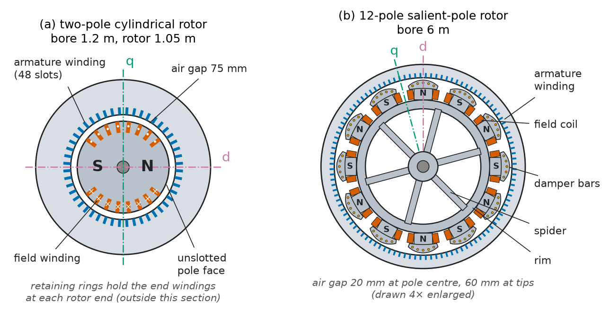
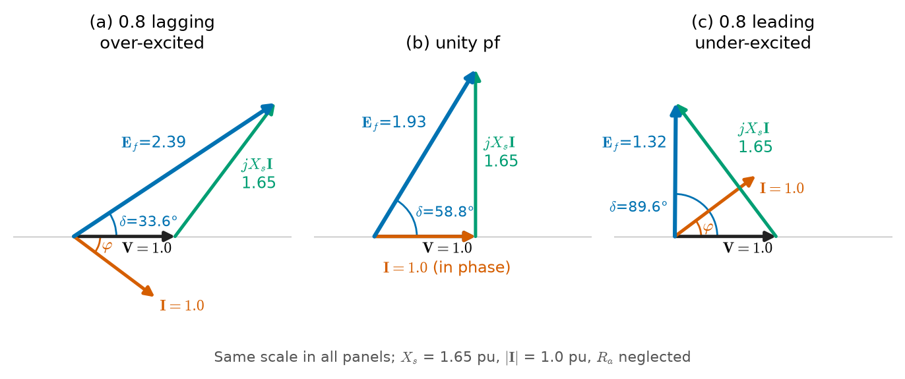
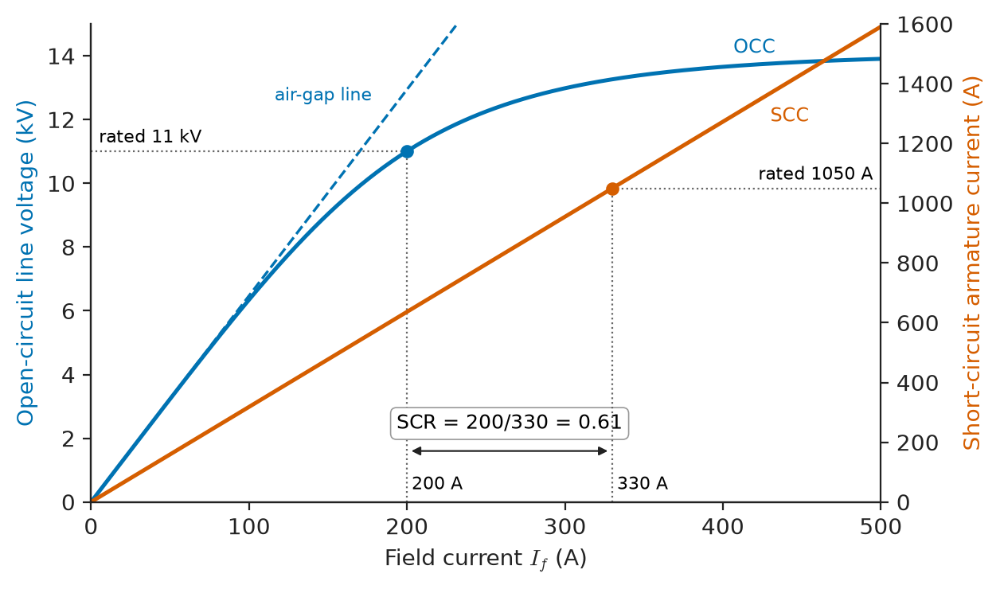
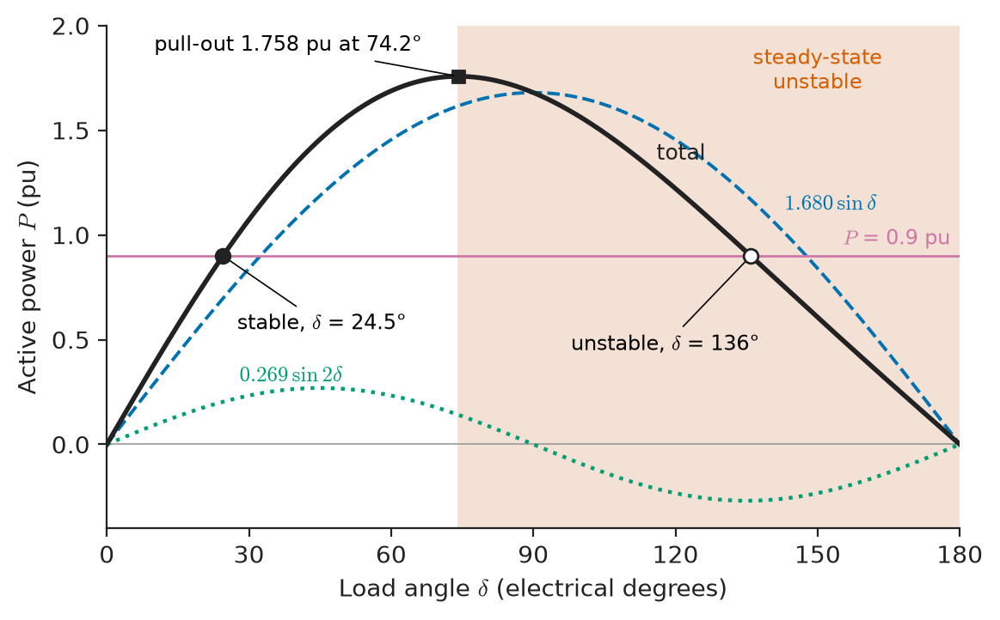
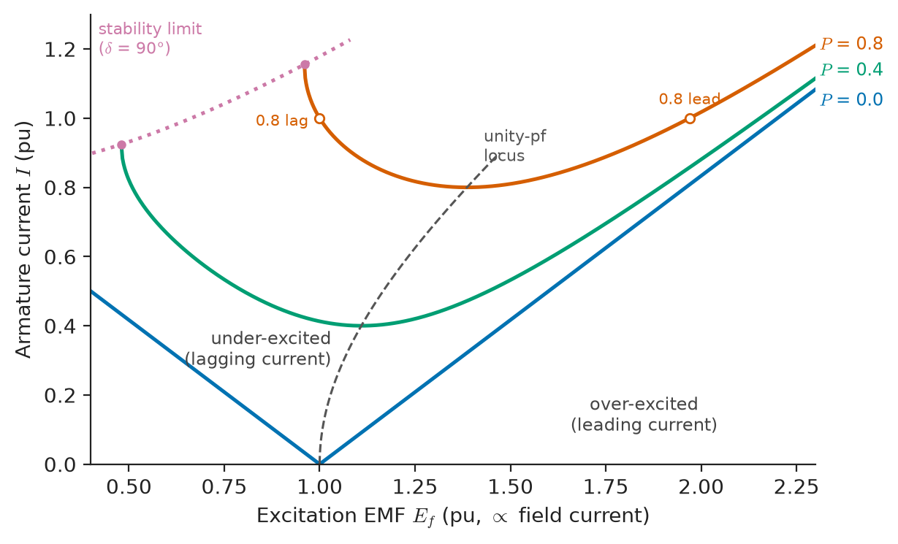
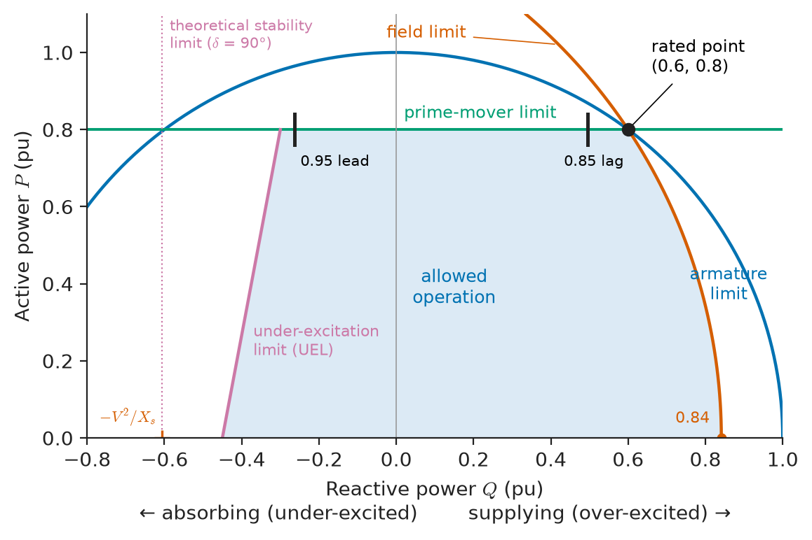

# Chapter 7 — Synchronous Machines

*Part II · Transformers and Electrical Machines*

A combined-heat-and-power plant at a paper mill runs a 20 MVA, 11 kV gas-engine generator in parallel with the utility. The plant engineer is asked to raise the generator's output from 12 MW to 16 MW and, at the same time, stop paying the utility's reactive-energy charge. The governor setpoint is raised, and the megawatts follow; the field current is raised, and the megavars follow. Nothing else changes: the terminal voltage stays at 11 kV and the frequency stays at 50 Hz, because the grid holds both. A month later a fault on the 33 kV line feeding the mill is cleared in 300 ms instead of the planned 120 ms, and the generator trips on pole slip. A second set at an offshore platform, running on its own with no grid behind it, behaves quite differently: there, raising the field current raises the voltage, and raising the fuel raises the frequency. All three behaviours come from one machine, the synchronous machine, and from where it is connected.

> **How does a synchronous machine produce a sinusoidal EMF at exactly grid frequency, and what sets its terminal voltage, its active power and its reactive power?**
> **How is it connected to a live grid, how do several machines share load, and how much power can it carry before it falls out of step?**

| Concept | Engineering destination |
|---|---|
| Construction (cylindrical and salient rotors) | Turbo-generators, hydro units, gensets, wind and marine machines |
| Alternator operation and synchronous reactance | Per-phase models in power-flow and fault studies |
| EMF generation and winding factors | Waveform quality, harmonic voltage limits, winding design |
| Phasor diagrams | Field-current requirement, rotor angle, metering checks |
| Voltage regulation and OC/SC tests | Excitation sizing, test-certificate interpretation |
| Power-angle relationships | Transfer limits, rotor-angle monitoring, stability margins |
| Synchronization | Breaker-closing permissives, auto-synchronizer settings |
| Parallel operation | Governor droop, load sharing on islands and ships |
| Synchronous motors | Compressors, mills, LNG trains, power-factor correction |
| Excitation and reactive power | AVR, capability charts, grid-code reactive requirements, synchronous condensers |
| Stability fundamentals | Swing equation, inertia, critical clearing, RoCoF |

**Roadmap.** What the machine is made of (7.1) → how it generates and how it is modelled (7.2) → the EMF and its waveform (7.3) → phasor diagrams for round and salient rotors (7.4) → voltage regulation and the standard tests (7.5) → the power-angle law (7.6) → connecting to a live bus (7.7) and sharing load (7.8) → the same machine as a motor (7.9) → what the field current does to reactive power (7.10) → how far the rotor angle can go before synchronism is lost (7.11).

---

## 7.1 Synchronous-machine construction

A synchronous machine has a stator carrying a distributed three-phase winding, the **armature**, and a rotor carrying a DC **field** winding (or permanent magnets, Chapter 8). The field produces a flux pattern fixed to the rotor; the rotor turns at exactly synchronous speed, so the armature sees a magnetic field moving at constant speed and an EMF at constant frequency. The frequency–speed–pole relation $f=pn/120$ is stated in *Circuits, Signals and Communications*, [Ch. 10 §10.1](https://github.com/The-Studio-of-Sadiq/Circuits-Signals-and-Communications/blob/main/part-2-transient-and-ac-analysis/10-three-phase-circuits.md); this chapter takes it as given.

### Stator

The stator core is built from 0.35–0.65 mm laminations of non-oriented silicon steel (Chapter 9), stacked in segments with radial ventilation ducts every 40–60 mm in large machines. Slots on the bore hold the armature coils. Machines above a few MVA use **form-wound** coils or Roebel-transposed bars insulated with mica tape and resin (Chapter 9, §9.5), because terminal voltages of 11–27 kV demand a groundwall several millimetres thick. The armature is almost always star-connected, with the neutral earthed through a high resistance or a distribution transformer to limit earth-fault current to 5–15 A; a delta would let third-harmonic EMFs drive a circulating current.

### Rotor: cylindrical and salient

Two rotor forms cover nearly every machine built (Figure 7.1):

- **Cylindrical (round, non-salient) rotors** are forged steel cylinders with axial slots milled along about two-thirds of the circumference, the field coils sitting in the slots and held by non-magnetic wedges and retaining rings. The air gap is uniform. They have two or four poles and run at 3000/3600 rpm or 1500/1800 rpm. Peripheral speeds reach 150–200 m/s, which limits rotor diameter to about 1.2–1.3 m; to reach high ratings the rotor is made long instead, up to 8 m of active length. Steam and gas turbo-generators use them.
- **Salient-pole rotors** carry separate pole bodies bolted or dovetailed to a hub or spider, each wound with a concentrated field coil. The air gap is shortest under the pole centre and much longer between poles. They have many poles, run slowly (60–750 rpm) and can be large in diameter: a 700 MW hydro generator at 107 rpm has a rotor of 16–20 m diameter. Hydro units, diesel and gas-engine gensets, and most synchronous motors use them.

The salient pole faces carry **damper (amortisseur) bars**, copper or brass bars short-circuited by end rings, like a partial induction-motor cage. They carry no current at steady synchronous speed; they damp rotor oscillations, carry negative-sequence currents under unbalance, and provide starting torque in synchronous motors (§7.9). Cylindrical rotors obtain the same effect from the solid forging and the slot wedges.

<!-- FIGURE 7.1 | figures/ch07/fig-7-1-rotor-cross-sections.png | cross-section | Cross-sections of a two-pole cylindrical-rotor turbo-generator (a) and a 12-pole salient-pole hydro generator (b), drawn to show air-gap shape and field-winding placement. | Content: (a) stator bore 1.2 m diameter with 48 armature slots shown as small rectangles; rotor 1.05 m diameter with field slots on two thirds of the circumference grouped either side of two unslotted pole faces marked N and S; uniform air gap about 75 mm exaggerated; d-axis through pole centres, q-axis 90 electrical degrees away. (b) stator bore 6 m diameter; 12 pole bodies on a spider, each with a concentrated field coil and five damper bars in the pole shoe; air gap 20 mm under pole centre growing to about 60 mm at pole tips; d-axis and q-axis marked for one pole pair. Labels: armature winding, field winding, damper bars, retaining ring (a), spider (b). -->

*Figure 7.1 — Cross-sections of a two-pole cylindrical-rotor turbo-generator (a) and a 12-pole salient-pole hydro generator (b), drawn to show air-gap shape and field-winding placement.*

### Excitation systems

The field needs a DC supply of typically 0.5–1 % of the machine rating: a few hundred amperes at a few hundred volts for a 100 MVA unit, up to 6–7 kA in a 1000 MVA turbo-generator. Three arrangements are in use:

| Excitation system | How the field is fed | Typical use | Response |
|---|---|---|---|
| DC exciter (legacy) | Shaft-driven DC generator through slip rings | Older units, small hydro | Slow (time constant 0.5–2 s) |
| Brushless (AC exciter + rotating diodes) | Inverted AC exciter on the shaft, rectified by a rotating diode wheel; no slip rings | Gensets, marine, most units up to ~300 MVA, synchronous motors | Medium (0.1–0.5 s) |
| Static (bus-fed thyristor) | Thyristor bridge supplied from the generator terminals through an excitation transformer, fed to the field via slip rings | Large turbo and hydro units, synchronous condensers | Fast (< 50 ms); ceiling voltage 2–3× rated |

The automatic voltage regulator (AVR) commands the exciter; its dynamics belong to §7.10 and to Chapter 20. IEEE Std 421.5 gives the standard models used to represent all three in stability studies.

### Ratings in the field

**Table 7.1 — Representative synchronous machines.**

| Application | Rating | Voltage | Poles / speed (50 Hz) | Rotor | Cooling |
|---|---|---|---|---|---|
| Nuclear turbo-generator | 1000–1750 MVA | 22–27 kV | 4 / 1500 rpm (some 2 / 3000) | Cylindrical | H₂ + water-cooled stator bars |
| Coal or CCGT steam/gas turbine | 150–600 MVA | 15–22 kV | 2 / 3000 rpm | Cylindrical | Air or H₂ |
| Large hydro | 100–800 MVA | 13.8–24 kV | 28–96 / 125–214 rpm | Salient | Air, water-cooled stator in largest |
| Gas-engine CHP / data-centre genset | 1–20 MVA | 0.4–11 kV | 4–6 / 1000–1500 rpm | Salient | Air (IC01, IC411) |
| Marine propulsion generator | 3–15 MVA | 6.6–11 kV | 4–10 / 600–1500 rpm | Salient | Air–water (IC81W) |
| Synchronous motor (compressor, mill) | 2–60 MW | 6.6–13.8 kV | 2–40 | Salient or cylindrical | Air, air–water |
| Synchronous condenser | 25–350 Mvar | 11–20 kV | 2–8 | Salient or cylindrical | Air or H₂ |

---

## 7.2 Alternator operation

### Armature reaction

When the alternator is loaded, the three armature currents produce their own rotating field, which, as shown in Chapter 3 for any balanced polyphase winding, travels at synchronous speed and is therefore stationary relative to the rotor. The air-gap field is the sum of the field-winding MMF and this **armature-reaction** MMF. Its effect depends on the phase of the current relative to the EMF:

- Current in phase with the EMF (resistive load) produces cross-magnetising MMF along the q-axis: it distorts the field and produces the electromagnetic torque.
- Current lagging the EMF by 90° (inductive load) produces MMF directly opposed to the field along the d-axis: it **demagnetises**, and the terminal voltage falls.
- Current leading by 90° (capacitive load, a long unloaded cable) **magnetises**: the terminal voltage rises, and an unregulated machine can self-excite.

### Synchronous reactance and the per-phase model

Because the armature MMF is proportional to armature current and fixed in space relative to the rotor, its voltage effect in an unsaturated cylindrical machine is that of a reactance, the **armature-reaction reactance** $X_{ad}$. Adding the leakage reactance $X_l$ of slot and end-winding flux gives the **synchronous reactance** $X_s=X_l+X_{ad}$, and the per-phase model of a cylindrical-rotor machine (generator convention) is

$$
\mathbf E_f=\mathbf V+(R_a+jX_s)\,\mathbf I
$$

where $\mathbf E_f$ is the open-circuit EMF set by the field current, $\mathbf V$ the terminal phase voltage and $\mathbf I$ the armature current. $R_a$ is 0.002–0.01 pu and usually neglected beside $X_s$, which is 1–2.5 pu in turbo-generators. This is the same Thévenin-source model that *Circuits, Signals and Communications*, [Ch. 10 §10.5](https://github.com/The-Studio-of-Sadiq/Circuits-Signals-and-Communications/blob/main/part-2-transient-and-ac-analysis/10-three-phase-circuits.md) uses for a three-phase source, now with a large internal reactance whose value comes from the machine's magnetic design.

> **Status of the principle: Synchronous-reactance model**
> *Approximate.* Valid for balanced steady state with a cylindrical rotor and an unsaturated (or linearised) magnetic circuit; it fails for salient rotors (use the two-reaction model of §7.4), under heavy saturation, under unbalance (negative-sequence reactance differs), and during transients, where the subtransient and transient reactances $X_d''$, $X_d'$ govern (Chapter 19).

> **Boundary.** The machine as an energy converter is the gyrator of *Engineering Physics*, [Ch. 17 §17.5](https://github.com/The-Studio-of-Sadiq/Engineering-Physics/blob/main/CHAPTERS/CHAPTER%2017.md): electrical effort and flow couple to torque and speed. Faraday's law ([Ch. 11 §11.4](https://github.com/The-Studio-of-Sadiq/Engineering-Physics/blob/main/CHAPTERS/CHAPTER%2011.md)) gives the induced EMF, and Chapters 2 and 3 of this book give the rotating field and the co-energy torque. Here we use those results in machine form.

### Reactances and time constants

The synchronous reactance is only the steady-state member of a family. A sudden change in armature current is opposed by induced currents in the field and damper circuits, so the machine first behaves as a source behind the small **subtransient reactance** $X_d''$ (decaying in tens of milliseconds), then behind the **transient reactance** $X_d'$ (decaying over about a second), and finally behind $X_d$. The values matter in every chapter that follows: $X_d''$ sets fault currents (Chapter 19), $X_d'$ appears in transient stability (§7.11, Chapter 20), $X_d$ and $X_q$ set steady-state voltage and power behaviour.

**Table 7.2 — Typical synchronous-machine parameters (per unit on machine rating; ranges collected from IEEE Std 1110 and manufacturers' data).**

| Parameter | Two-pole turbo | Four-pole turbo | Salient pole, with dampers | Synchronous condenser |
|---|---|---|---|---|
| $X_d$ | 1.6–2.3 | 1.0–2.0 | 0.6–1.5 | 1.5–2.5 |
| $X_q$ | 1.5–2.2 | 1.0–1.9 | 0.4–1.0 | 0.9–1.5 |
| $X_d'$ | 0.20–0.35 | 0.20–0.40 | 0.20–0.50 | 0.30–0.50 |
| $X_d''$ | 0.12–0.25 | 0.15–0.25 | 0.15–0.35 | 0.18–0.30 |
| $X_l$ | 0.10–0.20 | 0.10–0.20 | 0.10–0.25 | 0.10–0.20 |
| $T_{d0}'$ (s) | 4–10 | 4–9 | 1.5–9 | 6–12 |
| $T_{d0}''$ (s) | 0.02–0.05 | 0.02–0.05 | 0.02–0.05 | 0.02–0.05 |
| Inertia constant $H$ (s) | 2.5–6 (incl. turbine) | 4–8 | 2–4 (incl. turbine) | 1–1.5 (more with flywheel) |
| Short-circuit ratio | 0.4–0.6 | 0.5–0.7 | 0.9–1.5 | 0.4–0.6 |

---

## 7.3 EMF generation

### The EMF equation

The rotor field sweeps each armature coil, and the induced phase EMF has the same form as the transformer EMF equation of Chapter 4, with two corrections for the fact that an armature phase is not one concentrated coil:

$$
E_{ph}=4.44\,f\,N_{ph}\,k_w\,\Phi
$$

Here $N_{ph}$ is the number of series turns per phase, $\Phi$ the fundamental flux per pole and $k_w=k_d\,k_p$ the **winding factor**.

> **Status of the principle: EMF equation of an AC winding**
> *Derived.* Follows from Faraday's law applied to a distributed winding in a sinusoidally distributed air-gap field; exact for the fundamental, and for each harmonic $h$ with $f\to hf$, $\Phi\to\Phi_h$ and $k_w\to k_{wh}$.

### Distribution and pitch factors

A phase belt spreads over $q$ slots per pole per phase, adjacent slots being $\gamma$ electrical degrees apart. The coil EMFs add as phasors with this angular spread, so their sum is less than the arithmetic sum by the **distribution factor**

$$
k_d=\frac{\sin(q\gamma/2)}{q\sin(\gamma/2)}
$$

A coil spanning less than a full pole pitch (a short-pitched or chorded coil, span $\rho$ as a fraction of a pole pitch) links less than the full flux; the **pitch factor** is $k_p=\sin(\rho\cdot 90^\circ)$. For harmonic $h$ the angles multiply by $h$:

$$
k_{dh}=\frac{\sin(hq\gamma/2)}{q\sin(h\gamma/2)},\qquad k_{ph}=\sin(h\rho\cdot 90^\circ)
$$

The engineering point is that both factors are close to one for the fundamental and small for the harmonics. A 5/6 pitch reduces the fundamental by only 3.4 % and the 5th and 7th harmonics by about 74 %. Third and other triplen harmonics are in phase in all three phases and cancel in the line-to-line voltage of a star winding, so they never reach the grid; they do appear phase-to-neutral and must be considered when the neutral is earthed or when generators with different pitches are paralleled (circulating neutral current). IEC 60034-1 limits the telephone harmonic factor of generators above 300 kVA to 1.5 %, which in practice means a carefully pitched and distributed armature and skewed or shaped pole faces.

**Worked example — EMF and flux of a 20 MVA CHP generator.** A 20 MVA, 11 kV, 50 Hz, four-pole, star-connected generator has 48 stator slots and a two-layer winding with coil span 10 slots (full pitch 12 slots). Each phase has 48 series turns. Find the winding factor, the flux per pole for rated voltage, and the harmonic winding factors.

Slots per pole per phase: $q=48/(4\times3)=4$. Slot angle: $\gamma=180^\circ\times4/48=15^\circ$ electrical.

$$
k_d=\frac{\sin(4\times15^\circ/2)}{4\sin(7.5^\circ)}=\frac{0.5}{4\times0.1305}=0.9577,\qquad k_p=\sin\!\left(\tfrac{10}{12}\times90^\circ\right)=\sin 75^\circ=0.9659
$$

so $k_w=0.9250$. The rated phase voltage is $11\,000/\sqrt3=6351$ V, hence

$$
\Phi=\frac{6351}{4.44\times50\times48\times0.9250}=0.644\ \mathrm{Wb}
$$

With a bore diameter of 1.0 m and a core length of 1.3 m, one pole covers $\pi\times1.0\times1.3/4=1.021\ \mathrm{m^2}$, so the average gap flux density is 0.63 T and the peak of a sinusoidal distribution is $0.63\times\pi/2=0.99$ T, a typical design value. The harmonic winding factors are $k_{w5}=0.205\times0.259=0.053$ and $k_{w7}=-0.158\times0.259=-0.041$: the winding passes only 5.3 % and 4.1 % of any 5th and 7th harmonic present in the air-gap field, against 92.5 % of the fundamental. The 11th and 13th are reduced only to $\lvert k_w\rvert=0.122$; they are slot harmonics ($h=2q\cdot3\pm1$), which is why the pole faces are skewed or the stator uses a fractional number of slots per pole per phase.

### The open-circuit characteristic and saturation

With the rotor driven at synchronous speed and the armature open, the terminal voltage plotted against field current is the **open-circuit characteristic (OCC)**. At low field current it follows the straight **air-gap line**, because almost all the MMF is spent across the air gap; above about 0.8 pu voltage the iron begins to saturate and the OCC bends away. At rated voltage a typical machine needs 10–20 % more field current than the air-gap line predicts. This saturation is the magnetic-circuit saturation of Chapter 1 in a rotating machine, and it is the reason the linear model of §7.2 has to be used with a *saturated* synchronous reactance near rated voltage (§7.5).

---

## 7.4 Phasor diagrams

### Cylindrical rotor

Take the terminal phase voltage $\mathbf V$ as reference and neglect $R_a$. The phasor $jX_s\mathbf I$ leads $\mathbf I$ by 90°, and $\mathbf E_f=\mathbf V+jX_s\mathbf I$. Figure 7.2 shows the three cases for the same current magnitude:

- **Lagging power factor** (the normal generator duty, supplying inductive load and reactive power): $jX_s\mathbf I$ points up and to the right, $\mathbf E_f$ is much larger than $\mathbf V$, and the machine is **over-excited**.
- **Unity power factor**: $jX_s\mathbf I$ is vertical, and $E_f=\sqrt{V^2+(X_sI)^2}$.
- **Leading power factor** (absorbing reactive power): $jX_s\mathbf I$ points up and to the left; $E_f$ may be less than $V$, and the machine is **under-excited**.

The angle $\delta$ between $\mathbf E_f$ and $\mathbf V$ is the **load angle** (power angle, torque angle). It is also, to within the pole-pair factor, the physical angle between the rotor's d-axis and the position it would occupy at no load, so it can be measured with a shaft-angle sensor, and modern generator protection relays compute it continuously.

<!-- FIGURE 7.2 | figures/ch07/fig-7-2-cylindrical-phasor-diagrams.png | phasor | Phasor diagrams of a cylindrical-rotor generator with Xs = 1.65 pu at rated current: (a) 0.8 lagging, (b) unity, (c) 0.8 leading power factor. | Content: three panels with V = 1.0 pu horizontal reference. (a) I = 1.0 pu at -36.9 degrees, jXsI = 1.65 pu leading I by 90 degrees, Ef = 2.39 pu at delta = 33.6 degrees. (b) I = 1.0 at 0 degrees, jXsI vertical 1.65, Ef = 1.93 at 58.8 degrees. (c) I = 1.0 at +36.9 degrees, jXsI = 1.65 pointing up-left, Ef = 1.32 at 89.6 degrees. Same scale in all panels, angle delta and power-factor angle phi marked, labels over-excited and under-excited. -->

*Figure 7.2 — Phasor diagrams of a cylindrical-rotor generator with Xs = 1.65 pu at rated current: (a) 0.8 lagging, (b) unity, (c) 0.8 leading power factor.*

### Salient rotor: the two-reaction model

In a salient-pole machine the air gap, and hence the reluctance, is very different along the pole axis (d-axis) and between poles (q-axis). An armature MMF along the d-axis produces more flux than the same MMF along the q-axis, so a single $X_s$ cannot represent it. Blondel's **two-reaction model** resolves the armature current into components along the two axes and gives each its own reactance:

$$
\mathbf E_f=\mathbf V+jX_d\mathbf I_d+jX_q\mathbf I_q,\qquad X_d>X_q
$$

with $\mathbf I_d$ along the d-axis (in quadrature with $\mathbf E_f$) and $\mathbf I_q$ in phase with $\mathbf E_f$. Since the direction of $\mathbf E_f$ is unknown at the start, the construction uses a fictitious phasor $\mathbf E_Q=\mathbf V+jX_q\mathbf I$, which lies along $\mathbf E_f$ and so fixes $\delta$; then $E_f=E_Q+(X_d-X_q)I_d$.

> **Status of the principle: Two-reaction (d–q) model**
> *Approximate.* Assumes sinusoidal winding distributions and neglects saturation and cross-coupling between axes; it is the basis of all dynamic machine models (Park's transformation) and is accurate to a few per cent in steady state for salient-pole and interior-PM machines (Chapter 8).

**Worked example — load angle of a hydro generator.** A salient-pole hydro generator has $X_d=1.0$ pu and $X_q=0.65$ pu ($R_a$ neglected). It delivers rated current at rated voltage and 0.9 power factor lagging. Find $\delta$ and $E_f$.

With $\mathbf V=1\angle0^\circ$ and $\mathbf I=1\angle-25.84^\circ=0.9-j0.4359$:

$$
\mathbf E_Q=1+j0.65\,(0.9-j0.4359)=1.2833+j0.585=1.410\angle24.51^\circ
$$

so $\delta=24.51^\circ$. The angle between $\mathbf I$ and the q-axis is $\psi=24.51^\circ+25.84^\circ=50.35^\circ$, giving $I_d=\sin50.35^\circ=0.770$ pu and $I_q=\cos50.35^\circ=0.638$ pu. Then

$$
E_f=1.410+(1.0-0.65)\times0.770=1.680\ \mathrm{pu}
$$

A cylindrical model with $X_s=X_d=1.0$ would have given $\lvert1+j(0.9-j0.4359)\rvert=1.695$ pu at $\delta=32.1^\circ$: close in field current but 7.6° wrong in load angle, which matters for stability margins and for setting loss-of-field and pole-slip protection.

---

## 7.5 Voltage regulation

### Definition and what it is used for

The **voltage regulation** of an alternator is the rise in terminal voltage when rated load at a stated power factor is removed with field current and speed held constant:

$$
\text{Regulation}=\frac{E_f-V_{\text{rated}}}{V_{\text{rated}}}\times100\,\%
$$

Unlike a transformer, whose regulation is a few per cent, an alternator with $X_s\approx1.5$ pu has a regulation of 30–150 %. Nobody runs an alternator without an AVR, so regulation is not experienced as a voltage swing. It matters in three other ways: it fixes the **field current and exciter rating** needed at full load; it sets the overvoltage that appears on **sudden load rejection** before the AVR acts (the transient voltage rise of a genset that loses its load, limited by ISO 8528-5 for gensets); and it is the basis of the generator's test certificate.

### Open-circuit and short-circuit tests

Two tests at synchronous speed characterise the machine (Figure 7.3):

1. **Open-circuit test**: armature open, field current raised in steps, terminal voltage recorded; this gives the OCC (§7.3).
2. **Short-circuit test**: the three terminals are shorted through a current transformer and the field raised until rated armature current flows. Because the current is almost purely reactive and demagnetising, the iron is unsaturated and the **short-circuit characteristic (SCC)** is a straight line.

From the two curves:

$$
X_{s,\text{unsat}}=\frac{V_{\text{air-gap line}}(I_f)}{I_{sc}(I_f)},\qquad
\text{SCR}=\frac{I_{f}\ \text{for rated voltage on OC}}{I_{f}\ \text{for rated current on SC}}\approx\frac{1}{X_{s,\text{sat}}\ \text{(pu)}}
$$

The **short-circuit ratio** is the single number most quoted for a generator. A high SCR (hydro, 1.0–1.5) means a small $X_s$, a large air gap, a heavy and expensive machine, small load angles and good steady-state stability. A low SCR (modern turbo, 0.4–0.6) means a lighter, cheaper machine with larger load angles that relies on a fast AVR for stability.

<!-- FIGURE 7.3 | figures/ch07/fig-7-3-occ-scc.png | plot | Open-circuit and short-circuit characteristics of the 20 MVA, 11 kV generator, with the air-gap line and the field currents that define the short-circuit ratio. | Content: x-axis field current 0 to 500 A; left y-axis line voltage 0 to 15 kV; right y-axis armature current 0 to 1600 A. OCC curve passes 5.5 kV at 85 A, 11 kV at 200 A, 13 kV at 300 A, flattening toward 14 kV at 500 A. Dashed air-gap line through origin and (170 A, 11 kV). SCC straight line from origin through (330 A, 1050 A). Vertical markers at If = 200 A (rated voltage on OCC) and 330 A (rated current on SCC), annotated SCR = 200/330 = 0.61. -->

*Figure 7.3 — Open-circuit and short-circuit characteristics of the 20 MVA, 11 kV generator, with the air-gap line and the field currents that define the short-circuit ratio.*

**Worked example — test data, synchronous reactance and regulation.** The 20 MVA, 11 kV generator of §7.3 needs 200 A field current for rated voltage on open circuit and 330 A for rated armature current on short circuit. Find the SCR, the saturated synchronous reactance in per unit and ohms, and the regulation and field current at rated load for 0.8 lagging, unity and 0.8 leading power factor, using the linear (EMF) method.

Rated current $I_r=20\times10^6/(\sqrt3\times11\,000)=1050$ A. Base impedance $Z_b=11\,000^2/(20\times10^6)=6.05\ \Omega$.

$$
\text{SCR}=\frac{200}{330}=0.606,\qquad X_s\approx\frac{1}{0.606}=1.65\ \mathrm{pu}=1.65\times6.05=9.98\ \Omega
$$

With $\mathbf V=1\angle0^\circ$ pu and $\lvert\mathbf I\rvert=1$ pu:

| Power factor | $\mathbf E_f=\mathbf V+jX_s\mathbf I$ | $E_f$ (pu) | $\delta$ | Regulation | $I_f$ (A, linear) |
|---|---|---|---|---|---|
| 0.8 lagging | $1+j1.65(0.8-j0.6)=1.99+j1.32$ | 2.39 | 33.6° | 139 % | 478 |
| Unity | $1+j1.65$ | 1.93 | 58.8° | 93 % | 386 |
| 0.8 leading | $1+j1.65(0.8+j0.6)=0.01+j1.32$ | 1.32 | 89.6° | 32 % | 264 |

The field current is found by scaling 200 A by $E_f$, i.e. along the straight line through the rated OC point, which is how the saturated-reactance method treats the machine.

Two conclusions follow. First, at 0.8 leading the load angle is almost 90°: the machine is at its steady-state stability limit, which is why under-excited operation is restricted (§7.10). Second, the 139 % figure overstates what a real open-circuit voltage would be, because the OCC saturates: at 478 A the actual OC voltage is about 1.26 pu, not 2.39. The linear method is pessimistic about regulation and gives a conservative exciter size.

### Better methods

Because the EMF (synchronous-impedance) method treats a saturating machine as linear, standards prescribe methods that separate the leakage drop from the saturation-dependent armature reaction. The **MMF method** adds field-current equivalents instead of voltages and is optimistic. The **zero-power-factor (Potier) method** uses a third test, rated current at zero power factor lagging, to extract the Potier reactance $X_p$ (close to $X_l$) and reads the air-gap voltage behind $X_p$ off the real OCC. The **ASA method** (IEEE Std 115) combines the two and is the basis of manufacturers' guaranteed field currents. For the example machine these methods give a rated-load field current of the order of 400 A rather than 478 A; read off the real OCC, that field gives about 13.6 kV on open circuit, a regulation of roughly 25 %, and the exciter can be sized correspondingly smaller.

---

## 7.6 Power-angle relationships

### The cylindrical-rotor power-angle equation

With $R_a$ neglected, the phasor diagram gives directly the active and reactive power delivered at the terminals, per phase:

$$
P=\frac{E_fV}{X_s}\sin\delta,\qquad Q=\frac{E_fV\cos\delta-V^2}{X_s}
$$

Three-phase totals are three times these with phase quantities, or the same expressions in per unit.

> **Status of the principle: Power-angle equation**
> *Derived.* Follows from complex power (*Circuits, Signals and Communications*, [Ch. 9](https://github.com/The-Studio-of-Sadiq/Circuits-Signals-and-Communications/blob/main/part-2-transient-and-ac-analysis/09-ac-power.md)) applied to the source-behind-reactance model; it inherits that model's assumptions (balanced, steady state, $R_a\ll X_s$, constant $X_s$).

The same equation describes power transfer across any reactance between two voltage sources: a transmission line (Chapter 21), an interconnector, the coupling inductor of a grid-tied inverter (Chapter 27). Two facts dominate everything that follows:

1. **Active power is set by the load angle, reactive power mainly by the voltage magnitudes.** For small $\delta$, $P\propto\delta$ and $Q\propto(E_f-V)$. Turbine torque moves $P$; field current moves $Q$.
2. **There is a maximum.** At $\delta=90^\circ$, $P_{\max}=E_fV/X_s$. Beyond it, more mechanical input produces less electrical output, the surplus accelerates the rotor, and synchronism is lost.

### Salient-pole power-angle equation

The two-reaction model adds a second term:

$$
P=\frac{E_fV}{X_d}\sin\delta+\frac{V^2}{2}\left(\frac{1}{X_q}-\frac{1}{X_d}\right)\sin2\delta
$$

The second term is **reluctance power**: torque produced by the rotor's tendency to align its low-reluctance axis with the stator field, with no field current at all. It is the principle of the reluctance and switched-reluctance motors of Chapter 8, and it is what lets a salient-pole synchronous motor keep running at light load after loss of excitation.

**Worked example — power-angle curve of the hydro generator.** For the machine of §7.4 ($E_f=1.680$ pu, $X_d=1.0$, $X_q=0.65$, $V=1$):

$$
P(\delta)=1.680\sin\delta+0.269\sin2\delta
$$

At $\delta=24.51^\circ$ this gives $P=0.900$ pu, the load we started with. Searching for the maximum gives $P_{\max}=1.758$ pu at $\delta=74.2^\circ$, against 1.680 pu at 90° for the excitation term alone. The reluctance term raises the pull-out power by 4.6 % and moves it to a smaller angle. With zero excitation the machine can still carry 0.269 pu.

<!-- FIGURE 7.4 | figures/ch07/fig-7-4-power-angle-curves.png | plot | Power-angle curves of the salient-pole hydro generator: excitation term, reluctance term and total, with the operating point and pull-out point. | Content: x-axis load angle 0 to 180 electrical degrees; y-axis active power -0.4 to 2.0 pu. Curve 1 (dashed) 1.680 sin(delta), peak 1.68 at 90 degrees. Curve 2 (dotted) 0.269 sin(2 delta), peak 0.269 at 45 degrees, negative beyond 90 degrees. Curve 3 (solid) total, peak 1.758 at 74.2 degrees. Horizontal line at P = 0.9 pu meeting the total curve at 24.5 degrees (stable operating point, marked) and at about 136 degrees (unstable, marked with open circle). Shade region delta > 74.2 degrees as unstable for steady state. -->

*Figure 7.4 — Power-angle curves of the salient-pole hydro generator: excitation term, reluctance term and total, with the operating point and pull-out point.*

### The synchronizing power coefficient

The slope of the power-angle curve,

$$
K_s=\frac{dP}{d\delta}=\frac{E_fV}{X_s}\cos\delta\quad\text{(cylindrical)}
$$

is the **synchronizing power coefficient**: the restoring power per radian of rotor displacement. It is positive below the peak (stable) and zero at the peak. For the 20 MVA machine at rated 0.8 lagging load on an infinite bus, $P_{\max}=2.388/1.65=1.447$ pu, $\delta=33.6^\circ$ and $K_s=1.447\cos33.6^\circ=1.21$ pu/rad. The steady-state stability margin $(P_{\max}-P)/P_{\max}$ is 45 % here, and much smaller in under-excited operation.

---

## 7.7 Synchronization

### The four conditions

Closing a breaker between an incoming generator and a live bus is safe only if, at the instant the contacts touch, the two voltages are nearly identical. Four conditions must hold:

1. **Phase sequence** the same (checked once at commissioning with a sequence meter; a wrong sequence is a three-phase short circuit through two machines).
2. **Voltage magnitude** nearly equal.
3. **Frequency** nearly equal.
4. **Phase angle** nearly zero.

Any difference drives a current through the two machines' subtransient reactances. A phase error $\theta$ between two equal voltages $V$ produces a voltage $2V\sin(\theta/2)$ across the closing breaker; with $X_d''=0.2$ pu on the incoming machine and a stiff grid, a 10° error gives a current of $2\sin5^\circ/0.2=0.87$ pu, a tolerable transient, while an out-of-phase closure at 120° gives over 8 pu current and a shaft torque that can be several times the three-phase short-circuit torque, enough to crack couplings and loosen stator windings.

### Acceptance limits

IEEE Std C50.12 (salient-pole) and C50.13 (cylindrical-rotor) give the closing window for large generators:

| Quantity | Limit at breaker closing |
|---|---|
| Phase angle | within ±10° |
| Voltage | generator 0 to +5 % relative to bus |
| Frequency (slip) | within ±0.067 Hz |

The slightly higher generator voltage and small positive slip ensure the machine picks up a little reactive and active power on closure rather than motoring. Smaller gensets use wider windows (±10–20°, ±0.1–0.3 Hz) set in the genset controller.

### Synchronizing equipment

Older stations used **lamps** connected across the open breaker (dark-lamp method: lamps go dark when voltages are in phase) and a **synchroscope**, a rotating-pointer instrument whose speed and direction show the slip and whose position shows the phase angle. Closing was manual, at about five minutes to twelve on the dial with a slow clockwise rotation, so that the contacts touched at zero. Modern stations use an **auto-synchronizer** (ANSI device 25A) that adjusts the governor and AVR setpoints, predicts the zero-crossing of the phase angle from the slip, and issues the close command early by the breaker's closing time (40–100 ms). A separate **synch-check relay** (device 25) independently blocks closure outside the window. Data-centre switchgear that parallels four to sixteen standby gensets onto a common bus within 10–15 s of a utility failure relies on exactly this function, executed in parallel for every set.

---

## 7.8 Parallel operation

### Connection to an infinite bus

An **infinite bus** is a supply whose voltage and frequency are unaffected by anything one machine does; a 20 MVA generator connected to a 10 GW grid is close to one. Once synchronized, the generator's speed is locked to the grid. Its two controls then act on different quantities:

- Raising the **governor setpoint** (more steam, gas or water) increases the mechanical torque, the rotor advances, $\delta$ increases, and the machine delivers more **active power**. Frequency does not change.
- Raising the **field current** increases $E_f$; with $V$ fixed by the grid, the machine delivers more **reactive power** (lagging), and its current and power factor change. Active power does not change (to first order).

This decoupling is exactly what the paper-mill engineer observed in the opening.

### Load sharing by governor droop

When several machines feed an isolated system (a ship, an oil platform, a mine site, a data centre on standby power, a microgrid) there is no infinite bus. Frequency is set by the balance between total mechanical input and total load, and voltage by the total reactive balance. For stable sharing each governor has a **droop** characteristic: its speed setpoint falls linearly with its output,

$$
f=f_{nl}-R\,f_{\text{rated}}\,\frac{P}{P_{\text{rated}}}
$$

where $f_{nl}$ is the no-load frequency setpoint and $R$ the droop, typically 3–5 %. All machines on the bus must run at the same frequency, so each settles where its own droop line crosses the common frequency.

> **Status of the principle: Droop load sharing**
> *Approximate.* Assumes linear governor characteristics and a common steady-state frequency; machines with equal per-unit droop share load in proportion to rating. It ignores dead bands and the dynamics of the prime mover, which dominate the first seconds (Chapter 20).

**Worked example — two diesel generators on a ship.** A 60 Hz ship's switchboard is fed by G1 (3 MW, droop 4 %, no-load setpoint 62.4 Hz) and G2 (2 MW, droop 5 %, no-load setpoint 62.0 Hz). The load is 3.5 MW. Find the sharing and the bus frequency, then the setpoints that restore 60 Hz with sharing in proportion to rating.

Slopes: G1 $0.04\times60/3=0.8$ Hz/MW; G2 $0.05\times60/2=1.5$ Hz/MW. Equal frequency and total load:

$$
62.4-0.8P_1=62.0-1.5(3.5-P_1)\;\Rightarrow\;P_1=\frac{62.4-62.0+5.25}{2.3}=2.457\ \mathrm{MW}
$$

so $P_2=1.043$ MW and $f=62.4-0.8\times2.457=60.43$ Hz. G1 is at 82 % of rating, G2 at 52 %: unequal droops and setpoints produce unequal per-unit sharing. Proportional sharing at 60 Hz requires $P_1=2.1$ MW and $P_2=1.4$ MW, so the setpoints become $60+0.8\times2.1=61.68$ Hz and $60+1.5\times1.4=62.10$ Hz. A power-management system on board does this automatically (secondary control); grids do it with automatic generation control (Chapter 20).

### Reactive sharing

Reactive power is shared the same way through **voltage droop** (reactive droop compensation in the AVR, typically 3–6 % voltage reduction at rated lagging reactive current) or through a cross-current compensation loop that equalises reactive currents. Without it, a machine whose AVR setpoint is slightly high takes on most of the reactive load, a circulating reactive current flows between machines, and one generator can end up over-excited while its neighbour is driven into under-excitation and trips on loss of field.

---

## 7.9 Synchronous motors

### Motor operation

Reverse the power flow and the same machine is a motor. In motor convention $\mathbf V=\mathbf E_f+jX_s\mathbf I$, the load angle becomes negative (the rotor lags the stator field), and the motor runs at exactly synchronous speed at every load up to its **pull-out torque**,

$$
T_{\max}=\frac{3E_fV}{\omega_sX_s}
$$

(phase quantities, $\omega_s$ the mechanical synchronous speed), typically 1.5–2.5 times rated torque. There is no slip, no rotor copper loss in steady state and no magnetising current drawn from the supply, since the field supplies the flux. These three properties explain where synchronous motors are used: large, constant-speed, continuously running drives where efficiency and power factor are worth a more complex machine.

| Application | Rating | Why synchronous |
|---|---|---|
| Centrifugal and reciprocating compressors (refineries, air separation, LNG) | 5–60 MW | Efficiency 97–98.5 %, pf correction, constant speed |
| Ball and SAG mills (mining, cement) | 5–28 MW (ring motors, gearless) | Low speed, very high torque, pf 1.0 or leading |
| Pumps for water transfer and pumped storage (as motor-generator) | 10–500 MW | Bidirectional machine, efficiency |
| Ship propulsion with VFD | 5–40 MW | Efficiency, high power at low speed |
| Wind-tunnel fans, rolling mills with VFD | 10–100 MW | Precise speed, high torque |

### Starting

At standstill a synchronous motor connected to the grid produces only an oscillating torque at slip frequency, with zero average: the rotor cannot follow a field rotating at 1500 rpm from rest. Starting methods:

- **Induction (asynchronous) starting** on the damper cage, with the field winding short-circuited through a discharge resistor (5–10 times field resistance) to avoid dangerous induced field voltages. Near 95–97 % speed the DC field is applied at the right rotor angle and the motor **pulls into step**. Starting current is 4–7 pu, so large motors use reduced-voltage starting via reactor or autotransformer (Chapter 6).
- **Variable-frequency starting**: a load-commutated inverter or a medium-voltage VFD accelerates the motor synchronously from zero, then hands over to the line (soft-start of pumped-storage units and large compressors), or runs it permanently (Chapter 12).
- **Pony motor**: a small auxiliary motor brings the unloaded machine to speed; used for synchronous condensers.

### Synchronous-motor power-factor correction

**Worked example — compressor motor improving plant power factor.** An air-separation plant draws 5 MW at 0.75 lagging from its induction-motor loads. A new 2 MW synchronous compressor motor rated 2.5 MVA, 0.8 leading, $X_s=1.2$ pu, is added. Find the excitation EMF at rated load and the plant power factor.

Motor convention, $\mathbf V=1\angle0^\circ$, $\mathbf I=1\angle+36.87^\circ$:

$$
\mathbf E_f=\mathbf V-jX_s\mathbf I=1-j1.2(0.8+j0.6)=1.72-j0.96=1.970\angle-29.2^\circ\ \mathrm{pu}
$$

The motor needs almost twice the no-load field. It supplies $2.5\times0.6=1.5$ Mvar to the plant. The plant's reactive demand is $5\tan(\cos^{-1}0.75)=4.41$ Mvar; the net is $4.41-1.5=2.91$ Mvar, and the power factor at the utility meter becomes

$$
\text{pf}=\frac{7}{\sqrt{7^2+2.91^2}}=0.923\ \text{lagging}
$$

compared with 0.75 before. The same motor at unity power factor would need only $E_f=\lvert1-j1.2\times0.8\rvert=1.386$ pu.

---

## 7.10 Excitation and reactive power

### V-curves

Hold the shaft power of a synchronous machine constant and vary its field current. The active component of armature current stays fixed; the reactive component changes sign as the excitation passes through the value that gives unity power factor. Plotting armature current against field current gives the **V-curves** of Figure 7.5; the minimum of each V is unity power factor, and joining the minima gives the **unity-power-factor locus**. To the right of it the machine is over-excited (as a generator it supplies lagging vars; as a motor it draws leading current). To the left it is under-excited. The left end of each curve is cut off by the stability limit, $\delta=90^\circ$, where $E_f=PX_s/V$.

<!-- FIGURE 7.5 | figures/ch07/fig-7-5-v-curves.png | plot | V-curves of a synchronous motor with Xs = 1.2 pu at constant shaft power 0, 0.4 and 0.8 pu. | Content: x-axis excitation EMF Ef 0.4 to 2.3 pu (proportional to field current); y-axis armature current 0 to 1.2 pu. P = 0: V-shape with minimum 0 at Ef = 1.0, reaching 1.0 pu at Ef = 2.2. P = 0.4: minimum 0.40 pu at Ef = 1.11, 0.67 pu at Ef = 0.6, 1.04 at Ef = 2.2. P = 0.8: minimum 0.80 pu at Ef = 1.39, 1.0 pu at Ef = 1.0 (0.8 lagging) and at Ef = 1.97 (0.8 leading). Dashed unity-pf locus through the minima. Dotted stability-limit locus through (0.48, 0.92) and (0.96, 1.16). Regions labelled under-excited (lagging) left and over-excited (leading) right. -->

*Figure 7.5 — V-curves of a synchronous motor with Xs = 1.2 pu at constant shaft power 0, 0.4 and 0.8 pu.*

### The synchronous condenser

A synchronous motor with no shaft load is a **synchronous condenser**: a continuously variable source or sink of reactive power controlled only by field current, from about −0.5 to +1.0 pu. After decades of replacement by static var compensators, condensers are being installed again (in South Australia, Great Britain, Denmark, Texas) because, unlike power-electronic var sources, they also supply **short-circuit current** (5–7 pu through $X_d''$), which protection and the grid-forming stability of inverter-dominated grids need, and **inertia**, especially when fitted with a flywheel (§7.11, Chapter 27). Retired coal-plant generators are often converted by decoupling the turbine.

### The generator capability chart

A generator's allowable operating region in the $P$–$Q$ plane is bounded by four limits (Figure 7.6):

1. **Armature (stator) heating**: $\sqrt{P^2+Q^2}\le S_{\text{rated}}$, a circle about the origin.
2. **Field heating**: $E_f\le E_{f,\max}$, set by the rated field current at rated MVA and power factor. In the per-unit $P$–$Q$ plane this is a circle of radius $E_{f,\max}V/X_s$ centred at $(0,-V^2/X_s)$; it limits the over-excited region.
3. **Prime-mover limit**: a horizontal line at the turbine's maximum power.
4. **Under-excited limit**: steady-state stability ($\delta$ approaching 90°, with margin) and, for turbo-generators, heating of the stator core ends, which increases sharply under leading power factor because the end-region flux is then axial and induces eddy currents in the end laminations.

<!-- FIGURE 7.6 | figures/ch07/fig-7-6-capability-chart.png | plot | Capability chart of the 20 MVA, 0.8 pf generator with Xs = 1.65 pu: armature, field, prime-mover and under-excitation limits. | Content: x-axis reactive power Q -0.8 to +1.0 pu (negative = absorbing, under-excited; positive = supplying, over-excited); y-axis active power P 0 to 1.1 pu. Armature circle radius 1.0 centred at origin. Field-limit arc centred at (Q = -0.606, P = 0) with radius 1.447, meeting the armature circle at (0.6, 0.8) and meeting P = 0 at Q = 0.84. Prime-mover limit horizontal at P = 0.8. Practical under-excitation limit as a straight line from (Q = -0.45, P = 0) to (Q = -0.3, P = 0.8). Shade the allowed region. Mark rated point (0.6, 0.8). Mark grid-code reactive range 0.85 lagging to 0.95 leading at P = 0.8 as two short ticks at Q = 0.50 and Q = -0.26. -->

*Figure 7.6 — Capability chart of the 20 MVA, 0.8 pf generator with Xs = 1.65 pu: armature, field, prime-mover and under-excitation limits.*

Grid codes translate this chart into obligations. A typical transmission-connected synchronous unit must be able to operate between 0.85 power factor lagging and 0.95 leading at rated output (for example the GB Grid Code, CC.6.3.2), and within a voltage band of ±5 % (±10 % for limited times); the ENTSO-E Requirements for Generators (EU 2016/631) set comparable $Q/P_{\max}$ ranges by system and voltage. The capability chart shows whether a given machine can meet them.

### The AVR and its limiters

The AVR measures terminal voltage and adjusts field voltage, typically holding voltage within ±0.5 %. Its gain, time constants and the ceiling voltage of the exciter decide how strongly the machine supports the grid during faults; the feedback design belongs to *Circuits, Signals and Communications*, [Ch. 34](https://github.com/The-Studio-of-Sadiq/Circuits-Signals-and-Communications/blob/main/part-7-control-system-fundamentals/34-feedback-and-stability.md). Around the AVR sit limiters that keep it inside the capability chart: the **over-excitation limiter** (OEL), which allows field forcing to 1.6–2 times rated for a few seconds during faults and then ramps back with an inverse-time characteristic matched to the field's thermal capability (IEEE C50.13); the **under-excitation limiter** (UEL), which stops the AVR from driving the machine below its stability and core-end limits; and the **V/Hz limiter**, which protects the generator and step-up transformer cores from overfluxing at low speed. A **power-system stabiliser** (PSS) adds a damping signal derived from speed or power to counter the electromechanical oscillations of §7.11, which a high-gain AVR otherwise tends to under-damp.

---

## 7.11 Stability fundamentals

### Steady-state stability

From §7.6, a machine connected through total reactance $X$ to an infinite bus can transfer at most $P_{\max}=EV/X$. Operating close to it leaves no margin for a voltage dip or a line outage that raises $X$. Planning criteria typically require the steady-state load angle across a transmission corridor to stay below 30–45° and the system to remain stable after the loss of any single element (the N−1 criterion, Chapter 13).

### The swing equation

When the mechanical input $P_m$ and electrical output $P_e$ differ, the difference accelerates the rotor. Newton's law for a rotating body (*Engineering Physics*, [Ch. 9 §9.7](https://github.com/The-Studio-of-Sadiq/Engineering-Physics/blob/main/CHAPTERS/CHAPTER%209.md) and [Ch. 19 §19.2](https://github.com/The-Studio-of-Sadiq/Engineering-Physics/blob/main/CHAPTERS/CHAPTER%2019.md)) written in per unit on the machine rating, with the rotor angle measured in electrical radians against a synchronously rotating reference, gives the **swing equation**:

$$
\frac{2H}{\omega_s}\frac{d^2\delta}{dt^2}=P_m-P_e(\delta)-D\,\frac{d\delta}{dt}
$$

where $\omega_s=2\pi f$ is the electrical synchronous speed, $D$ a damping coefficient representing damper-winding and load effects, and $H$ the **inertia constant**: kinetic energy at synchronous speed divided by rated MVA,

$$
H=\frac{\tfrac12 J\omega_{sm}^2}{S_{\text{rated}}}\quad\text{(seconds)}
$$

A 600 MVA steam unit with $H=3.5$ s stores 2100 MJ in its rotating masses, enough to supply its full rating for 3.5 s.

> **Status of the principle: Swing equation**
> *Derived.* Newton's second law for rotation applied to the turbine–generator shaft, with power in place of torque (valid because speed stays within a few per cent of synchronous). It treats the shaft as a single rigid mass; torsional modes between turbine stages and the generator need multi-mass models (subsynchronous resonance, Chapter 20).

### Small oscillations

Linearise about an operating point $\delta_0$: $P_e\approx P_0+K_s\Delta\delta$. With damping neglected the swing equation becomes a harmonic oscillator, and the rotor swings at the **natural frequency of electromechanical oscillation**

$$
\omega_n=\sqrt{\frac{\omega_s K_s}{2H}}
$$

> **Status of the principle: Linearised electromechanical oscillation**
> *Approximate.* Valid for small disturbances around a stable operating point with the classical model (constant EMF behind transient reactance); it is the starting point for small-signal stability analysis (Chapter 20).

**Worked example — rotor oscillation and transfer margin of a 600 MVA unit.** A 600 MVA, 50 Hz turbo-generator ($H=3.5$ s) is connected through a step-up transformer ($X_t=0.15$ pu) and two parallel lines (combined $0.35$ pu) to a strong grid at $V=1$ pu. In the classical transient model the machine is an EMF $E'=1.15$ pu behind $X_d'=0.30$ pu. It delivers 0.9 pu. Find the load angle, the synchronizing coefficient, the oscillation frequency, and the effect of losing one line.

Total reactance $X=0.30+0.15+0.35=0.80$ pu, so $P_{\max}=1.15/0.80=1.4375$ pu.

$$
\delta_0=\sin^{-1}\frac{0.9}{1.4375}=38.8^\circ,\qquad K_s=1.4375\cos38.8^\circ=1.121\ \mathrm{pu/rad}
$$

$$
\omega_n=\sqrt{\frac{314.16\times1.121}{2\times3.5}}=7.09\ \mathrm{rad/s}\quad\Rightarrow\quad f_n=1.13\ \mathrm{Hz}
$$

That is the typical local-mode frequency (0.8–2 Hz) seen on generator power traces after a disturbance. The transfer margin is $(1.4375-0.9)/1.4375=37\,\%$. If one line trips, the line reactance doubles to 0.70 pu, $X=1.15$ pu and $P_{\max}=1.0$ pu: the unit can still deliver 0.9 pu, but at $\delta=64.2^\circ$ with only 10 % margin, and $K_s$ falls to 0.44 pu/rad, lowering $f_n$ to 0.70 Hz. Operators would reduce output; a protection scheme might do it automatically.

### Transient stability and inertia

A large disturbance, a three-phase fault near the generator, collapses $P_e$ almost to zero while $P_m$ continues; the rotor accelerates for as long as the fault lasts. When the fault is cleared, $P_e$ jumps above $P_m$ and decelerates it. Whether the rotor swings back or passes the unstable equilibrium and **slips a pole** depends on the clearing time. The equal-area criterion and the critical clearing time are developed in Chapter 20; for the unit above, faults at the high-voltage terminal must be cleared in roughly 150–250 ms, which is why transmission protection is designed for 80–120 ms total clearing time (Chapter 23). The CHP generator in the opening, with a low $H$ of the order of 1 s, lost synchronism because the 300 ms clearing time exceeded its critical value.

Inertia also governs the system frequency. When a generator of power $\Delta P$ trips, all remaining synchronous machines decelerate together, and the initial **rate of change of frequency** is

$$
\text{RoCoF}=\frac{\Delta P\,f_0}{2H_{\text{sys}}S_{\text{sys}}}
$$

Losing 10 % of generation in a 50 Hz system with an aggregate $H$ of 4 s gives $0.1\times50/(2\times4)=0.625$ Hz/s. As inverter-based plant replaces synchronous machines, $H_{\text{sys}}$ falls and RoCoF rises; several grid operators now limit it to 0.5–1 Hz/s and buy inertia from synchronous condensers. This connects the synchronous machine directly to the frequency-stability questions of Chapters 20 and 27.

---

## What remains open

| Open question | Where it is answered |
|---|---|
| How do the stator windings, losses and cooling of a synchronous machine set its rating, and how is it tested? | Chapter 9 |
| How do permanent-magnet synchronous machines differ from wound-field ones, and why do they dominate EV traction? | Chapter 8 |
| How are synchronous motors driven at variable speed by inverters? | Chapter 12 |
| What turbines, boilers and dams drive these generators, and what are their auxiliary loads? | Chapter 14 |
| How are generators represented in per-unit network models and power-flow studies? | Chapters 17 and 18 |
| How large are generator fault currents, and how do $X_d''$ and $X_d'$ shape them? | Chapter 19 |
| Equal-area criterion, critical clearing time, small-signal modes, PSS tuning and frequency control | Chapter 20 |
| How are generators protected against faults, loss of field and pole slipping? | Chapter 23 |
| How do grid-forming inverters emulate synchronous-machine inertia and voltage support? | Chapter 27 |
| Feedback design of the AVR and governor loops | *Circuits, Signals and Communications*, [Ch. 33–35](https://github.com/The-Studio-of-Sadiq/Circuits-Signals-and-Communications/blob/main/part-7-control-system-fundamentals/README.md) |

**Next:** Chapter 8 replaces the wound field with permanent magnets, the commutator with transistors and the rotating field with switched reluctance, and follows the synchronous principle into EVs, robots, drones and wind turbines.
