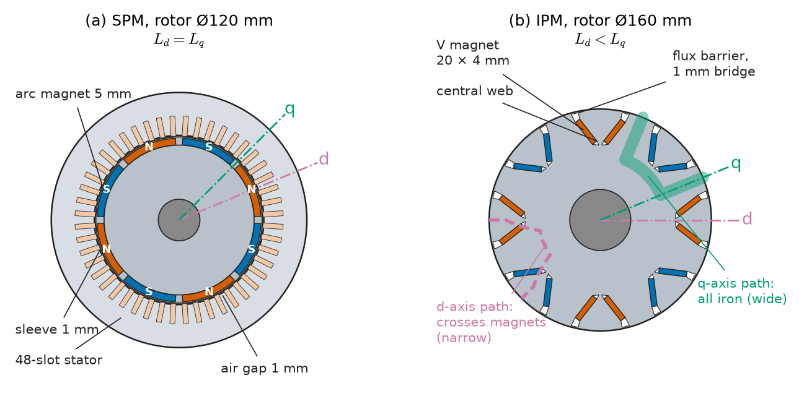
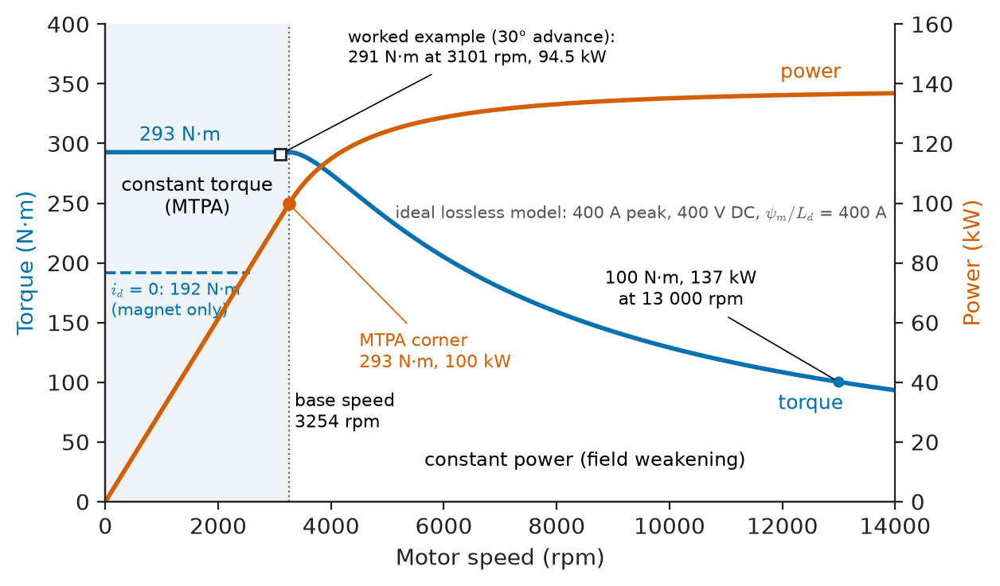
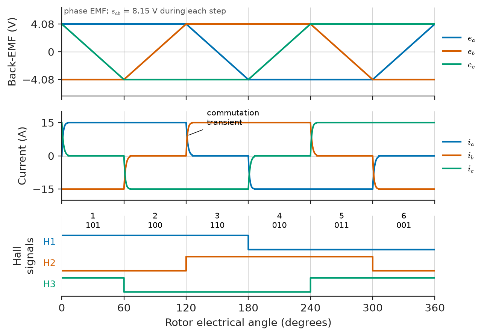
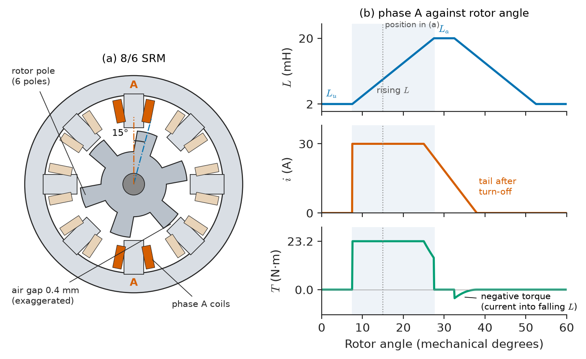
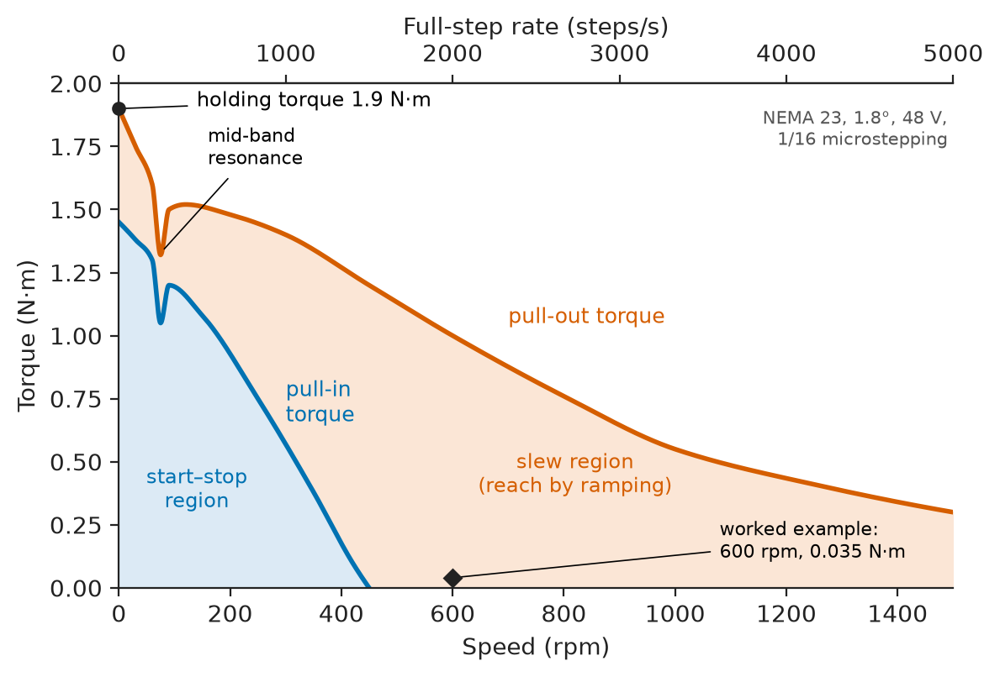
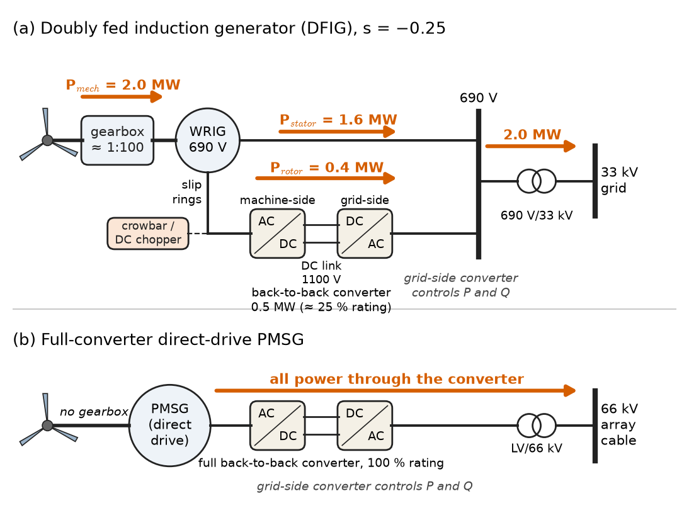

# Chapter 8 — Special Electrical Machines

*Part II · Transformers and Electrical Machines*

An electric-vehicle team has a 400 V battery, a gearbox ratio of 9:1 and a target of 0 to 100 km/h in seven seconds with a top speed of 180 km/h. An induction motor would do it, and so would a wound-field synchronous machine. The team picks an interior-permanent-magnet machine instead, because it fits in a 25 cm housing, reaches 95–97 % efficiency over most of the drive cycle, and adds range without adding battery. Down the corridor, a mining-equipment company has rejected the same machine for a battery shuttle car: magnets can be demagnetised by a hot short-circuit underground, and the duty is brutal, so it has chosen a switched-reluctance motor with no magnets and no rotor winding at all. Next door, a packaging-line integrator is choosing between a stepper motor that costs a fifth as much and a servo that will not lose position when a carton jams. These are the special electrical machines: built on the same physics as Chapters 5–7, but shaped by permanent magnets, power electronics and the application.

> **How do permanent magnets, electronic commutation and variable reluctance change what a motor can do, and where does each design reach its limits?**
> **How are these machines matched to traction, motion control, appliances, transport and wind generation?**

| Concept | Engineering destination |
|---|---|
| Permanent-magnet synchronous motors | EV traction, industrial IE5 motors, compressors, elevators |
| Brushless DC motors | Fans, pumps, drones, e-bikes, disk drives, data-centre cooling |
| Switched-reluctance motors | Mining vehicles, aerospace starter-generators, harsh-duty drives |
| Stepper motors | 3D printers, packaging, medical pumps, valve actuators |
| Universal motors | Power tools, vacuum cleaners, kitchen appliances |
| Linear motors | Maglev, metro LIM trains, aircraft-carrier launch, machine tools |
| Servo motors | Robots, CNC axes, pick-and-place, semiconductor equipment |
| Specialized generators | Wind turbines, aircraft, microturbines, vehicles, small hydro |
| Selection trade-offs | Choosing a machine against cost, efficiency, torque density and risk |

**Roadmap.** Magnets replace the field winding (8.1) → electronic commutation of a trapezoidal machine (8.2) → torque from reluctance alone (8.3) → stepping instead of rotating (8.4) → the commutator machine that runs on AC (8.5) → unrolling the machine into a line (8.6) → closing the loop for precise motion (8.7) → generators shaped by their prime movers (8.8) → choosing among all of them (8.9).

> **Boundary.** Torque from co-energy and the rotating field are taken from Chapter 3; synchronous-machine phasors and the two-reaction model from Chapter 7; the electromechanical converter as a gyrator from *Engineering Physics*, [Ch. 17 §17.5](https://github.com/The-Studio-of-Sadiq/Engineering-Physics/blob/main/CHAPTERS/CHAPTER%2017.md). Field-oriented and direct torque control are in Chapter 12; inverter and gate-driver circuits belong to *Electronics & Computing*; magnet metallurgy belongs to *The Materials Core*.

---

## 8.1 Permanent-magnet synchronous motors

### Why replace the field winding

A wound field costs copper loss: 0.5–1 % of rating in a large synchronous machine, but 10–20 % of total losses in a 10 kW machine, where the field must still magnetise a gap of comparable size. A permanent magnet supplies that MMF with no loss and no slip rings. It also allows a rotor with no current-carrying parts, which is cooler (rotor heat is the hardest to remove) and smaller. The **permanent-magnet synchronous motor (PMSM)** is a synchronous machine whose field is fixed by its magnets; it runs at synchronous speed only when fed from an inverter at the corresponding frequency (or, in line-start designs, with a starting cage).

### Magnet materials

**Table 8.1 — Representative permanent-magnet materials (typical catalogue values at 20 °C).**

| Material | Remanence $B_r$ (T) | Intrinsic coercivity $H_{cJ}$ (kA/m) | $(BH)_{\max}$ (kJ/m³) | Max. operating temperature | $B_r$ temperature coefficient |
|---|---|---|---|---|---|
| NdFeB, grade N42 | 1.28–1.32 | ≥ 960 | 320–340 | 80 °C | −0.12 %/K |
| NdFeB, grade 42SH (Dy/Tb grain-boundary diffused) | 1.28–1.32 | ≥ 1590 | 320–340 | 150 °C | −0.11 %/K |
| NdFeB, grade 38UH | 1.22–1.25 | ≥ 1990 | 290–310 | 180 °C | −0.11 %/K |
| SmCo (Sm₂Co₁₇) | 1.05–1.15 | 1400–2000 | 200–240 | 300–350 °C | −0.03 %/K |
| Sintered ferrite (Sr) | 0.38–0.45 | 250–350 | 28–36 | 250 °C (risk of demagnetisation when cold) | −0.20 %/K |
| AlNiCo 5 | 1.25 | 50 | 40–44 | 500 °C | −0.02 %/K |

Three engineering facts follow. Neodymium magnets give three times the flux density of ferrite and ten times the energy product, which is why NdFeB machines dominate where volume and mass are expensive (vehicles, aircraft, robots). Their coercivity falls with temperature, so high-temperature grades need dysprosium or terbium, which are scarce and price-volatile; this supply risk drives the development of magnet-free traction motors (§8.9). And every magnet has a **demagnetisation limit**: a stator current that drives the operating point below the knee of the $B$–$H$ curve, most likely during a short circuit at high temperature, permanently weakens the rotor. Machine design keeps a margin of 20–30 % between the worst-case demagnetising field and $H_{cJ}$ at maximum temperature.

### Surface and interior magnets

Two rotor geometries are used (Figure 8.1):

- **Surface-mounted PM (SPM)**: magnets glued to the rotor surface and held by a carbon-fibre or stainless sleeve. Since magnet permeability is close to that of air, the effective gap is large and uniform: $L_d\approx L_q$, low inductance, low armature reaction, smooth torque. Used in servo motors (§8.7), high-speed machines and BLDC motors.
- **Interior PM (IPM)**: magnets buried in slots inside the rotor laminations, often in a single or double V. The magnets are mechanically protected and shielded from stator harmonics, and the iron bridges make the rotor salient with $L_q>L_d$ (the opposite of the wound-field salient-pole machine, because the low-permeability magnets lie on the d-axis). The machine produces **reluctance torque** in addition to magnet torque. Used in nearly all EV traction motors and in variable-speed compressors.

<!-- FIGURE 8.1 | figures/ch08/fig-8-1-spm-ipm-rotors.png | cross-section | Rotor cross-sections of an 8-pole surface-mounted PM motor (a) and an 8-pole interior PM traction motor with V-shaped magnets (b), with d- and q-axes marked. | Content: (a) rotor outer diameter 120 mm, eight arc magnets 5 mm thick on the surface alternating N and S, 1 mm retaining sleeve, air gap 1 mm to a 48-slot stator; d-axis through a magnet centre, q-axis between magnets. (b) rotor outer diameter 160 mm, eight V-pairs of rectangular magnets 20 mm x 4 mm buried in flux barriers, 1 mm iron bridges at the rotor surface, central web; q-axis flux path through iron between poles highlighted as wide, d-axis path crossing magnets highlighted as narrow. Labels Ld < Lq on (b), Ld = Lq on (a). -->

*Figure 8.1 — Rotor cross-sections of an 8-pole surface-mounted PM motor (a) and an 8-pole interior PM traction motor with V-shaped magnets (b), with d- and q-axes marked.*

### Torque in the d–q frame

In the rotor (d–q) reference frame of Chapter 7, with $p$ pole pairs, magnet flux linkage $\psi_m$ and peak-value currents $i_d$, $i_q$, the electromagnetic torque is

$$
T=\tfrac32\,p\left[\psi_m i_q+(L_d-L_q)\,i_d i_q\right]
$$

> **Status of the principle: PMSM torque equation**
> *Derived.* Follows from the co-energy of Chapter 3 expressed in the rotor frame (Park's transformation) for sinusoidally distributed windings; saturation makes $L_d$, $L_q$ and even $\psi_m$ functions of current, so production designs replace the constants with finite-element maps.

The first term is magnet torque; the second is reluctance torque, which in an IPM ($L_q>L_d$) is positive when $i_d$ is negative. Driving current with a negative d-component therefore raises torque per ampere. The current angle that maximises torque for a given current magnitude defines **maximum torque per ampere (MTPA)** control (Chapter 12).

### Field weakening and the speed range

The inverter can apply only so much voltage: for a DC link $V_{dc}$ with space-vector modulation, the peak phase voltage is at most $V_{dc}/\sqrt3$. Neglecting resistance, the stator voltage magnitude is $\omega_e\sqrt{(\psi_m+L_di_d)^2+(L_qi_q)^2}$, which grows with speed until it reaches the limit at **base speed**. Above it the controller injects more negative $i_d$, cancelling part of the magnet flux (**field weakening**) and trading torque for speed at roughly constant power. The **characteristic current** $\psi_m/L_d$ decides how far this can go: if it is less than or equal to the inverter current limit, the flux can in principle be cancelled entirely and the constant-power range is wide.

**Worked example — torque, base speed and power of an EV IPM motor.** An 8-pole ($p=4$) IPM motor has $\psi_m=0.08$ Wb, $L_d=0.2$ mH and $L_q=0.5$ mH. The inverter supplies 400 A peak from a 400 V battery. Compare the torque with $i_d=0$ and with a 30° advance of the current vector, then find the base speed and power.

With $i_d=0$, $i_q=400$ A: $T=1.5\times4\times0.08\times400=192$ N·m, magnet torque only.

With a 30° advance: $i_d=-400\sin30^\circ=-200$ A, $i_q=400\cos30^\circ=346.4$ A.

$$
T=1.5\times4\left[0.08\times346.4+(0.2-0.5)\times10^{-3}\times(-200)\times346.4\right]=166.3+124.7=291\ \mathrm{N\,m}
$$

The same current produces 52 % more torque. A search over current angle puts the MTPA point at about 34°, with 293 N·m: the 30° figure is almost optimal. The flux linkage at this operating point is $\sqrt{(0.08-0.2\times10^{-3}\times200)^2+(0.5\times10^{-3}\times346.4)^2}=0.178$ Wb. With $V_{\max}=400/\sqrt3=230.9$ V peak:

$$
\omega_e=\frac{230.9}{0.178}=1299\ \mathrm{rad/s},\qquad \omega_m=\frac{1299}{4}=324.8\ \mathrm{rad/s}=3101\ \mathrm{rpm}
$$

and the power at base speed is $291\times324.8=94.5$ kW. With a 9:1 reduction and 0.33 m tyre radius, 3100 rpm corresponds to 43 km/h; the remaining speed range to 180 km/h and the motor's 13,000 rpm or so is covered by field weakening (Figure 8.2). At the true MTPA angle (34°, 293 N·m, flux linkage 0.169 Wb) the corner moves slightly up, to 3254 rpm and 100 kW. Note the characteristic current: $\psi_m/L_d=0.08/0.2\times10^{-3}=400$ A, exactly equal to the current limit, which is the classical design condition for an unlimited constant-power range in the ideal (lossless) machine. In this ideal model the current stays at 400 A above base speed while its angle advances, so power does not merely hold but keeps rising towards the asymptote $\tfrac32V_{\max}I_{\max}=1.5\times230.9\times400=139$ kW; at 13,000 rpm the envelope gives about 100 N·m and 137 kW. Real motors lose much of this rise to resistance, iron loss and saturation, and are usually rated for roughly constant power above base speed.

<!-- FIGURE 8.2 | figures/ch08/fig-8-2-pmsm-torque-power-envelope.png | plot | Torque-speed and power-speed envelope of the 8-pole EV IPM motor at 400 A peak and 400 V DC, showing the constant-torque and field-weakening regions. | Content: x-axis motor speed 0 to 14000 rpm; left y-axis torque 0 to 400 N m; right y-axis power 0 to 160 kW; curves computed from the ideal lossless model of the worked example. Torque flat at the MTPA value 293 N m (34 degree advance) from 0 to the base speed 3254 rpm (marked), then falling to about 100 N m at 13000 rpm (marked). Power rising linearly to 100 kW at the MTPA corner, then continuing to rise and flattening towards the 139 kW asymptote, about 137 kW at 13000 rpm. Worked-example point (30 degree advance, 291 N m at 3101 rpm, 94.5 kW) marked with an open square. Dashed line: magnet-torque-only operation (id = 0) at 192 N m. Regions labelled constant torque (MTPA) and constant power (field weakening). -->

*Figure 8.2 — Torque-speed and power-speed envelope of the 8-pole EV IPM motor at 400 A peak and 400 V DC, showing the constant-torque and field-weakening regions.*

### Efficiency, losses and uncontrolled generation

With no rotor copper loss, PMSMs reach IE4–IE5 efficiency classes (IEC 60034-30-2) in industrial sizes and 95–97 % peak efficiency in traction motors. Their losses are stator copper, stator iron at high frequency (a 12,000 rpm 8-pole motor runs at 800 Hz, so thin 0.20–0.27 mm steel is used, Chapter 9), and eddy loss in the magnets themselves, which are conductive and must be segmented. One hazard is specific to PM machines: when a vehicle coasts or a fan windmills with the inverter off, the magnets still generate a back-EMF proportional to speed. At top speed, an EV motor's open-circuit voltage can exceed the DC-link voltage, so an inverter fault can lead to **uncontrolled generator operation**, with current flowing back through the freewheel diodes. Designs limit the back-EMF ratio or provide active short-circuit modes, and maintenance staff must treat a rotating PM machine as energised.

---

## 8.2 Brushless DC motors

### A DC motor turned inside out

The DC motor of Chapter 5 has a stationary field and a rotating armature commutated by brushes. The **brushless DC (BLDC) motor** moves the magnets to the rotor and the armature to the stator, and replaces the mechanical commutator with transistors switched according to rotor position. Electrically it behaves like a DC motor: speed proportional to voltage, torque proportional to current, and the gyrator relations $E=K_e\omega$, $T=K_tI$ with $K_e=K_t$ in SI units.

The difference from a PMSM lies in the back-EMF waveform and the drive. A BLDC motor is wound with concentrated or full-pitch windings and magnets that give a **trapezoidal** back-EMF with a 120° flat top. It is driven with **six-step (120° block) commutation**: at any instant two phases conduct a constant current and the third floats, and every 60° electrical the switching pattern advances (Figure 8.3). When the flat top of the EMF coincides with the current block, the power $e_ai_a+e_bi_b+e_ci_c$, and therefore the torque, is ideally constant. A PMSM has a sinusoidal EMF and is driven with sinusoidal currents. In practice the boundary is blurred, and many small "BLDC" motors are driven sinusoidally for quietness.

<!-- FIGURE 8.3 | figures/ch08/fig-8-3-bldc-six-step-waveforms.png | plot | Trapezoidal back-EMFs, six-step phase currents and Hall-sensor signals of a BLDC motor over one electrical cycle. | Content: x-axis rotor electrical angle 0 to 360 degrees with gridlines every 60 degrees. Top panel: three trapezoidal phase back-EMFs ea, eb, ec with 120-degree flat tops at plus and minus 4.08 V, displaced 120 degrees, so that the line-to-line EMF across the two conducting phases is 8.15 V during each step (the drone motor of the worked example at 7500 rpm). Middle panel: phase currents as rectangular blocks of plus and minus 15 A, 120 degrees wide, centred on the EMF flat tops, zero for 60 degrees between blocks; small commutation spikes at each 60-degree boundary. Bottom panel: three Hall signals H1 H2 H3, each high for 180 degrees, displaced 120 degrees, giving six distinct states numbered 1 to 6. -->

*Figure 8.3 — Trapezoidal back-EMFs, six-step phase currents and Hall-sensor signals of a BLDC motor over one electrical cycle.*

### Position sensing and commutation

Six commutation instants per electrical cycle need only coarse position: three **Hall-effect sensors** spaced 120° electrical give six distinct codes. Sensorless drives detect the zero-crossing of the floating phase's back-EMF and commutate 30° later; they need a minimum speed (typically 5–10 % of rated) for the EMF to be detectable, so they start open-loop. The weaknesses of six-step drive are **commutation torque ripple** (10–20 % in practice, since the current cannot transfer instantly between phases through the winding inductance) and acoustic noise at the 6× electrical frequency.

### Applications

BLDC motors cover a huge volume of small machines: 3–1000 W fans (including the EC fans in data-centre air handlers and server chassis), wet-rotor circulator pumps (which in the EU must meet an energy-efficiency index of 0.23 or better, achievable only with PM rotors), HDD and optical spindles, drone and model-aircraft propulsion, e-bike hub motors (250–750 W), cordless power tools and appliance compressors. Their speed control is a DC-link voltage or PWM duty cycle, which is why fan speed in a server follows a simple PWM signal from the motherboard.

**Worked example — a drone propulsion motor.** An outrunner BLDC motor rated $K_v=920$ rpm/V drives a propeller from a four-cell lithium-polymer pack (14.8 V nominal). At hover it runs at 7500 rpm and draws 15 A; winding resistance (line-to-line) is 0.12 Ω. Find the torque, the required effective voltage, the PWM duty and the efficiency, neglecting iron and friction losses.

Converting $K_v$ to SI: $920\times2\pi/60=96.34$ rad/s per volt, so $K_e=K_t=1/96.34=0.01038$ V·s/rad = N·m/A.

- Torque: $T=0.01038\times15=0.156$ N·m.
- Back-EMF at 7500 rpm: $7500/920=8.15$ V. Like the resistance, this is a line-to-line value: the EMF across the two conducting phases in series, each contributing a flat top of 4.08 V (Figure 8.3). Required voltage: $8.15+15\times0.12=9.95$ V, a duty cycle of $9.95/14.8=67\,\%$.
- Mechanical power: $0.156\times(7500\times2\pi/60)=0.156\times785.4=122$ W; electrical input $9.95\times15=149$ W; efficiency 82 %.

At full throttle the no-load speed would be $14.8\times920=13,600$ rpm, but propeller torque rises with the square of speed, so current and copper loss rise steeply. The $K_v$ rating is the designer's choice of turns: a high-$K_v$ motor gives speed on a small propeller, a low-$K_v$ motor gives torque on a large one at the same voltage.

---

## 8.3 Switched-reluctance motors

### Torque without magnets or rotor windings

A **switched-reluctance motor (SRM)** has salient poles on both stator and rotor, concentrated coils on the stator poles only, and a rotor of plain laminated steel. Common geometries are 6/4 (three phases) and 8/6 (four phases) stator/rotor poles. Exciting a phase pulls the nearest rotor pole pair into alignment, because that minimises reluctance; switching to the next phase before alignment pulls the rotor on. Torque comes from the variation of phase inductance with rotor angle (Figure 8.4). From the co-energy result of Chapter 3, with linear magnetics,

$$
T=\tfrac12\,i^2\,\frac{dL}{d\theta}
$$

> **Status of the principle: Reluctance torque $\tfrac12 i^2\,dL/d\theta$**
> *Approximate.* Exact for a magnetically linear machine; real SRMs are designed to run deep in saturation, where the torque must be computed from the co-energy of the measured flux-linkage–current–angle map. Saturation is beneficial: it raises the energy converted per stroke relative to the volt-amperes the converter must supply.

Torque is independent of current direction, so the converter can be unipolar: the **asymmetric half-bridge**, two switches and two diodes per phase, with no possibility of shoot-through. Each phase is electrically independent, so the machine continues to run with one phase failed: a valued property in aircraft fuel pumps and mining vehicles.

<!-- FIGURE 8.4 | figures/ch08/fig-8-4-srm-geometry-inductance.png | cross-section | An 8/6 switched-reluctance motor (a) and the idealised phase inductance, current and torque against rotor angle (b). | Content: (a) 8 stator poles with concentrated coils, phase A coils on two opposite poles shaded, 6 rotor poles, rotor shown 15 mechanical degrees before alignment with phase A; air gap 0.4 mm exaggerated. (b) x-axis rotor angle 0 to 60 mechanical degrees (one rotor pole pitch); top trace phase A inductance trapezoid rising from Lu = 2 mH to La = 20 mH over 20 degrees, flat, falling over 20 degrees; middle trace flat-topped current pulse of 30 A during the rising-inductance interval; bottom trace torque 23.2 N m during the pulse, zero elsewhere, with a negative sliver if current persists into the falling region. -->

*Figure 8.4 — An 8/6 switched-reluctance motor (a) and the idealised phase inductance, current and torque against rotor angle (b).*

**Worked example — torque of an 8/6 SRM.** An 8/6 SRM phase has unaligned inductance 2 mH and aligned inductance 20 mH, with inductance rising linearly over 20° of rotation. The phase current is held at 30 A during the rising interval. Find the phase torque, the step angle and the average motor torque, assuming linear magnetics.

$$
\frac{dL}{d\theta}=\frac{0.020-0.002}{20\times\pi/180}=0.0516\ \mathrm{H/rad},\qquad T=\tfrac12\times30^2\times0.0516=23.2\ \mathrm{N\,m}
$$

Strokes per revolution: $m\times N_r=4\times6=24$, a stroke angle of 15°. Each stroke converts $\tfrac12 i^2(L_a-L_u)=\tfrac12\times900\times0.018=8.1$ J, so the average torque is $8.1\times24/(2\pi)=30.9$ N·m. The average exceeds the single-phase torque because the 20° rising region of each phase is longer than the 15° stroke, so phases overlap. In reality the current takes time to build against the back-EMF at speed, the converter must turn the phase off before alignment to avoid negative torque, and saturation reshapes everything.

### Strengths and weaknesses

The SRM's rotor tolerates 200 °C and more and speeds above 50,000 rpm (it has nothing to fly apart but laminations), it contains no rare earths, and it is cheap to build. Against this, it has high **torque ripple** (30–100 % without current profiling), **acoustic noise** from radial forces that pull the stator into an oval at the stroke frequency, a small air gap (0.25–0.5 mm) that must be held tightly, and a need for position sensing and nonstandard converters. Applications are where robustness outweighs refinement: battery shuttle cars and wheel loaders in underground and surface mining, aircraft starter-generators and fuel pumps, some high-speed vacuum-cleaner and centrifuge drives, and textile machinery. Current research uses current-profiling control and multi-objective geometry to bring noise and ripple close to induction-motor levels, as a rare-earth-free traction option.

---

## 8.4 Stepper motors

### Moving in steps

A **stepper motor** turns a fixed angle for each current pulse, so position is set by counting pulses, with no feedback sensor. Three types are built:

- **Permanent-magnet (tin-can)** steppers: a multipole magnet rotor between claw-pole stators; 7.5° or 15° steps; very cheap; used in HVAC damper actuators, automotive gauges and valve positioners.
- **Variable-reluctance** steppers: a toothed soft-iron rotor, the stepping version of the SRM; step angle $360^\circ/(mN_r)$, for example 15° for a three-phase motor with an 8-tooth rotor; now rare.
- **Hybrid** steppers: an axially magnetised magnet sandwiched between two toothed rotor cups offset by half a tooth pitch, combining PM and reluctance action. With $N_r=50$ rotor teeth and two phases, there are $2mN_r=200$ full steps per revolution, a **1.8° step**; 0.9° versions have 100 teeth. Holding torques range from 0.1–0.5 N·m in NEMA 17 frames (42 mm) to 1–3 N·m in NEMA 23 (57 mm) and 3–12 N·m in NEMA 34 (86 mm).

### Drive modes

Full-step drive energises the phases in sequence; half-step alternates one and two phases on, doubling resolution. **Microstepping** feeds sine–cosine weighted currents to the two phases, dividing each full step into 4–256 microsteps. It smooths motion and reduces noise and resonance, but does not improve accuracy in proportion: microstep positions are only as accurate as the motor's torque–angle linearity, typically ±5 % of a full step.

### Torque–speed behaviour, resonance and lost steps

Stepper torque falls with speed, because the winding inductance limits how fast phase current can rise within each step period; drivers therefore use chopper current control with supply voltages 10–20 times the winding rated voltage. Two curves describe the motor (Figure 8.5): the **pull-out torque** curve, the maximum load torque at which a running motor keeps step, and the lower **pull-in torque** curve, the maximum load at which it can start instantly at a given pulse rate without acceleration. Between them lies the **slew range**, reachable only by ramping the pulse rate. In a band of low-to-middle speeds (for the motor of Figure 8.5 about 200–300 full steps per second, 60–90 rpm) the rotor-load system behaves as an underdamped torsional oscillator, the **mid-band resonance**, and can lose torque or stall.

The fundamental limitation is that an open-loop stepper does not know when it has lost steps; a jam or overload silently corrupts position. For this reason **closed-loop steppers**, with an encoder and a drive that switches into servo-like control when the rotor lags, are increasingly used, and safety-related positioning uses servos.

<!-- FIGURE 8.5 | figures/ch08/fig-8-5-stepper-pull-in-pull-out.png | plot | Pull-out and pull-in torque curves of a NEMA 23 hybrid stepper (1.8 degree, 1.9 N m holding torque) driven at 48 V with 1/16 microstepping. | Content: x-axis speed 0 to 1500 rpm (top axis full-step rate 0 to 5000 steps per second); y-axis torque 0 to 2.0 N m. Holding torque 1.9 N m marked at zero speed. Pull-out curve 1.6 N m at 60 rpm, 1.4 at 300, 1.0 at 600, 0.55 at 1000, 0.3 at 1500. Pull-in curve below it, 1.3 N m at 60 rpm falling to near zero at 450 rpm. Shaded start-stop region under pull-in curve and slew region between curves. Dip in pull-out curve near 60 to 90 rpm labelled mid-band resonance. Operating point of the worked example at 600 rpm and 0.04 N m marked. -->

*Figure 8.5 — Pull-out and pull-in torque curves of a NEMA 23 hybrid stepper (1.8 degree, 1.9 N m holding torque) driven at 48 V with 1/16 microstepping.*

**Worked example — a stepper-driven linear axis.** A packaging machine moves a 20 kg carriage with a lead screw of 5 mm pitch driven by a 1.8° hybrid stepper with 1/16 microstepping. The carriage must travel at 50 mm/s and accelerate at 0.5 m/s² against 30 N friction; screw efficiency is 0.9. Find the motor speed, the full-step and microstep pulse rates, the positional resolution and the torque required.

- Screw speed $50/5=10$ rev/s = 600 rpm.
- Full-step rate $10\times200=2000$ steps/s; microstep rate $2000\times16=32,000$ pulses/s.
- Resolution $5\ \mathrm{mm}/(200\times16)=1.56\ \mu\mathrm{m}$ per microstep (the achievable accuracy is several microsteps, since microsteps are not equally spaced).
- Force $20\times0.5+30=40$ N; torque $40\times0.005/(2\pi\times0.9)=0.035$ N·m (plus the motor's own rotor inertia).

On the curve of Figure 8.5 the pull-out torque at 600 rpm is about 1.0 N·m, a large margin. A smaller NEMA 17 motor could do it, which is why steppers are attractive at low cost; the margin is still needed for resonance and because an unnoticed lost step ruins every subsequent move.

---

## 8.5 Universal motors

### A series DC motor on AC

A series-wound DC motor (Chapter 5) produces torque proportional to $\Phi I\propto I^2$, which does not change sign when the supply reverses. It therefore runs on AC as well as DC, hence the name **universal motor**. To run well on AC the stator must be laminated (the field flux alternates, so a solid yoke would have prohibitive eddy loss), the field turns are kept low to limit reactance, and larger machines add a compensating winding to cancel armature reactance. Torque pulsates at twice supply frequency, which the rotor inertia smooths.

The universal motor's selling point is its speed. With no synchronous-speed limit, it runs at 10,000–35,000 rpm on 50/60 Hz, giving 1–2 kW from a motor the size of a fist and a series characteristic with high starting torque. It is the classic motor of drills, angle grinders, circular saws, vacuum cleaners, blenders and older washing machines. Speed is controlled by a triac phase-angle controller, the trigger in a power drill.

### Limits

The brushes and commutator limit life to roughly 300–1000 operating hours in consumer products, generate carbon dust, and spark, causing radio-frequency interference that must be suppressed with capacitors and chokes to meet EN 55014 / CISPR 14. Efficiency is modest, typically 40–65 % in appliances, and acoustic noise high. Since about 2015 BLDC motors with integrated electronics have been replacing universal motors in cordless tools and premium vacuum cleaners (which now run at 100,000 rpm and more), driven by battery operation and by EU ecodesign rules that capped vacuum-cleaner input at 900 W.

A historical footnote explains a piece of grid engineering. Large series commutator motors were the first traction motors on AC railways, and their commutation improves at low frequency. That is why German, Austrian, Swiss, Swedish and Norwegian railways still run 15 kV at 16.7 Hz on separate traction grids fed by dedicated generators or frequency converters, while newer lines use 25 kV at 50 Hz with power-electronic drives.

---

## 8.6 Linear motors

### Unrolling a rotating machine

Cut a rotating machine along a radius and unroll it: the stator becomes a flat **primary** carrying a travelling field, and the rotor becomes a **secondary** or **reaction plate**. The field travels at the **synchronous velocity**

$$
v_s=2\tau f
$$

where $\tau$ is the pole pitch (metres) and $f$ the supply frequency. There is no conversion from rotation to translation, no gearbox, no screw and no rack, and the force acts directly on the moving part. Two families exist, mirroring the rotating machines.

### Linear induction motors

A **linear induction motor (LIM)** has a short three-phase primary on the vehicle and a long secondary in the track: an aluminium plate on a steel back-iron. The slip principle of Chapter 6 applies, with thrust $F=P_{ag}/v_s$, secondary loss $sP_{ag}$ and mechanical power $(1-s)P_{ag}$. But LIMs have two handicaps a rotating motor does not: a large mechanical gap (10–15 mm for a vehicle on a track), which raises magnetising current and gives power factors of 0.5–0.65; and **end effects**, because fresh secondary enters the field at the leading edge and field leaves at the trailing edge, inducing eddy currents that brake the vehicle at high speed. Efficiencies are 60–80 %. In return, they give traction independent of wheel–rail adhesion, steep gradients (up to 6–8 %), tight curves and small tunnels. LIM metros include the Vancouver SkyTrain, Toronto Scarborough line (closed 2023), Kuala Lumpur's Kelana Jaya line and Tokyo's Toei Ōedo line; the US Navy's Electromagnetic Aircraft Launch System (EMALS) uses linear induction motors to accelerate 45 t aircraft to about 240 km/h in roughly 90 m.

**Worked example — a LIM metro vehicle.** A LIM has pole pitch 0.25 m and is fed at 50 Hz. At cruising, the air-gap power is 500 kW at a slip of 0.1. Find the synchronous and vehicle speeds, thrust, secondary loss and mechanical power.

$$
v_s=2\times0.25\times50=25\ \mathrm{m/s}=90\ \mathrm{km/h},\qquad v=25(1-0.1)=22.5\ \mathrm{m/s}=81\ \mathrm{km/h}
$$

Thrust $F=500\times10^3/25=20$ kN; secondary (reaction-plate) loss $0.1\times500=50$ kW, deposited in the track; mechanical power $450$ kW. The secondary loss heats the aluminium reaction plate, which must be designed to tolerate repeated acceleration near stations, and a variable-frequency inverter on the vehicle keeps slip small at all speeds.

### Linear synchronous motors

A **linear synchronous motor (LSM)** carries magnets or a DC field on one member and a three-phase winding on the other. Long-stator maglev puts the winding in the guideway and the field on the vehicle, feeding only the guideway section under the train: the Shanghai Transrapid line (opened 2004, 431 km/h in service) and Japan's superconducting SCMaglev (603 km/h record, 2015) both work this way. In industry, **linear PM motors** (ironcore or ironless) drive machine-tool axes, laser cutters, semiconductor lithography stages and pick-and-place gantries with accelerations of 5–10 g, speeds up to 5 m/s, and nanometre-level positioning with linear encoders. Their drawbacks are cost (magnets along the whole stroke), strong attractive forces of ironcore types (several times the thrust, carried by the bearings), heat delivered directly into the machine structure, and the need for a full closed-loop servo drive.

---

## 8.7 Servo motors

### What makes a motor a servo

A **servo motor** is not a distinct electromagnetic type but a motor designed to be part of a closed position or speed loop: motor, feedback device and servo drive tuned together. Modern AC servo motors are SPM synchronous motors (§8.1) with:

- **High-resolution feedback**: absolute encoders with 20–24 bits per revolution (about one million to 16.8 million counts), often multi-turn, sometimes resolvers in harsh environments.
- **Low rotor inertia** (long, slim rotors) for high acceleration, or medium-inertia versions for better inertia matching.
- **High peak torque**, typically three times continuous for a few hundred milliseconds, limited by the drive current and magnet demagnetisation margin.
- **Sinusoidal EMF and skewed or fractional-slot windings** for torque ripple below 1–2 %.
- Integrated brakes, thermistors and, increasingly, single-cable feedback.

Brushed DC servos remain in low-cost and battery-powered equipment; direct-drive torque motors (large-diameter, high-pole-count PM machines) replace gearboxes in rotary tables and robot joints.

### Sizing a servo

Servo sizing follows the motion profile, not a steady load. Two checks dominate:

1. **Peak torque** must cover acceleration of the total inertia plus friction and process load at the highest speed in the profile.
2. **RMS torque** over the cycle must not exceed continuous torque, because copper loss is proportional to torque squared and the thermal time constant (10–60 min) is much longer than the cycle (Chapter 9, §9.1):

$$
T_{\text{rms}}=\sqrt{\frac{1}{t_{\text{cycle}}}\sum_k T_k^2\,t_k}
$$

> **Status of the principle: RMS-torque thermal equivalence**
> *Approximate.* Valid when the motion cycle is much shorter than the motor's thermal time constant and losses are dominated by copper loss proportional to $T^2$; it fails for long dwells at high torque and at high speeds where iron loss dominates.

A third rule concerns tuning: the **inertia ratio** $J_{\text{load}}/J_{\text{motor}}$ should usually be below 5–10 for responsive, stable tuning; above that, compliance in couplings and belts produces resonances the loop cannot suppress.

**Worked example — servo for an indexing axis.** A rotary indexer requires the motor to turn 10 revolutions in 0.2 s with a trapezoidal profile (one third accelerating, one third constant speed, one third decelerating), then dwell for 0.2 s. Motor rotor inertia is $1.2\times10^{-4}$ kg·m², reflected load inertia $3.0\times10^{-4}$ kg·m², friction 0.2 N·m. Find peak speed, peak torque and RMS torque.

Each segment is $t_a=0.0667$ s. Distance $=\omega_{\max}(t_a/2+t_a+t_a/2)=\omega_{\max}\times0.1333$ s, so $\omega_{\max}=20\pi/0.1333=471.2$ rad/s = 4500 rpm. Acceleration $\alpha=471.2/0.0667=7069$ rad/s². Total inertia $4.2\times10^{-4}$ kg·m², so the inertial torque is $2.97$ N·m.

| Segment | Duration (s) | Torque (N·m) |
|---|---|---|
| Accelerate | 0.0667 | $2.97+0.2=3.17$ |
| Constant speed | 0.0667 | 0.20 |
| Decelerate | 0.0667 | $2.97-0.2=2.77$ (braking) |
| Dwell | 0.2 | 0 |

$$
T_{\text{rms}}=\sqrt{\frac{0.0667\,(3.17^2+0.20^2+2.77^2)}{0.4}}=1.72\ \mathrm{N\,m}
$$

A 750 W-class servo (about 2.4 N·m continuous, 7.2 N·m peak, 6000 rpm maximum) fits: 72 % thermal utilisation, adequate peak margin at 4500 rpm, and an inertia ratio of 2.5. Peak mechanical power is $3.17\times471.2=1.49$ kW for a few tens of milliseconds, which is why servo drives are sized on peak current and why the braking energy (here up to about 1.3 kW) goes to a DC-bus brake resistor or a shared regenerative bus.

---

## 8.8 Specialized generators

Generators, too, are shaped by their prime movers. The wound-field synchronous generator of Chapter 7 serves constant-speed turbines; where the prime mover's speed varies, or where weight, cost or simplicity dominates, other machines take over.

### Wind turbines: DFIG and full-converter PMSG

Wind turbines must run at variable speed to capture maximum power (Chapter 15). Two architectures dominate (Figure 8.6):

- **Doubly fed induction generator (DFIG)**: a wound-rotor induction machine whose stator is connected directly to the grid and whose rotor is fed through slip rings by a back-to-back converter. The converter injects rotor currents at slip frequency, so the machine can run from about 30 % below to 30 % above synchronous speed while delivering grid-frequency power. Since rotor power is $-s$ times stator power, the converter is rated at only 25–35 % of the turbine rating, which made DFIG the dominant onshore technology from about 2000 to 2015 at 1.5–6 MW.
- **Full-converter PMSG**: a permanent-magnet synchronous generator whose entire output passes through a back-to-back converter. Direct-drive versions, with 100–200 poles and diameters of 5–10 m, turn at 8–15 rpm and eliminate the gearbox; medium-speed versions use a one- or two-stage gearbox. The full converter decouples the generator from the grid, gives the best fault ride-through and grid support, and has become standard for offshore turbines of 8–15 MW and beyond.

**Worked example — DFIG power flows.** A 2 MW, four-pole, 50 Hz DFIG delivers 2.0 MW of mechanical power at 25 % above synchronous speed ($s=-0.25$). Neglecting losses, find stator and rotor power, rotor frequency and shaft torque.

From the induction-machine relations of Chapter 6, $P_{\text{mech}}=(1-s)P_s$ and $P_r=-sP_s$:

$$
P_s=\frac{2.0}{1.25}=1.6\ \mathrm{MW},\qquad P_r=0.25\times1.6=0.4\ \mathrm{MW}
$$

Both flow to the grid: 1.6 MW from the stator, 0.4 MW from the rotor via the converter. Rotor frequency is $\lvert s\rvert f=12.5$ Hz. Speed is $1500\times1.25=1875$ rpm, so torque is $2\times10^6/(1875\times2\pi/60)=10.2$ kN·m. At $s=+0.2$ (sub-synchronous) the same 2 MW of shaft power would require $P_s=2.5$ MW, with 0.5 MW flowing *into* the rotor from the grid. The converter must handle about $\lvert s_{\max}\rvert$ of the rating, here 0.4–0.5 MW: the economic reason for DFIG. The cost is the slip rings and brushes (maintenance every 6–12 months) and a weaker response to grid faults, because a voltage dip induces large rotor currents that the small converter cannot absorb, requiring a crowbar or chopper (Chapter 27).

<!-- FIGURE 8.6 | figures/ch08/fig-8-6-wind-generator-topologies.png | single-line | Single-line diagrams of a doubly fed induction generator (a) and a full-converter direct-drive PMSG (b) wind turbine, with power flows from the worked example. | Content: (a) rotor blades, gearbox (ratio about 1:100), wound-rotor induction generator 690 V, stator connected directly to 690 V/33 kV turbine transformer; rotor connected via slip rings to back-to-back converter (machine-side and grid-side inverters with DC link 1100 V) rated 0.5 MW joining the 690 V bus. Arrows: Pmech 2.0 MW, Pstator 1.6 MW, Protor 0.4 MW at s = -0.25. (b) rotor blades driving direct-drive PMSG (no gearbox), full back-to-back converter rated 100 percent, transformer to 66 kV array cable. Labels: crowbar or DC chopper on (a), grid-side converter controls P and Q on both. -->

*Figure 8.6 — Single-line diagrams of a doubly fed induction generator (a) and a full-converter direct-drive PMSG (b) wind turbine, with power flows from the worked example.*

### Induction generators

A squirrel-cage induction machine driven above synchronous speed generates (Chapter 6). Fixed-speed "Danish concept" wind turbines of the 1980s–90s used them with a gearbox, soft-starter and capacitor bank; many still run. Small hydro and micro-hydro plants (5 kW–5 MW) use grid-connected induction generators because they need no synchroniser and no excitation control. Off-grid, an induction machine can **self-excite** from capacitors across its terminals, but its voltage and frequency then vary with load, so it suits only simple stand-alone loads with an electronic load controller.

### Aircraft and vehicle generators

Aircraft electrical systems run at 115 V (or 230 V) AC and 28 V DC. Traditional aircraft use an **integrated drive generator (IDG)**: a hydromechanical constant-speed drive turns a brushless synchronous generator at constant speed for 400 Hz output, typically 90–120 kVA per engine. Newer aircraft omit the constant-speed drive and accept a **variable-frequency** output tracking engine speed, 360–800 Hz: the Airbus A380 has four 150 kVA variable-frequency generators and the Boeing 787 four 250 kVA variable-frequency starter-generators at 235 V AC, which also start the engines as motors. These are brushless three-stage machines (PM pilot exciter, main exciter, main generator) on one shaft running at 7000–24,000 rpm, oil-cooled, with power densities of 2–3 kW/kg. Ships use **shaft generators** on the propeller line and, increasingly, variable-speed diesel gensets feeding a DC bus.

The car's **claw-pole (Lundell) alternator** is a wound-field synchronous generator with a diode rectifier, producing 14 V at 100–250 A. Its claw-pole rotor is cheap but leaky, and efficiency is only 50–65 %; each 100 W of electrical load costs of the order of 0.1–0.15 L of fuel per 100 km, so 48 V mild hybrids replace it with belt-driven starter-generators of 10–20 kW.

### High-speed and unconventional generators

**Microturbines** (30–1000 kW) and organic-Rankine-cycle expanders couple directly to high-speed PM generators running at 45,000–100,000 rpm, with magnets retained by carbon-fibre or Inconel sleeves and an inverter to deliver grid frequency; the absence of a gearbox and the use of air bearings give long maintenance intervals. **Axial-flux** PM generators (disc-shaped) suit short, wide spaces such as small wind turbines and hub generators. **Superconducting generators**, using high-temperature or MgB₂ field windings (the physics is in *Engineering Physics*, [Ch. 7 §7.7](https://github.com/The-Studio-of-Sadiq/Engineering-Physics/blob/main/CHAPTERS/CHAPTER%207.md)), have been demonstrated at multi-megawatt scale for wind and ship propulsion to cut the mass of direct-drive machines by a half, but cryogenic reliability has so far kept them out of series production.

---

## 8.9 Selection and application trade-offs

### Comparing the machines

**Table 8.2 — Comparison of motor types (typical, for machines of similar rating; IM = induction motor).**

| Machine | Typical power range | Peak efficiency | Torque density | Relative cost | Control | Main strengths | Main weaknesses |
|---|---|---|---|---|---|---|---|
| Induction motor (Ch. 6) | 0.1 kW–20 MW | 85–97 % | Medium | Low (1×) | Line or VFD | Rugged, cheap, line-start | Rotor loss, lower pf |
| Wound-field synchronous (Ch. 7) | 1–1000 MW | 96–99 % | Medium | High | Exciter + VFD/line | pf control, highest efficiency at scale | Exciter, brushes or diodes, complexity |
| PMSM (IPM/SPM) | 10 W–10 MW | 93–97.5 % | Very high | 1.5–2× | Inverter essential | Efficiency, compactness, wide speed range | Magnet cost and supply, demagnetisation, back-EMF hazard |
| BLDC | 1 W–10 kW | 80–92 % | High | 1.2–2× (with electronics) | Six-step or sinusoidal | Simple control, long life | Torque ripple, noise |
| Synchronous reluctance | 1–500 kW | 92–96 % (IE4–IE5) | Medium | ≈ IM | Inverter essential | No magnets, cool rotor | Low pf, needs good control |
| Switched reluctance | 100 W–500 kW | 85–94 % | Medium–high | Low | Special converter | Robust, magnet-free, fault tolerant | Ripple, noise, special drive |
| Stepper | 1–500 W | 50–70 % | Medium at low speed | Low | Open-loop pulses | Simple positioning, holding torque | Lost steps, resonance, heats at standstill |
| Universal | 50 W–2 kW | 40–65 % | High (by speed) | Very low | Triac | High speed on mains | Brush life, noise, EMI |
| Linear (LIM/LSM) | 100 W–50 MW | 60–80 % (LIM), 85–95 % (LSM) | — | High | Inverter | Direct thrust, no adhesion limit | Large gap (LIM), cost per metre |
| Servo (SPM + encoder) | 50 W–50 kW | 90–95 % | Very high peak | High | Closed loop | Precision, dynamics | Cost, tuning |

### How choices are made

**EV traction.** The design target is efficiency over a drive cycle, not at one point, plus torque density and cost. IPM motors win on efficiency at low and medium speed and on volume. Induction motors win on cost and have no drag losses when idling (a reason Tesla used them on the secondary axle). Externally excited synchronous motors (BMW's fifth-generation drive, Renault) avoid rare earths at a small efficiency penalty. Rare-earth-free SRM and synchronous-reluctance designs are being developed for the same reason.

**Industrial pumps, fans and compressors.** For 0.75–375 kW at variable speed the choice is between an IE3/IE4 induction motor on a VFD and an IE5 PMSM or synchronous-reluctance motor on the same VFD. The PM or SynRM option saves 1–3 percentage points of efficiency; for a 55 kW fan running 8000 h/y that is 5–14 MWh/year, often a payback below two years (Chapter 28).

**Motion control.** Stepper for low-cost, low-speed, light-load positioning where a missed step is a nuisance rather than a hazard; closed-loop stepper for the middle ground; servo where dynamics, accuracy at speed or safety matter; linear motor where screw stiffness or speed limits the axis.

**Harsh environments.** SRM or induction motor where temperature, vibration and fault tolerance dominate (mining, downhole, aerospace fuel pumps). PM machines need care above about 150 °C rotor temperature and where short-circuit currents could demagnetise.

**Generators.** Wound-field synchronous for constant-speed turbines and grid strength; full-converter PMSG for modern wind and microturbines; DFIG where converter cost dominates; induction generators for small hydro and simple systems.

The final criterion is often not electromagnetic at all: supply-chain risk (rare earths), maintenance access (brushes on an offshore turbine), noise rules (appliances), or the existing skill of the maintenance team.

---

## What remains open

| Open question | Where it is answered |
|---|---|
| How are the losses, temperature rises and insulation of these machines calculated and tested? | Chapter 9 |
| How is the load matched to the motor across four quadrants, and how are drives protected? | Chapter 10 |
| How are PMSMs and BLDC motors controlled (FOC, MTPA, field weakening, sensorless)? | Chapter 12 |
| How do wind and microturbine generators fit into renewable plants, and what is their capacity factor? | Chapter 15 |
| How do DFIG and full-converter turbines meet grid codes for fault ride-through and reactive power? | Chapter 27 |
| What efficiency gains justify replacing motors with PM or SynRM machines? | Chapter 28 |
| Inverter, chopper and gate-driver circuits for these machines | *Electronics & Computing* |
| Magnet and electrical-steel materials science | *The Materials Core* |
| Position, speed and current control-loop design for servos | *Circuits, Signals and Communications*, [Ch. 34–35](https://github.com/The-Studio-of-Sadiq/Circuits-Signals-and-Communications/blob/main/part-7-control-system-fundamentals/35-control-design-fundamentals.md) |

**Next:** Chapter 9 takes all of these machines into the design office and the test bay, where ratings, losses, temperature, insulation and cooling decide how much power a given frame can deliver and how long it will last.
