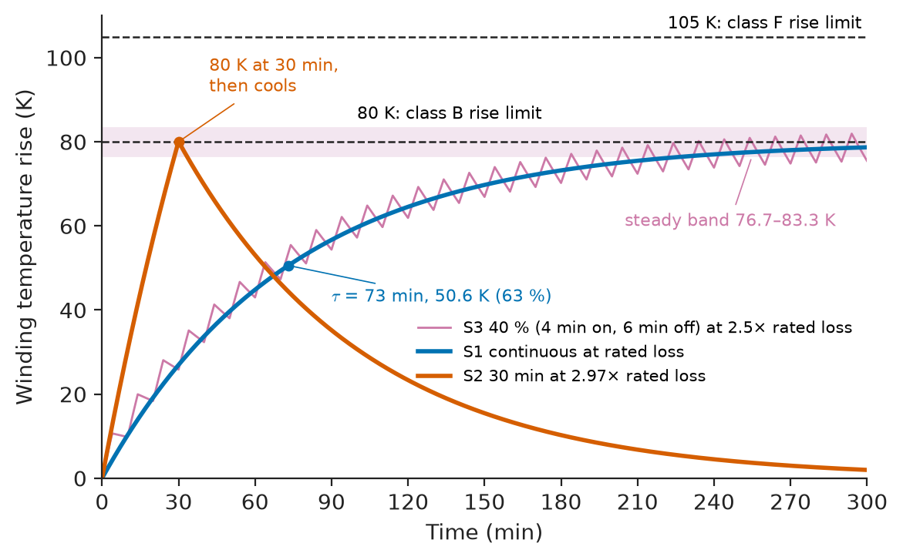
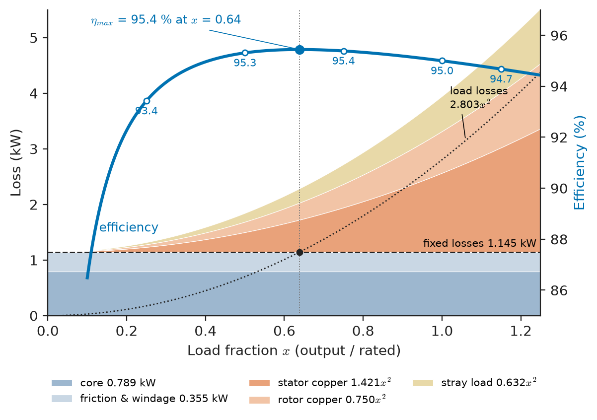
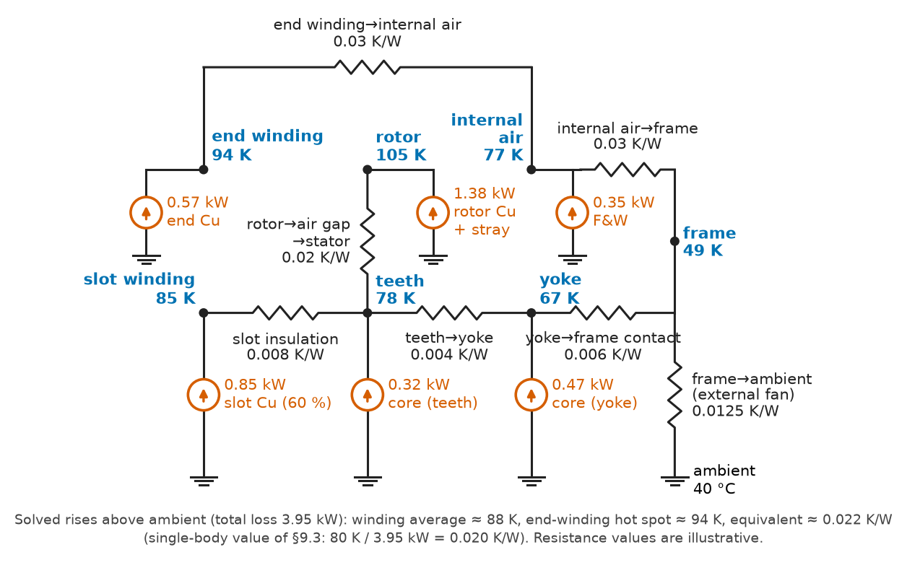
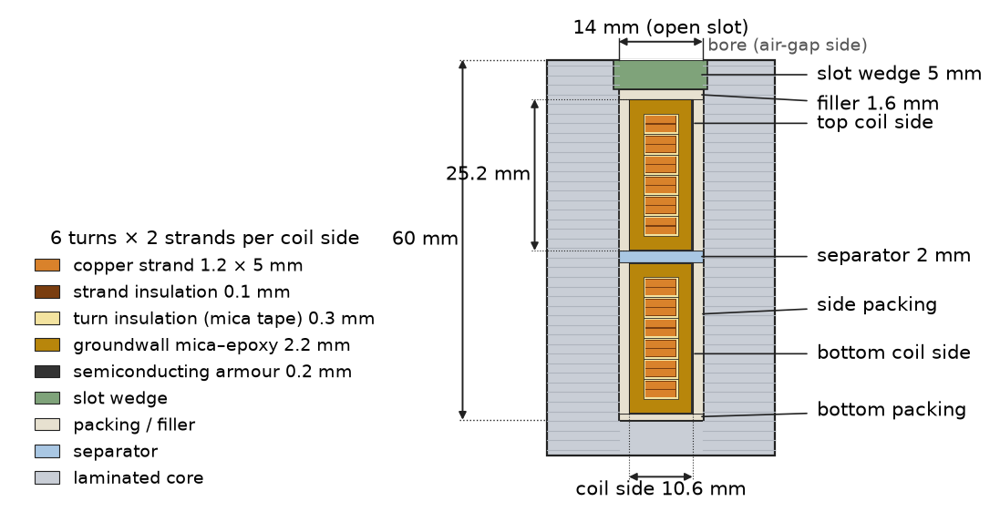
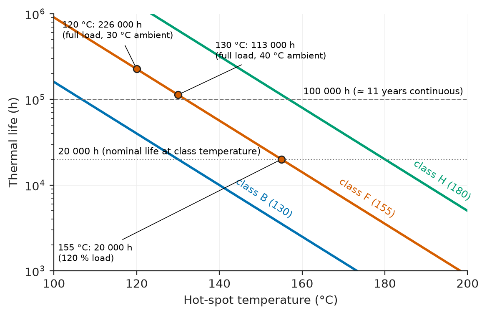
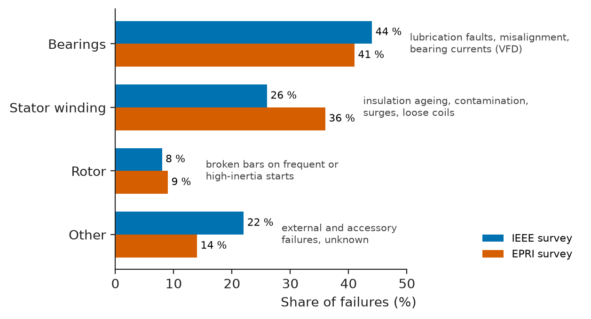

# Chapter 9 — Electrical Machine Design and Performance

*Part II · Transformers and Electrical Machines*

A cement plant replaces a failed 75 kW kiln-fan motor with a new one of the same nameplate rating from a different supplier. The new motor is 2 % more efficient on paper, yet eight months later its winding fails. The post-mortem finds nothing wrong with the motor: the fan had been retrofitted with a variable-frequency drive, the new motor's insulation was not rated for inverter voltage spikes, the plant sits at 1800 m where the air cools less, and the fan duty, which had crept up after a process change, kept the motor at 110 % load in a 45 °C motor room. Each of those facts changes how much power a motor can actually deliver. A nameplate kilowatt figure is not a property of the electromagnetics; it is the load at which losses, cooling and insulation reach an agreed balance under stated conditions. This chapter is about that balance.

> **What sets the rating of an electrical machine, and how do losses, temperature and insulation life connect to it?**
> **How are machines cooled, wound, built from which materials, tested, and kept running?**

| Concept | Engineering destination |
|---|---|
| Rating and duty cycles | Motor selection for cranes, hoists, conveyors, traction; derating for altitude and ambient |
| Loss calculations | Efficiency guarantees, cooling design, energy bills |
| Thermal limits | Overload capability, protection settings, hot-spot management |
| Efficiency | IE classes, regulations, life-cycle cost |
| Insulation systems | Winding life, inverter-duty motors, HV generator bars |
| Cooling | Enclosure and cooling-method selection (IC/IP codes), large-generator hydrogen and water cooling |
| Winding design fundamentals | Sizing a machine, current density, slot fill |
| Material selection | Electrical steel grades, copper versus aluminium, magnets |
| Performance testing | Factory acceptance tests, commissioning, efficiency verification |
| Reliability and maintenance | Failure modes, condition monitoring, bearing life, maintenance planning |

**Roadmap.** What a rating means (9.1) → where the losses come from (9.2) → how hot they make the machine (9.3) → efficiency and its regulation (9.4) → what the heat does to insulation (9.5) → how heat is removed (9.6) → how windings and machine size follow from loading limits (9.7) → which materials (9.8) → how all of it is verified (9.9) → how machines fail and how they are kept running (9.10).

> **Boundary.** Heat conduction, convection and the thermal-resistance network are owned by *Engineering Physics*, [Ch. 14 §14.7](https://github.com/The-Studio-of-Sadiq/Engineering-Physics/blob/main/CHAPTERS/CHAPTER%2014.md) and [Ch. 19 §19.6](https://github.com/The-Studio-of-Sadiq/Engineering-Physics/blob/main/CHAPTERS/CHAPTER%2019.md); resistivity and its temperature dependence come from [Ch. 14 §14.1](https://github.com/The-Studio-of-Sadiq/Engineering-Physics/blob/main/CHAPTERS/CHAPTER%2014.md). Loss mechanisms and efficiency at the level of principle are in Chapter 3; the machines themselves are in Chapters 4–8. This chapter applies all of these to rating, design and testing.

---

## 9.1 Rating and duty cycles

### What a rating promises

The **rated output** of a motor is the shaft power it can deliver continuously, at rated voltage and frequency, without exceeding the temperature limit of its insulation class, under the standard conditions of IEC 60034-1: ambient cooling air at no more than 40 °C, altitude no more than 1000 m, and a stated duty. A generator's rating is in kVA at a rated power factor, because its armature current, not its real power, sets its heating (Chapter 7). Change any of these conditions and the rating changes:

- **Ambient temperature.** Above 40 °C the permitted temperature rise must be reduced by the excess; a motor in a 50 °C ambient typically delivers about 90 % of its rating.
- **Altitude.** Air density falls with height, and with it the heat carried away by the fan. As a rule of thumb, rating falls by about 1 % per 100 m above 1000 m, unless the ambient is correspondingly cooler; IEC 60034-1 allows rise limits to be traded against lower ambient at altitude.
- **Supply quality.** Voltage unbalance raises losses sharply through negative-sequence currents (NEMA MG1 derates by about 10 % at 3 % voltage unbalance), and inverter supply adds harmonic losses (§9.2).

NEMA motors may carry a **service factor** (typically 1.15), allowing continuous operation at 115 % load with about 10 K more temperature rise and correspondingly shorter insulation life. IEC motors have no service factor; the margin, if any, comes from using class F insulation with class B rise.

### Duty types

Many machines do not run at constant load. IEC 60034-1 defines ten standard **duty types**, which let a manufacturer rate a machine for a defined cycle rather than for continuous load:

| Duty | Description | Typical application |
|---|---|---|
| S1 | Continuous running at constant load, long enough for thermal equilibrium | Pumps, fans, compressors |
| S2 | Short-time duty (e.g. S2 30 min), then rest until cold | Valve actuators, sluice gates, emergency pumps |
| S3 | Intermittent periodic: identical cycles of constant load and rest, no significant starting heat; cyclic duration factor 15, 25, 40 or 60 % of a 10 min cycle | Cranes, hoists (without frequent starts) |
| S4 | As S3 with significant starting heat | Cranes and hoists with frequent starts |
| S5 | As S4 with electric braking | Lifts, mill auxiliaries |
| S6 | Continuous-operation periodic duty: load and no-load, no rest | Machine tools, saws |
| S7 | As S6 with starting and electric braking | Reversing drives |
| S8 | Continuous operation with related load and speed changes | Multi-speed fans, pole-changing drives |
| S9 | Non-periodic load and speed variations, including overloads | Most VFD-fed process drives, traction |
| S10 | Discrete constant loads | Machines with a few defined operating states |

A motor rated 30 kW S1 might be rated 37 kW S3 40 % and 45 kW S2 30 min: the shorter the time at load relative to the thermal time constant (§9.3), the more power it can deliver. Figure 9.1 shows the temperature histories behind these ratings.

<!-- FIGURE 9.1 | figures/ch09/fig-9-1-duty-cycle-temperature.png | plot | Winding temperature rise under S1 continuous, S2 30 min and S3 40 percent duty for a motor with a 73 min thermal time constant and an 80 K permitted rise. | Content: x-axis time 0 to 300 min; y-axis temperature rise 0 to 110 K. S1 at rated losses: exponential rise toward 80 K with time constant 73 min (reaching 63 percent, 50.6 K, at 73 min). S2 30 min at 2.97 times rated losses: rise reaching 80 K at 30 min, then exponential cooling toward zero. S3 40 percent with a 10 min cycle (4 min on, 6 min off) at 2.5 times rated losses: sawtooth climbing over the first four to five hours (about four time constants) to a steady band between 76.7 and 83.3 K, still slightly below it at 300 min; steady band shaded. Horizontal dashed lines at 80 K labelled class B rise limit and at 105 K labelled class F rise limit. -->

*Figure 9.1 — Winding temperature rise under S1 continuous, S2 30 min and S3 40 percent duty for a motor with a 73 min thermal time constant and an 80 K permitted rise.*

### Equivalent continuous load

For a cyclic load with a period much shorter than the thermal time constant, the winding sees the time-average of its losses. With losses dominated by copper loss proportional to current squared, and current roughly proportional to torque in a machine at constant flux, the equivalent continuous load is the **RMS torque** (or RMS current) over the cycle, as already used for servo motors in Chapter 8. For a self-ventilated motor the cooling is worse at standstill, so rest periods count only partly: a common correction counts rest time at a fraction $k\approx0.25$–0.5 of its duration.

**Worked example — rating a mine-hoist motor.** A forced-ventilated 6.6 kV, six-pole induction motor drives a skip hoist at 990 rpm. Each 80 s cycle comprises 8 s acceleration at 9.6 kN·m, 40 s full-speed hoisting at 6.0 kN·m, 8 s deceleration at 2.4 kN·m and 24 s at rest while the skip is loaded. Is a 630 kW motor adequate?

$$
T_{\text{rms}}=\sqrt{\frac{9.6^2\times8+6.0^2\times40+2.4^2\times8+0}{80}}=5.27\ \mathrm{kN\,m}
$$

Rated torque of a 630 kW motor at 990 rpm is $630/(990\times2\pi/60)=6.08$ kN·m. Thermal utilisation is $5.27/6.08=87\,\%$, and the peak of 9.6 kN·m is 1.58 times rated, safely below a breakdown torque of typically 2.2–2.5 times. The equivalent RMS power is 547 kW and the average delivered power only 373 kW (speed rises and falls linearly during acceleration and deceleration, so those intervals deliver at half speed on average). If the motor were self-ventilated, with rest time counted at 40 %, the RMS torque would rise to $5.82$ kN·m, 96 % of rated: still acceptable, but the margin for cycle-time creep, voltage dips and the extra heat of frequent starts (duty S4) would be gone. In practice a 710 kW or a forced-ventilated 630 kW machine would be chosen.

---

## 9.2 Loss calculations

### Where the losses arise

The losses of every machine in Chapters 4–8 fall into five groups. Their separation matters because each scales differently with load, voltage, speed and temperature.

1. **Stator copper loss** $3I^2R$, with $R$ corrected to operating temperature. For copper, $R_T=R_{20}[1+0.00393(T-20)]$: the resistance at 115 °C is 37 % higher than at 20 °C, so efficiency tests always correct to a reference temperature (IEC 60034-2-1 uses the measured or class-specified winding temperature). At high frequency, **AC resistance** exceeds DC resistance because of skin and proximity effects in deep or wide conductors; this matters in large machines and in EV hairpin windings at several hundred hertz.
2. **Rotor copper loss**: $sP_{ag}$ in an induction motor (Chapter 6), field $I_f^2R_f$ in a synchronous machine, zero in PM machines apart from magnet eddy loss.
3. **Core (iron) loss**: hysteresis and eddy currents in the laminations, a function of flux density, frequency and lamination thickness (Chapter 1 and §9.8).
4. **Friction and windage**: bearings, seals, fan and rotor drag; nearly constant at fixed speed, roughly proportional to the cube of speed for the fan part.
5. **Stray (additional) load loss**: everything else that grows with load: leakage-flux eddy currents in end structures and frames, high-frequency losses from slot harmonics on the rotor surface, inter-bar currents in skewed cages.

### Core-loss models

Core loss per unit mass is normally taken from the steel supplier's data at the operating flux density and frequency, and corrected with empirical factors (1.5–2 is typical) for punching damage, rotational fields and harmonics. To scale it, the classical separation is

$$
p_{\text{core}}=k_hfB^{\alpha}+k_e(fB)^2+k_{\text{ex}}(fB)^{1.5}
$$

with $\alpha\approx1.6$–2.2: hysteresis, classical eddy-current and excess (anomalous) loss, each with a fitted coefficient.

> **Status of the principle: Steinmetz/Bertotti core-loss separation**
> *Empirical.* The functional forms rest on physical arguments, but the coefficients are fitted to Epstein or single-sheet measurements for each steel grade; accuracy is ±10–20 % under sinusoidal flux and worse under PWM or with DC bias.

### Stray load loss

Stray load loss is the hardest to calculate and was long the source of disagreement between test standards. IEC 60034-2-1 allows it to be measured (by the residual-loss method, §9.9) or **assigned** as a fraction of input power,

$$
P_{LL}=P_1\left[0.025-0.005\log_{10}\!\left(\frac{P_2}{1\ \mathrm{kW}}\right)\right]\qquad(1\ \mathrm{kW}<P_2<10\ \mathrm{MW})
$$

For a 75 kW motor this gives 1.56 % of input, about 1.23 kW, which is roughly twice what a good modern design measures. The assigned value is deliberately conservative; a manufacturer that measures can claim a higher efficiency.

### Inverter-supply losses

A PWM inverter adds current ripple at switching frequency and time harmonics in the flux. For induction motors these raise total losses by roughly 10–20 % at the same load (mostly iron loss and rotor-surface loss), which is why IEC TS 60034-25 and NEMA MG1 Part 30 recommend derating general-purpose motors on inverters, and why PM motors for high-speed drives need laminated or segmented magnets.

**Worked example — loss budget and efficiency curve of a 75 kW IE3 motor.** A 75 kW, four-pole, 400 V, 50 Hz induction motor has full-load efficiency 95.0 %. A typical breakdown of its losses is: stator copper 36 %, rotor copper 19 %, core 20 %, friction and windage 9 %, stray load 16 %. Find the losses at full load, the efficiency at 25–115 % load, and the load of maximum efficiency.

Input at full load: $75/0.95=78.95$ kW; total loss $3.947$ kW. Split: stator copper 1.421 kW, rotor copper 0.750 kW, core 0.789 kW, friction and windage 0.355 kW, stray 0.632 kW.

Group into **fixed losses** (core plus friction and windage, nearly independent of load at fixed voltage and speed) $P_0=1.145$ kW, and **load losses** (copper plus stray, roughly proportional to the square of load fraction $x$) $P_{L}=2.803x^2$ kW. Then $\eta(x)=75x/(75x+1.145+2.803x^2)$:

| Load fraction $x$ | Output (kW) | Losses (kW) | Efficiency |
|---|---|---|---|
| 0.25 | 18.75 | 1.320 | 93.4 % |
| 0.50 | 37.5 | 1.845 | 95.3 % |
| 0.75 | 56.25 | 2.721 | 95.4 % |
| 1.00 | 75.0 | 3.947 | 95.0 % |
| 1.15 | 86.25 | 4.851 | 94.7 % |

Figure 9.2 shows the components. Maximum efficiency occurs where load losses equal fixed losses:

$$
x_{\text{opt}}=\sqrt{\frac{P_0}{P_{L,\text{rated}}}}=\sqrt{\frac{1.145}{2.803}}=0.64,\qquad \eta_{\max}=95.4\,\%
$$

The curve is flat from about 50 % to full load, which is why a modestly oversized motor costs little efficiency; below 25 % load efficiency (and power factor) collapse. The simple $x^2$ scaling overstates the fall of stator copper loss at light load, because the magnetising current does not fall, so measured part-load efficiencies are slightly lower than this table.

> **Status of the principle: Maximum efficiency at equal fixed and variable losses**
> *Derived.* Setting $d\eta/dx=0$ with losses $P_0+P_Lx^2$ gives $P_Lx^2=P_0$; it holds for any machine or transformer (Chapter 4) whose losses split cleanly into a constant and a square-law part.

<!-- FIGURE 9.2 | figures/ch09/fig-9-2-losses-efficiency-vs-load.png | plot | Loss components and efficiency of the 75 kW IE3 induction motor against load, with the maximum-efficiency point. | Content: x-axis load fraction 0 to 1.25; left y-axis loss 0 to 5.5 kW; right y-axis efficiency 85 to 97 percent. Stacked areas: core 0.789 kW and friction-windage 0.355 kW constant; stator copper 1.421 x squared, rotor copper 0.750 x squared, stray 0.632 x squared. Efficiency curve passing 93.4 percent at 0.25, 95.3 at 0.5, 95.4 at 0.75, 95.0 at 1.0, 94.7 at 1.15; maximum 95.4 percent at x = 0.64 marked where the fixed-loss line (1.145 kW) crosses the load-loss curve. -->

*Figure 9.2 — Loss components and efficiency of the 75 kW IE3 induction motor against load, with the maximum-efficiency point.*

---

## 9.3 Thermal limits

### The thermal network

Losses heat the winding, core and rotor; the heat flows by conduction through insulation and iron, by convection to internal and external air, and by radiation from the frame. *Engineering Physics*, [Ch. 14 §14.7](https://github.com/The-Studio-of-Sadiq/Engineering-Physics/blob/main/CHAPTERS/CHAPTER%2014.md), builds the thermal-resistance network that models this; machine designers use it with five to fifty nodes (Figure 9.3). The critical paths are almost always the same: **through the slot insulation** from copper to core (insulation has a thermal conductivity of 0.2–0.3 W/(m·K), against 400 for copper and about 25 for laminated steel across the stack), **across the frame-to-core interface** (contact pressure and fit tolerances matter), and **from the frame to the air** (fin area and air velocity). End windings, cooled only by internal air turbulence, are usually the hottest region in TEFC motors.

<!-- FIGURE 9.3 | figures/ch09/fig-9-3-motor-thermal-network.png | schematic | Lumped thermal network of a TEFC induction motor with losses as heat sources and the dominant resistances, for the 75 kW example. | Content: nodes: slot winding, end winding, stator teeth, stator yoke, rotor, internal air, frame, ambient (40 C). Heat sources drawn as current sources: stator copper 1.42 kW split 60 percent slot and 40 percent end winding, core 0.79 kW at teeth and yoke, rotor copper plus stray 1.38 kW at rotor, friction-windage 0.36 kW at internal air. Resistances (K/W): slot insulation 0.008, end winding to internal air 0.03, teeth to yoke 0.004, yoke to frame contact 0.006, rotor to air gap to stator 0.02, internal air to frame 0.03, frame to ambient by external fan 0.0125. Resistance values are illustrative; annotate the solved node rises, total loss 3.95 kW, winding average rise about 88 K, end-winding hot spot about 94 K, total equivalent about 0.022 K/W, compared with the single-body value of 80 K / 3.95 kW = 0.020 K/W used in §9.3. -->

*Figure 9.3 — Lumped thermal network of a TEFC induction motor with losses as heat sources and the dominant resistances, for the 75 kW example.*

### Temperature limits by insulation class

The temperature a winding may reach is set by its insulation's **thermal class** (§9.5). IEC 60034-1 converts it into a permitted **temperature rise** above a 40 °C ambient, measured as the average winding temperature by the resistance method, leaving a margin for the hot spot:

| Thermal class (IEC 60085) | Class temperature | Permitted average rise (resistance method, 40 °C ambient) | Hot-spot allowance |
|---|---|---|---|
| 130 (B) | 130 °C | 80 K | 10 K |
| 155 (F) | 155 °C | 105 K | 10 K |
| 180 (H) | 180 °C | 125 K | 15 K |

Most modern industrial motors use class F insulation but are designed for class B rise ("F/B"), so that the hot spot runs about 25 K below the class limit. That reserve buys a long life (§9.5) and capacity for overload, high ambient or a poor supply.

### Transient heating

Treated as one thermal mass $C$ (J/K) with one resistance $R_{th}$ to ambient (the thermal RC network of *Engineering Physics*, [Ch. 14 §14.7.3](https://github.com/The-Studio-of-Sadiq/Engineering-Physics/blob/main/CHAPTERS/CHAPTER%2014.md)), a machine's temperature rise after a step change in loss $P$ follows

$$
\theta(t)=\theta_\infty+(\theta_0-\theta_\infty)\,e^{-t/\tau},\qquad\theta_\infty=PR_{th},\quad\tau=R_{th}C
$$

> **Status of the principle: Single-body thermal model**
> *Approximate.* A good description of the frame and the average winding over tens of minutes; it underestimates the winding's fast rise during starting or stall, when the copper heats adiabatically in seconds with a time constant of its own (tens of seconds to a few minutes). Motor protection relays (IEC 60255-149) therefore use two-body thermal models.

**Worked example — overload of the 75 kW motor.** The motor of §9.2 has a full-load rise of 80 K, a mass of 450 kg and an average specific heat of 480 J/(kg·K). It has been running at full load and is then loaded to 120 % for 15 minutes. Find the thermal time constant, the ultimate rise at 120 % and the rise after 15 minutes.

$R_{th}=80/3947=0.0203$ K/W; $C=450\times480=216$ kJ/K; $\tau=0.0203\times216\,000=4380$ s = 73 min.

At 120 % load, losses are $1.145+2.803\times1.2^2=5.18$ kW, so $\theta_\infty=5180\times0.0203=105$ K, exactly the class F limit. After 15 minutes from 80 K:

$$
\theta=105-(105-80)\,e^{-15/73}=105-25\times0.814=84.6\ \mathrm{K}
$$

The short overload is harmless; even indefinitely, the 120 % load would sit at the class F limit. That is the F/B reserve at work. The real winding heats somewhat faster than this single-body estimate, so a protection relay set to this model should include the winding's shorter time constant.

### Starting and stall

During starting an induction motor draws 6–8 times rated current, so copper loss is 36–64 times rated, and the rotor cage absorbs energy equal to the kinetic energy given to the load. IEC 60034-12 specifies how many consecutive starts a motor must tolerate (typically two from cold, one from hot), and data sheets give a **safe stall time**, typically 10–20 s hot, which the protection must respect. High-inertia loads (fans, centrifuges, crushers) are where motors most often fail thermally on starting.

---

## 9.4 Efficiency

### Efficiency classes

Electric motors use about 45 % of the world's electricity. Since 2008 their efficiency has been classified by IEC 60034-30-1 into **IE classes**: IE1 (standard), IE2 (high), IE3 (premium), IE4 (super premium), with IE5 (ultra premium) defined as about 20 % lower losses than IE4. Table 9.1 gives the minimum full-load efficiencies for four-pole 50 Hz motors.

**Table 9.1 — Minimum efficiencies, four-pole, 50 Hz (IEC 60034-30-1).**

| Rated output | IE1 | IE2 | IE3 | IE4 |
|---|---|---|---|---|
| 0.75 kW | 72.1 % | 79.6 % | 82.5 % | 85.7 % |
| 7.5 kW | 86.0 % | 88.7 % | 90.4 % | 92.6 % |
| 15 kW | 88.7 % | 90.6 % | 92.1 % | 93.9 % |
| 37 kW | 91.2 % | 92.7 % | 93.9 % | 95.2 % |
| 75 kW | 92.7 % | 94.0 % | 95.0 % | 96.0 % |
| 110 kW | 93.3 % | 94.5 % | 95.4 % | 96.3 % |

Two patterns stand out: efficiency rises steeply with size (losses scale roughly with surface, output with volume), and each class step removes 15–25 % of the losses. Large machines go much further: a 10 MW synchronous motor reaches 97.5–98.5 %, a 500 MVA turbo-generator 98.7–99 %, and a large transformer 99.5–99.8 % (Chapter 4).

### Regulation

Minimum efficiency is mandatory in most markets. In the EU, Regulation 2019/1781 has required IE3 for motors from 0.75 to 1000 kW since July 2021 and IE4 for 75–200 kW two-, four- and six-pole motors since July 2023; VFDs must meet IE2 under IEC 61800-9-2. The United States requires NEMA Premium (≈ IE3) under 10 CFR 431, and China, India, Brazil and others have comparable rules. IEC 61800-9-2 also defines **IES classes** for the motor-plus-drive system, recognising that what matters is the efficiency of the whole power drive system at its actual operating points.

### Efficiency in operation

Rated efficiency is a single point. What the energy bill sees is efficiency weighted over the operating profile, which is why a VFD on a fan that spends most of its life at 60 % flow saves far more energy (the fan's power falls roughly with the cube of speed) than any motor upgrade (Chapter 28). Still, motor efficiency compounds over a life of 15–25 years: replacing the 75 kW IE3 motor (95.0 %) with an IE4 (96.0 %) at full load and 6000 h/y saves $(75/0.95-75/0.96)\times6000=4.9$ MWh per year, about 590 per year at 0.12 per kWh, against a price premium of perhaps 15–25 % on a motor that costs a few thousand. The energy cost of a continuously running industrial motor over its life is typically 95–97 % of its life-cycle cost; the purchase price is 2–3 %.

---

## 9.5 Insulation systems

### What the insulation has to do

A winding's insulation must withstand the working voltage between turns, between phases and to earth, for decades, at high temperature, under vibration, thermal cycling, contamination and moisture, and with steep-fronted surges from switching and inverters. It is the component that most often limits machine life (§9.10). A stator insulation system consists of:

- **Strand and turn insulation**: enamel (polyesterimide, polyamide-imide overcoat) on round wire; enamel plus glass or mica tape on rectangular strands of form-wound coils.
- **Groundwall (main) insulation**: slot liners of aramid paper or polyester film laminates (Nomex–Mylar–Nomex) in random-wound motors; mica-paper tape bonded with epoxy or polyester resin, 2–6 mm thick, in form-wound coils above about 1 kV, because mica alone resists partial discharge (see *Inverter-fed windings* below). Figure 9.4 shows a typical medium-voltage slot.
- **Phase separators**, slot wedges, end-winding bracing and lead insulation.
- **Impregnating resin**, applied by dipping or by **vacuum-pressure impregnation (VPI)**, which fills voids, bonds the winding into a rigid mass and improves heat transfer. Global VPI of a complete wound stator is standard for medium-voltage motors.
- In machines above about 6 kV, **semiconducting slot armour** to prevent discharges between coil surface and core, and **stress-grading** tape at the slot exit to control the surface field.

<!-- FIGURE 9.4 | figures/ch09/fig-9-4-form-wound-slot-cross-section.png | cross-section | Slot cross-section of a 6.6 kV form-wound two-layer stator winding showing the insulation system. | Content: open rectangular slot 14 mm wide by 60 mm deep in laminated core; two coil sides one above the other, each 10.6 mm by 25.2 mm overall; each coil side with 6 turns of 2 rectangular copper strands 1.2 mm by 5 mm with strand insulation 0.1 mm, turn insulation mica tape 0.3 mm around each turn of two strands, groundwall mica-epoxy 2.2 mm, outer semiconducting armour tape 0.2 mm; bottom packing 1 mm; separator 2 mm between layers; filler 1.6 mm under the top slot wedge of 5 mm; side packing. Dimension labels and a legend of materials. -->

*Figure 9.4 — Slot cross-section of a 6.6 kV form-wound two-layer stator winding showing the insulation system.*

### Thermal ageing

Insulation ages chemically: oxidation and depolymerisation of the resin binder make it brittle until vibration cracks it and moisture tracks across. The rate is a thermally activated (Arrhenius) process, as in *Engineering Physics*, [Ch. 20 §20.7.1](https://github.com/The-Studio-of-Sadiq/Engineering-Physics/blob/main/CHAPTERS/CHAPTER%2020.md), so life falls exponentially with temperature. The thermal class is defined (IEC 60216, IEC 60085) as the temperature at which the material system reaches a nominal 20,000 h life in accelerated tests. In engineering practice this is expressed by the **Montsinger 10-degree rule**:

$$
L(T)=L_0\cdot2^{(T_0-T)/10\ \mathrm{K}}
$$

> **Status of the principle: Ten-degree halving of insulation life**
> *Empirical.* An approximation to Arrhenius behaviour with an activation energy near 1.1 eV in the 120–180 °C range; real systems halve life every 8–12 K, and the rule ignores the electrical, mechanical and environmental stresses that often end a winding's life first (the multi-factor TEAM view: thermal, electrical, ambient, mechanical).

**Worked example — insulation life against temperature.** A class F (155 °C) winding has a nominal 20,000 h life at its class temperature. Estimate its thermal life for the 75 kW motor of §9.3 (hot spot = ambient + average rise + 10 K): at full load in a 40 °C ambient; at full load in a 30 °C ambient; and at the 120 % overload sustained continuously at 40 °C.

| Case | Hot spot | Thermal life | Years at 8760 h/y |
|---|---|---|---|
| Full load, 40 °C | $40+80+10=130$ °C | $20\,000\times2^{2.5}=113\,000$ h | 13 |
| Full load, 30 °C | 120 °C | $20\,000\times2^{3.5}=226\,000$ h | 26 |
| 120 % load, 40 °C | $40+105+10=155$ °C | 20,000 h | 2.3 |

Figure 9.5 plots the rule for the three common classes. Ten degrees cooler doubles thermal life; a continuous 20 % overload cuts it by a factor of more than five. The cement-plant motor of the opening, at 110 % load in a 45 °C room at 1800 m, would have been consuming thermal life at several times the design rate even before its inverter problem.

<!-- FIGURE 9.5 | figures/ch09/fig-9-5-insulation-life-vs-temperature.png | plot | Thermal life of class B, F and H insulation systems against hot-spot temperature according to the 10 K halving rule, with the worked-example points. | Content: x-axis hot-spot temperature 100 to 200 C; y-axis life on logarithmic scale 1000 to 1 000 000 h. Three straight lines (on log scale) each passing 20 000 h at its class temperature: class B at 130 C, class F at 155 C, class H at 180 C, halving every 10 K. Markers on the class F line at 120 C (226 000 h), 130 C (113 000 h), 155 C (20 000 h). Horizontal reference lines at 100 000 h (about 11 years continuous) and 20 000 h. -->

*Figure 9.5 — Thermal life of class B, F and H insulation systems against hot-spot temperature according to the 10 K halving rule, with the worked-example points.*

### Inverter-fed windings

A PWM inverter delivers voltage steps with rise times of 50–200 ns. On a long cable these reflect at the motor terminals, where the high-frequency surge impedance of the motor is much larger than that of the cable, and the peak can approach twice the DC-link voltage (a 690 V drive with a 970 V DC link can produce 1.8–2 kV peaks) with most of the step falling across the first turns of the first coil. If the local field exceeds the inception voltage of air voids, **partial discharges** erode organic insulation within months. Inverter-duty design follows IEC 60034-18-41 (Type I, partial-discharge-free random-wound windings, qualified by impulse PD tests) and IEC 60034-18-42 (Type II, form-wound windings with PD-resistant mica); NEMA MG1 Part 31 requires inverter-duty motors up to 600 V to withstand peaks of 3.1 times rated voltage. Mitigations are corona-resistant enamel, better phase separation, output dV/dt or sine filters, and shorter cables. This is the cause of the cement-plant failure in the opening.

---

## 9.6 Cooling

### Cooling methods

Cooling determines how much loss, and therefore how much output, a given frame can carry. IEC 60034-6 codes the method as IC followed by the circuit arrangement and the method of moving the coolant; IEC 60034-5 codes the enclosure's protection against solids and water as IP.

| Code | Arrangement | Typical use |
|---|---|---|
| IC01 | Open, self-ventilated (drip-proof) | Clean indoor plant, gensets |
| IC411 | Totally enclosed, fan-cooled (TEFC): shaft fan blows over a finned frame | The standard industrial LV motor, 0.1–1000 kW |
| IC416 | TEFC with independent motor-driven fan | VFD motors running at low speed |
| IC511 / IC611 | Totally enclosed with air-to-air heat exchanger (tube cooler) | MV motors 200 kW–5 MW |
| IC81W | Totally enclosed with air-to-water heat exchanger (TEWAC) | Large motors and generators, marine machines |
| IC71W / direct liquid | Water jacket or oil spray directly on windings | EV traction motors, high-speed machines |

**Table 9.2 — Representative enclosure codes (IEC 60034-5).**

| Code | Protection | Use |
|---|---|---|
| IP23 | Fingers, solid objects > 12.5 mm; spraying water up to 60° | Indoor open machines |
| IP55 | Dust-protected; water jets | Standard industrial TEFC |
| IP56 / IP66 | Powerful water jets; dust-tight (66) | Marine deck, washdown, mining |
| IP67 / IP68 | Temporary or continuous immersion | Submersible pumps, EV drive units |

### Large generators: hydrogen and water

As turbo-generators grew beyond a few hundred MVA, air could no longer carry the heat out of a rotor of limited diameter. **Hydrogen** at 2–6 bar gauge has about seven times the thermal conductivity of air and one-fourteenth of its density, so windage loss falls to roughly a tenth and heat transfer improves markedly. Hydrogen cooling is standard from roughly 300 MVA to over 1000 MVA, with seals to keep air out (the hydrogen purity is held above about 95 % to stay far from the flammable range) and CO₂ purging procedures. Beyond about 500–600 MVA the stator bars are hollow and cooled internally by **deionised water**, removing heat directly at the copper. Large hydro generators use air or, in the largest, water-cooled stators. These cooling advances, not new electromagnetics, are why unit ratings grew from 100 MVA in the 1950s to 1750 MVA today.

### What cooling buys

The usable current density and electric loading (§9.7) rise with cooling intensity:

| Cooling | Stator current density (A/mm²) | Electric loading $A$ (kA/m) |
|---|---|---|
| TEFC, random-wound, small motors | 4–7 | 15–40 |
| Air-cooled, form-wound, MV motors and gensets | 3–5 | 40–80 |
| Indirect hydrogen-cooled turbo-generator | 3–6 | 80–150 |
| Direct water-cooled stator bars | 6–12 | 150–250 |
| EV traction, oil-spray or water jacket (peak, tens of seconds) | 15–30 | 60–120 |

---

## 9.7 Winding design fundamentals

### Windings

Two constructions dominate. **Random-wound** windings, used up to about 690 V and several hundred kW, are made of round enamelled wire inserted into semi-closed slots; turns lie in random positions, so adjacent turns may be from opposite ends of the coil and see the full coil voltage, which is acceptable at low voltage. Copper fill (copper area over slot area) is 0.35–0.45. **Form-wound** windings, used above about 1 kV and in large low-voltage machines, are made of pre-formed coils or bars of rectangular conductors in open slots, with turn and groundwall insulation applied before insertion; fill is 0.50–0.65 and every turn's position and voltage are controlled. **Hairpin** windings, rectangular U-shaped conductors inserted axially and welded at one end, give EV motors fill factors of 0.6–0.75 and automated manufacturing, at the cost of higher AC resistance at high frequency.

Within either construction the designer chooses the number of slots per pole per phase $q$, single- or double-layer, coil pitch (5/6 is common to suppress 5th and 7th harmonics, Chapter 7), the number of turns per coil, and the number of **parallel paths** $a$ (used when the series turns needed are few and the current large). The constraint linking them is that the phase EMF $E=4.44fN_{ph}k_w\Phi$ (Chapter 7, §7.3) must match the supply voltage at the chosen flux density.

### Electric and magnetic loading

Two quantities summarise how hard a machine is worked. The **magnetic loading** is the average air-gap flux density $\bar B$ over a pole pitch, typically 0.4–0.6 T in induction machines (limited by tooth saturation and magnetising current) and 0.5–0.7 T in synchronous and PM machines. The **electric loading** $A$ is the total armature current per metre of bore circumference,

$$
A=\frac{2m N_{ph} I}{\pi D}
$$

with $m$ phases, $N_{ph}$ series turns per phase, $I$ RMS phase current and $D$ the bore diameter. Magnetic loading is limited by the steel; electric loading by cooling.

### The output equation

Substituting the EMF equation and the definition of $A$ into the apparent power $S=mEI$ gives, for a three-phase machine with bore diameter $D$, core length $L$ and synchronous speed $n_s$ (rev/s),

$$
S=\frac{\pi^3}{2\sqrt2}k_w\bar BA\,D^2Ln_s\approx11\,k_w\bar BA\,D^2Ln_s\quad(\mathrm{VA})
$$

> **Status of the principle: Output equation**
> *Derived.* Follows from the EMF equation and the definitions of electric and magnetic loading, with sinusoidal flux distribution assumed; it is exact in form, but the loadings that may be inserted are empirical, set by cooling, saturation and experience.

The output equation says that output per unit speed scales with rotor volume $D^2L$ at given loadings. Torque, equivalently, is proportional to rotor volume times the air-gap shear stress, so designers compare machines by **torque per rotor volume (TRV)**: about 2.5–7 kN·m/m³ for small totally enclosed motors, 7–30 for industrial motors, 15–50 for high-performance servos, 30–75 for aerospace machines and 100–250 kN·m/m³ for large liquid- or hydrogen-cooled machines.

**Worked example — main dimensions of a 75 kW four-pole motor.** Size the 75 kW, 400 V, 50 Hz, four-pole motor with $\eta=0.95$, power factor 0.86, $k_w=0.955$, $\bar B=0.45$ T, $A=30$ kA/m and a square pole face (core length equal to pole pitch).

$$
S=\frac{75\,000}{0.95\times0.86}=91.8\ \mathrm{kVA},\qquad n_s=25\ \mathrm{rev/s}
$$

$$
D^2L=\frac{91\,800}{1.11\pi^2\times0.955\times0.45\times30\,000\times25}=0.0260\ \mathrm{m^3}
$$

With $L=\pi D/4$, $D^3=0.0260/0.785$, so $D=0.321$ m and $L=0.252$ m. These are close to a real frame-size 280 motor (bore about 0.30–0.32 m, core 0.25–0.30 m). Rated torque at 1480 rpm is 484 N·m, giving $\text{TRV}=484/(\pi\times0.321^2\times0.252/4)=23.7$ kN·m/m³, in the industrial range. Line current is $91\,800/(\sqrt3\times400)=132.5$ A; in a delta-connected winding the phase current is 76.5 A, so at 5 A/mm² each phase needs 15.3 mm² of copper per turn, made of several parallel enamelled wires (for example 8 × 1.6 mm diameter), split if necessary between parallel paths.

---

## 9.8 Material selection

### Electrical steel

Laminated non-oriented silicon steel carries the flux in rotating machines; grain-oriented steel, whose low loss exists only along the rolling direction, is used in transformers (Chapter 4). Grades are named by maximum loss at 1.5 T and 50 Hz and thickness (EN 10106): M270-35A means at most 2.70 W/kg, 0.35 mm.

**Table 9.3 — Representative magnetic core materials.**

| Material | Thickness | Loss at 1.5 T, 50 Hz | Loss at 1.0 T, 400 Hz | Saturation (approx.) | Use |
|---|---|---|---|---|---|
| M800-65A (low Si) | 0.65 mm | 8.0 W/kg | — | 2.0 T | Low-cost small motors |
| M400-50A | 0.50 mm | 4.0 W/kg | ≈ 30–40 W/kg | 2.0 T | General industrial motors |
| M270-35A | 0.35 mm | 2.7 W/kg | ≈ 20–25 W/kg | 1.95 T | IE3–IE4 motors, generators |
| NO20 (thin, high Si) | 0.20 mm | ≈ 2.2–2.5 W/kg | ≈ 12–15 W/kg | 1.9 T | EV traction, high-speed machines |
| Cobalt-iron (49 % Co) | 0.1–0.35 mm | ≈ 2–3 W/kg (at 1.5 T) | ≈ 15–25 W/kg | 2.35 T | Aerospace generators, high torque density |
| Amorphous ribbon | 0.025 mm | ≈ 0.2–0.3 W/kg (at 1.3 T) | ≈ 3–5 W/kg | 1.56 T | Distribution transformers, some high-speed motors |
| Soft magnetic composite | Bulk | High at 50 Hz | Competitive above ~1 kHz | 1.5–1.8 T, μr ≈ 500 | Axial-flux and claw-pole 3D flux paths |
| Grain-oriented (CRGO) | 0.23–0.30 mm | 0.8–1.1 W/kg (rolling direction, 1.7 T) | — | 2.0 T | Transformers |

The trade-off is plain: thinner and higher-silicon steels lose less, especially at high frequency, but cost more, have lower saturation and are harder to punch. Punching and welding damage the edges and raise local loss by 20–50 % in narrow teeth, which is why small motors' measured core losses exceed catalogue predictions.

### Conductors

Copper (resistivity $1.72\times10^{-8}\ \Omega\,\mathrm m$ at 20 °C, density 8.96 g/cm³) is standard for windings. Aluminium ($2.82\times10^{-8}\ \Omega\,\mathrm m$, 2.70 g/cm³) needs 64 % more cross-section for the same resistance but weighs half as much for that resistance, and costs less; it is used for die-cast squirrel-cage rotors in most induction motors below a few hundred kW. **Copper die-cast rotors** reduce rotor loss by 15–30 % and help motors reach IE3–IE4 at the cost of harder casting. Large induction motors use fabricated copper or copper-alloy bars brazed to end rings. Hollow copper conductors carry cooling water in the largest generators.

### Magnets, insulation and structure

Permanent magnets are chosen from Table 8.1 against temperature, demagnetisation risk and cost. Insulation materials (§9.5) are chosen by thermal class and voltage: enamelled wire grades by thermal index 155–220 °C; mica for voltages above about 3 kV where partial discharge is unavoidable; aramid and polyimide films for slot liners. Structural parts matter too: non-magnetic steel retaining rings on turbo-generator rotors (18Mn18Cr, chosen for stress-corrosion resistance), carbon-fibre magnet sleeves for high-speed PM rotors, aluminium or cast-iron frames (cast iron for vibration damping and corrosion resistance in heavy industry), and shaft steels chosen for fatigue strength.

---

## 9.9 Performance testing

### Type, routine and site tests

Machines are tested at three levels. **Type tests** are performed on the first machine of a design to verify every performance claim. **Routine tests** are performed on every machine before shipment. **Site (commissioning) tests** verify the installed machine and give the baseline for later condition monitoring. IEC 60034-1, IEC 60034-2-1 (efficiency), IEEE Std 112 (induction motors) and IEEE Std 115 (synchronous machines) define the procedures.

| Test | Type / routine | What it shows |
|---|---|---|
| Winding resistance (with temperature) | Routine | Reference for copper loss and temperature measurement |
| No-load test (voltage sweep) | Routine | Core plus friction-windage loss, magnetising current |
| Locked-rotor test | Type (reduced voltage routine) | Starting current and torque, leakage impedance |
| Load test with dynamometer or back-to-back | Type | Efficiency, slip, power factor, stray load loss |
| Heat run (temperature-rise test) to equilibrium | Type | Temperature rise against class limit |
| Open- and short-circuit characteristics (synchronous) | Type and routine | OCC, SCC, SCR, $X_d$ (Chapter 7) |
| Sudden short-circuit (synchronous) | Type | $X_d''$, $X_d'$, time constants |
| High-voltage withstand, 1 min | Routine | Insulation integrity |
| Insulation resistance and polarisation index | Routine and site | Moisture, contamination |
| Surge comparison (IEEE 522) | Routine for form-wound | Turn-to-turn insulation |
| Partial discharge (above ~6 kV) | Type and routine | Voids, delamination, slot discharge |
| Vibration and noise | Routine | Balance, alignment, bearing condition (IEC 60034-14, IEC 60034-9) |

### Efficiency determination

IEC 60034-2-1 distinguishes **direct** methods, measuring input power electrically and output power with a torque transducer (uncertainty limited by the torque sensor to a few tenths of a per cent in efficiency, which is large compared with the 1 % between IE classes), and **indirect** methods, which measure the losses and subtract them. The preferred method for induction motors, 2-1-1B (equivalent to IEEE 112 Method B), measures the input and output under load, separates the conventional losses using no-load and resistance data, and obtains the stray load loss as a **residual** smoothed by linear regression against torque squared. For large machines, where full-load testing is impossible, the **calorimetric** method measures the heat carried away by the coolant, and the **summation-of-losses** method combines no-load, short-circuit and resistance tests.

### Insulation tests

The **high-voltage test** applies $1000\ \mathrm V+2U_N$ (minimum 1500 V) at power frequency for one minute between winding and earth: 1800 V for a 400 V motor, 14.2 kV for a 6.6 kV motor, 23 kV for an 11 kV generator. It is a pass–fail proof test, repeated later only at reduced voltage (typically 80 %) because each application consumes some life. **Insulation resistance** at 500–5000 V DC (IEEE Std 43) and the **polarisation index** (ratio of 10-minute to 1-minute resistance) reveal moisture and contamination; IEEE 43 recommends minimum one-minute values of 100 MΩ for form-wound windings and 5 MΩ for random-wound windings below 1 kV (corrected to 40 °C), and a PI of at least 2.0 for class B and above. **Surge tests** apply fast impulses to compare the ringing of phases and detect turn faults. **Partial-discharge** measurement, offline or online through coupling capacitors, trends the condition of medium- and high-voltage windings over years.

---

## 9.10 Reliability and maintenance

### How machines fail

Surveys of large industrial motors by IEEE (1985) and EPRI give consistent pictures of failure causes (Figure 9.6):

| Component | IEEE survey | EPRI survey |
|---|---|---|
| Bearings | 44 % | 41 % |
| Stator winding | 26 % | 36 % |
| Rotor (bars, end rings, shaft, core) | 8 % | 9 % |
| Other (accessories, external causes, unknown) | 22 % | 14 % |

Bearing failures come from lubrication faults (too little, too much, wrong or contaminated grease), misalignment, excessive belt or coupling load, and, in VFD-fed motors, **bearing currents**: high-frequency common-mode voltage drives current through the bearing film, causing electrical discharge machining and fluting of the races. Mitigations are insulated bearings (non-drive end, or both ends in large motors), ceramic balls, shaft-grounding brushes and common-mode filters. Stator failures are the end-point of the ageing of §9.5, accelerated by contamination, moisture, thermal cycling, loose coils vibrating in their slots, and voltage surges. Rotor failures in induction motors are mostly broken bars from thermal and mechanical stress during frequent or high-inertia starts.

<!-- FIGURE 9.6 | figures/ch09/fig-9-6-motor-failure-causes.png | plot | Distribution of failure causes of large induction motors according to the IEEE and EPRI surveys. | Content: grouped horizontal bar chart, categories bearings, stator winding, rotor, other; two bars per category: IEEE 44, 26, 8, 22 percent and EPRI 41, 36, 9, 14 percent. x-axis 0 to 50 percent. Annotation listing main mechanisms next to each category: lubrication and bearing currents; insulation ageing, contamination, surges; broken bars on frequent starts; external and accessory failures. -->

*Figure 9.6 — Distribution of failure causes of large induction motors according to the IEEE and EPRI surveys.*

### Bearing life

Rolling-bearing fatigue life is rated by ISO 281 as the $L_{10}$ life, the number of revolutions that 90 % of a large group of identical bearings will survive:

$$
L_{10}=\left(\frac{C}{P}\right)^{p}\times10^6\ \text{revolutions}
$$

with $C$ the dynamic load rating, $P$ the equivalent load, $p=3$ for ball and $10/3$ for roller bearings.

> **Status of the principle: Bearing $L_{10}$ life**
> *Empirical.* Fitted to large populations of fatigue tests; it predicts sub-surface fatigue under clean, well-lubricated conditions. Real bearings in motors usually fail earlier from lubrication, contamination or electrical damage, which ISO 281's life-modification factors only partly capture.

**Worked example — effect of belt tension on bearing life.** A four-pole motor at 1485 rpm has a drive-end deep-groove ball bearing with $C=120$ kN. With a direct coupling the equivalent load is 6 kN; converting to a belt drive raises it to 8 kN. Compare the $L_{10}$ lives.

$$
L_{10}=20^3\times10^6=8.0\times10^9\ \text{rev}\;\Rightarrow\;\frac{8.0\times10^9}{1485\times60}=89\,800\ \mathrm h
$$

$$
L_{10}=15^3\times10^6=3.375\times10^9\ \text{rev}\;\Rightarrow\;37\,900\ \mathrm h
$$

A 33 % increase in load cuts fatigue life by 58 %, from about ten years of continuous running to about four. Over-tensioned belts are among the commonest avoidable causes of motor bearing failure; a roller bearing at the drive end is chosen for heavy belt loads.

### Maintenance strategies

Maintenance has moved from fixed intervals toward condition:

- **Reactive** (run to failure): acceptable for small, cheap, non-critical motors with spares on the shelf.
- **Preventive** (time-based): regreasing at intervals from the bearing manufacturer's formula (thousands of hours, shorter for hot or fast bearings), cleaning, insulation-resistance checks, brush replacement on DC and slip-ring machines.
- **Predictive / condition-based**: monitoring that detects deterioration before failure, so that repair is planned.
- **Reliability-centred maintenance**: choosing among these per machine according to the consequence of its failure.

**Table 9.4 — Condition-monitoring techniques.**

| Technique | Detects | Typical use |
|---|---|---|
| Vibration analysis (velocity, envelope spectrum) | Unbalance, misalignment, looseness, bearing defects | All motors above ~30 kW in critical service; ISO 20816 severity zones |
| Thermography | Hot connections, blocked cooling, overloaded phases | Motors, switchgear, cable terminations |
| Motor-current signature analysis | Broken rotor bars, eccentricity, load faults | Induction motors, from the MCC without access to the machine |
| Insulation resistance and PI trending | Moisture, contamination | All windings, before restarting after long standstill |
| Online partial discharge | Insulation deterioration in MV and HV windings | Motors above 6 kV, generators |
| Lubricant and oil analysis | Bearing wear, contamination | Sleeve-bearing machines, gearboxes |
| Shaft-voltage measurement | Bearing-current risk | VFD-fed motors |
| Air-gap and flux monitoring | Rotor eccentricity, shorted field turns | Hydro and turbo-generators |

NFPA 70B (a standard since 2023) requires an electrical maintenance programme for equipment in the United States, and IEC 60034-23 covers repair and overhaul of rotating machines. A large generator follows a major-inspection cycle of 6–10 years, with rotor removal, wedge-tightness checks, retaining-ring inspection and electrical tests; a fleet of small motors is managed by criticality ranking and spares strategy. For the plant manager the measures of success are mean time between failures (a well-maintained industrial motor fleet achieves failure rates of a few per cent per motor-year) and the cost of unplanned downtime, which for a kiln fan or a data-centre chiller motor can exceed the price of the motor many times over in a single day.

---

## What remains open

| Open question | Where it is answered |
|---|---|
| How are motors matched to their loads and protected within a drive system? | Chapter 10 |
| How do inverter control strategies affect machine losses and heating? | Chapter 12 |
| How do generator ratings and auxiliary loads appear in power-plant design? | Chapter 14 |
| How do transformer and generator thermal ratings enter network and fault studies? | Chapters 17 and 19 |
| How are motors protected against overload, stall, unbalance and earth faults? | Chapter 23 |
| How are insulation systems tested at high voltage and coordinated against surges? | Chapter 24 |
| How do harmonics and unbalance on the supply heat machines? | Chapter 25 |
| How are motor efficiency upgrades, VFDs and life-cycle cost evaluated in an energy audit? | Chapter 28 |
| How are motors selected, cabled and protected in an installation design? | Chapter 30 |
| Heat-transfer correlations and thermal-network theory | *Engineering Physics*, [Ch. 19 §19.6](https://github.com/The-Studio-of-Sadiq/Engineering-Physics/blob/main/CHAPTERS/CHAPTER%2019.md) |
| Structure and properties of electrical steels, conductors, magnets and insulating polymers | *The Materials Core* |

**Next:** Chapter 10 opens Part III by placing the machine in its drive system, where motor, load, converter and control must be matched across four quadrants of torque and speed.
