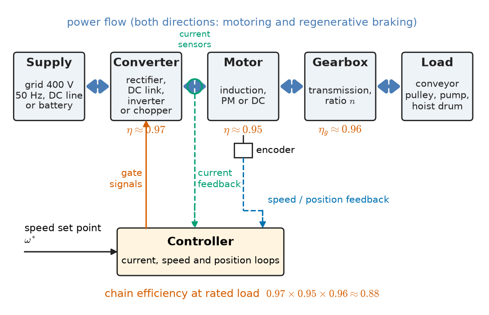
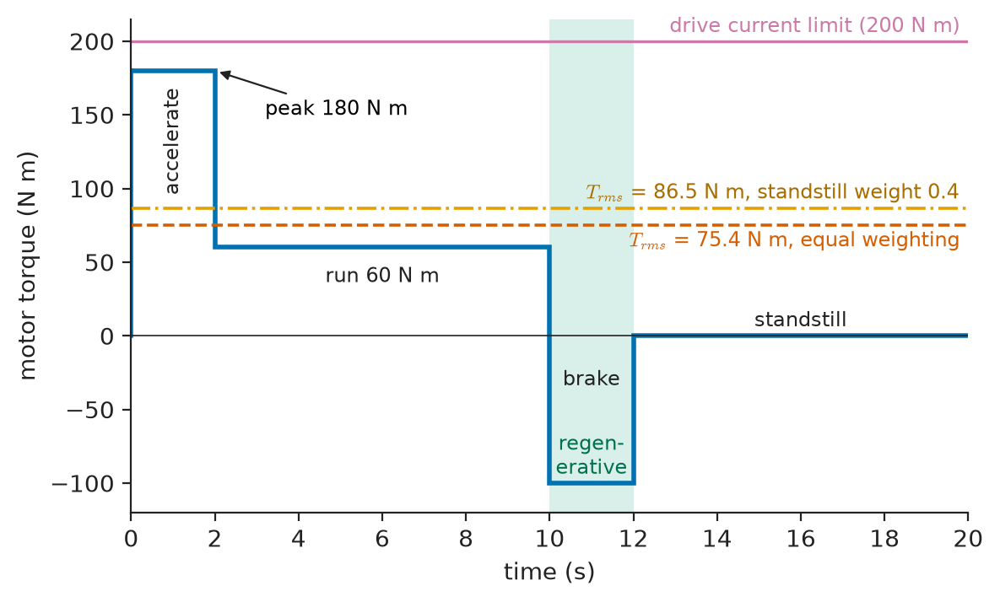
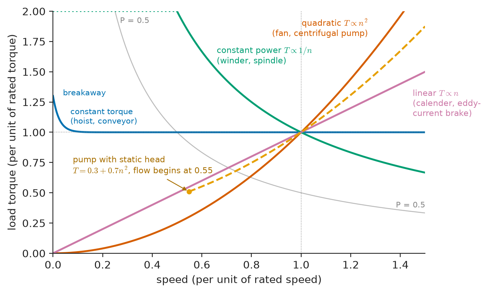
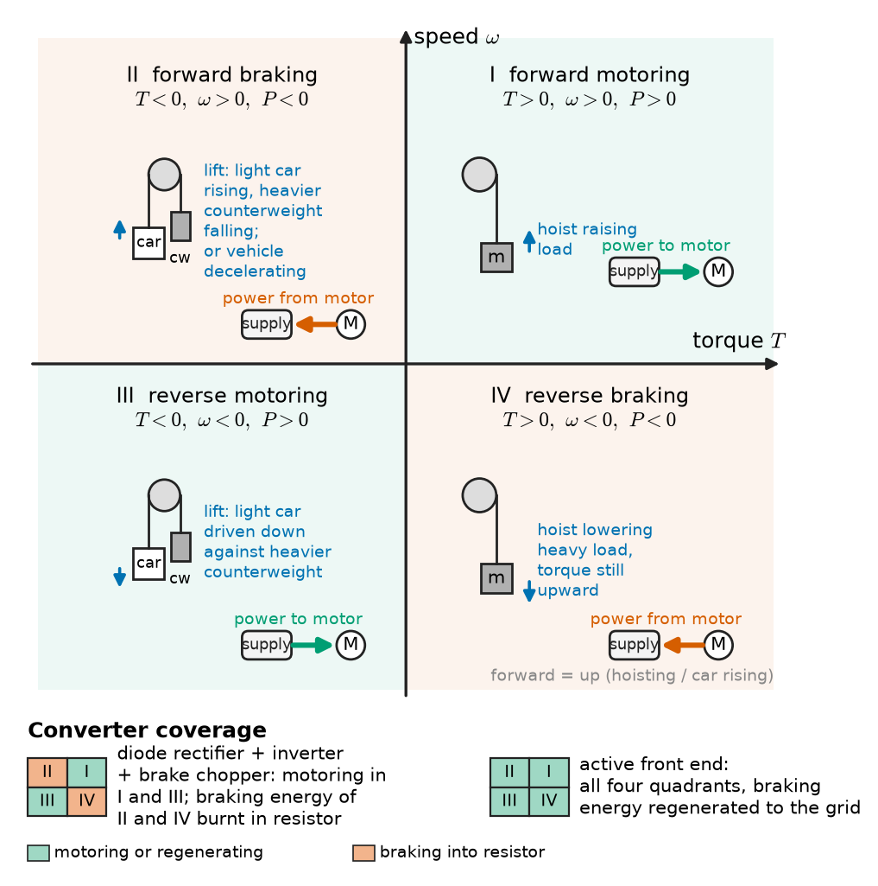
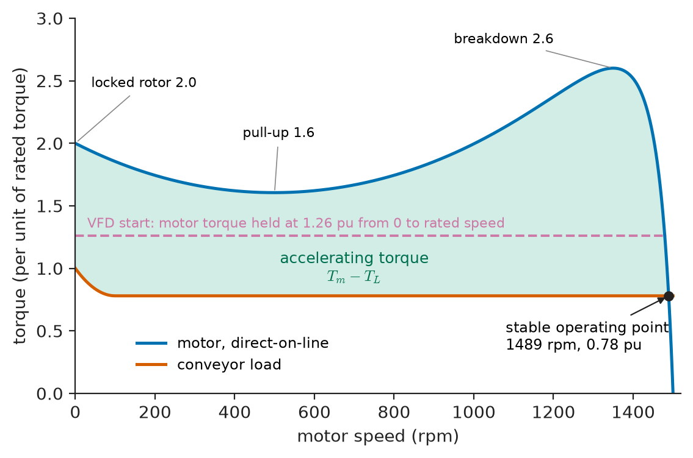
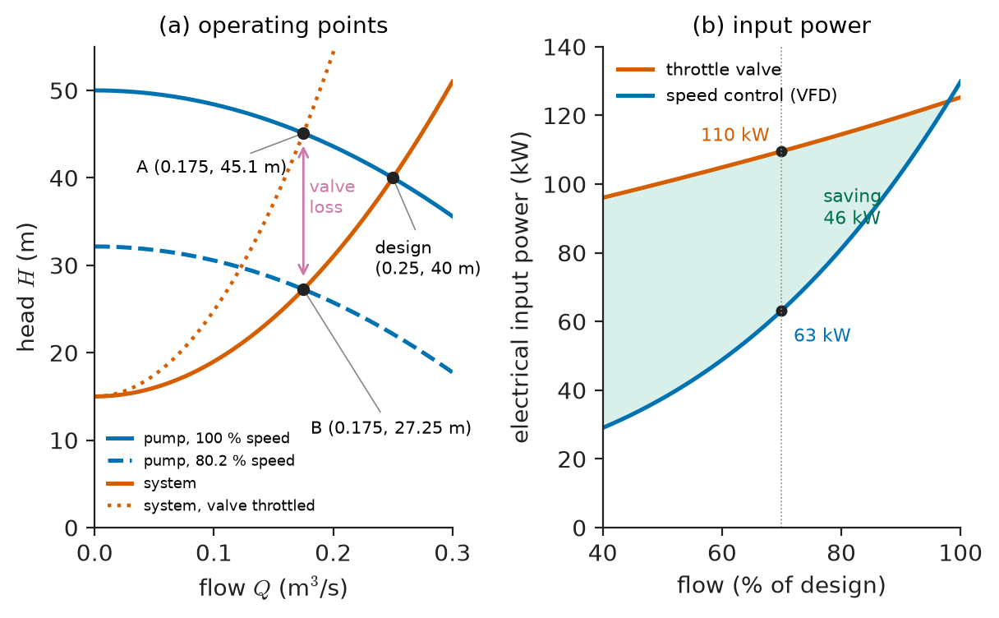

# Chapter 10 — Drive-System Fundamentals

*Part III · Motor Drives*

A copper mine commissions a new overland belt conveyor: 1.8 km long, 3 m/s belt speed, driven by a 160 kW induction motor through a helical gearbox. On the first loaded start after a weekend shutdown the motor hums, draws six times its rated current, and the belt does not move; the overload relay trips after eight seconds. Nothing is broken. The motor was chosen from the steady running power, 125 kW, with a comfortable margin, but nobody counted the torque needed to break the cold, loaded belt free and to accelerate 60 tonnes of belt and ore, nor the fact that a direct-on-line induction motor gives its torque at the wrong speeds for this job. The same weekend, at a water utility across the valley, a 132 kW pump runs at full speed against a half-closed valve, burning 45 kW that does nothing but heat the water, and in an office tower a lift returns 10 kW of braking power to a resistor on the roof every time a full car comes down. Each of these is a *drive-system* problem: a motor, a power converter, a controller and a mechanical load that were not matched to each other.

> **How do we match a motor to the torque and speed its load actually demands, during starting, running and braking?**
> **How do we decide how many quadrants a drive needs, how efficient the whole chain is, how it is protected, and which drive to buy?**

| Concept | Engineering destination |
|---|---|
| Motor-load matching | Gear ratios, referred inertia, operating-point stability of conveyors, pumps, hoists |
| Torque and speed requirements | Motor and converter sizing from duty cycles, peak and RMS torque |
| Load characteristics | Constant-torque, fan-law and constant-power loads; choosing the control method |
| Four-quadrant operation | Lifts, hoists, EVs, rolling mills, test benches, cranes |
| Starting and braking | Acceleration time, starting current, braking resistors, regenerative supply units |
| Drive efficiency | Pump and fan energy savings, IEC 61800-9-2 efficiency classes, life-cycle cost |
| Protection | Motor overload classes, drive trips, safe torque off, insulation and bearing stress |
| Drive selection | Specification sheets, normal and heavy duty ratings, supply and environment checks |

**Roadmap.** What a drive system is and how motor and load meet on a common shaft (10.1) → the torque and speed a duty really needs (10.2) → the shapes of real load characteristics (10.3) → the four quadrants and which loads need them (10.4) → starting and braking, where most sizing errors live (10.5) → efficiency of the whole chain (10.6) → protection of motor, converter and people (10.7) → a selection procedure that ties it together (10.8).

---

## 10.1 Motor-load matching

### The drive system as a chain

An electric drive is the chain of Figure 10.1: a **supply** (the grid, a battery, a DC traction line), a **power converter** that sets the voltage, current and frequency the motor sees, the **motor**, a **mechanical transmission** (coupling, gearbox, belt, screw, rope drum), the **load**, and a **controller** with its sensors that closes loops on current, speed or position. The machines themselves were the subject of Part II; this part is about the chain. A drive with an excellent motor can still fail its duty because the gearbox ratio is wrong, the converter cannot supply the starting current, or the controller has no way to absorb the energy that comes back from the load.

<!-- FIGURE 10.1 | figures/ch10/fig-10-1-drive-system-blocks.png | block-diagram | The parts of an electric drive system and the power and signal flows between them. | Content: left-to-right chain of blocks: Supply (grid 400 V 50 Hz, or DC link or battery) -> Power converter (rectifier, DC link, inverter or chopper) -> Motor -> Transmission (gearbox ratio n, efficiency 0.96) -> Load (conveyor pulley, pump, hoist drum). Thick arrows for power flow, drawn double-headed between supply and load to show that power can return. Below: Controller block receiving speed or position feedback from an encoder on the motor shaft and current feedback from sensors at the converter output; it sends gate signals to the converter. Reference input (speed set point) enters the controller from the left. Annotate typical efficiencies under each block: converter 0.97, motor 0.95, gearbox 0.96. -->

*Figure 10.1 — The parts of an electric drive system and the power and signal flows between them.*

Figure 10.1 shows power flowing in both directions. Whether the converter and the supply can actually accept power coming back from the load is one of the first questions a drive specification must answer (Section 10.4).

### The equation of motion on the motor shaft

> **Boundary.** Rotational dynamics, the torque–angular-velocity effort–flow pair and the gear pair as a mechanical transformer are treated in *Engineering Physics*, [Ch. 19 §19.2](https://github.com/The-Studio-of-Sadiq/Engineering-Physics/blob/main/CHAPTERS/CHAPTER%2019.md) (with rigid-body rotation in [Ch. 9 §9.7](https://github.com/The-Studio-of-Sadiq/Engineering-Physics/blob/main/CHAPTERS/CHAPTER%209.md)); the motor as a gyrator between the electrical and mechanical domains is in [Ch. 17 §17.5](https://github.com/The-Studio-of-Sadiq/Engineering-Physics/blob/main/CHAPTERS/CHAPTER%2017.md). Here those results are used, not derived.

Everything a drive does mechanically is governed by Newton's law for rotation applied to the motor shaft, with every inertia and torque referred to that shaft:

$$
J_{eq}\frac{d\omega_m}{dt}=T_m-T_L^{\prime}
$$

where $T_m$ is the electromagnetic torque of the motor (less its own friction), $T_L^{\prime}$ is the load torque referred to the motor shaft, and $J_{eq}$ is the total inertia seen by the motor. When $T_m>T_L^{\prime}$ the drive accelerates; when $T_m<T_L^{\prime}$ it decelerates; in steady state the two torques are equal. All of starting, braking and speed control is the art of shaping $T_m$ so that this equation produces the speed profile the process wants.

> **Status of the principle: Shaft equation of motion**
> *Fundamental.* Newton's second law for rotation of a rigid shaft; it fails only where shaft torsional compliance or backlash matters (long shafts, rope hoists, rolling-mill spindles), when the drivetrain must be modelled as several inertias joined by springs.

### Referring torque and inertia through a transmission

A gearbox with ratio $n=\omega_m/\omega_L$ (motor speed over load speed) and efficiency $\eta_g$ is a mechanical transformer (*Engineering Physics*, Ch. 19 §19.2.2). Referred to the motor shaft, a load torque and inertia become

$$
T_L^{\prime}=\frac{T_L}{n\,\eta_g}\ \ (\text{motoring}),\qquad J_L^{\prime}=\frac{J_L}{n^{2}}
$$

When power flows backwards (the load drives the motor, as in a lowering hoist) the efficiency multiplies instead of divides: $T_L^{\prime}=T_L\eta_g/n$. A translating mass $m$ moving at speed $v$ is referred by equating kinetic energies, $J^{\prime}\omega_m^{2}=mv^{2}$, so $J^{\prime}=m(v/\omega_m)^{2}$. For a conveyor pulley or hoist drum of radius $r$ driven through ratio $n$, $v/\omega_m=r/n$.

> **Status of the principle: Referred torque and inertia**
> *Derived.* Follows from power conservation across an ideal transmission and equality of kinetic energy; the efficiency correction is an approximation that treats transmission loss as proportional to transmitted torque, adequate for helical gears at more than about 25 % load.

The $1/n^{2}$ is why gearboxes are used. A conveyor pulley turning at 72 rpm with 11 600 kg·m² of referred belt inertia looks to a 1485 rpm motor like 27 kg·m², comparable with its own rotor. Without a gearbox a 72 rpm motor of the same power would need about 21 times the torque, and therefore roughly 21 times the active volume.

### Matching ratio for dynamic loads

In servo applications (machine-tool axes, packaging, robots) the requirement is not steady torque but acceleration. For a load inertia $J_L$ and motor inertia $J_m$ with no load torque, the motor torque needed to give the load an angular acceleration $\alpha_L$ is

$$
T_m=\left(J_m n+\frac{J_L}{n}\right)\alpha_L
$$

which is smallest when $n_{opt}=\sqrt{J_L/J_m}$, i.e. when the referred load inertia equals the motor inertia. In practice servo designers accept inertia ratios $J_L^{\prime}/J_m$ of 1 to 10, because a gearbox ratio chosen for minimum torque may give too low a top speed, and because a stiff coupling tolerates a larger ratio than a belt. Ratios above about 10 make the speed loop hard to tune: the load resonance moves into the loop bandwidth.

### Operating point and its stability

In steady state the motor runs where its torque–speed curve crosses the load curve, both referred to the same shaft (Figure 10.5 in Section 10.5). Not every crossing is a stable operating point. Suppose the speed rises slightly by $\Delta\omega$. Linearising the shaft equation,

$$
J_{eq}\frac{d\,\Delta\omega}{dt}=\left(\frac{\partial T_m}{\partial\omega}-\frac{\partial T_L^{\prime}}{\partial\omega}\right)\Delta\omega
$$

and the disturbance dies away only if

$$
\frac{\partial T_L^{\prime}}{\partial\omega}>\frac{\partial T_m}{\partial\omega}
$$

> **Status of the principle: Steady-state stability criterion**
> *Derived.* Linearisation of the shaft equation about the operating point (small-signal stability, as in *Circuits, Signals and Communications*, [Ch. 33](https://github.com/The-Studio-of-Sadiq/Circuits-Signals-and-Communications/blob/main/part-7-control-system-fundamentals/33-dynamic-system-modeling.md)); it ignores the motor's electrical dynamics, which can destabilise an otherwise stable point (Chapter 12).

An induction motor on its normal low-slip region has a steeply falling torque curve, so it is stable against almost any load. On the high-slip side of its peak torque the motor torque *rises* with speed, and a constant-torque load crossing there is unstable: the drive either accelerates to the normal region or stalls. A DC series motor with a load that falls faster with speed than the motor torque does, or a fan driven by a motor whose torque rises with speed, are the classic textbook traps. Closed-loop drives make the question nearly academic, because the speed controller deliberately gives $T_m$ a strong negative slope against speed error, but the criterion still governs drives in torque or open-loop scalar mode.

**Worked example — matching a mine conveyor drive.** The conveyor of the opening has belt speed $v=3.0$ m/s on a drive pulley of diameter 0.80 m. The steady belt pull (friction of idlers, belt flexing and lift of the ore) is 40 kN; the total moving mass of belt and ore is 60 t, and the pulleys and idlers add an equivalent of 2000 kg·m² at the drive pulley. The motor is four-pole, 50 Hz, rated 160 kW at 1485 rpm; the helical gearbox has $\eta_g=0.96$, and motor rotor plus coupling and gear input add 5.0 kg·m².

- Pulley speed: $\omega_L=v/r=3.0/0.40=7.50$ rad/s (71.6 rpm). Motor speed $\omega_m=1485\times2\pi/60=155.5$ rad/s, so $n=155.5/7.50=20.7$.
- Pulley torque $T_L=40\ \mathrm{kN}\times0.40\ \mathrm{m}=16.0$ kN·m; referred, $T_L^{\prime}=16\,000/(20.7\times0.96)=804$ N·m. Belt power $Fv=120$ kW; motor shaft power $120/0.96=125$ kW.
- Inertia at the pulley: $mr^{2}+2000=60\,000\times0.16+2000=11\,600$ kg·m²; referred, $11\,600/20.7^{2}=27.0$ kg·m². Total $J_{eq}=27.0+5.0=32.0$ kg·m². The stored kinetic energy at full speed is $\tfrac12J_{eq}\omega_m^{2}=387$ kJ.
- To reach full speed in 20 s (a typical limit for belt stresses) at constant acceleration needs an extra $J_{eq}\omega_m/t=32.0\times155.5/20=249$ N·m.
- The motor's rated torque is $160\,000/155.5=1029$ N·m. Running load plus acceleration is $804+249=1053$ N·m, 1.02 times rated; if the cold belt needs 30 % more than its running pull to break away, the start demands $1.3\times804+249=1294$ N·m, 1.26 times rated, for the 20 s of the start.

The motor is correctly sized for running (78 % load) and thermally capable of the start, but a direct-on-line start gives the wrong torque in the wrong way. Its catalogue curve (Figure 10.5) offers about 2 times rated torque at standstill and a pull-up minimum of 1.6 near a third of speed, but it draws 6 to 7 times rated current, about 1.8 kA. On the mine's weak 400 V supply that current depresses the terminal voltage by 15 %, and induction-motor torque falls with the square of voltage: the pull-up torque drops to $1.6\times0.85^{2}=1.16$ times rated, below the 1.26 the loaded belt needs. The motor hangs at pull-up speed, drawing nearly locked-rotor current, until the overload relay trips. A variable-frequency drive rated for 150 % torque for 60 s (a "heavy-duty" rating, Section 10.8) delivers the 126 % smoothly at about 130 % current, which is the solution adopted for most long conveyors. The example shows the rule that defeats most first-time drive specifications: size for the *torque profile*, not for the running power.

---

## 10.2 Torque and speed requirements

### From process to torque–speed profile

The process sets a speed or position profile; the shaft equation turns it into a torque profile. A crane hoist must lift rated load at rated speed, accelerate it within a time fixed by productivity, and hold it at zero speed. A rolling mill must keep strip speed within 0.1 % while the bite of the next pass adds a torque step. An electric car must deliver high torque from standstill for acceleration, constant power over a wide speed range for overtaking, and a top speed four or five times the speed at which full torque ends. Table 10.1 collects representative requirements.

**Table 10.1 — Representative torque and speed requirements (typical values).**

| Application | Speed range | Peak / rated torque | Accuracy or bandwidth | Quadrants |
|---|---|---|---|---|
| Centrifugal pump, fan | 30–100 % | 1.1 | 1–2 % speed | 1 |
| Belt conveyor | 10–100 % | 1.3–1.6 at start | 1 % speed, load sharing | 1 (2 on downhill) |
| Crane hoist | 0–100 %, hold at zero | 1.6–2.0 | Smooth zero-speed holding | 4 |
| Passenger lift | 0–100 % (1–6 m/s) | 1.8–2.5 | Levelling within 5 mm | 4 |
| Rolling mill stand | 0–100 %, field weakening to 2–3× | 2.5–3.0 for 10 s | 0.01–0.1 % speed, 50–100 Hz current-loop bandwidth | 4 |
| Paper machine section | 5–100 % | 1.5 | 0.01 % speed (draw control) | 1–2 |
| CNC axis servo | 0–6000 rpm | 3–5 for 0.1 s | 1–10 µm position, 100–300 Hz speed bandwidth | 4 |
| EV traction motor | 0–12 000 rpm, constant power above 3000–4000 rpm | 2–3 for 10–30 s | 1–5 ms torque response | 4 |
| Ship propulsion (fixed-pitch propeller) | 0–100 % both directions | 1.2 | 1 % speed | 4 |

### Base speed, constant torque and constant power

A motor's continuous capability is limited by two different things in two speed regions (Figure 11.1 and Figure 12.6 show the DC and PMSM versions). Below **base speed** the limit is current, because current sets copper loss and therefore temperature; with full flux, full current means full torque, so the region is called **constant torque**. Above base speed the converter has run out of voltage, because the motor's back-EMF $E\propto\Phi\omega$ has reached the supply limit; the only way to go faster is to reduce flux (**field weakening**), and with current still at its limit the torque falls as $1/\omega$ and power stays constant. At still higher speed the machine's own limits (commutation in DC machines, breakdown torque in induction machines, the voltage ellipse in PM machines) make torque fall faster, as $1/\omega^{2}$. A drive specification therefore states at least: rated torque up to base speed, the field-weakening range (2:1 for most industrial induction motors, 3:1 to 4:1 for traction), and the maximum speed.

### Peak torque, RMS torque and duty

Two different motor limits apply to a cyclic duty. **Peak torque** is limited by the converter's current limit and, in induction motors, by breakdown torque (typically 2 to 3 times rated); in PM motors by demagnetisation of the magnets. **Continuous torque** is limited by temperature, which responds to the average of the losses over the thermal time constant of the motor (tens of minutes for a 100 kW motor). Because copper loss is proportional to current squared, and current to torque below base speed, the thermally equivalent constant torque of a cycle is its **RMS torque**:

$$
T_{rms}=\sqrt{\frac{\sum_k T_k^{2}\,t_k}{\sum_k t_k}}
$$

A self-ventilated motor cools less well at standstill and low speed, so standstill periods are counted with a reduced weight $k_0\approx0.25$–$0.5$ in the denominator. The duty types S1 (continuous) to S10 of IEC 60034-1, and the thermal reasoning behind them, are covered in [Chapter 9](../part-2-transformers-and-electrical-machines/09-electrical-machine-design-and-performance.md).

> **Status of the principle: RMS-torque sizing**
> *Approximate.* Valid when the cycle is much shorter than the motor's thermal time constant, when copper loss dominates and is proportional to torque squared (no field weakening), and when cooling is independent of speed or corrected by a standstill factor; it fails for long cycles, for operation in field weakening, and for motors whose iron loss is a large share of the total.

<!-- FIGURE 10.2 | figures/ch10/fig-10-2-duty-cycle-torque.png | plot | Torque profile of a cyclic packaging-machine duty and its RMS equivalent. | Content: x-axis time 0 to 20 s, y-axis torque -120 to +200 N m. Stepped profile: +180 N m from 0 to 2 s (acceleration), +60 N m from 2 to 10 s (running), -100 N m from 10 to 12 s (braking), 0 from 12 to 20 s (standstill). Horizontal dashed line at 75.4 N m labelled "T_rms, equal weighting" and dash-dot line at 86.5 N m labelled "T_rms, standstill weight 0.4". Shade the braking interval and label it "regenerative". Annotate peak 180 N m against a horizontal line at 200 N m labelled "drive current limit". -->

*Figure 10.2 — Torque profile of a cyclic packaging-machine duty and its RMS equivalent.*

**Worked example — RMS torque of a cyclic duty.** A packaging machine indexes a turret with the cycle of Figure 10.2: 180 N·m for 2 s to accelerate, 60 N·m for 8 s to run, −100 N·m for 2 s to brake, then 8 s at rest; the motor runs at 1470 rpm. With equal weighting

$$
T_{rms}=\sqrt{\frac{180^{2}\times2+60^{2}\times8+100^{2}\times2}{20}}=\sqrt{\frac{64\,800+28\,800+20\,000}{20}}=75.4\ \mathrm{N\,m}
$$

For a self-ventilated motor with standstill weight $k_0=0.4$ the denominator becomes $12+0.4\times8=15.2$ s, giving $T_{rms}=86.5$ N·m. At 1470 rpm ($\omega=153.9$ rad/s) the thermally equivalent power is $86.5\times153.9=13.3$ kW, while the peak demand is $180\times153.9=27.7$ kW. A 15 kW four-pole motor (rated torque about 97 N·m) is thermally adequate, its breakdown torque of 2.5 to 3 times rated covers the 180 N·m peak, and the converter must be sized for the peak current, about 1.9 times motor rated current for 2 s, not for 15 kW. The braking segment returns energy (Section 10.4) that must be absorbed somewhere.

---

## 10.3 Load characteristics

### The main families

The torque a load demands as a function of speed is its **mechanical characteristic**. Most industrial loads fall into a few families (Figure 10.3), and the family largely decides the drive.

<!-- FIGURE 10.3 | figures/ch10/fig-10-3-load-characteristics.png | plot | Torque-speed characteristics of the main load families, normalised to rated torque and rated speed. | Content: x-axis speed 0 to 1.5 per unit, y-axis torque 0 to 2.0 per unit. Curves: constant torque (hoist, conveyor) horizontal at 1.0 with a breakaway spike to 1.3 near zero speed; quadratic (fan, centrifugal pump) T = speed squared, passing 1.0 at 1.0 pu; constant power (winder, machine-tool spindle) T = 1/speed from 0.5 to 1.5 pu, capped at 2.0; linear (calender, eddy-current brake) T = speed; pump with static head T = 0.3 + 0.7 speed squared starting at speed 0.55 pu where flow begins. Label each curve with example loads. A thin grey family of power curves P = 0.5, 1.0 pu as hyperbolas. -->

*Figure 10.3 — Torque-speed characteristics of the main load families, normalised to rated torque and rated speed.*

- **Constant torque**, $T_L\approx$ const. Hoists and cranes (gravity), conveyors (friction), positive-displacement pumps and compressors, extruders, mixers. Power is proportional to speed. Static friction usually adds a **breakaway torque** at standstill of 10 to 50 % above the running value, more after a cold standstill (grease, frozen belts, settled slurry).
- **Quadratic (fan law)**, $T_L\propto\omega^{2}$, $P\propto\omega^{3}$. Centrifugal fans, pumps and compressors. They follow the affinity laws, flow $\propto$ speed, head $\propto$ speed², power $\propto$ speed³ (*Engineering Physics*, [Ch. 19 §19.7.3](https://github.com/The-Studio-of-Sadiq/Engineering-Physics/blob/main/CHAPTERS/CHAPTER%2019.md)). With a static head (lifting water to a reservoir), flow begins only above the speed at which the pump's shut-off head equals the static head, and power then falls less steeply than the cube.
- **Constant power**, $T_L\propto1/\omega$. Centre winders and unwinders (constant tension, so torque proportional to roll radius while speed is inversely proportional to it), lathe and milling spindles (constant cutting power across tool diameters), traction at speed. These loads want a motor with a wide field-weakening range.
- **Linear**, $T_L\propto\omega$. Calenders, viscous mixers at low Reynolds number, eddy-current brakes and generators feeding resistive loads.
- **Position-dependent and pulsating**. Reciprocating compressors and pumps, crank presses and beam pumps (oil-field "nodding donkeys") have torque that varies with shaft angle within each revolution; flywheels and inertia smooth it.

> **Status of the principle: Fan affinity laws**
> *Approximate.* Derived from dynamic similarity for a pump or fan running at different speeds against a purely frictional system; they fail when static head is a large share of the total, at very low speeds where Reynolds-number effects change efficiency, and for positive-displacement machines.

### Active and passive loads

A second distinction matters more than the shape: is the load **passive** or **active**? A passive load (friction, fans, pumps, cutting) always opposes motion; remove the motor torque and it stops. An active load (gravity on a hoist or lift, a vehicle on a downhill grade, an unwinder, a wind or water turbine on a test bench) can drive the shaft by itself. An active load sends power back into the drive whenever it overhauls the motor, which is the reason four-quadrant drives exist.

### Load characteristic decides control strategy

Table 10.2 links the load family to what the drive must do.

**Table 10.2 — Load families and drive consequences.**

| Load family | Starting requirement | Typical control | Energy lever |
|---|---|---|---|
| Fan, centrifugal pump | Low (torque rises with speed) | Open-loop V/f, soft starter for fixed speed | Speed instead of dampers or valves: power $\propto$ speed³ |
| Conveyor, extruder, positive-displacement pump | High: breakaway plus acceleration | Sensorless vector, 150 % heavy-duty rating | Avoid oversizing; regenerate on downhill conveyors |
| Hoist, crane, lift | Full torque at zero speed, holding | Closed-loop vector with encoder, brake logic | Regeneration on lowering |
| Winder, spindle | Wide constant-power range | Vector or DC with field weakening | Correct base speed choice |
| Servo axis | High peak, fast response | PMSM servo, position loop | Low inertia, DC-bus sharing |
| Traction | High starting torque, constant power to 3–4× base | PMSM or induction vector, four-quadrant | Regenerative braking |

---

## 10.4 Four-quadrant operation

### The torque–speed plane

Plot speed on the vertical axis and torque on the horizontal axis, both taken positive in the "forward" direction (Figure 10.4). The plane has four quadrants, and the product $P=T_m\omega_m$ tells which way power flows:

- **Quadrant I**, $T>0$, $\omega>0$: forward motoring. Power flows from supply to load.
- **Quadrant II**, $T<0$, $\omega>0$: forward braking. The motor runs forward but its torque opposes motion; power flows from load to supply (or to a resistor). The motor is a generator.
- **Quadrant III**, $T<0$, $\omega<0$: reverse motoring.
- **Quadrant IV**, $T>0$, $\omega<0$: reverse braking.

<!-- FIGURE 10.4 | figures/ch10/fig-10-4-four-quadrant-plane.png | block-diagram | The four quadrants of the torque-speed plane, with a hoist and a lift as examples and the direction of power flow in each. | Content: horizontal axis torque T (positive right), vertical axis speed omega (positive up), origin at centre. Quadrant I: forward motoring, P > 0, sketch of hoist raising load. Quadrant II: forward braking, P < 0, sketch of lift with light (empty) car rising while the heavier counterweight falls, or vehicle decelerating. Quadrant III: reverse motoring, light car driven down against the heavier counterweight. Quadrant IV: reverse braking, hoist lowering a heavy load with torque still upward (likewise a full lift car descending). Note: forward = up (hoisting, car rising). Arrows between supply and motor icons in each quadrant showing power direction: into motor in I and III, out of motor in II and IV. Under the plane, a strip showing which converters cover which quadrants: diode rectifier plus inverter with brake chopper (I, III; II and IV into resistor); active front end (all four, regenerating). -->

*Figure 10.4 — The four quadrants of the torque-speed plane, with a hoist and a lift as examples and the direction of power flow in each.*

Which quadrants a drive needs follows from the load. A pump or fan needs only Quadrant I. A conveyor needs I, plus II if it runs downhill or must stop faster than friction stops it. A crane hoist needs I (raising) and IV (lowering a load, with torque still upward to hold it against gravity). A lift, a rolling mill, a ship propeller and an electric vehicle use all four.

### Two ways to brake: dissipate or regenerate

Braking energy that leaves the motor in Quadrants II and IV must go somewhere. A standard low-voltage VFD has a diode rectifier that cannot pass power back to the grid; the returned energy charges the DC-link capacitor, and its voltage rises. A 400 V drive (DC link about 540 V) typically trips on overvoltage near 800 V. Three remedies exist:

1. **Ramp-limited deceleration.** If the load's own friction or fan torque absorbs the energy, simply decelerate slowly enough. Drives include an overvoltage controller that automatically stretches the ramp.
2. **Brake chopper and resistor.** An IGBT switch connects a resistor across the DC link above a threshold (about 700 to 760 V for 400 V drives). The energy is burnt as heat. This is cheap and the usual choice for infrequent stops and for cranes up to a few hundred kW.
3. **Regeneration.** An active front end (an IGBT rectifier, essentially a grid-connected inverter, [Chapter 27](../part-7-power-quality-and-grid-modernization/27-grid-integration-of-renewable-energy.md)), a thyristor regenerative unit, or a **common DC bus** shared with other drives that are motoring at the same moment returns the energy. It costs more but saves energy where braking is frequent and heavy: lifts, cranes, test benches, centrifuges, downhill conveyors, mine winders.

In DC drives the same choice appears as rheostatic versus regenerative braking (Chapter 11); in traction and EVs regeneration is standard, and the limit is the receptivity of the battery or the traction line (Section 11.6).

**Worked example — the regenerating lift.** A traction lift has car mass 1000 kg, rated load 1000 kg and a counterweight of car mass plus half rated load, 1500 kg. Rated speed is 2.5 m/s, travel 30 m. With a full car descending, the car side is $2000-1500=500$ kg heavier than the counterweight. Gravity therefore drives the system with $F=500\times9.81=4905$ N, and holding constant speed requires the machine to brake. Taking car-up as forward, the speed is negative and the torque still acts upward on the car side: Quadrant IV, like the hoist lowering its load. Mechanical power returned is $Fv=4905\times2.5=12.3$ kW. With roping and sheave efficiency 0.85, motor 0.95 and inverter 0.97, the electrical power reaching the DC link is $12.3\times0.85\times0.95\times0.97=9.6$ kW for the 12 s run, $115$ kJ per trip. An empty car going *up* is the mirror case (the counterweight is 500 kg heavier, so the machine must hold the car back: positive speed, negative torque, Quadrant II) and also regenerates; a full car up or an empty car down are motoring cases, drawing $12.3/(0.85\times0.95\times0.97)=15.7$ kW.

With a brake resistor, the resistor must absorb up to the full 12.3 kW (sized conservatively on mechanical power) at the lower end of the chopper threshold band, about 700 V: $R\le V^{2}/P=700^{2}/12\,260=40\ \Omega$, rated for the duty (a lift in an office tower may make 200 such trips a day). With a regenerative unit, about half of all trips return roughly 115 kJ each. At 200 trips a day, 100 regenerating, that is $100\times115$ kJ $=11.5$ MJ $\approx3.2$ kWh a day returned instead of heating the machine room, a 15 to 30 % cut in lift energy, which is why modern lift standards for energy performance (ISO 25745) reward regeneration.

---

## 10.5 Starting and braking

### Acceleration time

Integrating the shaft equation from standstill to the final speed $\omega_f$ gives the starting time:

$$
t_{start}=J_{eq}\int_{0}^{\omega_f}\frac{d\omega}{T_m(\omega)-T_L^{\prime}(\omega)}
$$

The integrand is the reciprocal of the **accelerating torque** $T_m-T_L^{\prime}$, the gap between the motor and load curves in Figure 10.5. Where the gap is small (near the induction motor's pull-up torque, or with a high-torque load) the drive spends most of its starting time. In practice the integral is evaluated graphically or numerically in steps of speed.

<!-- FIGURE 10.5 | figures/ch10/fig-10-5-motor-load-acceleration.png | plot | Direct-on-line torque-speed curve of a four-pole induction motor against a conveyor load, showing the accelerating torque and the operating point. | Content: x-axis speed 0 to 1500 rpm, y-axis torque 0 to 3.0 per unit of motor rated torque. Motor curve: locked-rotor torque 2.0 pu at 0 rpm, pull-up minimum 1.6 pu near 500 rpm, breakdown 2.6 pu at 1350 rpm, falling to 0 at 1500 rpm, crossing 1.0 at 1485 rpm. Load curve: conveyor 1.0 pu breakaway falling to 0.78 pu by 100 rpm and constant thereafter. Shade the gap between curves and label it "accelerating torque T_m - T_L". Mark the stable operating point at about 1488 rpm, 0.78 pu. Inset text: "VFD start: motor torque held at 1.26 pu from 0 to rated speed" drawn as a dashed horizontal line. -->

*Figure 10.5 — Direct-on-line torque-speed curve of a four-pole induction motor against a conveyor load, showing the accelerating torque and the operating point.*

Three practical consequences follow. First, in a direct-on-line start the motor's rotor losses during acceleration equal the kinetic energy finally stored in the load (for an unloaded induction motor), and more with load torque present, so frequent starts of high-inertia loads overheat rotors; motor data sheets give the permitted number of starts per hour and the maximum load inertia. Second, long starts with high current trip overload relays (Section 10.7). Third, the supply sees the starting current: a 160 kW motor started direct-on-line draws about 1.8 kA at 400 V, enough to depress the voltage of a weak site supply by 10 % or more ([Chapter 25](../part-7-power-quality-and-grid-modernization/25-power-quality.md)).

### Starting methods at system level

The starting methods for induction motors (direct-on-line, star–delta, autotransformer, soft starter, VFD) and their current and torque ratios are described in [Chapter 6](../part-2-transformers-and-electrical-machines/06-induction-machines.md); DC-motor starting in [Chapter 5](../part-2-transformers-and-electrical-machines/05-dc-machines.md). From the drive-system point of view the choice compares three things the method controls: the starting current drawn from the supply, the starting torque available at the shaft, and whether the speed can be controlled during and after the start. Table 10.3 summarises.

**Table 10.3 — Starting methods compared for a cage induction motor (typical values, per unit of rated).**

| Method | Supply current | Starting torque | Speed control | Typical use |
|---|---|---|---|---|
| Direct-on-line | 6–8 | 1.5–2.5 | No | Small motors, stiff supply |
| Star–delta | 2–2.7 | 0.5–0.8 | No | Light-start pumps, fans |
| Autotransformer (65 % tap) | 2.5–3.4 | 0.6–1.0 | No | Larger pumps, compressors |
| Soft starter (voltage ramp) | 2.5–4.5 adjustable | Proportional to voltage² | Start and stop only | Pumps (water-hammer control), fans, conveyors with light start |
| Variable-frequency drive | 1.0–1.5 | 1.5–2.0 at any speed | Full | Heavy start, speed control, frequent starts |

### Braking methods

Braking is the mirror of starting, with the important difference that the energy now flows back. The options:

- **Mechanical brakes** (disc, drum, band) dissipate in friction. They remain essential as holding and emergency brakes (a lift or hoist brake is a safety device, sized to stop and hold 125 % to 150 % of rated load), but they wear and cannot be modulated finely.
- **Dynamic (rheostatic) braking.** The motor runs as a generator into a resistor: across the armature of a DC machine, or via the brake chopper of a VFD. Braking torque falls as speed falls unless the resistance is stepped down.
- **DC injection braking** of an induction motor: DC in the stator produces a stationary field; the rotor's kinetic energy is dissipated in the rotor. Cheap and built into most drives, but all the energy heats the motor.
- **Plugging** (reverse-phase or reverse-polarity braking). Reversing two supply phases of an induction motor or the armature of a DC motor gives strong braking torque, but the motor dissipates about three times the kinetic energy of the load. Limited to small drives and emergency use.
- **Regenerative braking**, converting the kinetic or potential energy back to electrical energy in the supply or a battery. The most efficient; covered for DC drives in Section 11.6 and for AC drives in Chapter 12.

The time to stop under a constant braking torque $T_b$ plus load torque is $t_{stop}=J_{eq}\omega_0/(T_b+T_L^{\prime})$, and the energy to be absorbed by the braking device is the stored kinetic energy minus the work done by the load. For the conveyor of Section 10.1, the 387 kJ stored at full speed would be dissipated by belt friction alone in about $J\omega/T_L^{\prime}=32.0\times155.5/804=6.2$ s, so a normal stop needs no electrical braking at all. Long *downhill* conveyors are the opposite: gravity on the loaded belt can exceed friction, and the drive must regenerate continuously, sometimes several megawatts on large overland conveyors.

---

## 10.6 Drive efficiency

### The efficiency chain

The efficiency of a drive system is the product of the efficiencies of its stages (*Engineering Physics*, [Ch. 19 §19.4.1](https://github.com/The-Studio-of-Sadiq/Engineering-Physics/blob/main/CHAPTERS/CHAPTER%2019.md)):

$$
\eta_{system}=\eta_{converter}\,\eta_{motor}\,\eta_{transmission}\,\eta_{process}
$$

where the last factor, the efficiency with which the load turns shaft power into useful work (hydraulic power for a pump, air power for a fan), is often the smallest and the most variable. Table 10.4 gives representative values.

**Table 10.4 — Representative efficiencies of drive-system stages at rated load.**

| Stage | Typical efficiency | Notes |
|---|---|---|
| LV VFD, 7.5–250 kW | 96–98.5 % | Diode front end; active front end 1–1.5 points lower |
| MV drive, 1–20 MW | 97–99 % | Including input transformer for multi-pulse designs: about 96–97.5 % |
| Induction motor 15 kW, IE3 / IE4 (IEC 60034-30-1) | 92.1 % / 93.9 % | Four-pole, 50 Hz minimum values |
| Induction motor 160 kW, IE3 / IE4 | 95.8 % / 96.6 % | Four-pole, 50 Hz minimum values |
| PMSM, 15–200 kW | 94–97 % | Higher at part load than induction |
| Helical gear stage | 97–99 % | Per stage |
| Worm gear | 40–90 % | Strongly ratio-dependent |
| V-belt / synchronous belt | 93–97 % / 97–98 % | |
| Centrifugal pump at best-efficiency point | 70–90 % | Falls rapidly away from it |

The motor's efficiency classes and losses are dealt with in [Chapter 9](../part-2-transformers-and-electrical-machines/09-electrical-machine-design-and-performance.md) and, as a plant energy measure, in [Chapter 28](../part-7-power-quality-and-grid-modernization/28-energy-efficiency-and-management.md). For the drive as a whole, IEC 61800-9-2 defines efficiency classes IE0 to IE2 for the **complete drive module** (the converter, CDM) and IES0 to IES2 for the **power drive system** (converter plus motor, PDS), measured at defined speed and torque points; IE2 for a CDM means losses at least 25 % below the standard's reference value, and IES2 for a PDS means losses at least 20 % below its reference.

### Part-load efficiency and why it matters

Most drives spend most of their life at part load. A VFD has losses that are roughly a constant (control, fans, capacitor losses) plus a term proportional to current (switching and conduction), so its efficiency stays high to about 25 % load. Induction motors lose efficiency below about 50 % load because their magnetising losses do not fall, and an oversized motor running at 30 % load can be 3 to 5 points less efficient than its nameplate. The converter also adds losses *in the motor*: the PWM ripple current raises motor losses by roughly 5 to 15 % of their sinusoidal value at 4 to 8 kHz switching.

The biggest gains, though, are not in the electrical stages at all. They come from replacing throttling with speed control in fans and pumps, where the electrical chain's losses are a few percent and the throttle's are tens of percent.

<!-- FIGURE 10.6 | figures/ch10/fig-10-6-pump-throttle-vs-speed.png | plot | Pump flow control by throttling versus by speed: head-flow operating points and the shaft power each method needs. | Content: left panel: x-axis flow 0 to 0.30 m3/s, y-axis head 0 to 55 m. Pump curve at 100 % speed H = 50 - 160 Q^2; pump curve at 80.2 % speed H = 32.15 - 160 Q^2; system curve H = 15 + 400 Q^2; throttled system curve passing through Q = 0.175, H = 45.1 m. Mark design point (0.25, 40 m), throttled point A (0.175, 45.1 m), speed-controlled point B (0.175, 27.25 m). Right panel: x-axis flow 40 to 100 percent of design, y-axis input electrical power 0 to 140 kW; curves for throttle control and for speed control; mark 110 kW and 63 kW at 70 % flow. -->

*Figure 10.6 — Pump flow control by throttling versus by speed: head-flow operating points and the shaft power each method needs.*

**Worked example — throttle valve versus speed control.** A water-utility booster pump has the curve $H=50-160Q^{2}$ (head in m, flow in m³/s) at rated speed and works against a system $H=15+400Q^{2}$, of which 15 m is static lift. The design point is 0.25 m³/s at 40 m, hydraulic power $\rho gQH=1000\times9.81\times0.25\times40=98.1$ kW, shaft power 120 kW at 82 % pump efficiency, on a 132 kW motor. For most of the year the required flow is 70 %, 0.175 m³/s (Figure 10.6).

*Throttling.* At full speed the pump delivers 0.175 m³/s at $H=50-160\times0.175^{2}=45.1$ m; the valve burns the difference between 45.1 m and what the system needs. Hydraulic power is $9810\times0.175\times45.1=77.4$ kW; with pump efficiency 0.74 at this off-design point, shaft power is 104.6 kW and electrical input, at motor efficiency 0.955, is 109.6 kW.

*Speed control.* The system needs only $15+400\times0.175^{2}=27.25$ m. The pump curve at speed ratio $k$ is $H=50k^{2}-160Q^{2}$ (affinity laws), so $k^{2}=(27.25+4.90)/50=0.643$, $k=0.802$. Hydraulic power is $9810\times0.175\times27.25=46.8$ kW; with pump efficiency 0.80, shaft power 58.5 kW; with motor 0.95 and VFD 0.97, electrical input 63.5 kW.

The VFD saves $109.6-63.5=46.1$ kW. Over 6000 h/year that is 277 MWh, worth about USD 33 000 at USD 0.12 per kWh, against a 132 kW drive costing perhaps USD 15 000–25 000 installed: a payback of under a year. Note that the saving is far less than the cube law alone would suggest ($0.70^{3}=34$ % power at 70 % flow) because of the static head: speed fell only to 80 %, not 70 %. Pumps with mostly static head (borehole pumps, boiler feed against pressure) save much less, and a drive must not reduce speed below the point where the pump's shut-off head drops under the static head, or flow stops while the pump churns.

> **Status of the principle: Efficiency chain**
> *Derived.* Product of stage efficiencies from energy conservation through a series chain; it holds at each operating point, and the stage efficiencies themselves are load-dependent, so annual energy must be summed over the actual load profile, not computed from rated values.

---

## 10.7 Protection

A drive system must protect the motor, the converter, the mechanical load and the people around it, and must do so without nuisance trips. Protection of the supply network (feeder overcurrent and short-circuit protection upstream of the drive) is the subject of [Chapter 23](../part-6-transmission-distribution-and-protection/23-power-system-protection.md) and [Chapter 29](../part-8-electrical-safety-and-engineering-practice/29-electrical-safety.md).

### Motor thermal protection

The motor's limit is winding temperature (insulation class F: 155 °C hot-spot, usually used at class B rise, [Chapter 9](../part-2-transformers-and-electrical-machines/09-electrical-machine-design-and-performance.md)). Two approaches are used:

- **Thermal models.** An overload relay or the drive's software integrates current squared through a first-order thermal model with the motor's time constant. Electromechanical and electronic overload relays are characterised by **trip class** (IEC 60947-4-1): at 7.2 times setting current, class 10 trips in 4 to 10 s, class 20 in 6 to 20 s, class 30 in 9 to 30 s. A high-inertia load like a large fan or a centrifuge started direct-on-line needs class 20 or 30, or the relay trips before the motor is up to speed: one possible cause of the conveyor trip in the opening.
- **Direct temperature measurement.** PTC thermistors embedded in the windings (switching sharply at their rated temperature) or Pt100 sensors, wired to the drive or a relay. Essential when the motor runs at low speed on a VFD with a shaft-mounted fan, because cooling falls with speed while current does not, which no current-only model sees unless the drive includes the speed-dependent cooling curve.

> **Status of the principle: I²t thermal overload model**
> *Approximate.* A single-time-constant model of winding temperature driven by copper loss; adequate for running overloads, but it underestimates rotor heating in long starts and stalls (rotor-limited motors) and ignores reduced cooling at low speed unless corrected.

### Converter and system protection

Inside the drive, faster protection acts because semiconductors have thermal time constants of milliseconds:

- **Overcurrent and short-circuit**: hardware desaturation detection turns off IGBTs within about 10 µs of an output short; software current limit holds current at the overload rating (typically 150 % for 60 s in every 10 minutes for heavy duty, 110 % for normal duty).
- **DC-link overvoltage** (regeneration, supply surges; trip near 800 V on a 400 V drive) and **undervoltage** (supply dips; ride-through uses the load's kinetic energy to hold the DC link up for a few hundred milliseconds).
- **Earth fault** at the output, by summing the three output currents.
- **Input protection**: semiconductor (aR or gR) fuses or a circuit breaker coordinated with the converter's short-circuit rating, per IEC 61800-5-1.
- **Mechanical and process protection**: overspeed, stall detection, underload (a pump running dry or a broken belt shows as low torque at speed), torque limits that protect gearboxes and couplings.

### Safety functions

For people, the important functions are standardised in IEC 61800-5-2. **Safe torque off (STO)** removes the gate signals by hardware so the motor cannot produce torque, without opening the power circuit; it replaces a motor contactor for emergency stops (stop category 0 per IEC 60204-1) and, with a controlled ramp first, gives safe stop 1 (SS1). Drive safety functions are rated by safety integrity level (SIL, per IEC 61508 and IEC 62061) or performance level (PL, per ISO 13849-1). STO is not isolation: the DC link remains charged and the motor terminals live, so electrical work still requires lockout and a wait for the DC-link capacitors to discharge, typically 5 to 15 minutes ([Chapter 29](../part-8-electrical-safety-and-engineering-practice/29-electrical-safety.md)).

### Stresses the converter creates

A PWM converter protects the motor from overload but stresses it in two new ways. Fast voltage edges (rise times 50 to 200 ns) travel down the motor cable and reflect at the motor terminals, nearly doubling the voltage at cable lengths above roughly 20 to 50 m; inverter-duty insulation is specified for peak voltages up to 1.3–1.6 kV at 400–480 V (IEC TS 60034-25, NEMA MG 1 Part 31), or the drive is fitted with dv/dt or sine filters. The common-mode voltage of the inverter drives currents through the bearings, which pit races in months on large motors unless insulated bearings, shaft-grounding brushes or common-mode filters are used. These are converter phenomena owned by *Electronics & Computing*; their system consequences are why drive specifications state cable length and motor insulation class.

---

## 10.8 Drive selection

### A selection procedure

Selecting a drive is a sequence of checks that moves from the load to the supply:

1. **Load profile.** Speed range, torque–speed characteristic, breakaway, inertia, duty cycle, required accuracy and dynamics, number of quadrants. Refer everything to the motor shaft through the chosen transmission ratio (Section 10.1).
2. **Motor.** Type (cage induction, PMSM, DC, special), rated torque from RMS torque, peak torque against breakdown or demagnetisation limits, base speed and field-weakening range, cooling at low speed (self-ventilated or forced), enclosure and hazardous-area certification, inverter-duty insulation.
3. **Converter.** Current rating from motor current and *peak* current, not from kW; normal-duty or heavy-duty rating; switching frequency (higher frequency reduces motor noise and ripple but requires derating of the converter); voltage class; braking arrangement (none, chopper and resistor, regenerative); control mode (V/f, sensorless vector, closed-loop vector, servo).
4. **Supply and installation.** Supply short-circuit level and harmonic limits (IEEE 519, IEC 61000-3-12; choose 6-pulse with DC choke, 12- or 18-pulse, or active front end, [Chapter 25](../part-7-power-quality-and-grid-modernization/25-power-quality.md)); EMC category per IEC 61800-3 (C1 residential to C4 large industrial); cable length and filters; ambient temperature and altitude derating (typically 1 % per 100 m above 1000 m and 1 to 2.5 % per °C above 40 °C); enclosure IP rating.
5. **Protection and safety.** Overload class, thermistor input, STO and other safety functions to the SIL or PL from the risk assessment, coordination of fuses or breakers.
6. **Life-cycle cost.** Purchase price is often under 10 % of the life-cycle cost of a continuously running drive; energy dominates ([Chapter 28](../part-7-power-quality-and-grid-modernization/28-energy-efficiency-and-management.md)).

### Drive types and their territory

Table 10.5 maps the main drive types to their territory. The DC drive's place (Chapter 11) has shrunk to legacy plants, retrofits and some very high-torque low-speed duties; the AC drive (Chapter 12) is now the default.

**Table 10.5 — Drive types and typical applications.**

| Drive type | Power range | Strengths | Typical use |
|---|---|---|---|
| Soft starter with cage induction motor | 5 kW–5 MW | Cheap, reduces starting current; no speed control | Fixed-speed pumps, fans, compressors |
| LV VFD, V/f or sensorless vector | 0.2 kW–2 MW | Low cost, simple, energy saving | Pumps, fans, conveyors, mixers |
| LV VFD, closed-loop vector or DTC | 1 kW–5 MW | Full torque at zero speed, fast torque response | Hoists, cranes, lifts, winders, extruders |
| PMSM servo drive | 50 W–100 kW | Very high dynamics, high torque density | Machine tools, robots, packaging |
| PMSM or induction traction inverter | 50–500 kW (road), up to 1.5 MW per bogie (rail) | Constant power over wide speed range, regenerative | EVs, buses, trams, locomotives |
| Thyristor DC drive | 5 kW–10 MW | Simple four-quadrant, robust, retrofit | Legacy rolling mills, paper machines, excavators, cranes |
| MV drive (multilevel VSI, LCI) | 0.5–100 MW | High power, high voltage | Pipeline compressors, mine mills, ship propulsion, pumped-hydro start-up |

### Normal duty and heavy duty

Converter manufacturers usually give two ratings for one frame. **Normal duty** (light overload, about 110 % for 60 s every 10 minutes) suits pumps and fans. **Heavy duty** (150 % for 60 s, often 200 % for 2–3 s) suits conveyors, hoists, extruders and anything with a high breakaway. The same hardware is rated one size lower in heavy duty, because the semiconductors' junction temperature, not the motor, sets the overload.

**Worked example — selecting the conveyor drive.** For the conveyor of Section 10.1 the specification reads: constant-torque load, 804 N·m running at 1485 rpm, 1294 N·m for 20 s at start (126 % of the 160 kW motor's rated torque), single quadrant on this level route, 400 V 50 Hz supply at a mine substation with 25 kA fault level, ambient up to 45 °C, altitude 1500 m.

- *Motor:* 160 kW four-pole IE3 cage motor (rated current about 280 A at 400 V), inverter-duty insulation, PTC thermistors. Running at 78 % load gives ample thermal margin at the 70 % to 100 % speeds the belt uses; no forced cooling needed.
- *Converter current:* the start needs about 126 % torque. In the constant-flux region of a vector-controlled induction motor, current rises less than proportionally with torque because the magnetising component is fixed (Section 12.6); about 1.3 × 280 ≈ 360 A for 20 s.
- *Duty rating:* heavy duty. A frame with heavy-duty rating 300 A (normal duty about 360 A) gives 450 A for 60 s, covering the start.
- *Derating:* altitude 1500 m costs about 5 %, ambient 45 °C about 5 to 12 % depending on the manufacturer; the continuous 225 A running current (at 78 % load, roughly 0.8 × 280 A) is still well inside a derated 300 A × 0.85 ≈ 255 A.
- *Supply:* a 6-pulse front end with DC choke gives about 35–45 % current THD; whether that is acceptable depends on the point of common coupling (IEEE 519 limits relative to $I_{SC}/I_L$; here $I_{SC}/I_L$ is roughly 25 000/230 ≈ 110, allowing 15 % TDD at the PCC), so a single drive is usually fine while a dozen would need a multi-pulse or active-front-end solution.
- *Braking:* none; friction stops the belt in about 6 s (Section 10.5).

The result is a 160 kW motor on a heavy-duty-rated drive of about 160 kW normal-duty size, with no brake resistor: the same motor that failed to start direct-on-line now starts every time in 20 s at 130 % current.

---

## What remains open

| Open question | Where it is answered |
|---|---|
| How is the speed of a DC motor controlled by armature voltage and field, and how does a chopper or thyristor converter implement it? | Chapter 11 (DC motor drives) |
| How do V/f, field-oriented and direct torque control make an induction or PM motor behave like a controllable torque source? | Chapter 12 (AC motor drives) |
| How are torque-speed curves, starting methods and losses of the motors themselves obtained? | Chapters 5, 6, 8 and 9 |
| How are duty types, thermal ratings and insulation classes of motors defined? | Chapter 9 (electrical machine design and performance) |
| What do drive input harmonics do to the supply, and how are they mitigated? | Chapter 25 (power quality) |
| How much energy do drives save across a plant, and how is that audited? | Chapter 28 (energy efficiency and management) |
| How are drive and motor circuits isolated and worked on safely? | Chapter 29 (electrical safety) |
| How are the current and speed controllers of a drive tuned, and what limits their bandwidth? | Chapters 11 and 12; control theory in *Circuits, Signals and Communications*, [Ch. 35](https://github.com/The-Studio-of-Sadiq/Circuits-Signals-and-Communications/blob/main/part-7-control-system-fundamentals/35-control-design-fundamentals.md) |
| How do the IGBTs, gate drivers and DC-link circuits of a converter work internally? | *Electronics & Computing* |

**Next:** Chapter 11 takes the simplest controllable machine, the DC motor, and shows how armature and field control, chopper and thyristor converters and cascaded current and speed loops turn it into a precise four-quadrant drive.
