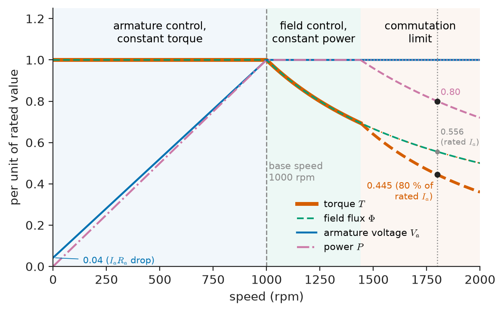
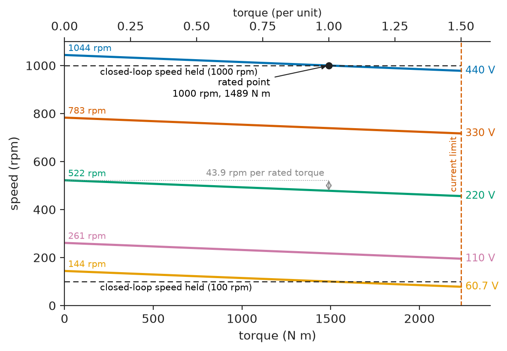
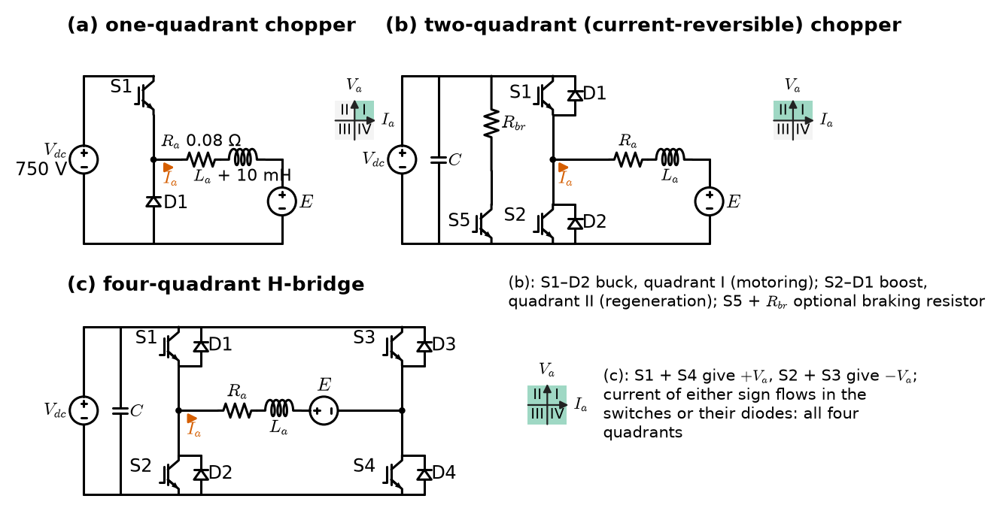
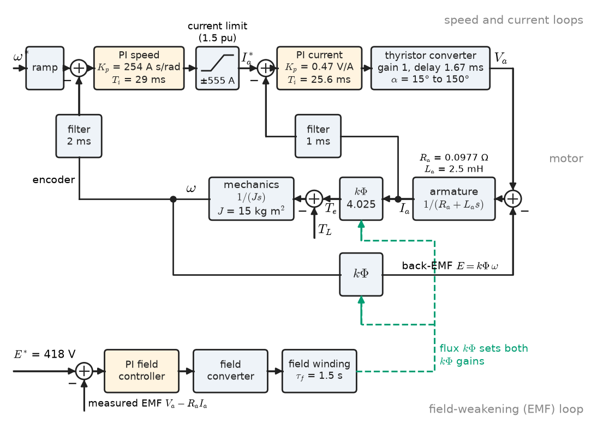
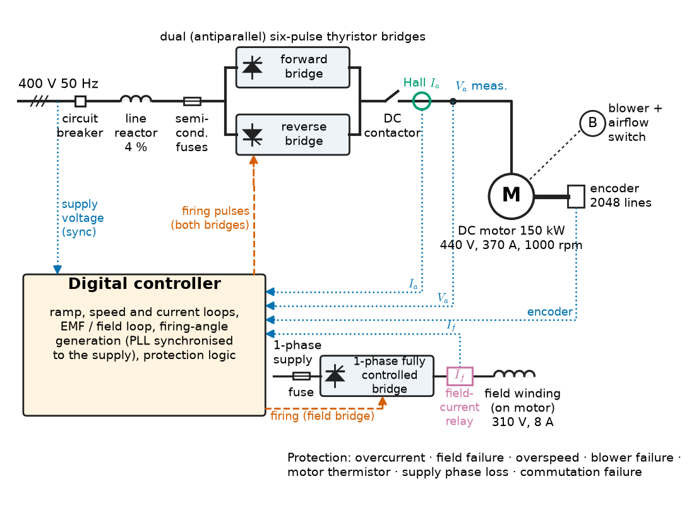

# Chapter 11 — DC Motor Drives

*Part III · Motor Drives*

A hot-strip mill installed in the 1980s still runs its finishing stands on 3 MW DC motors fed by thyristor converters. The plant's power engineer has two complaints and one instruction. The complaints: the mill's 6.6 kV supply shows a power factor of 0.5 whenever the stands thread a new slab at low speed, and the utility charges for the reactive power; and stand 4 lost its field supply last year, after which its motor tried to run away before the protection caught it. The instruction from management: decide whether to keep the DC drives for another twenty years or replace them with AC. To answer, the engineer needs to know exactly what a DC drive does well (clean, fast, four-quadrant torque control with a converter of almost trivial structure), what it costs in power factor and maintenance, and how its control works, because the same structure, a fast inner current loop under a slower speed loop with the flux held separately, is the template that every AC vector drive in Chapter 12 imitates.

> **How are the speed and torque of a DC motor controlled through its armature voltage and its field, and what converter supplies each?**
> **How do chopper and thyristor drives regulate speed, control torque, recover braking energy, and what does a practical DC drive look like?**

| Concept | Engineering destination |
|---|---|
| Armature control | Constant-torque speed control of mills, winders, excavators, cranes, legacy traction |
| Field control | Constant-power speed range above base speed; field-loss protection |
| Chopper-fed drives | Battery vehicles, forklifts, mining locomotives, DC trams and metros, small servos |
| Speed regulation | Draw control in paper and steel lines, process accuracy specifications |
| Torque control | Cascaded current and speed loops, tension control in winders, current limiting |
| Regenerative braking | Energy recovery in traction, hoists and mill reversals; line receptivity |
| Practical drive architecture | Specifying, maintaining or retrofitting DC drives; the template for AC vector control |

**Roadmap.** The DC motor's two control inputs and the armature-voltage range below base speed (11.1) → field weakening above base speed (11.2) → the chopper as a DC-to-DC armature supply (11.3) → closing the speed loop and what regulation it buys (11.4) → the inner current loop and torque control (11.5) → braking with energy recovery (11.6) → how a complete industrial DC drive is built and protected (11.7).

---

## 11.1 Armature control

### Two inputs, two time constants

> **Boundary.** The DC machine's construction, EMF and torque equations, characteristics and losses are in [Chapter 5](../part-2-transformers-and-electrical-machines/05-dc-machines.md). The motor's transfer function, with its electrical and mechanical poles, is derived in *Circuits, Signals and Communications*, [Ch. 33 §33.2](https://github.com/The-Studio-of-Sadiq/Circuits-Signals-and-Communications/blob/main/part-7-control-system-fundamentals/33-dynamic-system-modeling.md). Converter circuit internals (thyristor commutation, chopper switching, gate drives) belong to *Electronics & Computing*; the averaged converter relations used here are summarised in *Engineering Physics*, [Ch. 18 §18.8](https://github.com/The-Studio-of-Sadiq/Engineering-Physics/blob/main/CHAPTERS/CHAPTER%2018.md).

For a separately excited (or permanent-magnet) DC motor, Chapter 5 gives

$$
E=k\Phi\,\omega_m,\qquad T_e=k\Phi\,I_a,\qquad V_a=E+R_aI_a+L_a\frac{dI_a}{dt}
$$

so the steady-state speed is

$$
\omega_m=\frac{V_a-R_aI_a}{k\Phi}=\frac{V_a}{k\Phi}-\frac{R_a}{(k\Phi)^{2}}\,T_e
$$

Speed can be changed by the armature voltage $V_a$, by the flux $\Phi$ through the field current, or by adding resistance in the armature circuit. Resistance control wastes power in proportion to the speed drop and survives only in old cranes and traction starting rheostats. The other two are the basis of every modern DC drive, and they differ sharply in time scale: the armature time constant $\tau_a=L_a/R_a$ is 10 to 60 ms in industrial motors, while the field time constant $\tau_f=L_f/R_f$ is 0.5 to 5 s. Armature voltage is the fast input; field current is the slow one.

### Constant torque below base speed

**Armature voltage control** keeps the field at its rated value and varies $V_a$ from zero to rated. Equation above says the no-load speed is proportional to $V_a$, and the slope of the speed–torque line, $R_a/(k\Phi)^{2}$, does not change: armature control produces a family of parallel lines (Figure 11.2). At rated armature current the motor gives rated torque at every speed from zero to **base speed**, the speed at which $V_a$ reaches rated with rated flux. Power rises linearly with speed. This is the constant-torque region of Section 10.2, and its ideal fit to hoists, conveyors, extruders and mills is the reason DC drives dominated variable-speed industry until the 1990s.

<!-- FIGURE 11.1 | figures/ch11/fig-11-1-dc-capability.png | plot | Capability of a separately excited DC drive: armature voltage, field flux, torque and power against speed, with the armature-control, field-control and commutation-limited regions. | Content: x-axis speed 0 to 2000 rpm, base speed 1000 rpm marked by a vertical dashed line. Four curves in per unit of rated values on a common y-axis 0 to 1.2: armature voltage rising linearly from 0.04 pu at 0 rpm to 1.0 at 1000 rpm then flat; field flux flat at 1.0 to 1000 rpm then falling as 1000/n to 0.556 at 1800 rpm and 0.50 at 2000 rpm; torque flat at 1.0 to 1000 rpm then falling as 1/n (rated armature current) to 1440 rpm; beyond 1440 rpm the commutation limit (armature current times speed constant, current 1440/n) makes torque fall as 1/n squared (dashed), to 0.445 at 1800 rpm (80 percent current, marked) and 0.36 at 2000 rpm, with the rated-current 1/n curve continued faintly dotted (0.556 at 1800 rpm, marked); power rising linearly to 1.0 at 1000 rpm, flat to 1440 rpm, then falling as 1440/n (dashed) to 0.80 at 1800 rpm (marked) and 0.72 at 2000 rpm, with the constant 1.0 continued dotted. Dotted vertical line at 1800 rpm. Region labels: "armature control, constant torque", "field control, constant power" (1000 to 1440 rpm) and "commutation limit" (above 1440 rpm). -->

*Figure 11.1 — Capability of a separately excited DC drive: armature voltage, field flux, torque and power against speed, with the armature-control, field-control and commutation-limited regions.*

<!-- FIGURE 11.2 | figures/ch11/fig-11-2-armature-control-family.png | plot | Speed-torque lines of a 150 kW DC motor under armature voltage control at full field, open loop. | Content: x-axis torque 0 to 2250 N m (0 to 1.5 pu), y-axis speed 0 to 1100 rpm. Parallel straight lines for Va = 440, 330, 220, 110 and 60.7 V, each falling 43.9 rpm per rated torque (1489 N m) through armature resistance 0.05 ohm. No-load speeds 1044, 783, 522, 261 and 144 rpm. Mark rated point 1000 rpm at 1489 N m on the 440 V line. Dashed horizontal lines at 1000 rpm and 100 rpm labelled "closed-loop speed held" to contrast. Vertical dashed line at 1.5 pu labelled "current limit". -->

*Figure 11.2 — Speed-torque lines of a 150 kW DC motor under armature voltage control at full field, open loop.*

### The thyristor converter as an armature supply

Most industrial DC drives above a few kilowatts take their armature voltage from a **three-phase fully controlled thyristor bridge**. Its averaged output, a result we take from converter theory, is

$$
V_a=\frac{3\sqrt2}{\pi}V_{LL}\cos\alpha-\frac{3\omega L_c}{\pi}I_a=1.35\,V_{LL}\cos\alpha-R_{ov}I_a
$$

where $\alpha$ is the firing (delay) angle, $V_{LL}$ the RMS line voltage of the supply and $L_c$ the commutating (supply plus transformer) inductance per phase. The term $R_{ov}=3\omega L_c/\pi$ is not a real resistance and dissipates nothing, but it lowers the output voltage like one: it represents the overlap time during which two thyristors share the current. The output has a six-pulse ripple at $6f$ (300 Hz at 50 Hz), smoothed by the armature inductance and often an added reactor so that the current stays continuous.

For $0<\alpha<90^\circ$ the bridge rectifies; for $90^\circ<\alpha<150^\circ$ (the upper limit leaves time for commutation) its average voltage is negative while its current, which thyristors allow in only one direction, stays positive, so power flows *from* the DC side to the AC supply: the bridge **inverts**. A single bridge can therefore operate in two quadrants of the *voltage–current* plane, which for the motor means forward motoring and reverse-speed braking (Quadrants I and IV of Section 10.4). Section 11.6 shows how full four-quadrant operation is obtained.

> **Status of the principle: Averaged thyristor-bridge output**
> *Approximate.* Valid for continuous armature current, a stiff sinusoidal supply and an overlap angle under about 30°; it fails in discontinuous conduction at light load, where the average voltage rises and the drive's gain changes sharply, and on weak supplies whose voltage is notched by the commutations.

### The power-factor price of low speed

The thyristor bridge draws line current in 120° blocks that lag the supply voltage by about $\alpha+\mu/2$, where $\mu$ is the overlap angle. Its displacement factor is therefore roughly $\cos(\alpha+\mu/2)$, and with the distortion of the quasi-square current (whose fundamental is $3/\pi=0.955$ of its RMS value), the power factor is about $0.955\cos(\alpha+\mu/2)$. Low speed at full torque means low $V_a$, large $\alpha$, and a reactive power demand that barely falls while real power does. This is the mill's complaint in the opening.

**Worked example — firing angle and power factor of a mill-stand drive.** A separately excited DC motor is rated 440 V, 370 A, 1000 rpm, with $R_a=0.050\ \Omega$; it is fed by a fully controlled bridge from a 400 V, 50 Hz transformer secondary with commutating reactance $X_c=\omega L_c=0.050\ \Omega$.

- Rated EMF: $E=440-370\times0.050=421.5$ V. Motor constant: $k\Phi=421.5/104.72=4.025$ V·s/rad. Rated torque: $k\Phi I_a=4.025\times370=1489$ N·m; internal power $EI_a=156$ kW, about 150 kW at the shaft after rotational losses.
- Converter: $1.35\times400=540.2$ V maximum; $R_{ov}=3\times0.050/\pi=0.0477\ \Omega$, an overlap drop of 17.7 V at 370 A.
- At 1000 rpm and rated current, the bridge must provide $440+17.7=457.7$ V before overlap, so $\cos\alpha=457.7/540.2=0.847$, $\alpha=32.1^\circ$. The overlap angle from $\cos\alpha-\cos(\alpha+\mu)=2X_cI_a/(\sqrt2V_{LL})$ is $\mu=6.5^\circ$, and the power factor is about $0.955\cos(35.3^\circ)=0.78$.
- At 600 rpm and rated torque: $E=4.025\times62.83=252.9$ V, $V_a=271.4$ V, $\cos\alpha=(271.4+17.7)/540.2=0.535$, $\alpha=57.6^\circ$, $\mu=4.3^\circ$, power factor about 0.48. Shaft power has fallen to 60 % (94 kW of internal power) while the line current is unchanged at $\sqrt{2/3}\times370=302$ A RMS.
- At 100 rpm (threading speed): $\alpha=81.7^\circ$ and power factor about 0.11. The drive draws full current from the supply, about 210 kVA, to deliver 15.6 kW.

The supply sees the same 302 A at every speed while delivering power proportional to speed. That reactive demand, plus the 5th, 7th, 11th and 13th harmonic currents of a six-pulse bridge, is what forces mills to install static VAR compensators and harmonic filters ([Chapter 25](../part-7-power-quality-and-grid-modernization/25-power-quality.md)), and it is one of the strongest arguments for replacing thyristor DC drives with AC drives whose diode or active front end runs near unity displacement factor at all speeds.

---

## 11.2 Field control

### Above base speed: weakening the flux

At base speed the armature voltage has reached its limit. Equation $\omega_m=(V_a-R_aI_a)/(k\Phi)$ shows that speed can still rise if $\Phi$ falls. In **field weakening** the drive holds $V_a$ at rated and reduces the field current, so that $E=k\Phi\omega$ stays just below $V_a$. With $I_a$ at its rated value, power $EI_a$ is constant and torque $k\Phi I_a$ falls as $1/\omega$: the constant-power region of Figure 11.1.

> **Status of the principle: Constant-power field weakening**
> *Approximate.* Follows from $E=k\Phi\omega$ with armature voltage and current both held at rated values; it assumes $k\Phi$ is set by field current alone, but armature reaction reduces the effective flux at high current and low field, and commutation limits force armature current down at the top of the range.

### How far field weakening can go

The field-weakening range of a DC motor is limited by the machine, not the converter:

- **Commutation.** The reactance voltage in the coils undergoing commutation rises with speed and current, while the interpole flux that cancels it stays fixed; above some speed sparking at the brushes forces armature current to be reduced. Typical field-weakening ranges are 2:1 to 3:1 for industrial motors and up to 4:1 for motors designed for winders and test benches.
- **Armature reaction.** At weak field the armature MMF distorts the main flux more, the neutral zone shifts and the risk of flashover rises; compensating windings in the pole faces of large motors counteract it.
- **Stability.** At very weak field a load increase raises $I_a$, armature reaction weakens the flux further, speed rises, and the drive may become unstable: the field-weakening controller must act on measured EMF, not on a fixed field-current schedule.
- **Mechanical speed limit** of the armature and commutator.

The flux is not proportional to field current: the magnetisation curve saturates (Chapter 1 and Chapter 5). Near rated flux, on the knee of the curve, a 10 % cut in flux may need a 20 % cut in field current; at weak field, on the nearly linear part, flux and field current fall almost in proportion. Practical drives therefore do not compute the field current from speed; they close an **EMF loop** that trims the field current until the measured armature EMF ($V_a-R_aI_a$) equals its set value, typically 95 % of rated armature voltage to leave headroom for current control.

### Field supply and field loss

The field is supplied by a separate small converter, usually a single-phase half- or fully controlled bridge rated 1 to 3 % of the armature power. Because the field time constant is long, field weakening is slow: changing flux by half takes roughly one field time constant, 1 to 3 s. Fully controlled field bridges can force the field current down faster by applying negative voltage.

The dangerous failure is **loss of field**. If the field current falls to a small residual value while the armature converter is still applying voltage, the motor tries to reach the speed at which $E=V_a$ with residual flux, which may be five to ten times rated: the motor overspeeds, or, if the load holds it, armature current rises to the current limit with almost no torque. DC drives therefore always include **field-failure protection** (a field-current relay that trips the armature converter when field current falls below about 50 to 70 % of its minimum expected value) and independent overspeed protection. The incident on the mill's stand 4 in the opening is the textbook case.

**Worked example — field weakening for a coiler.** The 150 kW motor of Section 11.1 drives a strip coiler that must run to 1800 rpm. Holding $V_a=440$ V and $I_a=370$ A:

- Required EMF is still 421.5 V, so $k\Phi=421.5/(1800\times2\pi/60)=421.5/188.5=2.236$ V·s/rad, 55.6 % of rated flux.
- Torque at rated current: $2.236\times370=827$ N·m, 55.6 % of rated; power $827\times188.5=156$ kW internal, unchanged.
- If the motor's commutation limit at 1.8 times base speed allows only 80 % of rated armature current, the available torque falls to $2.236\times0.8\times370=662$ N·m (0.445 per unit), and the power to 125 kW (0.80 per unit): the drive must be specified on the reduced curve. Because the reactance voltage grows roughly with the product $I_an$, a limit of 80 % current at 1800 rpm means full current is available only up to about $0.8\times1800=1440$ rpm (Figure 11.1).

A coiler is a constant-power load (Section 10.3): tension times strip speed is constant while the coil diameter grows, so the full-field, full-current torque is needed at the largest coil diameter (lowest speed) and the weakest field at the empty mandrel (highest speed). A 1.8:1 diameter build-up matches the 1.8:1 field-weakening range almost exactly, which is how coiler motors are specified.

---

## 11.3 Chopper-fed drives

### From a DC source to a variable armature voltage

Where the supply is DC (a battery, a traction line at 600, 750, 1500 or 3000 V, or the DC link of a larger converter), the armature voltage is controlled by a **chopper**: a switch that connects the source to the armature for a fraction $D$ (the duty ratio) of each switching period $T_s=1/f_s$. The averaged result, the buck-converter relation of *Engineering Physics* Ch. 18 §18.8.2, is

$$
V_a=D\,V_{dc},\qquad 0\le D\le1
$$

The armature inductance plays the role of the converter's filter inductor, and the motor's back-EMF that of the output voltage. Choppers switch with IGBTs or MOSFETs at 1 to 20 kHz in modern drives (GTO thyristors at 200 to 500 Hz in the trams and metros of the 1980s and 1990s, many still running).

<!-- FIGURE 11.3 | figures/ch11/fig-11-3-chopper-quadrants.png | circuit | One-, two- and four-quadrant chopper configurations feeding a DC motor armature, with the quadrants each can reach. | Content: (a) one-quadrant chopper: DC source Vdc 750 V, switch S1 in series, freewheel diode D1 across the armature branch (Ra 0.08 ohm, La plus smoothing reactor 10 mH, back-EMF E); quadrant I shown shaded in a small Va-Ia plane. (b) two-quadrant (current-reversible) chopper: switches S1 (upper) and S2 (lower) with antiparallel diodes D1, D2, armature between the midpoint and the negative rail; S1-D2 operate as buck in quadrant I, S2-D1 operate as boost in quadrant II (regeneration); quadrants I and II shaded. (c) four-quadrant H-bridge: four switches S1 to S4 with antiparallel diodes, armature across the bridge midpoints; all four quadrants shaded. A DC-link capacitor across the source in (b) and (c), and in (b) an optional braking resistor with switch S5 across the link. -->

*Figure 11.3 — One-, two- and four-quadrant chopper configurations feeding a DC motor armature, with the quadrants each can reach.*

### Configurations and quadrants

Figure 11.3 shows the three standard configurations:

- **One-quadrant (step-down) chopper**: a switch and a freewheeling diode. Positive voltage, positive current; forward motoring only. Simple traction and forklift drives use it with a mechanical or contactor-switched reversing arrangement.
- **Two-quadrant (current-reversible) chopper**: two switches with antiparallel diodes in a half-bridge. Positive voltage, current in both directions: forward motoring as a buck converter, forward braking as a boost converter that pumps current back into the source (Section 11.6). This is the standard DC traction chopper.
- **Four-quadrant H-bridge chopper**: four switches; voltage and current of both signs. The standard for DC servo amplifiers, automotive actuators (window lifts, electric power steering in older designs, throttle bodies) and battery-vehicle drives with electronic reversing.

### Current ripple and discontinuous conduction

Between switching instants the armature current ramps up and down. If the armature circuit (motor plus any smoothing reactor) has inductance $L$, resistance small compared with $L/T_s$, and the switching is fast compared with $\tau_a$, the peak-to-peak current ripple of a one- or two-quadrant chopper is

$$
\Delta I=\frac{V_{dc}\,D(1-D)}{L\,f_s}\le\frac{V_{dc}}{4Lf_s}
$$

with the maximum at $D=0.5$. The ripple matters for three reasons. It adds copper and iron loss in the motor (the RMS current exceeds the average), it worsens commutation at the brushes (a "form factor" limit of about 1.02 to 1.05 on RMS-to-average current is typical for DC motors on choppers), and if the average current is less than $\Delta I/2$ the current falls to zero in each cycle: **discontinuous conduction**, in which the simple relation $V_a=DV_{dc}$ no longer holds and the speed rises under light load.

> **Status of the principle: Chopper averaged model and ripple formula**
> *Approximate.* Holds for continuous conduction, ideal switches and a switching period much shorter than the armature time constant; it fails at light load (discontinuous conduction), at very low duty ratio where minimum on-time limits resolution, and when the source has significant impedance, as on a long traction feeder.

**Worked example — ripple in a tram chopper.** A tram motor on a 750 V line has armature resistance 0.080 Ω and total armature-circuit inductance (motor plus smoothing reactor) 10 mH; its average current at full tractive effort is 300 A.

- At a GTO-era switching frequency of 400 Hz the worst-case ripple is $750/(4\times0.010\times400)=46.9$ A peak to peak, 16 % of the average current.
- At 2 kHz with IGBTs: $750/(4\times0.010\times2000)=9.4$ A, 3 % of the average current.
- At low speed with $E=200$ V, the duty ratio is $D=(200+300\times0.080)/750=0.299$ and the ripple at 2 kHz is $750\times0.299\times0.701/(0.010\times2000)=7.9$ A; at $E=500$ V, $D=0.699$ and the ripple is again 7.9 A, symmetrical about $D=0.5$.
- Conduction becomes discontinuous below an average current of about 4.7 A at 2 kHz (half the worst-case ripple), but below 23 A at 400 Hz, which is why GTO choppers needed large smoothing reactors and why the reactor of a modernised tram can be several times smaller.

The fivefold frequency increase cut the ripple fivefold, or allowed the reactor to shrink fivefold for the same ripple; it also moved the switching noise from a strongly audible 400 Hz whine toward the edge of hearing, and moved the line-current harmonics away from the 50 Hz signalling frequencies of the track circuits, an EMC constraint that railway standards (EN 50121, EN 50238) police strictly.

### Choppers in battery and traction systems

Chopper DC drives were the first efficient electronic traction drives: the Paris and London metro choppers of the 1970s–1990s, DC trams worldwide, and still the battery forklifts and mining locomotives of today at 24 to 80 V and 5 to 30 kW, where a series or separately excited DC motor and a MOSFET chopper remain cheap and robust. Their weaknesses are the commutator (brush wear, 1000 to 5000 hours between brush changes in traction, and a sparking hazard in gassy mines that demands flameproof enclosures) and the weight per kW. New traction designs use inverters and AC motors (Chapter 12), but the chopper principle survives in every DC–DC converter of an EV and in the boost stage of every PV inverter.

---

## 11.4 Speed regulation

### Open-loop speed droop

Without feedback, a DC drive holding $V_a$ constant slows as load increases, by the resistive drop over $k\Phi$:

$$
\Delta\omega=\frac{(R_a+R_{ov}+R_{reactor})\,I_a}{k\Phi}
$$

The industrial measure is **speed regulation**, the change in speed from no load to full load as a percentage of full-load speed (or of rated speed, which matters at low settings). Because the drop is a fixed number of rpm, regulation as a percentage of *set* speed worsens in proportion as speed falls.

**Worked example — open- and closed-loop regulation of the mill motor.** For the 150 kW motor of Section 11.1 fed by its thyristor bridge, the effective circuit resistance is $R_a+R_{ov}=0.050+0.0477=0.0977\ \Omega$. At rated current the speed drop is

$$
\Delta\omega=\frac{0.0977\times370}{4.025}=8.99\ \mathrm{rad/s}=85.8\ \mathrm{rpm}
$$

At a 1000 rpm setting that is 8.6 % regulation; at a 100 rpm threading setting the same 86 rpm drop is 86 %, and a load step can nearly stall the stand. Figure 11.2 shows the parallel lines in terms of terminal voltage, where only $R_a$ appears (43.9 rpm per rated torque); the converter's overlap drop doubles the slope seen from the firing-angle command.

With speed feedback from a tachogenerator or encoder and a *proportional* speed controller of loop gain $K$ (the product of controller, converter, motor and sensor gains around the loop at steady state), the droop is divided by $1+K$: with $K=20$ the drop is $85.8/21=4.1$ rpm, with $K=100$ it is 0.85 rpm. A controller with integral action (PI) removes the steady-state droop completely, leaving the error set by the speed measurement itself.

### What limits regulation accuracy

Once the integral action has removed load droop, regulation is limited by the sensor and by how fast the loop recovers from load steps:

**Table 11.1 — Speed feedback options and achievable steady-state accuracy (typical).**

| Feedback | Steady-state accuracy (of rated speed) | Notes |
|---|---|---|
| None (open loop) | 5–10 % at base speed, worse at low speed | Plus temperature drift of $R_a$ |
| Armature voltage with $IR$ compensation | 1–2 % | No tachometer; compensation tuned to hot $R_a$ |
| DC tachogenerator | 0.1–0.5 % | Ripple and brush wear; still common on old mills |
| AC tachogenerator, rectified | 0.5–1 % | |
| Incremental encoder, 1024–4096 lines | 0.01 % | Standard for paper and steel lines, cranes |
| High-resolution sin/cos encoder | 0.001 % | Test benches, precision lines |

**Dynamic regulation**, the speed dip and recovery time after a load step, depends on the loop bandwidth, and that depends on the inner current loop (Section 11.5). A rolling-mill stand might specify a dip of under 1 % for a 100 % impact load, recovered in 0.3 s. Paper machines specify the *draw* (speed difference between sections) to 0.01 %, because the sheet tears if a downstream section pulls too hard; they achieve it by digital speed references and encoder feedback with a common time base.

> **Status of the principle: Steady-state regulation with feedback**
> *Derived.* The droop of a proportional loop is the open-loop droop divided by $1+K$, and integral action drives it to zero (internal-model principle, *Circuits, Signals and Communications*, [Ch. 34 §34.7](https://github.com/The-Studio-of-Sadiq/Circuits-Signals-and-Communications/blob/main/part-7-control-system-fundamentals/34-feedback-and-stability.md)); it holds only while the converter is not saturated at its voltage or current limit.

---

## 11.5 Torque control

### Why control current first

Torque is $k\Phi I_a$. With the field held, controlling armature current *is* controlling torque, and the armature current can be changed in milliseconds while speed changes in tenths of seconds or seconds. Industrial DC drives therefore use **cascade control** (Figure 11.4): an inner current loop that makes the converter and armature behave as a fast, current-limited torque source, and an outer speed loop whose output is the current reference. The structure has three advantages that made it universal, and that AC vector drives copy:

1. **Current limiting is built in.** Clamping the current reference at, say, 150 % of rated limits torque and protects converter, motor and gearbox, without any separate protective action: a stalled hoist simply produces limit torque.
2. **The fast electrical dynamics are hidden.** Seen from the speed loop, the current loop is a small first-order lag, so the speed controller sees a nearly pure integrator ($T_e\to\omega$ through $1/Js$).
3. **Each loop is tuned separately**, inner first, outer second.

Many applications use the inner loop alone: **torque control**. A winder or unwinder holds strip tension $F$ at a coil radius $r$ by commanding torque $Fr$ (plus inertia and friction compensation) while the line's master drive sets speed; test benches and dynamometers set torque to emulate a road load; load-sharing between two motors on one conveyor belt sets one in speed control and the other as a torque follower.

<!-- FIGURE 11.4 | figures/ch11/fig-11-4-cascade-control.png | block-diagram | Cascade speed and current control of a separately excited DC drive, with field-weakening (EMF) controller. | Content: speed reference omega* (ramp generator first) -> summing junction (minus measured omega from encoder via filter 2 ms) -> PI speed controller (Kp 254 A per rad/s, Ti 29 ms) -> current limiter (plus/minus 555 A, 1.5 pu) -> current reference Ia* -> summing junction (minus measured Ia via filter 1 ms) -> PI current controller (Kp 0.47 V/A, Ti 25.6 ms) -> converter block (gain 1, dead time 1.67 ms, firing-angle limits 15 to 150 degrees) -> armature block 1/(Ra + La s) with Ra 0.0977 ohm, La 2.5 mH -> Ia -> gain k Phi 4.025 -> torque Te -> summing junction (minus load torque TL) -> 1/(J s) with J 15 kg m2 -> omega. Back-EMF feedback k Phi omega into the armature voltage summing junction. Separate lower path: EMF reference 418 V minus measured EMF -> PI field controller -> field converter -> field winding (time constant 1.5 s) -> k Phi, multiplying into the torque and EMF gains. -->

*Figure 11.4 — Cascade speed and current control of a separately excited DC drive, with field-weakening (EMF) controller.*

### Tuning the current loop

The current loop plant is the converter (a gain with a small delay) and the armature circuit $1/(R+L_as)$ with time constant $\tau_a$. Its small delays are lumped into one time constant $T_\sigma$: for a six-pulse thyristor bridge at 50 Hz the average firing delay is about half a pulse interval, $1/(2\times300)=1.67$ ms, plus the current-measurement filter. A standard rule, the **technical (modulus) optimum**, places the zero of a PI controller on the armature pole and sets the gain for a well-damped loop:

$$
T_i=\tau_a=\frac{L_a}{R},\qquad K_p=\frac{L_a}{2\,K_{conv}\,T_\sigma}
$$

which gives a closed current loop behaving approximately as a first-order lag of time constant $2T_\sigma$ (step overshoot about 4 %). The back-EMF acts as a slow disturbance that the integral action removes. The general theory of PI tuning, anti-windup and margins is in *Circuits, Signals and Communications*, [Ch. 35 §35.2–35.4](https://github.com/The-Studio-of-Sadiq/Circuits-Signals-and-Communications/blob/main/part-7-control-system-fundamentals/35-control-design-fundamentals.md); what the drive engineer adds is where $T_\sigma$ comes from and how small it can be made.

### Tuning the speed loop

With the current loop reduced to a lag $2T_\sigma$ and the speed-measurement filter added, the speed loop plant is an integrator $k\Phi/(Js)$ with a small equivalent lag $T_{eq}$. For an integrator plant, a PI controller tuned by the **symmetrical optimum** places the crossover frequency at $1/(2T_{eq})$, geometrically centred between the controller zero and the lag, maximising the phase margin (about 37° for the basic form, raised by a reference pre-filter or by widening the spacing):

$$
K_{p\omega}=\frac{J}{2\,k\Phi\,T_{eq}},\qquad T_{i\omega}=4T_{eq}
$$

The symmetrical optimum gives excellent rejection of load-torque steps; its set-point overshoot (about 40 %) is suppressed by a first-order filter on the speed reference or by a ramp generator.

> **Status of the principle: Technical and symmetrical optimum tuning**
> *Approximate.* Rules for loops whose small delays can be lumped into one equivalent time constant much shorter than the dominant plant time constant; they assume linear operation and fail when the converter saturates, when the mechanical drive train has torsional resonances inside the speed-loop bandwidth, or in discontinuous conduction.

**Worked example — tuning the mill drive.** The 150 kW drive has $R=0.0977\ \Omega$, $L_a=2.5$ mH, $k\Phi=4.025$ V·s/rad and motor-plus-load inertia $J=15$ kg·m².

- Armature time constant $\tau_a=2.5\times10^{-3}/0.0977=25.6$ ms; mechanical time constant $\tau_m=JR/(k\Phi)^{2}=15\times0.0977/16.20=90.5$ ms.
- Current loop: $T_\sigma=1.67+1.0=2.67$ ms. With converter gain normalised to 1 V/V, $T_i=25.6$ ms and $K_p=2.5\times10^{-3}/(2\times2.67\times10^{-3})=0.47$ V/A. The closed current loop has time constant $2T_\sigma=5.3$ ms, a bandwidth of about $1/(2\pi\times5.3\ \mathrm{ms})=30$ Hz, and a step response that reaches the reference in roughly 12 ms.
- Speed loop: $T_{eq}=5.3+2.0=7.3$ ms including a 2 ms speed filter. $K_{p\omega}=15/(2\times4.025\times7.33\times10^{-3})=254$ A per rad/s, $T_{i\omega}=29$ ms; crossover at $1/(2T_{eq})=68$ rad/s (11 Hz).
- Current limit at 1.5 times rated, 555 A, gives $4.025\times555=2234$ N·m, so an unloaded run-up to 1000 rpm takes $J\omega/T=15\times104.7/2234=0.70$ s, during which the speed controller saturates and needs anti-windup.

With an IGBT chopper at 5 kHz instead of the thyristor bridge, $T_\sigma$ falls to about 0.2 ms and the current-loop bandwidth rises to about 400 Hz: the converter's switching rate, not the motor, sets the dynamics. That is why thyristor drives give 20 to 40 Hz current loops and transistor drives 300 Hz to 2 kHz.

---

## 11.6 Regenerative braking

### The principle

A DC motor whose EMF exceeds the applied armature voltage drives current backwards: $I_a=(V_a-E)/R_a<0$, torque reverses and the machine generates. To brake *regeneratively*, the converter must accept that reversed current and pass the power on to the supply. The converter decides what is possible:

- A **one-quadrant chopper** or a **single thyristor bridge** cannot carry reversed armature current; it can brake only rheostatically (with a resistor switched across the armature) or, for the thyristor bridge, regenerate in Quadrant IV, with speed reversed by an overhauling load, as in a hoist lowering.
- A **two-quadrant chopper** regenerates in Quadrant II as a **boost converter**: switching the lower device short-circuits the armature for a fraction $D$ of the period, building current from the EMF; releasing it forces the current through the upper diode into the source. The averaged relation is $E\approx(1-D)V_{dc}$.
- A **dual converter** (two thyristor bridges in antiparallel) gives all four quadrants: one bridge carries positive current, the other negative, and the controller blocks one before firing the other with a dead time of a few milliseconds (circulating-current-free operation). The armature current reverses within 10 to 20 ms, fast enough for reversing mills that change direction several times per slab. A cheaper alternative for slow reversals reverses the *field* instead, at the cost of a reversal time of a second or more.

### Limits on regeneration

Regeneration needs a voltage to push against and a receiver. At low speed the EMF falls, and a boost converter needs $D\to1$ to keep current flowing; below roughly 5 to 10 % of base speed the available braking current fades, and mechanical or rheostatic braking takes over to stop and hold. At the receiving end, a **battery** must have charge acceptance (cold or full batteries refuse charge, Chapter 16); a **thyristor bridge** must keep $\alpha$ below about 150° or the commutation fails (an "inverter shoot-through" or commutation failure, a short circuit of the supply through the converter); and a **DC traction line** must have another train accelerating nearby to absorb the power. Railway supply standards fix how far the line voltage may rise: for a 750 V DC system, EN 50163 permits a highest permanent voltage of 900 V and a highest non-permanent voltage of 1000 V. If the line is not receptive, the chopper diverts the energy to an on-board resistor; reversible substations or wayside storage (supercapacitors or batteries) raise receptivity.

**Worked example — regenerative braking of a tram.** A 30 t tram on a 750 V DC network brakes from 60 km/h (16.7 m/s) at 1.0 m/s².

- Kinetic energy: $\tfrac12\times30\,000\times16.7^{2}=4.17$ MJ (1.16 kWh), ignoring rotating masses.
- Braking force $ma=30$ kN; initial braking power $Fv=500$ kW, falling linearly to zero over the $16.7$ s stop.
- With motor efficiency 0.92 and chopper 0.97 in the generating direction, about $0.892\times4.17=3.72$ MJ (1.03 kWh) reaches the line, minus the share absorbed by running resistance during the stop.
- At 5 km/h the motor EMF is only $5/60=8$ % of its 60 km/h value; the chopper's duty ratio must approach 1 and armature resistance drop takes most of the EMF, so electric braking fades and the friction brake completes the stop.

On a busy line with trams accelerating nearby, almost all of the 1 kWh is reused; at night, with one tram on a feeder section, the line voltage climbs toward 900 V and the energy goes to the roof resistor. Metro operators report that regenerative braking returns 15 to 35 % of traction energy, the lower figure without storage or reversible substations, the higher with them.

> **Status of the principle: Regenerative energy recovery**
> *Derived.* Energy conservation through the motor and converter efficiency chain; the recoverable share is further limited by the receptivity of the source, the fade of generated EMF at low speed and the current limit at high speed, which no efficiency figure captures.

---

## 11.7 Practical drive architecture

### Building blocks

A complete industrial thyristor DC drive (Figure 11.5) contains:

- **Supply side**: a circuit breaker or switch-fuse, a line reactor or dedicated converter transformer (to limit commutation notching and fault current, and to match voltage), semiconductor fuses, and an RC snubber network.
- **Armature converter**: a six-pulse fully controlled bridge (two-quadrant) or a dual bridge (four-quadrant); for multi-megawatt mill drives, two bridges in series or parallel fed from transformer secondaries 30° apart, forming a 12-pulse converter with lower harmonics.
- **Field converter**: a single-phase half- or fully controlled bridge, 1 to 3 % of armature rating, with its own current loop and the EMF controller of Section 11.2.
- **DC side**: armature smoothing reactor where needed, a DC circuit breaker or contactor on large drives, armature current measurement (shunt, Hall-effect or DC current transformer).
- **Motor**: a separately excited DC machine with compensating winding above a few hundred kW, forced ventilation (blower motor with airflow switch), brush-wear and temperature monitoring.
- **Feedback**: encoder or tachogenerator; armature voltage measurement.
- **Control**: a digital controller running the ramp generator, speed and current loops, field control, firing-angle generation synchronised to the supply by a phase-locked loop, and the protection logic; communication to the plant control system over fieldbus.

<!-- FIGURE 11.5 | figures/ch11/fig-11-5-dc-drive-architecture.png | single-line | Architecture of an industrial four-quadrant thyristor DC drive for a 150 kW mill motor. | Content: 400 V 50 Hz supply -> circuit breaker -> line reactor 4 percent -> semiconductor fuses -> dual (antiparallel) six-pulse thyristor bridges labelled "forward bridge" and "reverse bridge" -> DC contactor -> armature of DC motor (440 V, 370 A, 1000 rpm), with armature current sensor (Hall) and armature voltage measurement. Separate single-phase branch: fuse -> single-phase fully controlled bridge -> field winding (310 V, 8 A) with field-current relay. Motor shaft with incremental encoder (2048 lines) and blower motor with airflow switch. Digital controller block receiving encoder, current, voltage and field-current signals and supply-voltage synchronisation; outputs firing pulses to both bridges and to the field bridge. Protection list beside the controller: overcurrent, field failure, overspeed, blower failure, motor thermistor, supply phase loss, commutation failure. -->

*Figure 11.5 — Architecture of an industrial four-quadrant thyristor DC drive for a 150 kW mill motor.*

### Protection specific to DC drives

Besides the generic drive protection of Section 10.7, a DC drive protects against faults that AC drives do not have:

**Table 11.2 — DC-drive-specific protection (typical settings).**

| Fault | Consequence | Protection |
|---|---|---|
| Field loss | Overspeed or uncontrolled armature current | Field-current relay at 50–70 % of minimum field; trips armature converter and applies brake |
| Overspeed | Mechanical failure of commutator | Independent overspeed trip at 110–120 % of maximum speed |
| Commutation failure in inverting mode | Short circuit of the supply through the bridge | Firing-angle limit (about 150°), fast DC breaker or fuses |
| Blower failure | Motor overheating, especially at low speed and full torque | Airflow switch, winding thermistors |
| Brush wear and flashover | Commutator damage, arcing | Brush-length sensors, compensating winding, current-rise limit $di/dt$ |
| Supply phase loss or dip | Commutation failure, loss of control in regeneration | Supply monitoring, controlled pulse suppression |

### Where DC drives stand today

DC drives still offer: the simplest four-quadrant power circuit (a dual thyristor bridge has no DC-link capacitor and no PWM), very low converter cost per kW at high power, a decoupled flux and torque structure that needs no motor model, and easy retrofit when only the converter is replaced. They also bring: brush and commutator maintenance (brushes every few thousand hours, commutator resurfacing), larger and heavier motors than induction or PM motors of the same rating, a speed ceiling set by commutation, and the poor and variable power factor of Section 11.1. New installations have been overwhelmingly AC since about 2000; existing DC installations in steel, paper, mining excavators and draglines, cranes, lifts and some marine winches are either kept with new digital converters on the old motors (the cheapest modernisation, often a few years' payback on reliability alone) or replaced by AC drives when the motors themselves reach end of life.

For the engineer of the opening, the arithmetic is: new thyristor converters keep the 0.5 power factor at threading speed and need SVC or filter investment; AC drives with active front ends remove the reactive demand and the commutator maintenance but require new motors, foundations and cabling. The control architecture, though, transfers unchanged. Field-oriented control of an AC motor (Section 12.6) is nothing other than the construction, inside a controller, of a "field current" and an "armature current" from the three-phase currents, so that the cascade of Figure 11.4 can be applied.

---

## What remains open

| Open question | Where it is answered |
|---|---|
| How is an AC motor made to behave like a separately excited DC motor with independent flux and torque control? | Chapter 12 (vector and field-oriented control) |
| How do PWM inverters synthesise variable-frequency voltages, and how are induction and PM motors controlled with them? | Chapter 12 (AC motor drives) |
| Where do the DC machine's EMF, torque and commutation limits come from? | Chapter 5 (DC machines) |
| How are the six-pulse harmonics and poor power factor of thyristor drives measured and corrected at plant level? | Chapter 25 (power quality); Chapter 28 (energy efficiency and management) |
| How do batteries accept regenerated energy, and what limits charge acceptance? | Chapter 16 (energy storage) |
| How are traction substations and DC railway supplies organised? | Chapter 22 (distribution systems); Chapter 13 (power-system structure) |
| How do thyristor commutation, chopper switching and gate drives work at circuit level? | *Electronics & Computing* |
| How are PI controllers designed, and how is anti-windup implemented? | *Circuits, Signals and Communications*, [Ch. 35](https://github.com/The-Studio-of-Sadiq/Circuits-Signals-and-Communications/blob/main/part-7-control-system-fundamentals/35-control-design-fundamentals.md) |

**Next:** Chapter 12 replaces the commutator with a PWM inverter and shows how V/f, field-oriented and direct torque control turn induction and permanent-magnet motors into drives that match, and now surpass, the DC drive.
