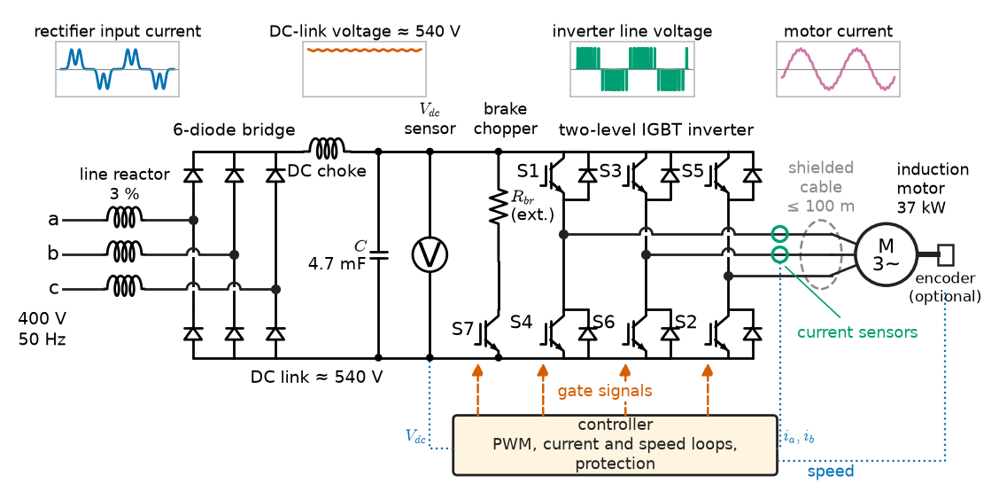
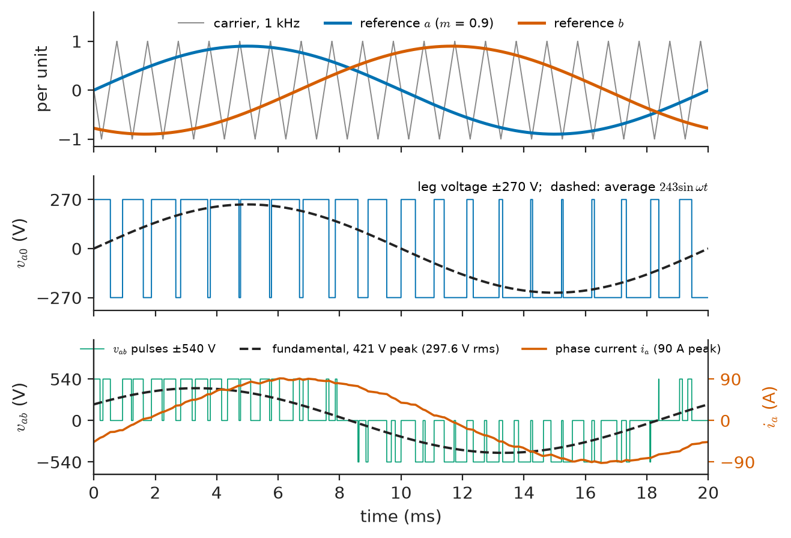
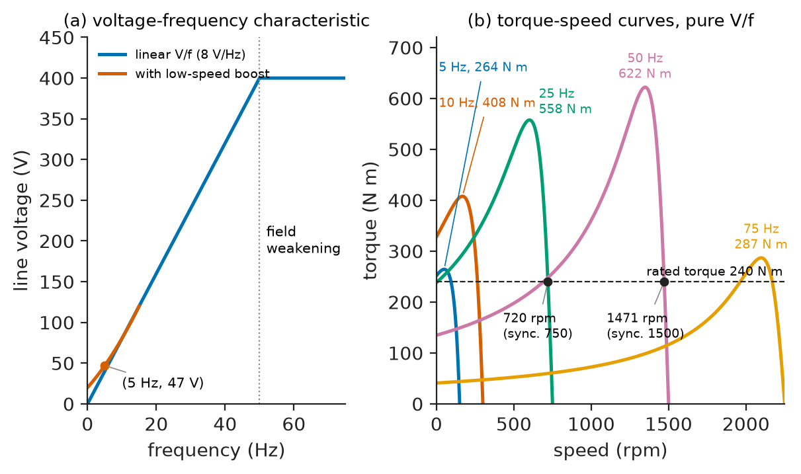
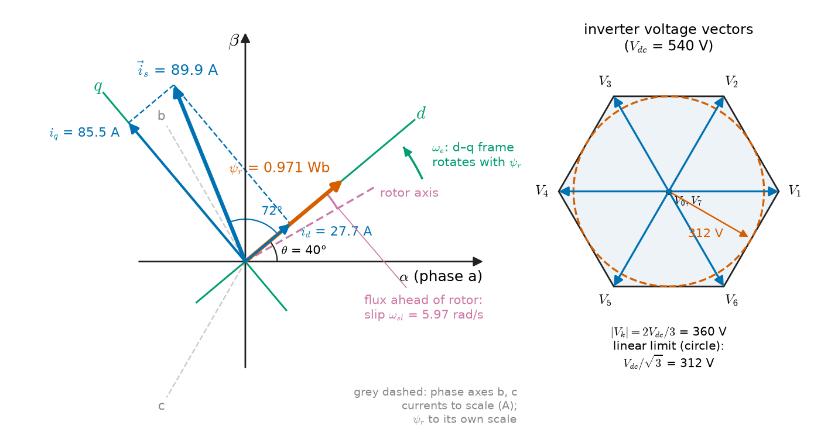
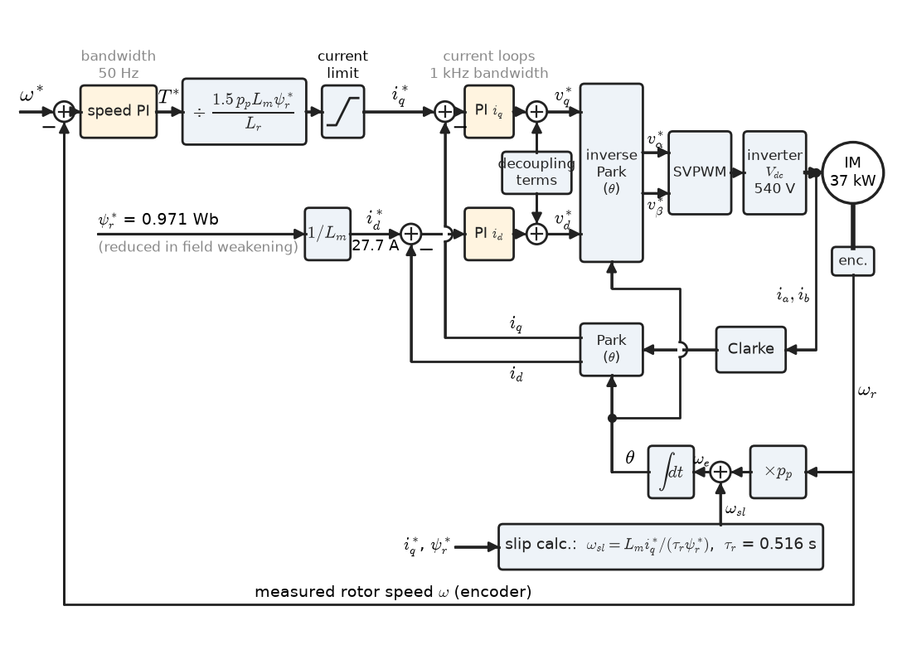
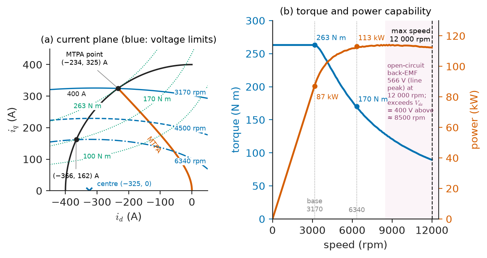

# Chapter 12 — AC Motor Drives

*Part III · Motor Drives*

A district-cooling plant replaces the inlet-vane control of its four 250 kW chiller-condenser fans with variable-frequency drives and saves 40 % of their energy in the first summer. Its engineers then try the same drives on a 37 kW cooling-tower hoist that lifts maintenance platforms, and the platform sags by a few centimetres every time it starts from rest: the drive, still in its factory V/f mode, cannot produce full torque at zero speed. In a car factory two floors away, a 300 N·m permanent-magnet motor in an electric-vehicle test cell reverses from full motoring to full regeneration in 2 ms, and an operator pressing the emergency stop at 12 000 rpm learns that the inverter cannot simply switch off, because the motor's magnets would then pump 560 V back into a 400 V battery. These are all AC drives, and they differ only in what the controller knows about the motor and what it does with that knowledge. This chapter builds the AC drive from the inverter outward: how a PWM inverter makes a variable-frequency, variable-voltage supply, how scalar control uses it, and how vector control, field orientation, direct torque control and PMSM control make an AC motor behave like the separately excited DC motor of Chapter 11, only faster and without a commutator.

> **How does a variable-frequency drive synthesise the voltages an AC motor needs, and when is simple V/f control enough?**
> **How do field-oriented and direct torque control decouple flux and torque in induction and permanent-magnet motors, and how is such a drive commissioned?**

| Concept | Engineering destination |
|---|---|
| Variable-frequency drives | Pumps, fans, compressors, conveyors, HVAC, the default industrial drive |
| PWM inverters | Output voltage limits, switching-frequency choice, motor insulation and bearing stress |
| Scalar (V/f) control | Simple drives for fans, pumps and group drives; low-speed boost and slip compensation |
| Induction motor speed control | Choosing between pole changing, slip control, slip recovery and VFDs |
| Vector control fundamentals | Space vectors and the d–q frame used by every high-performance drive |
| Field-oriented control | Cranes, hoists, lifts, winders, traction; full torque at zero speed |
| Direct torque control | Fast torque response without a modulator; rolling mills, marine propulsion |
| PMSM control fundamentals | EV traction, servo drives, high-efficiency pumps and compressors |
| Drive commissioning | Parameter identification, loop tuning, ramps, braking and protection settings |

**Roadmap.** The VFD and what it must deliver (12.1) → how the PWM inverter delivers it, and its limits (12.2) → the simplest control, constant V/f (12.3) → the induction motor speed-control options compared (12.4) → the space-vector and d–q tools (12.5) → field-oriented control of the induction motor (12.6) → direct torque control (12.7) → PMSM control, MTPA and field weakening (12.8) → commissioning a drive (12.9).

---

## 12.1 Variable-frequency drives

### What the motor needs

> **Boundary.** The rotating magnetic field, slip and the induction-motor equivalent circuit are developed in [Chapter 3](../part-1-magnetic-circuits-and-energy-conversion/03-energy-conversion-principles.md) and [Chapter 6](../part-2-transformers-and-electrical-machines/06-induction-machines.md); synchronous and permanent-magnet machines in [Chapter 7](../part-2-transformers-and-electrical-machines/07-synchronous-machines.md) and [Chapter 8](../part-2-transformers-and-electrical-machines/08-special-electrical-machines.md). Three-phase phasors and the operator $a=1\angle120^\circ$ are from *Circuits, Signals and Communications*, [Ch. 10](https://github.com/The-Studio-of-Sadiq/Circuits-Signals-and-Communications/blob/main/part-2-transient-and-ac-analysis/10-three-phase-circuits.md). The internal circuits of rectifiers and inverters, IGBT physics and gate drives belong to *Electronics & Computing*.

An AC motor runs near the synchronous speed set by the supply frequency, $n_s=120f/p$. Changing speed efficiently means changing $f$. But the stator flux of an AC machine is set by the ratio of voltage to frequency: Faraday's law makes the air-gap flux linkage approximately $\psi\approx V/(2\pi f)$ when the stator resistance drop is small. To keep the motor at rated flux, and therefore at rated torque per ampere, the voltage must change in proportion to frequency. A **variable-frequency drive** (VFD) is a converter that supplies three-phase voltage of independently adjustable frequency and amplitude, typically 0 to 50 or 60 Hz at constant V/f, then up to 2 or 3 times base frequency at constant (maximum) voltage in field weakening.

### The voltage-source drive structure

Nearly every low-voltage and most medium-voltage drives are **voltage-source inverters** (VSI) with a DC link (Figure 12.1):

1. A **rectifier** turns the AC supply into DC. A six-pulse diode bridge is the cheapest; a DC choke or AC line reactor (3 to 5 %) limits harmonic current; 12- and 18-pulse versions with phase-shifting transformers, or an **active front end** (an IGBT rectifier with an LCL filter), meet stricter harmonic limits and allow regeneration.
2. A **DC link** with electrolytic or film capacitors holds a stiff voltage, about $1.35V_{LL}$ under load: 540 V for a 400 V supply, 650 V for 480 V, 930 V for 690 V.
3. A **PWM inverter** of six IGBTs (two per phase) switches each motor terminal between the positive and negative DC rails, at 2 to 16 kHz, so that the *average* terminal voltage over each switching period follows a sinusoidal reference (Section 12.2).
4. **Braking**: a brake chopper and resistor across the DC link, or regeneration through an active front end (Section 10.4).
5. **Control**: a digital controller that measures two or three phase currents and the DC-link voltage (and speed, when an encoder is fitted), runs the control algorithm of Sections 12.3 to 12.8 every 50 to 250 µs, and generates the switching pattern.

<!-- FIGURE 12.1 | figures/ch12/fig-12-1-vfd-power-circuit.png | circuit | Power circuit of a low-voltage voltage-source variable-frequency drive. | Content: three-phase 400 V 50 Hz supply -> AC line reactor 3 percent -> six-diode bridge rectifier -> DC link with DC choke in the positive rail and capacitor bank (labelled about 540 V, 4.7 mF for 37 kW) -> brake chopper (IGBT plus external resistor) -> three-phase two-level IGBT inverter (six IGBTs with antiparallel diodes, labelled S1 to S6) -> motor cable (shielded, length up to 100 m) -> induction motor 37 kW. Current sensors on two output phases, DC-link voltage sensor, optional encoder on the motor. Control block below drawing gate signals. Annotate typical waveform sketches: rectifier input current (double-hump pulses), DC link (flat 540 V with small ripple), inverter output line voltage (PWM pulses of height 540 V) and motor current (near sinusoid with ripple). -->

*Figure 12.1 — Power circuit of a low-voltage voltage-source variable-frequency drive.*

Current-source inverters and load-commutated inverters (LCI) with thyristors survive in multi-megawatt synchronous-motor drives (compressors, ship propulsion, pumped-storage start-up), and cycloconverters in a few very large low-speed mills and ship drives; medium-voltage VSIs use multilevel topologies (three-level neutral-point clamped, cascaded H-bridge, modular multilevel) to reach 3.3 to 13.8 kV with lower-voltage devices.

### What a VFD delivers and costs

**Table 12.1 — Representative VFD characteristics (typical values).**

| Quantity | Low voltage (0.4–0.69 kV) | Medium voltage (2.3–13.8 kV) |
|---|---|---|
| Power range | 0.2 kW–5 MW | 0.3–100 MW |
| Output frequency | 0–300 Hz (up to 1–2 kHz for spindles) | 0–75 Hz typical |
| Switching frequency | 2–16 kHz | 0.3–1.5 kHz per device |
| Efficiency at rated load | 96–98.5 % | 96.5–99 % |
| Input current THD, 6-pulse with choke | 30–45 % | — (multi-pulse standard) |
| Input current THD, AFE or 18-pulse | 3–8 % | 3–5 % |
| Overload | 110 % / 60 s (normal duty), 150 % / 60 s (heavy duty) | 110–150 % / 60 s |
| Output voltage rise time | 50–200 ns | 1–5 µs (with multilevel steps) |

---

## 12.2 PWM inverters

### Making a sinusoid from two levels

Each leg of a two-level inverter connects its motor terminal either to $+V_{dc}/2$ or to $-V_{dc}/2$ (measured from the DC-link midpoint). In **sine-triangle PWM** (Figure 12.2), a sinusoidal reference for each phase, of amplitude $m$ (the **modulation index**) relative to a triangular carrier of amplitude 1, is compared with the carrier: when the reference exceeds the carrier the upper switch is on. Averaged over a carrier period, the leg voltage then follows the reference:

$$
\bar v_{a0}(t)=m\,\frac{V_{dc}}{2}\sin\omega t,\qquad 0\le m\le1
$$

and the fundamental line-to-line RMS output is

$$
V_{LL1}=\frac{\sqrt3}{2\sqrt2}\,m\,V_{dc}=0.612\,m\,V_{dc}
$$

The harmonics of the output lie in sidebands around multiples of the carrier frequency, far above the fundamental, where the motor's leakage inductance filters them into a small current ripple.

<!-- FIGURE 12.2 | figures/ch12/fig-12-2-sine-triangle-pwm.png | plot | Sine-triangle PWM of one inverter leg and the resulting line voltage and motor current. | Content: three stacked panels sharing a time axis 0 to 20 ms (one 50 Hz cycle). Top: triangular carrier at 1 kHz (shown at low frequency for clarity) amplitude plus/minus 1 and sinusoidal references for phases a and b with modulation index m = 0.9. Middle: leg voltage va0 switching between +270 V and -270 V (Vdc = 540 V), with its averaged value 243 sin(wt) dashed. Bottom: line voltage vab as pulses of plus/minus 540 V, its fundamental of peak 421 V (rms 297.5 V) dashed, and the motor phase current, a sinusoid of 90 A peak with small triangular ripple. -->

*Figure 12.2 — Sine-triangle PWM of one inverter leg and the resulting line voltage and motor current.*

### Using the DC link fully

Sine-triangle PWM uses only 86.6 % of the available DC voltage, because the line voltage is the *difference* of two phase legs and the legs' common-mode part is wasted. Adding a third-harmonic (or, equivalently, a min-max offset) common-mode component to all three references, or using **space-vector PWM** (SVPWM), which chooses the inverter's eight switching states directly (Section 12.5), extends the linear range to $m=2/\sqrt3=1.155$:

$$
V_{LL1,max}=\frac{V_{dc}}{\sqrt2}=0.707\,V_{dc}
$$

Beyond this, **overmodulation** drops pulses and the output approaches **six-step** (square-wave) operation, the maximum a two-level inverter can give:

$$
V_{LL1,six-step}=\frac{\sqrt6}{\pi}\,V_{dc}=0.780\,V_{dc}
$$

at the cost of large 5th and 7th harmonic currents and torque ripple at six times the fundamental frequency.

> **Status of the principle: Averaged PWM inverter model**
> *Approximate.* The inverter is replaced by its switching-period average, valid when the carrier frequency is at least about 10–20 times the output frequency and the dead time between complementary switches is negligible; dead time distorts the output at low voltage (low speed), and the model fails in overmodulation and six-step operation.

**Worked example — can a 400 V drive give a 400 V motor its rated voltage?** A 400 V, 50 Hz supply through a diode bridge gives about $\sqrt2\times400=566$ V on the DC link at no load, and about $1.35\times400=540$ V under load.

- Sine-triangle PWM at $m=1$: $0.612\times540=330$ V, only 83 % of rated motor voltage.
- SVPWM at the end of the linear range: $540/\sqrt2=382$ V, 95.5 %.
- Six-step: $0.780\times540=421$ V.

A drive in the linear range therefore cannot quite deliver 400 V to the motor at full load; at rated frequency the motor runs with about 5 % less voltage and so about 5 % less flux, drawing a few percent more current for rated torque. Drives handle this by entering mild overmodulation near base speed, by setting the field-weakening point a few percent below the nameplate frequency, or by being specified at one voltage class above the motor (a 480 V drive for a 460 V motor). It also explains why supply dips of only 5 to 10 % immediately reduce available torque at top speed.

### Switching frequency and its side effects

Raising the switching frequency reduces current ripple (and audible motor noise, which is why HVAC drives in occupied buildings run at 8 to 16 kHz) but raises IGBT switching losses roughly in proportion, forcing the drive to be derated. A typical 37 kW drive rated at 4 kHz loses 10 to 20 % of its current rating at 8 kHz and 30 to 40 % at 16 kHz.

Fast voltage edges have system consequences treated in Section 10.7: reflected-wave overvoltages on long cables, stressing turn-to-turn insulation (IEC TS 60034-25 and NEMA MG 1 Part 31 limits); **common-mode voltage**, which steps by $V_{dc}/3$ at each switching and drives capacitive currents through the motor bearings and into the earth; and radiated and conducted emissions that IEC 61800-3 limits by environment category. Output dv/dt filters, sine filters (an LC filter that makes the motor voltage nearly sinusoidal, at the cost of voltage drop and lost dynamic performance), shielded symmetrical cables and correct 360° shield bonding are the mitigation toolkit.

---

## 12.3 Scalar control

### Constant volts per hertz

**Scalar** or **V/f control** commands only the amplitude and frequency of the stator voltage, with no knowledge of the motor's internal state. The speed reference sets $f$; a characteristic sets $V=V_{rated}\,f/f_{rated}$ up to base frequency and $V=V_{max}$ above it (Figure 12.3a). The motor then slips naturally: from the equivalent circuit of Chapter 6, if the air-gap flux is constant, torque near synchronism is proportional to the **slip frequency** $f_2=sf$ and does not depend on $f$ itself. The whole torque–speed curve shifts sideways with frequency, keeping its shape (Figure 12.3b), and the slip speed for a given torque stays roughly constant in rpm.

<!-- FIGURE 12.3 | figures/ch12/fig-12-3-vf-control.png | plot | Constant V/f control: (a) the voltage-frequency characteristic with low-speed boost; (b) the resulting torque-speed curves of a 37 kW four-pole motor. | Content: (a) x-axis frequency 0 to 75 Hz, y-axis line voltage 0 to 450 V. Linear V/f line from 0 V at 0 Hz to 400 V at 50 Hz, flat at 400 V from 50 to 75 Hz (field weakening). Boosted characteristic: a smooth (quadratic) curve from 20 V at 0 Hz through (5 Hz, 47 V), marked, joining the linear line at 15 Hz (120 V). (b) x-axis speed 0 to 2250 rpm, y-axis torque 0 to 650 N m. Torque-speed curves with pure V/f at 5, 10, 25 and 50 Hz, peaks 264, 408, 558 and 622 N m respectively; a 75 Hz curve at 400 V with lower peak (about 287 N m). Horizontal line at rated torque 240 N m. Mark operating points at rated torque: 720 rpm at 25 Hz, 1471 rpm at 50 Hz, both about 29 rpm below synchronous. -->

*Figure 12.3 — Constant V/f control: (a) the voltage-frequency characteristic with low-speed boost; (b) the resulting torque-speed curves of a 37 kW four-pole motor.*

### Low-speed boost and slip compensation

Two corrections make V/f usable. At low frequency the stator resistance drop $R_1I_1$ is no longer small compared with the shrinking applied voltage, so the air-gap flux falls and so does available torque. **Voltage boost** (or "$IR$ compensation") adds voltage at low frequency, either as a fixed offset or in proportion to measured current. **Slip compensation** raises the frequency slightly in proportion to the measured active current, so that the shaft speed rather than the synchronous speed follows the reference, improving open-loop speed accuracy from about 2–3 % to about 0.5–1 %.

**Worked example — V/f operation of a 37 kW motor.** A 37 kW, 400 V, 50 Hz, four-pole induction motor has per-phase (star-equivalent) parameters $R_1=0.080\ \Omega$, $R_2^{\prime}=0.070\ \Omega$, $X_1=X_2^{\prime}=0.35\ \Omega$ and $X_m=11.0\ \Omega$ at 50 Hz (core loss neglected). Solving the equivalent circuit of Chapter 6 numerically:

- At 50 Hz, rated torque (241 N·m electromagnetic, 240 N·m at the shaft) occurs at slip 0.0190, 1471 rpm, with stator current 63.6 A and power factor 0.88. Breakdown torque is 622 N·m (2.6 times rated) at slip 0.10.
- At 25 Hz with exactly half the voltage (115.5 V per phase), rated torque occurs at 720.5 rpm: a slip of 29.5 rpm, almost the same as the 28.5 rpm at 50 Hz, as constant-flux reasoning predicts. But breakdown torque has fallen to 558 N·m, because $R_1$ now takes a larger share of the voltage.
- At 10 Hz and 5 Hz, pure V/f gives breakdown torques of only 408 and 264 N·m. At 5 Hz the motor can barely carry rated torque.
- To restore the 50 Hz air-gap EMF per hertz at 5 Hz and rated torque, the phase voltage must be 27.2 V instead of the proportional 23.1 V: a boost from 40 V to 47 V line-to-line, which is the point marked on Figure 12.3a.

This is the cooling-tower hoist of the opening: in V/f mode near zero frequency the drive has neither the flux nor any knowledge of the load, and a fixed boost large enough for full load over-fluxes and overheats the motor at light load. Hoisting needs vector control.

> **Status of the principle: Constant-flux V/f control**
> *Approximate.* Keeps air-gap flux close to rated when the stator resistance drop is small compared with applied voltage, roughly above 10 % of base frequency; below that, flux and torque depend on load unless the voltage is boosted, and V/f gives no control of transient torque at any speed.

### Where scalar control is the right choice

V/f control needs no motor model beyond the nameplate, tolerates almost any motor (including several motors in parallel on one drive, as on roller tables and textile machines), and is stable without tuning. It is the correct choice for fans, centrifugal pumps and compressors whose torque falls at low speed, and for group drives. It is the wrong choice where full torque is needed at low speed, where torque must be controlled dynamically, or where the motor can be overhauled by the load near zero speed, as in hoists and lifts. Its other weakness is light-load instability: some motors, especially large and efficient ones, show low-frequency oscillations of speed and current at light load on open-loop V/f, damped in practice by a stabilising loop that modulates frequency with measured active current.

---

## 12.4 Induction motor speed control

The VFD has made most older speed-control methods obsolete, but each survives somewhere, and comparing them shows why frequency control won. The fundamental fact, from Chapter 6, is that the rotor copper loss equals slip times air-gap power:

$$
P_{cu2}=s\,P_{ag},\qquad P_{mech}=(1-s)\,P_{ag}
$$

Any method that reduces speed by increasing slip at fixed supply frequency dissipates the fraction $s$ of the air-gap power in the rotor circuit, so its efficiency cannot exceed $1-s$.

> **Status of the principle: Rotor loss proportional to slip**
> *Derived.* Follows from the induction-machine equivalent circuit (Chapter 6) for sinusoidal steady state; it is exact for the fundamental and bounds the efficiency of every slip-control method, though harmonic losses from converter supplies come on top.

**Table 12.2 — Induction motor speed-control methods compared.**

| Method | Principle | Speed range | Efficiency at reduced speed | Where it survives |
|---|---|---|---|---|
| Pole changing (Dahlander, separate windings) | Changes $p$ in $n_s=120f/p$ | Two or three fixed speeds (e.g. 1500/750 rpm) | High | Two-speed fans, lift motors of older design, machine tools |
| Stator voltage control (thyristor or triac) | Reduces torque, slip rises | Narrow, load-dependent | Poor: rotor loss $sP_{ag}$ | Small fans, ceiling fans, soft starters |
| Rotor resistance (wound rotor) | External resistors raise slip | 50–100 % | Poor: loss in resistors | Older cranes, hoists, mine winders |
| Slip-energy recovery (static Kramer, Scherbius) | Rotor power fed back to supply via converter | 60–100 % | Good | Large pumps; and the doubly fed induction generator of wind turbines, Chapter 15 |
| Variable frequency, V/f | Shifts the whole torque–speed curve | 5–200 % | High (slip stays small) | Pumps, fans, conveyors |
| Variable frequency, vector control | Controls flux and torque separately | 0–300 %, full torque at zero speed | High | Hoists, lifts, traction, process lines |

**Worked example — slowing a fan by voltage or by frequency.** A fan absorbing 37 kW at 1475 rpm must run at 1050 rpm. By the fan law (Section 10.3) shaft power falls to $37\times(1050/1475)^{3}=13.3$ kW.

- *Stator voltage control.* Synchronous speed stays 1500 rpm, so slip is $(1500-1050)/1500=0.30$. Air-gap power is $13.3/(1-0.30)=19.0$ kW and rotor loss $0.30\times19.0=5.7$ kW, all of it inside the rotor of a motor whose rated rotor loss is about $0.019\times37.7\approx0.7$ kW. The motor overheats unless it is a special high-slip design, and the system efficiency cannot exceed 70 %.
- *VFD.* The load torque is $13\,300/110.0=121$ N·m, half the motor's rated torque, so the slip speed is about half the rated 28.5 rpm, roughly 14 rpm. The drive runs at about 35.5 Hz (synchronous 1064 rpm), slip is $14/1064=0.013$, and rotor loss is about $0.013\times13.3/0.987=0.18$ kW.

The VFD keeps the rotor loss about 30 times smaller. This is the physical reason voltage control is restricted to small fans with high-resistance rotors, and wound-rotor resistance control to duties where the heat goes into external resistors.

---

## 12.5 Vector control fundamentals

### The idea

A DC motor's torque $k\Phi I_a$ is the product of two quantities controlled by separate windings whose fields are at right angles, so torque responds instantly to armature current while flux is held by the field. In an AC motor the flux and the torque-producing current are both carried by the same three stator currents, and both rotate. **Vector control** recovers the DC motor's structure mathematically: it describes the three phase currents as a single rotating vector, expresses that vector in a coordinate frame rotating with the flux, and splits it there into a flux-producing component and a torque-producing component that the controller can regulate independently, like field and armature current.

### Space vectors

For three phase quantities $x_a,x_b,x_c$ (currents, voltages or flux linkages) the **space vector** is the complex number

$$
\vec x=\frac{2}{3}\left(x_a+a\,x_b+a^{2}x_c\right),\qquad a=e^{j2\pi/3}
$$

It is a single complex quantity in the stationary plane of the stator whose real and imaginary parts are the $\alpha$ and $\beta$ components (the **Clarke transform**). The factor $2/3$ makes it amplitude-invariant: for balanced sinusoidal currents of peak $\hat I$, $\vec i=\hat I e^{j\omega t}$, a vector of constant length $\hat I$ rotating at the electrical angular frequency. The space vector is not a phasor: a phasor represents one sinusoid at one frequency, while the space vector represents the instantaneous values of all three phases and remains defined during transients, with harmonics, and at any waveform. Physically, it points in the direction of the air-gap MMF wave produced by the three windings (Chapter 3).

The eight switching states of a two-level inverter map to eight voltage space vectors: six active vectors of length $2V_{dc}/3$ at 60° intervals and two zero vectors. SVPWM synthesises any reference inside the hexagon they span by time-averaging the two adjacent active vectors and the zero vectors in each switching period; the inscribed circle of radius $V_{dc}/\sqrt3$ is the linear limit of Section 12.2.

### The rotating d–q frame

Viewing the space vector from axes that rotate at angle $\theta$ (the **Park transform**),

$$
i_d+j\,i_q=\vec i\,e^{-j\theta}
$$

turns sinusoidal currents of any frequency into constant values when $\theta$ follows the rotating field. If the $d$-axis is aligned with a chosen flux vector, $i_d$ is the component along the flux and $i_q$ the component at right angles to it, and the electromagnetic torque of any three-phase machine is

$$
T_e=\frac{3}{2}\,p_p\,\left(\psi_d\,i_q-\psi_q\,i_d\right)
$$

with $p_p$ the number of pole pairs and the factor 3/2 compensating for the amplitude-invariant scaling. With perfect alignment ($\psi_q=0$) this is $T_e=\tfrac32p_p\psi_di_q$: flux times a perpendicular current, the DC motor's $k\Phi I_a$ in different clothes.

<!-- FIGURE 12.4 | figures/ch12/fig-12-4-space-vector-dq.png | phasor | The stator current space vector in the stationary alpha-beta frame and in a d-q frame aligned with the rotor flux. | Content: stationary axes alpha (horizontal, aligned with phase a) and beta, with phase axes a, b, c at 0, 120 and 240 degrees drawn faintly. Rotor flux vector psi_r of length 0.971 Wb (peak) at angle theta = 40 degrees from alpha, defining the d-axis; q-axis 90 degrees ahead. Stator current vector i_s of length 89.9 A at angle theta + 72 degrees, with projections i_d = 27.7 A on d and i_q = 85.5 A on q drawn as dashed components. Arrow showing rotation of the d-q frame at the synchronous electrical speed omega_e, and slip angular frequency omega_sl = 5.97 rad/s between rotor flux and rotor. Inset: the six active inverter voltage vectors V1 to V6 of length 2Vdc/3 = 360 V forming a hexagon, with the inscribed linear-modulation circle of radius Vdc / sqrt(3) = 312 V. -->

*Figure 12.4 — The stator current space vector in the stationary alpha-beta frame and in a d-q frame aligned with the rotor flux.*

> **Status of the principle: d–q torque equation**
> *Derived.* Follows from the co-energy of a machine with sinusoidally distributed windings ([Chapter 3](../part-1-magnetic-circuits-and-energy-conversion/03-energy-conversion-principles.md)) under the Park transform; it assumes sinusoidal winding distribution, linear magnetics in each axis and no slotting effects, so saturation, cross-coupling between axes and space harmonics appear as parameter variations and torque ripple.

---

## 12.6 Field-oriented control

### Rotor-flux orientation of the induction motor

In **field-oriented control** (FOC) of an induction motor the d-axis is aligned with the **rotor flux linkage** $\vec\psi_r$. In that frame the rotor equations reduce to two simple results. The rotor flux follows the d-axis current through a first-order lag with the **rotor time constant** $\tau_r=L_r/R_r$:

$$
\tau_r\frac{d\psi_r}{dt}+\psi_r=L_m\,i_d
$$

and the torque is set by the q-axis current:

$$
T_e=\frac{3}{2}\,p_p\,\frac{L_m}{L_r}\,\psi_r\,i_q
$$

Here $L_m$ is the magnetising inductance and $L_r=L_m+L_{2l}$ the rotor self-inductance. In steady state $\psi_r=L_mi_d$. So $i_d$ plays the role of field current (slow, with $\tau_r$ of 0.1 to 1 s, like a DC machine's field), and $i_q$ that of armature current (instant torque, as fast as the current loop can change it). Holding $i_d$ constant and controlling $i_q$ gives exactly the DC drive of Chapter 11.

To stay aligned, the controller must know where the rotor flux is. The flux rotates relative to the rotor at the **slip angular frequency**

$$
\omega_{sl}=\frac{L_m\,i_q}{\tau_r\,\psi_r}
$$

and the flux angle is the integral of rotor electrical speed plus slip.

> **Status of the principle: Rotor-flux-oriented induction motor model**
> *Approximate.* Exact for the linear d–q model of the machine; correct decoupling of flux and torque requires the rotor time constant and magnetising inductance to be known, and both vary with rotor temperature (rotor resistance rises about 30 % from 20 °C to 100 °C) and saturation.

### Indirect and direct FOC

- **Indirect FOC** computes the slip from the commanded currents and the estimated $\tau_r$, adds it to the measured rotor speed from an encoder, and integrates to get the flux angle. It works down to and at zero speed and is the standard for cranes, lifts and process lines. Its weakness is sensitivity to $\tau_r$: a detuned estimate misaligns the frame, so flux and torque deviate from their commands by several percent up to over 10 %. Drives adapt $\tau_r$ online from a thermal model or a model-reference estimator.
- **Direct FOC** estimates the flux vector itself from measured voltages and currents (a "voltage model", integrating $\vec v_s-R_s\vec i_s$) at medium and high speed, blended with a current model at low speed. **Sensorless** vector drives replace the encoder with a speed estimator (model-reference adaptive systems, observers); they give full torque down to about 1 to 2 % of base speed, but not reliably at sustained zero frequency under load, where the induction motor's voltage carries no speed information. Hoists and lifts therefore keep their encoders.

### The control structure

The FOC drive of Figure 12.5 is the DC cascade of Figure 11.4 rebuilt in d–q coordinates. Two PI current controllers regulate $i_d$ and $i_q$ with a bandwidth of 0.5 to 2 kHz (limited by the PWM frequency and sampling, *Circuits, Signals and Communications*, [Ch. 35 §35.8](https://github.com/The-Studio-of-Sadiq/Circuits-Signals-and-Communications/blob/main/part-7-control-system-fundamentals/35-control-design-fundamentals.md)); decoupling terms cancel the cross-coupling voltages $\omega_e\sigma L_si$ between the axes. A speed PI controller produces the torque reference, hence $i_q^{*}$; a flux controller, or a field-weakening schedule above base speed, produces $i_d^{*}$. The reference voltages are rotated back into the stationary frame and passed to the SVPWM modulator.

<!-- FIGURE 12.5 | figures/ch12/fig-12-5-foc-block-diagram.png | block-diagram | Indirect rotor-flux-oriented control of an induction motor with encoder feedback. | Content: speed reference omega* minus measured omega -> speed PI -> torque reference T* -> divide by (1.5 pp Lm psi_r* / Lr) -> iq* (with current limit). Flux reference psi_r* (0.971 Wb below base speed, reduced in field weakening) -> divide by Lm -> id* = 27.7 A. Two current PI controllers: id* minus id -> vd*, iq* minus iq -> vq*, with decoupling feedforward terms. Block "inverse Park (theta)" -> v_alpha*, v_beta* -> SVPWM -> inverter (Vdc 540 V) -> induction motor 37 kW. Feedback: phase currents ia, ib -> Clarke -> Park (theta) -> id, iq. Encoder -> rotor speed omega_r -> times pp -> plus slip calculator omega_sl = Lm iq*/(tau_r psi_r*) with tau_r = 0.516 s -> integrator -> theta. Annotate current-loop bandwidth 1 kHz, speed-loop bandwidth 50 Hz. -->

*Figure 12.5 — Indirect rotor-flux-oriented control of an induction motor with encoder feedback.*

**Worked example — FOC operating point of the 37 kW motor.** Use the motor of Section 12.3. With $\omega=2\pi\times50$: $L_m=11.0/314.2=35.0$ mH, leakage inductances 1.11 mH each, $L_r=36.1$ mH, $R_r=0.070\ \Omega$, so $\tau_r=0.516$ s. At rated load (slip 0.0190, 63.6 A RMS) the equivalent circuit gives, after the transformation to rotor-flux coordinates (peak, amplitude-invariant values):

- Rotor flux $\psi_r=0.971$ Wb; $i_d=\psi_r/L_m=27.7$ A (19.6 A RMS equivalent); $i_q=85.5$ A (60.5 A RMS equivalent); $\lvert\vec i_s\rvert=\sqrt{27.7^{2}+85.5^{2}}=89.9$ A, matching $\sqrt2\times63.6$.
- Torque: $T_e=\tfrac32\times2\times(35.0/36.1)\times0.971\times85.5=241$ N·m, matching the equivalent-circuit result.
- Slip: $\omega_{sl}=L_mi_q/(\tau_r\psi_r)=0.0350\times85.5/(0.516\times0.971)=5.97$ rad/s, i.e. 0.951 Hz, exactly $s f=0.0190\times50$.

For 150 % torque at constant flux, $i_q$ rises to 128 A while $i_d$ stays 27.7 A; the current magnitude becomes 131 A peak (92.8 A RMS), 146 % of rated current. Torque per ampere improves at overload because the magnetising component is fixed, which is why vector drives deliver more starting torque per ampere than any other way of driving an induction motor (and the basis of the conveyor sizing in Section 10.8).

### Field weakening of an induction motor

Above base speed, voltage is limited, so the flux reference is reduced roughly as $1/\omega$ and available torque falls. Induction motors weaken their field easily (there is no magnet to fight), but breakdown torque falls as $1/\omega^{2}$ at constant voltage, so above about 1.5 to 2 times base speed the drive is limited by breakdown torque rather than current and power falls. Traction motors designed for a 3:1 or 4:1 constant-power range have low leakage reactance to push that limit out.

---

## 12.7 Direct torque control

### Controlling torque and flux by switching directly

**Direct torque control** (DTC) dispenses with current controllers and the PWM modulator. It estimates the stator flux vector $\vec\psi_s$ (by integrating $\vec v_s-R_s\vec i_s$) and the torque $T_e=\tfrac32p_p(\psi_{s\alpha}i_{s\beta}-\psi_{s\beta}i_{s\alpha})$ every 25 to 50 µs, compares them with their references through hysteresis comparators, and chooses one of the inverter's eight voltage vectors from a switching table. The reasoning is simple: over one short interval, $\Delta\vec\psi_s\approx\vec v\,\Delta t$, so applying a voltage vector moves the flux vector's tip in the direction of that vector. A vector ahead of the flux and outward increases flux and torque; ahead and inward increases torque and reduces flux; a zero vector stops the flux and lets torque fall slowly. With the flux plane divided into six sectors, the table needs only three inputs: flux error sign, torque error sign (with a three-level comparator), and sector.

**Table 12.3 — Basic DTC switching table (flux in sector $k$, voltage vectors numbered counter-clockwise).**

| Flux error | Torque error | Selected vector |
|---|---|---|
| Increase | Increase | $V_{k+1}$ |
| Increase | Hold | Zero vector |
| Increase | Decrease | $V_{k-1}$ |
| Decrease | Increase | $V_{k+2}$ |
| Decrease | Hold | Zero vector |
| Decrease | Decrease | $V_{k-2}$ |

### Strengths and weaknesses

DTC gives the fastest torque response of any industrial method, about 1 to 2 ms to full torque, because each decision applies the most effective voltage vector immediately; it needs no rotor parameters except $R_s$, no coordinate transformations and no current-loop tuning, and it is inherently robust to rotor-parameter changes. Its costs are a switching frequency that varies with speed and load (spreading acoustic noise and complicating filter design), higher torque and current ripple than FOC with PWM at the same average switching frequency, demanding sampling rates, and the stator-flux estimator's drift at very low speed, where the integral of a small voltage is dominated by errors in $R_s$. Industrial DTC drives (introduced commercially in 1995 for drives from a few kW to tens of MW, including marine propulsion and rolling mills) add flux observers, ripple reduction and speed-dependent hysteresis bands. Modern **model-predictive control** generalises the DTC idea: at each sampling instant it predicts the effect of every possible switching state over a short horizon and chooses the best against a cost function, which is now used in medium-voltage multilevel drives.

> **Status of the principle: Direct torque control**
> *Approximate.* Rests on the stator-flux estimate from voltage integration and on hysteresis control over very short intervals; it is accurate wherever $\lvert\vec v_s\rvert\gg R_s\lvert\vec i_s\rvert$, and fails without additional observers near zero frequency, where estimator drift and $R_s$ errors dominate.

**Table 12.4 — FOC and DTC compared (typical industrial values).**

| Property | FOC with SVPWM | DTC |
|---|---|---|
| Torque step response | 2–5 ms | 1–2 ms |
| Switching frequency | Fixed (2–16 kHz) | Variable (average 2–5 kHz) |
| Current ripple at same average frequency | Lower | Higher |
| Parameters needed | $\tau_r$, $L_m$, $\sigma L_s$, $R_s$ | $R_s$ (plus $L_s$ for observers) |
| Coordinate transforms | Yes | No |
| Low-speed behaviour without encoder | Down to 1–2 % speed | Down to 1–2 % speed with observer |
| Typical use | General industry, servo, traction | Rolling mills, marine propulsion, large pumps and fans, general industry |

---

## 12.8 PMSM control fundamentals

### Rotor-oriented control of the permanent-magnet motor

A permanent-magnet synchronous motor (PMSM, Chapter 8) has its flux on the rotor, so the d-axis is simply the rotor's magnet axis, known from a position sensor (resolver, encoder) or a position estimator. In rotor coordinates, with magnet flux linkage $\psi_{PM}$ and d- and q-axis inductances $L_d$ and $L_q$:

$$
\psi_d=L_d\,i_d+\psi_{PM},\qquad \psi_q=L_q\,i_q
$$

$$
T_e=\frac{3}{2}\,p_p\left[\psi_{PM}\,i_q+(L_d-L_q)\,i_d\,i_q\right]
$$

The first term is **magnet torque**. The second is **reluctance torque**, present only when the rotor is salient: in an **interior PM** (IPM) motor, with magnets buried in the rotor iron, $L_q>L_d$, so a negative $i_d$ adds torque. In a **surface PM** (SPM) motor $L_d\approx L_q$, the reluctance term vanishes, and the best choice below base speed is $i_d=0$, giving torque strictly proportional to $i_q$, like a DC motor with a permanent field. That is the standard servo drive.

The stator voltage in steady state, neglecting resistance, is

$$
v_d=-\omega_eL_q\,i_q,\qquad v_q=\omega_e\left(L_d\,i_d+\psi_{PM}\right)
$$

and the inverter limits its magnitude to about $V_{dc}/\sqrt3$ (peak phase, SVPWM limit) minus a margin for the current controllers. The current is limited to $I_{max}$ by the inverter and by the motor's heating.

### Maximum torque per ampere and field weakening

Below base speed only the current limit is active. For an IPM motor, the **maximum-torque-per-ampere** (MTPA) trajectory gives each torque with the least current, at a current angle $\beta$ ahead of the q-axis that grows with load. Above base speed the back-EMF $\omega_e\psi_{PM}$ would exceed the voltage limit; a negative $i_d$ reduces $\psi_d$ and so the voltage, which is **flux weakening** by current rather than by a field winding. In the $i_d$–$i_q$ plane (Figure 12.6), the current limit is a circle and the voltage limit an ellipse centred at $(-\psi_{PM}/L_d,\,0)$ that shrinks as speed rises; the operating point must lie inside both.

The **characteristic current** $\psi_{PM}/L_d$ decides the high-speed behaviour. If it is less than $I_{max}$, the ellipse centre lies inside the current circle and the motor can, in principle, produce power at any speed: this is the design rule for traction motors with wide constant-power ranges. If it is greater, power falls to zero at a finite speed.

<!-- FIGURE 12.6 | figures/ch12/fig-12-6-pmsm-mtpa-field-weakening.png | plot | IPM traction motor: (a) the current plane with current-limit circle, MTPA trajectory and voltage-limit ellipses; (b) torque and power capability against speed. | Content: (a) x-axis id -450 to +50 A, y-axis iq 0 to 450 A. Current-limit circle radius 400 A. MTPA curve from origin to the point (-234, 325) A. Voltage-limit ellipses centred at (-325, 0) for speeds 3170 rpm (passing through the MTPA point), 4500 rpm and 6340 rpm (passing through (-366, 162) A). Constant-torque contours for 100, 170 and 263 N m. (b) x-axis speed 0 to 12 000 rpm, y-axis torque 0 to 300 N m on left and power 0 to 130 kW on right. Torque flat at 263 N m to base speed 3170 rpm, then falling to 170 N m at 6340 rpm and continuing to fall; power rising to 87 kW at 3170 rpm and to 113 kW at 6340 rpm, approximately flat (112 to 114 kW) beyond; torque about 89 N m at 12 000 rpm. Mark the 12 000 rpm maximum speed and annotate "open-circuit back-EMF 566 V line peak exceeds Vdc = 400 V above about 8500 rpm". -->

*Figure 12.6 — IPM traction motor: (a) the current plane with current-limit circle, MTPA trajectory and voltage-limit ellipses; (b) torque and power capability against speed.*

**Worked example — an IPM motor for an electric car.** An eight-pole ($p_p=4$) IPM traction motor has $\psi_{PM}=0.065$ Wb, $L_d=0.20$ mH, $L_q=0.50$ mH; the inverter runs from a 400 V battery and limits current to 400 A peak. The voltage limit, with a 5 % control margin, is $0.95\times400/\sqrt3=219$ V peak per phase.

- *Pure q-axis current* ($i_d=0$, as for an SPM): $T_e=\tfrac32\times4\times0.065\times400=156$ N·m.
- *MTPA*: searching the current angle gives the maximum at $\beta=35.8^\circ$: $i_d=-234$ A, $i_q=325$ A. Magnet torque $\tfrac32\times4\times0.065\times325=127$ N·m; reluctance torque $\tfrac32\times4\times(0.20-0.50)\times10^{-3}\times(-234)\times325=137$ N·m; total 263 N·m, 69 % more than with $i_d=0$ for the same current.
- *Base speed*: the stator voltage $\omega_e\sqrt{(L_di_d+\psi_{PM})^{2}+(L_qi_q)^{2}}$ (resistance 10 mΩ included in the calculation) reaches 219 V at $\omega_e=1327$ rad/s, i.e. 211 Hz or $1327/4\times60/2\pi=3170$ rpm. Power there: $263\times331.7=87$ kW.
- *At twice base speed* (6340 rpm), the best point inside both limits is $i_d=-366$ A, $i_q=162$ A at full current: 170 N·m and 113 kW. Power rises above base speed because the characteristic current $\psi_{PM}/L_d=325$ A is below $I_{max}$, and the motor gains reluctance torque as $i_d$ grows.
- *At 12 000 rpm* ($\omega_e=5027$ rad/s) the magnets alone generate $5027\times0.065=327$ V peak per phase, 566 V peak line-to-line, well above the 400 V battery. Under control the drive still delivers about 89 N·m there (112 kW): the power stays nearly flat from twice base speed to maximum speed.

The last line is the emergency-stop problem of the opening. If the inverter simply blocked its gate signals at 12 000 rpm, its freewheeling diodes would form an uncontrolled rectifier and the motor would pump current into the battery and DC-link capacitors with no control over its magnitude, causing overvoltage and a large braking torque on the drivetrain. EV inverters therefore respond to faults at high speed by an **active short circuit** (turning on all three lower or upper switches, so the motor current circulates at a safe level set by $\psi_{PM}/L_d$) rather than by switching off, and their DC-link components are rated for the uncontrolled-generator voltage.

> **Status of the principle: PMSM d–q model with MTPA**
> *Approximate.* Uses constant $\psi_{PM}$, $L_d$ and $L_q$; in real IPM motors $L_q$ falls by 30 to 50 % from no load to peak current through saturation and cross-saturation, and $\psi_{PM}$ falls by about 0.1 % per kelvin (NdFeB), so production drives use measured flux maps or lookup tables of optimal $i_d$, $i_q$ against torque and speed instead of the closed-form trajectory.

### Position sensing

PMSM control needs the rotor angle, to within 1 to 2 electrical degrees for good torque accuracy. Servo drives use high-resolution encoders; EV and aircraft drives use **resolvers**, robust to temperature and vibration; low-cost pump and compressor drives (and HVAC compressors in heat pumps) run **sensorless**, estimating the angle from back-EMF at medium and high speed and, for IPMs, from the saliency by injecting a high-frequency signal at low speed. Brushless DC motors (Chapter 8) with trapezoidal back-EMF use three Hall sensors and six-step commutation, the simplest form of the same idea.

---

## 12.9 Drive commissioning

### A commissioning sequence

Commissioning turns a drive from a box of parameters into a working system. Its steps, in the order a field engineer follows them:

1. **Pre-power checks.** Supply voltage and earthing; cable types, shield bonding at both ends, cable length against the drive's limit and the need for output filters; motor insulation resistance tested with the drive *disconnected* (a megger on the drive's output would damage it); motor insulation suitable for inverter supply (Section 10.7); brake resistor value and rating; correct fuse types.
2. **Nameplate data.** Rated voltage, current, frequency, speed, power, power factor and connection (star or delta); encoder type and resolution; motor thermistor connection.
3. **Motor identification (autotune).** A **stationary** identification injects DC and pulsed voltages to measure $R_s$ and the leakage inductance $\sigma L_s$; a **rotating** identification, with the motor uncoupled or lightly loaded, measures the magnetising inductance and $\tau_r$ (induction) or $\psi_{PM}$, $L_d$, $L_q$ and encoder offset (PMSM). The rotating test is preferred for vector control; when the load cannot be uncoupled (a pump, a lift already roped) the drive relies on estimates from nameplate data and the stationary test.
4. **Direction and feedback check.** Run at low speed in V/f to confirm rotation direction (and pump or fan direction from the process side) and that the encoder counts in the same direction; a reversed encoder makes a vector drive run away to current limit.
5. **Current-loop tuning.** Usually automatic from the identified $R_s$ and $\sigma L_s$, giving bandwidths of 0.5 to 2 kHz.
6. **Speed-loop tuning.** From the measured or estimated inertia (an acceleration test identifies $J$), set for 40 to 60° phase margin (*Circuits, Signals and Communications*, [Ch. 35 §35.4](https://github.com/The-Studio-of-Sadiq/Circuits-Signals-and-Communications/blob/main/part-7-control-system-fundamentals/35-control-design-fundamentals.md)); check for mechanical resonances with a step test, and add notch filters if the coupling or gearbox resonates.
7. **Ramps and limits.** Acceleration and deceleration ramps, minimum and maximum speed, current and torque limits, skip frequencies (to avoid running a fan or pump at a structural resonance), flying-start enable for fans that may be windmilling.
8. **Braking and DC-link control.** Brake chopper threshold and resistor thermal model, or regeneration limits; overvoltage controller.
9. **Protection.** Motor thermal model with low-speed cooling curve, thermistor trip, stall and underload detection, earth-fault, phase-loss and STO wiring tests (Section 10.7).
10. **Process tests and documentation.** Load tests across the speed range; harmonic measurement at the point of common coupling against IEEE 519 or IEC 61000-3-12; parameter backup; commissioning report with settings, measured values and safety-function validation.

**Worked example — the deceleration ramp of a large fan.** A 75 kW induction-motor fan runs at 1480 rpm ($\omega=155.0$ rad/s) with a total inertia, fan plus motor, of 60 kg·m². Its full-speed shaft torque is $75\,000/155.0=484$ N·m and falls with speed squared. The drive has a diode front end and no brake resistor. The commissioning engineer must set a deceleration ramp to half speed.

- Stored energy at full speed: $\tfrac12\times60\times155.0^{2}=721$ kJ.
- Coasting, the fan torque alone decelerates the rotor as $J\,d\omega/dt=-T_0(\omega/\omega_0)^{2}$, whose solution is $\omega(t)=\omega_0/(1+T_0t/J\omega_0)$. It reaches half speed in $J\omega_0/T_0=60\times155.0/484=19.2$ s.
- A 10 s linear ramp to half speed demands a decelerating torque of $J\,\Delta\omega/\Delta t=60\times77.5/10=465$ N·m. The fan supplies 484 N·m at full speed but only 121 N·m at half speed; the deficit must come from the motor as braking torque. Regeneration starts almost immediately (at 98 % speed, where $T_0(\omega/\omega_0)^{2}=465$ N·m) and reaches $(465-121)\times77.5=26.7$ kW at half speed.
- With no brake resistor, the DC link charges up and the drive trips on overvoltage within a fraction of a second, unless its overvoltage controller stretches the ramp.

So the engineer either sets the ramp to about 20 s or longer (matching the fan's natural deceleration), enables the drive's overvoltage controller to do so automatically, or specifies a brake chopper if the process really needs the 10 s stop. The same reasoning, the shaft equation of Section 10.1 applied to the actual load curve, settles most commissioning disputes about ramps.

> **Status of the principle: Parameter identification**
> *Empirical.* Autotune results are fitted to measured responses under test conditions; they drift with temperature (stator and rotor resistance), saturation and load, so drives that need accurate torque, such as winders and test benches, combine identification with online adaptation and periodic re-identification.

### Typical commissioning problems

**Table 12.5 — Common commissioning faults and causes.**

| Symptom | Likely cause | Remedy |
|---|---|---|
| Overcurrent trip at start | Wrong motor data, flying fan not caught, output short or earth fault | Check nameplate entry, enable flying start, test cables |
| DC-link overvoltage on stopping | Ramp too short for the inertia, no braking resistor | Lengthen ramp, enable overvoltage control, add brake chopper |
| Vector drive runs to current limit, wrong direction | Encoder channels or motor phases swapped | Swap encoder A/B or two motor phases, re-identify |
| Speed oscillates at low frequency | Speed gain too high for the inertia, or mechanical resonance | Re-identify inertia, reduce gain, add notch filter |
| Hoist load sags on start | V/f mode, brake opened before torque established | Vector mode with encoder, torque-proving before brake release |
| Motor bearing failure after months | Common-mode bearing currents | Insulated bearing, shaft grounding, symmetrical shielded cable |
| Nuisance earth-fault trips with long cables | Capacitive leakage current | Output reactor, reduce switching frequency |
| Supply transformer overheating, capacitor bank failures | Drive harmonics resonating with PF capacitors | Detuned capacitor bank, harmonic filter (Chapter 25) |

The hoist of the opening needs two of these fixes: vector control with an encoder, so that full torque exists at zero speed, and brake logic that proves the motor holds the load before the mechanical brake releases. After that the platform does not move a millimetre.

---

## What remains open

| Open question | Where it is answered |
|---|---|
| How do inverter harmonics and drive input currents affect the supply, and how are they limited? | Chapter 25 (power quality) |
| How do grid-connected inverters synchronise to the grid and control active and reactive power, using the same d–q tools? | Chapter 27 (grid integration of renewable energy) |
| How do doubly fed induction generators and full-converter PMSM generators control wind turbines? | Chapter 15 (renewable energy systems); Chapter 27 |
| How much energy do VFDs save across a plant, and how are motor efficiency classes used? | Chapter 28 (energy efficiency and management) |
| How are battery packs that feed EV inverters rated and managed? | Chapter 16 (energy storage) |
| How are motors designed for inverter supply, and how are their thermal limits set? | Chapter 9 (electrical machine design and performance) |
| How are drive cabinets isolated and worked on safely after STO? | Chapter 29 (electrical safety) |
| How do IGBT inverters, gate drivers and SVPWM modulators work at circuit and firmware level? | *Electronics & Computing* |
| How are digital current and speed controllers discretised and their sampling rates chosen? | *Circuits, Signals and Communications*, [Ch. 35](https://github.com/The-Studio-of-Sadiq/Circuits-Signals-and-Communications/blob/main/part-7-control-system-fundamentals/35-control-design-fundamentals.md) |

**Next:** Chapter 13 leaves the motor shaft for the network that feeds it, opening Part IV with the structure of the power system: how generation, transmission and distribution are arranged to deliver energy reliably to every drive, building and plant.
