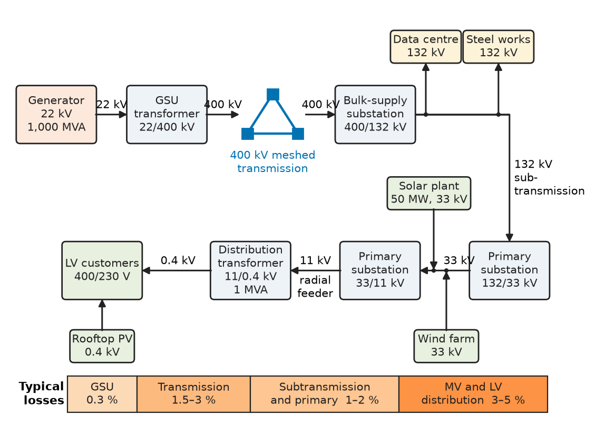
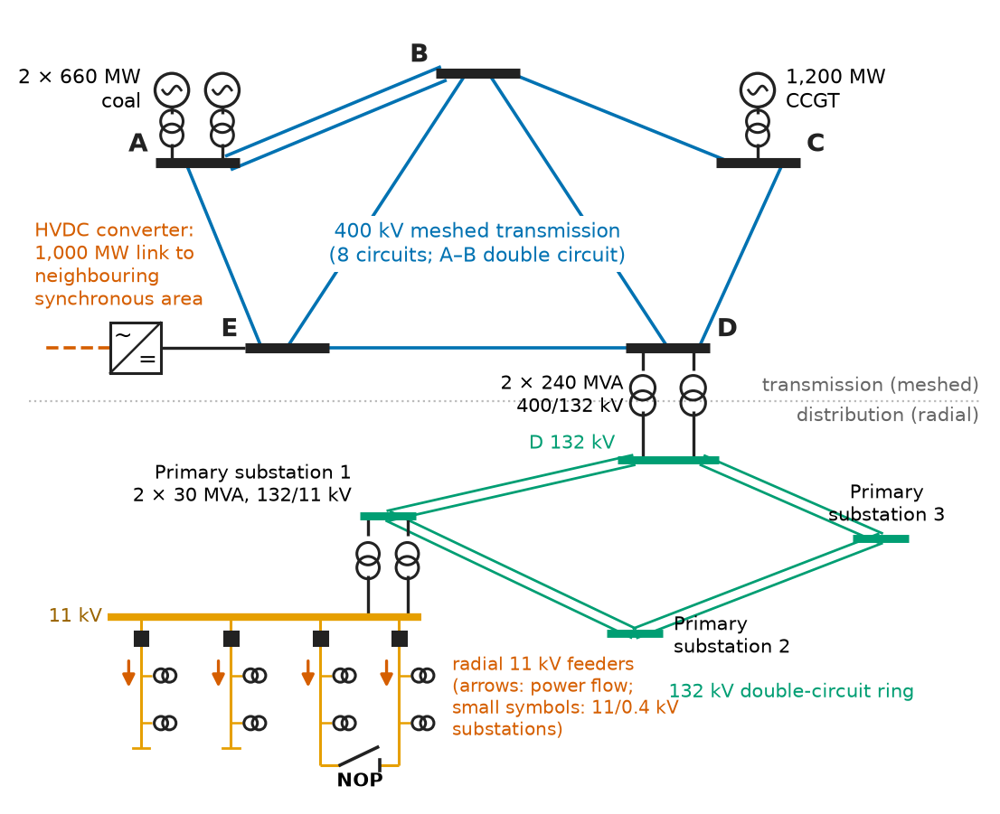
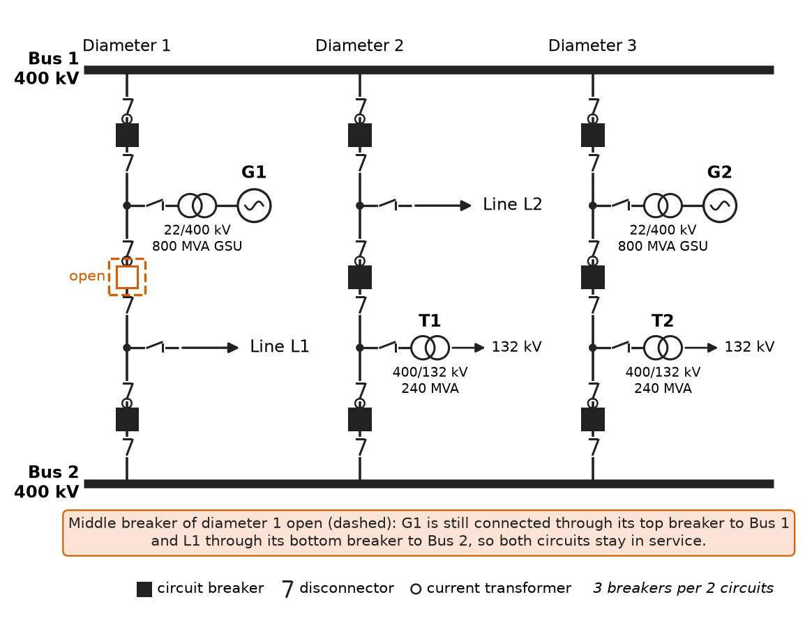
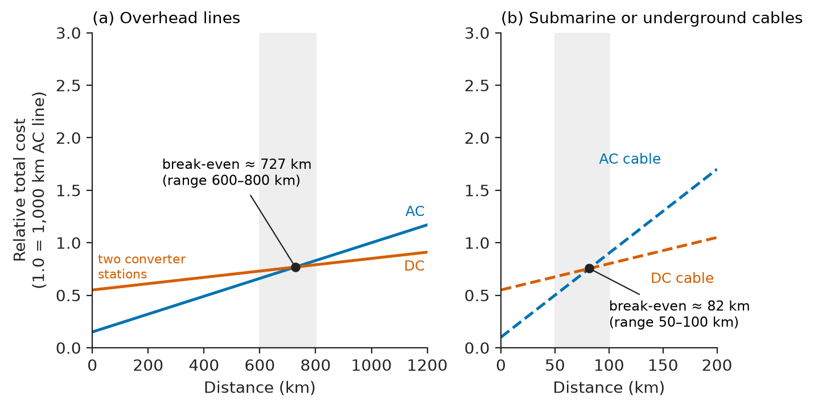
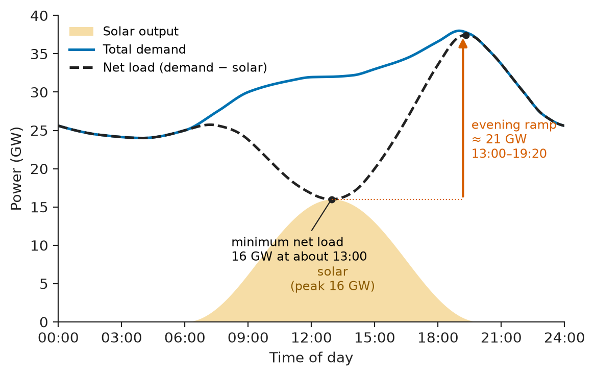
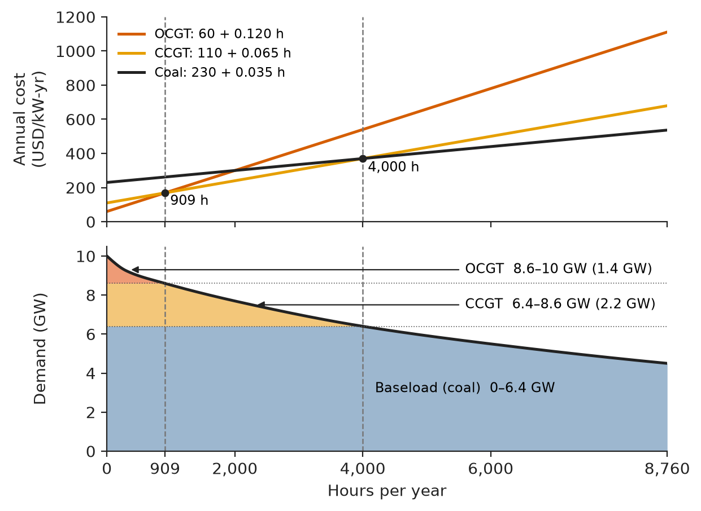

# Chapter 13 — Power-System Structure

*Part IV · Power Generation*

A developer wants to build a 300 MW data-centre campus on the edge of a growing city and asks the local utility for a connection. The answer comes back in a letter: the nearest 132 kV substation has 40 MW of spare transformer capacity, the 400 kV substation that feeds it is already loaded close to its firm rating on summer evenings, a new 400/132 kV transformer and two new cable circuits will be needed, and the earliest date the transmission operator can offer is six years away because three new generation projects ahead in the queue need the same reinforcement. Nothing in the letter is about a machine or a circuit law. It is about structure: where power is produced, the voltage levels through which it travels, which elements are allowed to fail without loss of supply, how much demand there will be at the moment of system peak, and how long it takes to build the steel and copper that carry it. Those are the subjects of this chapter. Parts I–III built the converters (transformers, machines, drives); this chapter assembles them into the largest machine engineers have ever made, the interconnected power system, and sets out the vocabulary that the rest of the book uses to analyse it.

> **How is a power system organised from generator to socket, and why is it built at the voltages, in the topologies and with the components it has?**
> **How are demand, energy flow, reliability and future growth quantified, and how do those numbers drive what gets built?**

| Concept | Engineering destination |
|---|---|
| Generation, transmission, distribution | Voltage-level choice, loss budgets, network ownership and regulation |
| Grid architecture | Meshed transmission, radial distribution, synchronous areas, interconnectors |
| Power-system components | Substation layouts, transformer and breaker specifications, compensation |
| AC versus DC | HVDC links, offshore wind export, DC data centres, EV and PV systems |
| Energy flow | Sankey diagrams, line loading, the power-angle transfer limit |
| Load demand | Load curves, load factor, diversity, peak forecasts, tariffs |
| Reliability and resilience | N-1 security, LOLE, SAIDI and SAIFI, black start, hardening |
| Power-system planning | Generation mix, screening curves, transmission reinforcement, connection queues |

**Roadmap.** The supply chain from fuel to socket (13.1) → how the networks are wired together (13.2) → the hardware in them (13.3) → why most of it is AC and where DC wins (13.4) → how energy and power actually move (13.5) → what the customers demand and when (13.6) → how continuity of supply is measured and secured (13.7) → how the system is planned years ahead (13.8).

---

## 13.1 Generation, transmission, and distribution

> **Boundary.** AC power, complex power and power factor are taken from *Circuits, Signals and Communications*, [Ch. 9](https://github.com/The-Studio-of-Sadiq/Circuits-Signals-and-Communications/blob/main/part-2-transient-and-ac-analysis/09-ac-power.md); three-phase connections, line and phase quantities and three-phase power from [Ch. 10](https://github.com/The-Studio-of-Sadiq/Circuits-Signals-and-Communications/blob/main/part-2-transient-and-ac-analysis/10-three-phase-circuits.md); distributed line parameters and surge impedance from [Ch. 14](https://github.com/The-Studio-of-Sadiq/Circuits-Signals-and-Communications/blob/main/part-3-advanced-network-theory/14-transmission-lines.md). This chapter uses them to describe the system, not to re-derive them.

### The three functional layers

Every public power system performs three functions, usually by different organisations and always at different voltages.

- **Generation** converts a primary resource (fuel, falling water, wind, sunlight, nuclear fission) into three-phase electrical power, typically at 11–27 kV at the terminals of a synchronous generator or at 0.4–0.8 kV at the output of an inverter or wind-turbine converter. A generator step-up (GSU) transformer raises it to transmission voltage.
- **Transmission** moves bulk power over tens to thousands of kilometres at 220–765 kV AC (and ±320 kV to ±1,100 kV DC), between large plants, between regions and between countries. It is meshed, so that power has several paths, and it is where the system's frequency and stability are managed.
- **Distribution** takes power from bulk-supply substations down through subtransmission (33–132 kV) and medium voltage (6.6–33 kV) to low voltage (230/400 V or 120/240 V) and delivers it to customers, mostly through radial feeders.

The boundaries are not sharp. A 132 kV network is "transmission" in one country and "distribution" in another; a 50 MW solar plant connects at 33 kV inside the distribution system; a large industrial customer (an aluminium smelter, a steel mill with an electric arc furnace, a hyperscale data centre) may take supply directly at 132–400 kV. Figure 13.1 shows the chain with typical voltages.

<!-- FIGURE 13.1 | figures/ch13/fig-13-1-supply-chain-voltage-levels.png | block-diagram | The supply chain from generator to customer with typical voltage levels and the share of losses at each stage. | Content: left to right blocks. Generator 22 kV (1,000 MVA) to GSU transformer 22/400 kV to 400 kV meshed transmission (three interconnected substations drawn as a triangle) to bulk-supply substation 400/132 kV to 132 kV subtransmission to primary substation 132/33 kV and 33/11 kV to 11 kV radial feeder to distribution transformer 11/0.4 kV (1 MVA) to LV customers 400/230 V. Side branches: wind farm 33 kV joining at 132/33 kV substation, 50 MW solar plant at 33 kV, steel works at 132 kV, data centre at 132 kV, rooftop PV at 0.4 kV. Below the chain a bar showing typical losses: GSU 0.3 percent, transmission 1.5 to 3 percent, subtransmission and primary 1 to 2 percent, MV and LV distribution 3 to 5 percent. -->

*Figure 13.1 — The supply chain from generator to customer with typical voltage levels and the share of losses at each stage.*

### Why voltage rises with distance and power

The reason for the ladder of voltages is the conductor loss $3I^2R$. For a fixed power $P$ at power factor $\cos\varphi$, the line current is $I=P/(\sqrt3\,V\cos\varphi)$, so the loss on a given conductor falls as $1/V^2$. The three-phase power relations and the copper saving of three-phase over single-phase transmission are in *Circuits, Signals and Communications*, [Ch. 10 §10.1 and §10.7](https://github.com/The-Studio-of-Sadiq/Circuits-Signals-and-Communications/blob/main/part-2-transient-and-ac-analysis/10-three-phase-circuits.md); here the question is the engineering one of choosing the level.

**Worked example — choosing a transmission voltage.** A 500 MW wind cluster must be carried 300 km to a load centre at power factor 0.95. A twin-conductor bundle has an AC resistance of 0.035 Ω/km per phase, so $R=10.5\ \Omega$ per phase. At 220 kV the line current is

$$
I=\frac{500\times10^6}{\sqrt3\times220\times10^3\times0.95}=1381\ \mathrm{A},\qquad P_\text{loss}=3I^2R=3\times1381^2\times10.5=60.1\ \mathrm{MW}
$$

which is 12 % of the transported power; if the line ran at full output half the hours of the year it would lose about 260 GWh, worth some USD 16 million a year at USD 60/MWh. At 400 kV the current falls to 760 A and the loss to 18.2 MW (3.6 %); at 765 kV it would be 397 A and 5.0 MW (1.0 %). The higher voltage costs more per kilometre (taller towers, longer insulator strings, wider right of way, more expensive substations), so the economic voltage rises with both power and distance. Rules of thumb that fall out of studies of this kind are summarised in Table 13.1.

**Table 13.1 — Representative AC voltage levels and their roles (line-to-line, nominal).**

| Level | Typical voltages | Typical power per circuit | Typical distance | Examples |
|---|---|---|---|---|
| Low voltage (LV) | 230/400 V, 120/240 V, 480 V, 690 V | up to ~1 MVA | < 0.5 km | Homes, offices, motor control centres, wind-turbine converters |
| Medium voltage (MV) | 6.6, 11, 13.8, 20, 22, 33 kV | 1–30 MVA | 1–30 km | Urban and rural feeders, large motors, solar and wind collector systems |
| Subtransmission / high voltage (HV) | 66, 110, 132, 138 kV | 50–250 MVA | 10–100 km | Regional rings, industrial supplies, distribution bulk-supply points |
| Transmission (EHV) | 220, 275, 330, 345, 400, 500 kV | 300–2,000 MVA | 50–500 km | National backbones, large power stations |
| Ultra-high voltage (UHV) | 765, 800, 1,000, 1,150 kV | 2,000–6,000 MVA | 300–1,500 km | India, China, South Africa, Russia long-distance corridors |

The nominal values and the highest voltages for equipment are standardised in IEC 60038 and ANSI C84.1; equipment insulation levels follow from them (Chapter 24).

### Who owns what

Until the 1990s most systems were vertically integrated: one utility owned generation, transmission and distribution and sold to captive customers. Many countries have since unbundled them. A typical liberalised structure has competing generators selling into a wholesale market; a **transmission system operator** (TSO; in North America an ISO or RTO with transmission owners) that runs the high-voltage network, balances supply and demand second by second and procures reserves; **distribution network operators** (DNOs or DSOs) that own and run the wires below about 132 kV; and retailers who bill the customer. The physics does not care about ownership, but planning, connection procedures and the incentives that decide which reinforcement is built are shaped by it. The data-centre letter of the opening is an artefact of that structure: the DSO owns the 132 kV substation, the TSO owns the 400 kV one, and both must agree before the connection is offered.

---

## 13.2 Grid architecture

### Meshed transmission, radial distribution

Transmission networks are **meshed**: every major substation is connected to at least two others, so that the loss of any single line or transformer redistributes power over the remaining paths rather than interrupting it. Meshing buys security at the cost of control. In a mesh the operator cannot simply send power down a chosen line; power divides among parallel paths in inverse proportion to their impedances (Section 13.5), and a single tripped circuit can overload its neighbours.

Distribution networks are mostly **radial** in operation even where they are built as loops. An 11 kV urban feeder may form a ring between two primary substations, but a **normally open point** splits it, so each half is radial: protection is simple (current flows one way), fault levels are lower, and voltage control is a matter of setting the transformer tap at the source. After a fault the faulted section is isolated and the open point is moved to restore the rest. Dense city centres (parts of London, New York, Paris, Singapore) use interconnected LV networks and meshed MV networks with network protectors to reach very high reliability, at higher cost. Distribution architectures are developed in Chapter 22.

### Synchronous areas and interconnections

All AC generators connected through AC lines must turn in electrical synchronism, at one common frequency. The set of networks that share a frequency is a **synchronous area**. Examples:

- **Continental Europe** (ENTSO-E): one synchronous area from Portugal to Turkey and from Denmark to Greece, more than 400 million people, 50 Hz.
- **Nordic**, **Great Britain**, **Ireland** and **Baltic** areas are separate synchronous areas linked to Continental Europe only by HVDC.
- **North America** has four main synchronous areas at 60 Hz: the Eastern Interconnection, the Western Interconnection, ERCOT (most of Texas) and Québec, linked by a few back-to-back HVDC ties.
- **India** operates a single national synchronous grid at 50 Hz since 2013; **Japan** is split between 50 Hz (east) and 60 Hz (west) with frequency-converter stations of a few GW between them.

A large synchronous area pools inertia and reserves: when a 1,000 MW unit trips, every generator in the area contributes a share of the replacement power through its governor droop (Chapter 14 §14.6), so the frequency dip is small. The price is that disturbances also propagate: a cascading outage can spread across a whole area, as in the 2003 North American and Italian blackouts and the 2006 split of the European system into three islands. DC links between areas transfer scheduled power without coupling their frequencies and act as firewalls.

<!-- FIGURE 13.2 | figures/ch13/fig-13-2-grid-architecture-mesh-radial.png | single-line | A meshed 400 kV transmission ring feeding radial 132 kV and 11 kV distribution with a normally open point. | Content: top half a ring of five 400 kV substations A to E connected by eight 400 kV circuits: the ring A-B-C-D-E-A plus two diagonals B-E and B-D, with A-B built as a double circuit, two power stations (2 x 660 MW coal at A, 1,200 MW CCGT at C), an HVDC converter at E labelled 1,000 MW link to neighbouring synchronous area. Bottom half: substation D 400/132 kV with two 240 MVA transformers feeding a 132 kV double-circuit ring to three primary substations; one primary substation 132/11 kV with two 30 MVA transformers feeding four 11 kV radial feeders; two feeders joined at a normally open point drawn as an open switch symbol labelled NOP. Arrows show power flow direction on the radial feeders only. -->

*Figure 13.2 — A meshed 400 kV transmission ring feeding radial 132 kV and 11 kV distribution with a normally open point.*

Figure 13.2 shows the two layers together. Within a synchronous area the grid is divided into **control areas** (balancing authorities), each responsible for keeping its own interchange with its neighbours at the scheduled value; the combined action of their automatic generation control keeps the frequency at nominal (Chapter 20).

### Islands, microgrids and isolated systems

At the other extreme are isolated systems: islands (Hawaii, Cyprus, the Canary Islands), remote mines, offshore platforms, ships and aircraft. They have small inertia, a few large units and no neighbour to lean on, so a single unit trip can be 20–50 % of the load. Their design rules are harsher: spinning reserve at least equal to the largest unit, fast load shedding, often battery storage for frequency support. A large cruise ship is a 60–90 MW isolated diesel-electric power system at 6.6 or 11 kV; a mine in the Atacama desert can be a 200 MW islanded system with gas engines and solar. A **microgrid** is a portion of a distribution network that can disconnect from the main grid and run as an island (a university campus, a military base, a hospital, a village); its control is treated in Chapter 26.

---

## 13.3 Power-system components

### The inventory

Every power system is assembled from a small number of component types. Their electrical models are introduced across the book (machines in Part II, network models in Chapter 17, lines in Chapter 21, protection in Chapter 23); here they are placed in the system with their typical ratings.

**Table 13.2 — Principal power-system components and representative ratings.**

| Component | Function | Representative ratings and parameters |
|---|---|---|
| Synchronous generator | Converts shaft power to three-phase AC; supplies inertia, fault current and reactive power | 50–1,750 MVA, 11–27 kV; $X_d''\approx0.15$–$0.25$ pu |
| Inverter-based resource | Converts DC (PV, battery) or variable-frequency AC (wind) to grid AC | 3–6 MVA per central inverter, 0.1–0.35 MVA per string inverter; fault current 1.1–1.5 pu |
| Generator step-up transformer | Raises generator voltage to transmission voltage | 22/400 kV, 100–1,000 MVA, impedance 12–16 % |
| Interbus (auto)transformer | Couples two transmission voltages | 400/220 or 400/132 kV, 240–1,000 MVA, impedance 10–15 %, on-load tap changer ±10 % |
| Distribution transformer | Final step to LV | 11/0.4 kV, 0.1–2.5 MVA, impedance 4–6 % |
| Overhead line | Bulk transport | 400 kV double circuit, 1.5–3 GVA per circuit (thermal); $x\approx0.25$–$0.33\ \Omega$/km |
| Underground / submarine cable | Transport where lines cannot go | 132–400 kV XLPE, 200–1,000 MVA; capacitance 0.15–0.3 µF/km |
| Circuit breaker | Interrupts load and fault currents | 420 kV, 4 kA continuous, 50–63 kA interrupting (IEC 62271-100) |
| Disconnector, earthing switch | Visible isolation for maintenance | Off-load only |
| Shunt reactor | Absorbs charging reactive power of long lines and cables | 50–300 Mvar at 400 kV |
| Shunt capacitor bank | Supplies reactive power, supports voltage | 10–200 Mvar at 132–400 kV |
| SVC, STATCOM | Fast controllable reactive power | ±100 to ±400 Mvar |
| Series capacitor | Cancels part of line reactance to raise transfer | 30–70 % compensation of a long line |
| HVDC converter station | AC–DC–AC conversion | 0.5–12 GW per bipole; losses 0.7–1 % per station |
| Instrument transformers, relays | Measurement and protection | CT 1 A or 5 A secondary, VT 110 V secondary |
| Load | Motors, lighting, electronics, heating, electrolysers | From watts to hundreds of MW |

### Substations and busbar arrangements

A **substation** is a node of the network: a set of busbars to which lines, transformers, generators and compensation devices connect through circuit breakers. The way the busbars and breakers are arranged decides what happens when a breaker or a busbar fails, and how much of the substation can be maintained without an outage. Table 13.3 compares the common arrangements, and Figure 13.3 draws a breaker-and-a-half bay.

**Table 13.3 — Busbar arrangements.**

| Arrangement | Breakers per circuit | Busbar fault consequence | Breaker maintenance | Typical use |
|---|---|---|---|---|
| Single busbar | 1 | Whole substation lost | Circuit out of service | Small MV substations, industrial switchboards |
| Single busbar with bus section | 1 (+ section) | Half the substation lost | Circuit out | MV primary substations |
| Double busbar | 1 (+ coupler) | Circuits on the faulted bar lost until transferred | Circuit out (unless bypass) | HV and EHV substations in Europe |
| Ring (mesh) | 1 | No circuit lost for a busbar section fault | No outage | Small EHV substations, 4–6 circuits |
| Breaker-and-a-half | 1.5 | No circuit lost | No outage | EHV substations, power-station switchyards (North America, India) |
| Double breaker, double bus | 2 | No circuit lost | No outage | Critical nuclear and large-plant switchyards |

<!-- FIGURE 13.3 | figures/ch13/fig-13-3-breaker-and-a-half-substation.png | single-line | A 400 kV breaker-and-a-half switchyard with three diameters serving two generators, two lines and two transformers. | Content: two horizontal busbars labelled Bus 1 and Bus 2. Three vertical diameters between them, each with three circuit breakers in series (squares) and disconnectors either side. Between breakers: diameter 1 connects Generator G1 (via 22/400 kV 800 MVA GSU) and Line L1; diameter 2 connects Line L2 and Transformer T1 (400/132 kV 240 MVA); diameter 3 connects Generator G2 and Transformer T2. Current transformers drawn on each breaker. A shaded note shows that opening the middle breaker of diameter 1 leaves G1 on Bus 1 and L1 on Bus 2 still in service. -->

*Figure 13.3 — A 400 kV breaker-and-a-half switchyard with three diameters serving two generators, two lines and two transformers.*

### Secondary systems

Behind the primary plant sit the secondary systems: protection relays and their current and voltage transformers (Chapter 23), the substation automation system with IEC 61850 communications, the DC auxiliary supply (110 V or 125 V batteries that must trip breakers when the AC supply is gone), revenue metering, and the supervisory control and data acquisition (SCADA) link to the control centre where the energy management system runs state estimation, power flow and contingency analysis (Chapter 26). A modern 400 kV substation costs perhaps 15–30 % of its price in secondary equipment, and a large share of major disturbances begin with a protection or control misoperation rather than a primary-plant failure.

---

## 13.4 AC versus DC systems

### Why AC won the first round

The commercial systems of the 1880s were DC, at about 110 V, because DC lamps and motors existed and DC generators were well understood. They could serve customers only within a kilometre or two of the station, because the voltage could not be raised for transmission and lowered for use. The transformer (Chapter 4) made AC voltage conversion cheap, efficient (over 99 % at large ratings) and passive, and the induction motor (Chapter 6) gave AC a rugged, brushless load. Three-phase AC also gives constant instantaneous power and a rotating field from stationary windings (*Circuits, Signals and Communications*, [Ch. 10 §10.7](https://github.com/The-Studio-of-Sadiq/Circuits-Signals-and-Communications/blob/main/part-2-transient-and-ac-analysis/10-three-phase-circuits.md)). By 1900 AC had won public supply. It still dominates because transformers, synchronous generators and induction motors are mature, cheap and robust, and because AC current passes through zero twice a cycle, which makes interrupting a fault current with a mechanical breaker far easier than in DC.

### Where AC runs out

AC has three structural limits, all of which come from reactance.

1. **Transfer limit of long lines.** The power transferable over a line falls with its reactance (Section 13.5), and the reactance grows with length. Beyond a few hundred kilometres, uncompensated AC lines are stability-limited well below their thermal rating (Chapter 21).
2. **Cable charging current.** A cable is a long capacitor. Its charging current, which flows whether or not any power is delivered, uses up the conductor's thermal capacity.
3. **Synchronism.** Two AC systems can only be joined if they share a frequency; joining 50 Hz and 60 Hz, or two systems that are not to be coupled dynamically, needs conversion.

**Worked example — the critical length of an AC cable.** A 220 kV XLPE cable has a capacitance of 0.20 µF/km per phase and a thermal rating of 1,000 A. The charging current per kilometre at 50 Hz is

$$
I_c=\frac{V}{\sqrt3}\,\omega C=\frac{220\times10^3}{\sqrt3}\times2\pi\times50\times0.20\times10^{-6}=7.98\ \mathrm{A/km}
$$

and the cable generates reactive power at $V^2\omega C=3.04$ Mvar/km. If the cable is fed from one end only, the charging current alone reaches the thermal rating at $1000/7.98=125$ km, leaving nothing for real power. In practice shunt reactors at both ends (and sometimes midway) are used to stretch AC cables to 100–150 km, which is why the export cables of offshore wind farms more than about 80–100 km from shore are almost always HVDC. A 400 kV cable with 0.18 µF/km has a charging current of 13 A/km and generates 9 Mvar/km, so the limit is similar despite the higher rating.

### Where DC wins

HVDC transmission carries no reactive power, has no charging current in steady state, has no stability limit set by line reactance, and uses two conductors (or one plus earth or sea return) instead of three. Its costs are concentrated in the converter stations at each end. The result is the classic break-even picture of Figure 13.4: AC is cheaper for short distances, DC beyond a break-even distance of roughly 600–800 km for overhead lines and 50–100 km for submarine or underground cables.

<!-- FIGURE 13.4 | figures/ch13/fig-13-4-ac-dc-breakeven.png | plot | Total cost of AC and DC transmission versus distance, showing the break-even distance for overhead lines and for cables. | Content: x-axis distance 0 to 1,200 km; y-axis relative total cost (capital plus capitalised losses) 0 to 3.0 in units of the cost of a 1,000 km AC line. AC overhead line: straight line starting at 0.15 at 0 km with slope 0.00085 per km (reaching 1.0 at 1,000 km, including series compensation and intermediate switching stations). DC overhead line: starts at 0.55 (two converter stations) with slope 0.0003 per km. Lines cross near 730 km, labelled break-even overhead about 600 to 800 km. Inset or dashed pair for submarine cable: AC cable steep slope 0.008 per km from 0.1, DC cable from 0.55 slope 0.0025 per km, crossing near 80 km, labelled break-even cable about 50 to 100 km. -->

*Figure 13.4 — Total cost of AC and DC transmission versus distance, showing the break-even distance for overhead lines and for cables.*

Other cases where DC is chosen regardless of distance: asynchronous links between synchronous areas (back-to-back converters, as between Japan's 50 and 60 Hz grids or between ERCOT and the Eastern Interconnection); controllable power flow inside a congested AC mesh; and offshore wind connection. Two converter families are used: line-commutated converters (LCC) with thyristors, cheaper and with lower losses for very large bulk links (±800 kV, 8–12 GW in China and India), and voltage-source converters (VSC) with IGBTs, which control active and reactive power independently, can energise a dead network and suit offshore wind and multi-terminal grids. HVDC fundamentals are in Chapter 21; converter circuit internals belong to *Electronics & Computing*.

### DC at the edges of the system

DC is also returning at low and medium voltage because the sources and loads are increasingly DC themselves. PV modules, batteries, fuel cells and electrolysers are DC devices; nearly every electronic load, LED driver, EV battery and variable-speed drive has a DC link inside. Examples:

- **Data centres** use 380 V DC or 48 V DC distribution in some designs to remove one or two conversion stages; a conversion stage at 97–98 % efficiency saved on a 30 MW IT load is 0.6–0.9 MW of losses and cooling.
- **Ships** with electric propulsion are moving from AC to DC switchboards with batteries on the DC bus; **aircraft** use 270 V DC in more-electric designs; **traction** systems use 750 V and 1.5 kV DC for metros and 3 kV DC for some main lines.
- **PV plants** collect at 1,000–1,500 V DC before inversion; MVDC collection for large solar and wind farms is being demonstrated.

The case against DC in distribution is protection: with no current zero, DC fault interruption needs solid-state or hybrid breakers or current-limiting converters. The structure of the future grid is therefore AC backbone with DC links and DC islands, not a wholesale return to DC.

---

## 13.5 Energy flow

### From primary energy to useful work

Energy flows through a power system from a primary resource to an end use, with losses at every conversion. A Sankey diagram, with band widths proportional to energy, makes the chain visible. For a fossil-fuelled system, starting from 100 units of fuel energy:

- a thermal plant at 40 % net efficiency on the lower heating value delivers 40 units at its terminals and rejects 60 as heat (Chapter 14);
- the plant's own auxiliaries take about 5 % of gross output, so 38 units are sent out;
- transmission and distribution lose about 8 % of what enters them, leaving 35 units at customers' meters;
- a pump driven through a variable-speed drive and an IE3 motor at a combined 90 % delivers about 31.5 units of shaft work.

Less than a third of the fuel energy reaches the pump shaft. The chain explains why efficiency improvements at the end use have the largest leverage on fuel: a kilowatt-hour saved at the motor saves about three kilowatt-hours of fuel (Chapter 28). For wind, solar and hydro there is no fuel to account for and the relevant efficiency is that of turning a free but variable resource into deliverable energy, which is the subject of Chapter 15.

### Active and reactive power flow in a network

Inside the network, energy flows as active power $P$ at the system frequency, accompanied by reactive power $Q$ that oscillates between fields without net transport of energy. The definitions and conservation of complex power are in *Circuits, Signals and Communications*, [Ch. 9 §9.2–9.4](https://github.com/The-Studio-of-Sadiq/Circuits-Signals-and-Communications/blob/main/part-2-transient-and-ac-analysis/09-ac-power.md). What the system engineer needs on top is how $P$ and $Q$ divide among the branches of a network. For a predominantly inductive link of reactance $X$ between two buses with voltages $V_1\angle\delta$ and $V_2\angle0$, neglecting resistance,

$$
P=\frac{V_1V_2}{X}\sin\delta,\qquad Q_{2}=\frac{V_2\left(V_1\cos\delta-V_2\right)}{X}
$$

where $Q_2$ is the reactive power arriving at bus 2. The equations are derived for a synchronous machine in Chapter 7 and generalised to any network in Chapter 18.

> **Status of the principle: Two-bus power transfer**
> *Approximate.* Exact for a lossless series reactance between two fixed voltages; good for EHV lines and transformers where $R\ll X$ (typically $X/R>10$), poor for LV and MV cables where resistance is comparable to reactance and voltage drop is set mainly by $P$, not $Q$.

Two consequences shape the whole of power-system operation:

- **Active power flows toward the lagging voltage angle.** Angle differences across a transmission system are a direct measure of loading; phasor measurement units now record them in real time across continents.
- **Reactive power flows toward the lower voltage magnitude**, and it travels badly: its transport causes voltage drops that grow with $X$. Reactive power is therefore produced locally, by generators, capacitor banks, STATCOMs and cables, close to where it is consumed.

**Worked example — the power-angle limit of a 400 kV line.** A single 400 kV circuit 250 km long has a series reactance of 0.32 Ω/km, so $X=80\ \Omega$. With both ends held at 400 kV,

$$
P=\frac{(400\times10^3)^2}{80}\sin\delta=2000\sin\delta\ \mathrm{MW}
$$

At $\delta=20^\circ$ the transfer is 684 MW; at $30^\circ$ it is 1,000 MW; the theoretical steady-state maximum at $90^\circ$ is 2,000 MW. Operators keep the angle across such a line well below about $30$–$40^\circ$ so that the system can survive a fault and the loss of a parallel path (Chapter 20). A line twice as long has twice the reactance and half the transfer at the same angle, which is why long AC corridors need series compensation or are replaced by HVDC.

### Loop flows

Because power in a mesh divides according to impedance, the path that contracts specify and the path the electrons take can differ. Power sold from northern to southern Germany flows partly through Poland and the Czech Republic; power scheduled within the US Midwest loops through Ontario. These **loop flows** load neighbouring networks without their consent, and they are controlled with phase-shifting transformers (which insert an adjustable angle in series with a line) and HVDC links. They are a direct consequence of the structure of a meshed AC network, and a reason power-flow analysis (Chapter 18) is the central computational tool of the industry.

---

## 13.6 Load demand

### Load curves

The demand on a power system is the sum of millions of individual decisions to switch something on. Taken together they are remarkably predictable. A **daily load curve** plots demand against time of day; its shape depends on climate, season, day of the week and the mix of residential, commercial and industrial customers. A temperate winter weekday shows a morning rise around 07:00, a daytime plateau, and an evening peak around 17:00–19:00 when lighting, cooking and heating coincide with the end of the working day. Hot climates peak in the afternoon with air conditioning.

The spread of rooftop and utility solar has changed the curve that conventional generators see. **Net load** (demand minus variable renewable output) dips at midday and rises steeply in the evening as the sun sets and demand peaks: the "duck curve" first described for California. Figure 13.5 shows a representative summer weekday. The evening ramp is the hardest operating requirement on such systems; it can exceed 10 GW in three hours in California, and it is the main business case for four-hour battery storage (Chapter 16).

<!-- FIGURE 13.5 | figures/ch13/fig-13-5-daily-load-and-net-load.png | plot | Daily demand and net load on a summer weekday in a system with high solar penetration. | Content: x-axis time of day 00:00 to 24:00; y-axis power 0 to 40 GW. Solid curve: total demand, 24 GW at 04:00, rising to 30 GW at 09:00, 33 GW at 15:00, peak 38 GW at 19:00, falling to 27 GW at 23:00. Shaded area: solar output, zero before 06:00 and after 20:00, bell-shaped with peak 16 GW at 13:00. Dashed curve: net load (demand minus solar) with minimum 16 GW at 13:00 and rising to about 37 GW at about 19:20. Annotate the evening ramp with an arrow: about 21 GW between 13:00 and 19:20. Annotate minimum net load. -->

*Figure 13.5 — Daily demand and net load on a summer weekday in a system with high solar penetration.*

### Measures of demand

A small set of numbers describes demand for planning and tariff purposes.

- **Maximum (peak) demand** $P_\text{max}$: the highest demand averaged over a demand interval (15 or 30 min for billing, one hour for system planning).
- **Load factor** $LF=\bar P/P_\text{max}$, where $\bar P$ is average demand over the period. A system or a customer with high load factor uses its connection and its generators intensively. Typical annual system load factors are 55–70 %; an aluminium smelter or a data centre may exceed 85–90 %; a residential feeder may be 30–40 %.
- **Demand factor**: maximum demand divided by connected load. A house with 25 kW of appliances may never draw more than 7 kW.
- **Diversity factor**: the sum of the individual maximum demands of a group of customers divided by the maximum demand of the group. Because individual peaks do not coincide, it exceeds 1; its reciprocal is the **coincidence factor**.

> **Status of the principle: Diversity and coincidence factors**
> *Empirical.* They are statistical summaries of measured demand for a class of customers, region and season; values transfer poorly between climates and change as new loads (heat pumps, EV chargers) alter behaviour.

**Worked example — sizing a primary substation from customer data.** A primary substation will supply four groups: an industrial estate with a measured maximum demand of 4.2 MW, a hospital campus with 3.1 MW, a residential district with 2.6 MW and a shopping centre with 1.8 MW. The individual peaks sum to 11.7 MW, but they occur at different times; the coincident maximum demand measured on a similar substation is 9.0 MW, a diversity factor of $11.7/9.0=1.30$. Sizing the transformers on the arithmetic sum would oversize them by 30 %. With an annual load factor of 0.58, the substation delivers $9.0\times0.58\times8760=45.7$ GWh a year. A firm-capacity design (Section 13.7) uses two 12 MVA transformers, so that either alone can carry the 9 MW peak at power factor 0.9 (10 MVA) with margin for growth.

### Load composition and models

For network studies a load is represented by how its power changes with voltage. Resistive heating draws power proportional to $V^2$ (constant impedance); a motor driving a fixed mechanical load draws roughly constant power until it stalls; electronics behind a regulated power supply draw constant power. A composite load is often modelled as a weighted sum of constant-impedance, constant-current and constant-power parts (the ZIP model) plus a dynamic motor component. Constant-power loads are the dangerous ones for voltage stability: when voltage sags they draw more current, which deepens the sag (Chapter 20).

### Demand growth and electrification

Demand is not static. After two decades of flat consumption in many developed countries, electrification of transport and heat and the growth of data centres are now increasing it. Some orders of magnitude: an electric car at 15 kWh/100 km over 15,000 km a year uses 2,250 kWh a year, so a million of them add 2.25 TWh, about the output of a 300 MW CCGT running at 85 %; their effect on peak depends almost entirely on when they charge, from a few hundred megawatts for managed overnight charging to several gigawatts for uncontrolled early-evening charging at 7 kW. A heat pump can double a house's winter peak. A single hyperscale data-centre campus of 300–1,000 MW is as large as a city. Planners must forecast all of this, as Section 13.8 discusses.

---

## 13.7 Reliability and resilience

### Adequacy and security

Reliability has two parts. **Adequacy** is having enough generation, transmission and distribution capacity to meet demand, allowing for scheduled maintenance and random failures. **Security** is the ability to withstand sudden disturbances (a short circuit, the unexpected loss of a generator or line) without uncontrolled loss of load. A system can be adequate but insecure (enough plants, but one fault cascades) or secure but inadequate (stable, but short of capacity on a cold windless evening).

### The N-1 criterion

The central security rule of transmission planning and operation is **N-1**: the system must remain within thermal, voltage and stability limits after the loss of any single element (a line, a transformer, a generator, a busbar section where applicable), without loss of load. Many operators extend it to N-1-1 (a second outage after re-dispatch) or to specified common-mode events such as the loss of a double-circuit tower line. N-1 is why a primary substation has two transformers, each able to carry the peak (firm capacity), and why the 400 kV substation of the opening letter was "loaded to its firm rating" long before its transformers reached their nameplate sum.

> **Status of the principle: N-1 security criterion**
> *Empirical.* It is a deterministic engineering rule calibrated by decades of operating experience, not a law; it ignores the probability of each outage and the cost of the load lost, which is why probabilistic methods are increasingly used alongside it.

### Generation adequacy measures

The probability that available generation falls short of demand is quantified by the **loss-of-load expectation** (LOLE), the expected number of hours or days per year in which demand exceeds available supply, and the **expected energy not served** (EENS). Common standards are 0.1 days per year ("one day in ten years") in much of North America and 3 hours per year in Great Britain, France and Belgium. A traditional proxy is the **reserve margin**, installed firm capacity above forecast peak, typically 12–20 %. With large shares of wind and solar the reserve margin no longer works, because a megawatt of wind is not a megawatt of firm capacity; its contribution is measured by its effective load-carrying capability (Chapter 15 §15.8).

### Distribution reliability indices

At the customer end, interruptions are counted with the indices of IEEE 1366:

$$
\mathrm{SAIFI}=\frac{\sum N_i}{N_T},\qquad \mathrm{SAIDI}=\frac{\sum r_iN_i}{N_T},\qquad \mathrm{CAIDI}=\frac{\mathrm{SAIDI}}{\mathrm{SAIFI}}
$$

where $N_i$ is the number of customers interrupted in event $i$, $r_i$ the duration of that interruption and $N_T$ the total number of customers served. SAIFI is interruptions per customer per year, SAIDI minutes of interruption per customer per year, CAIDI the average restoration time. Only sustained interruptions (longer than 5 min in IEEE 1366, 3 min in European practice) are counted; momentary interruptions have their own index, MAIFI. Major event days are excluded by a statistical rule so that storms do not swamp the trend.

**Table 13.4 — Typical annual distribution reliability (sustained interruptions, excluding major events).**

| System | SAIDI (min/yr) | SAIFI (interruptions/yr) |
|---|---|---|
| Dense urban underground networks (Germany, Netherlands, Singapore) | 5–20 | 0.1–0.3 |
| National averages, Western Europe | 15–60 | 0.3–1.0 |
| US investor-owned utilities, average | 100–150 | 1.0–1.4 |
| Rural overhead systems, developed countries | 150–400 | 1.5–3 |
| Many developing-country systems | 1,000–10,000 | 10–100 |

**Worked example — reliability indices for a distribution utility.** A utility serving 48,000 customers records six sustained interruptions in a year (major events excluded): 12,000 customers for 95 min, 3,500 for 240 min, 800 for 30 min, 22,000 for 45 min, 1,500 for 600 min and 6,000 for 180 min. Then

$$
\sum N_i=45{,}800,\qquad \sum r_iN_i=4{,}974{,}000\ \text{customer-minutes}
$$

$$
\mathrm{SAIFI}=\frac{45{,}800}{48{,}000}=0.95,\qquad \mathrm{SAIDI}=\frac{4{,}974{,}000}{48{,}000}=104\ \mathrm{min},\qquad \mathrm{CAIDI}=\frac{104}{0.95}=109\ \mathrm{min}
$$

The average service availability is $1-103.6/525{,}600=0.99980$, "three nines and a bit". The 22,000-customer event contributes almost half the SAIFI; automatic sectionalising that restored three quarters of those customers within 3 min would remove 16,500 customer interruptions from the count and cut SAIFI to 0.61, which is why feeder automation (Chapter 26) is usually the cheapest reliability investment.

### Component reliability and redundancy

The reliability of a system of components follows from their failure rates and repair times. With a constant failure rate $\lambda$ and mean repair time $r$, a component's unavailability is approximately $U\approx\lambda r$ when $\lambda r\ll1$. Two elements in series (both needed) have $U_s\approx U_1+U_2$; two in parallel (either suffices) have $U_p\approx U_1U_2$ if failures are independent. A 132/11 kV transformer with $\lambda=0.02$ per year and a repair or replacement time of 1,000 h has $U=0.02\times1000/8760=2.3\times10^{-3}$, about 20 h a year on average; two in parallel give $5.2\times10^{-6}$, under 3 min a year. The same arithmetic underlies data-centre "2N" and "N+1" designs and the Uptime Institute tiers.

> **Status of the principle: Constant-failure-rate reliability model**
> *Approximate.* Valid in the useful-life part of the bathtub curve, with independent failures; it fails for ageing equipment, for common-mode events (one storm, one tower carrying both circuits, one protection error) and for repair times that depend on spares.

### Resilience

Reliability indices deliberately exclude major events. **Resilience** is about exactly those: high-impact, low-probability events such as hurricanes, ice storms, wildfires, floods, geomagnetic storms, extreme cold (Texas, February 2021, when more than 50 GW of generation was forced out and about 4.5 million customers lost supply), cyberattacks (Ukraine 2015) and cascading blackouts. Resilience has four phases: resist (hardening: undergrounding, stronger poles, flood walls, winterised plant), absorb (islanding, microgrids, load shedding that sacrifices part to save the whole), recover (spares, mutual-aid crews, black-start plans), and adapt (rebuilding to a higher standard).

**Black start** is the restoration of a system from total shutdown. It needs units that can start without external supply (hydro, small gas turbines, diesel generators, increasingly batteries with grid-forming inverters), energise a skeleton of lines, pick up load in steps small enough for their governors, and synchronise islands progressively. Restoration of a large system takes hours to a day; the 2025 Iberian blackout showed again that the planning, testing and documentation of black-start paths are an integral part of system structure, not an afterthought.

---

## 13.8 Power-system planning

### Time horizons

Planning spans eight orders of magnitude of time, from the protection settings that act in tens of milliseconds to the transmission corridors that take a decade to permit and build.

**Table 13.5 — Planning and operating horizons.**

| Horizon | Decisions | Tools |
|---|---|---|
| Milliseconds–seconds | Protection, inertia and primary frequency response, fast reserves | Relay settings, dynamic simulation (Chapters 20, 23) |
| Minutes–hours | Economic dispatch, secondary and tertiary reserves, redispatch | Energy management system, optimal power flow |
| Day ahead–week | Unit commitment, outage scheduling, market clearing | Forecasting, security-constrained unit commitment |
| 1–5 years | Maintenance plans, operational adequacy, connection offers | Adequacy studies, short-circuit and power-flow studies |
| 5–40 years | Generation mix, transmission reinforcement, new voltage levels, interconnectors | Capacity expansion models, cost-benefit analysis, scenarios |

### Load forecasting

Every plan starts with a forecast of energy (GWh) and peak (MW) by region and year. Short-term forecasts (hours to days) use weather forecasts and calendar effects and reach 1–3 % error for system demand a day ahead. Long-term forecasts combine population, economic growth, efficiency trends and electrification scenarios, and their errors are tens of percent over twenty years. Because the error is large, planners now work with several scenarios (high electrification, low growth, high distributed generation) and choose investments that are robust across them.

### Generation expansion and the screening curve

Generation technologies differ in how their cost divides between fixed (capital, fixed operation and maintenance, per kilowatt per year) and variable (fuel, carbon, variable maintenance, per megawatt-hour). Which is cheapest depends on how many hours a year a unit runs. The **screening curve** plots annual cost per kilowatt against hours of operation; combined with the load-duration curve it gives a first estimate of the least-cost mix.

**Worked example — screening curve for a thermal mix.** Three options have the following annualised fixed and variable costs:

| Option | Fixed cost (USD/kW-yr) | Variable cost (USD/MWh) |
|---|---|---|
| Open-cycle gas turbine (peaking) | 60 | 120 |
| Combined-cycle gas turbine (mid-merit) | 110 | 65 |
| Coal-fired steam (baseload) | 230 | 35 |

The annual cost per kilowatt of a unit running $h$ hours is $C(h)=F+V\,h/1000$. The OCGT and CCGT lines cross where $60+0.120h=110+0.065h$, at $h=909$ h; the CCGT and coal lines where $110+0.065h=230+0.035h$, at $h=4{,}000$ h. Reading these hours on the load-duration curve (Figure 13.6): the slice of load needed fewer than about 900 hours a year should be met by peaking turbines, the slice needed between 900 and 4,000 hours by combined cycles, and the slice needed more than 4,000 hours by baseload plant. If the system peak is 10 GW and the load-duration curve shows demand above 8.6 GW for 900 hours and above 6.4 GW for 4,000 hours, the screening answer is about 6.4 GW of baseload, 2.2 GW of CCGT and 1.4 GW of OCGT, plus a reserve margin.

<!-- FIGURE 13.6 | figures/ch13/fig-13-6-screening-and-load-duration.png | plot | Screening curves for three technologies above the annual load-duration curve; the crossings fix the least-cost mix. | Content: upper panel x-axis hours per year 0 to 8,760, y-axis annual cost 0 to 1,200 USD/kW-yr. Three straight lines: OCGT 60 + 0.120 h, CCGT 110 + 0.065 h, coal 230 + 0.035 h. Crossings marked at 909 h and 4,000 h with vertical dashed lines extending into the lower panel. Lower panel same x-axis, y-axis demand 0 to 10 GW: monotonically decreasing load-duration curve from 10 GW at 0 h, 8.6 GW at 909 h, 6.4 GW at 4,000 h, to 4.5 GW at 8,760 h. Horizontal bands shaded: baseload 0 to 6.4 GW, CCGT 6.4 to 8.6 GW, OCGT 8.6 to 10 GW, labelled with the GW values. -->

*Figure 13.6 — Screening curves for three technologies above the annual load-duration curve; the crossings fix the least-cost mix.*

> **Status of the principle: Screening-curve method**
> *Approximate.* It assumes linear costs, perfectly flexible units and a load-duration curve that is the only thing that matters; it ignores start-up costs, ramp limits, network constraints, chronology and storage, and it cannot handle variable renewables, whose output is not dispatchable. Production-cost and capacity-expansion models with hourly chronology replace it for real decisions.

With wind and solar the same idea is applied to **net load**: renewables have high fixed and almost zero variable cost, and they reshape the load-duration curve that the other plant sees. Their value falls as their share rises, because they produce at the same times (Chapter 15).

### Transmission and distribution planning

Transmission plans are tested against N-1 (and specified N-2) contingencies across many demand and generation scenarios, using power-flow, short-circuit and stability studies (Part V). Reinforcement options include reconductoring with high-temperature low-sag conductors, dynamic line rating, series compensation, phase-shifting transformers, new circuits, new voltage levels and HVDC overlays. Distribution plans (Chapter 22) test feeder loading and voltage at peak and, with distributed generation, at minimum load and maximum generation, the condition under which rooftop PV raises feeder voltages at noon.

### The connection queue

The opening letter describes a common contemporary bottleneck. In many countries the queue of generation, storage and large-load projects waiting for grid connection is several times the installed capacity of the system. Projects that would each need the same reinforcement are increasingly studied as a cluster, connection offers are made "flexible" (accepting curtailment in return for an earlier date), and anticipatory investment ahead of firm demand is being allowed by regulators. The data-centre developer may well be offered 200 MW in three years on a non-firm basis, with an obligation to shed load or run on-site generation and batteries during the hours when the 400 kV transformers are at their firm limit. That offer is the planning process of this section, the N-1 criterion of Section 13.7 and the load curves of Section 13.6 acting together.

---

## What remains open

| Open question | Where it is answered |
|---|---|
| How do steam, gas, combined-cycle, hydro and nuclear plants convert fuel to electricity, and what limits their efficiency and flexibility? | Chapter 14 |
| How are wind, solar, small hydro, biomass and geothermal resources converted, and how variable are they? | Chapter 15 |
| How does storage shift energy in time and support the evening ramp? | Chapter 16 |
| How are mixed voltage levels and components reduced to one network model? | Chapter 17 |
| How are power flows and voltages calculated in a meshed network? | Chapter 18 |
| How large are fault currents and what must breakers interrupt? | Chapter 19 |
| How do rotor-angle, voltage and frequency stability limit transfers? | Chapter 20 |
| How are long AC lines modelled and compensated, and how does HVDC work? | Chapter 21 |
| How are radial and ring distribution systems designed and regulated? | Chapter 22 |
| How does protection isolate faults selectively? | Chapter 23 |
| How do automation, microgrids and demand response change the structure? | Chapter 26 |
| Where do the three-phase power relations and the AC power definitions come from? | *Circuits, Signals and Communications*, [Ch. 9](https://github.com/The-Studio-of-Sadiq/Circuits-Signals-and-Communications/blob/main/part-2-transient-and-ac-analysis/09-ac-power.md) and [Ch. 10](https://github.com/The-Studio-of-Sadiq/Circuits-Signals-and-Communications/blob/main/part-2-transient-and-ac-analysis/10-three-phase-circuits.md) |

**Next:** Chapter 14 opens the first block of Figure 13.1, the conventional power station, and follows the energy from fuel through steam or gas turbine to the generator terminals.
