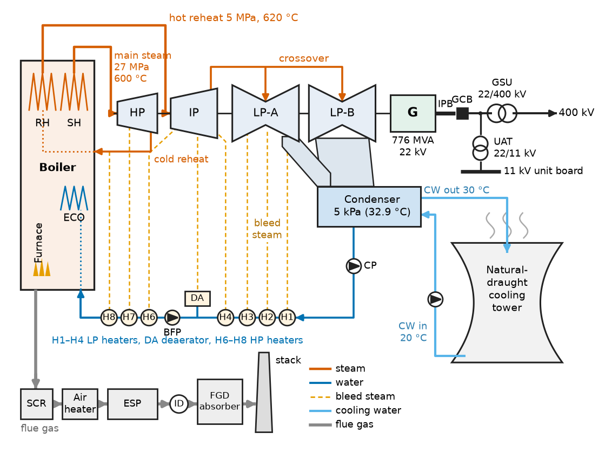
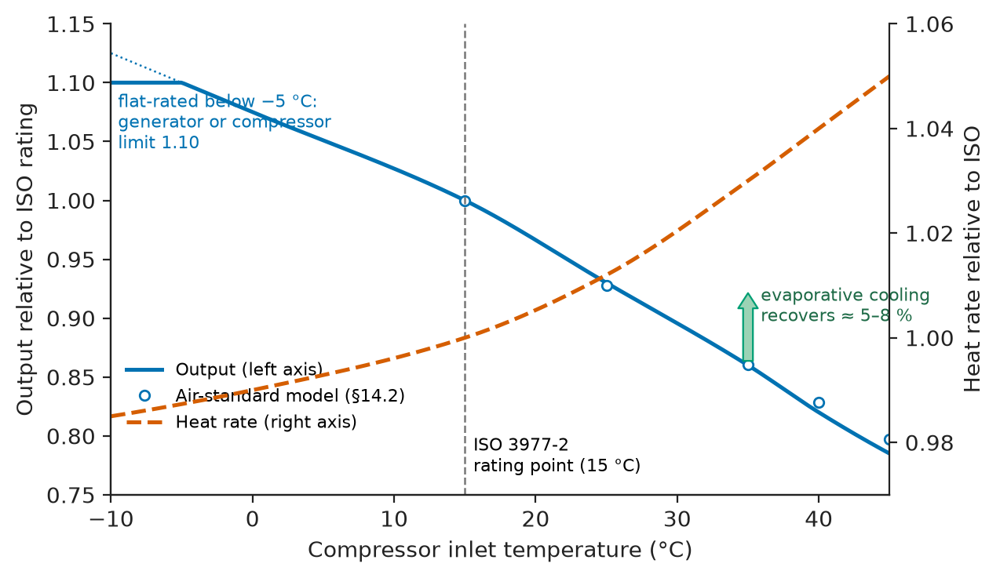
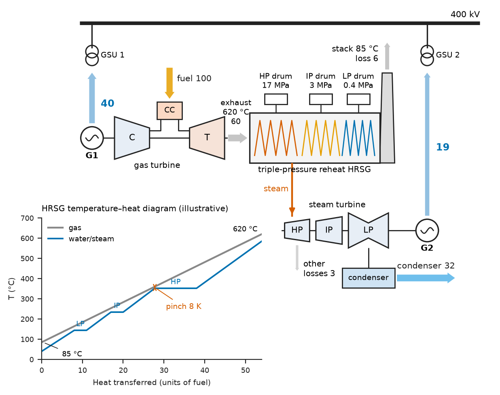
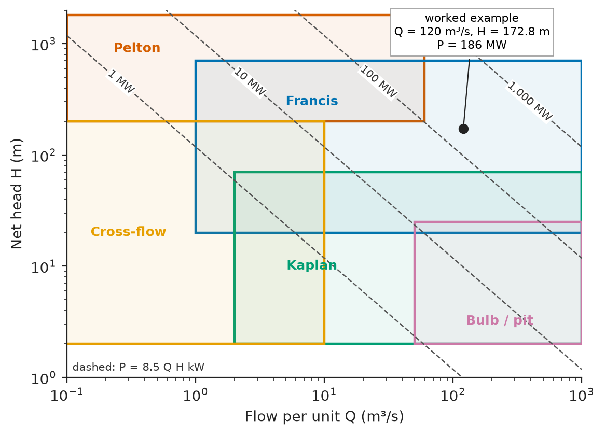
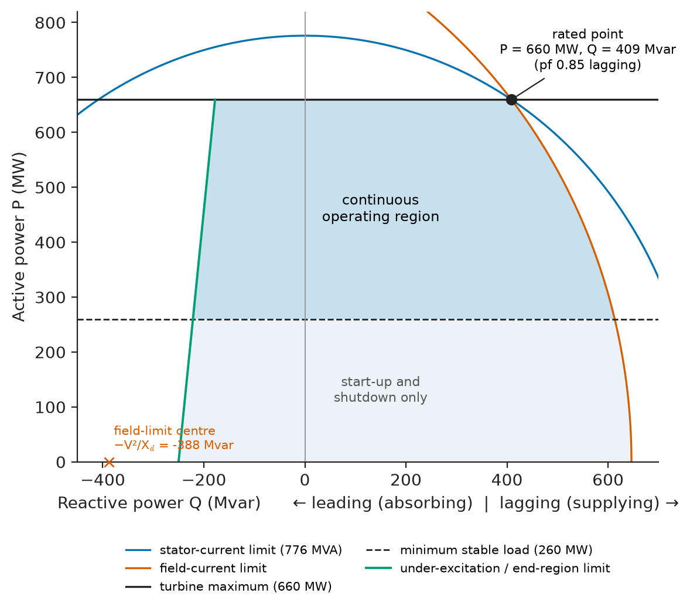
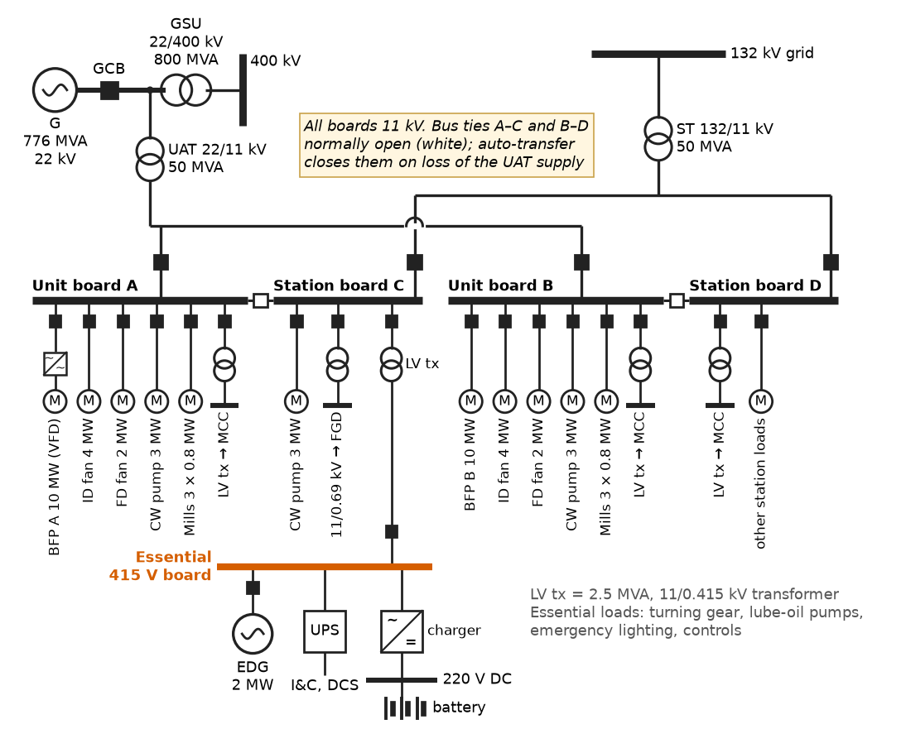

# Chapter 14 — Conventional Generation

*Part IV · Power Generation*

On the hottest afternoon of the year a grid operator calls on a 450 MW combined-cycle plant for its full output, and the plant delivers 405 MW. Nothing is broken. At 40 °C the air entering the gas turbines is 8 % less dense than at the 15 °C rating condition, so less mass flows through the machines; the compressors absorb more of the turbine work; the cooling towers cannot pull the condenser down to its design pressure, so the steam turbine loses output too. The same plant, cycled down to 40 % load at noon every day because rooftop solar has filled the midday demand, burns 15 % more gas per megawatt-hour than at full load and wears its hot-gas-path parts out faster with every start. Down the coast a 660 MW coal unit is losing money on the same days, and a nuclear unit is asked whether it can follow load at all. Every one of these questions is a question about how thermal and hydraulic energy is turned into three-phase electricity, and how the electrical side of the plant, from generator to auxiliaries, shapes what the system can ask of it. This chapter follows that chain through the five conventional technologies that still supply most of the world's electricity.

> **How do steam, gas-turbine, combined-cycle, hydro and nuclear plants turn a primary resource into electrical power, and what sets their efficiency, flexibility and rating?**
> **What does the electrical system of a power station consist of, how much of the output does the station consume itself, and what does conventional generation cost the environment?**

| Concept | Engineering destination |
|---|---|
| Steam power plants | Coal, lignite, biomass, nuclear and solar-thermal stations; condenser and cooling design |
| Gas-turbine plants | Peaking plant, island and offshore power, data-centre and hospital backup |
| Combined-cycle plants | Mid-merit and baseload gas generation, industrial cogeneration |
| Hydroelectric generation | Large dams, frequency control, black start, water-hammer and surge design |
| Nuclear generation | Baseload supply, decay-heat removal, safety-class electrical systems |
| Generator systems | Generator ratings, cooling, excitation, governors, capability curves, unit connection |
| Plant efficiency | Heat rate, fuel cost, merit order, LHV and HHV accounting |
| Auxiliary loads | Station service transformers, large motor starting, drive retrofits, black start |
| Environmental considerations | Emission limits, carbon cost, cooling water, waste, capture |

**Roadmap.** The steam plant (14.1) → the gas turbine (14.2) → the two combined (14.3) → water power (14.4) → nuclear heat (14.5) → the electrical machine they all drive and its controls (14.6) → efficiency compared and costed (14.7) → the plant's own consumption (14.8) → emissions, water and waste (14.9).

---

## 14.1 Steam power plants

> **Boundary.** The laws of thermodynamics and the Carnot limit $\eta_C=1-T_c/T_h$ are in *Engineering Physics*, [Ch. 10 §10.5–10.6](https://github.com/The-Studio-of-Sadiq/Engineering-Physics/blob/main/CHAPTERS/CHAPTER%2010.md); the Rankine cycle with superheat, reheat and regeneration, and its efficiency $\eta=1-Q_\text{cond}/Q_\text{boiler}$, are in [Ch. 19 §19.5.1–19.5.2](https://github.com/The-Studio-of-Sadiq/Engineering-Physics/blob/main/CHAPTERS/CHAPTER%2019.md); heat-exchanger LMTD and NTU methods are in [Ch. 19 §19.6.3](https://github.com/The-Studio-of-Sadiq/Engineering-Physics/blob/main/CHAPTERS/CHAPTER%2019.md). This section takes the cycle as given and follows it into a real plant.

### From cycle to plant

A utility steam unit realises the Rankine cycle with five major systems (Figure 14.1). The **boiler** (or steam generator) burns pulverised coal, lignite, biomass or oil in a furnace whose walls are lined with water tubes; superheaters and a reheater in the hot flue-gas path raise the steam to its final temperature. The **turbine** is split into a high-pressure (HP), an intermediate-pressure (IP) and two or three double-flow low-pressure (LP) cylinders on one shaft, turning a two-pole generator at 3,000 rpm (50 Hz) or 3,600 rpm (60 Hz). The **condenser** under the LP turbines condenses the exhaust steam at a pressure of 4–10 kPa. The **feedwater train** returns the condensate through six to nine feedwater heaters, heated by steam bled from the turbine, and a boiler feed pump raises it to boiler pressure. The **flue-gas train** removes particulates, sulphur and nitrogen oxides before the stack (Section 14.9).

<!-- FIGURE 14.1 | figures/ch14/fig-14-1-steam-plant-schematic.png | schematic | A 660 MW ultra-supercritical coal unit with reheat, regenerative feed heating and the main electrical connections. | Content: boiler on the left with furnace, superheater SH and reheater RH; main steam 27 MPa 600 C to HP turbine; cold reheat back to RH, hot reheat 5 MPa 620 C to IP turbine; crossover to two double-flow LP turbines; LP exhaust to condenser at 5 kPa (32.9 C) with cooling-water inlet 20 C and outlet 30 C to a natural-draught cooling tower. Condensate pump, four LP heaters, deaerator, boiler feed pump, three HP heaters back to the boiler economiser, with bleed lines from turbines to each heater. On the same shaft: generator 776 MVA 22 kV, connected through isolated-phase bus and generator circuit breaker to a 22/400 kV GSU transformer; unit auxiliary transformer 22/11 kV tapped off the generator bus. Flue gas path from boiler through SCR, air heater, electrostatic precipitator, induced-draught fan and FGD absorber to the stack. -->

*Figure 14.1 — A 660 MW ultra-supercritical coal unit with reheat, regenerative feed heating and the main electrical connections.*

### Steam conditions and efficiency

The efficiency of a steam unit is set by the mean temperature at which heat is added and the temperature at which it is rejected. Raising the main-steam temperature and pressure past the critical point of water (22.06 MPa, 374 °C) removes the boiling plateau and lifts the mean heat-addition temperature; reheating the steam once (twice in a few units) does the same for the second half of the expansion. Table 14.1 shows how plant efficiency has followed steam conditions, which in turn have followed the creep strength of boiler and turbine steels: 9–12 % chromium martensitic steels for 600–620 °C, nickel-base alloys for the 700 °C class.

**Table 14.1 — Steam conditions and typical net efficiency of steam units (LHV basis).**

| Class | Main steam | Reheat | Net efficiency | Net heat rate (kJ/kWh) |
|---|---|---|---|---|
| Subcritical drum unit | 16–17 MPa, 538 °C | 538 °C | 35–38 % | 9,500–10,300 |
| Supercritical | 24 MPa, 565 °C | 565 °C | 39–42 % | 8,600–9,200 |
| Ultra-supercritical (USC) | 25–30 MPa, 600 °C | 610–620 °C | 43–47 % | 7,700–8,400 |
| Advanced USC (demonstration) | 35 MPa, 700 °C | 720 °C | 48–50 % | 7,200–7,500 |
| Light-water reactor secondary | 6–7 MPa, ~285 °C saturated | moisture separator reheater | 32–36 % | 10,000–11,250 |
| Small biomass or waste boiler | 4–10 MPa, 450–540 °C | none | 20–32 % | 11,250–18,000 |

The cold end matters as much as the hot end. Condenser pressure is fixed by the cooling-water temperature: at 5 kPa the steam condenses at 32.9 °C, at 10 kPa at 45.8 °C. A unit cooled by cold sea water (Nordjylland in Denmark, Isogo in Japan) gains one to two percentage points of efficiency over the same unit with a dry air-cooled condenser in a desert, and on a hot day any unit loses output as its condenser pressure rises. This is the steam-side part of the opening problem.

**Worked example — fuel, carbon and cooling water of a 660 MW unit.** An ultra-supercritical unit delivers 660 MW net at 42 % net efficiency (LHV), burning bituminous coal of lower heating value 25 MJ/kg. Fuel power input is

$$
\dot Q_f=\frac{660}{0.42}=1571\ \mathrm{MW},\qquad \dot m_\text{coal}=\frac{1571}{25}=62.9\ \mathrm{kg/s}=226\ \mathrm{t/h}
$$

about 5,400 tonnes a day, two trainloads. The net heat rate is $3600/0.42=8{,}571$ kJ/kWh. With the IPCC default emission factor for bituminous coal of 94.6 kg CO₂ per GJ, each net kilowatt-hour emits $8.571\times0.0946=0.811$ kg of CO₂. For the condenser: auxiliaries take 7 % of gross output, so gross output is $660/0.93=710$ MW; boiler and stack losses take about 8 % of fuel input (126 MW); the rest, $1571-710-126=736$ MW, is rejected in the condenser. With a cooling-water temperature rise of 10 K the circulating-water flow is

$$
\dot m_{cw}=\frac{736\times10^6}{4186\times10}=1.76\times10^4\ \mathrm{kg/s}\approx17.6\ \mathrm{m^3/s}
$$

a small river. In a closed loop with a cooling tower, about 1.5–2 % of that flow evaporates, roughly 0.3 m³/s, which is why siting a thermal plant is as much a water question as a fuel question (Section 14.9).

### Part load and flexibility

Steam units were designed for continuous full-load operation. With wind and solar displacing them for part of the day they now cycle, and their limits become important: a minimum stable load of 30–50 % (set by furnace flame stability and boiler circulation), ramp rates of 1–4 % of rating per minute (set by thermal stress in thick-walled headers and turbine rotors), a hot start of 2–4 h and a cold start of 6–10 h. Each start consumes fatigue life of the thick components; operators assign an equivalent cost, often tens of thousands of dollars per cold start for a large unit, which enters the unit-commitment problem of Chapter 13 §13.8. Retrofits to lower the minimum load (indirect firing, better mill control, turbine bypass) are now common.

---

## 14.2 Gas-turbine plants

> **Boundary.** The ideal Brayton cycle and its efficiency $\eta=1-r_p^{-(\gamma-1)/\gamma}$, together with the materials that permit high turbine inlet temperatures, are in *Engineering Physics*, [Ch. 19 §19.5.3](https://github.com/The-Studio-of-Sadiq/Engineering-Physics/blob/main/CHAPTERS/CHAPTER%2019.md). Here the cycle is made non-ideal and put on a generator.

### Machines and ratings

A gas turbine compresses air, burns fuel in it at constant pressure and expands the hot gas through a turbine that drives both the compressor and the load. Two families serve power generation.

- **Heavy-duty (industrial, frame) machines** are built for power: single-shaft, 3,000 or 3,600 rpm direct-coupled to a two-pole generator (or geared for smaller sizes), pressure ratios 15–25, turbine inlet temperatures 1,400–1,600 °C in F-, H- and J-class machines, and ratings of 250–570 MW in simple cycle at 38–44 % efficiency.
- **Aeroderivative machines** are adapted jet engines: lighter, higher pressure ratio (25–40), two or three shafts, a free power turbine driving the generator, ratings of 30–120 MW at 40–44 % efficiency. They start in 5–10 min and tolerate many starts, which suits peaking duty, offshore platforms, LNG plants, ships and fast-reserve service.

### The real cycle

The ideal Brayton efficiency predicts 57.5 % for a pressure ratio of 20; no simple-cycle machine achieves it. The main reason is that the compressor and turbine are not isentropic, and because the compressor absorbs a large fraction of the turbine work (the **back-work ratio**), small component inefficiencies are amplified.

**Worked example — a non-ideal Brayton cycle.** Take an air-standard cycle with $\gamma=1.4$, $c_p=1.005$ kJ/(kg·K), ambient $T_1=288.15$ K (ISO 15 °C), pressure ratio $r_p=20$, turbine inlet $T_3=1600$ K, compressor isentropic efficiency 0.88 and turbine isentropic efficiency 0.90. The isentropic temperature ratio is $r_p^{0.2857}=2.354$, so

$$
T_2=T_1+\frac{T_1(2.354-1)}{0.88}=731\ \mathrm{K},\qquad T_4=T_3-0.90\,T_3\left(1-\frac{1}{2.354}\right)=772\ \mathrm{K}
$$

Compressor work is $c_p(T_2-T_1)=445$ kJ/kg, turbine work $c_p(T_3-T_4)=832$ kJ/kg, heat added $c_p(T_3-T_2)=873$ kJ/kg. The net work is 387 kJ/kg, the back-work ratio 0.54 and the efficiency $387/873=44.3\ \%$ against the ideal 57.5 %. Real machines lose a few points more to the compressed air bled off to cool the first turbine stages, to pressure losses in the inlet, combustor and exhaust, and to variable gas properties, which brings them to the 36–42 % of Table 14.4. A machine of 400 MW at 387 kJ/kg would swallow about 1,030 kg/s of air. Repeating the calculation for other pressure ratios shows why designs settle where they do: efficiency keeps rising slowly with $r_p$ (46 % at 30, 47 % at 40), but specific work peaks near $r_p\approx15$ and falls above it, so heavy-duty machines intended for combined cycles choose moderate pressure ratios and high exhaust temperature, while aeroderivatives choose high pressure ratios.

> **Status of the principle: Air-standard cycle with component efficiencies**
> *Approximate.* Treats the working fluid as air with constant specific heats and lumps all irreversibility into two isentropic efficiencies; it captures trends with pressure ratio, firing temperature and ambient temperature well but overestimates absolute efficiency by several points because it omits blade cooling, combustion products and duct losses.

### The ambient-temperature penalty

A gas turbine is a constant-volume-flow machine: at fixed shaft speed its compressor swallows a nearly fixed volume of air per second, so its mass flow falls with air density. Hotter air also costs more compressor work per kilogram. Repeating the worked example with $T_1=308$ K (35 °C) gives net specific work 356 kJ/kg (8 % lower) and a mass flow lower by the density ratio $288/308=0.935$; output falls to $0.920\times0.935=0.86$ of its ISO value, about 0.7 % per kelvin. Manufacturers quote output and heat rate at ISO conditions (15 °C, 60 % relative humidity, 101.325 kPa; ISO 3977-2) with correction curves like Figure 14.2. Inlet chilling, evaporative coolers and fogging recover part of the loss on hot days, exactly when the power is most valuable.

<!-- FIGURE 14.2 | figures/ch14/fig-14-2-gas-turbine-ambient-correction.png | plot | Gas-turbine output and heat rate relative to ISO rating versus compressor inlet temperature. | Content: x-axis compressor inlet temperature -10 to 45 C; left y-axis relative output 0.75 to 1.15; right y-axis relative heat rate 0.97 to 1.06. Output curve (solid) passing through 1.00 at 15 C, 0.93 at 25 C, 0.86 at 35 C, 0.82 at 40 C; below -5 C the delivered output is flat-rated at 1.10 (labelled generator or compressor limit), with the uncapped trend continued as a dotted line to about 1.12 at -10 C. Heat-rate curve (dashed) 0.985 at -10 C, 1.00 at 15 C, 1.03 at 35 C, 1.04 at 40 C. Vertical marker at 15 C labelled ISO 3977-2 rating point. Shaded arrow at 35 C labelled evaporative cooling recovers about 5 to 8 percent. -->

*Figure 14.2 — Gas-turbine output and heat rate relative to ISO rating versus compressor inlet temperature.*

### Role in the system

Open-cycle gas turbines are the classic peaking plant: low capital cost, high fuel cost per megawatt-hour (Chapter 13 §13.8), fast starts. Reciprocating gas engines (4–20 MW per engine, 44–49 % efficiency, start in 2–5 min) compete for the same role and for island grids, and diesel gensets (1–3 MW each) provide the backup supply of hospitals, data centres and nuclear safety systems. Gas turbines burn natural gas, distillate oil and, increasingly, hydrogen blends; most current heavy-duty combustors accept 30–50 % hydrogen by volume, with full-hydrogen combustion under development, limited by flame speed and NOx formation.

---

## 14.3 Combined-cycle plants

### The bottoming cycle

A gas turbine exhausts at 550–650 °C, which is hot enough to raise steam for a Rankine cycle. A **combined-cycle gas turbine** (CCGT) plant puts a **heat-recovery steam generator** (HRSG) in the exhaust duct and drives a steam turbine from it (Figure 14.3). If the gas turbine converts a fraction $\eta_{GT}$ of fuel energy to work and rejects the rest in its exhaust, the HRSG recovers a fraction $\varepsilon$ of that exhaust heat, and the steam cycle converts a fraction $\eta_{ST}$ of the recovered heat, energy conservation gives

$$
\eta_{CC}=\eta_{GT}+\varepsilon\,\eta_{ST}\left(1-\eta_{GT}\right)
$$

> **Status of the principle: Combined-cycle efficiency**
> *Derived.* A direct first-law balance on two cascaded heat engines with no supplementary firing; it holds exactly for the stated definitions, and the physics lies in the values of $\varepsilon$ and $\eta_{ST}$, which are limited by the HRSG pinch point and stack temperature.

With $\eta_{GT}=0.40$, $\varepsilon=0.90$ and $\eta_{ST}=0.35$, $\eta_{CC}=0.40+0.90\times0.35\times0.60=0.589$, nearly 59 %. The best H- and J-class plants have reached about 63–64 % net LHV in commercial operation; typical new plants are 58–62 %, older F-class plants 55–58 %. Roughly two thirds of the output comes from the gas turbine and one third from the steam turbine.

<!-- FIGURE 14.3 | figures/ch14/fig-14-3-combined-cycle-energy-flow.png | schematic | A 1-on-1 combined-cycle unit with triple-pressure reheat HRSG and its energy flows per 100 units of fuel. | Content: left, gas turbine (compressor, combustor, turbine) with fuel input 100 units; GT generator output 40 units; exhaust at 620 C carrying 60 units into a horizontal three-pressure HRSG (HP 17 MPa, IP 3 MPa, LP 0.4 MPa drums drawn) with stack at 85 C. HRSG feeds steam turbine (HP, IP, LP sections) driving a second generator, output 19 units. Condenser rejection 32 units, stack loss 6 units, other losses 3 units, all shown as labelled arrows. Electrical side: two generators connected through separate GSU transformers to a 400 kV busbar. Small inset of the HRSG temperature-heat diagram: gas line falling 620 to 85 C, water-steam line with evaporator plateau and a pinch point of 8 K marked. -->

*Figure 14.3 — A 1-on-1 combined-cycle unit with triple-pressure reheat HRSG and its energy flows per 100 units of fuel.*

### Configurations and operation

A CCGT is built as a single-shaft unit (gas turbine, generator and steam turbine on one shaft, with a synchro-self-shifting clutch for starting) or as a multi-shaft "2-on-1" block in which two gas turbines with their HRSGs feed one steam turbine. A 2-on-1 H-class block reaches 1,100–1,300 MW. The HRSG is the slow element: its thick drums limit the warm-up rate, and the steam turbine cannot be loaded until steam conditions match its metal temperatures. Modern "fast-start" designs with once-through HP sections and steam-turbine bypass reach full output in 30–40 min from a hot start; gas-turbine power is available in about 10 min, before the steam side contributes.

Part-load efficiency falls because the gas turbine must reduce firing temperature to cut output, which cools its exhaust and degrades the bottoming cycle: a 60 % plant at full load runs at roughly 52–54 % at 50 % load. A 2-on-1 block can shut one gas turbine down and run the other near full load, which keeps efficiency high at half output.

### Cogeneration

Where there is a use for low-temperature heat (district heating, paper and chemical plants, refineries, desalination), the steam turbine can exhaust at 0.2–1 MPa instead of a vacuum and deliver its condensing heat to the process. Electrical efficiency falls, but the total useful output (electricity plus heat) reaches 75–90 % of fuel energy. The value of the heat depends on its temperature; an exergy view counts a megawatt of 120 °C district heat as worth roughly a quarter of a megawatt of electricity.

---

## 14.4 Hydroelectric generation

> **Boundary.** Bernoulli's equation and hydrostatics are in *Engineering Physics*, [Ch. 15 §15.5](https://github.com/The-Studio-of-Sadiq/Engineering-Physics/blob/main/CHAPTERS/CHAPTER%2015.md); fluid systems as hydraulic circuits, pipe losses and the pump affinity laws are in [Ch. 19 §19.7](https://github.com/The-Studio-of-Sadiq/Engineering-Physics/blob/main/CHAPTERS/CHAPTER%2019.md). This section covers large reservoir and pumped-storage plant; small and run-of-river hydro as a renewable resource are treated in Chapter 15 §15.3.

### Power from head and flow

A hydro plant converts the potential energy of water stored at a height $H$ above the turbine. The power delivered to the grid is

$$
P=\eta_t\,\eta_g\,\rho g Q H_n
$$

where $Q$ is the turbine flow, $H_n$ the net head (gross head minus losses in intake, tunnel and penstock), $\eta_t$ the turbine efficiency (90–95 % at the best point for large units) and $\eta_g$ the generator efficiency (98–99 %). Water-to-wire efficiencies of 85–92 % make hydro by far the most efficient large-scale conversion technology.

**Worked example — a Francis unit.** A plant has a gross head of 180 m and a design flow of 120 m³/s per unit. Penstock and intake losses at design flow are 4 % of gross head, so $H_n=172.8$ m. The hydraulic power is $1000\times9.81\times120\times172.8=203.4$ MW, and with $\eta_t=0.93$ and $\eta_g=0.985$ the unit delivers $P=186$ MW. Over a year with 4,000 equivalent full-load hours it generates 745 GWh.

### Turbine types

The turbine is chosen by head and flow (Figure 14.4), conventionally through the specific speed:

- **Pelton** (impulse) turbines for high heads, about 200–1,800 m: water jets strike buckets on a wheel at atmospheric pressure. Flat efficiency curves down to 10–20 % of rated flow.
- **Francis** (reaction) turbines for about 20–700 m: the most common type, from a few megawatts to the 1,000 MW units at Baihetan. Efficiency falls off at part load, and a "rough zone" of vortex-rope pressure pulsations is typically avoided between about 40 % and 60 % load.
- **Kaplan** and **bulb** turbines for low heads, about 2–70 m for Kaplan and 2–25 m for bulb units, with adjustable runner blades that keep efficiency high over a wide flow range: run-of-river plants on large rivers and tidal barrages.
- **Reversible pump-turbines** for pumped storage, usually of Francis type, with motor-generators (Chapter 16).

<!-- FIGURE 14.4 | figures/ch14/fig-14-4-hydro-turbine-selection.png | plot | Turbine-type application ranges by net head and flow, with lines of constant unit power. | Content: log-log axes, x-axis flow per unit 0.1 to 1,000 m3/s, y-axis net head 1 to 2,000 m. Shaded regions: Pelton head 200 to 1,800 m, flow 0.1 to 60 m3/s; Francis head 20 to 700 m, flow 1 to 1,000 m3/s; Kaplan head 2 to 70 m, flow 2 to 1,000 m3/s; bulb and pit head 2 to 25 m, flow 50 to 1,000 m3/s; cross-flow head 2 to 200 m, flow 0.05 to 10 m3/s. Ranges overlap at their edges, as in handbook selection charts. Diagonal lines of constant power at 1, 10, 100 and 1,000 MW, approximate, using P = 8.5 Q H kW (overall efficiency about 0.87). Mark the worked-example point Q = 120 m3/s, H = 172.8 m, labelled 186 MW (from the example's efficiencies 0.93 x 0.985, i.e. about 9.0 Q H kW), inside the Francis region. -->

*Figure 14.4 — Turbine-type application ranges by net head and flow, with lines of constant unit power.*

### Water hammer, surge and governing

A hydro unit is hydraulically coupled to a long column of water. Two consequences follow, both absent from thermal plants.

First, **water hammer**. If the wicket gates close faster than a pressure wave can travel up the penstock and back, $2L/a$ where $a\approx1{,}000$ m/s is the wave speed in a steel penstock, the column is stopped abruptly and the pressure rise follows the Joukowsky relation $\Delta p=\rho a\,\Delta v$. In the worked-example plant a 650 m penstock of 5.5 m diameter carries $v=120/23.8=5.05$ m/s; sudden closure would raise the pressure by $1000\times1000\times5.05=5.05$ MPa, a head of 515 m on top of the 180 m static head. Gates are therefore closed over 5–15 s, much longer than $2L/a=1.3$ s, and long tunnels are protected by surge tanks. This is why a hydro unit that loses its grid connection (load rejection) cannot simply shut its gates: it overspeeds to 130–160 % before the governor brings it back, and the generator and its rotor are designed for that runaway.

Second, the **water starting time**

$$
T_w=\frac{L\,v}{g\,H_n}
$$

is the time needed to accelerate the water column from rest to rated velocity under the net head. For the worked example $T_w=650\times5.05/(9.81\times172.8)=1.9$ s; typical values are 0.5–4 s. When the governor opens the gates to increase output, the water column cannot accelerate instantly, so the pressure at the turbine first falls and power briefly *decreases* before it rises. In control terms the turbine has a right-half-plane zero; the governor must be detuned (transient droop) to stay stable, which limits how quickly a hydro unit can respond to a frequency drop despite its fast mechanical start.

> **Status of the principle: Rigid-water-column turbine model**
> *Approximate.* Treats the water as incompressible in a rigid conduit, which is adequate for governor and frequency studies when $T_w$ is small compared with the wave travel time effects; it fails for long penstocks and fast gate movements, where the elastic travelling-wave model of water hammer is needed.

### The system value of hydro

Large hydro with reservoirs is the most flexible conventional source: units start from standstill to full load in 1–5 min, ramp at tens of percent per minute, provide black-start capability (Chapter 13 §13.7) and can run as synchronous condensers with the runner dewatered. Its output is limited by water, not by capacity, so reservoir plants are dispatched to the hours of highest value and their capacity factors (35–60 %) reflect hydrology and strategy rather than technical availability.

---

## 14.5 Nuclear generation

> **Boundary.** Nuclear binding energy, the energy of about 200 MeV per fission of uranium-235, the fission barrier, the chain reaction and the four-factor formula for $k_\text{eff}$ are in *Engineering Physics*, [Ch. 6 §6.9–6.11](https://github.com/The-Studio-of-Sadiq/Engineering-Physics/blob/main/CHAPTERS/CHAPTER%206.md); the radioactive-decay law is in §6.10.3. This section is about the reactor as a heat source for a steam plant and about its electrical consequences.

### Reactor types

A power reactor is a controlled heat source for a Rankine cycle. Its coolant and moderator define its type (Table 14.2).

**Table 14.2 — Principal power-reactor types.**

| Type | Coolant / moderator | Coolant outlet | Steam to turbine | Net efficiency | Examples |
|---|---|---|---|---|---|
| Pressurised water reactor (PWR, VVER) | Light water at 15.5 MPa | ~325 °C | 6–7.5 MPa saturated, via steam generators | 33–37 % | Most of the world fleet; EPR 1,650 MW, AP1000 |
| Boiling water reactor (BWR) | Light water boiling at 7 MPa | ~286 °C | Direct cycle | 33–35 % | US, Japan, Sweden, ABWR 1,350 MW |
| Pressurised heavy-water reactor (CANDU, PHWR) | Heavy water | ~310 °C | ~4.7 MPa saturated | 30–33 % | Canada, India, Romania |
| Advanced gas-cooled reactor (AGR) | CO₂ / graphite | ~640 °C | 16 MPa, 540 °C superheated | ~41 % | UK |
| High-temperature gas reactor (HTGR) | Helium / graphite | 750–950 °C | 13–17 MPa, 540–570 °C | 40–45 % | China HTR-PM |
| Sodium-cooled fast reactor | Liquid sodium / none | ~550 °C | 14–17 MPa, ~500 °C | 38–42 % | Russia BN-800 |
| Small modular reactors (SMR) | Mostly light water | 300–325 °C | Saturated | 30–33 % | 50–300 MW designs |

The low steam conditions of light-water reactors, limited by the pressure a reactor vessel can safely hold, explain their modest efficiency: the steam leaves the steam generators saturated, so the turbine has very wet steam in its later stages and needs moisture-separator reheaters between HP and LP cylinders. To keep blade tip speeds of the enormous LP last stages within limits, large nuclear turbines run at half speed (1,500 or 1,800 rpm) and drive four-pole generators of up to about 2,000 MVA, the largest rotating electrical machines built.

**Worked example — fuel use of a 1,000 MWe PWR.** At 33 % net efficiency the reactor produces $1000/0.33=3{,}030$ MW of heat. At 200 MeV ($3.20\times10^{-11}$ J) per fission the fission rate is

$$
\frac{3.03\times10^9}{200\times1.602\times10^{-13}}=9.46\times10^{19}\ \mathrm{s^{-1}}
$$

which fissions $9.46\times10^{19}\times86{,}400/6.022\times10^{23}\times235\ \mathrm{g}=3.19$ kg of uranium-235 per day, a little over a tonne a year (plus some plutonium bred in the fuel, and more U-235 lost to non-fission capture). The reactor is refuelled by fuel assemblies, accounted for by burn-up: at 50 GWd per tonne of uranium and a capacity factor of 90 %, the core must be supplied with $3030\times365\times0.9/50{,}000=19.9$ tonnes of enriched uranium a year, against about 2.7 million tonnes of coal for a coal plant of the same output. The spent fuel is the same 20 tonnes, and it is the waste-management question of Section 14.9.

### Decay heat and the electrical consequences

Shutting down the chain reaction does not shut down the heat. The fission products continue to decay, releasing about 6–7 % of full thermal power immediately after shutdown and falling slowly. A widely used approximation (Way–Wigner) for a reactor that has run long at power $P_0$ gives

$$
\frac{P_d}{P_0}\approx0.066\,t^{-0.2}
$$

with $t$ in seconds after shutdown: 1.3 % after 1 hour (39 MW for the 3,030 MW core), 0.7 % after a day (21 MW), 0.5 % after a week.

> **Status of the principle: Way–Wigner decay-heat approximation**
> *Empirical.* A power-law fit to the summed decay of fission products, accurate to roughly ±30 % between about 10 s and 100 days; licensing analyses use the tabulated standards (ANS-5.1, ISO 10645), which are slightly lower in the first hours.

Removing that heat needs pumps and therefore electricity, at the very moment the generator has stopped. This single fact drives the electrical design of a nuclear station: two independent offsite supplies from the grid, safety-class (Class 1E, IEEE 308) AC buses fed by redundant emergency diesel generators of 4–8 MW each that start and load within 10–15 s, large DC batteries for instrumentation and control, and, in newer designs, passive cooling that needs no AC power for 72 h. The 2011 Fukushima Daiichi accident was a station blackout: the earthquake removed offsite power and the tsunami flooded the diesels and switchgear, so decay heat could not be removed. Grid engineers also feel the consequence: a nuclear unit is usually the largest single infeed in its system, so its trip sets the size of the frequency reserve (Chapter 20), and grid voltage and frequency excursions that trip the reactor's coolant pumps are design cases for the grid code.

### Flexibility

Nuclear plants have very low marginal cost and are normally run at full output. They can follow load: French PWRs routinely ramp between about 50 % and 100 % at 1–5 % per minute, using grey control rods to avoid distorting the power distribution, and German units provided load-following and primary frequency response. Limits arise from xenon-135 poisoning (after a power reduction xenon builds up for about 8–10 h and can prevent a return to power late in the fuel cycle) and from fuel-cladding stress.

---

## 14.6 Generator systems

> **Boundary.** Synchronous-machine theory (EMF generation, phasor diagrams, power-angle relations, synchronisation and excitation) is the subject of Chapter 7. This section is about the generator as a power-station component.

### Turbo-generators and hydro generators

Every conventional plant ends in a synchronous generator, and the prime mover sets its shape. Steam and gas turbines run fast, so their **turbo-generators** have two (or, for nuclear, four) poles, cylindrical rotors of solid forged steel 1–1.3 m in diameter and long active lengths of up to 8 m. Hydro turbines run slowly, so **hydro generators** have many salient poles on a large-diameter rotor: the 700 MW units of Three Gorges turn at 75 rpm with 80 poles and a rotor about 19 m across. Table 14.3 compares them.

**Table 14.3 — Representative large generator data.**

| Quantity | 2-pole turbo-generator | 4-pole nuclear generator | Salient-pole hydro generator |
|---|---|---|---|
| Rating | 100–1,300 MVA | 1,000–2,000 MVA | 10–1,000 MVA |
| Terminal voltage | 11–27 kV | 20–27 kV | 11–24 kV |
| Speed (50 Hz) | 3,000 rpm | 1,500 rpm | 75–750 rpm |
| Synchronous reactance $X_d$ | 1.8–2.5 pu | 1.8–2.2 pu | 0.8–1.2 pu |
| Subtransient reactance $X_d''$ | 0.15–0.25 pu | 0.25–0.30 pu | 0.20–0.30 pu |
| Inertia constant $H$ | 2–5 s (with turbine) | 4–7 s | 2–4 s |
| Rated power factor | 0.85–0.9 lagging | 0.9 | 0.9–0.95 |
| Full-load efficiency | 98.7–99.0 % | ~99 % | 98–99 % |
| Cooling | Air to ~300–500 MVA; hydrogen; water in stator bars above ~600 MVA | Hydrogen and water | Air, water in large units |

Cooling sets the rating. Losses of about 1 % of a 1,000 MVA machine, some 10 MW, must leave a rotor only a metre across. Hydrogen at 3–5 bar gauge has about seven times the thermal conductivity of air and about one-fourteenth of its density, cutting windage loss and raising heat removal; it needs shaft seals, purity monitoring and purging procedures because hydrogen–air mixtures are explosive between 4 % and 75 %. The largest machines also pump deionised water through hollow stator conductors. The thermal limits that follow are developed in Chapter 9.

### Unit connection

A large generator is connected to the grid as a **generator–transformer unit** (Figure 14.1). The terminal current is large: a 776 MVA, 22 kV generator carries

$$
I=\frac{776\times10^6}{\sqrt3\times22\times10^3}=20.4\ \mathrm{kA}
$$

per phase, carried by **isolated-phase bus**, each phase in its own earthed aluminium enclosure so that phase-to-phase faults are almost impossible and magnetic forces on adjacent structures are contained. A **generator circuit breaker** (IEEE C37.013 / IEC 62271-37-013) between the generator and the GSU lets the unit be synchronised and tripped on the low-voltage side while the unit auxiliary transformer stays energised from the grid. The GSU, typically delta on the generator side and earthed star on the HV side, blocks zero-sequence current from the generator and its earthing (Chapter 19).

### Excitation, voltage regulation and the capability curve

The field winding is supplied either by a **static exciter** (a thyristor bridge fed from the generator terminals through an excitation transformer, with brushes and slip rings) or by a **brushless exciter** (an inverted AC generator on the same shaft feeding a rotating diode rectifier). Field currents of large machines are 3–6 kA at a few hundred volts. The automatic voltage regulator (AVR) holds terminal voltage; a power-system stabiliser (PSS) adds damping of electromechanical oscillations (Chapter 20); limiters keep the machine inside its **capability curve** (Figure 14.5), the region of the P–Q plane bounded by stator current heating, rotor (field) current heating at lagging power factor, stator end-region heating and steady-state stability at leading power factor, and the prime mover's maximum and minimum power. Dynamic models of exciters for stability studies are standardised in IEEE 421.5.

<!-- FIGURE 14.5 | figures/ch14/fig-14-5-generator-capability-curve.png | plot | Capability curve of a 776 MVA, 0.85 power-factor, 22 kV turbo-generator. | Content: x-axis reactive power Q from -450 Mvar (leading, absorbing) to +700 Mvar (lagging, supplying); y-axis active power P 0 to 800 MW. Stator-current limit: arc of radius 776 MVA centred at origin. Field-current limit: arc centred at (-776/Xd = -388 Mvar for Xd = 2.0 pu, 0) intersecting the stator arc at the rated point P = 660 MW, Q = 409 Mvar (pf 0.85). Turbine maximum: horizontal line at 660 MW. Minimum stable load: horizontal dashed line at 260 MW (about 40 percent). Underexcitation and end-region limit: straight line from (-250 Mvar, 0 MW) rising to meet the turbine maximum at (-180 Mvar, 660 MW). Field-current arc of radius 1,035 MVA reaches Q = +647 Mvar at P = 0, so the x-axis runs -450 to +700 Mvar. Shade the permitted operating region. Mark the rated point. -->

*Figure 14.5 — Capability curve of a 776 MVA, 0.85 power-factor, 22 kV turbo-generator.*

### Governors and droop

The turbine governor adjusts steam valves, gas-turbine fuel or wicket gates. For frequency control each unit is given a **droop** $R$: the fractional change in frequency that drives its output from zero to rated, typically 4–5 %. A unit with droop $R$ responds to a frequency deviation $\Delta f$ with

$$
\frac{\Delta P}{P_\text{rated}}=-\frac{1}{R}\,\frac{\Delta f}{f_0}
$$

> **Status of the principle: Proportional (droop) governing**
> *Approximate.* Describes the steady-state response of a governor outside its dead band and within headroom limits; the actual response is delayed by valve, boiler, combustion or water-column dynamics and saturates at maximum output or minimum load.

**Worked example — primary response of a 600 MW unit.** After a large infeed is lost, a 50 Hz system's frequency settles 0.2 Hz low. A 600 MW unit with 4 % droop increases output by $(0.2/50)/0.04=0.10$ pu, 60 MW, provided it has 60 MW of headroom and its boiler can supply it. Units with no headroom (running flat out), units with governors in a wide dead band and inverter-based plant without frequency response contribute nothing, which is why grid codes now require all units to reserve and deliver this response (Chapter 27). Because all droop-controlled units share any change in load in proportion to their ratings, the system's frequency settles at a new value rather than returning to 50 Hz; secondary control restores it (Chapter 20).

---

## 14.7 Plant efficiency

### Heat rate and heating value

Power-station efficiency is usually expressed as a **heat rate**, the fuel energy consumed per kilowatt-hour generated: $HR=3600/\eta$ kJ/kWh (or $3412/\eta$ Btu/kWh in US practice). Two conventions coexist. The **higher heating value** (HHV) counts the latent heat of the water vapour formed in combustion; the **lower heating value** (LHV) does not, because no conventional plant condenses its flue gas. HHV/LHV is about 1.11 for natural gas and 1.03–1.05 for coal. European and manufacturer data are normally LHV; US utility data are normally HHV. A CCGT at 58 % LHV is 52.3 % HHV, a heat rate of about 6,530 Btu/kWh (HHV): the same machine, numbers that differ by almost six points. Equally important is **gross** (at the generator terminals) versus **net** (after the plant's own auxiliary consumption, Section 14.8) output.

**Table 14.4 — Typical net efficiency and flexibility of conventional plant (LHV).**

| Technology | Net efficiency | Net heat rate (kJ/kWh) | Hot start | Ramp rate | Minimum stable load |
|---|---|---|---|---|---|
| Subcritical coal | 33–38 % | 9,500–10,900 | 2–4 h | 1–2 %/min | 40–50 % |
| Ultra-supercritical coal | 43–47 % | 7,700–8,400 | 2–4 h | 2–4 %/min | 30–40 % |
| Open-cycle gas turbine, heavy duty | 36–42 % | 8,600–10,000 | 10–20 min | 8–15 %/min | 20–50 % |
| Aeroderivative gas turbine | 40–44 % | 8,200–9,000 | 5–10 min | 20–50 %/min | 20–50 % |
| Reciprocating gas engine | 44–49 % | 7,350–8,200 | 2–5 min | 20–100 %/min | 10–30 % (per engine) |
| Combined cycle (F to J class) | 55–63 % | 5,700–6,550 | 30–60 min | 3–8 %/min | 30–50 % |
| Light-water nuclear | 32–36 % | 10,000–11,250 (thermal) | Hours (typically baseload) | 1–5 %/min in load-follow | 30–50 % |
| Large hydro (water to wire) | 85–92 % | Not applicable | 1–5 min | 50–100 %/min | 20–40 % (Francis) |

### Part-load, degradation and ambient effects

Efficiency figures are at full load and design conditions. A real unit spends much of its life elsewhere. Part load lowers efficiency in every thermal plant, most strongly in gas turbines; deposits, blade erosion, seal wear and compressor fouling degrade heat rate by 2–5 % between overhauls (compressor washing recovers part of it); and ambient temperature moves both gas-turbine output (Section 14.2) and condenser pressure (Section 14.1). Plant performance testing to ASME PTC 46 or ISO 2314 corrects measured performance to reference conditions so that guarantees can be checked.

### Efficiency in money

The fuel and carbon cost of a megawatt-hour of output is $c=(p_f+p_c\,e_f)/\eta$, where $p_f$ is the fuel price per megawatt-hour of fuel energy, $e_f$ the fuel's emission factor in tonnes of CO₂ per megawatt-hour of fuel and $p_c$ the carbon price.

**Worked example — merit order with a carbon price.** Natural gas costs €30/MWh (LHV) and emits 56.1 kg CO₂/GJ, which is 0.202 t/MWh of fuel; coal costs €12/MWh and emits 94.6 kg/GJ, 0.341 t/MWh. The carbon price is €70/t. A 58 % CCGT has a fuel cost of $30/0.58=51.7$ €/MWh, emits $0.202/0.58=0.348$ t/MWh and pays €24.4/MWh for carbon: €76.1/MWh. A 40 % coal unit has a fuel cost of $12/0.40=30.0$ €/MWh, emits 0.851 t/MWh and pays €59.6/MWh for carbon: €89.6/MWh. The gas plant is cheaper to run despite fuel two and a half times as expensive per unit of energy. Setting the two costs equal gives the **fuel-switching carbon price**, $(51.7-30.0)/(0.851-0.348)=43$ €/t: below it coal runs first in the merit order, above it gas does. The coal plant could close the gap only by raising its efficiency; at 45 % its cost would fall to €79.6/MWh, still above the CCGT.

---

## 14.8 Auxiliary loads

### What the station consumes

A power station is also a large electricity consumer. Its pumps, fans, mills, conveyors, cooling-tower fans, emission-control equipment, lighting, HVAC and controls are its **auxiliary load** or **station service**, and its net output is gross output minus this load. Table 14.5 gives typical values.

**Table 14.5 — Auxiliary load as a share of gross output (full load, typical).**

| Plant | Auxiliary load | Largest consumers |
|---|---|---|
| Coal unit with FGD and SCR | 6–10 % | Motor-driven boiler feed pumps 2.5–3.5 %, ID/FD/PA fans 1.5–2.5 %, CW pumps 0.8–1.2 %, FGD 1–1.5 %, coal mills 0.5–1 % |
| Lignite unit | 8–12 % | As coal, plus fuel handling and drying |
| Combined cycle | 1.5–3 % | Boiler feed pumps, CW pumps or air-cooled condenser fans, gas compressors |
| Open-cycle gas turbine | 0.5–1.5 % | Lube oil, cooling, fuel-gas compressor if needed |
| PWR nuclear | 4–7 % | Reactor coolant pumps (four of 6–9 MW), condensate and CW pumps (main feed pumps often turbine-driven) |
| Hydro | 0.3–1 % | Cooling water, governors, drainage, lighting |

### The auxiliary electrical system

Figure 14.6 shows a typical arrangement. The **unit auxiliary transformer** (UAT), tapped off the generator bus between generator breaker and GSU, feeds the unit's medium-voltage switchboards at 6.6, 10 or 11 kV when the unit runs. A **station service transformer** (or start-up transformer) fed from the grid supplies the same boards for start-up and when the unit is off, with automatic transfer between sources. Large motors (boiler feed pumps of 8–20 MW, fans of 2–8 MW, CW pumps of 2–5 MW, reactor coolant pumps) connect at MV; smaller drives at 400–690 V through motor control centres. Essential loads (turning gear, lube-oil pumps, control systems, emergency lighting) are backed by diesel generators and by 110–250 V DC batteries, so that a turbine tripped with loss of all AC can coast down without wiping its bearings.

<!-- FIGURE 14.6 | figures/ch14/fig-14-6-auxiliary-power-single-line.png | single-line | Auxiliary power system of a 660 MW unit with unit and station transformers, MV boards and emergency supplies. | Content: generator G 776 MVA 22 kV, generator circuit breaker, GSU 22/400 kV 800 MVA to 400 kV bus. Unit auxiliary transformer UAT 22/11 kV 50 MVA tapped between GCB and GSU, feeding 11 kV unit boards A and B. Station transformer ST 132/11 kV 50 MVA from the 132 kV grid feeding station boards C and D, with bus-tie breakers to A and B and an auto-transfer note. Loads on 11 kV: boiler feed pump 10 MW (with VFD symbol on one), ID fans 2 x 4 MW, FD fans 2 x 2 MW, CW pumps 3 x 3 MW, coal mills 6 x 0.8 MW, FGD board via 11/0.69 kV transformer. 11/0.415 kV transformers 2.5 MVA feeding LV motor control centres. Emergency diesel generator 2 MW on an essential 415 V board with UPS and 220 V DC battery charger. -->

*Figure 14.6 — Auxiliary power system of a 660 MW unit with unit and station transformers, MV boards and emergency supplies.*

### Starting large auxiliaries

Starting a 10 MW boiler feed pump direct-on-line draws about six times rated current at low power factor. With a motor rating of $10/(0.97\times0.9)=11.5$ MVA, the starting demand is about 69 MVA. On an 11 kV board with a fault level of 25 kA (476 MVA), the voltage dip is roughly $69/(476+69)=13\ \%$, enough to drop out contactors and disturb other drives on the board. The usual remedies are a variable-frequency drive, a soft starter, or a starting sequence that brings the biggest motors on first; motor starting is treated in Chapters 6 and 10.

### Saving auxiliary power

Because auxiliary consumption is a direct deduction from saleable output, it is one of the most rewarding places for efficiency work. Fans and pumps controlled by dampers or throttle valves waste the pressure they destroy; speed control follows the affinity laws of *Engineering Physics*, [Ch. 19 §19.7.3](https://github.com/The-Studio-of-Sadiq/Engineering-Physics/blob/main/CHAPTERS/CHAPTER%2019.md), in which shaft power scales with the cube of speed.

**Worked example — a variable-speed drive on an induced-draught fan.** A 4 MW ID fan runs at 70 % of design flow for 6,000 h a year as the unit cycles. With inlet-damper control it draws about 80 % of rated power, 3.2 MW. With a variable-frequency drive the ideal fan power is $4\times0.7^3=1.37$ MW, and with a drive efficiency of 96 % the input is 1.43 MW. The saving is $3.2-1.43=1.77$ MW, or about 10,600 MWh a year: at a wholesale price of €60/MWh, €640,000 a year from one fan, against a drive costing perhaps €1–1.5 million. (The real saving is somewhat smaller because the system curve has a static component, so the fan speed must stay above 70 % at 70 % flow.)

---

## 14.9 Environmental considerations

### Air emissions

Combustion produces carbon dioxide, which cannot be removed by end-of-pipe treatment short of capture, and several pollutants which can. Table 14.6 gives representative values and the main controls.

**Table 14.6 — Direct emissions per net kWh and controls (typical).**

| Plant | CO₂ (kg/kWh) | Main pollutants | Controls and removal |
|---|---|---|---|
| Subcritical coal | 0.90–1.0 | SO₂, NOx, particulates, mercury | FGD (95–99 % SO₂), SCR (80–90 % NOx), ESP or fabric filter (> 99.5 % dust) |
| Ultra-supercritical coal | 0.75–0.85 | As above | As above |
| Lignite | 1.0–1.2 | As coal, more SO₂ and dust | As above |
| Combined cycle | 0.33–0.40 | NOx | Dry low-NOx combustors, SCR |
| Open-cycle gas turbine | 0.48–0.60 | NOx | Dry low-NOx combustors, water injection |
| Diesel genset | 0.65–0.75 | NOx, particulates | SCR, particulate filters |
| Nuclear, hydro | ~0 direct | None in operation | Not applicable |

Emission limits for large combustion plants are set by law: in the EU, Annex V of the Industrial Emissions Directive (2010/75/EU) sets limits of the order of 150 mg/Nm³ for SO₂ and NOx and 10 mg/Nm³ for dust for new coal units above 300 MW thermal, tightened by the best-available-technique conclusions for large combustion plants; in the US, New Source Performance Standards and the Mercury and Air Toxics Standards. Each control system also costs auxiliary power (Section 14.8) and, in the case of FGD, limestone and gypsum handling.

### Carbon capture

Post-combustion capture scrubs CO₂ from flue gas with an amine solvent, which is regenerated with steam bled from the turbine. The energy penalty is large.

**Worked example — the energy penalty of carbon capture.** The 660 MW unit of Section 14.1 at 42 % efficiency emits 0.811 kg CO₂/kWh. Fitting 90 % capture with solvent regeneration, CO₂ compression and the associated auxiliaries reduces net efficiency by about 9 percentage points to 33 %. The fuel needed per net kilowatt-hour rises by $0.42/0.33-1=27\ \%$, so the CO₂ produced per kilowatt-hour rises to 1.03 kg, of which 10 % is released: 0.103 kg/kWh, an 87 % reduction rather than 90 %. For the same coal input the unit's net output falls from 660 MW to about 519 MW. The penalty is lower on CCGTs (about 7 percentage points) because their flue gas is a smaller stream per kilowatt-hour, though more dilute in CO₂.

### Water

Thermal plants are among the largest users of water. Once-through cooling withdraws 75,000–190,000 litres per megawatt-hour and returns it 8–12 K warmer, which is regulated to protect river and coastal ecosystems and forces plants to reduce output during heat waves when rivers are warm and low (as French nuclear plants on the Rhône and Garonne have done repeatedly). Closed-loop cooling with towers withdraws much less but consumes, by evaporation, roughly 2,000–2,700 L/MWh for coal and nuclear plants and 700–1,000 L/MWh for combined cycles (less steam per kilowatt-hour). Dry air-cooled condensers consume almost no water at a cost of 1–2 points of efficiency and higher auxiliary power.

### Solid waste, nuclear waste and land

A coal plant produces fly ash, bottom ash and FGD gypsum, together about 10–15 % of the coal mass; much is used in cement and plasterboard, the rest landfilled. A nuclear plant produces about 20 t of spent fuel per gigawatt-year (the worked example of Section 14.5), which is highly radioactive and must be cooled in pools for years, then stored in dry casks and eventually emplaced in a deep geological repository; Finland's Onkalo is the first in the world to approach operation. Hydro reservoirs flood land, displace people, block fish migration and trap sediment, and in warm climates the decay of flooded vegetation releases methane, which can make the life-cycle emissions of some tropical reservoirs comparable with those of gas plants.

### Life-cycle emissions

Direct stack emissions miss fuel extraction, transport, methane leakage, construction and decommissioning. Life-cycle assessments summarised by the IPCC (AR5, Annex III) give median values of roughly 820 g CO₂-eq/kWh for coal, 490 g for combined-cycle gas, 24 g for hydro and 12 g for nuclear, with wide ranges for each. These numbers, together with the costs and flexibility of Table 14.4, are the starting point for the comparison with renewable sources in Chapter 15.

---

## What remains open

| Open question | Where it is answered |
|---|---|
| How are the synchronous generator's EMF, reactances, power-angle curve and excitation analysed? | Chapter 7 |
| How are generator losses, cooling and insulation designed to a thermal rating? | Chapter 9 |
| How are wind, solar, small hydro, biomass and geothermal plant built and rated? | Chapter 15 |
| How does pumped storage use reversible hydro units, and how does storage compete with peaking plant? | Chapter 16 |
| How are generators represented in network models and in per unit? | Chapter 17 |
| How much fault current does a generator deliver and what breaker duty results? | Chapter 19 |
| How do inertia, governors, AVRs and PSSs determine frequency and rotor-angle stability? | Chapter 20 |
| How is a generator and its transformer protected? | Chapter 23 |
| What do grid codes require of generating units, and how do inverter-based plants provide the same services? | Chapter 27 |
| Where do the thermodynamic cycles and fission physics come from? | *Engineering Physics*, [Ch. 10](https://github.com/The-Studio-of-Sadiq/Engineering-Physics/blob/main/CHAPTERS/CHAPTER%2010.md), [Ch. 19](https://github.com/The-Studio-of-Sadiq/Engineering-Physics/blob/main/CHAPTERS/CHAPTER%2019.md) and [Ch. 6](https://github.com/The-Studio-of-Sadiq/Engineering-Physics/blob/main/CHAPTERS/CHAPTER%206.md) |

**Next:** Chapter 15 turns from fuels to flows of energy that cannot be stored at the source, sunlight, wind, water, biomass and the Earth's heat, and asks how much of each can be converted, at what capacity factor and with what predictability.
