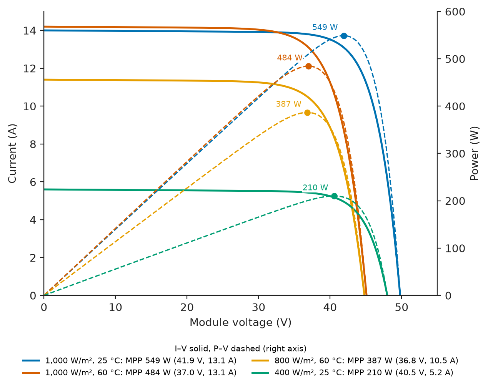
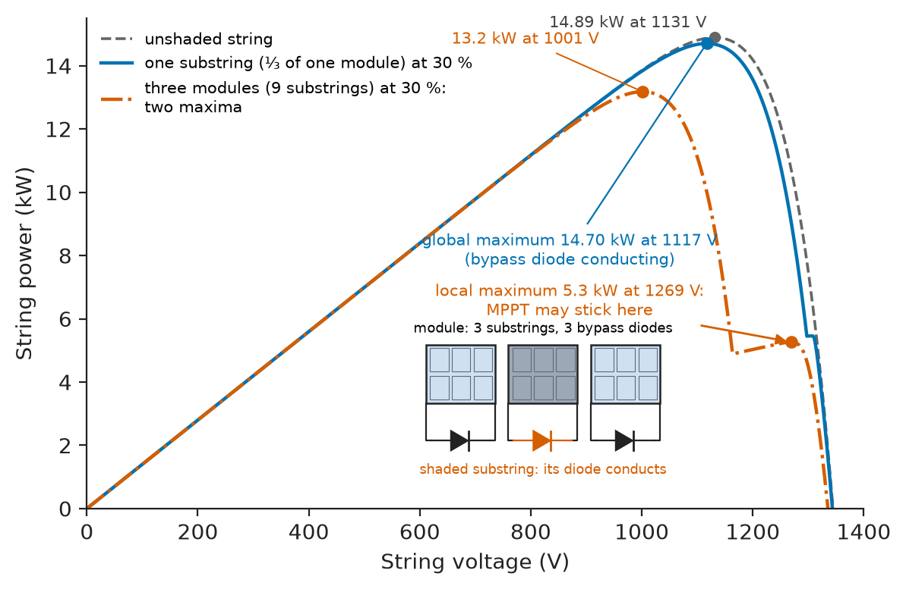
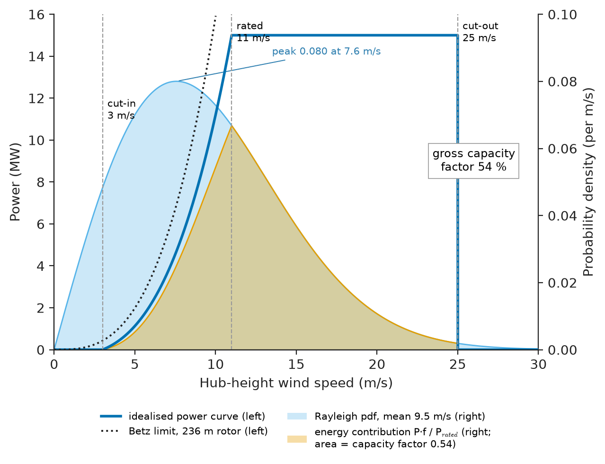
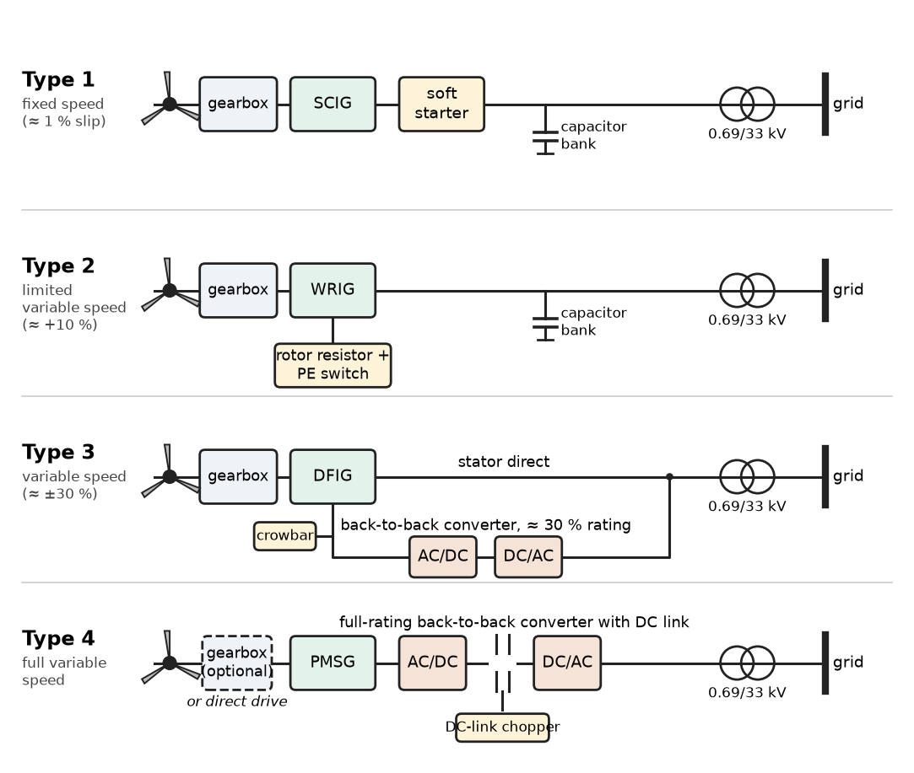
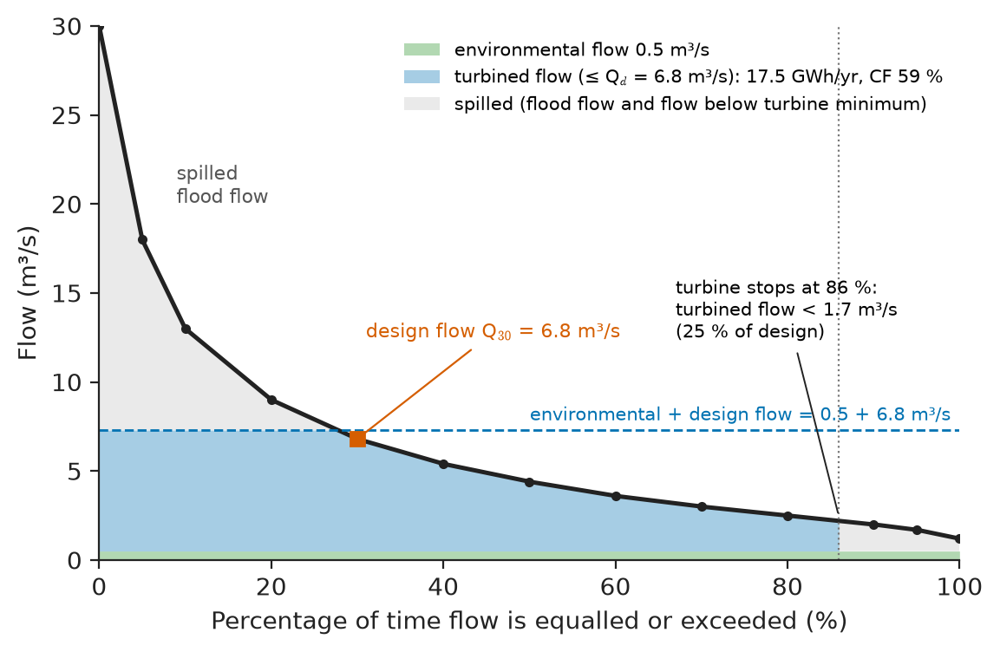
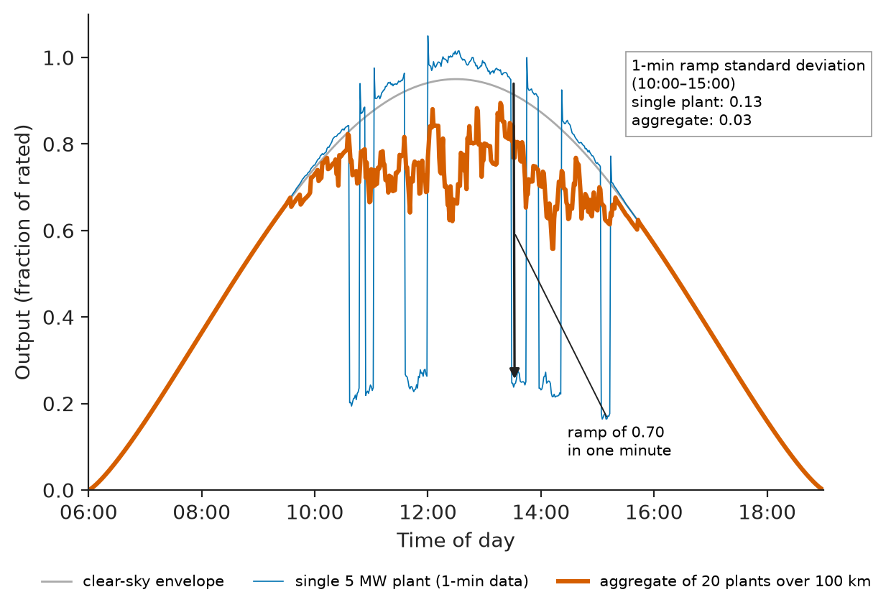

# Chapter 15 — Renewable Energy Systems

*Part IV · Power Generation*

A 50 MW solar plant in a semi-arid region finishes its first year of operation 6 % below the energy its lenders were promised. The modules are fine: flash tests on a sample match their datasheets. The shortfall is a stack of small things. The year was slightly less sunny than the long-term average; the satellite irradiance data used in the yield study were a few percent high for that site; dust storms soiled the modules more than the 2 % allowed for; the inverters clipped more noon energy than modelled because the DC array was oversized; and the grid operator curtailed output on 40 spring afternoons when the regional network was full. None of these is a failure of physics; all of them are failures to quantify a resource that varies from second to second and from year to year, and to follow it through every conversion step to the meter. Wind farms, small hydro schemes, biomass plants and geothermal stations each have their own version of the same problem. This chapter takes the five main renewable technologies from resource to grid connection, and then asks the three questions every investor and grid operator asks of them: how much energy, at what capacity factor, and how predictably.

> **How are sunlight, wind, flowing water, biomass and the Earth's heat converted into grid electricity, and where are the losses in each chain?**
> **How is a renewable resource measured and turned into a bankable energy estimate, and how do capacity factor, variability and forecast error shape the role of these plants in the power system?**

| Concept | Engineering destination |
|---|---|
| Solar photovoltaic generation | Module and string design, inverter sizing, rooftop and utility PV plants |
| Wind generation | Turbine selection, generator topologies, wind-farm layout and grid interface |
| Hydroelectric systems | Small and run-of-river schemes, design-flow selection, mini-grids |
| Biomass generation | Sugar-mill and wood-fired CHP, biogas engines, co-firing |
| Geothermal energy | Flash and binary plants, brine management, baseload renewables |
| Renewable-resource assessment | Yield studies, P50 and P90 estimates, project finance |
| Energy conversion | Loss chains, performance ratio, inverter-based versus synchronous interfaces |
| Capacity factor | Plant comparison, capacity credit, replacement of thermal plant |
| Variability and forecasting | Reserves, ramp limits, storage sizing, market bidding |

**Roadmap.** Photovoltaics (15.1) → wind (15.2) → small and run-of-river hydro (15.3) → biomass (15.4) → geothermal (15.5) → how the resource is measured and turned into an energy estimate (15.6) → the conversion chains compared (15.7) → capacity factor and capacity credit (15.8) → variability and its forecasting (15.9).

---

## 15.1 Solar photovoltaic generation

> **Boundary.** Band gaps of the common semiconductors are in *Engineering Physics*, [Ch. 6 §6.6](https://github.com/The-Studio-of-Sadiq/Engineering-Physics/blob/main/CHAPTERS/CHAPTER%206.md); the p-n junction, the Shockley diode equation, the illuminated cell $I=I_0(e^{eV/k_BT}-1)-I_{SC}$, its open-circuit voltage and the Shockley–Queisser limit of about 33 % are in [Ch. 14 §14.5.4–14.5.5](https://github.com/The-Studio-of-Sadiq/Engineering-Physics/blob/main/CHAPTERS/CHAPTER%2014.md); the blackbody spectrum behind that limit is in [Ch. 10 §10.8.4](https://github.com/The-Studio-of-Sadiq/Engineering-Physics/blob/main/CHAPTERS/CHAPTER%2010.md). This section starts from the single cell and builds the plant.

### From cell to module

A single crystalline-silicon cell gives about 0.6–0.7 V at open circuit and, in today's 182 mm or 210 mm wafer formats, 13–18 A at short circuit. A **module** connects 60, 72 or (as half-cut cells) 120, 132 or 144 cells in series, laminated between glass and a polymer or glass back sheet, with **bypass diodes** across groups of 20–24 cells. Ratings are given at **standard test conditions** (STC: irradiance 1,000 W/m², cell temperature 25 °C, AM1.5 spectrum; IEC 60904-3), and design and type approval follow IEC 61215 and IEC 61730. Table 15.1 gives representative commercial values.

**Table 15.1 — Representative PV module technologies (commercial, typical).**

| Technology | Module efficiency | Power temperature coefficient | Notes |
|---|---|---|---|
| Mono-Si PERC | 21–22 % | −0.34 to −0.37 %/K | Mainstream until about 2023 |
| Mono-Si TOPCon | 22–23.5 % | −0.29 to −0.32 %/K | Current mainstream, often bifacial |
| Silicon heterojunction (HJT) | 22.5–24 % | −0.24 to −0.26 %/K | Best hot-climate performance |
| Back-contact silicon | 23–24.5 % | −0.26 to −0.30 %/K | Premium rooftop and utility |
| Cadmium telluride thin film | 19–20 % | −0.28 to −0.32 %/K | Utility scale, good in diffuse light and heat |
| Perovskite–silicon tandem | Lab cells above 33 % | Under evaluation | Pre-commercial; stability is the open issue |

A typical 144-half-cell TOPCon module rated 550 W has, at STC, $V_{OC}=49.8$ V, $I_{SC}=14.0$ A, $V_{mp}=41.9$ V and $I_{mp}=13.1$ A, on a 2.58 m² area (21.3 %).

### Irradiance and temperature

Two environmental variables move the operating point (Figure 15.1). Short-circuit current, and therefore power, is nearly proportional to the irradiance $G$ reaching the cells. Voltage falls with cell temperature at roughly −0.27 %/K for $V_{OC}$ and −0.3 to −0.35 %/K for maximum power, the consequence of the exponential temperature dependence of $I_0$. Cell temperature is estimated from ambient temperature $T_a$ with the nominal operating cell temperature (NOCT, typically 42–46 °C at 800 W/m², 20 °C ambient, 1 m/s wind):

$$
T_c\approx T_a+\frac{\mathrm{NOCT}-20}{800}\,G,\qquad P\approx P_\text{STC}\,\frac{G}{1000}\left[1+\gamma\,(T_c-25)\right]
$$

where $\gamma$ is the power temperature coefficient (negative).

> **Status of the principle: NOCT cell-temperature and linear power model**
> *Empirical.* Fitted to open-rack modules in moderate wind; it underestimates cell temperature for roof-integrated modules with poor rear ventilation, ignores wind speed and thermal lag, and the linear power model loses accuracy below about 200 W/m², where the module's low-irradiance efficiency falls. Yield-modelling software uses more detailed fits (Faiman, Sandia, PVsyst models).

**Worked example — module output on a hot afternoon.** The 550 W module ($\gamma=-0.35$ %/K, NOCT 45 °C) sees 800 W/m² at an ambient temperature of 35 °C. Its cells run at $T_c=35+(45-20)/800\times800=60$ °C, 35 K above STC, and

$$
P\approx550\times0.8\times\left(1-0.0035\times35\right)=386\ \mathrm{W}
$$

The temperature alone costs 12 % of the output. An HJT module with $\gamma=-0.25$ %/K would lose 8.75 %, which is why low temperature coefficients command a premium in hot climates.

<!-- FIGURE 15.1 | figures/ch15/fig-15-1-pv-module-iv-curves.png | plot | Current-voltage and power-voltage curves of a 550 W module at three irradiances and two cell temperatures. | Content: x-axis voltage 0 to 55 V; left y-axis current 0 to 15 A; right y-axis power 0 to 600 W. I-V curves (solid) at 1,000 W/m2 and 25 C (Isc 14.0 A, Voc 49.8 V, MPP 41.9 V, 13.1 A), 1,000 W/m2 and 60 C (Isc 14.2 A, Voc 45.1 V), 800 W/m2 and 60 C (Isc 11.4 A, Voc 44.8 V, MPP about 36.5 V, 10.6 A, 386 W), 400 W/m2 and 25 C (Isc 5.6 A, Voc 48.0 V). Matching P-V curves dashed on the right axis. Mark each maximum power point with a dot and its value. -->

*Figure 15.1 — Current-voltage and power-voltage curves of a 550 W module at three irradiances and two cell temperatures.*

### Strings, arrays and inverters

Modules are connected in series into **strings** to reach the inverter's input voltage, and strings in parallel to reach its power. The upper limit is the maximum system voltage (1,000 V or, for utility plants, 1,500 V DC under IEC 60364-7-712 and the module's own rating), which must not be exceeded even at the lowest expected cell temperature, when $V_{OC}$ is highest.

**Worked example — string sizing for a 1,500 V system.** The site minimum ambient temperature is −10 °C; at dawn on such a day the cells are at ambient with irradiance enough to bring the string to open circuit. With a $V_{OC}$ temperature coefficient of −0.27 %/K, at 35 K below STC

$$
V_{OC,\max}=49.8\times(1+0.0027\times35)=54.5\ \mathrm{V},\qquad N_{\max}=\left\lfloor\frac{1500}{54.5}\right\rfloor=27
$$

A 27-module string has a maximum-power voltage of 1,131 V at STC and, with cells at 70 °C on a summer afternoon ($V_{mp}$ falling at −0.35 %/K), $27\times41.9\times(1-0.0035\times45)=953$ V, which must stay above the inverter's minimum MPPT voltage. The string power at STC is $27\times550=14.85$ kW. String fuses and cables are sized on $1.25\,I_{SC}$, often with a further 1.25 factor (IEC 62548), about 22 A here.

Three inverter architectures dominate: **central inverters** of 2–6 MVA with 1,000–1,500 V DC input for utility plants; **string inverters** of 3–350 kW, each with several MPPT inputs, for commercial roofs and increasingly for utility plants; and **microinverters or optimisers** at module level for shaded residential roofs. Every inverter runs a **maximum power point tracking** (MPPT) algorithm, typically perturb-and-observe or incremental conductance, which adjusts its DC input voltage continuously to hold the array at the knee of its P–V curve. Inverter circuits are the subject of *Electronics & Computing*; their grid behaviour is the subject of Chapter 27.

### Partial shading and bypass diodes

Series connection makes a string only as strong as its weakest cell. If one cell is shaded, the string current forces it into reverse bias, where it dissipates power as heat and can form a **hot spot** that damages the module. Bypass diodes conduct around the shaded substring, limiting the loss to that substring, but they create several local maxima in the string's P–V curve (Figure 15.2). A simple MPPT can lock onto a local peak; modern inverters perform periodic global scans. Shading by a chimney or a neighbouring row of modules at low sun angles is the most common avoidable loss in rooftop systems, and inter-row spacing on ground-mounted plants is chosen to keep winter-noon shading acceptable.

<!-- FIGURE 15.2 | figures/ch15/fig-15-2-partial-shading-pv-curve.png | plot | Power-voltage curves of a 27-module string under partial shading, showing how bypass diodes create a local maximum that can trap a simple MPPT. | Content: x-axis string voltage 0 to 1,400 V; y-axis string power 0 to 15.5 kW. 27 modules, 81 bypassed substrings, shaded substrings at 30 percent irradiance. Dashed curve: unshaded string, single maximum 14.89 kW at 1,131 V. Solid curve: one substring (one third of one module) shaded; its bypass diode conducts and the curve keeps a single maximum, 14.70 kW at 1,117 V, with only a small step near 1,300 V where the shaded substring limits current (no distinct local peak). Dash-dot curve: three modules (9 substrings) shaded; two maxima, a global maximum 13.2 kW at 1,001 V (bypass diodes conducting) and a local maximum 5.3 kW at 1,269 V (shaded substrings limiting current). Arrow to the local peak labelled MPPT may stick here. Inset: schematic of a module with three substrings and three bypass diodes, the shaded substring's diode conducting. -->

*Figure 15.2 — Power-voltage curves of a 27-module string under partial shading, showing how bypass diodes create a local maximum that can trap a simple MPPT.*

### Plant design choices

Utility plants have converged on a few design decisions:

- **DC/AC ratio** (array STC power over inverter AC rating) of 1.2–1.4. Oversizing the array fills the inverter for more hours at the cost of clipping a few percent of noon energy; inverters are cheaper per watt than ever, but the grid connection is not.
- **Single-axis trackers** that turn rows east to west raise annual yield by 15–25 % at low latitudes for a 5–10 % cost increase, and are standard in sunny regions; **bifacial** modules collect 5–10 % extra from ground-reflected light, more over bright sand or snow.
- **Degradation** of 0.4–0.55 % a year is assumed over a 30-year life; light- and elevated-temperature-induced degradation in the first months adds 1–2 %.
- Grid-connected plants of tens of megawatts collect at 33 kV through inverter transformers; larger ones step up to 132–400 kV.

---

## 15.2 Wind generation

> **Boundary.** Mass and momentum conservation in a fluid and Bernoulli's equation are in *Engineering Physics*, [Ch. 15 §15.4–15.5](https://github.com/The-Studio-of-Sadiq/Engineering-Physics/blob/main/CHAPTERS/CHAPTER%2015.md); turbulence as the regime that has no exact model is in §15.8.2. The rotor-aerodynamic limit below is not in that book and is given here in brief.

### Power in the wind and the Betz limit

The kinetic energy carried per second through an area $A$ perpendicular to a wind of speed $v$ and density $\rho$ is

$$
P_w=\tfrac12\rho A v^3
$$

The cube makes wind power acutely sensitive to speed: 10 % more wind gives 33 % more power. A rotor cannot capture all of it, because the air must leave with some speed or it would pile up. Treat the rotor as a thin actuator disc that slows the wind from $v$ far upstream to $v(1-a)$ at the disc and $v(1-2a)$ far downstream, where $a$ is the axial induction factor. Applying mass conservation, the momentum balance and Bernoulli's equation on each side of the disc gives the power extracted as $P=2\rho Av^3a(1-a)^2$, a power coefficient $C_p=P/P_w=4a(1-a)^2$, and a maximum where $dC_p/da=0$:

$$
a=\tfrac13,\qquad C_{p,\max}=\frac{16}{27}=0.593
$$

> **Status of the principle: Betz limit**
> *Derived.* Follows from conservation of mass, momentum and energy for an ideal, frictionless, non-rotating actuator disc in an unbounded uniform stream; real rotors fall below it because of wake rotation, finite blade number (tip losses) and profile drag, and reach aerodynamic $C_p$ of about 0.45–0.50.

### Rotor control and the power curve

A rotor's power coefficient depends on the **tip-speed ratio** $\lambda=\omega R/v$ and on the blade pitch angle $\beta$. Three-bladed rotors reach their maximum $C_p$ at $\lambda\approx7$–$9$. A variable-speed turbine therefore runs in four regions, which together make the **power curve** of Figure 15.3:

1. Below the **cut-in** speed (typically 3 m/s) the rotor idles.
2. Between cut-in and **rated** speed (10–13 m/s), the controller varies rotor speed in proportion to wind speed to hold $\lambda$ at its optimum and $C_p$ at its maximum, so power rises roughly as $v^3$.
3. Between rated and **cut-out** speed (typically 25 m/s), the blades are pitched to shed excess power and hold rated output; generator torque and rotor speed are held near their limits.
4. Above cut-out the turbine feathers its blades and stops, to protect the structure; many modern turbines ramp down gradually between 25 and 30 m/s instead.

Rotor tip speed is limited to about 80–90 m/s onshore (noise) and around 100 m/s offshore (leading-edge erosion), so large rotors turn slowly. A 236 m rotor at $\lambda=8$ in a 10 m/s wind turns at $\omega=8\times10/118=0.68$ rad/s, 6.5 rpm, with an 80 m/s tip speed.

**Worked example — a 15 MW offshore turbine.** A turbine with a 236 m rotor ($A=43{,}740$ m²) in air of density 1.225 kg/m³ sees, at 10 m/s, a wind power of $\tfrac12\times1.225\times43{,}740\times10^3=26.8$ MW, of which the Betz limit allows 15.9 MW. At its rated speed of 11 m/s the wind power is 35.7 MW; delivering 15 MW through a drivetrain and converter with a combined efficiency of 94 % needs an aerodynamic $C_p$ of $15/(0.94\times35.7)=0.45$, close to the practical maximum. Now place it at a site where the hub-height wind follows a Rayleigh distribution (a Weibull distribution with shape factor $k=2$) of mean 9.5 m/s, and idealise its power curve as $P=15\,(v^3-3^3)/(11^3-3^3)$ MW between 3 and 11 m/s, 15 MW from 11 to 25 m/s and zero otherwise. Integrating the power curve against the distribution numerically gives a mean output of 8.10 MW, a gross capacity factor of 54 % and 71.0 GWh a year. The wind is above rated speed 35 % of the time and below cut-in 7.5 %. After 10 % wake losses within the farm and 3 % for availability and electrical losses, the net figures are 47 % and 62 GWh. The same turbine at sites with mean speeds of 7.5 and 6.5 m/s would reach gross capacity factors of 39 % and 30 %.

<!-- FIGURE 15.3 | figures/ch15/fig-15-3-wind-power-curve-and-distribution.png | plot | Power curve of a 15 MW turbine with the Rayleigh wind-speed distribution of a 9.5 m/s site and the resulting energy distribution. | Content: x-axis hub-height wind speed 0 to 30 m/s. Left y-axis power 0 to 16 MW: idealised power curve rising as (v cubed minus 27)/(1331 minus 27) times 15 MW from 3 to 11 m/s, flat 15 MW to 25 m/s, zero above; dotted Betz-limit curve 16/27 times 0.5 rho A v cubed for comparison up to 12 m/s. Right y-axis probability density 0 to 0.10 per m/s: Rayleigh distribution with mean 9.5 m/s (peak about 0.080 at 7.6 m/s), shaded. Second shaded curve: energy contribution (power times probability) peaking around 11 to 12 m/s. Annotations: cut-in 3 m/s, rated 11 m/s, cut-out 25 m/s, gross capacity factor 54 percent. -->

*Figure 15.3 — Power curve of a 15 MW turbine with the Rayleigh wind-speed distribution of a 9.5 m/s site and the resulting energy distribution.*

### The wind resource near the ground

Wind speed increases with height above ground because of surface friction. Over open terrain the profile is often approximated by the power law $v(h)=v_\text{ref}(h/h_\text{ref})^\alpha$ with $\alpha\approx0.14$ (the "one-seventh law") over flat open land, 0.10–0.12 offshore and 0.2–0.3 over forest or in stable night-time conditions. Raising a hub from 100 m to 150 m with $\alpha=0.14$ gains $1.5^{0.14}=1.058$ in speed and $1.5^{0.42}=1.19$ in power, which is why onshore hub heights have risen from 80 m to 120–170 m. Turbines are designed for a wind class under IEC 61400-1: classes I, II and III correspond to reference 10-min extreme speeds of 50, 42.5 and 37.5 m/s (annual means up to 10, 8.5 and 7.5 m/s), with turbulence categories A, B and C. A low-wind class III turbine has a larger rotor for the same generator.

Turbines in a farm shade each other. A wake recovers over 5–10 rotor diameters; typical spacing is 5–9 diameters in the prevailing wind direction and 3–5 across it, and wake losses are 5–15 % of the energy of an isolated turbine, more in large offshore arrays.

### Generator topologies

The electrical side of a wind turbine has gone through four generations, classified in IEEE and IEC grid-integration work as Types 1 to 4 (Figure 15.4).

**Table 15.2 — Wind-turbine generator types.**

| Type | Generator and converter | Speed range | Grid behaviour | Status |
|---|---|---|---|---|
| 1 | Squirrel-cage induction generator, directly connected, capacitor bank | Fixed (about 1 % slip) | Absorbs reactive power; power fluctuates with gusts; large fault current | Legacy, small units |
| 2 | Wound-rotor induction generator with variable rotor resistance | About 10 % above synchronous | As Type 1, softer torque | Legacy |
| 3 | Doubly-fed induction generator (DFIG), rotor fed by back-to-back converter of 25–35 % rating | About ±30 % | Controllable P and Q; stator directly on grid; fault ride-through needs a crowbar or chopper | Common onshore up to ~6 MW |
| 4 | Synchronous (often permanent-magnet) or induction generator behind a full-rating converter, geared or direct-drive | Full range | Fully decoupled from grid; behaviour set by converter control; fault current limited to 1.1–1.5 pu | Standard offshore and for the largest onshore turbines |

The machines themselves (induction machines, PMSMs, specialised generators) are in Chapters 6–8, and the drive-side control of their converters follows the methods of Chapter 12. A Type 4 turbine is electrically an inverter-based resource like a PV plant: it has no natural inertia and no large fault current, which is a central theme of Chapter 27.

<!-- FIGURE 15.4 | figures/ch15/fig-15-4-wind-generator-types.png | block-diagram | The four wind-turbine generator types from fixed-speed induction to full-converter machines. | Content: four rows, each left to right. Type 1: rotor, gearbox, squirrel-cage induction generator, soft starter, capacitor bank, transformer 0.69/33 kV, grid. Type 2: rotor, gearbox, wound-rotor induction generator with rotor resistor block and power-electronic switch, capacitor bank, transformer, grid. Type 3: rotor, gearbox, DFIG with stator directly to transformer and rotor through back-to-back converter (labelled 30 percent rating) to the same transformer, crowbar on rotor side. Type 4: rotor, optional gearbox (drawn dashed) or direct drive, PMSG, full-rating back-to-back converter with DC link and chopper, transformer, grid. Label each with typical speed range. -->

*Figure 15.4 — The four wind-turbine generator types from fixed-speed induction to full-converter machines.*

---

## 15.3 Hydroelectric systems

> **Boundary.** The hydro power equation $P=\eta_t\eta_g\rho gQH_n$, turbine types, water hammer and governing are in Chapter 14 §14.4. This section treats hydro as a variable renewable resource: small and run-of-river schemes without large storage, whose output follows the river.

### Small hydro and run-of-river

"Small hydro" is defined by capacity, with thresholds that vary by country from 10 MW to 50 MW; mini (below about 1 MW), micro (below 100 kW) and pico (below 5 kW) schemes serve villages, farms and remote telecommunications sites. Most are **run-of-river**: a low weir diverts part of the river through an intake, a headrace canal or pipe and a penstock to a powerhouse, and returns it downstream. With little or no storage, output follows the river's flow from day to day and season to season, and the key resource description is the **flow-duration curve** (FDC): the flow plotted against the percentage of time it is equalled or exceeded.

### Choosing the design flow

The design (rated) flow of the turbine sets both its cost and its energy. A turbine sized for a high flow captures flood flows but runs at part load or stops for much of the year; one sized for a low flow runs full most of the time but spills the rest. Two further constraints enter: an **environmental (residual) flow** must be left in the river reach between intake and outfall, and each turbine type has a minimum operating flow (about 10–20 % of rated for Pelton and Kaplan, 30–40 % for Francis).

**Worked example — sizing a run-of-river scheme.** A river at a proposed intake has the flow-duration curve of Figure 15.5: 30 m³/s exceeded 0 % of the time (peak flood), 13 m³/s exceeded 10 %, 6.8 m³/s exceeded 30 %, 4.4 m³/s exceeded 50 %, 2.5 m³/s exceeded 80 % and 1.2 m³/s exceeded 100 % of the time. The net head is 60 m, the overall water-to-wire efficiency 85 %, an environmental flow of 0.5 m³/s must pass the weir, and the turbine shuts down below 25 % of its rated flow. Integrating the power over the FDC numerically for several design flows gives:

| Design flow (m³/s) | Rated power (MW) | Annual energy (GWh) | Capacity factor |
|---|---|---|---|
| 4.4 ($Q_{50}$) | 2.20 | 14.5 | 75 % |
| 5.4 ($Q_{40}$) | 2.70 | 16.0 | 68 % |
| 6.8 ($Q_{30}$) | 3.40 | 17.5 | 59 % |
| 9.0 ($Q_{20}$) | 4.50 | 18.8 | 48 % |
| 13.0 ($Q_{10}$) | 6.50 | 19.2 | 34 % |

Rated power is $9.81\times0.85\times60\times Q_d$ kW. Raising the design flow from $Q_{40}$ to $Q_{20}$ adds 67 % to the turbine and generator size but only 17 % to the energy; going on to $Q_{10}$ adds almost nothing. A design flow around $Q_{25}$–$Q_{35}$ is a common optimum, and the choice of two unequal units rather than one extends the low-flow operating range.

<!-- FIGURE 15.5 | figures/ch15/fig-15-5-flow-duration-curve.png | plot | Flow-duration curve of a run-of-river site with design flow, environmental flow and the energy captured. | Content: x-axis percentage of time flow equalled or exceeded 0 to 100 percent; y-axis flow 0 to 30 m3/s. Curve through (0, 30), (5, 18), (10, 13), (20, 9), (30, 6.8), (40, 5.4), (50, 4.4), (60, 3.6), (70, 3.0), (80, 2.5), (90, 2.0), (95, 1.7), (100, 1.2). Horizontal band 0 to 0.5 m3/s labelled environmental flow. Horizontal line at 6.8 m3/s labelled design flow Q30. Shaded area between environmental flow and the lesser of (curve minus 0.5) and 6.8 m3/s, labelled turbined flow, ending where turbined flow falls below 1.7 m3/s (25 percent of design). Unshaded area above the design line labelled spilled flood flow. -->

*Figure 15.5 — Flow-duration curve of a run-of-river site with design flow, environmental flow and the energy captured.*

### Electrical side

Small hydro units of up to a few megawatts often use induction generators, which need no synchroniser or exciter and simply run slightly above synchronous speed when connected to the grid; synchronous generators are used where the unit must run islanded or support a weak grid. In isolated mini-grids, where a governor is too expensive, an **electronic load controller** keeps the turbine fully loaded and diverts surplus power to ballast heaters, holding frequency by dumping energy rather than adjusting water. Grid-connected small hydro is classed as distributed generation and connects under the distribution rules of Chapter 22.

---

## 15.4 Biomass generation

> **Boundary.** The Rankine cycle is in *Engineering Physics*, [Ch. 19 §19.5.2](https://github.com/The-Studio-of-Sadiq/Engineering-Physics/blob/main/CHAPTERS/CHAPTER%2019.md); its realisation in a utility steam plant is in Chapter 14 §14.1. Biomass plants are small steam plants with an awkward fuel.

### Fuels

Biomass for power is mainly wood (forestry residues, chips, pellets), agricultural residues (sugar-cane bagasse, rice husk, straw, palm-oil residues), energy crops and wet wastes converted to biogas. The decisive property is moisture, because every kilogram of water in the fuel must be evaporated in the furnace and leaves up the stack. A useful approximation for the lower heating value of wet fuel with moisture fraction $w$ (wet basis) is

$$
\mathrm{LHV}_\text{wet}\approx\mathrm{LHV}_\text{dry}\,(1-w)-2.44\,w\quad\mathrm{MJ/kg}
$$

where 2.44 MJ/kg is the latent heat of water at 25 °C.

**Table 15.3 — Representative biomass fuel properties.**

| Fuel | Moisture (wet basis) | LHV as received (MJ/kg) | Ash (dry) |
|---|---|---|---|
| Wood pellets | 6–10 % | 16.5–17.5 | 0.5–1 % |
| Fresh wood chips | 40–55 % | 7–10 | 1–3 % |
| Sugar-cane bagasse | 48–52 % | 7.5–8.5 | 2–4 % |
| Rice husk | 8–12 % | 13–15 | 15–20 % |
| Cereal straw (baled) | 12–18 % | 13–15 | 5–8 % |
| Biogas (60 % CH₄) | Not applicable | about 21.5 MJ/m³ | Not applicable |

### Conversion routes and efficiencies

- **Dedicated steam plants** of 5–50 MW burn chips, straw or residues on grates or in fluidised beds. Their steam conditions are modest (4–10 MPa, 450–540 °C) because alkali chlorides in the ash corrode superheaters, so net electrical efficiencies are 20–32 % (Table 14.1). Large converted coal units burning pellets (Drax in the UK) reach 36–38 %.
- **Co-firing** a few to 20 % biomass in a coal unit uses the coal plant's efficiency and emission controls at little extra cost.
- **Combined heat and power** is the natural use of biomass in industry: sugar mills, paper mills and sawmills have both residues and a heat demand. Modern high-pressure sugar-mill cogeneration exports 100–130 kWh per tonne of cane crushed.
- **Biogas** from anaerobic digestion of manure, food waste or sewage sludge, and **landfill gas**, are burned in reciprocating gas engines of 0.5–4 MW at 38–42 % electrical efficiency, often with heat recovery.
- **Gasification** converts solid biomass to a combustible gas for an engine or turbine; it promises higher efficiency at small scale but has struggled with tar removal.

**Worked example — bagasse for a sugar-mill power plant.** A mill plans a cogeneration plant with 25 MW net electrical output at a net electrical efficiency of 24 % (the rest of the steam serves the mill's process). Bagasse at 50 % moisture with a dry LHV of 18.5 MJ/kg has

$$
\mathrm{LHV}_\text{wet}=18.5\times0.5-2.44\times0.5=8.03\ \mathrm{MJ/kg}
$$

The fuel power is $25/0.24=104$ MW, so the plant burns $104/8.03=13.0$ kg/s, 46.7 t/h. Over a 200-day crushing season at 24 h a day that is about 224,000 t of bagasse; at a bagasse yield of 30 % of cane mass, the mill must crush about 750,000 t of cane to fuel the plant. Outside the season the plant stops or burns stored or purchased fuel, so its annual capacity factor is often only 50–60 %, and a mill that wants year-round export must stockpile bagasse or buy wood chips.

### Is biomass carbon-neutral?

The CO₂ released by burning biomass was absorbed from the atmosphere as the plant grew, so its stack emissions are conventionally counted as zero in national energy statistics. The real climate effect depends on what would have happened otherwise. Residues that would decay within a few years anyway (bagasse, straw, sawdust) come close to neutral; harvesting whole trees from slow-growing forests creates a carbon debt that may take decades to repay. Fuel collection, drying, pelletising and long-distance shipping add 5–30 % of the energy content. Combined with carbon capture (BECCS), biomass is one of the few routes to net removal of CO₂, at the energy penalty discussed in Chapter 14 §14.9.

---

## 15.5 Geothermal energy

> **Boundary.** The Carnot efficiency $\eta_C=1-T_c/T_h$ is in *Engineering Physics*, [Ch. 10 §10.6](https://github.com/The-Studio-of-Sadiq/Engineering-Physics/blob/main/CHAPTERS/CHAPTER%2010.md). Geothermal plants are the clearest case in this book of a heat engine running close to that limit's floor, at low source temperature.

### Resources and plant types

The Earth's crust warms by about 25–30 K per kilometre of depth on average, much more in volcanic regions and along plate boundaries, where water-filled reservoirs at 150–350 °C lie 1–3 km down. Power plants tap them through production wells and return the cooled fluid through reinjection wells. Four plant types match four resource types:

- **Dry steam** plants pass steam from the reservoir directly to a turbine (The Geysers, California; Larderello, Italy). Rare resources, simplest plant.
- **Flash** plants take a high-pressure hot-water or two-phase fluid, flash part of it to steam in a separator at reduced pressure, and send the steam to a condensing turbine; double-flash plants flash the remaining brine again at lower pressure for 15–25 % more output. Most of the world's geothermal capacity (Indonesia, the Philippines, Kenya's Olkaria, Iceland, New Zealand) is flash.
- **Binary** plants pass moderate-temperature brine (100–180 °C) through a heat exchanger that boils a low-boiling organic working fluid (isopentane, n-pentane, R245fa) in an organic Rankine cycle (ORC). The brine never touches the turbine and is fully reinjected, so emissions of non-condensable gases are near zero.
- **Enhanced geothermal systems** (EGS) create permeability in hot dry rock by hydraulic stimulation and circulate water through it; recent projects using horizontal drilling from the oil-and-gas industry are moving them toward commercial scale.

### Why the efficiency is low

The resource is hot water, not a fuel, and it gives up its heat over a falling temperature range. The maximum work obtainable from brine cooled from $T_h$ to $T_r$ with a heat sink at $T_0$ is its exergy, $\dot m c_p\left[(T_h-T_r)-T_0\ln(T_h/T_r)\right]$, well below the Carnot fraction of the heat because only the first part of the heat is delivered at $T_h$.

**Worked example — a binary geothermal plant.** A well field delivers 100 kg/s of brine ($c_p=4.25$ kJ/(kg·K)) at 160 °C; to avoid silica scaling in the reinjection wells the brine may not be cooled below 70 °C; the air-cooled condenser rejects heat at an effective 30 °C. The heat available is

$$
\dot Q=100\times4.25\times(160-70)=38.3\ \mathrm{MW_{th}}
$$

The Carnot efficiency between 160 °C and 30 °C would be 30 %, but the exergy of the brine over this range is only

$$
\dot W_\text{max}=100\times4.25\left[90-303.15\ln\frac{433.15}{343.15}\right]=8.24\ \mathrm{MW}
$$

or 21.5 % of the heat. A real ORC converts about 12 % of the heat to gross power, 4.6 MW. The feed pumps of the organic cycle, the condenser fans and the brine production and reinjection pumps take 20–30 % of gross output in binary plants; at 25 % the net output is 3.4 MW, a net thermal efficiency of 9 % but a second-law (exergy) efficiency of 42 %. The low thermal efficiency is not a sign of a poor machine; it is the thermodynamics of a low-temperature source.

### Characteristics

Geothermal plants run around the clock with capacity factors of 75–95 %, which makes them one of the few renewable sources that can serve baseload. Their capital cost is dominated by drilling: wells cost several million dollars each, and exploration risk (dry or low-productivity wells) is the main barrier to development. Reservoirs decline if fluid is extracted faster than heat is replenished, so field management with make-up wells and reinjection is a continuous task. Flash plants release dissolved CO₂ and H₂S from the reservoir fluid; emissions vary from near zero to a few hundred grams of CO₂ per kilowatt-hour depending on the field, and H₂S abatement is mandatory in most jurisdictions. Reinjection can trigger small earthquakes, a particular concern for EGS. The generators are conventional synchronous machines, so geothermal plants contribute inertia and fault current like thermal plant.

---

## 15.6 Renewable-resource assessment

### Why assessment matters

A renewable plant's costs are almost entirely fixed at financial close; its revenue depends on a resource that varies and can only be estimated. A 1 % error in mean wind speed is a 2–3 % error in energy at a typical site. Resource assessment is therefore a measurement and statistics discipline, and its products, the **P50** and **P90** energy estimates, decide how much debt a project can carry.

### Solar resource

Solar resource is described by three irradiance components: **global horizontal irradiance** (GHI), **direct normal irradiance** (DNI) and **diffuse horizontal irradiance** (DHI). Long-term estimates come from satellite-derived datasets with 10–30 years of hourly or sub-hourly data, summarised as a typical meteorological year (TMY) for simulation. A transposition model converts GHI and DHI to the **plane-of-array** (POA) irradiance on tilted or tracking modules. Annual GHI ranges from about 1,000 kWh/m² in northern Europe through 1,600–1,900 in southern Europe, India and the southern US to 2,200–2,500 in the deserts of Chile, Namibia, the Middle East and Australia. Satellite data carry 3–6 % uncertainty in annual GHI; a year of on-site measurement with secondary-standard pyranometers (IEC 61724-1 Class A monitoring) reduces it through site adaptation. Interannual variability of annual GHI is 2–5 %.

### Wind resource

Wind assessment needs on-site measurement because wind speed depends strongly on local terrain, roughness and height. A campaign of at least one year uses a met mast with calibrated cup anemometers and vanes at several heights, or a ground-based lidar, ideally both. The short record is related to a long-term reference (a nearby station or a reanalysis dataset) by **measure–correlate–predict** to estimate the long-term mean; the shear profile extrapolates it to hub height; a flow model (linear models for simple terrain, computational fluid dynamics for complex terrain) spreads it across the turbine positions; and the measured frequency distribution, often fitted with a Weibull distribution of shape factor $k=1.8$–$2.5$, is combined with each turbine's power curve, corrected for site air density, and with a wake model. Interannual variability of annual wind energy is typically 4–8 %, larger than for solar.

### Hydro, biomass and geothermal

Hydro assessment relies on long river-gauge records, synthesised for ungauged catchments from rainfall and catchment area; climate change makes the past an imperfect guide. Biomass assessment is a supply-chain study: residue availability, competing uses and transport distance. Geothermal assessment starts with surface geology and geochemistry and ends with test wells and flow tests; its uncertainty is the largest and is resolved only by drilling.

### From P50 to P90

The **P50** is the annual energy that is expected to be exceeded with 50 % probability; the **P90** is exceeded with 90 % probability. Independent uncertainties (expressed as standard deviations in percent of energy) are combined in quadrature, and with a normal distribution

$$
P_{90}=P_{50}\left(1-1.282\,\sigma\right)
$$

where $\sigma$ is the combined relative standard deviation. Interannual variability averages out over a debt term, so a ten-year P90 divides that component by $\sqrt{10}$.

> **Status of the principle: Normal uncertainty model for energy yield**
> *Approximate.* Assumes independent, normally distributed error components; it understates the tails when errors are correlated or skewed (curtailment, long outages, multi-year climate anomalies) and says nothing about systematic bias in the P50 itself, which industry back-casting studies have shown to be several percent optimistic for many portfolios.

**Worked example — P90 for the 50 MW solar plant.** The opening plant's yield study gave a P50 of 90 GWh/yr with uncertainties of 4.0 % (interannual variability of irradiance), 4.5 % (long-term irradiance dataset), 2.0 % (transposition model), 3.0 % (simulation and loss model) and 2.0 % (soiling and availability assumptions). Combined in quadrature, $\sigma_1=\sqrt{4.0^2+4.5^2+2.0^2+3.0^2+2.0^2}=7.3\ \%$, so the one-year P90 is $90\times(1-1.282\times0.073)=81.6$ GWh. Over ten years the interannual term falls to $4.0/\sqrt{10}=1.26\ \%$, $\sigma_{10}=6.2\ \%$ and the ten-year P90 is 82.8 GWh. A first-year yield 6 % below P50, 84.6 GWh, lies well inside the one-year distribution: unlucky, not a design failure, which is why lenders size debt on the P90 and not the P50.

---

## 15.7 Energy conversion

### The loss chains compared

Each renewable technology converts its resource through a chain of steps, each with a loss. For PV the chain from plane-of-array irradiance to AC energy at the grid connection is summarised by the **performance ratio** (PR), the ratio of actual AC yield to the yield a lossless system would give at STC efficiency (IEC 61724-1). A typical loss budget for a well-designed utility plant is soiling 2 %, temperature 6 %, mismatch and light-induced degradation 2 %, DC cabling 1.5 %, low-irradiance and spectral effects 1.5 %, inverter 2 %, MV transformer 1 %, AC cabling 0.5 % and availability 1 %. Multiplying the remaining fractions,

$$
PR=0.98\times0.94\times0.98\times0.985\times0.985\times0.98\times0.99\times0.995\times0.99=0.837
$$

**Worked example — specific yield and capacity factor of a tracker plant.** A single-axis-tracked plant in a sunny region receives 2,100 kWh/m² a year in the plane of array. With PR = 0.837 the specific yield is $2100\times0.837=1{,}758$ kWh per kWp of STC array power. The capacity factor on the DC rating is $1758/8760=20.1\ \%$; on the AC rating, with a DC/AC ratio of 1.25 and clipping already counted in the losses, it is about 25 %. The 50 MWp plant of the opening, with 40 MW AC, would deliver about 88 GWh a year at this site.

**Table 15.4 — Conversion chains and typical overall efficiencies.**

| Technology | Conversion chain | Overall efficiency (resource to grid) | Grid interface |
|---|---|---|---|
| Crystalline-Si PV | Photons → electron–hole pairs → DC → inverter → AC | 17–20 % of incident sunlight (module 21–24 % × PR 0.80–0.87) | Inverter (grid-following, increasingly grid-forming) |
| Wind (Type 4) | Kinetic energy → rotor (Cp 0.45–0.50) → gearbox or direct drive → generator → converter → AC | 40–45 % of kinetic energy through the rotor disc at below-rated speeds | Full converter |
| Wind (Type 3) | As above, with partial converter on rotor circuit | Similar | Stator direct, rotor via converter |
| Small hydro | Potential energy → turbine → generator | 75–88 % water to wire | Synchronous or induction generator |
| Biomass steam | Chemical energy → combustion → steam cycle → generator | 20–32 % electrical (75–85 % with CHP) | Synchronous generator |
| Biogas engine | Digestion → gas engine → generator | 38–42 % of biogas energy | Synchronous generator |
| Geothermal binary | Brine heat → ORC → generator | 8–12 % net thermal (35–50 % exergy) | Synchronous generator |
| Geothermal flash | Steam → condensing turbine → generator | 10–17 % net thermal | Synchronous generator |

### Synchronous versus inverter-based interfaces

The last column of Table 15.4 divides renewable plants into two electrically different classes. Hydro, biomass and geothermal plants drive synchronous generators: they contribute rotating inertia, deliver 5–7 times rated current into a nearby fault and hold their internal EMF through disturbances, exactly like the thermal plant of Chapter 14. PV, Type 4 wind and batteries are **inverter-based resources** (IBRs): they have no intrinsic inertia, their fault current is limited by semiconductor ratings to 1.1–1.5 pu, and their response to a disturbance is whatever their control software makes it. Most present IBRs are **grid-following**: they measure the grid voltage with a phase-locked loop and inject current synchronised to it, so they rely on a strong grid formed by others. **Grid-forming** inverters, which behave as controlled voltage sources and can provide synthetic inertia and black-start, are now required for new plants in some grid codes. This difference, and not the variability of the resource, is the deepest engineering consequence of the energy transition for system stability and protection (Chapters 20, 23 and 27).

---

## 15.8 Capacity factor

### Definition and typical values

The **capacity factor** is the ratio of the energy a plant actually delivers in a period to the energy it would deliver at its rated power throughout:

$$
CF=\frac{E}{P_\text{rated}\,T}
$$

For renewable plants it is set mainly by the resource, for thermal plants mainly by economics and availability. It is always necessary to say which rating: PV capacity factors quoted on the DC (kWp) rating are 15–25 % lower than on the AC rating. Table 15.5 gives typical ranges.

**Table 15.5 — Typical annual capacity factors (net).**

| Technology | Capacity factor | Main determinant |
|---|---|---|
| Rooftop PV, northern Europe (DC basis) | 9–12 % | Latitude, cloud |
| Utility PV, fixed tilt (AC basis) | 17–25 % | Irradiance, DC/AC ratio |
| Utility PV, single-axis tracking, desert (AC basis) | 25–33 % | Irradiance, DC/AC ratio |
| Onshore wind | 25–45 % | Mean wind speed, rotor-to-generator ratio |
| Offshore wind | 40–55 % | Mean wind speed, availability (access) |
| Run-of-river hydro | 35–65 % | Hydrology, design flow |
| Reservoir hydro | 35–60 % | Water availability, dispatch strategy |
| Biomass steam and CHP | 50–85 % | Fuel supply, seasonal operation |
| Geothermal | 75–95 % | Reservoir, availability |
| Nuclear (for comparison) | 80–93 % | Refuelling outages, availability |
| Combined-cycle gas (for comparison) | 40–65 % | Merit order |

A low capacity factor is not a defect but a cost driver. A wind turbine with a larger rotor on the same generator ("low specific rating") has a higher capacity factor and produces more energy in low winds, when power is scarcer and more valuable; a PV plant with a high DC/AC ratio does the same.

**Worked example — replacing a nuclear unit's energy.** A 1,000 MW nuclear unit at a 92 % capacity factor delivers $1\times0.92\times8760=8.06$ TWh a year. Delivering the same energy needs $8.06/(0.22\times8.76)=4.2$ GW of utility PV at 22 %, or 2.6 GW of onshore wind at 35 %, or 1.9 GW of offshore wind at 48 %. The energy is the same; its timing is not. The PV produces nothing at night; the wind may produce little for a week. Replacing the nuclear unit's *firm capacity* is a separate question, answered with storage, other dispatchable plant or demand response.

### Capacity credit

The contribution of a variable plant to meeting peak demand is measured by its **capacity credit**, defined most rigorously as its **effective load-carrying capability** (ELCC): the amount by which the system's demand could rise, with the plant added, while keeping the same loss-of-load expectation (Chapter 13 §13.7). Typical ELCCs are 10–30 % of nameplate for wind, depending on the correlation of wind with peak demand, and for solar from 50–70 % at low penetration in summer-peaking systems with afternoon peaks to below 10 % at high penetration once the net peak has moved into the evening. The ELCC of every additional unit of the same technology declines, because they produce at the same times. Storage can raise the capacity credit of a PV portfolio by moving its energy into the evening peak (Chapter 16).

> **Status of the principle: Declining marginal capacity credit of correlated resources**
> *Empirical.* It is observed in every probabilistic adequacy study and follows qualitatively from the correlation of output across plants of one type, but its magnitude is system-specific and must be computed with chronological demand and resource data for each case.

---

## 15.9 Variability and forecasting

### Time scales of variability

Variability is not one phenomenon but several, each with its own engineering response:

| Time scale | Cause | Engineering response |
|---|---|---|
| Seconds | Cloud edges over a PV plant, gusts on a turbine | Inverter ramp control, smoothing by aggregation, small battery |
| Minutes | Cloud fields, wind fronts | Automatic generation control, frequency reserves (Chapter 20) |
| Hours | Diurnal solar cycle, weather systems | Dispatchable plant, storage, demand response |
| Days–weeks | Anticyclones with low wind ("dark doldrums") | Long-duration storage, firm capacity, interconnection |
| Seasons–years | Winter versus summer, dry versus wet years | Seasonal hydro storage, hydrogen, capacity planning |

A single PV plant under broken cloud can swing by 50–70 % of its output in under a minute. Island grids such as Puerto Rico and Hawaii have imposed ramp-rate limits of the order of 10 % of rated power per minute on new plants, usually met with a battery.

### Smoothing by aggregation

Fast fluctuations at different sites are weakly correlated, so they partly cancel when plants are combined. For $N$ equal plants whose fluctuations have the same standard deviation and a pairwise correlation $\rho$, the standard deviation of the aggregate, relative to that of $N$ times a single plant, is

$$
\frac{\sigma_\text{agg}}{N\sigma_1}=\sqrt{\frac{1+(N-1)\rho}{N}}
$$

For 20 uncorrelated plants it is 0.22; for 20 plants with $\rho=0.3$ it is 0.58, and even 100 such plants only reach 0.55, approaching the floor $\sqrt\rho$. Fluctuations of seconds to minutes are almost uncorrelated over a few kilometres and smooth very effectively (Figure 15.6); hourly and daily variations driven by the sun's position or large weather systems are strongly correlated over hundreds of kilometres and do not. Geographic diversity and interconnection reduce short-term reserve needs a great deal and the multi-day problem very little.

<!-- FIGURE 15.6 | figures/ch15/fig-15-6-pv-aggregation-smoothing.png | plot | Normalised output of one PV plant and of an aggregate of twenty plants on a partly cloudy day. | Content: x-axis time of day 06:00 to 19:00; y-axis output as fraction of rated 0 to 1.1. Thin grey line: clear-sky envelope peaking at 0.95 at 12:30. Jagged thin line: single 5 MW plant with one-minute data swinging between 0.2 and 1.05 (cloud enhancement) from 10:00 to 15:00, ramps of 0.6 in under one minute marked with an arrow. Thick smooth line: aggregate of twenty plants spread over 100 km, following a slowly varying curve between 0.55 and 0.8 at midday with short-term fluctuations reduced to about one fifth. Annotation box: one-minute ramp standard deviation, single plant 0.12, aggregate 0.03. -->

*Figure 15.6 — Normalised output of one PV plant and of an aggregate of twenty plants on a partly cloudy day.*

### Forecasting

Forecasts turn variability, which is a physical fact, into uncertainty, which is what costs money. Different methods dominate at different horizons:

- **Seconds to minutes**: persistence (the next value equals the present one) is hard to beat; sky cameras and upstream sensors help PV plants anticipate cloud shadows.
- **Minutes to six hours**: satellite cloud-motion vectors for solar, statistical and machine-learning models trained on recent plant output and weather observations.
- **Hours to ten days**: numerical weather prediction (NWP) ensembles, post-processed with plant-specific statistical models.

Forecast errors grow with horizon and shrink with aggregation. Typical normalised mean absolute errors (as a percentage of installed capacity) for day-ahead forecasts are 8–15 % for a single wind farm but 3–6 % for a whole national fleet, and 5–10 % for a single PV plant but 2–5 % for a national PV fleet. Error distributions have heavy tails: the rare large miss, such as a storm front arriving hours early or fog that does not lift, drives reserve requirements.

**Worked example — reserves for forecast error.** A system has 20 GW of wind with a day-ahead forecast error of standard deviation 4 % of capacity for the fleet, 800 MW, and a day-ahead demand-forecast error of standard deviation 600 MW. If the two are independent, the combined standard deviation is $\sqrt{800^2+600^2}=1{,}000$ MW, and an operator who holds reserve for three standard deviations must hold about 3 GW; without the wind it would hold 1.8 GW. Shortening the forecast horizon helps more than anything else: intraday markets and re-dispatch close to real time, where wind errors are half or less of their day-ahead size, reduce this reserve substantially, which is one reason market design has moved toward shorter gate-closure times.

### What variability means for the system

Variable renewable output enters the system as a reduction in net load (Chapter 13 §13.6). At low shares it is absorbed by the flexibility that thermal and hydro fleets already have. At higher shares it deepens the midday dip, steepens the evening ramp, lowers the minimum net load below the minimum stable output of thermal units, and causes curtailment when there is nowhere for the energy to go, as the opening plant found on spring afternoons. The responses, storage (Chapter 16), demand response and smart-grid control (Chapter 26), grid codes that require renewable plants to provide frequency and voltage support (Chapter 27), and stronger interconnection (Chapter 21), are the subject of much of the rest of this book.

---

## What remains open

| Open question | Where it is answered |
|---|---|
| How do induction, permanent-magnet and doubly-fed machines behave as wind generators? | Chapters 6–8 |
| How are the generator-side converters of wind turbines controlled? | Chapter 12 |
| How is renewable energy stored and shifted to the hours of demand? | Chapter 16 |
| How do inverter-based resources change fault levels and protection? | Chapters 19 and 23 |
| How do low inertia and grid-following inverters affect frequency and rotor-angle stability? | Chapter 20 |
| How are offshore wind farms connected by AC and HVDC cables? | Chapter 21 |
| How does rooftop PV raise feeder voltages, and how are distribution networks adapted? | Chapter 22 |
| What harmonics and flicker do inverters and wind turbines inject? | Chapter 25 |
| How do microgrids and demand response absorb variability? | Chapter 26 |
| What must renewable plants do under grid codes: ride-through, frequency and voltage support, anti-islanding? | Chapter 27 |
| Where do the cell physics and the Carnot limit come from? | *Engineering Physics*, [Ch. 14 §14.5](https://github.com/The-Studio-of-Sadiq/Engineering-Physics/blob/main/CHAPTERS/CHAPTER%2014.md) and [Ch. 10 §10.6](https://github.com/The-Studio-of-Sadiq/Engineering-Physics/blob/main/CHAPTERS/CHAPTER%2010.md) |

**Next:** Chapter 16 takes up the missing element that variability makes essential, energy storage, from batteries and their management systems to pumped hydro, thermal storage and hydrogen.
