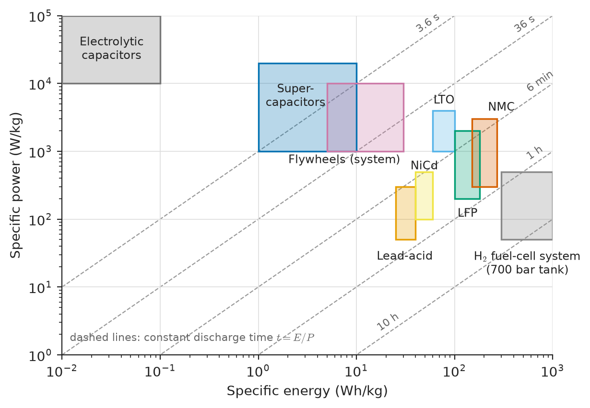
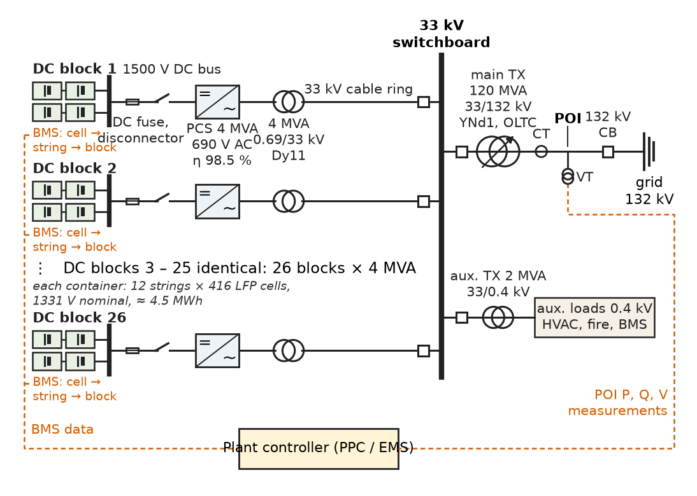
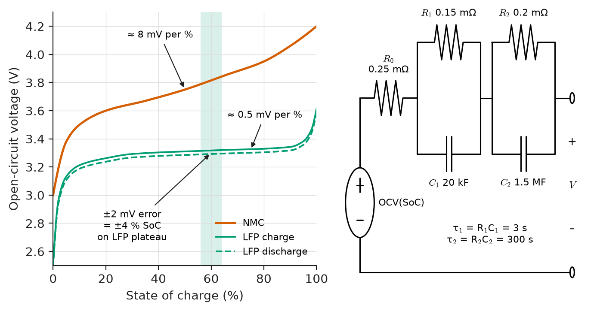
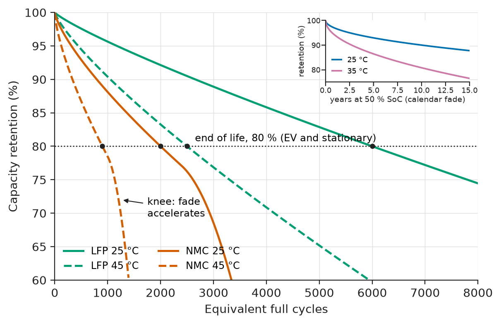
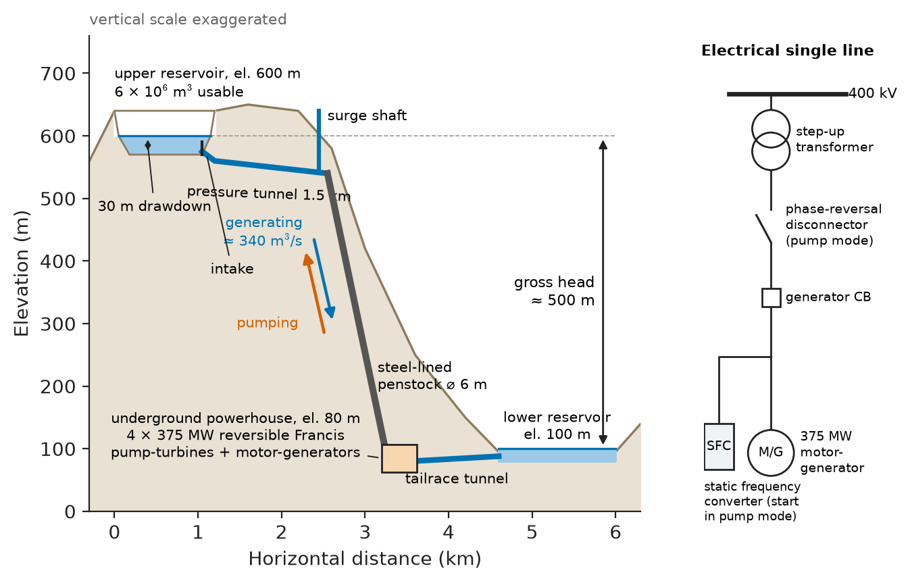
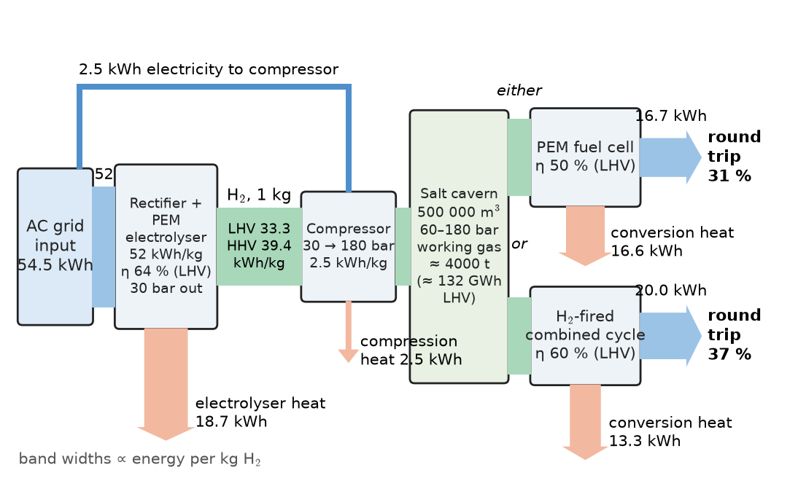

# Chapter 16 — Energy Storage

*Part IV · Power Generation*

At 4:30 on a winter afternoon a regional grid operator watches 3 GW of solar output fall away in ninety minutes while demand climbs to its evening peak. A growing share of the gap now comes from battery plants that charged at midday, when wholesale prices went negative; and when a 660 MW coal unit trips, the same batteries inject full power within a quarter of a second, long before any steam governor has moved. Elsewhere, a data centre rides through a 10 s utility outage on a spinning steel flywheel; a tram recovers its braking energy into a supercapacitor bank on its roof; and a steelworks studies hydrogen stored in a salt cavern as a way to carry summer wind energy into winter. Each is the same problem, moving energy in time, solved with different physics, costs and risks.

> **How are storage devices rated, and why do energy rating, power rating, efficiency and lifetime have to be specified separately?**
> **How does a battery management system know how full and how worn a battery is, and keep it safe?**
> **When is a battery the right answer, and when do supercapacitors, flywheels, pumped hydro, thermal stores or hydrogen win?**

| Concept | Engineering destination |
|---|---|
| Battery technologies | Choosing a chemistry for a grid plant, an EV, a UPS or a ship |
| Energy and power ratings | MW/MWh specification of a storage plant; C-rate; usable versus nameplate energy |
| Battery management systems | Protection limits, balancing, thermal management, functional safety |
| State of charge | Dispatch of a battery plant, EV range display, UPS autonomy |
| State of health | Warranties, augmentation, end-of-life and second-life decisions |
| Supercapacitors | Regenerative braking in trams and cranes, wind-turbine pitch back-up, power smoothing |
| Flywheels | Data-centre ride-through, frequency regulation, kinetic-energy recovery |
| Pumped hydro | Bulk daily and weekly shifting, black start, system inertia |
| Thermal storage | Concentrating solar plants, building ice storage, Carnot batteries |
| Hydrogen storage | Seasonal storage, sector coupling, gas-turbine fuel |
| Economics and safety | Levelised cost of storage, revenue stacking, NFPA 855 and UL 9540A siting |

**Roadmap.** What a battery is made of and how chemistries differ (16.1) → how storage is rated in energy, power and efficiency (16.2) → the management system that keeps a battery inside its limits (16.3) → estimating how full it is (16.4) and how worn it is (16.5) → the short-duration alternatives: supercapacitors (16.6) and flywheels (16.7) → the bulk alternatives: pumped hydro (16.8), thermal storage (16.9) and hydrogen (16.10) → what storage costs and how it fails (16.11).

---

## 16.1 Battery technologies

> **Boundary.** The electrochemistry of electrodes and electrolytes, and the crystal structures of cathode materials, belong to *The Materials Core*. The DC/DC converters and inverters that connect a battery to a bus belong to *Electronics & Computing*; *Engineering Physics*, [Ch. 18 §18.8](https://github.com/The-Studio-of-Sadiq/Engineering-Physics/blob/main/CHAPTERS/CHAPTER%2018.md) gives the outline. This chapter treats a cell as an engineering component with a voltage, a capacity, an internal resistance, an efficiency, a lifetime and a failure mode.

### The cell as a component

Every electrochemical cell has two electrodes, an electrolyte that conducts ions but not electrons, and a separator. The open-circuit voltage (OCV) is set by the chemistry and the state of charge; the terminal voltage under load differs from it by the internal voltage drops. For engineering purposes a cell is represented by the equivalent circuit of Figure 16.3 later in the chapter: an OCV source that depends on state of charge, a series ohmic resistance $R_0$, and one or two RC pairs that represent charge-transfer and diffusion polarisation with time constants of seconds to tens of minutes.

Cells come in cylindrical, prismatic (up to 300 Ah or more for stationary use) and pouch formats, and are connected in series for voltage and in parallel for capacity: a "96S2P" pack has 96 series groups of two parallel cells. The string is only as good as its weakest cell (Section 16.3).

### Lead-acid

Lead-acid (2.0 V per cell) is the oldest rechargeable chemistry and still the cheapest per nameplate kWh. Flooded cells need watering and ventilation for the hydrogen released on overcharge; valve-regulated (VRLA) cells recombine most of it internally. Cycle life at 80 % depth of discharge is only a few hundred cycles, and sulphation sets in if a cell is left partly discharged. Its domains today are standby duty (substation DC systems, telecom, older UPS installations) and engine starting. Sizing follows IEEE 485.

Nickel–cadmium (1.2 V per cell) is robust from −40 °C to +50 °C and tolerates abuse, which keeps it in aircraft, rolling stock and offshore platforms despite cadmium's toxicity.

### Lithium-ion

A lithium-ion cell shuttles lithium ions between a graphite negative and a metal-oxide or phosphate positive in an organic electrolyte; the cathode names the family:

- **LFP** (lithium iron phosphate, 3.2 V): moderate energy density, a very flat OCV curve, long cycle life and the highest thermal-runaway onset temperature of the common chemistries; it dominates stationary storage.
- **NMC** and **NCA** (nickel-rich oxides, 3.6–3.7 V): high energy density for long-range EVs and aircraft, with lower runaway onset temperatures and more energetic failures.
- **LTO** (lithium titanate negative, 2.3–2.4 V): low energy density, but tens of thousands of cycles and charging at 6C or more; used in opportunity-charged buses.

### Sodium-ion, high-temperature and flow batteries

**Sodium-ion** cells need no lithium, cobalt or nickel; energy density is below LFP but cold performance is better. **Sodium–sulphur** (NaS) batteries run at 300–350 °C with molten electrodes and have served six-hour grid duty in Japan since the early 2000s.

In a **flow battery**, led commercially by the vanadium redox flow battery (VRFB), energy is held in liquid electrolytes in external tanks and power is set by the stack, so the two are sized independently; the electrolyte does not degrade and cannot run away thermally, at the price of low energy density, pumps and 65–75 % round-trip efficiency.

**Table 16.1 — Representative properties of battery technologies (typical cell-level values; packs are lower by 20–40 % in energy density).**

| Technology | Nominal cell voltage | Specific energy (Wh/kg) | Energy density (Wh/L) | Cycle life to 80 % capacity | DC round-trip efficiency | Typical use |
|---|---|---|---|---|---|---|
| Lead-acid (VRLA) | 2.0 V | 30–45 | 60–110 | 300–1,500 (depth dependent) | 75–85 % | Substation DC, telecom, standby UPS |
| Nickel–cadmium | 1.2 V | 40–60 | 50–150 | 1,500–3,000 | 65–80 % | Aircraft, rail, offshore |
| Li-ion LFP | 3.2 V | 140–205 | 300–450 | 4,000–10,000 | 92–96 % | Grid storage, EVs, buses, marine |
| Li-ion NMC / NCA | 3.6–3.7 V | 200–300 | 550–750 | 1,000–3,000 | 92–96 % | Long-range EVs, aviation, power tools |
| Li-ion LTO | 2.3–2.4 V | 60–110 | 120–250 | 10,000–30,000 | 95–98 % | Fast-charge buses, frequency regulation |
| Sodium-ion | 3.0–3.1 V | 100–160 | 250–350 | 2,000–5,000 | 90–94 % | Low-cost stationary, small EVs |
| Sodium–sulphur | 2.1 V | 100–150 | 150–250 | 4,000–5,000 | 75–85 % (incl. heating) | Six-hour grid storage |
| Vanadium redox flow | 1.2–1.4 V | 10–30 (system) | 15–25 (electrolyte) | over 15,000 | 65–75 % (AC) | Long-duration stationary |

Figure 16.1 places these technologies, and the non-battery stores of later sections, on a Ragone plot of specific power against specific energy. The plot is the quickest way to see why no single technology serves every application: moving up the energy axis costs power, and the diagonals of constant discharge time separate the seconds-scale devices from the hours-scale ones.

<!-- FIGURE 16.1 | figures/ch16/fig-16-1-ragone-plot.png | plot | Ragone plot of specific power against specific energy for storage technologies, with lines of constant discharge time. | Content: log-log axes, x specific energy 0.1 to 1000 Wh/kg, y specific power 1 to 100000 W/kg. Shaded regions: electrolytic capacitors (0.01 to 0.1 Wh/kg, 10^4 to 10^5 W/kg), supercapacitors (1 to 10 Wh/kg, 10^3 to 2x10^4 W/kg), flywheels (5 to 30 Wh/kg, 10^3 to 10^4 W/kg system), lead-acid (25 to 40 Wh/kg, 50 to 300 W/kg), NiCd (40 to 60 Wh/kg, 100 to 500 W/kg), LFP (100 to 180 Wh/kg, 200 to 2000 W/kg), NMC (150 to 270 Wh/kg, 300 to 3000 W/kg), LTO (60 to 100 Wh/kg, 1000 to 4000 W/kg), hydrogen fuel-cell system with 700 bar tank (300 to 1000 Wh/kg, 50 to 500 W/kg). Dashed diagonals of constant discharge time labelled 3.6 s, 36 s, 6 min, 1 h, 10 h. -->

*Figure 16.1 — Ragone plot of specific power against specific energy for storage technologies, with lines of constant discharge time.*

---

## 16.2 Battery energy and power ratings

### Capacity, energy and C-rate

A cell is rated by its **capacity** $Q$ in ampere-hours, measured at a stated discharge rate and temperature down to a stated cut-off voltage. Its **energy** is the integral of terminal voltage times current over that discharge, approximately

$$
E \approx Q\,V_{\mathrm{nom}},
$$

so a 280 Ah LFP cell at 3.2 V nominal holds 0.896 kWh. The **C-rate** expresses current relative to capacity: 1C discharges the rated capacity in one hour, 0.25C in four hours, 4C in fifteen minutes. A battery plant rated "100 MW / 400 MWh" is a four-hour or 0.25C system; a frequency-regulation plant at "50 MW / 25 MWh" runs at 2C.

Capacity falls at high discharge rate, because internal drops bring the terminal voltage to cut-off earlier, and at low temperature. For lead-acid the effect is large and follows Peukert's law, $t = H\,(C/(IH))^{k}$ with $k\approx1.1$–1.3; for lithium-ion it is a few per cent between 0.2C and 1C at 25 °C, but significant below 0 °C, where charging must also be restricted to avoid lithium plating.

> **Status of the principle: Peukert's law and rate-dependent capacity**
> *Empirical.* Fitted to constant-current discharge tests of lead-acid cells; it does not hold for variable currents, high temperatures or lithium-ion chemistries, for which manufacturers publish capacity-versus-rate curves instead.

### Power rating and internal resistance

The power a battery can deliver is limited by voltage limits, current limits and heat. With OCV $V_{oc}$ and internal resistance $R_i$, the terminal voltage at discharge current $I$ is $V=V_{oc}-IR_i$, and the Joule loss is $I^2R_i$. Maximum power transfer at $V=V_{oc}/2$ is never approached: the minimum cell voltage (2.5 V for LFP, about 3.0 V for NMC) and the temperature rise limit the current long before. Datasheets give a continuous current, a 10 s or 30 s pulse current and a power capability that depends on SoC and temperature, which the BMS (Section 16.3) turns into a live "state of power" for the inverter.

Internal resistance is small but decisive. A 280 Ah prismatic LFP cell has $R_i\approx0.2$–0.3 mΩ when new; at 0.5C (140 A) its loss is about $140^2\times0.25\times10^{-3}\approx4.9$ W against 448 W delivered, about 1 %. At 2C the loss fraction quadruples and the cooling system must remove it.

### From nameplate to usable energy

Four layers separate the energy printed on a battery's cells from the energy delivered at the grid connection:

1. **State-of-charge window.** Operating between, say, 5 % and 95 % SoC protects the cells and leaves room for estimation error. Usable DC energy is 90 % of nameplate.
2. **Conversion losses.** The power conversion system (PCS: the inverter), the medium-voltage transformer and, for a transmission-connected plant, the main step-up transformer each lose energy in both directions.
3. **Auxiliary loads.** HVAC, fire detection, BMS and controls consume a few per cent of throughput; in hot climates the HVAC load can reach 3–5 % of discharged energy.
4. **Degradation.** Capacity falls with age (Section 16.5). The plant contract either over-builds at the start, or adds new cells ("augmentation") every few years to maintain the guaranteed energy at the point of interconnection (POI).

**Round-trip efficiency** (RTE) is the ratio of energy delivered to energy absorbed over a full cycle, measured at a stated point. A lithium-ion cell has a DC round-trip efficiency of about 95 %; a complete grid plant measured at the POI, including transformers and auxiliaries, achieves 82–90 %. IEC 62933-2-1 defines the test procedures.

**Worked example — Sizing a 100 MW / 400 MWh battery plant.** A transmission-connected battery must deliver 100 MW for four hours at the POI. LFP prismatic cells of 280 Ah, 3.2 V are used; the PCS efficiency is 98.5 %, the medium-voltage transformers 99.3 %, the main 33/132 kV transformer 99.5 %. The SoC window is 5–95 %.

*One-way efficiency, DC to POI:* $0.985\times0.993\times0.995=0.9732$.

*Usable DC energy:* $400/0.9732=411.0$ MWh.

*Nameplate energy at beginning of life:* with a 90 % window, $411.0/0.90=456.7$ MWh.

*Cells:* each holds $280\times3.2=0.896$ kWh, so $456.7\times10^3/0.896\approx5.10\times10^5$ cells. With 416 cells in series per string (nominal DC voltage $416\times3.2=1331$ V, inside the 1500 V limit of the PCS), one string holds 372.7 kWh, and 1,226 strings are needed (456.97 MWh). At twelve strings per container that is 102.2 containers, rounded up to 104 so that 26 four-container blocks, each with its own 4 MVA PCS, are identical.

*C-rate:* the DC power at full output is $100/0.9732=102.8$ MW, or $102.8/457.0=0.225$C; each string carries $102.8\times10^6/(1226\times1331)=63$ A, comfortably within the continuous rating of a 280 Ah cell.

*Degradation:* if the plant is guaranteed to deliver 400 MWh after ten years, when the cells may have only 80 % of their original capacity, the initial build would have to be $456.7/0.80=571$ MWh, a 25 % over-build. Most developers instead build close to 457 MWh and augment in years 4–7, when cells are cheaper.

*Round-trip efficiency:* with a cell-level DC efficiency of 95 %, $0.9732^2\times0.95=0.90$ before auxiliaries; with 2–3 % HVAC and control load, about 87–88 % at the POI.

Figure 16.2 shows the arrangement: battery containers in DC blocks, each block feeding a PCS and a medium-voltage transformer, collected on a 33 kV bus and stepped up to the transmission network. The structure is the same for a 2 MWh commercial system, with fewer blocks and a low-voltage connection.

<!-- FIGURE 16.2 | figures/ch16/fig-16-2-bess-single-line.png | single-line | Single-line diagram of a 100 MW / 400 MWh battery energy storage plant connected at 132 kV. | Content: left to right. Twenty-six DC blocks shown as three representative blocks plus an ellipsis; each block is four battery containers (each 12 strings of 416 LFP cells, 1331 V nominal, about 4.5 MWh) on a 1500 V DC bus with DC fuses and disconnector, feeding a 4 MVA PCS (inverter, 690 V AC output, efficiency 98.5 %), then a 4 MVA 0.69/33 kV Dy11 transformer. MV ring of 33 kV cables to a 33 kV switchboard with feeder breakers, auxiliary transformer 33/0.4 kV (HVAC, fire system, BMS, 2 MVA), then a 120 MVA 33/132 kV YNd1 main transformer with on-load tap changer, metering CTs and VTs at the point of interconnection, 132 kV breaker to grid. Labels: BMS hierarchy (cell, string, block) with dashed communication lines to the plant controller, which also receives POI measurements. -->

*Figure 16.2 — Single-line diagram of a 100 MW / 400 MWh battery energy storage plant connected at 132 kV.*

---

## 16.3 Battery management systems

### What the BMS is for

A lithium-ion cell is safe and long-lived only inside a narrow operating window: voltage between about 2.5 and 3.65 V (LFP) or 3.0 and 4.2 V (NMC), temperature between about −20 and +55 °C on discharge and 0 to +45 °C on charge, and current within the datasheet limits. Outside it, the cell degrades quickly or, at the extreme, enters thermal runaway. The **battery management system** (BMS) enforces that window. It measures every cell voltage to a few millivolts, the pack current and enough temperatures to catch the hottest cell; it opens contactors on over-voltage, under-voltage, over-current, over-temperature or isolation fault, and derates current as limits approach; it estimates state of charge (Section 16.4), state of health (Section 16.5) and state of power (the current available for the next 2, 10 or 30 s); it balances cells, commands cooling and heating, and reports to the vehicle, inverter or plant controller over CAN, Modbus or IEC 61850.

### Architecture

Large packs use a hierarchy: cell-monitoring circuits (one integrated circuit per 12–18 series cells) on each module, a string controller that owns the contactors and current measurement, and a system controller (three levels in Figure 16.2). The monitoring chain is galvanically isolated, because a 1331 V string puts its top module 1.3 kV above the bottom one.

Because the BMS is a safety function, its hardware and software are developed to functional-safety standards: ISO 26262 for road vehicles (traction batteries usually at ASIL C or D for over-voltage protection), IEC 61508 for industrial systems, and the product standards IEC 62619 and UL 1973 for stationary cells and batteries. A typical requirement is that an over-voltage condition be detected and the current interrupted within a few hundred milliseconds, with a probability of dangerous failure below $10^{-7}$ per hour.

### Cell balancing

Cells differ in capacity by 1–2 % at manufacture, in self-discharge and in temperature across a pack. In a series string the first cell to reach its upper limit ends the charge and the first to reach its lower limit ends the discharge, so without correction usable capacity drifts below that of the weakest cell.

- **Passive balancing** bleeds charge from the highest cells through resistors (typically 50–200 mA) near the top of charge. It is cheap and universal but wastes energy as heat and is slow: at 100 mA, correcting a 1 % imbalance on a 280 Ah cell takes 28 h.
- **Active balancing** moves charge from high cells to low cells through inductive or capacitive DC/DC converters, at amperes rather than milliamperes and with 80–90 % transfer efficiency. It recovers capacity in packs of aged or second-life cells, at higher cost and complexity.

> **Status of the principle: Weakest-cell limit of a series string**
> *Derived.* Follows directly from the series connection (the same current flows in every cell) and the per-cell voltage limits; balancing changes the charge distribution but not the rule.

### Thermal management

Cell temperature drives both ageing (Section 16.5) and safety. Liquid cooling through cold plates holds the cell-to-cell spread to 3–5 K; air-cooled systems may see 10 K or more. The heat-transfer models of *Engineering Physics*, [Ch. 14 §14.7](https://github.com/The-Studio-of-Sadiq/Engineering-Physics/blob/main/CHAPTERS/CHAPTER%2014.md) and [Ch. 19 §19.6](https://github.com/The-Studio-of-Sadiq/Engineering-Physics/blob/main/CHAPTERS/CHAPTER%2019.md), apply directly: a thermal-resistance network from cell core to coolant, with the cooling plant sized for the worst-case duty and ambient.

---

## 16.4 State of charge

### Definition

**State of charge** is the remaining charge as a fraction of the present full capacity:

$$
\mathrm{SoC}(t)=\mathrm{SoC}(t_0)-\frac{1}{Q_{\mathrm{act}}}\int_{t_0}^{t}\eta_c\,i(\tau)\,d\tau ,
$$

with discharge current positive, $Q_{\mathrm{act}}$ the actual (aged) capacity and $\eta_c$ the coulombic efficiency (above 99.9 % for lithium-ion, 85–95 % for lead-acid on charge). SoC cannot be measured, only estimated, and an error of a few per cent becomes stranded energy in a dispatched plant or an unexpected shutdown in a UPS.

### Coulomb counting

Integrating the measured current is accurate over short periods but needs a correct starting value and $Q_{\mathrm{act}}$, and accumulates every sensor error: an offset grows linearly with time, a gain error with charge throughput.

### OCV-based estimation

After a rest of tens of minutes, the terminal voltage relaxes to the OCV, which is a known function of SoC for each chemistry (Figure 16.3). An OCV reading resets the coulomb counter. For NMC the OCV curve has a useful slope, about 6–10 mV per per cent of SoC through the mid-range. For LFP it is almost flat, about 0.5 mV per per cent between 30 % and 90 % SoC, with hysteresis between charge and discharge of a few tens of millivolts. That flatness is the main reason SoC estimation for LFP is hard, and why LFP plants periodically drive to full charge to recalibrate.

<!-- FIGURE 16.3 | figures/ch16/fig-16-3-ocv-soc-and-ecm.png | plot | Open-circuit voltage against state of charge for NMC and LFP cells, with the equivalent-circuit model used by battery management systems. | Content: left panel x-axis SoC 0 to 100 %, y-axis OCV 2.5 to 4.3 V. NMC curve rising from 3.0 V at 0 % through 3.6 V at 20 %, 3.75 V at 50 %, 3.95 V at 80 % to 4.2 V at 100 % (slope about 8 mV per % mid-range). LFP curve: 2.5 V at 0 %, steep rise to 3.2 V by 10 %, flat plateau 3.28 to 3.33 V from 30 % to 90 % (slope about 0.5 mV per %), then rising to 3.6 V at 100 %; LFP charge and discharge branches separated by 20 to 30 mV hysteresis. Shaded band on the plateau labelled 2 mV measurement error equals 4 % SoC. Right panel: Thevenin equivalent circuit, OCV(SoC) source, series R0 = 0.25 milliohm, R1 = 0.15 milliohm parallel C1 = 20 kF (tau 3 s), R2 = 0.2 milliohm parallel C2 = 1.5 MF (tau 300 s), terminal voltage V. -->

*Figure 16.3 — Open-circuit voltage against state of charge for NMC and LFP cells, with the equivalent-circuit model used by battery management systems.*

### Model-based estimators

Modern BMSs combine both sources of information in a state observer, most often an extended Kalman filter. The model is the equivalent circuit of Figure 16.3 with SoC as a state; the filter predicts SoC by coulomb counting, compares the predicted terminal voltage with the measurement, and corrects the estimate in proportion to the mismatch, weighting each source by its uncertainty. When the OCV curve is steep the voltage correction is strong; on the LFP plateau it is weak and the filter rightly trusts the current integral. Well-implemented estimators keep SoC error within about 2–3 % for NMC and 3–5 % for LFP over the pack's life.

> **Status of the principle: Equivalent-circuit model of a cell**
> *Approximate.* A lumped fit to measured pulse responses; valid within the temperature, current and SoC range over which its parameters were identified, it does not capture lithium plating, ageing mechanisms or behaviour near the voltage limits, and its parameters drift as the cell ages.

**Worked example — Why an LFP bus loses track of its SoC.** An electric bus has a 200 Ah LFP pack and a Hall-effect current sensor with a 0.2 A residual offset after calibration. The bus runs two shifts a day and is opportunity-charged at the depot to about 85 % SoC, never to full.

*Offset drift.* Over 24 h the offset integrates to $0.2\times24=4.8$ Ah, which is $4.8/200=2.4$ % of capacity per day. After ten days without a reset the coulomb count can be wrong by 24 %.

*Can OCV correct it?* At the depot the bus rests for 30 min. With a cell-voltage measurement accuracy of ±2 mV and an LFP plateau slope of 0.5 mV per per cent, the OCV reading constrains SoC only to $\pm2/0.5=\pm4$ %, and hysteresis adds more. For an NMC pack with a slope of 8 mV per per cent the same measurement would fix SoC to $\pm0.25$ %.

*Consequence and remedy.* The LFP pack needs a periodic full charge (the top of the OCV curve is steep, and the BMS resets SoC to 100 % when the charge current tapers) or a better current sensor, typically a shunt with offset below 20 mA. Fleet operators schedule a full "balancing charge" weekly for exactly this reason.

---

## 16.5 State of health

### Definitions

**State of health** (SoH) describes how much of the battery's original capability remains. Two definitions are used:

$$
\mathrm{SoH}_Q=\frac{Q_{\mathrm{act}}}{Q_{\mathrm{rated}}},\qquad
\mathrm{SoH}_R=\frac{R_{\mathrm{EOL}}-R_{\mathrm{act}}}{R_{\mathrm{EOL}}-R_{\mathrm{new}}}.
$$

Capacity fade limits energy; resistance growth limits power. Conventional **end of life** is 80 % of rated capacity for EV and stationary cells, or a doubling of resistance for power applications. A battery at end of life for an EV may still be useful in a less demanding stationary "second life".

### Ageing mechanisms

Two kinds of ageing act together:

- **Calendar ageing** happens whether or not the battery is used. Its main mechanism is the slow growth of the solid-electrolyte interphase on the graphite, which consumes cyclable lithium. It accelerates with temperature and with high SoC, and is often fitted as proportional to the square root of time.
- **Cycle ageing** depends on charge throughput, depth of discharge, C-rate and temperature. Mechanical stress from repeated expansion cracks particles; at low temperature and high charge rate, lithium plates on the negative electrode as metal, which both consumes capacity and seeds internal short circuits.

Both are commonly modelled with an Arrhenius temperature factor (the Boltzmann-factor rate law of *Engineering Physics*, [Ch. 20 §20.7.1](https://github.com/The-Studio-of-Sadiq/Engineering-Physics/blob/main/CHAPTERS/CHAPTER%2020.md)). For calendar fade,

$$
\Delta Q(t,T)=k_0\,e^{-E_a/(RT)}\sqrt{t},
$$

with an activation energy $E_a$ fitted to test data, typically 30–60 kJ/mol for lithium-ion. Figure 16.4 shows representative fade curves.

> **Status of the principle: Battery ageing laws**
> *Empirical.* Square-root-of-time calendar fade, Arrhenius temperature acceleration and Wöhler-type cycle-life curves are fitted to accelerated tests for each cell design; they extrapolate poorly beyond the tested range and miss the "knee" at which fade suddenly accelerates late in life.

<!-- FIGURE 16.4 | figures/ch16/fig-16-4-capacity-fade.png | plot | Capacity retention of LFP and NMC cells against equivalent full cycles at different temperatures, showing the end-of-life threshold and the late-life knee. | Content: x-axis equivalent full cycles 0 to 8000, y-axis capacity retention 60 to 100 %. Curves: LFP at 25 C (reaching 80 % at about 6000 cycles), LFP at 45 C (80 % at about 2500 cycles), NMC at 25 C (80 % at about 2000 cycles), NMC at 45 C (80 % at about 900 cycles, with a knee and steep drop after 1000 cycles). Horizontal dashed line at 80 % labelled end of life (EV and stationary). Inset: calendar fade at 50 % SoC against time 0 to 15 years, square-root shape, curves at 25 C and 35 C with 35 C fade about 1.9 times the 25 C fade. -->

*Figure 16.4 — Capacity retention of LFP and NMC cells against equivalent full cycles at different temperatures, showing the end-of-life threshold and the late-life knee.*

### Estimating SoH in the field

In service a full capacity test is rarely possible, so the BMS estimates SoH from partial data: charge counted between two well-defined OCV points, the voltage step at a current change, or incremental-capacity analysis ($dQ/dV$) of slow charges. Grid plants also run an annual capacity test at the POI, because the guaranteed MWh is contractual.

**Worked example — A UPS battery in a hot electrical room.** A data-centre UPS uses NMC modules whose calendar fade at 25 °C is 10 % after 10 years at 50 % SoC. The electrical room's cooling is reduced to save energy and the battery now sits at 35 °C. Take $E_a=50$ kJ/mol.

*Acceleration factor:*

$$
\frac{k(35^\circ\mathrm C)}{k(25^\circ\mathrm C)}=\exp\!\left[\frac{50\,000}{8.314}\left(\frac{1}{298.15}-\frac{1}{308.15}\right)\right]=1.92 .
$$

*Fade after ten years at 35 °C:* $10\times1.92=19.2$ %, essentially at end of life, against 10 % at 25 °C.

*Time to 20 % fade.* With $\Delta Q=k\sqrt t$ and $k_{25}=10/\sqrt{10}=3.16$ % per $\sqrt{\text{year}}$, 20 % fade takes $(20/3.16)^2=40$ years at 25 °C (cycle ageing and other mechanisms will end life sooner) but $(20/(3.16\times1.92))^2=10.8$ years at 35 °C. A 10 K rise has roughly quartered the calendar life (the square-root law turns a 1.92-fold rate into a $1.92^2\approx3.7$-fold reduction in time). The money saved on cooling is small beside the cost of a premature battery replacement, which is why IEEE 1188 and manufacturers' warranties specify 20–25 °C for stationary batteries.

---

## 16.6 Supercapacitors

### Principle and ratings

An **electric double-layer capacitor** (EDLC, supercapacitor or ultracapacitor) stores charge electrostatically in the double layer, about a nanometre thick, at the interface between a porous carbon electrode and an electrolyte. The huge internal area (over 1,000 m² per gram of carbon) and tiny separation give capacitances of thousands of farads per cell, but the electrolyte limits cell voltage to about 2.7–3.0 V. The stored energy is the capacitor energy of *Circuits, Signals and Communications*, [Ch. 5 §5.4](https://github.com/The-Studio-of-Sadiq/Circuits-Signals-and-Communications/blob/main/part-1-circuit-fundamentals/05-capacitors-and-inductors.md), $E=\tfrac12CV^2$.

Because no chemical reaction is involved, supercapacitors charge and discharge in seconds, last 500,000 to over a million cycles, work down to −40 °C and have round-trip efficiencies of 90–98 % at moderate currents. Their weaknesses are low specific energy (3–8 Wh/kg for cells, 2–5 Wh/kg for modules, against 150+ Wh/kg for LFP cells), self-discharge of a few per cent per day, and a terminal voltage that falls in proportion to charge.

### Usable energy and the voltage window

The falling voltage means that a converter must interface the bank to a fixed DC bus, and that energy cannot be fully extracted. Discharging from $V_{\max}$ to $V_{\min}$ releases

$$
E_{\mathrm{use}}=\tfrac12C\left(V_{\max}^2-V_{\min}^2\right)=E_{\max}\left[1-\left(\frac{V_{\min}}{V_{\max}}\right)^2\right].
$$

Stopping at half voltage recovers 75 % of the stored energy, while the converter current doubles. Going lower gains little energy at the cost of a much larger converter, so $V_{\min}=V_{\max}/2$ is the usual design point.

### Applications

Supercapacitors serve where energy flows in and out in seconds, many times an hour: regenerative braking in trams, metros and container-port cranes, back-up for wind-turbine pitch systems, and smoothing of pulsed loads in hybrid ship and aircraft power systems. Hybrid **lithium-ion capacitors** reach 10–30 Wh/kg and fill part of the gap to batteries.

**Worked example — Supercapacitor bank for a catenary-free tram.** A 40 t tram brakes from 60 km/h at 1.2 m/s² and must store its braking energy on board. The drive chain from wheel to storage is 80 % efficient. The bank is built from 125 V, 63 F heavy-transport modules (each about 60 kg) connected in series and discharged to half voltage.

*Kinetic energy:* $v=60/3.6=16.67$ m/s, so $E_k=\tfrac12\times40\,000\times16.67^2=5.56$ MJ $=1.54$ kWh.

*Energy to store:* $0.80\times5.56=4.44$ MJ.

*Per module:* $\tfrac12\times63\times125^2=492$ kJ stored at full voltage, of which 75 % (369 kJ) is usable down to 62.5 V.

*Number of modules:* $4.44/0.369=12.04$, so 13 modules in series, rated $13\times125=1625$ V, total mass about 0.8 t.

*Power and current:* the braking force is $40\,000\times1.2=48$ kN, so at 16.67 m/s the wheel power is 800 kW and about 640 kW reaches the bank. If braking begins with the bank near half voltage (812 V), the current is $640\,000/812\approx790$ A; with the bank nearly full (1625 V) it is half that. A bidirectional DC/DC converter rated about 800 A links the bank to the 750 V traction bus. A lithium-ion pack of equal mass would hold forty times the energy, but it could not accept 0.8 MW per tonne every two minutes for a million stops.

---

## 16.7 Flywheels

### Energy and the material limit

A flywheel stores kinetic energy in a rotating mass. With moment of inertia $I$ and angular speed $\omega$, $E=\tfrac12I\omega^2$; rotational mechanics, moment of inertia and the steel-disk example are in *Engineering Physics*, [Ch. 19 §19.2](https://github.com/The-Studio-of-Sadiq/Engineering-Physics/blob/main/CHAPTERS/CHAPTER%2019.md), and [Ch. 9 §9.7](https://github.com/The-Studio-of-Sadiq/Engineering-Physics/blob/main/CHAPTERS/CHAPTER%209.md). The engineering extension is the question of how much energy a rotor of given mass can hold before it bursts. The hoop stress in a rotating body scales with $\rho v^2$, where $v$ is the rim speed, while the stored energy per unit mass scales with $v^2$. Eliminating $v$ gives the maximum specific energy

$$
\frac{E}{m}\bigg|_{\max}=K\,\frac{\sigma_{\mathrm{allow}}}{\rho},
$$

where $K$ is a shape factor: about 0.5 for a thin rim, about 0.6 for a solid disc of steel ($\nu=0.3$), and up to 1 for an ideal constant-stress profile.

> **Status of the principle: Specific-energy limit of a flywheel rotor**
> *Derived.* Follows from the energy of a rotating body and the stress in a rotating disc or rim; the shape factor assumes isotropic linear-elastic material, and real composite rotors are limited by radial (through-thickness) stress and fatigue, so design values are half or less of the ideal.

The ratio $\sigma/\rho$ favours strong, light materials. High-strength steel ($\sigma\approx800$ MPa usable, $\rho=7850$ kg/m³) gives at most about 17 Wh/kg in a solid disc; a carbon-fibre composite rim ($\sigma\approx1500$ MPa, $\rho\approx1600$ kg/m³) gives about 130 Wh/kg in theory. Complete systems achieve 5–30 Wh/kg.

### Construction and losses

A modern flywheel unit has the rotor in an evacuated housing (to eliminate windage), magnetic or hybrid bearings, and an integral motor-generator, usually a permanent-magnet synchronous machine (Chapter 8) driven by a bidirectional converter. The usable speed range is limited, as with the supercapacitor, by the converter: discharging from $\omega_{\max}$ to $\omega_{\max}/2$ releases 75 % of the energy. Self-discharge from bearing, residual windage and magnetic losses is significant, typically 1–5 % of stored energy per hour, so flywheels serve seconds-to-minutes duties, not hours. Burst containment is a design requirement: the housing must absorb the energy of a failed rotor, which is why rotors are often installed below ground level.

### Applications

The main applications are UPS ride-through, bridging the 10–20 s between a utility outage and a diesel generator taking load, and frequency regulation, where tens of thousands of shallow cycles a year would wear out a battery; the 20 MW Stephentown plant in New York uses 200 composite flywheels of 100 kW each. Flywheels also smooth pulsed loads such as mine hoists.

**Worked example — Flywheel ride-through for a data centre.** A 1 MW UPS must ride through 15 s until the standby generators have started and taken load. The converter and machine efficiency is 95 %, and the flywheel operates between its maximum speed of 7,700 rpm and half speed. The rotor is a solid steel disc of radius 0.35 m.

*Energy:* usable $1\times10^6\times15/0.95=15.8$ MJ; total at full speed $15.8/0.75=21.1$ MJ.

*Speed:* $\omega=7700\times2\pi/60=806$ rad/s; rim speed $806\times0.35=282$ m/s.

*Mass:* for a solid disc $E=\tfrac14mr^2\omega^2$, so $m=4\times21.1\times10^6/(0.35^2\times806^2)=1057$ kg, a disc 0.35 m thick.

*Stress check:* the peak (central) stress of a solid disc is $\frac{3+\nu}{8}\rho v^2=0.4125\times7850\times282^2=258$ MPa, a safety factor of about 3 against an 800 MPa allowable.

*Specific energy:* $21.1\times10^6/1057/3600=5.5$ Wh/kg in the rotor alone. A battery would weigh less but need replacing every 5–8 years; the flywheel lasts twenty, and its state of charge is simply its speed.

---

## 16.8 Pumped hydro

### Principle and scale

Pumped-storage hydroelectricity moves water between two reservoirs at different heights: pumping uphill when electricity is cheap or surplus, generating when it is valuable. It provides over 90 % of the world's installed storage energy, about 180 GW of power capacity, with individual plants from tens of megawatts to 3.6 GW. The stored energy is the gravitational potential energy of the water; the flow through penstock and turbine is the hydraulic circuit of *Engineering Physics*, [Ch. 19 §19.7](https://github.com/The-Studio-of-Sadiq/Engineering-Physics/blob/main/CHAPTERS/CHAPTER%2019.md). The electrical energy delivered from a volume $V$ falling through a net head $h$ is

$$
E=\rho\,g\,h\,V\,\eta_g ,
$$

with $\eta_g$ the generating efficiency (turbine, generator and transformer, about 0.88–0.92). Pumping the same water back takes $\rho g h V/\eta_p$ with $\eta_p$ about 0.86–0.90. Round-trip efficiency is 70–82 % for modern plants.

Figure 16.5 shows the layout: upper reservoir, intake, pressure tunnel and steel-lined penstock, an underground powerhouse with reversible pump-turbines, tailrace and lower reservoir. Head is the key design parameter: energy per cubic metre is proportional to it, so high-head sites (300–700 m) need much smaller reservoirs. One cubic metre falling 500 m yields only $1000\times9.81\times500=4.9$ MJ, or 1.36 kWh: pumped hydro has the lowest energy density of any technology in this chapter and makes up for it in volume.

<!-- FIGURE 16.5 | figures/ch16/fig-16-5-pumped-hydro-layout.png | cross-section | Cross-section of a pumped-storage plant with reversible pump-turbines in an underground powerhouse. | Content: upper reservoir at elevation 600 m (usable volume 6 million cubic metres, drawdown 30 m), intake, 1.5 km pressure tunnel and inclined steel-lined penstock (diameter 6 m), surge shaft near the upper end, underground powerhouse at elevation 80 m with four 375 MW reversible Francis pump-turbines and motor-generators, tailrace tunnel to lower reservoir at elevation 100 m. Gross head about 500 m labelled (full upper level to lower level; the head used in the worked example). Arrows showing pumping and generating flow directions (about 340 cubic metres per second at full generation). Inset single-line: motor-generator, generator circuit breaker, phase-reversal disconnector for pumping mode, step-up transformer to 400 kV, static frequency converter for starting in pump mode. -->

*Figure 16.5 — Cross-section of a pumped-storage plant with reversible pump-turbines in an underground powerhouse.*

### Machines and control

Most pumped-storage plants use reversible Francis pump-turbines coupled to synchronous motor-generators (Chapter 7). The machine reverses rotation between modes, so a disconnector swaps the phase sequence, and pump-mode starting needs a static frequency converter. A fixed-speed pump draws fixed power; **variable-speed** units with doubly fed induction machines or full-power converters (Chapter 12) adjust pumping power by ±10–20 % and so can regulate frequency while pumping.

### What pumped hydro adds to the grid

Pumped storage also contributes synchronous inertia and fault current, fast ramping (Dinorwig in Wales, 1,728 MW and about 9 GWh, reaches full load from standstill in under 2 minutes) and black-start capability. Its limits are geographic: two reservoirs with a large height difference, a decade of construction and high capital cost, eased in recent schemes by closed-loop "off-river" sites and old mines.

**Worked example — Energy of an upper reservoir.** A pumped-storage plant has a usable upper reservoir volume of $6\times10^6$ m³, a head of 500 m (the gross head of Figure 16.5, taken as constant over the 30 m drawdown), a generating efficiency of 90 % and a pumping efficiency of 88 %; the friction losses in tunnel and penstock, a few percent of the head, are counted in these two efficiencies rather than by reducing $h$. Four units give 1,500 MW.

*Stored electrical energy (generating):* $1000\times9.81\times500\times6\times10^6\times0.90=2.65\times10^{13}$ J $=7.36$ GWh.

*Duration at full output:* $7360/1500=4.9$ h.

*Energy to refill:* $1000\times9.81\times500\times6\times10^6/0.88=3.34\times10^{13}$ J $=9.29$ GWh.

*Round-trip efficiency:* $0.90\times0.88=79$ %.

*Flow at full output:* $Q=P/(\rho g h\eta_g)=1500\times10^6/(1000\times9.81\times500\times0.90)=340$ m³/s.

The same energy in LFP would take about 8.2 million 280 Ah cells; batteries win economically at 1–4 h, pumped hydro at 6 h and longer where a site exists.

---

## 16.9 Thermal storage

### Forms of thermal storage

Thermal storage holds energy as heat (or cold) and comes in three forms:

- **Sensible heat**: raising the temperature of a material, $Q=mc_p\Delta T$. Molten nitrate salt, water, concrete, rocks and sand are used.
- **Latent heat**: melting or freezing a phase-change material, which stores energy at nearly constant temperature. Ice (334 kJ/kg) is the commonest; salts and paraffins cover other temperatures.
- **Thermochemical**: reversible chemical reactions, still largely at demonstration scale.

Thermal storage is cheap per kWh of heat. Its weakness appears when the energy must come back as electricity: the conversion from heat to work is bounded by the Carnot efficiency of *Engineering Physics*, [Ch. 10 §10.6](https://github.com/The-Studio-of-Sadiq/Engineering-Physics/blob/main/CHAPTERS/CHAPTER%2010.md), and real Rankine cycles (*Engineering Physics*, [Ch. 19 §19.5](https://github.com/The-Studio-of-Sadiq/Engineering-Physics/blob/main/CHAPTERS/CHAPTER%2019.md)) reach only 35–45 %. Thermal storage therefore works best where heat is the input (concentrating solar power), the output (industrial process heat, district heating) or both (building cooling).

### Concentrating solar power with molten salt

A concentrating solar power (CSP) plant collects sunlight as heat, so storing the heat before the turbine costs little efficiency. Most commercial plants use a two-tank system: "solar salt" (60 % NaNO₃, 40 % KNO₃ by mass, $c_p\approx1.5$ kJ/(kg·K), melting near 220 °C) is pumped from a cold tank at about 290 °C through the receiver to a hot tank at about 565 °C, and from there through a steam generator that drives a conventional turbine (Chapter 14).

**Worked example — Salt inventory for a 110 MW CSP plant with ten hours of storage.** The turbine cycle efficiency is 41.5 %, the salt cycles between 290 °C and 565 °C, $c_p=1.5$ kJ/(kg·K), and the hot salt density is about 1900 kg/m³.

*Thermal energy:* $110\times10=1100$ MWh of electricity requires $1100/0.415=2651$ MWh$_{\mathrm{th}}$ $=9.54\times10^{12}$ J.

*Salt mass:* $m=Q/(c_p\Delta T)=9.54\times10^{12}/(1500\times275)=2.31\times10^7$ kg, about 23,000 t.

*Tank:* $2.31\times10^7/1900=12\,200$ m³; a 40 m diameter tank needs a salt depth of $12\,200/(\pi\times20^2)=9.7$ m. Real plants add a heel of salt that is never drawn down and a margin for heat losses (tanks lose about 1 K per day), so built inventories are 20–40 % larger.

*Power-to-power check:* if the same tank were charged by electric heaters (a "Carnot battery"), round-trip efficiency would be about $1.0\times0.415=41.5$ % before heat losses, far below a battery, and the ideal limit with heat rejected at 40 °C would still be only $1-313/838=63$ %.

### Thermal storage in buildings and industry

In buildings, ice made at night cools offices in the afternoon: a 10,000 ton-hour ice store (35 MWh of cooling) shifts about 7–9 MWh of chiller electricity off the peak. Hot-water cylinders and storage heaters are distributed thermal stores that utilities control with ripple control and smart meters (Chapter 26). In industry, high-temperature stores (refractory brick or sand at 600–1500 °C) charged by electric resistance heating replace fossil fuel in process heat, the "power-to-heat" route that avoids the Carnot penalty entirely.

> **Status of the principle: Carnot bound on power-to-heat-to-power storage**
> *Fundamental.* Follows from the second law of thermodynamics; it caps the electrical round-trip efficiency of any storage that passes through heat, whatever the storage medium. Heat-pump-charged Carnot batteries raise the attainable figure to about 50–70 % but cannot escape the bound.

---

## 16.10 Hydrogen energy storage

### The chain

Hydrogen storage converts electricity to chemical energy by electrolysis, stores the hydrogen as compressed gas, liquid or a carrier compound, and reconverts it in a fuel cell or a combustion turbine. Figure 16.6 traces the chain and its losses. The chain is inefficient, but it is the only option here whose cost scales to weeks and months, because caverns hold energy at very low cost per kWh.

<!-- FIGURE 16.6 | figures/ch16/fig-16-6-hydrogen-chain.png | block-diagram | Power-to-hydrogen-to-power chain with energy flows per kilogram of hydrogen. | Content: left to right blocks: AC grid input 54.5 kWh, rectifier and PEM electrolyser (52 kWh/kg, 64 % LHV efficiency, 30 bar output), compressor to 180 bar (2.5 kWh/kg), salt cavern storage (500 000 cubic metres, 60 to 180 bar, working gas about 4000 t), then two alternative output branches: PEM fuel cell (50 % LHV, 16.7 kWh/kg electric, round trip 31 %) and hydrogen-fired combined cycle (60 % LHV, 20 kWh/kg electric, round trip 37 %). Sankey-style arrow widths proportional to energy, loss arrows downward labelled electrolyser heat, compression, conversion heat. LHV 33.3 kWh/kg and HHV 39.4 kWh/kg marked on the hydrogen arrow. -->

*Figure 16.6 — Power-to-hydrogen-to-power chain with energy flows per kilogram of hydrogen.*

### Electrolysers

Three electrolyser types matter: **alkaline** (mature, cheapest per kW, best at steady load), **proton-exchange-membrane** (PEM: responds in seconds, suits variable renewable input, delivers gas at 30 bar or more) and **solid-oxide** (700–850 °C, highest electrical efficiency given waste heat, early commercial).

System consumption is about 50–55 kWh of electricity per kilogram of hydrogen for alkaline and PEM plants, against a lower heating value (LHV) of 33.3 kWh/kg and a higher heating value (HHV) of 39.4 kWh/kg: about 60–67 % efficiency on an LHV basis. Electrically, an electrolyser is a large DC load fed by a thyristor or IGBT rectifier; a 100 MW electrolyser plant is a significant source of harmonics and a candidate for demand response and frequency services (Chapters 25 and 27).

### Storage and reconversion

Hydrogen's volumetric density is poor: about 0.09 kg/m³ at atmospheric pressure, 40 kg/m³ at 700 bar and 71 kg/m³ as a liquid at −253 °C. Compression to 200 bar costs 2–3 kWh/kg, liquefaction 10–12 kWh/kg. For grid-scale storage the attractive option is a solution-mined **salt cavern**, used for hydrogen at Teesside and in Texas for decades. Reconversion uses PEM or solid-oxide fuel cells (45–60 % LHV) or gas turbines adapted to burn hydrogen or hydrogen blends (combined-cycle efficiency 55–62 % LHV).

**Worked example — Round-trip efficiency and cavern capacity.** Electrolysis consumes 52 kWh/kg, compression to 180 bar 2.5 kWh/kg.

*Round trip via a fuel cell at 50 % LHV:* $33.3\times0.50/(52+2.5)=16.7/54.5=31$ %.

*Round trip via a hydrogen-fired combined cycle at 60 % LHV:* $20.0/54.5=37$ %.

*Cavern capacity.* A $5\times10^5$ m³ salt cavern at about 320 K cycles between 60 and 180 bar. With compressibility factors of about 1.035 and 1.11, the gas density $\rho=pM/(ZRT)$ is $60\times10^5\times0.002016/(1.035\times8.314\times320)=4.39$ kg/m³ at 60 bar and 12.29 kg/m³ at 180 bar. The working gas is $(12.29-4.39)\times5\times10^5\approx3.95\times10^6$ kg, about 3,950 t, holding $3.95\times10^6\times33.3=132$ GWh (LHV), which returns about 66 GWh of electricity through fuel cells.

That single cavern returns about nine times the electricity of the pumped-hydro reservoir of Section 16.8 and over 160 times that of the 400 MWh battery plant of Section 16.2; measured as stored hydrogen energy (LHV) the ratios are about 18 and 330. The two-thirds of input energy lost on the way is the price. Hydrogen makes sense for storage only where duration, not efficiency, is the binding constraint: seasonal balancing in a high-renewable grid, or where the hydrogen is also needed as a feedstock (steel, ammonia, refining), so that only part of it is ever converted back to electricity.

---

## 16.11 Storage economics and safety

### Rating storage by service

Storage earns money by providing services, and the service determines the rating. Table 16.2 maps the main services to the duration and response they need, and to the technologies that usually win.

**Table 16.2 — Grid and customer storage services (typical values).**

| Service | Response time | Duration | Cycles per year | Technologies usually chosen |
|---|---|---|---|---|
| Fast frequency response, synthetic inertia | 0.1–1 s | seconds to 15 min | many partial cycles | Li-ion (LFP, LTO), flywheel, supercapacitor |
| Frequency regulation (secondary) | seconds | 15–60 min | thousands of shallow cycles | Li-ion, flywheel |
| UPS ride-through | under 10 ms | 10 s to 15 min | few | Li-ion, VRLA, flywheel |
| Peak shaving, demand-charge reduction | minutes | 1–4 h | 50–300 | Li-ion |
| Energy arbitrage, solar shifting | minutes | 2–8 h | 250–365 | Li-ion, pumped hydro, flow |
| Capacity adequacy (peak reserve) | minutes | 4–10 h | few to 100 | Li-ion, pumped hydro |
| Black start | minutes | hours | 0–1 | Pumped hydro, Li-ion with grid-forming inverters |
| Seasonal balancing | hours | weeks to months | 1–2 | Hydrogen, large hydro reservoirs |

Most battery plants "stack" several services, because one revenue stream rarely pays for the plant.

### Levelised cost of storage

Storage is compared by the **levelised cost of storage** (LCOS): the constant price per MWh of discharged energy that recovers capital, operating and charging costs over the plant's life. In its simplest annualised form,

$$
\mathrm{LCOS}=\frac{C_{\mathrm{cap}}\,\mathrm{CRF}+C_{\mathrm{O\&M}}}{E_{\mathrm{out}}}+\frac{c_{\mathrm{charge}}}{\eta_{\mathrm{RT}}},
\qquad \mathrm{CRF}=\frac{i(1+i)^n}{(1+i)^n-1},
$$

where CRF is the capital recovery factor at discount rate $i$ over $n$ years, $E_{\mathrm{out}}$ is the annual discharged energy and $c_{\mathrm{charge}}$ the price paid for charging energy.

**Worked example — Levelised cost of a four-hour battery.** The 100 MW / 400 MWh plant of Section 16.2 costs \$280 per kWh of rated energy installed (\$112 M), with fixed O&M of 2 % of capital per year, a 20-year life, a 7 % discount rate and one full cycle a day at an average of 90 % of rated energy (allowing for degradation and availability). Charging energy costs \$30/MWh and the AC round-trip efficiency is 85 %.

*Capital recovery factor:* $0.07\times1.07^{20}/(1.07^{20}-1)=0.0944$; annualised capital $112\times0.0944=10.57$ \$M/yr; O&M 2.24 \$M/yr.

*Annual discharge:* $400\times365\times0.90=131\,400$ MWh.

*Fixed cost per MWh:* $(10.57+2.24)\times10^6/131\,400=97.5$ \$/MWh.

*Charging cost per MWh delivered:* $30/0.85=35.3$ \$/MWh.

*LCOS:* $97.5+35.3=133$ \$/MWh. The plant must on average sell at about \$100/MWh more than it buys to break even on arbitrage alone. Cycling twice a day halves the fixed component and gives an LCOS of about \$84/MWh, provided the cells' cycle life allows it, which is why frequency-response and capacity payments, not daily arbitrage alone, have underpinned most battery projects.

Rough mid-2020s ranges: lithium-ion \$200–350 per kWh installed for four-hour plants; pumped hydro \$1,500–3,000 per kW but cheap per kWh at long durations; hydrogen dominated by the per-kW cost of electrolysers and reconversion, with the cavern costing well under \$1 per kWh.

### Failure modes and thermal runaway

Flywheels can burst; hydrogen is flammable from 4 to 75 % in air with a minimum ignition energy about a tenth of methane's; lead-acid batteries release hydrogen. For lithium-ion the defining hazard is **thermal runaway**: once a cell's internal temperature exceeds a threshold (about 150–200 °C for NMC, 200–270 °C for LFP), exothermic decomposition reactions heat it faster than it can lose heat, and the temperature rises to 500–900 °C in seconds to minutes. The cell vents flammable and toxic gases (hydrogen, carbon monoxide, hydrocarbons, hydrogen fluoride). If the heat ignites neighbouring cells, runaway **propagates** through the module and rack. Triggers include internal short circuits from manufacturing defects or lithium plating, over-charge, external short circuits, mechanical damage and external fire.

At McMicken, Arizona, in 2019, a runaway in a 2 MWh container filled it with unignited gas, which exploded when firefighters opened the door and injured four of them. More than twenty fires in South Korea in 2017–2019, and the January 2025 fire in an indoor battery building at Moss Landing, California, pushed the industry toward outdoor containerised designs with spacing between units.

### Safety standards and design defences

Safety is designed in layers, each covered by a standard:

- **Cell and battery**: IEC 62619 and UL 1973 (stationary), IEC 62660 and UN 38.3 (transport), with abuse tests for over-charge, short circuit, crush and thermal stability.
- **System**: UL 9540 lists complete energy storage systems; **UL 9540A** is the test method that measures whether runaway propagates from cell to module to unit to installation, and quantifies vent gas composition.
- **Installation**: **NFPA 855** (and the International Fire Code) sets limits on unit size (typically 50 kWh per unit in occupied buildings unless tests justify more), spacing, explosion control (deflagration venting per NFPA 68 or gas detection and ventilation per NFPA 69), fire suppression and emergency response plans. IEC 62933-5-2 covers the same ground internationally.
- **Electrical protection**: DC arc-fault and ground-fault detection, correctly rated DC fuses and breakers (Chapter 23), isolation monitoring, and the arc-flash assessment of Chapter 29. A 1500 V DC battery string can deliver tens of kiloamperes into a fault, with no current zero to help a breaker interrupt.

> **Status of the principle: Layered defence against thermal runaway**
> *Empirical.* The test-based approach of UL 9540A and NFPA 855 rests on observed propagation behaviour in full-scale fire tests; it bounds the consequences of a single-cell failure for the tested configuration, not for untested layouts, chemistries or ambient conditions.

The shift to LFP in stationary storage is partly a safety decision: its higher onset temperature and lower heat release make propagation slower and less violent than in NMC, though not impossible.

---

## What remains open

| Open question | Where it is answered |
|---|---|
| How storage fits into the structure, planning and adequacy of the whole power system | Chapter 13 |
| How the synchronous machines of pumped-storage plants are built, excited and synchronised | Chapters 7 and 14 |
| How the variability of wind and solar sets the storage duration a grid needs | Chapter 15 and Chapter 27 |
| How storage is represented as a bus injection in a load-flow model | Chapters 17 and 18 |
| How fast storage helps to arrest frequency decline after a generator trip | Chapter 20 |
| How battery inverters provide grid-forming control, frequency and voltage support under grid codes | Chapter 27 |
| How storage operates inside a microgrid and an energy management system | Chapter 26 |
| How DC faults in a battery plant are detected and cleared | Chapter 23 |
| How harmonics from electrolysers and battery inverters are limited | Chapter 25 |
| How arc-flash and shock hazards of battery rooms are assessed | Chapter 29 |
| Electrode materials, electrolytes and cell chemistry | *The Materials Core* |
| Bidirectional converters, battery chargers and balancing circuits | *Electronics & Computing* |

**Next:** Chapter 17 opens Part V by building the per-unit system and the network models that let generation, storage, transformers and lines of every voltage level be analysed as a single network.
