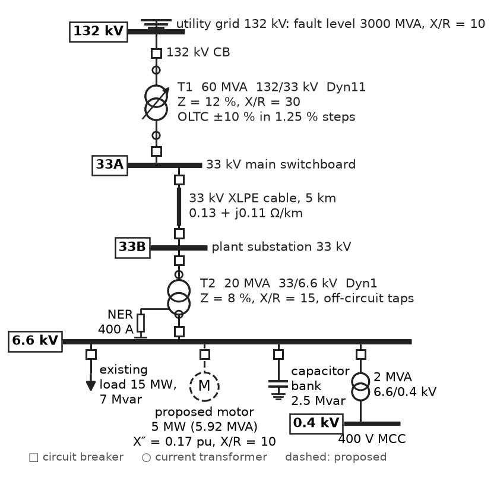
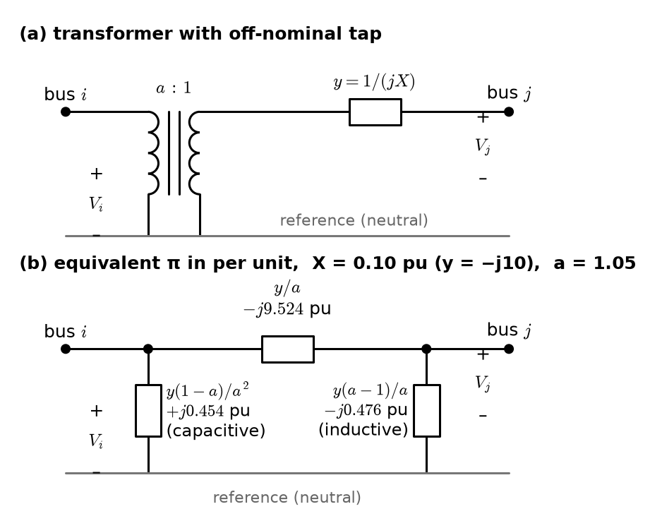
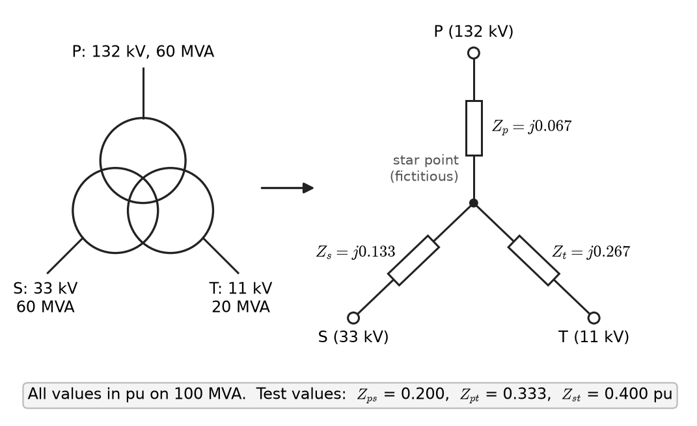
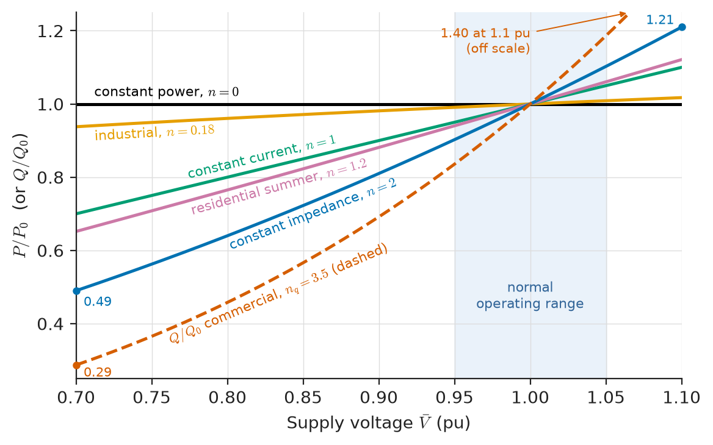
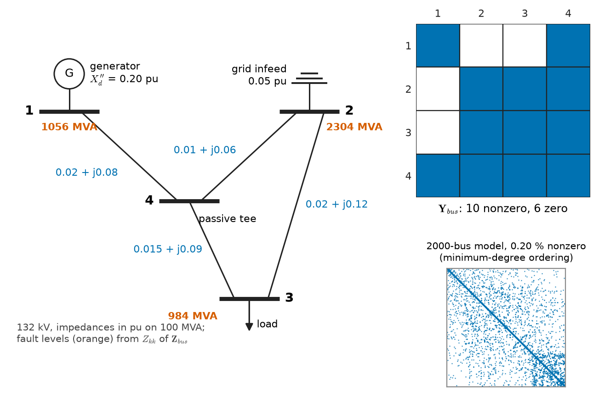

# Chapter 17 — Per-Unit Systems and Network Modeling

*Part V · Power-System Analysis*

A consulting engineer is asked whether a 5 MW induction motor can be added to the 6.6 kV board of a mineral-processing plant. The question sounds simple: will the board's voltage stay inside its limits, and can the switchgear still interrupt the fault current? But the data arrive in a dozen incompatible forms. The utility quotes a fault level of 3000 MVA at its 132 kV substation. The main transformer nameplate says 60 MVA, 132/33 kV, 12 % impedance. The 33 kV cable manufacturer gives ohms per kilometre. The plant transformer is 20 MVA, 33/6.6 kV, 8 %. The motor datasheet gives locked-rotor current as a multiple of full-load current. Adding these numbers directly is meaningless: an ohm on the 132 kV side is not the same as an ohm on the 6.6 kV side, and a percentage on a 60 MVA base is not the same as one on a 20 MVA base. Before any analysis can begin, the plant has to be turned into one network, on one set of bases, with one model for each piece of equipment. That translation is the subject of this chapter, and it underlies every load-flow, fault and stability study in Part V.

> **Why do power engineers work in per unit, and how are base values chosen so that transformers disappear from the network?**
> **How is each piece of equipment represented, and how is a whole system reduced to the bus-and-branch model a computer can solve?**

| Concept | Engineering destination |
|---|---|
| Per-unit quantities | Nameplate impedances, relay settings, study reports, grid-code limits |
| Base values | Consistent analysis across 400 kV, 33 kV, 6.6 kV and 400 V in one network |
| Impedance conversion | Using manufacturers' data on a common system base |
| Single-line diagrams | Drawings that every study, protection scheme and switching order starts from |
| Equipment models | Generators, transformers, lines, cables, loads, motors and inverters in studies |
| Network reduction | Thevenin equivalents, fault levels, external-grid equivalents |
| Bus and branch representation | The admittance matrix solved by load-flow and fault programs |
| System-data preparation | Building and validating the study model that decisions rest on |

**Roadmap.** What a per-unit quantity is and why it helps (17.1) → choosing bases so that ideal transformers vanish (17.2) → converting manufacturers' data to the system base (17.3) → the single-line diagram (17.4) → per-unit models of each kind of equipment (17.5) → reducing a network to equivalents (17.6) → the bus-and-branch model and the admittance matrix (17.7) → preparing and checking the data (17.8).

> **Boundary.** Phasors, complex power, the per-phase equivalent of a balanced three-phase system and nodal analysis come from *Circuits, Signals and Communications*: [Ch. 8](https://github.com/The-Studio-of-Sadiq/Circuits-Signals-and-Communications/blob/main/part-2-transient-and-ac-analysis/08-sinusoidal-steady-state-analysis.md) (§8.7, AC nodal analysis), [Ch. 9](https://github.com/The-Studio-of-Sadiq/Circuits-Signals-and-Communications/blob/main/part-2-transient-and-ac-analysis/09-ac-power.md) (§9.4, complex power), [Ch. 10](https://github.com/The-Studio-of-Sadiq/Circuits-Signals-and-Communications/blob/main/part-2-transient-and-ac-analysis/10-three-phase-circuits.md) (§10.5, per-phase equivalent) and [Ch. 3](https://github.com/The-Studio-of-Sadiq/Circuits-Signals-and-Communications/blob/main/part-1-circuit-fundamentals/03-network-analysis.md) (§3.8, matrix formulation and stamping). They are used here without re-derivation. Everything in this chapter assumes a balanced system solved per phase; unbalanced conditions need the sequence networks of Chapter 19.

---

## 17.1 Per-unit quantities

### Definition

A **per-unit** (pu) quantity is the actual quantity divided by a chosen base quantity of the same dimension:

$$
\text{quantity in pu}=\frac{\text{actual quantity}}{\text{base quantity}} .
$$

A bus voltage of 10.45 kV on an 11 kV base is 0.95 pu; a current of 875 A on a 1000 A base is 0.875 pu; a load of 45 MW on a 100 MVA base is 0.45 pu. Percent is per unit times 100, and transformer and machine nameplates traditionally use it: "12 % impedance" means 0.12 pu on the transformer's own rating.

Per-unit values are complex where the quantity is complex. The base is a real number, so the angle is unchanged: $\bar V=10.45\angle-5^\circ$ kV becomes $0.95\angle-5^\circ$ pu.

### Why per unit

Per-unit normalisation is not a convenience of hand calculation that computers made obsolete; every load-flow, fault and stability program works internally in per unit, and every study report and grid code states its results that way. The reasons are practical:

1. **Ideal transformers disappear.** With bases chosen correctly (Section 17.2), a transformer's turns ratio vanishes from the per-unit network, and a system with five voltage levels becomes one circuit.
2. **Equipment parameters fall into narrow ranges.** A 2 MVA distribution transformer and a 1000 MVA generator step-up transformer have impedances of a few ohms (referred to 11 kV) and a few tens of ohms (referred to 400 kV) respectively, but 6 % and 15 % on their own ratings. An engineer who sees a transformer impedance of 0.6 % or 60 % knows immediately that the data are wrong.
3. **Normal operating values are near 1.** Bus voltages are 0.9–1.1 pu, so violations and errors stand out.
4. **The $\sqrt3$ factors vanish.** With the base choices of Section 17.2, three-phase and per-phase per-unit quantities are numerically the same.
5. **Numerical conditioning improves.** Quantities near unity, rather than spanning $10^{-3}$ Ω to $10^{5}$ V, keep the matrices of Chapters 18–20 well scaled.

**Table 17.1 — Typical per-unit impedances of power-system equipment, on the equipment's own rating (typical ranges).**

| Equipment | Parameter | Typical value (pu, own base) |
|---|---|---|
| Turbo-generator (2-pole, 100–1500 MVA) | $X_d$ / $X_d'$ / $X_d''$ | 1.6–2.3 / 0.2–0.35 / 0.15–0.25 |
| Salient-pole hydro generator | $X_d$ / $X_d'$ / $X_d''$ | 0.8–1.3 / 0.25–0.4 / 0.18–0.3 |
| Distribution transformer (up to 2.5 MVA) | $Z$ | 0.04–0.06 |
| MV/MV and HV/MV transformer (5–100 MVA) | $Z$ | 0.07–0.14 |
| Generator step-up and EHV transformer | $Z$ | 0.12–0.18 |
| Induction motor (locked rotor) | $Z_{LR}\approx X''$ | 0.15–0.20 (locked-rotor current 5–7 pu) |
| Current-limiting reactor | $X$ | 0.03–0.10 |
| Wind or PV inverter (fault contribution) | current limit | 1.0–1.5 pu of rated current |

Typical X/R ratios rise with rating: 5–10 for distribution transformers, 20–50 for large transmission transformers and generators.

---

## 17.2 Base values

### Choosing the bases

Four quantities are linked by two circuit laws, $S=VI^*$ and $V=ZI$, so only two bases can be chosen freely. Power-system practice chooses:

- **Base power** $S_b$: one value for the whole system, usually 100 MVA for transmission studies, 10 MVA or 1 MVA for industrial and distribution studies. It is a three-phase power.
- **Base voltage** $V_b$: one value per **voltage zone**, a zone being a part of the network bounded by transformers. It is a line-to-line voltage, normally the nominal system voltage of that zone.

The remaining bases follow:

$$
I_b=\frac{S_b}{\sqrt3\,V_b},\qquad
Z_b=\frac{V_b^2}{S_b},\qquad
Y_b=\frac{1}{Z_b}.
$$

With line-to-line $V_b$ in kV and $S_b$ in MVA, $Z_b$ is in ohms and $I_b$ in kA. A per-phase impedance in ohms is converted by $Z_{\mathrm{pu}}=Z_\Omega/Z_b$.

### Why the $\sqrt3$ vanishes

The per-phase base quantities are $S_b/3$ and $V_b/\sqrt3$, giving the same $I_b$ and the same $Z_b=(V_b/\sqrt3)^2/(S_b/3)=V_b^2/S_b$. A line-to-line voltage and the corresponding line-to-neutral voltage have the same per-unit value, and the three-phase power and the per-phase power have the same per-unit value. A per-unit per-phase calculation therefore gives three-phase answers directly: $S_{3\phi,\mathrm{pu}}=V_{\mathrm{pu}}I^*_{\mathrm{pu}}$, with no factor of 3 or $\sqrt3$.

### Why transformers disappear

Take an ideal transformer of ratio $V_{1}:V_{2}$ (line-to-line, rated) and choose base voltages in the two zones in the same ratio, $V_{b1}/V_{b2}=V_1/V_2$, with the same $S_b$ on both sides. Then a voltage on side 1 and the voltage it produces on side 2 have the same per-unit value, and so do the corresponding currents, because $I_{b1}/I_{b2}=V_{b2}/V_{b1}$ matches the current ratio. The ideal transformer becomes a 1:1 connection, and only its leakage impedance, the same per-unit value seen from either side, remains in the circuit. An impedance $Z$ referred across the transformer changes by the square of the ratio in ohms, but its per-unit value does not change, because $Z_b$ changes by the same square.

> **Status of the principle: Per-unit normalisation**
> *Derived.* A change of units applied to linear circuit equations: with one base power and zone base voltages in the ratio of the transformer turns ratios, ideal transformers become unity ratio and per-phase per-unit quantities equal three-phase ones. It is exact; any error comes from transformers whose actual ratio differs from the zone base ratio (Section 17.3) or from phase shifts in star–delta transformers (Section 17.5).

**Table 17.2 — Base impedance and base current at $S_b=100$ MVA.**

| Base voltage (kV, line-to-line) | $Z_b$ (Ω) | $I_b$ (A) |
|---|---|---|
| 400 | 1600 | 144.3 |
| 132 | 174.24 | 437.4 |
| 33 | 10.89 | 1,749.5 |
| 11 | 1.21 | 5,248.6 |
| 6.6 | 0.4356 | 8,747.7 |
| 0.69 | 0.004761 | 83,674 |
| 0.4 | 0.0016 | 144,338 |

The table makes the scaling problem visible. One ohm is 0.000625 pu at 400 kV and 625 pu at 400 V; a network whose impedances were left in ohms would mix values six orders of magnitude apart.

---

## 17.3 Impedance conversion

### Change of base

Manufacturers give impedances in per unit (or percent) on the equipment's own rating, $S_{\mathrm{rated}}$ and $V_{\mathrm{rated}}$. The study needs them on the system bases $S_b$ and $V_b$. Since the ohmic value is the same,

$$
Z_{\mathrm{pu,new}}=Z_{\mathrm{pu,old}}\;\frac{S_{b,\mathrm{new}}}{S_{b,\mathrm{old}}}\;\left(\frac{V_{b,\mathrm{old}}}{V_{b,\mathrm{new}}}\right)^2 .
$$

A larger base power makes per-unit impedances larger; a larger base voltage makes them smaller. The voltage factor equals one when the equipment rated voltage equals the zone base, which is why zone bases are usually set to nominal voltages.

> **Status of the principle: Change-of-base formula**
> *Derived.* Follows from $Z_{\mathrm{pu}}=Z_\Omega S_b/V_b^2$ applied with both sets of bases to the same ohmic impedance; exact for any linear impedance.

### Transformers whose ratio does not match the bases

Choose a 230 kV base for a transmission zone and the zone bases are fixed by the transformer ratios. If the generator step-up transformer is 14.4/230 kV, the generator zone has a 14.4 kV base, even though the generator is rated 13.8 kV. Its nameplate reactance must then be converted with the voltage factor $(13.8/14.4)^2$. Where two transformers of different ratio connect the same two zones, or a transformer is on a tap other than nominal, the bases cannot match every ratio. The mismatch is represented by an **off-nominal tap ratio** in the transformer model (Section 17.5), never by bending the bases.

**Worked example — Generator reactance on the system base.** A generator is rated 125 MVA, 13.8 kV, with subtransient reactance $X_d''=0.18$ pu on its own rating. It connects through a 14.4/230 kV step-up transformer, and the study uses $S_b=100$ MVA with a 230 kV base in the transmission zone.

*Zone base at the generator:* $230\times14.4/230=14.4$ kV.

*Converted reactance:*

$$
X_d''=0.18\times\frac{100}{125}\times\left(\frac{13.8}{14.4}\right)^2=0.18\times0.8\times0.9184=0.1323\ \mathrm{pu}.
$$

*Check in ohms:* on its own rating, $0.18\times13.8^2/125=0.274\ \Omega$; on the system base, $Z_b=14.4^2/100=2.0736\ \Omega$ and $0.274/2.0736=0.1323$ pu. Omitting the voltage correction would overstate the reactance by 8.9 % and understate the generator's fault contribution by about 8 %.

### Impedances given in ohms

Line and cable data come in ohms per kilometre. Multiply by length and divide by the zone $Z_b$. A 5 km, 33 kV cable with $0.13+j0.11\ \Omega$/km has $0.65+j0.55\ \Omega$, and on a 100 MVA base ($Z_b=10.89\ \Omega$) $0.0597+j0.0505$ pu. Shunt susceptance in siemens is multiplied by $Z_b$.

### Fault levels and percent impedance

A network infeed is usually described by its three-phase **fault level** $S_k$ (MVA) at nominal voltage, and an X/R ratio. Its Thevenin impedance is

$$
Z_{\mathrm{pu}}=\frac{S_b}{S_k},
$$

split into R and X by the X/R ratio. Conversely, a transformer of impedance $z$ pu on its own rating $S_T$, fed from an infinite bus, would pass a fault level of $S_T/z$: 60 MVA at 12 % limits a secondary fault to 500 MVA. This one-line arithmetic is how engineers first size switchgear, long before a full study.

---

## 17.4 Single-line diagrams

### What the diagram shows

A **single-line diagram** (SLD, one-line diagram) represents a balanced three-phase system by one line per circuit, with standard symbols for each item of equipment (IEC 60617 or IEEE 315). It is the master document of an installation: studies, protection schemes, switching orders and arc-flash labels all refer to it. Figure 17.1 shows the plant of the opening problem.

<!-- FIGURE 17.1 | figures/ch17/fig-17-1-plant-single-line.png | single-line | Single-line diagram of a mineral-processing plant supplied at 132 kV, used throughout the chapter. | Content: top: utility grid symbol at 132 kV bus labelled fault level 3000 MVA, X/R 10. 132 kV circuit breaker, transformer T1 60 MVA 132/33 kV Dyn11 Z = 12 % X/R 30 with on-load tap changer plus or minus 10 % in 1.25 % steps. 33 kV main switchboard (bus 33A) with breakers; 5 km 33 kV XLPE cable 0.13 + j0.11 ohm per km to plant substation 33 kV bus 33B. Transformer T2 20 MVA 33/6.6 kV Dyn1 Z = 8 % X/R 15 with off-circuit taps. 6.6 kV board (bus 6.6) with feeders: existing load 15 MW, 7 Mvar; proposed 5 MW induction motor (5.92 MVA, X'' = 0.17 pu, X/R 10) shown dashed; 2.5 Mvar capacitor bank; 6.6/0.4 kV 2 MVA transformer to 400 V MCC. Breaker symbols, CTs at transformer terminals, earthing resistor on T2 neutral 6.6 kV 400 A. Bus names in boxes. -->

*Figure 17.1 — Single-line diagram of a mineral-processing plant supplied at 132 kV, used throughout the chapter.*

A complete SLD shows, for each item: rating (MVA, kV, A), impedance in percent or ohms, vector group and earthing of transformers, tap range, breaker and fuse ratings, current and voltage transformer ratios, cable sizes and lengths, and the normal open points. A study SLD may omit protection details but must show every impedance that the study uses.

### Conventions worth knowing

- **Breakers and switches** are drawn in their normal state; normally open points (between two feeders in a ring, Chapter 22) are marked.
- **Vector groups** such as Dyn11 or YNd1 record winding connections and the 30° phase shifts they introduce (Section 17.5). A positive-sequence study can ignore the shift if it is the same around every loop; a negative-sequence or unbalanced study cannot.
- **Earthing** of transformer neutrals (solid, resistance, reactance or isolated) does not affect balanced studies at all, but it determines earth-fault currents (Chapter 19) and must be on the diagram.
- **Bus names and numbers** used in the SLD should match those in the study model, so that results can be traced back to the hardware.

---

## 17.5 Equipment models

Each item of equipment is represented in a balanced study by a per-phase per-unit model. The models are chosen for the question asked: steady-state load flow, short circuit or transient stability needs different detail from the same machine. Table 17.3 summarises.

**Table 17.3 — Positive-sequence equipment models used in system studies.**

| Equipment | Load flow (Chapter 18) | Short circuit (Chapter 19) | Stability (Chapter 20) |
|---|---|---|---|
| Synchronous generator | P and V (or P and Q) specified at terminals, within capability limits | Voltage behind $X_d''$ | Voltage behind $X_d'$ or detailed d–q model with controls |
| Transformer | Series $R+jX$, off-nominal tap, phase shift | Series $R+jX$ | Series $R+jX$, tap changer dynamics if slow |
| Overhead line, cable | Nominal or equivalent π | Series impedance (shunt often neglected) | π model |
| Load | Constant P and Q, or ZIP / exponential in V | Usually neglected (static), or constant impedance | Voltage- and frequency-dependent, motor models |
| Induction motor | Load (P, Q) | Voltage behind $X''$ for a few cycles | Dynamic motor model |
| Inverter-based resource | P and Q or V control | Current-limited source, 1.0–1.5 pu | Control-loop model per grid code |
| Shunt capacitor or reactor | Constant admittance | Constant admittance (capacitor discharge neglected) | Constant admittance |

> **Status of the principle: Lumped per-phase equipment models**
> *Approximate.* Each model assumes balanced, fundamental-frequency, quasi-steady operation and linear magnetics; they fail under unbalance (use sequence models), during fast electromagnetic transients (use distributed and frequency-dependent models), and where saturation, harmonics or converter control limits dominate.

### Synchronous generators

The machine models of Chapter 7 enter the network in three forms. For load flow the generator is a terminal constraint: it holds a scheduled active power and a voltage set-point while its reactive output stays within the capability curve of Chapter 18. For short circuit it is an internal voltage behind the subtransient reactance $X_d''$ (first cycles) or transient reactance $X_d'$. For stability it is a dynamic model with excitation and governor controls. In each case the reactances come from the manufacturer on the machine's rating and are converted to the system base as in Section 17.3.

### Two-winding transformers and tap changers

The approximate equivalent circuit of Chapter 4 reduces, in per unit, to a series leakage impedance $R+jX$; magnetising current (0.5–2 % of rated) is neglected in most system studies, or modelled as a small shunt admittance where no-load losses matter. Two refinements remain.

**Off-nominal tap.** Let the transformer have per-unit series admittance $y=1/(R+jX)$ and an ideal transformer of ratio $a:1$ on its tap side $i$, where $a$ is the actual turns ratio divided by the ratio of the zone bases. The bus admittance entries are

$$
Y_{ii}=\frac{y}{a^2},\qquad Y_{jj}=y,\qquad Y_{ij}=Y_{ji}=-\frac{y}{a}.
$$

These are reproduced exactly by the π circuit of Figure 17.2: a series branch $y/a$, a shunt $y(1-a)/a^2$ at the tap side and a shunt $y(a-1)/a$ at the other side. When $a=1$ the shunts vanish. When $a\neq1$ one shunt is capacitive and the other inductive; they have no physical existence and represent the voltage transformation of the tap.

<!-- FIGURE 17.2 | figures/ch17/fig-17-2-off-nominal-tap-pi.png | circuit | Transformer with off-nominal tap ratio a:1 and its equivalent pi circuit in per unit. | Content: top: bus i, ideal transformer a:1, series admittance y to bus j. Bottom: equivalent pi between bus i and bus j: series admittance y/a; shunt at bus i y(1-a)/a^2; shunt at bus j y(a-1)/a. Numerical labels for X = 0.10 pu, a = 1.05: series -j9.524 pu, shunt at i +j0.454 pu (capacitive), shunt at j -j0.476 pu (inductive). Arrows show Vi and Vj with respect to reference. -->

*Figure 17.2 — Transformer with off-nominal tap ratio a:1 and its equivalent pi circuit in per unit.*

For example, a transformer with $X=0.10$ pu ($y=-j10$) on a tap of $a=1.05$ gives $Y_{ii}=-j9.070$, $Y_{jj}=-j10$, $Y_{ij}=+j9.524$ pu; the π shunts are $+j0.454$ pu at the tap side and $-j0.476$ pu at the other. On-load tap changers (typically ±10 % in 16 or more steps of 1.25 %) make $a$ a control variable that the load flow of Chapter 18 adjusts to hold a bus voltage.

**Phase shift.** A star–delta transformer shifts positive-sequence voltages by 30° (Dyn11: low side leads by 30°; YNd1: low side lags by 30°). In a radial network the shift does not change magnitudes or power flows and is usually dropped. In meshed networks, and for phase-shifting transformers built to control power flow, the ratio becomes complex, $a=\lvert a\rvert\angle\theta$, and $Y_{ij}\neq Y_{ji}$: the admittance matrix loses its symmetry.

### Three-winding transformers

A three-winding transformer (for example 132/33/11 kV, with the 11 kV tertiary feeding a capacitor bank or station supply) is tested in three short-circuit tests, each between a pair of windings with the third open, giving $Z_{ps}$, $Z_{pt}$ and $Z_{st}$. After conversion to a common base, the star equivalent of Figure 17.3 has

$$
Z_p=\tfrac12\left(Z_{ps}+Z_{pt}-Z_{st}\right),\quad
Z_s=\tfrac12\left(Z_{ps}+Z_{st}-Z_{pt}\right),\quad
Z_t=\tfrac12\left(Z_{pt}+Z_{st}-Z_{ps}\right).
$$

A typical set, $Z_{ps}=12$ % on 60 MVA, $Z_{pt}=20$ % on 60 MVA and $Z_{st}=8$ % on 20 MVA, converts on a 100 MVA base to 0.200, 0.333 and 0.400 pu, giving $Z_p=0.067$, $Z_s=0.133$ and $Z_t=0.267$ pu. One branch of the star can come out small or even negative; this is normal, because the star point is fictitious.

<!-- FIGURE 17.3 | figures/ch17/fig-17-3-three-winding-star.png | circuit | Star equivalent circuit of a three-winding transformer in per unit. | Content: left: symbol of a 132/33/11 kV three-winding transformer with ratings 60/60/20 MVA. Right: star equivalent with common star point S; branch Zp = j0.067 pu to primary terminal P (132 kV), Zs = j0.133 pu to secondary terminal S (33 kV), Zt = j0.267 pu to tertiary terminal T (11 kV), all on 100 MVA. Annotation of test values: Zps = 0.200, Zpt = 0.333, Zst = 0.400 pu on 100 MVA. -->

*Figure 17.3 — Star equivalent circuit of a three-winding transformer in per unit.*

### Lines and cables

Overhead lines and cables are represented by π circuits: series impedance $R+jX$ and half the total shunt susceptance $B/2$ at each end. Lines shorter than about 80 km (overhead) may drop the shunt branch; lines longer than about 250 km need the hyperbolic correction to give an equivalent π. The wave theory behind these models is in *Circuits, Signals and Communications*, [Ch. 14](https://github.com/The-Studio-of-Sadiq/Circuits-Signals-and-Communications/blob/main/part-3-advanced-network-theory/14-transmission-lines.md), the two-port forms in [Ch. 12](https://github.com/The-Studio-of-Sadiq/Circuits-Signals-and-Communications/blob/main/part-3-advanced-network-theory/12-two-port-networks.md) (§12.3 and §12.5), and the calculation of line parameters from conductor geometry in Chapter 21. Cables have much larger capacitance than lines of the same voltage (a 132 kV cable generates 1–2 Mvar per km against about 0.05 Mvar per km for a line), which matters for voltage control and is never neglected.

### Loads

Loads are the least certain part of any model. The aggregate load at a substation is a mixture of motors, lighting, electronics, heating and drives whose power depends on voltage (and, more weakly, frequency). Two families of static model are used:

$$
P=P_0\left(a_Z\,\bar V^2+a_I\,\bar V+a_P\right)\quad(\text{ZIP}),\qquad
P=P_0\,\bar V^{\,n_p},\quad Q=Q_0\,\bar V^{\,n_q}\quad(\text{exponential}),
$$

with $\bar V$ the voltage in per unit of its nominal value and $a_Z+a_I+a_P=1$. Constant power ($n_p=0$), constant current ($n_p=1$) and constant impedance ($n_p=2$) are special cases. Figure 17.4 compares them. Constant-power load is the most pessimistic for voltage stability, because its current rises as voltage falls; constant-impedance load is the most optimistic.

<!-- FIGURE 17.4 | figures/ch17/fig-17-4-load-models.png | plot | Active power drawn by static load models as a function of supply voltage. | Content: x-axis voltage 0.7 to 1.1 pu, y-axis P/P0 0.4 to 1.25. Curves: constant power (n = 0, horizontal line at 1.0), constant current (n = 1), constant impedance (n = 2, 0.49 at 0.7 pu, 1.21 at 1.1 pu), industrial exponential n = 0.18, residential summer n = 1.2, and reactive power of commercial load n_q = 3.5 shown dashed (0.29 at 0.7 pu, 1.40 at 1.1 pu, clipped at top of axis with label). Vertical band 0.95 to 1.05 pu marking normal operating range. -->

*Figure 17.4 — Active power drawn by static load models as a function of supply voltage.*

**Table 17.4 — Typical voltage exponents of aggregate loads (after the IEEE Task Force on Load Representation; typical values).**

| Load class | $n_p$ | $n_q$ |
|---|---|---|
| Residential, summer (air-conditioning) | 1.2 | 2.9 |
| Residential, winter (heating) | 1.5 | 3.2 |
| Commercial, summer | 0.99 | 3.5 |
| Commercial, winter | 1.3 | 3.1 |
| Industrial | 0.18 | 6.0 |
| Power-plant auxiliaries | 0.1 | 1.6 |

> **Status of the principle: Static load models**
> *Empirical.* ZIP and exponential coefficients are fitted to field measurements of voltage steps at substations; they vary with season, time of day and the growing share of power-electronic loads (which behave closer to constant power), and they say nothing about dynamic motor stalling.

### Motors, inverters and shunt devices

An induction motor (Chapter 6) appears in a load flow as a load and in a short-circuit study as a source behind its locked-rotor reactance for the first few cycles, contributing 4–6 times its rated current. Inverter-based resources (PV, wind, batteries) appear in load flow as P–Q or P–V injections and in short-circuit studies as current-limited sources, because their converters will not supply more than 1.0–1.5 times rated current. Shunt capacitors and reactors are constant admittances, so their reactive output varies with $V^2$: a 10 Mvar capacitor bank at 0.95 pu supplies only 9.0 Mvar.

---

## 17.6 Network reduction

### Series, parallel and star–delta

Once every element is in per unit on a common base, the network is an ordinary linear circuit and its reduction uses the familiar tools: series and parallel combination, star–delta transformation (*Circuits, Signals and Communications*, [Ch. 4 §4.8](https://github.com/The-Studio-of-Sadiq/Circuits-Signals-and-Communications/blob/main/part-1-circuit-fundamentals/04-network-theorems.md)) and Thevenin's theorem (§4.2). The engineering use of the result is the **Thevenin impedance at a bus**, which gives both the fault level at the bus and the sensitivity of the bus voltage to load.

**Worked example — Fault level and voltage drop at the plant's 6.6 kV board.** Return to Figure 17.1 with $S_b=100$ MVA and zone bases 132, 33 and 6.6 kV.

*Utility infeed:* $Z=100/3000=0.0333$ pu at X/R = 10: $0.00332+j0.0332$ pu.

*T1:* $0.12\times100/60=0.200$ pu at X/R = 30: $0.00666+j0.1999$ pu.

*Cable:* $5\times(0.13+j0.11)/10.89=0.0597+j0.0505$ pu.

*T2:* $0.08\times100/20=0.400$ pu at X/R = 15: $0.0266+j0.3991$ pu.

*Thevenin impedance at the 6.6 kV board:* the sum, $Z_{th}=0.0963+j0.6827$ pu, $\lvert Z_{th}\rvert=0.6894$ pu.

*Three-phase fault level (prefault voltage 1.0 pu, motor contributions ignored):* $S_k=100/0.6894=145$ MVA, $I_k=8.748/0.6894=12.69$ kA, using $I_b=8.748$ kA from Table 17.2. At the 33 kV main board (upstream of the cable) the same arithmetic gives $Z_{th}=0.0100+j0.2331$ pu, 429 MVA, 7.50 kA.

*Adding the 5 MW motor.* At rated output, 88 % power factor and 96 % efficiency the motor draws $5/(0.88\times0.96)=5.92$ MVA; its subtransient reactance $0.17$ pu on that rating becomes $0.17\times100/5.92=2.87$ pu. In parallel with $Z_{th}$ (motor X/R = 10), the fault impedance falls to 0.557 pu, so the initial fault current rises to 15.7 kA, of which about 3.0 kA comes from the motor. If the 6.6 kV switchgear is rated 16 kA, the margin is now under 2 %, too small to accept without the detailed IEC 60909 calculation of Chapter 19.

*Voltage drop.* The existing load is 15 MW and 7 Mvar, $\bar S=0.15+j0.07$ pu. The approximation $\Delta V\approx RP+XQ=0.0963\times0.15+0.6827\times0.07=0.062$ pu predicts a 6.2 % drop; solving $\bar V=1-Z_{th}(\bar S/\bar V)^*$ iteratively gives $\lvert\bar V\rvert=0.928$ pu. Most of the drop is across the two transformer reactances, which is why T1 carries an on-load tap changer. The motor will add more, so the decision depends on the tap range and on a load flow (Chapter 18).

The whole calculation used nothing beyond series addition. Done in ohms, it would have required referring each impedance to the 6.6 kV side by the square of two turns ratios, and a single slip in that referral is the classic error in hand fault calculations.

### Kron reduction

When a network is described by its bus admittance matrix (Section 17.7), buses that have no injection, such as a tee point or a busbar with no load or generation, can be eliminated algebraically. Partition the nodal equations into retained buses $r$ and eliminated buses $e$ with $\mathbf I_e=\mathbf 0$:

$$
\begin{bmatrix}\mathbf I_r\\ \mathbf 0\end{bmatrix}=
\begin{bmatrix}\mathbf Y_{rr}&\mathbf Y_{re}\\ \mathbf Y_{er}&\mathbf Y_{ee}\end{bmatrix}
\begin{bmatrix}\mathbf V_r\\ \mathbf V_e\end{bmatrix}
\quad\Longrightarrow\quad
\mathbf Y_{\mathrm{red}}=\mathbf Y_{rr}-\mathbf Y_{re}\,\mathbf Y_{ee}^{-1}\,\mathbf Y_{er}.
$$

The reduced matrix reproduces exactly the relation between currents and voltages at the retained buses. Eliminating one bus at a time is Gaussian elimination, and Kron reduction is the matrix form of repeated star–delta transformation.

> **Status of the principle: Kron reduction**
> *Derived.* Exact elimination of nodes with zero injection from linear nodal equations; it remains exact only while the eliminated buses carry no load or generation, so a load bus may be eliminated only if its load is first converted to a constant admittance.

### External equivalents

A utility studying its own network cannot model the whole interconnection, yet the neighbouring systems affect its flows and fault levels. It replaces them with an **external equivalent**: in the simplest form a Thevenin source at each boundary bus with the fault level supplied by the neighbour; for load flow a **Ward equivalent** (a Kron reduction of the external network, with external injections converted to equivalent boundary injections), or a REI equivalent that preserves aggregated generation. Equivalents are accurate for the operating point at which they were built and degrade as conditions move away from it, which is why interconnected operators exchange full models through common data formats (Section 17.8).

---

## 17.7 Bus and branch representation

### From node-breaker to bus-branch

Real substations contain busbars, breakers and isolators in arrangements such as breaker-and-a-half or double busbar. A **node–breaker** model represents every switching device; it is used by control-centre topology processors. A **bus–branch** model merges every set of nodes connected by closed switches into one electrical bus and keeps only impedance branches (lines, cables, transformers, series reactors) between buses, and shunt elements (loads, generators, capacitors, reactors) at buses. Every load-flow, fault and stability program solves the bus–branch model; a topology processor rebuilds it whenever a breaker changes state.

### Building the admittance matrix

The bus admittance matrix $\mathbf Y_{\mathrm{bus}}$ is the complex nodal matrix of *Circuits, Signals and Communications*, [Ch. 8 §8.7](https://github.com/The-Studio-of-Sadiq/Circuits-Signals-and-Communications/blob/main/part-2-transient-and-ac-analysis/08-sinusoidal-steady-state-analysis.md), assembled by stamping each branch as in [Ch. 3 §3.8](https://github.com/The-Studio-of-Sadiq/Circuits-Signals-and-Communications/blob/main/part-1-circuit-fundamentals/03-network-analysis.md). In power-system form, with the ground as reference and every quantity in per unit:

- a π branch between buses $i$ and $k$ with series admittance $y_{ik}$ and total charging $jB_{ik}$ adds $y_{ik}+jB_{ik}/2$ to $Y_{ii}$ and $Y_{kk}$, and $-y_{ik}$ to $Y_{ik}$ and $Y_{ki}$;
- a transformer branch with tap $a$ adds $y/a^2$, $y$ and $-y/a$ as in Section 17.5;
- a shunt admittance at bus $i$ adds to $Y_{ii}$ only.

The resulting matrix has properties that every power-system program exploits:

1. **Sparse.** Each bus connects to two to four others on average, so a 10,000-bus model has about 99.96 % zero entries. Sparse storage and ordering are what make large studies feasible.
2. **Symmetric** unless the network contains phase-shifting transformers.
3. **Diagonally dominant** in its imaginary part, because transmission branches are mainly inductive.
4. **Nearly singular** if shunts are small: without connections to ground, every row sums to zero. Generator and load admittances, line charging and fault impedances supply the ground connections.

**Worked example — Admittance matrix and fault levels of a four-bus network.** A 132 kV regional network (Figure 17.5) has a generator at bus 1, a grid infeed at bus 2, a load substation at bus 3 and a passive tee point at bus 4. Branch impedances on 100 MVA are $z_{14}=0.02+j0.08$, $z_{24}=0.01+j0.06$, $z_{34}=0.015+j0.09$ and $z_{23}=0.02+j0.12$ pu; line charging is neglected for this example.

*Branch admittances:* $y_{14}=2.941-j11.765$, $y_{24}=2.703-j16.216$, $y_{34}=1.802-j10.811$, $y_{23}=1.351-j8.108$ pu.

*Admittance matrix by stamping:*

$$
\mathbf Y_{\mathrm{bus}}=
\begin{bmatrix}
2.941-j11.765 & 0 & 0 & -2.941+j11.765\\
0 & 4.054-j24.324 & -1.351+j8.108 & -2.703+j16.216\\
0 & -1.351+j8.108 & 3.153-j18.919 & -1.802+j10.811\\
-2.941+j11.765 & -2.703+j16.216 & -1.802+j10.811 & 7.446-j38.792
\end{bmatrix}\ \mathrm{pu}.
$$

Each row sums to zero, as expected with no shunt elements; six of the sixteen entries are zero.

*Kron reduction of the tee point.* Eliminating bus 4 gives a 3×3 matrix with off-diagonal entries $-1.104+j4.925$ (buses 1–2), $-0.736+j3.283$ (1–3) and $-1.991+j12.625$ (2–3). The equivalent branch impedances are the negative reciprocals: $0.043+j0.193$, $0.065+j0.290$ and $0.0122+j0.0773$ pu. The last combines the direct 2–3 line with the path through the tee.

*Fault levels.* Add the source impedances as shunts to ground: the generator's $X_d''=0.20$ pu at bus 1 and the grid infeed's $0.05$ pu at bus 2 (the admittances $-j5$ and $-j20$). Inverting the reduced matrix gives the **bus impedance matrix** $\mathbf Z_{\mathrm{bus}}$, whose diagonal entry $Z_{kk}$ is the Thevenin impedance at bus $k$. The results are $\lvert Z_{11}\rvert=0.0947$, $\lvert Z_{22}\rvert=0.0434$ and $\lvert Z_{33}\rvert=0.1016$ pu, so the three-phase fault levels are 1056 MVA at bus 1, 2304 MVA at bus 2 and 984 MVA at bus 3, or 4.62, 10.08 and 4.30 kA at 132 kV ($I_b=437.4$ A). Inverting the full 4×4 matrix gives the same $Z_{33}$, confirming that Kron reduction lost nothing.

<!-- FIGURE 17.5 | figures/ch17/fig-17-5-four-bus-network.png | single-line | Four-bus 132 kV network of the worked example with its admittance-matrix sparsity pattern. | Content: left: bus 1 with generator (Xd'' = 0.20 pu), bus 2 with grid infeed (0.05 pu), bus 3 with load, bus 4 passive tee. Branches 1-4: 0.02 + j0.08, 2-4: 0.01 + j0.06, 3-4: 0.015 + j0.09, 2-3: 0.02 + j0.12 pu on 100 MVA. Fault levels annotated: bus 1 1056 MVA, bus 2 2304 MVA, bus 3 984 MVA. Right: 4x4 grid showing nonzero entries of Ybus as filled squares (diagonal plus (1,4), (2,3), (2,4), (3,4) and symmetric), six zero entries empty. Inset: sparsity pattern of a 2000-bus transmission model, about 0.2 % nonzero, after minimum-degree ordering. -->

*Figure 17.5 — Four-bus 132 kV network of the worked example with its admittance-matrix sparsity pattern.*

### The bus impedance matrix

$\mathbf Z_{\mathrm{bus}}=\mathbf Y_{\mathrm{bus}}^{-1}$ is full, not sparse, and is never formed explicitly for a large network; programs compute the columns they need from the sparse factors of $\mathbf Y_{\mathrm{bus}}$. Its meaning is direct: $Z_{kk}$ is the Thevenin impedance at bus $k$, and $Z_{ik}$ is the voltage change at bus $i$ per unit current injected at bus $k$. Fault calculations (Chapter 19) are built on it, and so are many sensitivity calculations: how much a bus voltage changes when a capacitor bank switches, or how a new generator raises fault levels across a region.

> **Status of the principle: Bus admittance and impedance matrices**
> *Derived.* Nodal analysis of the per-unit, per-phase network; exact for the linear model. Load-flow nonlinearity enters only through the injections (Chapter 18), not through $\mathbf Y_{\mathrm{bus}}$.

---

## 17.8 System-data preparation

### Where the data come from

The study model is only as good as its data, and most errors in power-system studies are data errors, not method errors. Data come from:

- **Nameplates and test reports**: transformer impedance, losses and vector group from factory tests; generator reactances and time constants from type tests; motor ratings.
- **Line and cable constants**: calculated from conductor type, tower geometry or cable construction (Chapter 21) and, where available, checked by field measurement.
- **Utility data**: fault levels and X/R ratios at the connection point, minimum and maximum, for present and future system states.
- **Load data**: metered peak and minimum demand, power factor, and load composition for model selection.
- **Control settings**: tap-changer ranges and set-points, generator voltage set-points and capability curves, inverter control modes required by the grid code.

### Formats and exchange

Small studies are entered by hand in a study program. Large models are exchanged in standard formats: the IEEE Common Data Format (from 1973, still used for test systems), vendor formats such as PSS/E RAW, and the Common Information Model of IEC 61970 and IEC 61968, which European transmission operators use to merge national models into a pan-European grid model. The IEEE 14-, 30-, 118- and 300-bus test cases are standard benchmarks for new methods.

### A preparation workflow

For the plant of Figure 17.1, as for a 2,000-bus utility model, the steps are the same:

1. **Fix the scope and the study cases.** Which buses, which future years, maximum and minimum load, which generation dispatch, which outages. The utility supplies minimum and maximum fault levels, because the minimum sets protection sensitivity and the maximum sets switchgear duty.
2. **Choose the bases.** One $S_b$ (100 MVA here) and the nominal voltage of each zone; list every transformer whose ratio differs from the zone bases, so that its off-nominal tap is entered deliberately.
3. **Convert every impedance.** Nameplate percent with the change-of-base formula, cable and line ohms with the zone $Z_b$, infeeds from fault level and X/R. Keep the conversion sheet with the model, so that anyone can trace a per-unit value back to its source document.
4. **Enter loads with a stated model.** Constant power for planning load flows, voltage-dependent models where low voltages are expected, and motor contributions for fault studies.
5. **Check and reconcile.** Run the checks of Table 17.5, then compare with measurement.
6. **Record assumptions.** Tap positions, open points, load power factors and the date of every source document belong in the study report (Chapter 30).

### Validation checks

Before a model is used for a decision it is checked. Table 17.5 lists the errors that most often survive into studies and the checks that catch them.

**Table 17.5 — Common data errors and how they are caught.**

| Error | Symptom | Check |
|---|---|---|
| Impedance on wrong MVA base (own rating used as system base) | Fault levels wrong by the ratio of the bases | Compare every transformer impedance with Table 17.1 range on own rating |
| Ohms entered on wrong side of transformer | Impedance wrong by ratio squared (e.g. ×25 for 33/6.6 kV) | Recompute per-unit from ohms with zone $Z_b$; sanity-check X/R |
| Percent entered as per unit | Impedance ×100 | Values of 5–15 pu for a transformer are impossible |
| Line charging entered in µS instead of S, or as total instead of half | Large reactive mismatch, voltage rise on light load | Charging Mvar per km against typical (0.05 Mvar/km at 132 kV OHL) |
| Wrong vector group or omitted phase shift in a loop | Circulating power around loop | Sum of shifts around each loop must be zero |
| Tap position not matching operation | Voltages off by 1–5 % | Compare with SCADA measurements |
| Islanded bus or open branch | Load flow fails or singular matrix | Connectivity check, island detection |
| Load model all constant power at low voltage | Non-convergence near collapse | Use voltage-dependent models below 0.7–0.8 pu |

The final validation compares the solved model with measurement: a load flow for a recorded system state should reproduce measured line flows to within a few per cent and bus voltages to within about 0.01 pu. A short-circuit model can be checked against recorded fault currents from protection relays. A model that has never been checked against measurement should be treated as a hypothesis.

> **Status of the principle: Model validation against measurement**
> *Empirical.* No derivation guarantees that a network model represents the real system; agreement with recorded flows, voltages and fault currents is the only evidence, and it holds for the conditions tested.

---

## What remains open

| Open question | Where it is answered |
|---|---|
| How bus voltages and power flows are found when loads are specified as powers, not impedances | Chapter 18 |
| How unbalanced faults are analysed with sequence networks, and how IEC 60909 corrects the simple fault level | Chapter 19 |
| How generator dynamic models are used to judge whether a system stays in synchronism | Chapter 20 |
| How line resistance, inductance and capacitance are computed from conductor geometry; long-line models | Chapter 21 |
| How distribution feeders with high R/X ratios and unbalanced loads are modelled | Chapter 22 |
| How CT and VT ratios and per-unit impedances become relay settings | Chapter 23 |
| How equipment ratings are chosen from fault levels and voltage drops in design | Chapter 30 |
| Transformer equivalent circuit, tests and vector groups | Chapter 4 |
| Synchronous-machine reactances and their physical meaning | Chapter 7 |
| Two-port and transmission-line wave theory | *Circuits, Signals and Communications*, [Ch. 12](https://github.com/The-Studio-of-Sadiq/Circuits-Signals-and-Communications/blob/main/part-3-advanced-network-theory/12-two-port-networks.md) and [Ch. 14](https://github.com/The-Studio-of-Sadiq/Circuits-Signals-and-Communications/blob/main/part-3-advanced-network-theory/14-transmission-lines.md) |

**Next:** Chapter 18 takes the bus admittance matrix built here and solves the nonlinear power-balance equations that determine voltages and flows when loads and generators are specified as powers.
