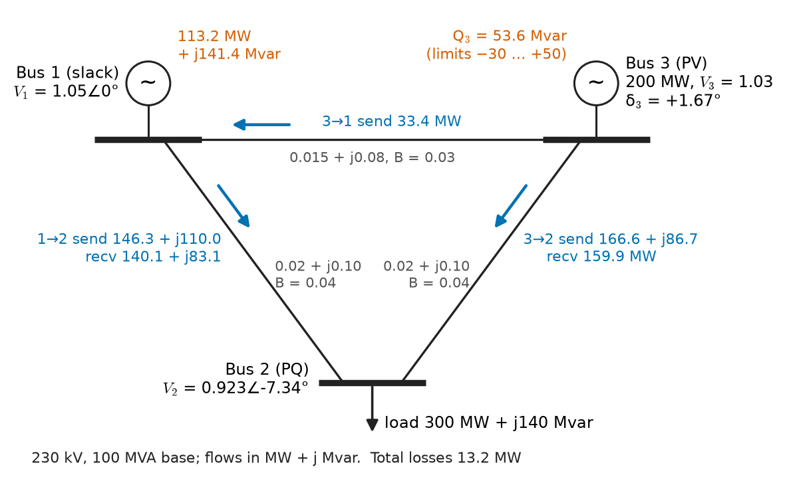
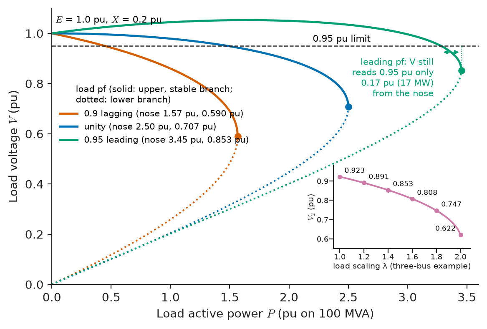
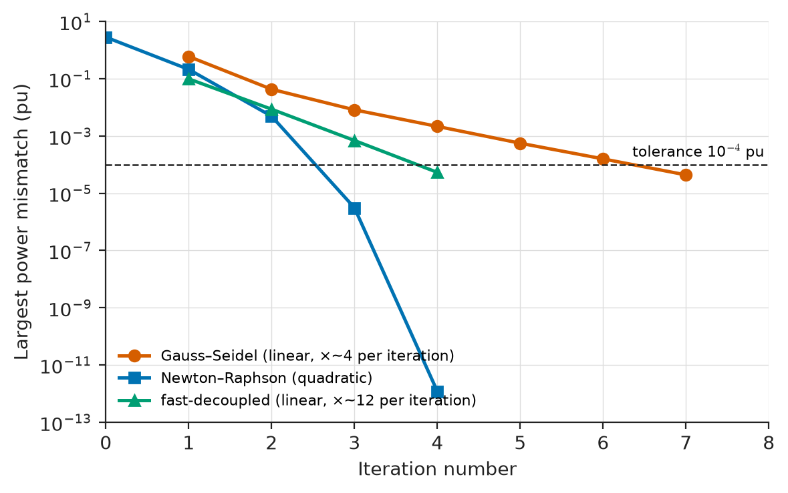
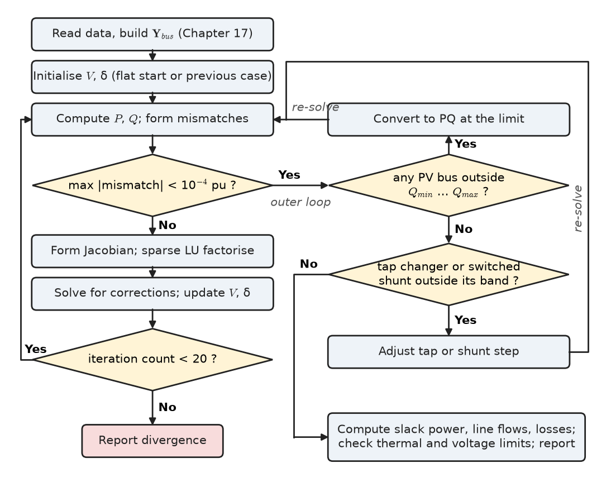
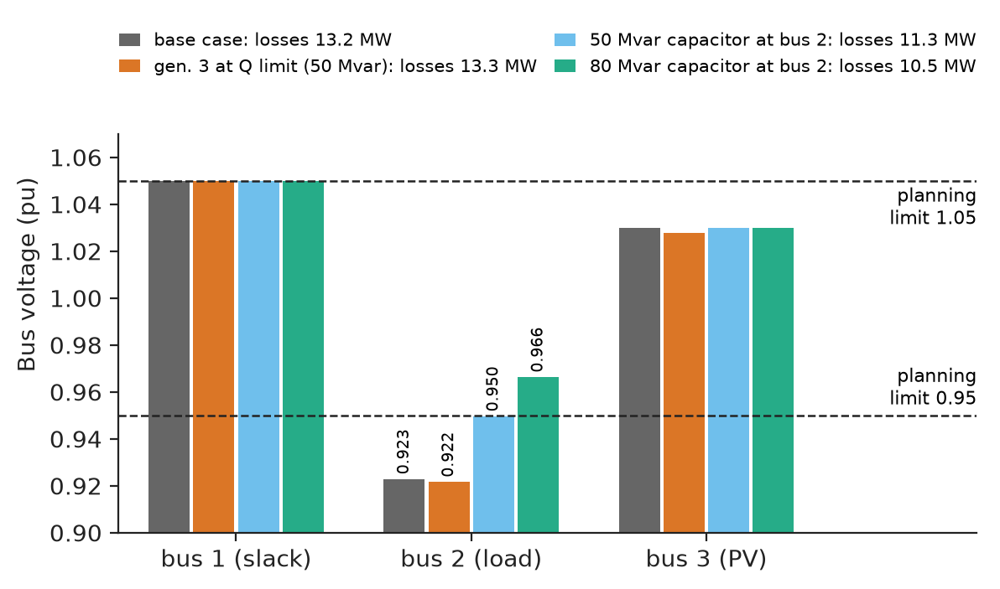
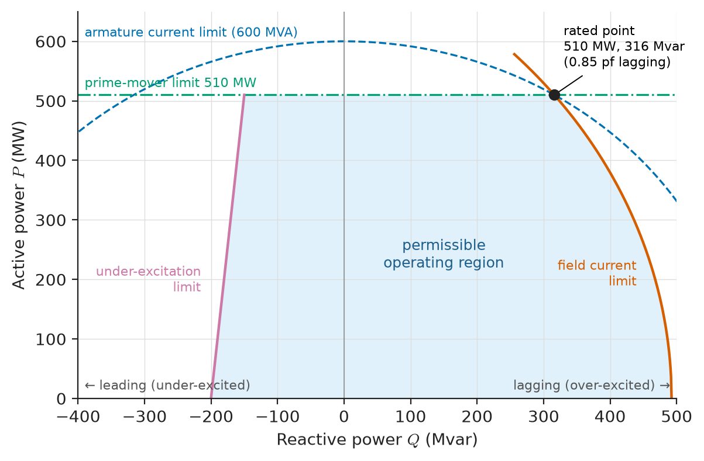

# Chapter 18 — Power-Flow Analysis

*Part V · Power-System Analysis*

A transmission planner receives a connection request: a 300 MW data-centre campus wants to connect at a 230 kV substation two years from now. Before saying yes, she must answer questions that no single-line diagram can settle by inspection. Will the voltage at the substation stay above 0.95 pu at peak load? Which lines will carry the extra power, and will any exceed its thermal rating? How much reactive power must the nearby generators supply, and will one of them hit its limit? Does the system still meet these limits with any one line out of service? Every one of these questions is answered by a **power-flow** (or **load-flow**) study, the most frequently run calculation in power engineering. Control centres run it every few minutes on the live network; planners run it thousands of times for future years; and every connection agreement for a wind farm, battery plant or factory rests on one. The difficulty is that loads and generators are specified as powers, not impedances or currents, and that turns a linear network into a set of nonlinear equations that must be solved iteratively.

> **What is specified and what is unknown at each bus, and why does specifying power make the network equations nonlinear?**
> **How do the Gauss–Seidel, Newton–Raphson and fast-decoupled methods solve them, and how fast?**
> **How are voltage profiles and reactive power read from the solution and managed in practice?**

| Concept | Engineering destination |
|---|---|
| Bus classifications | Modelling generators, loads, the reference machine and voltage-controlled buses |
| Power-balance equations | The physics every power-flow program solves |
| Load-flow formulation | Setting up a study: unknowns, mismatches, limits |
| Gauss–Seidel method | Simple solvers, distribution and teaching tools, initial estimates |
| Newton–Raphson method | Industry-standard solver in planning and control-centre software |
| Fast-decoupled load flow | Contingency screening and real-time security analysis |
| Voltage profiles | Compliance with ANSI C84.1, IEC 60038 and grid-code voltage limits |
| Reactive-power management | Capacitor banks, tap changers, generator capability, SVCs and STATCOMs |
| Convergence and interpretation | Trusting, reading and acting on the results |

**Roadmap.** What is known and unknown at each bus (18.1) → the power-balance equations (18.2) → assembling them into a solvable problem, and why a solution may not exist (18.3) → three ways to solve it: Gauss–Seidel (18.4), Newton–Raphson (18.5) and fast-decoupled (18.6) → reading voltage profiles (18.7) → controlling them with reactive power (18.8) → convergence, accuracy and interpretation (18.9).

> **Boundary.** This chapter uses the per-unit system, equipment models and bus admittance matrix of Chapter 17, the complex power $\bar S=\bar V\bar I^*$ of *Circuits, Signals and Communications*, [Ch. 9 §9.4](https://github.com/The-Studio-of-Sadiq/Circuits-Signals-and-Communications/blob/main/part-2-transient-and-ac-analysis/09-ac-power.md), and its nodal analysis, [Ch. 8 §8.7](https://github.com/The-Studio-of-Sadiq/Circuits-Signals-and-Communications/blob/main/part-2-transient-and-ac-analysis/08-sinusoidal-steady-state-analysis.md). The numerical methods themselves (fixed-point iteration, Newton's method, sparse LU factorisation) belong to *The Mathematics Universe*; here they are applied, not derived. The system is balanced and at steady state throughout.

---

## 18.1 Bus classifications

### Four quantities, two specified

At each bus $i$ four real quantities describe the steady state: the voltage magnitude $V_i$, its angle $\delta_i$, and the net injected active and reactive powers $P_i$ and $Q_i$ (generation minus load). The network equations supply two real relations per bus, so two of the four must be specified. Which two depends on what is connected:

- **PQ bus (load bus).** $P_i$ and $Q_i$ are specified, $V_i$ and $\delta_i$ are unknown. Most buses in a transmission model are PQ buses: substations serving load, and buses with no load or generation ($P_i=Q_i=0$). A generator operating at a fixed power factor, or one that has reached a reactive-power limit, is also modelled as PQ.
- **PV bus (generator or voltage-controlled bus).** $P_i$ and $V_i$ are specified, $Q_i$ and $\delta_i$ are unknown. The generator's governor and dispatch set $P$; its automatic voltage regulator holds $V$ by adjusting excitation, and therefore $Q$, within the limits $Q_{\min}\le Q_i\le Q_{\max}$. Static var compensators, STATCOMs and inverter-based plants in voltage-control mode are also PV buses.
- **Slack bus (swing or reference bus).** $V_i$ and $\delta_i$ are specified (usually $\delta=0$), $P_i$ and $Q_i$ are unknown. It is needed because the total losses are not known until the solution is found: the slack generator supplies whatever active power balances the system. It also provides the angle reference, since only angle differences are physically meaningful.

**Table 18.1 — Bus types in a power-flow study.**

| Bus type | Specified | Unknown | Typical equipment |
|---|---|---|---|
| Slack | $V$, $\delta$ | $P$, $Q$ | Largest generator or the external-grid equivalent |
| PV | $P$, $V$ | $Q$, $\delta$ | Generators, synchronous condensers, SVC, STATCOM, inverter plants in V control |
| PQ | $P$, $Q$ | $V$, $\delta$ | Loads, tee points, generators at Q limit or at fixed power factor |

### Practical variants

Real programs add refinements. A **distributed slack** shares the mismatch among many generators in proportion to their governor droops, which mimics how the system actually responds to an unknown loss. A **remote-voltage-controlled** bus holds a voltage at a bus other than the generator terminal, usually the high-voltage side of the step-up transformer. Buses can change type during the solution: a PV bus whose required $Q$ exceeds its limit is converted to a PQ bus with $Q$ fixed at the limit (Section 18.8).

The choice of slack matters more than it appears. Because the slack absorbs every error in the specified injections, including the unknown losses, it should be a large unit (or the external-grid equivalent) electrically close to the centre of the system. Choosing a small, remote generator as slack can push its computed output far outside its capability and distort the flows in its neighbourhood, even though the solution is mathematically correct.

---

## 18.2 Power-balance equations

### Complex form

With the bus admittance matrix $\mathbf Y_{\mathrm{bus}}$ of Chapter 17, the injected current at bus $i$ is $\bar I_i=\sum_k Y_{ik}\bar V_k$, and the complex power injected is

$$
\bar S_i=P_i+jQ_i=\bar V_i\,\bar I_i^{\,*}=\bar V_i\sum_{k=1}^{n}Y_{ik}^{*}\,\bar V_k^{*} .
$$

This is the whole physics of the power-flow problem: KCL at every bus, written with power instead of current.

### Polar form

Writing $\bar V_i=V_i\angle\delta_i$, $Y_{ik}=G_{ik}+jB_{ik}$ and $\delta_{ik}=\delta_i-\delta_k$ separates the real and imaginary parts:

$$
P_i=V_i\sum_{k=1}^{n}V_k\left(G_{ik}\cos\delta_{ik}+B_{ik}\sin\delta_{ik}\right),
$$

$$
Q_i=V_i\sum_{k=1}^{n}V_k\left(G_{ik}\sin\delta_{ik}-B_{ik}\cos\delta_{ik}\right).
$$

> **Status of the principle: Power-balance (load-flow) equations**
> *Derived.* KCL and the definition of complex power applied to the linear per-unit network; exact for the balanced, fundamental-frequency model, they become nonlinear only because injections are specified as powers.

### What the equations say physically

For a lossless line of reactance $X$ between two buses, the equations reduce to

$$
P_{12}=\frac{V_1V_2}{X}\sin\delta_{12},\qquad
Q_{12}=\frac{V_1^2-V_1V_2\cos\delta_{12}}{X}.
$$

Active power flows from the leading angle to the lagging one and depends mainly on the angle difference; reactive power flows from the higher voltage magnitude to the lower and depends mainly on the magnitude difference. This **P–δ and Q–V coupling** holds approximately for any network in which $X\gg R$, which covers transmission (X/R of 5–20) but not low-voltage distribution (X/R below 1). It explains why frequency and active power are controlled through prime movers and angles, and voltage through excitation, tap changers and reactive compensation; and it is the basis of the fast-decoupled method of Section 18.6.

---

## 18.3 Load-flow formulation

### Counting equations and unknowns

In an $n$-bus system with one slack bus, $n_{PV}$ PV buses and $n_{PQ}$ PQ buses:

- unknowns: $n-1$ angles (all except the slack) and $n_{PQ}$ voltage magnitudes;
- equations: one $P$ equation at every non-slack bus ($n-1$) and one $Q$ equation at every PQ bus ($n_{PQ}$).

Equations and unknowns both number $n-1+n_{PQ}$. The unknown $Q$ at PV buses and $P,Q$ at the slack are computed afterwards from the solved voltages. The problem is written as a **mismatch** to be driven to zero:

$$
\Delta P_i=P_i^{\mathrm{sp}}-P_i(\mathbf V,\boldsymbol\delta)=0,\qquad
\Delta Q_i=Q_i^{\mathrm{sp}}-Q_i(\mathbf V,\boldsymbol\delta)=0 .
$$

The specified values come from the dispatch and the load forecast; the computed values come from the equations of Section 18.2.

### The example system

Figure 18.1 shows a three-bus 230 kV system used for every worked example in this chapter. On a 100 MVA base:

- **Bus 1**, slack: $\bar V_1=1.05\angle0^\circ$.
- **Bus 2**, PQ: load 300 MW and 140 Mvar, so $P_2=-3.0$, $Q_2=-1.4$ pu.
- **Bus 3**, PV: generator 200 MW at $V_3=1.03$ pu, reactive limits $-30$ to $+50$ Mvar (used in Section 18.8).
- **Lines** (π models): 1–2: $z=0.02+j0.10$, $B=0.04$; 1–3: $z=0.015+j0.08$, $B=0.03$; 2–3: $z=0.02+j0.10$, $B=0.04$ pu.

<!-- FIGURE 18.1 | figures/ch18/fig-18-1-three-bus-system.png | single-line | Three-bus 230 kV test system used in the worked examples, with the solved power flow. | Content: bus 1 (slack generator, V = 1.05 at 0 deg) top left, bus 3 (generator 200 MW, V = 1.03 pu, Q limits -30 to +50 Mvar) top right, bus 2 (load 300 MW + j140 Mvar) bottom centre. Lines 1-2: 0.02 + j0.10, B = 0.04; 1-3: 0.015 + j0.08, B = 0.03; 2-3: 0.02 + j0.10, B = 0.04 pu on 100 MVA. Solved values annotated: V2 = 0.923 at -7.34 deg, delta3 = +1.67 deg; slack output 113.2 MW + j141.4 Mvar; generator 3 Q = 53.6 Mvar. Flow arrows: 1 to 2 sending 146.3 MW + j110.0 Mvar, receiving 140.1 MW + j83.1 Mvar; 3 to 1 sending 33.4 MW; 3 to 2 sending 166.6 MW + j86.7 Mvar, receiving 159.9 MW. Total losses 13.2 MW. -->

*Figure 18.1 — Three-bus 230 kV test system used in the worked examples, with the solved power flow.*

The admittance matrix, assembled as in Chapter 17, is

$$
\mathbf Y_{\mathrm{bus}}=
\begin{bmatrix}
4.187-j21.656 & -1.923+j9.615 & -2.264+j12.075\\
-1.923+j9.615 & 3.846-j19.191 & -1.923+j9.615\\
-2.264+j12.075 & -1.923+j9.615 & 4.187-j21.656
\end{bmatrix}\ \mathrm{pu}.
$$

The unknowns are $\delta_2$, $\delta_3$ and $V_2$; the equations are $\Delta P_2=0$, $\Delta P_3=0$ and $\Delta Q_2=0$.

### Nonlinearity, existence and the nose curve

The equations contain products of voltages and trigonometric functions of angles, so they have no closed-form solution and may have one, several or no solutions. The simplest case shows why. A load $P+jQ$ fed from a source $E$ through a lossless reactance $X$ satisfies

$$
V^4+\left(2QX-E^2\right)V^2+X^2\left(P^2+Q^2\right)=0 ,
$$

a quadratic in $V^2$. Below a critical loading there are two real solutions: a high-voltage one, at which the system operates, and a low-voltage one that is mathematically valid but practically unstable. At the critical loading they merge, and beyond it there is no solution at all. Plotting $V$ against $P$ traces the **nose curve** (P–V curve) of Figure 18.2. With $E=1$ and $X=0.2$ pu, a unity-power-factor load reaches its maximum at $P_{\max}=E^2/(2X)=2.5$ pu with $V=0.707$ pu; at 0.9 lagging the maximum falls to 1.57 pu at 0.59 pu voltage; at 0.95 leading (capacitive compensation) it rises to 3.45 pu at 0.85 pu.

<!-- FIGURE 18.2 | figures/ch18/fig-18-2-nose-curves.png | plot | Nose (P-V) curves for a load fed through a reactance of 0.2 pu from a 1.0 pu source at three power factors. | Content: x-axis load P 0 to 3.6 pu, y-axis load voltage V 0 to 1.1 pu. Three curves each with upper (stable) and lower branches meeting at the nose: 0.9 lagging (nose at P = 1.57, V = 0.59), unity (nose at P = 2.50, V = 0.707), 0.95 leading (nose at P = 3.45, V = 0.85). Horizontal dashed line at 0.95 pu marking the operating limit; annotation for the leading case that V still reads 0.95 pu at P = 3.28 pu, only 0.17 pu (5 %) below the nose at 3.45 pu: with capacitive compensation the margin to the nose is much smaller than the healthy voltage suggests. x-axis labelled pu on 100 MVA; leading nose voltage 0.853 pu. Inset: V2 of the three-bus example against load scaling factor lambda 1.0 to 2.0 (0.923 at 1.0, 0.891 at 1.2, 0.853 at 1.4, 0.808 at 1.6, 0.747 at 1.8, 0.622 at 2.0). -->

*Figure 18.2 — Nose (P-V) curves for a load fed through a reactance of 0.2 pu from a 1.0 pu source at three power factors.*

Two lessons follow. First, a power-flow program that fails to converge may be reporting a physical fact, that the specified loading has no steady state, rather than a numerical problem. Second, the voltage at the operating point is a poor indicator of the distance to collapse, especially with heavy capacitive compensation, which raises voltages while moving the nose closer in relative terms. Voltage stability is taken further in Chapter 20.

---

## 18.4 Gauss–Seidel method

### The iteration

Rearranging the complex power equation at a PQ bus for $\bar V_i$ gives a fixed-point form:

$$
\bar V_i^{(m+1)}=\frac{1}{Y_{ii}}\left[\frac{P_i-jQ_i}{\bar V_i^{(m)*}}-\sum_{k<i}Y_{ik}\bar V_k^{(m+1)}-\sum_{k>i}Y_{ik}\bar V_k^{(m)}\right].
$$

Buses are updated in turn, and each update uses the newest values available, which is what distinguishes Gauss–Seidel from Jacobi iteration. At a PV bus $Q_i$ is not known, so it is first computed from the latest voltages, $Q_i=-\operatorname{Im}\{\bar V_i^{*}\sum_kY_{ik}\bar V_k\}$; the voltage update is made with that $Q_i$; and the magnitude of the result is reset to the specified $V_i$, keeping only its angle. Iteration stops when the largest power mismatch, or the largest voltage change, falls below a tolerance.

The method needs very little memory and is simple to program, which is why it appeared first (in the 1950s) and why it survives in teaching tools and some distribution software. Its convergence is linear, however, and slows sharply as the network grows: each update spreads information only to neighbouring buses. Large transmission models need hundreds of iterations, and an **acceleration factor** $\alpha\approx1.4$–1.6, applied as $\bar V_i\leftarrow\bar V_i^{(m)}+\alpha(\bar V_i^{(m+1)}-\bar V_i^{(m)})$, is used to speed it up. Systems with series capacitors or a very weak slack connection may not converge at all.

> **Status of the principle: Gauss–Seidel load flow**
> *Derived.* A fixed-point iteration on the exact power-balance equations; its converged solution is exact, but convergence is only linear, depends on bus ordering and diagonal dominance of $\mathbf Y_{\mathrm{bus}}$, and is not guaranteed.

**Worked example — Gauss–Seidel iterations for the three-bus system.** Start from a flat estimate $\bar V_2^{(0)}=1.0\angle0^\circ$, $\bar V_3^{(0)}=1.03\angle0^\circ$.

*Bus 2, first update.* The terms are $(P_2-jQ_2)/\bar V_2^{(0)*}=-3.0+j1.4$, $Y_{21}\bar V_1=-2.019+j10.096$ and $Y_{23}\bar V_3=-1.981+j9.904$. The bracket is $(-3.0+j1.4)-(-2.019+j10.096)-(-1.981+j9.904)=1.000-j18.600$, and dividing by $Y_{22}=3.846-j19.191$ gives

$$
\bar V_2^{(1)}=0.9418-j0.1367=0.9517\angle-8.26^\circ\ \mathrm{pu}.
$$

*Bus 3, first update.* With the new $\bar V_2$, the reactive power needed at bus 3 is $Q_3=0.317$ pu. The voltage update gives $1.0346\angle1.24^\circ$; resetting the magnitude, $\bar V_3^{(1)}=1.03\angle1.24^\circ$.

*Convergence.* Continuing, the largest power mismatch falls as follows:

| Iteration | $V_2$ (pu) | $\delta_2$ (°) | $\delta_3$ (°) | $Q_3$ (pu) | Largest mismatch (pu) |
|---|---|---|---|---|---|
| 1 | 0.9517 | −8.255 | 1.241 | 0.317 | 0.602 |
| 2 | 0.9244 | −7.195 | 1.700 | 0.540 | 0.0430 |
| 3 | 0.9233 | −7.326 | 1.675 | 0.530 | 0.00822 |
| 4 | 0.9229 | −7.335 | 1.670 | 0.535 | 0.00217 |
| 5 | 0.9229 | −7.341 | 1.667 | 0.536 | 0.000561 |
| 6 | 0.9228 | −7.343 | 1.666 | 0.536 | 0.000159 |
| 7 | 0.9228 | −7.343 | 1.666 | 0.536 | 0.0000438 |

The mismatch shrinks by a roughly constant factor of about four per iteration, the signature of linear convergence; seven iterations reach a tolerance of $10^{-4}$ pu (0.01 MW on a 100 MVA base). On a three-bus system this is quick; on a 2,000-bus system the factor approaches one and the iteration count runs into hundreds.

---

## 18.5 Newton–Raphson method

### Linearise and correct

The Newton–Raphson method expands the mismatch equations to first order about the current estimate and solves the resulting linear system for a correction:

$$
\begin{bmatrix}\Delta\mathbf P\\ \Delta\mathbf Q\end{bmatrix}
=
\begin{bmatrix}\mathbf J_{P\delta} & \mathbf J_{PV}\\ \mathbf J_{Q\delta} & \mathbf J_{QV}\end{bmatrix}
\begin{bmatrix}\Delta\boldsymbol\delta\\ \Delta\mathbf V\end{bmatrix},
\qquad
\boldsymbol\delta\leftarrow\boldsymbol\delta+\Delta\boldsymbol\delta,\quad \mathbf V\leftarrow\mathbf V+\Delta\mathbf V .
$$

The **Jacobian** $\mathbf J$ contains the partial derivatives of the computed $P$ and $Q$ with respect to angles and magnitudes, evaluated at the current estimate; its rows correspond to the mismatch equations of Section 18.3 and its columns to the unknowns. Typical entries, for $i\neq k$, are

$$
\frac{\partial P_i}{\partial\delta_k}=V_iV_k\left(G_{ik}\sin\delta_{ik}-B_{ik}\cos\delta_{ik}\right),\qquad
\frac{\partial Q_i}{\partial V_k}=V_i\left(G_{ik}\sin\delta_{ik}-B_{ik}\cos\delta_{ik}\right),
$$

with similar expressions on the diagonal. The Jacobian has the same sparsity pattern as $\mathbf Y_{\mathrm{bus}}$, so it is factorised with sparse LU at every iteration at a cost roughly proportional to the number of buses.

Near the solution the error is squared at each iteration (**quadratic convergence**): if the mismatch is $10^{-2}$, the next is about $10^{-4}$, then $10^{-8}$. From a flat start a well-conditioned system of any size converges in 3–6 iterations. This size-independence, achieved once sparse matrix techniques were introduced in the late 1960s, made Newton–Raphson the industry standard.

> **Status of the principle: Newton–Raphson load flow**
> *Derived.* Newton's method applied to the exact power-balance equations; convergence is quadratic close to a solution, but the Jacobian becomes singular at the nose of the P–V curve, and from a poor starting point the iteration can diverge or converge to the low-voltage solution.

**Worked example — Newton–Raphson for the three-bus system.** Unknowns $\delta_2$, $\delta_3$, $V_2$; flat start $\delta_2=\delta_3=0$, $V_2=1.0$.

*Initial mismatches:* $\Delta P_2=-2.846$, $\Delta P_3=1.987$, $\Delta Q_2=-0.591$ pu.

*Initial Jacobian* (rows $\Delta P_2,\Delta P_3,\Delta Q_2$; columns $\delta_2,\delta_3,V_2$):

$$
\mathbf J^{(0)}=
\begin{bmatrix}
20.000 & -9.904 & 3.692\\
-9.904 & 22.964 & -1.981\\
-4.000 & 1.981 & 18.382
\end{bmatrix}.
$$

The large diagonal entries in the $P$–$\delta$ and $Q$–$V$ blocks and the small off-diagonal blocks are the P–δ and Q–V coupling of Section 18.2 made numerical.

*First correction:* solving gives $\delta_2=-6.619^\circ$, $\delta_3=1.804^\circ$, $V_2=0.9393$ pu.

*Iterations:*

| Iteration | $\delta_2$ (°) | $\delta_3$ (°) | $V_2$ (pu) | Largest mismatch after update (pu) |
|---|---|---|---|---|
| 0 (flat start) | 0 | 0 | 1.0000 | 2.85 |
| 1 | −6.619 | 1.804 | 0.9393 | 0.213 |
| 2 | −7.326 | 1.669 | 0.9232 | 0.00492 |
| 3 | −7.343 | 1.666 | 0.9228 | $3.1\times10^{-6}$ |
| 4 | −7.343 | 1.666 | 0.9228 | $1.2\times10^{-12}$ |

The mismatch exponent roughly doubles each step ($10^{-1}$, $10^{-3}$, $10^{-6}$, $10^{-12}$), and three iterations reach the accuracy that took Gauss–Seidel seven; the gap widens enormously for large systems.

*Solution.* $\bar V_2=0.9228\angle-7.343^\circ$ and $\delta_3=+1.666^\circ$. From the converged voltages, the slack supplies $P_1=113.2$ MW and $Q_1=141.4$ Mvar, and the bus-3 generator supplies $Q_3=53.6$ Mvar. Generation is $113.2+200=313.2$ MW against 300 MW of load: the **system losses are 13.2 MW**, which the slack picked up exactly as intended.

*Line flows,* computed from $\bar S_{ik}=\bar V_i[(\bar V_i-\bar V_k)y_{ik}+\bar V_i\,jB_{ik}/2]^*$:

| Line | Sending end | Receiving end | Loss |
|---|---|---|---|
| 1 → 2 | 146.3 MW, 110.0 Mvar | 140.1 MW, 83.1 Mvar | 6.17 MW |
| 3 → 1 | 33.4 MW, −33.0 Mvar | 33.1 MW, −31.4 Mvar (into bus 1) | 0.30 MW |
| 3 → 2 | 166.6 MW, 86.7 Mvar | 159.9 MW, 56.9 Mvar | 6.72 MW |

Bus 3 is at a slightly leading angle and exports power both to bus 2 and back towards the slack. Bus 2's voltage of 0.923 pu is below the usual 0.95 pu planning limit; Sections 18.7 and 18.8 deal with that.

<!-- FIGURE 18.3 | figures/ch18/fig-18-3-convergence-comparison.png | plot | Convergence of Gauss-Seidel, Newton-Raphson and fast-decoupled load flow on the three-bus example. | Content: x-axis iteration number 0 to 8, y-axis largest power mismatch in pu on log scale 1e-13 to 10. Gauss-Seidel markers: 0.602, 0.0430, 0.00822, 0.00217, 0.000561, 0.000159, 0.0000438 at iterations 1 to 7 (straight line on log scale). Newton-Raphson: 2.85 at 0, 0.213, 0.00492, 3.1e-6, 1.2e-12 at 1 to 4 (curving steeply down). Fast-decoupled: 0.0993, 0.00865, 0.000697, 0.0000537 at iterations 1 to 4 (straight line, steeper than Gauss-Seidel). Horizontal dashed line at 1e-4 pu tolerance. -->

*Figure 18.3 — Convergence of Gauss-Seidel, Newton-Raphson and fast-decoupled load flow on the three-bus example.*

### Flowchart of a production solver

Figure 18.4 shows the loop that every commercial power-flow program runs: build $\mathbf Y_{\mathrm{bus}}$; initialise voltages (flat start, or a previous solution); compute mismatches; check convergence; build and factorise the Jacobian; solve for corrections; update; then, after convergence, check generator reactive limits and tap-changer and shunt control actions, change bus types or settings where needed, and re-solve. These "outer loop" controls are where most real-world convergence difficulties arise.

<!-- FIGURE 18.4 | figures/ch18/fig-18-4-nr-flowchart.png | flowchart | Newton-Raphson load-flow algorithm with reactive-limit and control outer loop. | Content: boxes top to bottom: Read data and build Ybus (Chapter 17); Initialise V and delta (flat start or previous case); Compute P and Q, form mismatches; decision max mismatch below 1e-4 pu? No: form Jacobian, sparse LU factorise, solve for corrections, update V and delta, check iteration count below 20 (else report divergence), loop back. Yes: outer-loop decision any PV bus outside Qmin to Qmax? Yes: convert to PQ at limit, re-solve. Next decision any tap changer or switched shunt outside its voltage band? Yes: adjust tap or shunt step, re-solve. No: compute slack power, line flows, losses, check thermal and voltage limits, report. -->

*Figure 18.4 — Newton-Raphson load-flow algorithm with reactive-limit and control outer loop.*

---

## 18.6 Fast-decoupled load flow

### Two approximations

The Newton–Raphson Jacobian is recalculated and refactorised at every iteration. In transmission networks two physical facts allow a much cheaper scheme:

1. **Weak coupling.** Because $X\gg R$, $\partial P/\partial V$ and $\partial Q/\partial\delta$ are small compared with $\partial P/\partial\delta$ and $\partial Q/\partial V$ (compare the blocks of $\mathbf J^{(0)}$ above), so the off-diagonal blocks are dropped and the $P$–$\delta$ and $Q$–$V$ problems are solved alternately.
2. **Nearly constant blocks.** Angle differences across lines are small ($\cos\delta_{ik}\approx1$, $G_{ik}\sin\delta_{ik}\ll B_{ik}$) and $V\approx1$, so the remaining blocks are nearly constant.

The result, introduced by Stott and Alsaç in 1974, is the **fast-decoupled load flow** (FDLF):

$$
\frac{\Delta\mathbf P}{\mathbf V}=\mathbf B'\,\Delta\boldsymbol\delta,\qquad
\frac{\Delta\mathbf Q}{\mathbf V}=\mathbf B''\,\Delta\mathbf V .
$$

$\mathbf B'$ and $\mathbf B''$ are real, constant matrices built once and factorised once. In the common **XB** version, $\mathbf B'$ is built from branch reactances alone ($1/x_{ik}$, ignoring resistance, shunts and taps), and $\mathbf B''$ is the negative imaginary part of $\mathbf Y_{\mathrm{bus}}$ for the PQ buses. Each iteration costs a fraction of a Newton iteration; convergence is linear, but with a small, nearly constant ratio, so 4–8 iterations usually reach $10^{-4}$ pu.

> **Status of the principle: Fast-decoupled load flow**
> *Approximate.* The approximations affect only the iteration matrices, not the mismatch equations, so a converged result is as accurate as Newton–Raphson; but convergence relies on $X/R$ well above 1 and modest angle differences, and degrades or fails in distribution feeders, cable networks and heavily stressed systems.

**Worked example — Fast-decoupled solution of the three-bus system.** From the reactances $x_{12}=0.10$, $x_{13}=0.08$ and $x_{23}=0.10$, for the unknown angles at buses 2 and 3,

$$
\mathbf B'=\begin{bmatrix}20.0 & -10.0\\ -10.0 & 22.5\end{bmatrix},\qquad
\mathbf B''=\begin{bmatrix}19.191\end{bmatrix}.
$$

Alternating one $P$–$\delta$ and one $Q$–$V$ half-iteration, the largest mismatch after successive iterations is 0.0993, 0.00865, 0.000697 and 0.0000537 pu: a steady reduction by a factor of about 12 per iteration. After four iterations $V_2=0.9228$, $\delta_2=-7.343^\circ$ and $\delta_3=+1.666^\circ$, identical to the Newton result. The two constant matrices were factorised once; the Newton solution had to factorise a new 3×3 Jacobian at every iteration. In a 10,000-bus model that difference is what allows control centres to solve thousands of contingency cases every few minutes.

### Where decoupling fails

At low and medium voltage, R/X ratios approach or exceed 1: a 400 V cable has R/X of 2–5. The ignored coupling then dominates and FDLF converges slowly or not at all. Distribution programs therefore use full Newton, or methods that exploit radial topology (backward–forward sweep), and treat each phase separately because distribution loads are unbalanced (Chapter 22). The **DC power flow**, the extreme simplification ($V=1$, $R=0$, $\sin\delta\approx\delta$, $\mathbf P=\mathbf B'\boldsymbol\delta$), is linear and solves in one step; electricity markets and transmission-expansion studies use it for active-power flows, accepting errors of a few per cent and no information about voltages or reactive power.

---

## 18.7 Voltage profiles

### Limits

The **voltage profile** is the set of bus voltage magnitudes from the solution. Each must lie within limits set by equipment ratings, by supply standards and by grid codes. Table 18.2 gives representative values.

**Table 18.2 — Representative steady-state voltage limits.**

| Level | Normal limits | Source |
|---|---|---|
| North American service voltage, 120 V base | 114–126 V (±5 %, Range A); 110–127 V Range B | ANSI C84.1 |
| European low voltage, 230 V nominal | ±10 % for 95 % of 10-min means over a week | IEC 60038, EN 50160 |
| Medium-voltage distribution | ±5 to ±10 %, after regulators | Utility standards, EN 50160 |
| Transmission, planning (intact system) | 0.95–1.05 pu typical | Utility and regional planning criteria |
| Transmission, after a contingency | 0.90–1.10 pu typical, short-term | Planning criteria |
| 400 kV system (Continental Europe) | 0.90–1.05 pu unlimited time; highest equipment voltage 420 kV | EU Network Code RfG, IEC 60038 |

Low voltage reduces motor torque (proportional to $V^2$), increases current and losses, and can stall motors and trip drives; high voltage stresses insulation, saturates transformers and shortens lamp and electronics life. Transmission systems are often operated deliberately near the upper limit, to minimise losses and maximise margin to voltage collapse.

### Reading the profile

A quick estimate of the voltage drop along a branch carrying $P+jQ$ at the receiving end is

$$
\Delta V\approx\frac{RP+XQ}{V}\quad(\text{pu}).
$$

On transmission lines $X\gg R$, so reactive flow dominates the drop; on low-voltage cables resistance dominates and active power matters as much. In the three-bus example, bus 2 receives about 140 MW and 83 Mvar from bus 1 over $0.02+j0.10$ pu, giving $(0.02\times1.40+0.10\times0.83)/0.92\approx0.12$ pu, close to the actual 0.127 pu between bus 1 (1.05) and bus 2 (0.923). Most of the drop comes from moving reactive power, not active power, to the load.

<!-- FIGURE 18.5 | figures/ch18/fig-18-5-voltage-profiles.png | plot | Bus voltage profiles of the three-bus example for four operating cases, against planning limits. | Content: grouped bar chart, x-axis buses 1, 2, 3; y-axis voltage 0.90 to 1.07 pu. Cases: base case (1.050, 0.923, 1.030); generator 3 at Q limit 50 Mvar (1.050, 0.922, 1.028); 50 Mvar capacitor at bus 2 (1.050, 0.950, 1.030); 80 Mvar capacitor at bus 2 (1.050, 0.966, 1.030). Horizontal dashed lines at 0.95 and 1.05 pu labelled planning limits. Text labels: total losses 13.2, 13.3, 11.3 and 10.5 MW for the four cases. -->

*Figure 18.5 — Bus voltage profiles of the three-bus example for four operating cases, against planning limits.*

Profiles also expose the opposite problem. At light load, the charging of long lines and cables (Chapter 21) raises voltages, sometimes above 1.05–1.10 pu at remote ends. Distribution feeders with high rooftop PV show the same effect at midday, when reverse power flow lifts voltages at the feeder end (Chapters 22 and 27).

---

## 18.8 Reactive-power management

### Sources and sinks of reactive power

Reactive power must be balanced at every bus, and unlike active power it cannot be moved far: transmission branches consume $I^2X$ of reactive power and their voltage drops grow with reactive flow. In the base case of the example, the network consumes 55 Mvar net (series $I^2X$ minus line charging) while losing only 13.2 MW of active power. Reactive power is therefore supplied locally, by:

- **Synchronous generators and condensers**, within their capability curves (Figure 18.6);
- **Shunt capacitors**, switched in steps, supplying $Q=BV^2$, which falls just when it is most needed;
- **Shunt reactors**, absorbing reactive power on long lines and cables at light load;
- **On-load tap changers**, which do not create reactive power but redistribute it and hold voltages at selected buses;
- **Static var compensators** (thyristor-controlled reactors with fixed or switched capacitors) and **STATCOMs** (voltage-source converters), which vary output continuously in tens of milliseconds; a STATCOM's output is limited by current, so it falls only in proportion to $V$, not $V^2$;
- **Inverter-based resources** (PV, wind, batteries), which grid codes increasingly require to provide reactive power, for example at 0.95 leading to 0.95 lagging at rated output (Chapter 27).

### Generator capability

A generator's reactive limits are not fixed numbers. The capability curve of Figure 18.6 is bounded by the armature (stator) current limit, a circle of radius equal to rated MVA; the field current limit, which caps over-excited (lagging) output; the prime-mover limit on active power; and, on the under-excited (leading) side, the stator-end heating and steady-state stability limits. A 600 MVA, 0.85 power-factor turbo-generator rated 510 MW can produce about 316 Mvar lagging at full load, but only about 150–200 Mvar leading. The load flow models these limits as $Q_{\min}$ and $Q_{\max}$, sometimes as functions of $P$.

<!-- FIGURE 18.6 | figures/ch18/fig-18-6-generator-capability.png | plot | Capability curve of a 600 MVA, 0.85 power factor turbo-generator. | Content: x-axis reactive power Q from -400 (leading, under-excited) to +500 Mvar (lagging, over-excited), y-axis active power P 0 to 650 MW. Boundaries: armature current limit arc of radius 600 MVA centred at origin; field current limit arc (over-excited) intersecting armature arc at rated point P = 510 MW, Q = 316 Mvar, drawn assuming a synchronous reactance X_d = 1.8 pu on 600 MVA and a 1.0 pu terminal voltage (arc centred at Q = -333 Mvar, P = 0, radius about 826 MVA, so it meets P = 0 at about Q = 492 Mvar); prime-mover limit horizontal line at P = 510 MW; under-excitation limit line from about Q = -200 Mvar at P = 0 to Q = -150 Mvar at P = 510 MW. Rated operating point marked. Shaded area: permissible operating region. -->

*Figure 18.6 — Capability curve of a 600 MVA, 0.85 power factor turbo-generator.*

### Enforcing reactive limits in the load flow

**Worked example — Generator 3 reaches its reactive limit.** In the base solution the bus-3 generator must supply 53.6 Mvar to hold 1.03 pu, but its limit is 50 Mvar. The program converts bus 3 to a PQ bus with $Q_3=0.50$ pu and re-solves. Newton–Raphson converges in four iterations to $V_3=1.0279$ pu (bus 3 can no longer hold its set-point), $V_2=0.9216$ pu, $\delta_2=-7.348^\circ$, with the slack supplying 145.4 Mvar (up from 141.4) and losses 13.26 MW. The change is small here because the limit is only just exceeded, but in a stressed system the loss of voltage control at one generator shifts reactive demand to its neighbours, which may hit their own limits in turn: a cascade of limit hits is the classic precursor of voltage collapse (Chapter 20).

**Worked example — Sizing a capacitor bank for bus 2.** Bus 2 must be raised to at least 0.95 pu. A shunt capacitor of susceptance $B$ pu adds $jB$ to $Y_{22}$ and supplies $BV_2^2$.

*50 Mvar bank ($B=0.50$ pu):* re-solving gives $V_2=0.9496$ pu, just below 0.95, with the bank delivering only $0.50\times0.9496^2=45.1$ Mvar. Generator 3's reactive output falls to 26.6 Mvar, slack reactive output to 114.0 Mvar, and losses to 11.34 MW.

*80 Mvar bank ($B=0.80$ pu):* $V_2=0.9663$ pu, delivered 74.7 Mvar; generator 3 at 9.7 Mvar, slack at 96.8 Mvar; losses 10.48 MW.

*Interpretation.* An 80 Mvar bank, typically installed as two or three switched steps so that voltage can be held at both peak and light load, brings bus 2 comfortably inside limits, frees about 44 Mvar of generator 3's capability for contingencies and cuts losses by $13.18-10.48=2.7$ MW. Valued at \$60/MWh and a 50 % average load factor, that loss reduction alone is worth about $2.7\times8760\times0.5\times60\approx\$0.71$ M per year. The sensitivity from these cases, about 0.044 pu of voltage for 0.75 pu of delivered reactive power, or $\partial V_2/\partial Q_2\approx0.058$ pu per 100 Mvar, is what an operator uses to choose how many capacitor steps to switch.

> **Status of the principle: Local reactive-power compensation**
> *Derived.* Follows from the Q–V coupling of the power-balance equations: supplying reactive power at the bus that needs it reduces reactive flow, $I^2X$ losses and voltage drop along the path; the size of the effect depends on the network's Thevenin reactance at that bus and on the voltage dependence of the compensating device.

### Tap changers in the load flow

An on-load tap changer (OLTC) holds the voltage of a controlled bus, usually the transformer's low-voltage side, within a deadband of about ±1 % around its set-point by stepping the ratio $a$ of Chapter 17 in steps of about 1.25 %. The load flow represents it in one of two ways. In the **outer-loop** method the transformer is solved at a fixed tap; after convergence the controlled voltage is compared with the band, the tap is moved by the number of steps the sensitivity suggests, $\mathbf Y_{\mathrm{bus}}$ is updated and the case is re-solved. In the **integrated** method the tap ratio becomes an extra unknown in the Newton equations, with the controlled voltage magnitude as the extra specified quantity, and is rounded to the nearest physical step at the end. Either way, a tap changer does not create reactive power: raising the ratio to lift the load-side voltage draws more reactive power through the transformer from the upstream network. If the upstream network is already short of reactive power, the tap action lowers the high-voltage side further. This is why tap changers are blocked in emergency conditions, and why reactive sources must be planned together with them.

In the plant of Chapter 17, the 6.6 kV board fell to 0.928 pu at full load with T1 on its nominal tap. Moving T1's tap to boost the secondary by six steps (7.5 %) restores the board to about 1.0 pu ($0.928\times1.075\approx1.00$, neglecting the small extra drop); the extra reactive power is drawn from the 132 kV grid, whose 3000 MVA fault level makes the upstream voltage change negligible.

### Coordinating the controls

In practice the controls act together and on different time scales: generator AVRs and STATCOMs in under a second, switched capacitors and reactors in seconds to minutes, tap changers in tens of seconds per step, and operator dispatch over minutes to hours. Load-flow programs reproduce the steady result by adjusting taps and switched shunts in an outer loop (Figure 18.4); **optimal power flow** goes further and chooses the set-points that minimise losses or cost subject to all limits. Poor coordination, for example tap changers restoring load-side voltage while transmission voltages fall, has contributed to several historical voltage collapses.

---

## 18.9 Convergence and interpretation

### Tolerances and accuracy

A mismatch tolerance of $10^{-4}$ pu on a 100 MVA base means 0.01 MW and 0.01 Mvar at every bus, far finer than the accuracy of the input data. Load forecasts are uncertain by several per cent, line impedances by a few per cent, and the voltage dependence of loads is often unknown. The solution is precise; its accuracy is set by the data (Chapter 17).

### Why a load flow fails to converge

Non-convergence is information. The usual causes, roughly in order of frequency:

1. **Data errors**: an impedance on the wrong base, a missing branch that islands a load, a transformer tap far from nominal, a load entered in kW as MW (Table 17.5).
2. **No physical solution**: the case is beyond the nose of the P–V curve. Reducing the load until the case converges and tracing the voltage as load is increased (a **continuation power flow**) locates the limit; the three-bus example, with load at bus 2 scaled by a factor $\lambda$, still converges at $\lambda=2.0$ with $V_2=0.62$ pu, but needs more iterations and generator 3 supplies 403 Mvar, far beyond any real limit.
3. **Poor starting point**: a flat start far from the solution, for example with large phase-shifting transformers or long series-compensated lines. Starting from a previous solution, or a DC power flow for the angles, usually cures it.
4. **Control interactions**: PV–PQ switching or tap adjustments that oscillate between outer-loop iterations.

### Reading the results

A converged solution is checked and interpreted, not just accepted:

- **Balance check.** Total generation equals load plus losses. In transmission systems losses are 1.5–3 % of load; much higher values point to a data error or an unrealistic dispatch.
- **Slack output.** The slack should supply a plausible amount. A slack generator producing negative or several times its rated power means the dispatch does not balance the load.
- **Voltages.** Compare with Table 18.2; unusually high or low values are usually explained by the reactive balance.
- **Branch loading.** Each line and transformer flow is compared with its thermal rating (normal and emergency). In the example, line 3–2 carries $\lvert\bar S\rvert=\sqrt{166.6^2+86.7^2}=188$ MVA at its sending end, which must be compared with the conductor rating (Chapter 21).
- **Generator reactive output.** Units at or near their limits have no reserve for contingencies.

### Contingency analysis

A system planned to the **N−1 criterion** must remain within thermal and voltage limits after the loss of any single element. The planner of the opening paragraph therefore runs not one load flow but one for each credible outage, for several load levels and generation dispatches, and for future years: often tens of thousands of cases. Fast-decoupled solvers and sensitivity methods screen the cases, and full Newton solutions confirm the critical ones. The result is a list of violations and the reinforcements (new lines, transformers, capacitor banks, or special protection schemes) that remove them, which is the input to the planning decisions of Chapter 13.

> **Status of the principle: Steady-state power-flow solution**
> *Approximate.* A load flow gives one balanced, steady-state operating point for specified injections; it says nothing about whether the system can reach that point after a disturbance (Chapter 20), about unbalanced operation (Chapter 22) or about harmonics (Chapter 25).

---

## What remains open

| Open question | Where it is answered |
|---|---|
| How base values, equipment models and the admittance matrix are prepared | Chapter 17 |
| How the network responds to a short circuit, and how fault currents are calculated | Chapter 19 |
| Whether generators stay in synchronism after a disturbance, and how voltage collapse develops dynamically | Chapter 20 |
| How line parameters, thermal ratings and long-line effects enter the power flow | Chapter 21 |
| How radial, unbalanced distribution feeders are analysed, and how distributed generation changes their voltage profile | Chapter 22 |
| How SCADA measurements are turned into a real-time power-flow model (state estimation) | Chapter 26 |
| How inverter-based resources provide reactive power and voltage control under grid codes | Chapter 27 |
| How network planning uses power-flow results to decide on reinforcements | Chapter 13 |
| Newton's method, sparse matrices and iterative solvers as mathematics | *The Mathematics Universe* |
| Complex power and nodal analysis | *Circuits, Signals and Communications*, [Ch. 8](https://github.com/The-Studio-of-Sadiq/Circuits-Signals-and-Communications/blob/main/part-2-transient-and-ac-analysis/08-sinusoidal-steady-state-analysis.md) and [Ch. 9](https://github.com/The-Studio-of-Sadiq/Circuits-Signals-and-Communications/blob/main/part-2-transient-and-ac-analysis/09-ac-power.md) |

**Next:** Chapter 19 turns from the normal operating state to the abnormal one, and uses the same per-unit network to calculate the currents that flow when it is short-circuited.
