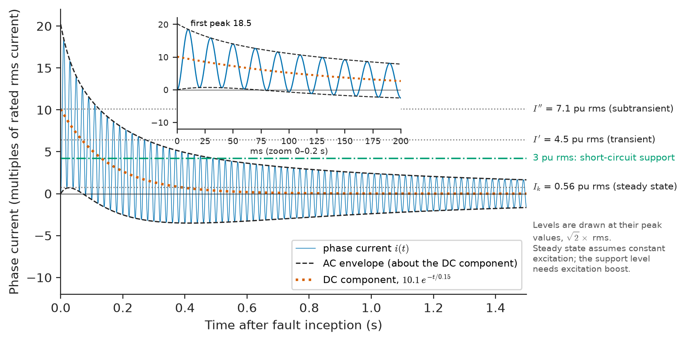
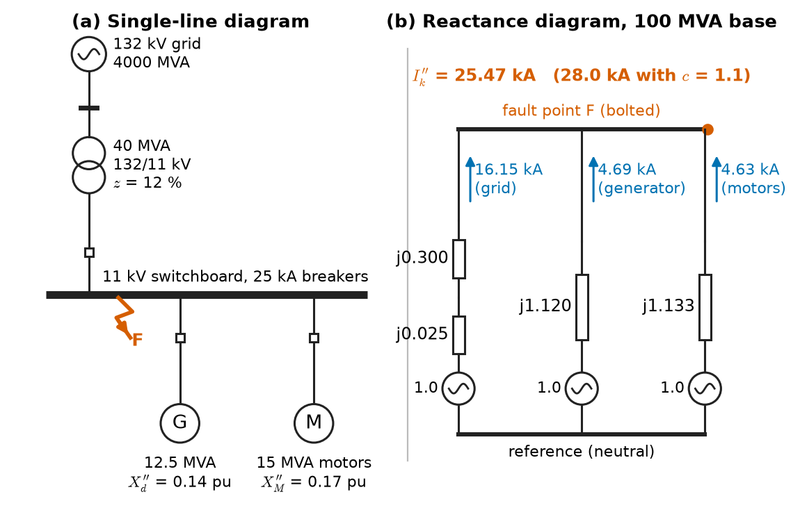
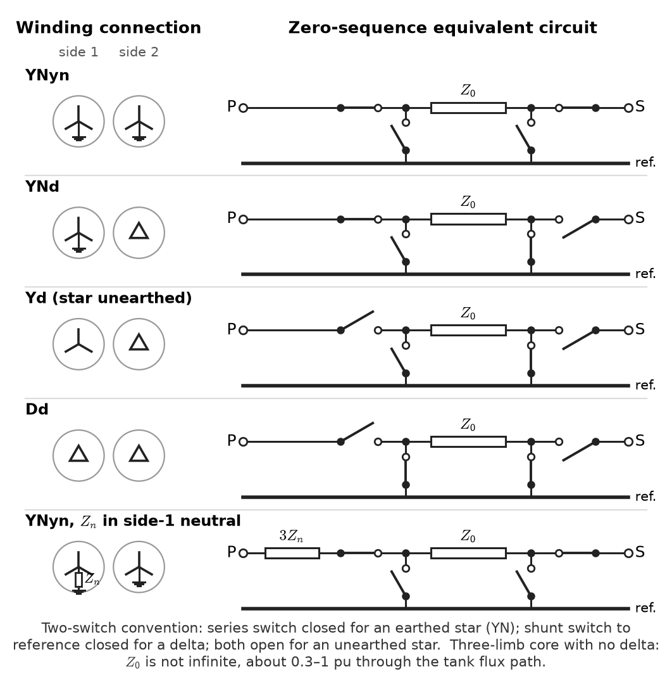
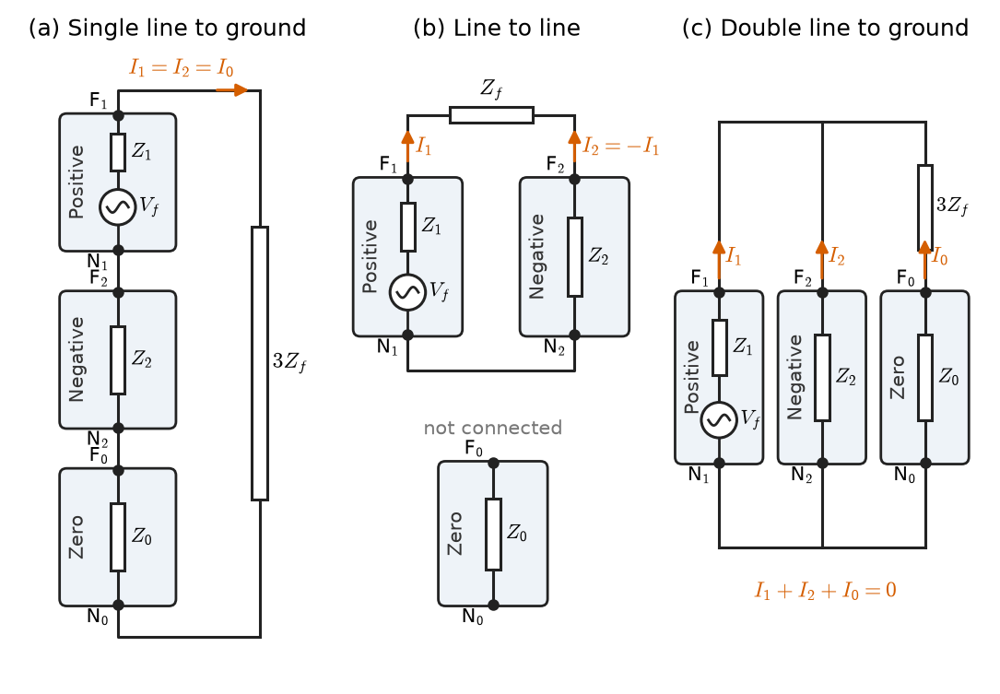
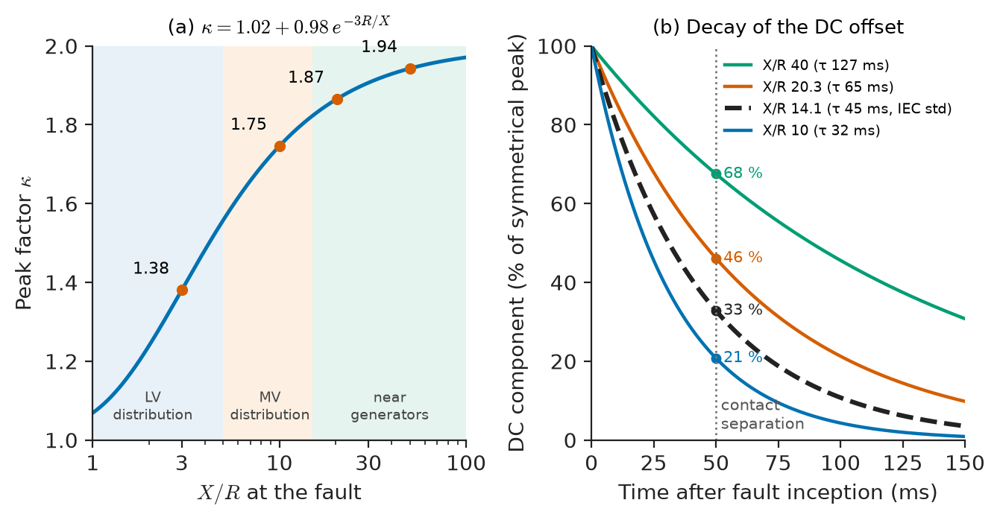
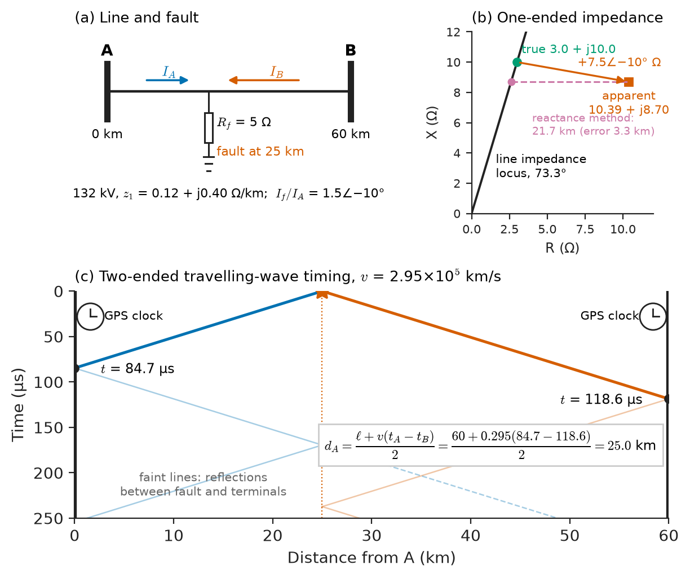

# Chapter 19 — Fault Analysis

*Part V · Power-System Analysis*

A gas-processing plant wants to add a 12.5 MVA gas-turbine generator to its 11 kV switchboard to cut its electricity bill and ride through grid outages. The switchboard was bought fifteen years ago with circuit breakers rated 25 kA. The protection engineer runs the numbers and finds that a short circuit on the busbar, which today would draw about 21 kA from the grid and the running motors, would draw about 28 kA once the generator is added. Nothing about normal operation changes: the load currents are a few hundred amperes. But on the one day a cable termination fails, the breaker asked to clear the fault would be asked to do something it was never tested to do, and a breaker that fails to interrupt becomes the next fault, often with an arc that destroys the switchroom. The same arithmetic appears when a utility connects a wind farm to a 132 kV substation, when a data centre adds a second 2.5 MVA transformer in parallel, and when a ship's designers put four generators on one main switchboard. Fault analysis is the calculation behind every one of those decisions.

> **How large is the current when a network is short-circuited, and how does it change in the first few cycles?**
> **How are unbalanced faults (one phase to earth, two phases together) calculated with balanced-network tools?**
> **What ratings must breakers, cables and switchgear have to survive the worst fault, and how is a fault found after it has been cleared?**

| Concept | Engineering destination |
|---|---|
| Short-circuit fundamentals | Fault levels at every bus, subtransient and transient generator response, X/R ratio |
| Symmetrical faults | Three-phase fault duty of switchgear, the bus impedance matrix |
| Symmetrical components | Unbalanced-fault calculation, negative-sequence and earth-fault relays |
| Sequence networks | Equipment data sheets, transformer vector groups, neutral-earthing design |
| Unsymmetrical faults | Single-line-to-ground, line-to-line and double-line-to-ground currents and voltages |
| Fault-current calculation | IEC 60909 and IEEE C37 short-circuit studies, peak and breaking currents |
| Equipment fault ratings | Breaker interrupting and making ratings, cable and busbar withstand, fault-current limiters |
| Fault-location concepts | Impedance-based and travelling-wave locators, cable fault finding, restoration time |

**Roadmap.** What a short circuit does to a network and to a generator (19.1) → the balanced three-phase fault and the bus impedance matrix (19.2) → symmetrical components as an engineering tool (19.3) and the sequence networks of real equipment (19.4) → connecting those networks for unbalanced faults (19.5) → the standard calculation procedures (19.6) → what the numbers must be compared with (19.7) → finding the fault afterwards (19.8).

---

## 19.1 Short-circuit fundamentals

### What a fault is

A **fault** is any unintended connection between conductors, or between a conductor and earth, that bypasses the load. On overhead lines most faults are flashovers of insulator strings caused by lightning, pollution, birds or vegetation; in cables they are insulation failures, joint failures and excavator damage; in machines and transformers they are winding insulation failures. The fault path may be a bolted metallic contact with almost zero impedance, an arc with a voltage drop of a few hundred volts to a few kilovolts, or a high-impedance path through a tree or dry ground.

Faults are classified by which conductors are involved:

| Fault type | Share of overhead-line faults (typical) | Comment |
|---|---|---|
| Single-line-to-ground (SLG) | 70–80 % | Insulator flashover to the tower; the most common fault |
| Line-to-line (LL) | 8–10 % | Conductor clashing in wind, galloping |
| Double-line-to-ground (LLG) | 5–10 % | Often an SLG that spreads |
| Three-phase (LLL, LLLG) | 2–5 % | Rare, but usually the most severe; also caused by earthing clamps left on after maintenance |

About 80–90 % of overhead-line faults are **transient**: once the arc is extinguished by tripping the line, the insulation recovers and the line can be reclosed. Cable and equipment faults are almost always **permanent**. This difference shapes protection practice (Chapter 23).

### Why the current is large and what it does

In normal operation the load impedance dominates the circuit. During a fault only the source, transformer and line impedances remain, and these are designed to be small so that voltage drop under load is small. A transformer with 10 % impedance therefore delivers about ten times its rated current into a fault at its terminals; a network bus fed by several such paths delivers more. The consequences are thermal (heating proportional to $I^2t$), mechanical (forces between conductors proportional to the square of the instantaneous current) and electrical (voltage collapse over a wide area while the fault persists, and arc energy at the fault itself).

The magnitude used to describe the strength of a network at a bus is the **fault level** or **short-circuit capacity**,

$$
S_\mathrm{sc}=\sqrt3\,V_\mathrm{n}\,I_\mathrm{sc}
$$

where $V_\mathrm{n}$ is the nominal line voltage and $I_\mathrm{sc}$ the symmetrical three-phase fault current. In per unit (Chapter 17), $S_\mathrm{sc}=1/Z_\mathrm{th}$ for a pre-fault voltage of 1 pu, so a 132 kV bus with a fault level of 4000 MVA has a Thévenin impedance of 0.025 pu on a 100 MVA base. The same quantity measures how "stiff" a bus is: voltage sag when a motor starts, flicker from an arc furnace and the stability of an inverter connection all improve with fault level (Chapters 25 and 27).

| Location | Typical fault level | Typical symmetrical fault current |
|---|---|---|
| 400 V main switchboard of a building or data centre | 25–70 MVA | 35–100 kA |
| 11 kV primary distribution bus | 250–500 MVA | 13–25 kA |
| 33 kV bus of a mining or industrial substation | 750–1500 MVA | 13–25 kA |
| 132 kV transmission substation | 3–9 GVA | 15–40 kA |
| 400 kV transmission substation | 20–40 GVA | 30–60 kA |
| Ship main switchboard, 6.6 kV with four generators | 200–400 MVA | 18–35 kA |

### The DC offset

When a fault occurs, the circuit seen from the source is predominantly inductive, with reactance-to-resistance ratio $X/R$ of 3–10 in distribution and 15–50 near large generators and transformers. The current cannot jump, so in addition to the steady sinusoid a decaying **DC offset** appears, whose size depends on the instant in the voltage cycle at which the fault strikes.

> **Boundary.** The RL transient behind the offset, including the worst-case first peak of $1.73$ times the symmetrical peak for $X/R=10$, is worked in *Circuits, Signals and Communications*, [Ch. 6 §6.4](https://github.com/The-Studio-of-Sadiq/Circuits-Signals-and-Communications/blob/main/part-2-transient-and-ac-analysis/06-first-order-circuits.md), with the Laplace-domain version in [Ch. 11](https://github.com/The-Studio-of-Sadiq/Circuits-Signals-and-Communications/blob/main/part-3-advanced-network-theory/11-laplace-domain-circuit-analysis.md). This chapter takes the result and applies it to breaker duties in Section 19.6.

The offset decays with time constant $\tau=X/(\omega R)$: 10–30 ms in distribution, 50–150 ms close to generators. While it lasts, the current has a higher peak (setting the mechanical forces and the breaker's **making** duty) and may not cross zero for several cycles, which matters because AC circuit breakers interrupt only at a current zero.

### The decaying AC component near generators

A second effect is specific to rotating machines. A synchronous generator does not behave as a constant voltage behind a constant reactance during a fault. The flux linkages of its rotor circuits (field winding and damper bars) cannot change instantly, so at the first instant the machine presents its small **subtransient reactance** $X_d''$. As the damper currents decay (time constant $T_d''$, a few cycles) the reactance rises to the **transient reactance** $X_d'$, and as the field current decays toward its steady value (time constant $T_d'$, about a second) it rises to the **synchronous reactance** $X_d$. The RMS AC component of a terminal fault current from an unloaded generator with internal voltage $E$ is

$$
I_\mathrm{ac}(t)=E\left[\left(\frac1{X_d''}-\frac1{X_d'}\right)e^{-t/T_d''}+\left(\frac1{X_d'}-\frac1{X_d}\right)e^{-t/T_d'}+\frac1{X_d}\right]
$$

> **Status of the principle: Generator short-circuit decrement**
> *Approximate.* Derived from the two-axis machine model with constant field voltage (Chapter 7); it neglects saturation, the action of the voltage regulator (which raises the field and holds the current up) and the difference between the direct- and quadrature-axis subtransient reactances.

For the 12.5 MVA generator of the opening, with $X_d''=0.14$, $X_d'=0.22$ and $X_d=1.8$ pu, the AC component of a terminal fault starts at $1/0.14=7.1$ times rated current, falls to $1/0.22=4.5$ times after a few cycles, and would settle at $1/1.8=0.56$ times rated current if the excitation stayed constant. A steady fault current smaller than full-load current is why a generator's own overcurrent protection uses voltage-restrained or voltage-controlled elements, and why the excitation systems of island generators (ships, oil platforms, mines) carry a **short-circuit support** feature that holds the field up to deliver about three times rated current for a few seconds, enough to operate downstream protection. Induction motors also feed a fault: their rotor flux supplies a current about equal to their locked-rotor current, which decays within two to five cycles because the motor has no field source.

<!-- FIGURE 19.1 | figures/ch19/fig-19-1-generator-fault-current.png | plot | Phase current of a 12.5 MVA generator for a three-phase terminal fault at the instant of maximum DC offset, showing the subtransient, transient and steady-state envelopes. | Content: x-axis time 0 to 1.5 s (inset zoom 0 to 0.2 s), y-axis current in per unit of rated peak, -12 to +22. Parameters Xd'' = 0.14, Xd' = 0.22, Xd = 1.8 pu, Td'' = 0.03 s, Td' = 0.8 s, armature time constant Ta = 0.15 s, E = 1.0 pu. Solid: instantaneous phase current with full DC offset. Dashed: upper and lower AC envelopes. Dotted: DC component decaying from 10.1 pu with 0.15 s time constant. Horizontal annotations at RMS levels 7.1 pu (subtransient), 4.5 pu (transient), 0.56 pu (steady state, constant excitation) and a dash-dot line at 3 pu labelled short-circuit support with excitation boost. -->

*Figure 19.1 — Phase current of a 12.5 MVA generator for a three-phase terminal fault at the instant of maximum DC offset, showing the subtransient, transient and steady-state envelopes.*

Figure 19.1 shows the three effects together: the AC envelope decays from subtransient to transient to steady values, and the DC offset displaces the waveform during the first few hundred milliseconds.

### The Thévenin method and its assumptions

Practical fault calculation uses one simplification that makes it tractable: **superposition of the pre-fault state and a fault-only network**. A fault at bus $k$ is equivalent to inserting, at that bus, a voltage source equal and opposite to the pre-fault voltage $V_k^{(0)}$. The currents caused by that source alone, flowing in the network with all other sources short-circuited and machines replaced by their subtransient or transient impedances, are the changes due to the fault; adding the pre-fault load currents gives the totals. For a bolted fault,

$$
I_f=\frac{V_k^{(0)}}{Z_\mathrm{th}}
$$

> **Status of the principle: Thévenin fault calculation**
> *Approximate.* Exact for a linear network by superposition; the approximations are in the model, namely machines as constant voltages behind fixed reactances, loads ignored or represented as constant impedances, and a pre-fault voltage that is assumed rather than taken from a load flow. Standards cover the uncertainty with a voltage factor $c$ (Section 19.6).

Pre-fault load currents are usually small compared with fault currents and are neglected, which is the standard practice of IEC 60909. What cannot be neglected are the sources that feed the fault: utility infeed, generators, motors and, increasingly, inverters.

---

## 19.2 Symmetrical faults

### The balanced fault and the per-phase network

A three-phase fault, with or without earth, keeps the network balanced. The per-phase equivalent of Chapter 17 therefore applies unchanged: one positive-sequence network with each source represented by its Thévenin equivalent and each machine by its subtransient reactance, solved for the current into the short at the faulted bus. This is the calculation that sets the **fault duty** of most switchgear, because three-phase faults are usually the most severe, and it is the starting point for all others.

**Worked example — adding a generator to a 25 kA switchboard.** The plant of the opening has an 11 kV switchboard fed from the 132 kV grid (fault level 4000 MVA) through a 40 MVA, 132/11 kV transformer with 12 % impedance. Running motors total 15 MVA, with subtransient reactance 0.17 pu on their own rating (a locked-rotor current of about six times rated). The new generator is 12.5 MVA with $X_d''=0.14$ pu. Work on a 100 MVA base at 11 kV, where the base current is $100\times10^6/(\sqrt3\times11\times10^3)=5249$ A, and use reactances only.

Convert each impedance to the common base:

$$
X_\mathrm{grid}=\frac{100}{4000}=0.025,\quad X_T=0.12\times\frac{100}{40}=0.300,\quad X_G=0.14\times\frac{100}{12.5}=1.120,\quad X_M=0.17\times\frac{100}{15}=1.133\ \mathrm{pu}
$$

With a pre-fault voltage of 1.0 pu, each path delivers its own contribution into a bolted busbar fault:

| Source | Path reactance (pu) | Contribution (pu) | Contribution (kA) |
|---|---|---|---|
| Grid through transformer | 0.325 | 3.077 | 16.15 |
| Generator | 1.120 | 0.893 | 4.69 |
| Motors | 1.133 | 0.882 | 4.63 |
| Total | 0.206 (parallel) | 4.852 | 25.47 |

Before the generator, the fault current was $16.15+4.63=20.78$ kA. With it, the total is 25.47 kA, a fault level of 485 MVA, already above the 25 kA rating before any safety margin. Applying the IEC voltage factor $c=1.1$ for maximum fault current at medium voltage gives 22.86 kA without the generator and 28.01 kA with it. The switchboard is adequate today and overdutied tomorrow. Section 19.6 completes this example with the peak and breaking currents; Section 19.7 discusses the remedies.

<!-- FIGURE 19.2 | figures/ch19/fig-19-2-plant-single-line.png | single-line | Single-line diagram and positive-sequence reactance diagram of the 11 kV plant switchboard with grid, generator and motor contributions to a busbar fault. | Content: left: 132 kV grid source labelled 4000 MVA, 40 MVA 132/11 kV transformer 12 percent, 11 kV switchboard with 25 kA breakers, 12.5 MVA generator Xd'' = 0.14 pu through its breaker, aggregated 15 MVA motor load Xm'' = 0.17 pu, fault symbol on the busbar. Right: reactance diagram on 100 MVA base: 0.025 + 0.300 pu grid branch, 1.120 pu generator branch, 1.133 pu motor branch, all with 1.0 pu sources, meeting at the fault point; contributions annotated 16.15 kA, 4.69 kA, 4.63 kA, total 25.47 kA (28.0 kA with c = 1.1). -->

*Figure 19.2 — Single-line diagram and positive-sequence reactance diagram of the 11 kV plant switchboard with grid, generator and motor contributions to a busbar fault.*

Figure 19.2 shows the single-line diagram and its reactance diagram. The three branches are in parallel at the fault, which is why every new source raises the fault level of every bus electrically close to it.

### The bus impedance matrix

In a meshed network with hundreds of buses, faults are calculated at every bus, and the method of choice is the **bus impedance matrix** $\mathbf Z_\mathrm{bus}=\mathbf Y_\mathrm{bus}^{-1}$, built from the same branch data as the power-flow admittance matrix (Chapter 18) but with machine subtransient reactances added as shunt branches to the reference. Its elements have direct physical meaning:

- the diagonal element $Z_{kk}$ is the Thévenin impedance at bus $k$, so the bolted three-phase fault current there is $I_f=V_k^{(0)}/Z_{kk}$;
- the off-diagonal element $Z_{ik}$ gives the voltage change at bus $i$ caused by injecting current at bus $k$, so during a fault at $k$ the voltage at bus $i$ is

$$
V_i=V_i^{(0)}-\frac{Z_{ik}}{Z_{kk}}V_k^{(0)}
$$

and the current in any branch between buses $i$ and $j$ follows from the voltage difference across its impedance.

> **Status of the principle: Fault calculation with $\mathbf Z_\mathrm{bus}$**
> *Derived.* A direct consequence of nodal analysis and superposition in a linear network; one column of $\mathbf Z_\mathrm{bus}$ gives the voltages everywhere for a fault at the corresponding bus.

In practice $\mathbf Z_\mathrm{bus}$ is never inverted explicitly for large networks. Programs factorise the sparse $\mathbf Y_\mathrm{bus}$ once and solve for the columns needed, or build $\mathbf Z_\mathrm{bus}$ branch by branch with the building algorithm. The voltage profile during the fault, from the formula above, is used to judge which motors will stall, which contactors will drop out (most fall out below 60–70 % voltage) and which inverters must ride through.

### Faults with impedance

A fault through an impedance $Z_f$ (an arc, or a tree branch) simply adds $Z_f$ to the Thévenin impedance: $I_f=V_k^{(0)}/(Z_{kk}+Z_f)$. On transmission networks arc resistance is a few ohms and changes the current little; at low voltage it matters a great deal. An arc at 400 V has a voltage drop of roughly 100–200 V, a large fraction of the 230 V phase voltage, so an **arcing fault** may draw only 40–60 % of the bolted current, too little to trip a breaker set for the bolted value quickly. That is why arc-flash studies (Chapter 29) compute both the bolted and the reduced arcing current and check the protection clearing time at each.

---

## 19.3 Symmetrical components

### The tool and where it comes from

Most faults are unbalanced, and an unbalanced fault on a balanced network breaks the symmetry that the per-phase method relies on. The way back is **symmetrical components**.

> **Boundary.** The decomposition of three unbalanced phasors into positive-, negative- and zero-sequence sets, with the operator $a=1\angle120°$, is stated in *Circuits, Signals and Communications*, [Ch. 10 §10.6](https://github.com/The-Studio-of-Sadiq/Circuits-Signals-and-Communications/blob/main/part-2-transient-and-ac-analysis/10-three-phase-circuits.md), with a numerical example on an unbalanced residential feeder. That chapter also states the key property: in a network whose elements are themselves symmetrical, each sequence set flows in its own uncoupled network. This section adds what a power engineer needs to use it.

In matrix form, with $\mathbf A$ the transformation matrix,

$$
\begin{bmatrix}V_a\\V_b\\V_c\end{bmatrix}=\begin{bmatrix}1&1&1\\1&a^2&a\\1&a&a^2\end{bmatrix}\begin{bmatrix}V_0\\V_1\\V_2\end{bmatrix},\qquad \mathbf V_{abc}=\mathbf A\,\mathbf V_{012}
$$

Applying $\mathbf A^{-1}$ to the impedance matrix of a three-phase element, $\mathbf Z_{012}=\mathbf A^{-1}\mathbf Z_{abc}\mathbf A$, diagonalises it whenever $\mathbf Z_{abc}$ has equal self-impedances $Z_s$ and equal mutual impedances $Z_m$, which a transposed line or a symmetrically built machine has. For a static element such as a line,

$$
Z_1=Z_2=Z_s-Z_m,\qquad Z_0=Z_s+2Z_m
$$

The positive- and negative-sequence impedances of static equipment are equal because reversing the phase order does not change how a stationary conductor links flux. The zero-sequence impedance is larger because three in-phase currents add, return through earth or a neutral, and enclose a much larger loop.

> **Status of the principle: Decoupling of sequence networks**
> *Derived.* Exact when every element of the network is phase-symmetrical; it is approximate for untransposed lines (mutual impedances unequal by 5–15 %) and fails for single-phase loads, open conductors and saturated equipment, which must be modelled in phase coordinates.

### Power, measurement and the phase shift through transformers

Three practical facts complete the toolkit. First, with the transformation as written, complex power is $S=3(V_0I_0^*+V_1I_1^*+V_2I_2^*)$, so power calculations in sequence quantities need the factor 3. Second, sequence quantities are directly measurable and are used as protection signals: the residual current $3I_0=I_a+I_b+I_c$ is what a core-balance CT or the summation of three phase CTs measures, and numerical relays compute $I_2$ and $V_2$ to detect unbalance and broken conductors.

Third, a transformer whose windings are connected differently on its two sides shifts sequence quantities by a phase angle. In a Dyn11 or YNd1 transformer, positive-sequence voltages and currents are shifted by 30° one way and negative-sequence quantities by 30° the other way; zero-sequence quantities are not transferred at all. When sequence currents are referred through such a transformer, the shift must be applied before recombining to phases, or the phase currents on the far side come out wrong. Worked example 19.5 shows the consequence: an earth fault on the secondary side of a delta–star transformer appears on the primary side as a current in only two lines.

---

## 19.4 Sequence networks

### Building the three networks

Each piece of equipment has three sequence impedances, and the network for each sequence is assembled from them with the same topology as the power system, with three differences:

- the **positive-sequence network** contains the sources (generator internal voltages); the other two are passive;
- the **negative-sequence network** has the same topology as the positive, with negative-sequence impedances and no sources;
- the **zero-sequence network** has a topology that depends on how each piece of equipment is earthed and how transformer windings are connected, because zero-sequence current can only flow where there is a return path.

Figure 19.3 shows the zero-sequence equivalents of the common transformer connections.

### Sequence impedances of real equipment

| Equipment | $Z_1$ | $Z_2$ | $Z_0$ |
|---|---|---|---|
| Turbo-generator (round rotor) | $X_d''$ = 0.10–0.25 pu | ≈ $X_d''$, 0.10–0.25 pu | 0.03–0.10 pu, plus $3Z_n$ of the neutral earthing |
| Salient-pole hydro generator with dampers | $X_d''$ = 0.18–0.30 pu | 0.20–0.35 pu | 0.05–0.15 pu, plus $3Z_n$ |
| Induction motor | Locked-rotor reactance 0.15–0.20 pu | ≈ $Z_1$ | Infinite (star or delta, unearthed) |
| Two-winding power transformer | Leakage impedance 0.06–0.20 pu, rising with rating | = $Z_1$ | Depends on connection; ≈ 0.8–1.0 $Z_1$ through YNd; open circuit from a delta or unearthed star side |
| Overhead line, 132–400 kV | 0.25–0.40 Ω/km | = $Z_1$ | 2.5–3.5 × $Z_1$ in reactance, with larger resistance (earth return) |
| Underground XLPE cable | 0.08–0.20 Ω/km | = $Z_1$ | 1–3 × $Z_1$, strongly dependent on sheath bonding and earth path |
| Inverter-based resource (PV, battery, full-converter wind) | Current source limited to 1.0–1.5 pu | Controlled; grid codes now require injection (IEEE 2800, ENTSO-E RfG) | Usually blocked by a delta or unearthed transformer winding |

The values are typical; data sheets and test reports govern actual studies.

### Generators and their earthing

A synchronous machine's negative-sequence reactance is close to its subtransient reactance: a negative-sequence current produces a field rotating backward at twice synchronous speed relative to the rotor, which the damper windings oppose much as they oppose a sudden change. That same double-frequency rotor current heats the rotor surface, which is why generators have a negative-sequence rating (typically continuous $I_2$ of 5–10 % and a short-time limit $I_2^2t$ of 5–30 s in per unit squared seconds, per IEC 60034-1) and a negative-sequence relay to enforce it.

The zero-sequence reactance of a generator winding is small, often smaller than $X_d''$, because three in-phase currents in distributed windings produce almost no air-gap field. If a generator neutral were solidly earthed, a terminal earth fault could therefore exceed the three-phase fault current and damage the winding. Generators are earthed through an impedance $Z_n$, which appears in the zero-sequence network as $3Z_n$, because all three sequence-zero currents flow through it: $I_n=3I_0$, so the neutral voltage is $3I_0Z_n$.

### Transformers and the zero-sequence path

The zero-sequence network of a transformer follows two rules. Zero-sequence current can flow in a star winding only if its neutral is earthed. It can be transferred from one side to the other only if both windings can carry it; a delta winding cannot pass zero-sequence current to its line terminals, but it can circulate it inside the delta, which balances ampere-turns and makes the transformer look like its leakage impedance to earth from the earthed-star side.

| Connection | Zero-sequence equivalent seen from side 1 | Zero-sequence equivalent seen from side 2 |
|---|---|---|
| YNyn, both neutrals earthed | Series leakage impedance through to side 2 | Series leakage impedance through to side 1 |
| YNd (star earthed on side 1) | Leakage impedance to reference (delta circulates current) | Open circuit |
| Yd or Yyn with unearthed star | Open circuit | Open circuit (Yd); through only if side 1 is earthed (Yyn) |
| Dd | Open circuit | Open circuit |
| Zigzag earthing transformer | Low zero-sequence impedance to reference | — |

The YNd connection is the workhorse of power systems because of this table: the step-up transformer of a power station (generator on the delta) isolates the generator from transmission earth faults, and the Dyn distribution transformer gives a solidly earthed LV neutral while presenting an open zero-sequence circuit to the MV system. Three-limb core-type transformers without a delta add a further subtlety: zero-sequence flux has no return path in the core and closes through the tank, giving a zero-sequence impedance far lower than the magnetising impedance (typically 0.3–1 pu), which a fault study must not treat as infinite.

<!-- FIGURE 19.3 | figures/ch19/fig-19-3-transformer-zero-sequence.png | schematic | Zero-sequence equivalent circuits of two-winding transformers for the common winding connections. | Content: five rows, each with a winding symbol pair on the left and its zero-sequence equivalent on the right between terminal P (side 1), terminal S (side 2) and the reference bus. Rows: YNyn (series Z0 between P and S, both switches closed), YNd (Z0 from P to reference, S open), Yd with unearthed star (both open), Dd (both open), YNyn with neutral impedance Zn on side 1 (3Zn in series on side 1). Use the two-switch convention: series switch closed for star earthed, shunt switch to reference closed for delta. Bottom note: three-limb core without delta, Z0 about 0.3 to 1 pu through tank flux. -->

*Figure 19.3 — Zero-sequence equivalent circuits of two-winding transformers for the common winding connections.*

### Lines and cables

The zero-sequence impedance of an overhead line is dominated by the earth return. Carson's equations replace the earth by an equivalent return conductor at a depth of several hundred metres, which depends on soil resistivity, and give zero-sequence reactances about three times the positive-sequence value. Shield wires bonded to every tower carry part of the return current and reduce $Z_0$. For a 132 kV line with $z_1=0.12+j0.40$ Ω/km, a typical zero-sequence value is $z_0=0.35+j1.25$ Ω/km. Because $Z_0$ also depends on soil resistivity, which varies with season, earth-fault calculations on long lines carry an uncertainty of 10–20 % that distance-relay settings must allow for (Chapter 23). Line parameters themselves are derived in Chapter 21.

### Neutral earthing practice

Because the zero-sequence network contains the earthing impedances, the choice of earthing sets the earth-fault current, the overvoltage on healthy phases and the way the fault must be detected:

| Earthing method | Earth-fault current | Healthy-phase voltage during fault | Typical use |
|---|---|---|---|
| Solid | Comparable to, or above, three-phase fault current | ≤ 1.4 pu (effectively earthed, IEC 60071) | Transmission ≥ 110 kV, LV TN systems, North American MV four-wire |
| Low-resistance | 100–1000 A (400 A and 1000 A common) | Up to ≈ 1.7 pu | Industrial and mining MV systems |
| High-resistance | < 10 A, set slightly above system capacitive current | Up to ≈ 1.73 pu | Generator neutrals, continuous-process LV and MV plants (alarm on first fault) |
| Resonant (Petersen coil) | Residual of a few amperes; arcs self-extinguish | ≈ 1.73 pu | Rural MV networks in Germany, Scandinavia, China |
| Unearthed | System capacitive current only | 1.73 pu, with intermittent-arc overvoltages much higher | Older industrial and marine systems |

High-resistance and resonant earthing let a plant run on with one earth fault, at the price of insulation stressed to line voltage; solid earthing gives fast, selective tripping at the price of large fault currents.

---

## 19.5 Unsymmetrical faults

### Fault boundary conditions

Each fault type is a set of boundary conditions on the phase quantities at the fault point. Transformed into sequence quantities, these conditions tell us how to interconnect the three sequence networks at that point. Let $Z_1$, $Z_2$ and $Z_0$ be the Thévenin impedances of the three networks seen from the fault, $V_f$ the pre-fault phase voltage and $Z_f$ the fault impedance. Phase $a$ is chosen as the reference (the faulted phase for SLG, the healthy phase for LL and LLG), which makes the connections symmetrical.

**Single-line-to-ground, phase $a$ to earth through $Z_f$.** The boundary conditions $I_b=I_c=0$ and $V_a=Z_fI_a$ give $I_0=I_1=I_2$: the three networks are connected **in series** with $3Z_f$:

$$
I_1=I_2=I_0=\frac{V_f}{Z_1+Z_2+Z_0+3Z_f},\qquad I_a=3I_0
$$

**Line-to-line, phases $b$ and $c$ through $Z_f$.** With $I_a=0$, $I_b=-I_c$ and $V_b-V_c=Z_fI_b$, the zero-sequence network is not involved and the positive and negative networks are connected **in parallel** (in opposition) through $Z_f$:

$$
I_1=-I_2=\frac{V_f}{Z_1+Z_2+Z_f},\qquad I_b=-I_c=-j\sqrt3\,I_1
$$

**Double-line-to-ground, phases $b$ and $c$ to earth.** For a bolted fault the three networks are connected **in parallel**:

$$
I_1=\frac{V_f}{Z_1+\dfrac{Z_2Z_0}{Z_2+Z_0}},\qquad I_2=-I_1\frac{Z_0}{Z_2+Z_0},\qquad I_0=-I_1\frac{Z_2}{Z_2+Z_0}
$$

with the earth current $3I_0$. A fault impedance to earth appears as $3Z_f$ in series with $Z_0$.

> **Status of the principle: Sequence-network connections for unbalanced faults**
> *Derived.* Each connection follows algebraically from the fault's phase boundary conditions and the symmetrical-component transformation; the results are exact for the linear model of Section 19.1 and inherit its approximations.

<!-- FIGURE 19.4 | figures/ch19/fig-19-4-sequence-connections.png | circuit | Interconnection of the positive-, negative- and zero-sequence networks at the fault point for single-line-to-ground, line-to-line and double-line-to-ground faults. | Content: three panels side by side. Each sequence network drawn as a box with a reference terminal and a fault terminal; positive box contains source Vf in series with Z1, negative box Z2, zero box Z0. (a) SLG: all three boxes in series with 3Zf, current I1 = I2 = I0 marked. (b) LL: positive and negative boxes in parallel through Zf, zero box unconnected, I1 = -I2. (c) LLG: all three in parallel (3Zf in series with zero box), currents I1, I2, I0 marked with I1 + I2 + I0 = 0. -->

*Figure 19.4 — Interconnection of the positive-, negative- and zero-sequence networks at the fault point for single-line-to-ground, line-to-line and double-line-to-ground faults.*

Figure 19.4 shows the three connections. Once the sequence currents are known, sequence voltages at the fault follow from $V_1=V_f-Z_1I_1$, $V_2=-Z_2I_2$ and $V_0=-Z_0I_0$, and phase quantities from the transformation matrix. Elsewhere in the network, the sequence currents in each branch come from the columns of the three sequence $\mathbf Z_\mathrm{bus}$ matrices, exactly as in Section 19.2.

### Which fault is the worst?

For a fault far from generators, where $Z_1=Z_2$, the SLG current compared with the three-phase current is

$$
\frac{I_\mathrm{SLG}}{I_\mathrm{3ph}}=\frac{3Z_1}{2Z_1+Z_0}
$$

so the SLG fault exceeds the three-phase fault whenever $Z_0<Z_1$. That happens at the LV terminals of a Dyn transformer, at generator terminals with a solid neutral, and at transmission substations with many earthed autotransformers. The LL fault current is $\sqrt3/2=0.87$ times the three-phase current when $Z_1=Z_2$, so it never governs breaker ratings far from machines, but it is the minimum-current case that protection must still detect.

**Worked example — faults on the low-voltage side of a data-centre transformer.** A data-centre electrical room is fed from an 11 kV ring through a 2.5 MVA, 11/0.415 kV Dyn11 transformer with 6 % impedance and a solidly earthed LV neutral. The 11 kV fault level at the ring main unit is 250 MVA. On the transformer base (2.5 MVA, 415 V; base current 3478 A) the source impedance is $2.5/250=0.01$ pu and the transformer 0.06 pu. Take all impedances to have the same angle so that magnitudes add, and use $Z_0=0.95\,Z_T=0.057$ pu for the zero-sequence impedance seen from the LV side (the 11 kV source does not appear in it, because the delta blocks zero-sequence current). Then $Z_1=Z_2=0.07$ pu.

- Three-phase: $I=1/0.07=14.29$ pu $=49.7$ kA.
- SLG: $I=3/(0.07+0.07+0.057)=15.23$ pu $=53.0$ kA, larger than the three-phase fault because $Z_0<Z_1$.
- LL: $I=\sqrt3/0.14=12.37$ pu $=43.0$ kA.
- LLG: $I_1=1/(0.07+0.07\parallel0.057)=9.86$ pu; the faulted-phase currents are 14.8 pu (51.5 kA), and the earth current $3I_0$ is 16.3 pu (56.7 kA).

The LV switchboard must therefore be rated for about 53 kA of symmetrical current, not the 50 kA a three-phase calculation suggests, and the earth-return path (neutral bar, main earthing conductor and bonding) must carry up to 57 kA for the clearing time. The view from the 11 kV side is very different. A three-phase LV fault draws $14.29\times131.2=1875$ A in all three HV lines (131.2 A is the HV base current). An SLG fault on the LV side, transferred through the delta, appears as current in only two HV lines, each $15.23/\sqrt3=8.79$ pu, or 1154 A, and nothing in the third. The HV fuses or overcurrent relays see 62 % of the three-phase current, clear the LV earth fault more slowly, and may not clear an arcing LV earth fault at all. This is why LV switchboards carry their own earth-fault protection (and, in North America, the ground-fault protection of equipment required by NFPA 70 for 480 V services of 1000 A and above).

---

## 19.6 Fault-current calculation

### The standard procedures

Two calculation standards dominate practice. **IEC 60909** (used in most of the world) computes the fault current from the Thévenin impedance at the fault with an equivalent voltage source $cV_n/\sqrt3$ at the fault point, where the **voltage factor** $c$ covers the unknown pre-fault voltage, tap positions and load: $c_\mathrm{max}=1.10$ for maximum currents at medium and high voltage (1.05 or 1.10 at low voltage depending on tolerance), $c_\mathrm{min}=1.00$ for minimum currents (0.95 at LV). Correction factors are applied to generator and power-station-unit impedances. The **IEEE C37.010/C37.13 and IEEE 551** procedures, used in North America, compute a first-cycle (momentary) duty with subtransient reactances and an interrupting duty with motor reactances multiplied by factors of 1.5–3 to represent their decay, then apply multiplying factors that depend on $X/R$ and on whether the fault is "local" (fed predominantly by nearby generators) or "remote".

Both methods compute, from one network model, a family of currents that answer different questions:

| Quantity (IEC 60909 name) | What it is | What it is compared with |
|---|---|---|
| Initial symmetrical current $I_k''$ | RMS AC component at fault inception, subtransient reactances | Breaker breaking rating (for far-from-generator faults), relay settings |
| Peak current $i_p$ | Highest instantaneous current including DC offset | Breaker making rating, busbar and support mechanical strength |
| Symmetrical breaking current $I_b$ | AC component at the instant of contact separation | Breaker breaking rating (near generators and motors) |
| DC component $i_\mathrm{DC}$ at contact separation | Decayed offset at that instant | Breaker's rated DC time constant |
| Thermal equivalent current $I_\mathrm{th}$ | RMS current giving the same $I^2t$ as the real decaying current over the fault duration | Short-time withstand of cables, CTs, switchgear |
| Steady-state current $I_k$ | Current after all transients, with excitation effects | Back-up protection of generator-fed systems |

### Peak current and the factor κ

The peak current is written as a multiple of the symmetrical peak:

$$
i_p=\kappa\sqrt2\,I_k'',\qquad \kappa\approx1.02+0.98\,e^{-3R/X}
$$

> **Status of the principle: IEC 60909 peak factor**
> *Empirical.* A curve fitted to the exact first peak of the RL transient of *Circuits, Signals and Communications* Ch. 6 over the practical range of $R/X$; in meshed networks with branches of different $X/R$ the standard adds rules (method (b) multiplies $\kappa$ by 1.15, method (c) uses an equivalent frequency) because no single $X/R$ describes the network.

$\kappa$ runs from 1.02 for a purely resistive circuit to 2.0 for a purely inductive one (Figure 19.5). At $X/R=10$ it is 1.75; at $X/R=20$ it is 1.86.

<!-- FIGURE 19.5 | figures/ch19/fig-19-5-peak-factor-dc-decay.png | plot | IEC 60909 peak factor kappa versus X/R, and the decay of the DC component for different X/R ratios compared with the 45 ms standard breaker time constant. | Content: left panel: kappa = 1.02 + 0.98 exp(-3R/X) versus X/R on a log axis from 1 to 100, kappa from 1.0 to 2.0; markers at X/R = 3 (1.38), 10 (1.75), 20.3 (1.87), 50 (1.94); shaded bands labelled LV distribution, MV distribution, near generators. Right panel: DC component as percent of symmetrical peak versus time 0 to 150 ms for X/R = 10 (tau 32 ms), 14.1 (tau 45 ms, labelled IEC 62271-100 standard), 20.3 (tau 64.5 ms) and 40 (tau 127 ms); vertical line at 50 ms contact separation; values at 50 ms: 21, 33, 46 and 67 percent. -->

*Figure 19.5 — IEC 60909 peak factor kappa versus X/R, and the decay of the DC component for different X/R ratios compared with the 45 ms standard breaker time constant.*

**Worked example — peak and breaking duty at the plant switchboard.** Return to the 11 kV board of Section 19.2 and give each branch a realistic $X/R$: grid 15, transformer 25, generator 40, motors 10. Combining the complex branch impedances gives a Thévenin impedance $Z_\mathrm{th}=0.0102+j0.2062$ pu, so $X/R=20.3$ at the bus. With $c=1.1$:

$$
I_k''=\frac{1.1}{\lvert Z_\mathrm{th}\rvert}\times5249=27.96\ \mathrm{kA},\qquad \kappa=1.02+0.98\,e^{-3\times0.0494}=1.865,\qquad i_p=1.865\sqrt2\times27.96=73.8\ \mathrm{kA}
$$

IEC method (b) would multiply $\kappa$ by 1.15, giving 2.14, which the standard caps at 2.0 for this voltage level, and $i_p=79.1$ kA. A 25 kA breaker has a rated making current of $2.5\times25=62.5$ kA (50 Hz), so it fails on making duty as well as on breaking duty.

The breaking current, at a minimum time delay of 50 ms (relay plus breaker opening time), decays in the generator and motor branches. With the IEC decay factor $\mu=0.71+0.51\,e^{-0.30I_{kG}''/I_{rG}}$ for the generator, where $I_{kG}''=5.15$ kA and the rated current $I_{rG}=656$ A give a ratio of 7.85 and $\mu=0.76$, and with the motor contribution roughly halved by 50 ms, the breaking current is about $17.75+0.76\times5.15+0.5\times5.07=24.2$ kA. The DC component at 50 ms, with the bus time constant $\tau=X/(\omega R)=64.5$ ms, is $e^{-50/64.5}=46\ \%$ of the symmetrical peak, well above the 33 % that a breaker tested at the IEC 62271-100 standard time constant of 45 ms is proven to interrupt. The replacement switchgear must therefore be specified for 31.5 kA breaking current, 80 kA making current and a DC time constant of 75 ms (one of the standard's alternative values for special cases), or the generator contribution must be limited (Section 19.7).

### Contributions that are easy to get wrong

- **Motors.** Large induction and synchronous motors contribute for the first few cycles; IEC 60909 includes them when their total exceeds 5 % of the fault current without them. In process plants and on ships they can supply a third of the peak current.
- **Inverter-based resources.** PV inverters, battery converters and full-converter wind turbines limit their current electronically to 1.0–1.5 times rated, with no DC offset of their own. A 100 MW solar plant therefore adds roughly 100–150 MVA to a fault level, compared with 500–700 MVA from a synchronous generator of the same rating. Grid codes specify how fast they must inject reactive current during a fault (for example within 30–60 ms) and, under IEEE 2800-2022 and the ENTSO-E requirements for generators, negative-sequence current. A network dominated by inverters has a lower and more controller-dependent fault level, which degrades overcurrent protection (Chapter 27).
- **Doubly fed induction generators.** Wind turbines of this type contribute like an induction machine until the rotor-side converter's crowbar or chopper acts, typically 5–8 times rated current for the first cycle.
- **Parallel transformers.** Two transformers in parallel halve the source impedance and roughly double the LV fault level; paralleling them is often the decision that overdutied a switchboard.

---

## 19.7 Equipment fault ratings

### Circuit breakers and switchgear

High-voltage AC breakers are specified under IEC 62271-100 (or IEEE C37.04/C37.06) by a set of ratings that map one-to-one onto the computed fault quantities:

| Rated voltage | Typical rated short-circuit breaking currents | Rated making current (50 Hz) |
|---|---|---|
| 12 kV | 25, 31.5, 40 kA | 2.5 × breaking current |
| 36 kV | 25, 31.5 kA | 2.5 × |
| 145 kV | 31.5, 40 kA | 2.5 × |
| 245 kV | 40, 50 kA | 2.5 × |
| 420 kV | 50, 63 kA | 2.5 × |

The making factor is 2.5 at 50 Hz and 2.6 at 60 Hz because it corresponds to $\kappa\sqrt2$ at the standard time constant of 45 ms. The **short-time withstand current** equals the breaking current for 1 s (IEC preferred) or 3 s, and covers switchgear, disconnectors and earthing switches. Generator circuit breakers, which interrupt currents with DC time constants of 130 ms or more and may see delayed current zeros, are tested under the dedicated IEC/IEEE 62271-37-013 standard. Metal-enclosed switchgear additionally carries an **internal arc classification** (IEC 62271-200, IAC AFLR 25 kA 1 s, for instance) stating that an internal arc of that current and duration will not eject hot gases at people standing at the front, lateral and rear sides.

Low-voltage devices are rated by their **breaking capacity**: for moulded-case and air circuit breakers under IEC 60947-2 the ultimate ($I_{cu}$) and service ($I_{cs}$) breaking capacities, typically 25–150 kA, and for LV switchboards under IEC 61439 the rated short-time withstand $I_{cw}$ and peak $I_{pk}$. Current-limiting fuses (IEC 60269) interrupt within the first half-cycle and have breaking capacities of 80–120 kA; they are often used as **back-up** protection for breakers whose own rating is lower than the prospective fault current, a combination that must be verified by the manufacturer's tested cascade tables.

### Cables, busbars and transformers

Conductors must survive the heat of the fault until it is cleared. Because the fault is short, heat has no time to leave the conductor, and the **adiabatic** criterion of IEC 60949 applies:

$$
I^2t\le k^2S^2
$$

> **Status of the principle: Adiabatic short-circuit rating**
> *Approximate.* It assumes all heat is stored in the conductor, which is conservative for durations up to about 5 s; $k$ (in A·s½/mm²) is computed from the conductor material and the initial and final temperatures permitted by the insulation.

Typical values of $k$ are 143 for copper with XLPE or EPR insulation (90 °C to 250 °C), 115 for copper with PVC (70 °C to 160 °C), 94 for aluminium with XLPE and 76 for aluminium with PVC. For the 11 kV plant, with a clearing time of 0.5 s and the 28 kA of Section 19.2, a copper XLPE cable needs a cross-section of at least

$$
S=\frac{I\sqrt t}{k}=\frac{28\,000\times\sqrt{0.5}}{143}=138\ \mathrm{mm^2}
$$

A 95 mm² cable withstands only $143\times95/\sqrt{0.5}=19.2$ kA for 0.5 s and would be damaged even though its continuous rating is ample for a 3 MW motor feeder; 150 mm² withstands 30.3 kA. On long feeders, this fault-withstand requirement, not the load current, often sets the size of the first cable leaving a substation. The metallic screen of an MV cable has its own earth-fault rating (for example 3–10 kA for 1 s), which must be checked against the earth-fault current set by the neutral earthing.

Busbars and their supports must withstand the electromagnetic force between conductors at the **peak** current $i_p$ (IEC 60865); the force grows with $i_p^2$, so the 73.8 kA of the plant example produces about 39 % more force than the 62.5 kA the original board was built for. Power transformers must withstand external faults for 2 s (IEC 60076-5); repeated through-faults loosen windings, so operators track the cumulative through-fault duty of critical units. Current transformers must not saturate during the DC offset before the protection has operated, which is why protection CTs are dimensioned with a transient factor that grows with the primary time constant (IEC 61869-2, classes TPX, TPY, TPZ).

### Living with rising fault levels

Fault levels rise as networks are meshed, transformers paralleled and generators added; they fall as synchronous plants retire and inverters take their place. When they rise above equipment ratings, the options are:

| Measure | How it works | Trade-off |
|---|---|---|
| Replace switchgear | Higher breaking, making and withstand ratings | Cost, outage time |
| Split the busbar (open bus-section) | Halves the number of parallel sources | Lower reliability, uneven loading |
| Higher-impedance transformers | Raises $Z_1$ of the main infeed | More voltage regulation, more losses |
| Series (current-limiting) reactor | Adds impedance to a feeder or generator circuit | Continuous voltage drop and reactive losses |
| Pyrotechnic current limiter ($I_s$-limiter) | Detects the rising current and inserts a fuse in under 1 ms, before the first peak | Single-shot device, replaced after operation |
| Superconducting fault-current limiter | Superconductor quenches to a high resistance during the fault | Cryogenic system, still at demonstration-to-early-commercial stage |
| Neutral impedance | Limits earth-fault current only | Higher overvoltages on healthy phases |

For the plant example, a series reactor large enough to hold the bus fault current at 25 kA with $c=1.1$ would need about 1.58 pu on 100 MVA, or 1.91 Ω, in the generator circuit. At the generator's rated current of 656 A it would drop 1.25 kV, about 20 % of the phase voltage, and absorb reactive power continuously: an unacceptable penalty. An $I_s$-limiter in the bus-section or generator circuit, or new 31.5 kA switchgear, is the practical answer. Superconducting limiters rely on the transition of a superconductor to the normal state, whose physics is treated in *Engineering Physics*, [Ch. 7](https://github.com/The-Studio-of-Sadiq/Engineering-Physics/blob/main/CHAPTERS/CHAPTER%207.md).

---

## 19.8 Fault-location concepts

### Why location matters

Protection trips the faulted section; someone must then find the fault. On a 120 km line crossing mountains, a 10 % location error means patrolling 12 km of route; on a buried cable it means digging in the wrong street. Two families of methods exist: impedance-based methods using the 50/60 Hz phasors recorded by relays, and travelling-wave methods timing the high-frequency transients launched by the fault.

### Impedance-based location

A distance relay already computes the impedance from its location to the fault (Chapter 23). If the line impedance per kilometre is known, the apparent impedance gives the distance. For an earth fault, the measurement uses the faulted-phase voltage divided by the phase current compensated for the zero-sequence path, $I_a+k_0\,3I_0$ with $k_0=(Z_0-Z_1)/(3Z_1)$, so that the result is in positive-sequence ohms. Two errors limit accuracy:

- **Fault resistance and remote infeed.** The voltage drop across the fault resistance is caused by the total fault current, which includes current from the remote end. Seen from one end, the fault resistance is multiplied by the ratio of total fault current to local current, and acquires a phase shift if the two ends' currents are not in phase. The resulting reactance error is the main weakness of one-ended methods.
- **Line parameters.** Errors in $Z_0$ (soil resistivity, Section 19.4), untransposed sections, mutual coupling with a parallel circuit and non-homogeneous lines (part cable, part overhead) all bias the result.

**Worked example — one-ended and two-ended location on a 132 kV line.** A 60 km, 132 kV line has $z_1=0.12+j0.40$ Ω/km. An earth fault occurs at 25 km from substation A through a tower-footing and arc resistance of 5 Ω. The remote end feeds the fault strongly, so the total current through the fault resistance is 1.5 times the compensated local current and lags it by 10°. The apparent impedance seen from A is

$$
Z_\mathrm{app}=25(0.12+j0.40)+5\times1.5\angle-10°=(3.00+j10.00)+(7.39-j1.30)=10.39+j8.70\ \Omega
$$

A **reactance method**, which divides the measured reactance by the line reactance per kilometre to ignore the (supposedly resistive) fault term, gives $8.70/0.40=21.7$ km: an error of 3.3 km, or 5.4 % of the line, entirely due to the phase shift of the remote infeed. Two-ended methods remove it. With synchronised phasors from both ends (from relays time-stamped by GPS, Chapter 26), the fault resistance and remote infeed become known quantities, and accuracy of 1–2 % of line length is routine. A **travelling-wave** locator does better still. The fault launches voltage and current waves in both directions at close to the speed of light; with a propagation speed of $2.95\times10^5$ km/s, they arrive at A after 84.7 µs and at B, 35 km away, after 118.6 µs. From the difference in arrival times $\Delta t=t_A-t_B=-33.9$ µs,

$$
d_A=\frac{\ell+v\,\Delta t}{2}=\frac{60+(2.95\times10^5)(-33.9\times10^{-6})}{2}=25.0\ \mathrm{km}
$$

A timing error of 1 µs moves the result by only $v\times1\ \mu\mathrm s/2=0.15$ km, which is why travelling-wave locators routinely achieve ±300 m on lines hundreds of kilometres long, about one tower span.

> **Boundary.** The propagation of surges as waves on lines, their reflection at discontinuities, and time-domain reflectometry are developed in *Circuits, Signals and Communications*, [Ch. 14 §14.5](https://github.com/The-Studio-of-Sadiq/Circuits-Signals-and-Communications/blob/main/part-3-advanced-network-theory/14-transmission-lines.md). Travelling-wave locators apply that theory to the transients a fault launches by itself.

<!-- FIGURE 19.6 | figures/ch19/fig-19-6-fault-location-methods.png | schematic | Two fault-location methods on a 60 km, 132 kV line: one-ended impedance measurement with remote infeed, and two-ended travelling-wave timing. | Content: top: line from substation A (0 km) to B (60 km), fault at 25 km through Rf = 5 ohm, currents IA and IB both flowing into the fault. Impedance-plane inset: R-X axes in ohms 0 to 12; line impedance locus from origin along 73.3 degrees; true fault point 3.0 + j10.0; apparent impedance 10.39 + j8.70 after adding 7.5 ohm at -10 degrees; horizontal dashed line from apparent point to the line locus labelled reactance method 21.7 km, error 3.3 km. Bottom: lattice diagram, distance 0 to 60 km horizontal, time 0 to 250 microseconds downward; first wavefronts arriving at A at 84.7 us and at B at 118.6 us; reflections from the fault point shown faintly; GPS clock symbols at both ends. -->

*Figure 19.6 — Two fault-location methods on a 60 km, 132 kV line: one-ended impedance measurement with remote infeed, and two-ended travelling-wave timing.*

Figure 19.6 compares the two approaches. Single-ended travelling-wave methods, timing the reflection from the fault, exist but are less robust.

### Distribution networks and cables

Radial distribution feeders branch, so a distance from the substation identifies several candidate locations. Utilities combine the computed distance with **fault passage indicators** (devices on poles or in ring main units that flag whether fault current passed them), with smart-meter last-gasp messages, and with automatic sectionalising that isolates the faulted section within a minute and restores the rest (Chapters 22 and 26).

Underground cables need a further step because the computed distance is along a route that is not visible. The sequence is **pre-location** (time-domain reflectometry; for high-resistance faults the arc-reflection method, in which a surge strikes an arc at the fault so that the reflectometer sees a short circuit), **route tracing**, and **pinpointing** by "thumping": a surge generator discharges a capacitor of a few kilojoules into the cable every few seconds, the fault flashes over, and an acoustic receiver on the surface locates the bang to within a metre. Repeated high-energy surges stress aged XLPE insulation, so thumping is kept short.

| Method | Network | Typical accuracy | Needs |
|---|---|---|---|
| One-ended impedance (reactance, Takagi) | Transmission, sub-transmission | 2–10 % of line length | Relay records at one end, line data |
| Two-ended impedance | Transmission | 1–2 % | Synchronised or aligned records from both ends |
| Travelling-wave, two-ended | Transmission, HVDC lines | ±150–300 m | High-speed recorders (MHz sampling), GPS timing |
| Fault passage indicators and smart meters | Distribution | Section between devices | Indicator placement, communications |
| TDR, arc reflection, thumping | Cables | Pre-location to a few %, pinpoint to < 1 m | Specialist test van, cable access |

---

## What remains open

| Open question | Where it is answered |
|---|---|
| How are relays set to detect each fault type and trip only the faulted section? | Chapter 23 (Power-System Protection) |
| How do line parameters, including zero-sequence impedance, follow from tower geometry? | Chapter 21 (Transmission Lines) |
| Will the generators stay in step while the fault is on and after it is cleared? | Chapter 20 (Power-System Stability) |
| How does arc current translate into incident energy on a worker, and which PPE is required? | Chapter 29 (Electrical Safety) |
| How are earthing systems designed so that earth-fault currents do not create dangerous touch and step voltages? | Chapters 24 and 30 |
| How do voltage sags caused by remote faults affect sensitive loads? | Chapter 25 (Power Quality) |
| How do inverter-based resources behave during faults, and what do grid codes require? | Chapter 27 (Grid Integration of Renewable Energy) |
| How are the per-unit models and $\mathbf Y_\mathrm{bus}$ used here built? | Chapters 17 and 18 |
| What is the RL transient behind the DC offset? | *Circuits, Signals and Communications*, [Ch. 6](https://github.com/The-Studio-of-Sadiq/Circuits-Signals-and-Communications/blob/main/part-2-transient-and-ac-analysis/06-first-order-circuits.md) |

**Next:** Chapter 20 asks what happens to the generators while the fault of this chapter is on the system, and whether the network returns to a steady state after it is cleared.
