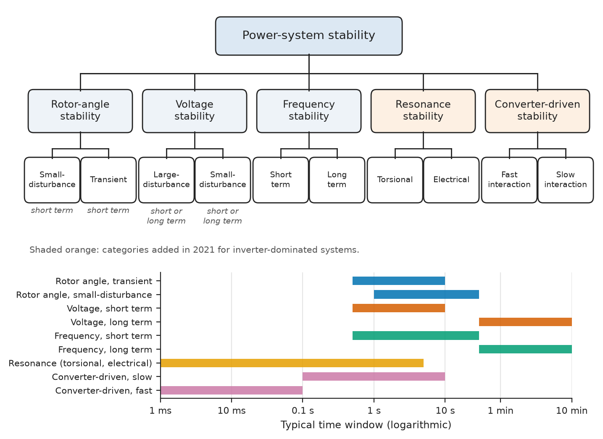
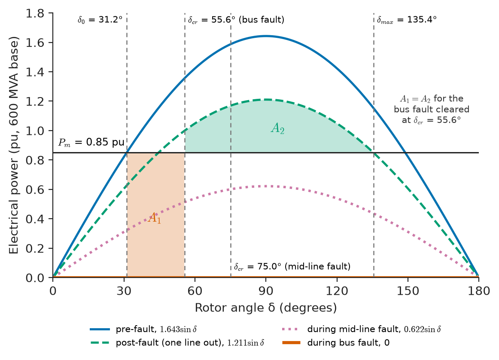
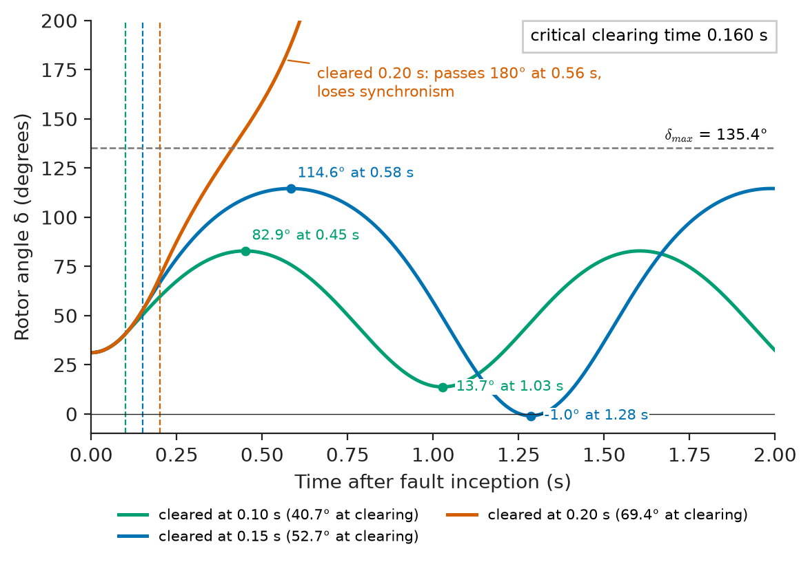
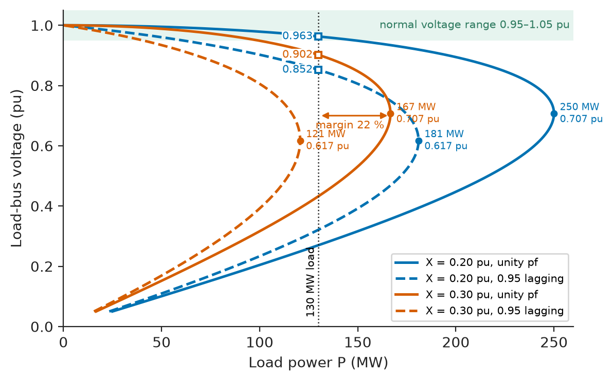
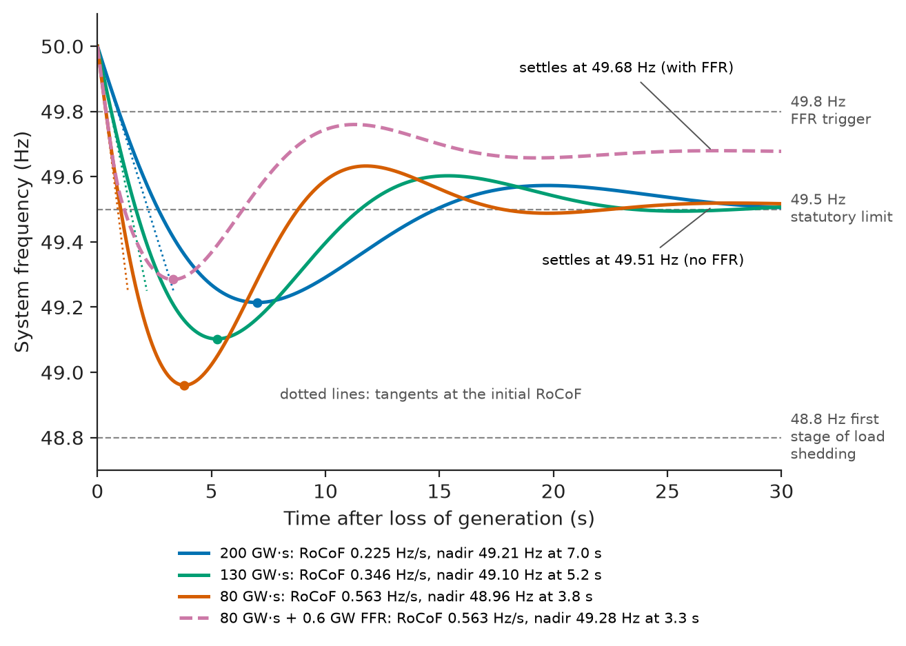
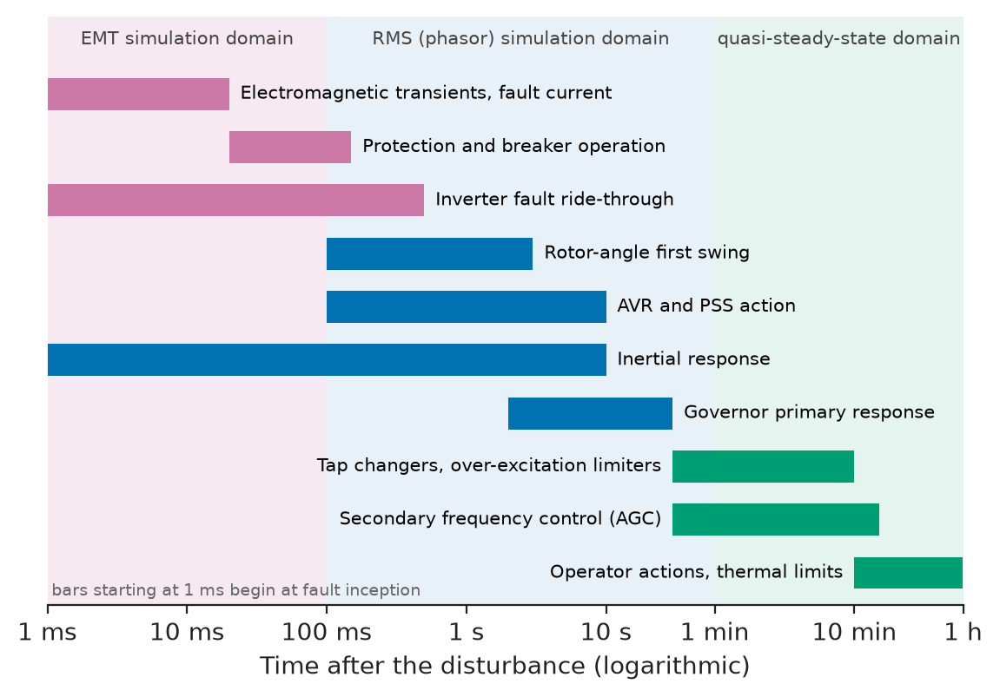

# Chapter 20 — Power-System Stability

*Part V · Power-System Analysis*

On the afternoon of 9 August 2019, lightning struck a 400 kV line north of London. The protection cleared the fault in less than 100 ms, exactly as designed, and the line reclosed successfully. Within the next second, an offshore wind farm reduced its output by 737 MW because its controls reacted badly to the voltage dip, a steam turbine at a combined-cycle plant tripped, and about 500 MW of small generators embedded in distribution networks disconnected because their loss-of-mains relays misread the disturbance. The frequency fell faster than the reserves could respond. Over the next minute two gas turbines at the same plant tripped, the total loss approached 1.9 GW, and the frequency reached 48.8 Hz, the first stage of automatic under-frequency load shedding. About 1 GW of demand, roughly 1.1 million customers, was disconnected; trains stopped, some of them for hours, because their on-board protection reacted to the frequency. Every individual device did what it was set to do. The event was a stability problem: the question of whether a power system, disturbed from its operating point, returns to an acceptable steady state, and how far it travels on the way.

> **Will the generators stay in synchronism after a fault, and how fast must the fault be cleared?**
> **How much more load can a network carry before its voltage collapses, and how far can the frequency fall after losing a large generator?**
> **How are stability margins measured, improved and checked by simulation?**

| Concept | Engineering destination |
|---|---|
| Rotor-angle stability | Synchronous generators staying in step after disturbances; transfer limits on corridors |
| Small-signal stability | Power-system stabilisers, damping of inter-area oscillations, controller tuning |
| Transient stability | Critical clearing times, protection speed requirements, generator tripping schemes |
| Voltage stability | Load-area import limits, reactive reserves, under-voltage load shedding |
| Frequency stability | Inertia and reserve requirements, under-frequency load shedding, battery fast frequency response |
| Disturbance response | Sequence of events after a fault or trip; ride-through requirements |
| Stability margins | Planning criteria (N-1), operating limits, grid-code requirements |
| Stability improvement | Fast protection, FACTS, PSS, synchronous condensers, grid-forming inverters |
| Simulation and interpretation | RMS and EMT studies, model validation, reading swing curves and frequency traces |

**Roadmap.** A classification and the rotor-angle problem (20.1) → its linear form, small-signal stability (20.2) → its nonlinear form, transient stability and the equal-area criterion (20.3) → voltage stability (20.4) → frequency stability (20.5) → how a real system responds to a disturbance over milliseconds to minutes (20.6) → how margins are defined (20.7) and improved (20.8) → how studies are done and read (20.9).

---

## 20.1 Rotor-angle stability

### A classification

Power-system stability is the ability of the system, for a given initial operating condition, to regain a state of operating equilibrium after a physical disturbance, with most system variables bounded so that practically the whole system remains intact. The IEEE/CIGRE classification (2004, extended in 2021 for inverter-dominated systems) divides the problem by the variable that goes wrong, the size of the disturbance and the time scale:

| Category | Variable that drifts | Disturbance size | Time scale | Main analysis tool |
|---|---|---|---|---|
| Rotor-angle, small-signal | Generator angles, oscillating | Small (load changes) | 1–30 s | Eigenvalues of the linearised model |
| Rotor-angle, transient | Generator angles, first swing or later | Large (faults) | 0.5–10 s | Time-domain simulation, equal-area criterion |
| Voltage, short-term | Bus voltages | Large | 0.5–10 s | Simulation with dynamic load (motor) models |
| Voltage, long-term | Bus voltages | Small or large | Minutes | Continuation power flow, PV and QV curves |
| Frequency | System frequency | Large (loss of generation or load) | 1 s–minutes | Aggregated frequency models, simulation |
| Resonance and converter-driven (2021 additions) | Torsional modes, converter control interactions | Small or large | ms–seconds | EMT simulation, impedance-based analysis |

<!-- FIGURE 20.1 | figures/ch20/fig-20-1-stability-classification.png | block-diagram | Classification of power-system stability by variable, disturbance size and time scale (IEEE/CIGRE 2004 with 2021 extensions). | Content: root box Power-system stability. Five branches: Rotor-angle stability (children: small-disturbance, transient; both labelled short term), Voltage stability (children: large-disturbance, small-disturbance; each short term or long term), Frequency stability (short term, long term), Resonance stability (torsional, electrical), Converter-driven stability (fast interaction, slow interaction). A horizontal time axis beneath from 1 ms to 10 min on a log scale with bars showing typical time windows of each category. -->

*Figure 20.1 — Classification of power-system stability by variable, disturbance size and time scale (IEEE/CIGRE 2004 with 2021 extensions).*

The categories are linked: a voltage collapse makes generators lose synchronism, and an angle separation splits the system into islands with frequency problems. Figure 20.1 shows the tree; this chapter follows its branches.

### The swing equation and the inertia constant

A synchronous generator stays in step when its rotor turns at synchronous speed, on average, with every other generator. If the mechanical power $P_m$ from the turbine and the electrical power $P_e$ to the network are unequal, the difference accelerates or decelerates the rotor, and the rotor angle $\delta$ (the angle of the internal EMF relative to a synchronously rotating reference) changes. In per unit,

$$
\frac{2H}{\omega_s}\frac{d^2\delta}{dt^2}=P_m-P_e-D\frac{d\delta}{dt}
$$

> **Boundary.** The swing equation is Newton's second law for rotation, $J\dot\omega=T_m-T_e$ (*Engineering Physics*, [Ch. 9 §9.7](https://github.com/The-Studio-of-Sadiq/Engineering-Physics/blob/main/CHAPTERS/CHAPTER%209.md) and [Ch. 19 §19.2](https://github.com/The-Studio-of-Sadiq/Engineering-Physics/blob/main/CHAPTERS/CHAPTER%2019.md)), written in electrical angle and per-unit power. Its linearisation into a second-order model with a synchronising coefficient, natural frequency and damping ratio is worked in *Circuits, Signals and Communications*, [Ch. 33 §33.2](https://github.com/The-Studio-of-Sadiq/Circuits-Signals-and-Communications/blob/main/part-7-control-system-fundamentals/33-dynamic-system-modeling.md). Here we use both results and supply the engineering data and consequences.

The **inertia constant** $H$ is the kinetic energy stored in the rotating mass at synchronous speed divided by the machine rating, $H=\tfrac12J\omega_{sm}^2/S_\mathrm{rated}$, in seconds. It answers a physical question: for how many seconds could the stored energy alone supply rated power? Because it is normalised to rating, it varies surprisingly little across machine sizes:

| Machine | Typical $H$ on own rating |
|---|---|
| Two-pole steam or nuclear turbo-generator (3000/3600 r/min), including turbine | 2.5–6 s |
| Four-pole nuclear turbo-generator (1500/1800 r/min) | 4–10 s |
| Gas turbine and combined-cycle units | 4–8 s |
| Hydro generator (slow-speed salient pole) | 2–4 s |
| Synchronous condenser (with flywheel) | 1–2 s (up to 8 s with added flywheel) |
| Large induction motor load | 0.5–2 s |
| Wind turbine (rotor and generator, behind a converter) | 2–6 s physically, but decoupled from the grid unless the controls emulate inertia |
| PV inverter, battery converter | 0 physically; grid-forming control can provide synthetic inertia |

### The power-angle curve and synchronising power

For a generator with internal voltage $E'$ behind a transient reactance, connected through a total reactance $X$ to an infinite bus at voltage $V$, the electrical power is $P_e=(E'V/X)\sin\delta=P_\mathrm{max}\sin\delta$ (Chapter 7). Steady operation needs $P_e=P_m$, which has a solution only if $P_m<P_\mathrm{max}$, and the solution with $\delta<90°$ is stable: if the rotor advances, $P_e$ increases, the rotor decelerates and returns. The slope

$$
P_s=\frac{dP_e}{d\delta}=P_\mathrm{max}\cos\delta_0
$$

is the **synchronising power coefficient**. A network that is electrically weak (large $X$) has a small $P_\mathrm{max}$, operates at a larger angle for the same power, and has a small $P_s$: it is held in synchronism by a weak spring. A tripped line, which raises $X$, weakens the spring further.

Rotor-angle instability shows up in two ways. Lack of synchronising torque gives a non-oscillatory drift of the angle (aperiodic instability, now rare because automatic voltage regulators hold $E'$ up). Lack of **damping torque** gives oscillations of growing amplitude. Both are small-signal phenomena when the disturbance is small and transient phenomena when it is large.

---

## 20.2 Small-signal stability

### Modes of oscillation

Linearised about an operating point, the power system becomes a linear state-space model $\Delta\dot{\mathbf x}=\mathbf A\,\Delta\mathbf x$, and its stability is decided by the eigenvalues of $\mathbf A$: every eigenvalue must have a negative real part (*Circuits, Signals and Communications*, [Ch. 34 §34.4](https://github.com/The-Studio-of-Sadiq/Circuits-Signals-and-Communications/blob/main/part-7-control-system-fundamentals/34-feedback-and-stability.md)). A real system has thousands of states: rotor angles and speeds, flux linkages, exciter and governor states, converter controls. A complex pair of eigenvalues $\sigma\pm j\omega_d$ is an **oscillation mode** with frequency $f=\omega_d/2\pi$ and damping ratio

$$
\zeta=\frac{-\sigma}{\sqrt{\sigma^2+\omega_d^2}}
$$

The mode's **eigenvector** shows which generators swing and against whom, and its **participation factors** show which states, and hence which controllers, influence it. The modes that matter in practice are:

| Mode | Frequency | What swings | Typical cause of poor damping |
|---|---|---|---|
| Local (plant) mode | 0.7–2.0 Hz | One plant against the rest of the system | Fast high-gain AVR on a plant with a weak connection |
| Inter-area mode | 0.1–0.8 Hz | Groups of generators in one region against another | Heavy power transfer across weak tie-lines |
| Control modes | Varies | Exciters, governors, HVDC and FACTS controls, inverter PLLs | Poorly tuned controllers |
| Torsional modes | 10–50 Hz | Turbine-generator shaft sections against each other | Series-capacitor resonance (subsynchronous resonance), converter controls |

The Western North American system has a well-known inter-area mode near 0.25 Hz between the Pacific Northwest and the Southwest; continental Europe has east–west modes near 0.15–0.25 Hz. Their undamped growth in 1996 contributed to the separation of the western US system into islands, and their damping is now monitored in real time with phasor measurement units (Chapter 26).

> **Status of the principle: Small-signal (modal) stability**
> *Derived.* Lyapunov's first method: the stability of the linearised model decides the local stability of the nonlinear system; valid only for disturbances small enough that the linearisation holds, and silent about what happens after a large fault.

### Why voltage regulators reduce damping, and how stabilisers restore it

A fast, high-gain automatic voltage regulator (AVR) is good for transient stability, because it pushes $E'$ up quickly after a fault and raises $P_\mathrm{max}$. It is bad for damping. When the rotor swings, the terminal voltage swings with it; the AVR responds by changing the field, and through the field winding's time lag the resulting change in electrical torque arrives partly in phase opposition to rotor speed, a negative damping torque. The Heffron–Phillips analysis of a single machine shows that this negative damping grows with AVR gain and with the external reactance, so the problem is worst on remote plants with long lines.

A **power-system stabiliser** (PSS) is an added control loop that measures rotor speed deviation (or electrical power, or a combination), passes it through phase-lead compensation, and adds it to the AVR reference so that the AVR produces a torque component in phase with speed: positive damping. Grid codes in most countries require a PSS on large synchronous generators and specify its tuning tests (IEEE 421.5 provides standard models such as PSS2B and PSS4B).

**Worked example — damping of a remote 600 MVA unit.** A 600 MVA steam unit with $H=4.0$ s is connected through its step-up transformer and two parallel lines to a strong grid. On the machine base the reactances are $X_d'=0.30$, transformer 0.15 and each line 0.50 pu; the internal voltage is $E'=1.15$ pu, the grid voltage 1.0 pu and the unit delivers $P_m=0.85$ pu.

With both lines, $X=0.30+0.15+0.25=0.70$ pu and $P_\mathrm{max}=1.15/0.70=1.643$ pu. The operating angle is $\delta_0=\arcsin(0.85/1.643)=31.2°$ and $P_s=1.643\cos31.2°=1.406$ pu/rad. With $M=2H/\omega_s=8/314.16=0.0255$ s²/rad, the undamped natural frequency is

$$
\omega_n=\sqrt{\frac{P_s}{M}}=\sqrt{\frac{1.406}{0.0255}}=7.43\ \mathrm{rad/s}\quad(1.18\ \mathrm{Hz})
$$

With one line out, $X=0.95$ pu, $P_\mathrm{max}=1.211$ pu, $\delta_0=44.6°$, $P_s=0.862$ pu/rad and the mode falls to 5.82 rad/s (0.93 Hz). Represent all damping effects by an equivalent coefficient $D$ in pu power per rad/s. Natural damping from the damper windings and the load, $D=0.02$, gives $\zeta=D/(2\sqrt{P_sM})=0.053$ with both lines and 0.067 with one: acceptable. Now suppose a high-gain static exciter contributes $-0.025$ to $D$, a magnitude typical of such exciters on a weak connection. The net $D=-0.005$ gives $\zeta=-0.017$ with one line out: the oscillation grows, doubling in amplitude every $\ln2/(\lvert\zeta\rvert\omega_n)=7.1$ s, and the unit will be tripped by its out-of-step protection within a minute. A PSS adding $+0.040$ makes $D=0.035$ and $\zeta=0.118$, comfortably above the usual planning target of 0.05. The example illustrates the engineering pattern: damping is a small difference between larger positive and negative contributions, so it must be designed for, not assumed.

---

## 20.3 Transient stability

### The first swing

A large disturbance, typically a three-phase fault near a generator, collapses the electrical power the generator can deliver while the turbine's mechanical power stays constant (governors are far too slow to act in a fraction of a second). The rotor accelerates. When the fault is cleared, usually by tripping a line, the electrical power jumps back to a value on a post-fault power-angle curve. If the rotor angle at that moment is not too large, the electrical power exceeds the mechanical power, the rotor decelerates, and the angle reaches a maximum and swings back. If it is too large, the rotor passes the point beyond which electrical power again falls short of mechanical power, and the machine **slips a pole**: its angle runs away, it loses synchronism, and its out-of-step protection must trip it.

### The equal-area criterion

For a single machine against an infinite bus, multiplying the swing equation by $d\delta/dt$ and integrating shows that the rotor stops accelerating (its speed deviation returns to zero) when the accelerating energy gained since the disturbance has been returned. On the power-angle diagram this is a statement about areas: the area between $P_m$ and the during-fault curve from the initial angle $\delta_0$ to the clearing angle $\delta_c$ (accelerating area $A_1$) must be matched by the area between the post-fault curve and $P_m$ from $\delta_c$ to the maximum angle (decelerating area $A_2$). The largest available decelerating area ends at $\delta_\mathrm{max}=180°-\arcsin(P_m/P_{\mathrm{max}3})$, where the post-fault curve falls below $P_m$ again. Setting $A_1=A_2$ at that limit gives the **critical clearing angle**: with pre-fault, during-fault and post-fault amplitudes $P_{\mathrm{max}1}$, $P_{\mathrm{max}2}$ and $P_{\mathrm{max}3}$,

$$
\cos\delta_\mathrm{cr}=\frac{P_m(\delta_\mathrm{max}-\delta_0)+P_{\mathrm{max}3}\cos\delta_\mathrm{max}-P_{\mathrm{max}2}\cos\delta_0}{P_{\mathrm{max}3}-P_{\mathrm{max}2}}
$$

When the fault reduces the electrical power to zero ($P_{\mathrm{max}2}=0$, a fault at the generator's HV bus), the swing equation integrates directly during the fault, $\delta(t)=\delta_0+\omega_sP_mt^2/(4H)$, and the **critical clearing time** follows:

$$
t_\mathrm{cr}=\sqrt{\frac{4H(\delta_\mathrm{cr}-\delta_0)}{\omega_sP_m}}
$$

> **Status of the principle: Equal-area criterion**
> *Approximate.* Derived exactly from the swing equation for one machine against an infinite bus, under the classical model (constant voltage behind transient reactance, constant mechanical power, no damping); it extends only approximately to multimachine systems (through equivalents such as SIME) and ignores the AVR, governor and the decay of field flux, which matter for swings longer than about one second.

<!-- FIGURE 20.2 | figures/ch20/fig-20-2-equal-area-criterion.png | plot | Power-angle curves before, during and after a fault, with the accelerating and decelerating areas of the equal-area criterion at the critical clearing angle. | Content: x-axis rotor angle 0 to 180 degrees, y-axis power 0 to 1.8 pu. Curves: pre-fault 1.643 sin(delta) solid, post-fault (one line out) 1.211 sin(delta) dashed, during-fault (mid-line fault) 0.622 sin(delta) dotted, and zero for the bus fault on the axis. Horizontal line Pm = 0.85 pu. Vertical markers at delta0 = 31.2, critical clearing angle 55.6 (bus fault) and 75.0 (mid-line fault), and deltamax = 135.4 degrees. Shade A1 (between Pm and zero from 31.2 to 55.6) and A2 (between post-fault curve and Pm from 55.6 to 135.4) for the bus-fault case and label them equal. -->

*Figure 20.2 — Power-angle curves before, during and after a fault, with the accelerating and decelerating areas of the equal-area criterion at the critical clearing angle.*

Figure 20.2 shows the construction for the example that follows.

**Worked example — critical clearing time of the 600 MVA unit.** Take the unit of Section 20.2 at $P_m=0.85$ pu ($\delta_0=31.2°$, $P_{\mathrm{max}1}=1.643$ pu). A three-phase fault occurs on one of the two lines, and is cleared by tripping that line, so the post-fault amplitude is $P_{\mathrm{max}3}=1.211$ pu and $\delta_\mathrm{max}=180°-44.6°=135.4°$.

*Fault at the HV bus end of the line.* The generator's HV bus is short-circuited, so $P_{\mathrm{max}2}=0$. The formula gives $\delta_\mathrm{cr}=55.6°$ and

$$
t_\mathrm{cr}=\sqrt{\frac{4\times4.0\times(0.9698-0.5438)}{314.16\times0.85}}=0.160\ \mathrm s
$$

*Fault at the middle of the line.* The faulted line's two halves (0.25 pu each) now connect the generator side to earth through 0.25 pu; eliminating that node gives a transfer reactance of 1.85 pu and $P_{\mathrm{max}2}=1.15/1.85=0.622$ pu. The critical clearing angle rises to 75.0°. There is no closed-form time now, so the swing equation is integrated numerically: the critical clearing time is 0.290 s.

A numerical integration of the bus-fault case confirms the analytic result (0.160 s) and shows the swing curves: cleared at 0.10 s, the rotor reaches 40.7° at clearing and a first maximum of 82.9° after 0.45 s; cleared at 0.15 s, it reaches 52.7° at clearing and swings to 114.6°, stable but with little margin; cleared at 0.20 s, it is at 69.4° at clearing and passes 180° after 0.56 s. A 400 kV substation with modern protection clears close-in faults in 80–100 ms (relay 20–30 ms plus breaker 40–60 ms), which leaves a margin of about 60 ms for the bus fault. If a breaker fails and breaker-failure protection must trip the adjacent breakers after a further 150–200 ms, the total clearing time exceeds 0.16 s, and the unit is lost. Planning studies therefore check both normal and back-up clearing times.

<!-- FIGURE 20.3 | figures/ch20/fig-20-3-swing-curves.png | plot | Rotor-angle swing curves of the 600 MVA unit for a three-phase fault at the HV bus cleared at 0.10, 0.15 and 0.20 s (classical model, no damping). | Content: x-axis time 0 to 2.0 s, y-axis rotor angle 0 to 200 degrees. Three curves starting at 31.2 degrees: clearing at 0.10 s (angle 40.7 at clearing, first maximum 82.9 at 0.45 s, minimum 13.7 at 1.03 s, periodic), clearing at 0.15 s (52.7 at clearing, maximum 114.6 at 0.58 s, minimum about -1 at 1.29 s), clearing at 0.20 s (69.4 at clearing, crosses 180 at 0.56 s, labelled loses synchronism). Vertical dashed lines at the clearing times; horizontal dashed line at deltamax 135.4 degrees; annotation critical clearing time 0.160 s. -->

*Figure 20.3 — Rotor-angle swing curves of the 600 MVA unit for a three-phase fault at the HV bus cleared at 0.10, 0.15 and 0.20 s (classical model, no damping).*

Figure 20.3 shows the three swings. The undamped classical model keeps oscillating forever; a real machine's damping and AVR shrink the swings within a few cycles, and a second or later swing can still be unstable in multimachine systems when inter-area modes are poorly damped. Transient-stability studies therefore run for at least 10–20 s, not just the first swing.

---

## 20.4 Voltage stability

### The nose of the PV curve

Voltage instability is a different mechanism from loss of synchronism: it can happen with every generator perfectly in step. It comes from the inability of the network and the generators to deliver the reactive power that loads demand at acceptable voltage. Consider a load supplied from a source of voltage $E$ through a reactance $X$. As the load grows, the current grows and the voltage across $X$ grows, so the load voltage falls. The power delivered, $P=VI\cos\varphi$, first rises with current and then falls, because the voltage falls faster than the current rises. There is a maximum, at which the load impedance magnitude equals the line reactance (the maximum-power-transfer condition of circuit theory). For a load of constant power factor $\cos\varphi$ (lagging),

$$
P_\mathrm{max}=\frac{E^2}{2X}\,\frac{\cos\varphi}{1+\sin\varphi},\qquad V_\mathrm{cr}=\frac{E}{\sqrt{2(1+\sin\varphi)}}
$$

> **Status of the principle: Maximum loadability of a radial supply**
> *Derived.* Follows from the power-flow equations of a two-bus system with constant source voltage and constant-power-factor load; real networks compute the same "nose point" by continuation power flow, with generator reactive limits and tap changers included.

Plotting load voltage against load power gives the **PV curve** with its characteristic "nose" (Figure 20.4). For every power below the nose there are two voltages; normal operation is on the upper branch. At the nose, the Jacobian of the power-flow equations (Chapter 18) becomes singular, which is why load-flow programs fail to converge near voltage collapse, and why that failure should not be dismissed as a numerical nuisance. The **QV curve**, which plots the reactive power that must be injected at a bus to hold each voltage, carries the same information in a form that operators use to size reactive reserves: the depth of the minimum below zero is the reactive margin.

**Worked example — import limit of an industrial area.** An industrial area is supplied over a double-circuit 132 kV line and two 132/33 kV transformers. On a 100 MVA base the equivalent reactance from the strong grid to the 33 kV load bus is 0.20 pu with everything in service and 0.30 pu with one circuit out; the source voltage is 1.0 pu. The area's load is 130 MW.

| Case | $P_\mathrm{max}$ | Critical voltage | Load voltage at 130 MW |
|---|---|---|---|
| Both circuits, unity power factor | 250 MW | 0.707 pu | 0.963 pu |
| Both circuits, 0.95 lagging | 181 MW | 0.617 pu | 0.852 pu |
| One circuit, unity power factor | 167 MW | 0.707 pu | 0.902 pu |
| One circuit, 0.95 lagging | 121 MW | 0.617 pu | No solution: beyond the nose |

At 0.95 power factor, the area is already at an unacceptable 0.85 pu with all circuits in service, and the loss of one circuit leaves no operating point at all: the voltage would collapse. With capacitor banks correcting the load to unity power factor at the 33 kV bus, the margin is $1-130/250=48\ \%$ intact and $1-130/167=22\ \%$ after the outage, both above the 5 % post-contingency real-power margin that the WECC voltage-stability criterion requires. The calculation also shows the trap of shunt capacitors: they hold voltage up on the upper branch, but their output falls with the square of voltage, so a heavily compensated area operates with near-normal voltage right up to a nose that arrives suddenly. A normal voltage is not evidence of a healthy margin.

<!-- FIGURE 20.4 | figures/ch20/fig-20-4-pv-nose-curves.png | plot | PV curves of a load area supplied through 0.20 pu and 0.30 pu equivalent reactances for unity and 0.95 lagging power factor, showing the nose points and margins at 130 MW. | Content: x-axis load power 0 to 260 MW, y-axis load voltage 0 to 1.05 pu. Four curves (upper and lower branches): X = 0.20 pu unity pf (nose 250 MW at 0.707 pu), X = 0.20 pu 0.95 pf (nose 181 MW at 0.617 pu), X = 0.30 pu unity pf (nose 167 MW at 0.707 pu), X = 0.30 pu 0.95 pf (nose 121 MW at 0.617 pu). Vertical line at 130 MW with operating points 0.963, 0.852 and 0.902 pu marked; arrow showing margin 22 percent on the X = 0.30 unity curve; shaded band 0.95 to 1.05 pu labelled normal voltage range. -->

*Figure 20.4 — PV curves of a load area supplied through 0.20 pu and 0.30 pu equivalent reactances for unity and 0.95 lagging power factor, showing the nose points and margins at 130 MW.*

### Dynamics of collapse

Real voltage collapses unfold over seconds to minutes, driven by devices that try to restore load:

- **On-load tap changers** on distribution transformers raise secondary voltage step by step (every 30–60 s), restoring constant-power behaviour of the load and drawing more current from an already strained transmission system.
- **Generator over-excitation limiters** reduce field current after 10–60 s of overload, withdrawing reactive support exactly when it is needed.
- **Induction motors**, especially single-phase air-conditioning compressors with low inertia, stall when voltage stays below about 0.6–0.7 pu for a few cycles; stalled motors draw four to six times their running current at low power factor. The resulting **fault-induced delayed voltage recovery** (FIDVR) has held voltages at 0.7–0.8 pu for 10–30 s after cleared faults in summer-peaking systems in the southern United States.
- **Thermostatically controlled loads** (heaters, refrigeration) run longer at low voltage, so their aggregate power recovers after minutes.

The 1978 France and 1987 Tokyo blackouts were voltage collapses; the August 2003 North American blackout involved voltage decline as lines tripped one after another over an hour before the final cascade. Countermeasures include fast reactive sources (STATCOMs, synchronous condensers), tap-changer blocking, and **under-voltage load shedding**, which disconnects load when voltage stays below a threshold (typically 0.85–0.9 pu for several seconds).

---

## 20.5 Frequency stability

### Inertia and the first seconds

When a large generator trips, the power balance of the whole interconnected system is upset at once. The missing power is supplied in the first instants from the kinetic energy of every synchronously connected rotor, which slows down together. Aggregating the swing equations of all machines around their centre of inertia gives the initial **rate of change of frequency** (RoCoF):

$$
\frac{df}{dt}\Big\rvert_{t=0^+}=-\frac{\Delta P\,f_0}{2E_k},\qquad E_k=\sum_iH_iS_i
$$

where $E_k$ is the total stored kinetic energy of the synchronised machines (in MW·s) and $\Delta P$ the lost power.

> **Status of the principle: Aggregate frequency model**
> *Approximate.* Assumes a single uniform system frequency; in reality frequency differs between regions by tens of millihertz during the first seconds as inter-area modes swing, which matters for RoCoF relays and for measurements near the disturbance.

The kinetic energy falls as synchronous plants are replaced by inverter-based wind, solar and batteries. Great Britain's synchronous kinetic energy, typically 200–250 GW·s a decade ago, falls below 130 GW·s on windy low-demand days, and the system operator now buys inertia (from synchronous condensers and grid-forming batteries) as a service. Ireland, with an even smaller system, limits the instantaneous share of non-synchronous generation (the SNSP limit, raised in steps from 50 % to 75 %) for the same reason.

### Primary response, the nadir and load shedding

Within a few seconds, governors of generators with headroom open their valves in proportion to the frequency deviation (their **droop**, typically 4–5 %: a 4 % droop unit raises output by 100 % of rating for a 4 % fall in frequency). Loads help too: motor loads draw less power at lower frequency, a **load damping** of about 1–2 % of load per hertz. The frequency stops falling at the **nadir**, where the sum of primary response and load relief equals the lost power, and then recovers to a quasi-steady value set by the combined droop. Secondary control (automatic generation control, Chapter 26) restores nominal frequency over minutes.

If the nadir reaches a protection threshold, automatic **under-frequency load shedding** (UFLS) acts. The ENTSO-E network code on emergency and restoration requires shedding to start at 49.0 Hz and to reach 45 % of load by 48.0 Hz in steps of no more than 10 %; Great Britain's low-frequency demand disconnection starts at 48.8 Hz. These schemes are the last line of defence against a collapse of the whole interconnection.

**Worked example — frequency after the loss of 1.8 GW.** A 35 GW system loses 1.8 GW of generation. Its load damping is 0.7 GW/Hz (2 % per hertz), its primary response is represented as a gain of 3.0 GW/Hz with a first-order lag of 6 s, and its stored kinetic energy depends on the generation mix. The initial RoCoF and the result of integrating the aggregated model are:

| Synchronous kinetic energy | Initial RoCoF | Nadir | Time of nadir |
|---|---|---|---|
| 200 GW·s (high inertia) | 0.225 Hz/s | 49.21 Hz | 7.0 s |
| 130 GW·s | 0.346 Hz/s | 49.10 Hz | 5.2 s |
| 80 GW·s (low inertia) | 0.563 Hz/s | 48.96 Hz | 3.8 s |
| 80 GW·s plus 0.6 GW of battery fast frequency response | 0.563 Hz/s | 49.28 Hz | 3.3 s |
| 130 GW·s plus 0.6 GW of battery fast frequency response | 0.346 Hz/s | 49.38 Hz | 4.6 s |

In every case without fast response the quasi-steady frequency is the same, $50-1.8/(0.7+3.0)=49.51$ Hz, because it depends only on droop and load damping. Inertia changes how fast and how far frequency falls before the governors catch up. At 80 GW·s the nadir is only 0.16 Hz above the 48.8 Hz load-shedding threshold, and the initial RoCoF of 0.56 Hz/s exceeds the old 0.125 Hz/s RoCoF settings of embedded generators' loss-of-mains relays, which would trip them and deepen the event exactly as in August 2019 (GB has since raised these settings to 1 Hz/s). Batteries that inject 0.6 GW within about a second, triggered at 49.8 Hz, raise the nadir by about 0.3 Hz: fast response substitutes for inertia, although not for its instantaneous action in the first few hundred milliseconds.

<!-- FIGURE 20.5 | figures/ch20/fig-20-5-frequency-response.png | plot | System frequency after the loss of 1.8 GW in a 35 GW system for three levels of kinetic energy and with battery fast frequency response. | Content: x-axis time 0 to 30 s, y-axis frequency 48.7 to 50.1 Hz. Curves: 200 GW.s (nadir 49.21 Hz at 7.0 s), 130 GW.s (49.10 Hz at 5.2 s), 80 GW.s (48.96 Hz at 3.8 s), 80 GW.s with 0.6 GW fast frequency response (49.28 Hz at 3.3 s, settling 49.68 Hz). Without FFR all settle toward 49.51 Hz. Initial tangent lines labelled RoCoF 0.225, 0.346, 0.563 Hz/s. Horizontal dashed lines at 49.8 Hz (FFR trigger), 49.5 Hz (statutory limit), 48.8 Hz (first stage of load shedding). -->

*Figure 20.5 — System frequency after the loss of 1.8 GW in a 35 GW system for three levels of kinetic energy and with battery fast frequency response.*

Figure 20.5 shows the traces. Over-frequency is the mirror problem: the loss of a large load or an export interconnector raises frequency, and generators must reduce output (limited frequency-sensitive mode, typically from 50.2 Hz) rather than trip, a requirement that was added to grid codes after millions of PV inverters in Germany were found to share a single 50.2 Hz trip setting.

---

## 20.6 Disturbance response

### A sequence of events across time scales

A disturbance does not excite one stability problem at a time. Following one event through a large interconnection shows the layers, each governed by different physics and different equipment:

| Time after the fault | What happens | Governing equipment and physics |
|---|---|---|
| 0–20 ms | Fault current flows; voltages collapse near the fault; DC offset; travelling waves | Network impedances (Chapter 19), surge behaviour (Chapter 24) |
| 20–150 ms | Protection detects and trips; breakers interrupt; inverters switch to fault ride-through, inject reactive current | Relays, breakers, converter controls |
| 0.1–3 s | First swing of rotor angles; AVRs boost fields; voltage recovers or stalls motors | Generator inertia, exciters, motor dynamics |
| 1–30 s | Electromechanical oscillations damp out (or grow); frequency nadir; governors and fast frequency response | PSS, governors, batteries, HVDC controls |
| 30 s–10 min | Tap changers restore load voltages; over-excitation limiters act; secondary frequency control | OLTCs, OELs, automatic generation control |
| 10 min–hours | Operator actions, thermal limits of lines and transformers, re-dispatch | Control-room procedures, dynamic ratings |

<!-- FIGURE 20.6 | figures/ch20/fig-20-6-disturbance-time-scales.png | block-diagram | Time scales of power-system response to a disturbance, from fault inception to operator action. | Content: horizontal logarithmic time axis from 1 ms to 1 hour. Bars stacked vertically: electromagnetic transients and fault current (1-20 ms), protection and breaker operation (20-150 ms), inverter fault ride-through (0-500 ms), rotor-angle first swing (0.1-3 s), AVR and PSS action (0.1-10 s), inertial response (0-10 s), governor primary response (2-30 s), tap changers and overexcitation limiters (30 s - 10 min), secondary frequency control AGC (30 s - 15 min), operator actions and thermal limits (10 min - 1 h). Colour bands group them as EMT simulation domain, RMS simulation domain, quasi-steady-state domain. -->

*Figure 20.6 — Time scales of power-system response to a disturbance, from fault inception to operator action.*

Figure 20.6 sets these on one axis. The layers interact: the reactive current that inverters inject during a fault helps voltage recovery; the active current they withhold while recovering affects frequency; the speed at which they restore active power after the fault (grid codes require 90 % within 0.5–1 s, for example) changes the first swing of nearby synchronous machines.

### Inverter-based resources in the disturbance

Most wind, solar and battery plants are **grid-following**: their converters measure the grid voltage angle with a phase-locked loop and inject a controlled current in step with it. They need a stable voltage to follow, ride through faults within prescribed voltage-time envelopes (IEEE 2800-2022, NERC PRC-024, ENTSO-E RfG), and contribute no inherent inertia. In weak networks (short-circuit ratio below about 3) their control loops can interact with each other and with the network, producing the converter-driven oscillations at 2–20 Hz and above that were observed in West Murray (Australia) in 2019 and in Texas wind regions with series compensation. **Grid-forming** converters instead behave as a controlled voltage source behind an impedance, synchronise through a power-frequency relation that mimics the swing equation, and can supply inertia, fault current up to their current limit and system strength. Chapter 27 develops their control; for stability studies they are the main new modelling challenge.

---

## 20.7 Stability margins

### What "how stable" means

A system that is merely stable is not good enough: loads grow, lines fail and models are imperfect. Planning and operating criteria are therefore expressed as **margins**, measured against defined **contingencies**. The basic contingency criterion, **N-1**, requires the system to remain stable, within voltage and thermal limits, after the loss of any single element (a line, transformer, generator or HVDC pole) with normal protection clearing; many systems add N-1-1 (a second outage after re-dispatch) and selected N-2 events such as a double-circuit line on common towers or a busbar fault. In North America these requirements are formalised in NERC TPL-001; in Europe in the ENTSO-E system operation guideline and national security standards.

| Stability type | Margin measure | Typical requirement |
|---|---|---|
| Transient | Critical clearing time compared with actual clearing time | Stable for N-1 faults with normal clearing; many utilities also require stability with breaker-failure (back-up) clearing |
| Transient (transfer) | Maximum stable transfer across a corridor compared with scheduled transfer | Operate at least 5–10 % below the limit found by simulation |
| Small-signal | Damping ratio of the least-damped mode | ≥ 5 % in planning (3 % minimum in some operating guides) |
| Steady-state angle | Angle across a long corridor | Typically below 30–45 °, giving a 30–40 % margin on the angle limit |
| Voltage | Real-power distance to the nose of the PV curve | ≥ 5 % for N-1 and ≥ 2.5 % for N-2 (WECC criterion); reactive reserves on key buses |
| Voltage recovery | Post-fault voltage trajectory | Recover above 0.8–0.9 pu within 0.5–2 s (grid-code templates) |
| Frequency | Nadir and RoCoF after the largest credible infeed loss | Nadir above first load-shedding stage with margin; ENTSO-E Continental Europe: maximum dynamic deviation 800 mHz for 3 GW reference incident |

### Limits in operation

These margins become operating limits that the control room enforces: a transfer limit on the California–Oregon intertie that varies with the number of lines and series capacitors in service; a minimum number of synchronous units or minimum kinetic energy on the system; a maximum size of single generator or interconnector infeed. **Dynamic security assessment** tools now run hundreds of contingencies against the real-time state every few minutes, so that limits follow the actual system rather than seasonal worst cases. The economic consequence is direct: a stability limit on a corridor forces cheaper generation on one side to be curtailed and more expensive generation on the other to run, and stability improvement (Section 20.8) is often justified by the value of the transfer it releases.

---

## 20.8 Stability improvement

### Methods and what they act on

| Measure | Mechanism | Main stability benefit |
|---|---|---|
| Faster protection and breakers | Reduce the accelerating area | Transient |
| Single-pole tripping and auto-reclosing | Two phases keep transmitting during the most common fault (SLG) | Transient |
| Series capacitors on long lines | Reduce transfer reactance, raise $P_\mathrm{max}$ and synchronising power | Transient, small-signal, voltage (Chapter 21) |
| Shunt compensation: SVC, STATCOM, synchronous condensers | Hold voltage at key buses, supply reactive power fast | Voltage, transient (by raising mid-line voltage) |
| Power-system stabilisers | Add damping torque through the excitation | Small-signal |
| High initial-response excitation systems | Raise $E'$ quickly after the fault | Transient |
| Fast valving and braking resistors | Reduce turbine power or absorb surplus power during the swing | Transient |
| Generator tripping and load shedding schemes (special protection schemes) | Rebalance power within 100–200 ms after a critical contingency | Transient, frequency |
| HVDC and FACTS modulation | Modulate power flow to damp inter-area modes | Small-signal |
| Synchronous condensers and grid-forming converters | Add inertia, short-circuit strength and voltage-source behaviour | Frequency, converter-driven, voltage |
| Battery fast frequency response | Inject power within 0.5–1 s of a frequency deviation | Frequency |

### Two quantitative illustrations

**Series compensation.** For the 600 MVA unit of Section 20.3, the two lines contribute 0.25 pu of the 0.70 pu transfer reactance. Compensating each line by 50 % with series capacitors reduces the line reactance to 0.125 pu with both lines and 0.25 pu with one, so $P_{\mathrm{max}1}$ rises from 1.643 to $1.15/0.575=2.0$ pu and $P_{\mathrm{max}3}$ from 1.211 to $1.15/0.70=1.643$ pu. The pre-fault angle falls to 25.2°, $\delta_\mathrm{max}$ rises to 148.8°, and the equal-area criterion for the bus fault gives $\delta_\mathrm{cr}=74.9°$ and a critical clearing time of 0.228 s, against 0.160 s without compensation: enough to survive back-up clearing. The price is subsynchronous resonance: the series capacitor and the line inductance form an electrical resonance below 50 Hz that can lock onto a torsional mode of a turbine shaft. The 1970 and 1971 shaft failures at the Mohave plant in the western United States were caused this way, and series-compensated lines near thermal plants now carry SSR damping controls or thyristor-controlled series capacitors.

**Synchronous condensers in a low-inertia system.** In the frequency example of Section 20.5, adding five 250 MVA synchronous condensers with flywheels ($H=6$ s) adds $5\times250\times6=7.5$ GW·s of kinetic energy, together with roughly 0.9 GVA of short-circuit contribution each at the HV side of its step-up transformer ($250/(0.15+0.12)=926$ MVA for a subtransient reactance of 0.15 pu and a 12 % transformer), about 4.6 GVA in total. On an 80 GW·s day that is a 9 % increase in inertia: helpful, but small compared with the effect of 0.6 GW of fast battery response. Condensers are justified chiefly by system strength (fault level and voltage stiffness for inverter-based plants), with inertia as a by-product; Great Britain, Denmark, South Australia and Texas have all installed them for this combination of services.

---

## 20.9 Simulation and interpretation

### Which simulation

Stability is studied almost entirely by simulation, because real systems are too large and too nonlinear for closed-form criteria. Two families of tools are used:

| | RMS (phasor) simulation | Electromagnetic-transient (EMT) simulation |
|---|---|---|
| What is represented | Fundamental-frequency phasors; network as algebraic equations; machines and controls as differential equations | Instantaneous three-phase waveforms; network inductances and capacitances as differential equations |
| Time step | 1–10 ms (a quarter to half cycle) | 1–50 µs |
| Typical scope | Whole interconnection, thousands of buses, 10–60 s | A plant and its local network, up to a few hundred buses, a few seconds |
| Typical tools | PSS/E, PowerFactory (RMS mode), PSLF, TSAT | PSCAD/EMTDC, EMTP, PowerFactory (EMT mode), RTDS for real-time hardware testing |
| Good for | Rotor-angle, voltage and frequency stability; planning studies; operator security assessment | Converter controls, weak grids, subsynchronous resonance, protection performance |

The 2021 addition of converter-driven stability to the classification follows from this split: phenomena that live in converter control loops are invisible in RMS models unless the models are explicitly validated against EMT results or field measurements.

### Models and data

Results are only as good as the models. Standard model libraries describe generators (GENROU, GENSAL), exciters (IEEE 421.5 types such as ST1A, AC7B), stabilisers (PSS2B), governors (GGOV1, HYGOV), wind and solar plants (the WECC generic renewable models REGC, REEC, REPC) and loads (ZIP static models or the composite load model CMLD with motor components). Grid codes now require plant owners to supply validated models and to repeat validation after controller changes (NERC MOD-026 and MOD-027, for example). The load model is the largest single uncertainty: a static constant-impedance load model makes voltage recovery look far better than a model with stalling air-conditioner motors, and studies of FIDVR became credible only after composite load models were adopted.

### Reading the results

A stability study is judged on a few plots:

- **Rotor angles**, plotted relative to the centre of inertia or to a reference machine (never absolute angles, which drift with frequency). Stable cases show bounded, decaying swings; a machine whose angle separates from the group has lost synchronism.
- **Bus voltages**, compared with the grid code's voltage-recovery envelope; a slow recovery or a second dip points to motor stalling or reactive-power shortage.
- **Frequency** at several buses, for the nadir, RoCoF and the quasi-steady value; regional differences in the first seconds show the inter-area modes.
- **Active and reactive power** of key plants and interconnectors, for oscillations and limiter actions.
- **Damping estimates** from ringdown analysis (Prony or matrix-pencil fitting of oscillation frequency and damping ratio to a simulated or measured response), compared with the eigenvalue analysis of Section 20.2.

Two habits separate sound interpretation from plotting. First, check that the initial conditions are flat: a well-initialised simulation with no disturbance should stay still for several seconds, and drift indicates a model or data error. Second, look for the mechanism, not just the outcome: a case that is "stable" only because a limiter happened to act, or "unstable" only because a protection model tripped a unit at a questionable setting, tells the planner more about the model than about the system. Comparison with measurements from phasor measurement units after real disturbances is the final test, and the 2019 GB event, the 2016 South Australia blackout and the 2021 Texas winter event each led to model corrections that changed subsequent studies.

---

## What remains open

| Open question | Where it is answered |
|---|---|
| How are the fault currents and clearing times used here calculated and achieved? | Chapters 19 and 23 |
| How do the line reactance, series compensation and SIL used for transfer limits follow from line design? | Chapter 21 (Transmission Lines) |
| How do grid-forming and grid-following inverters provide frequency and voltage support? | Chapter 27 (Grid Integration of Renewable Energy) |
| How do energy-management systems, AGC and phasor measurements keep the system secure in real time? | Chapter 26 (Smart Grids) |
| How do synchronous machines produce the power-angle characteristic and respond to excitation? | Chapter 7 (Synchronous Machines) |
| How do batteries, flywheels and pumped hydro provide fast reserve? | Chapter 16 (Energy Storage) |
| How are linear models analysed with eigenvalues, root locus and frequency response? | *Circuits, Signals and Communications*, [Ch. 34](https://github.com/The-Studio-of-Sadiq/Circuits-Signals-and-Communications/blob/main/part-7-control-system-fundamentals/34-feedback-and-stability.md) and [Ch. 35](https://github.com/The-Studio-of-Sadiq/Circuits-Signals-and-Communications/blob/main/part-7-control-system-fundamentals/35-control-design-fundamentals.md) |
| How do voltage sags and frequency deviations appear to customers? | Chapter 25 (Power Quality) |

**Next:** Chapter 21 opens Part VI with the transmission line itself: how its parameters follow from conductors and towers, and how its length, loading and compensation set the limits that this chapter's stability studies assume.
