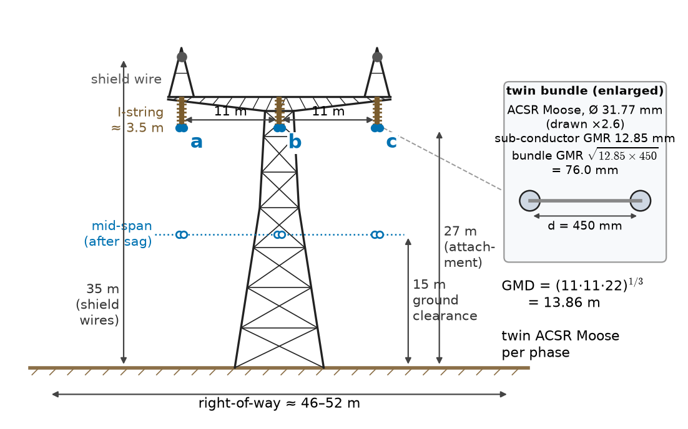
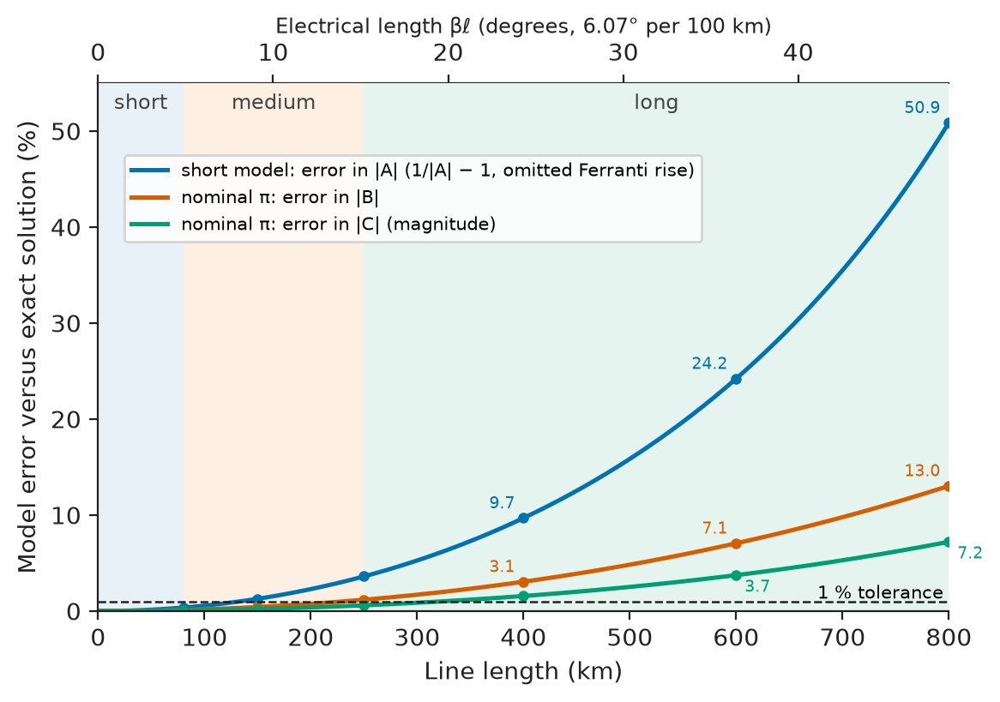
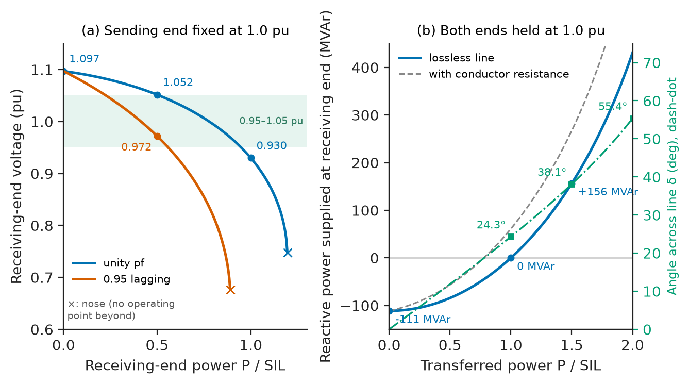
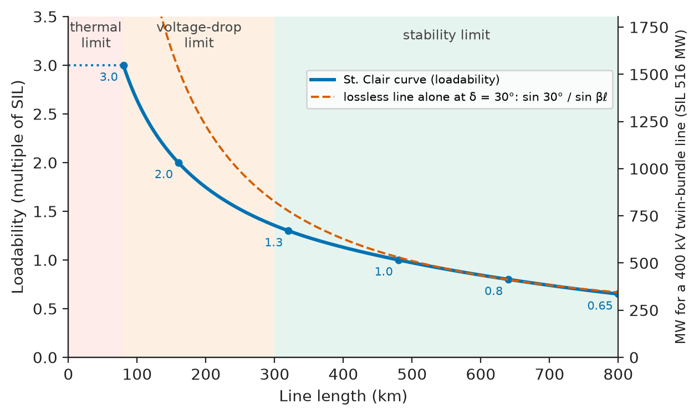
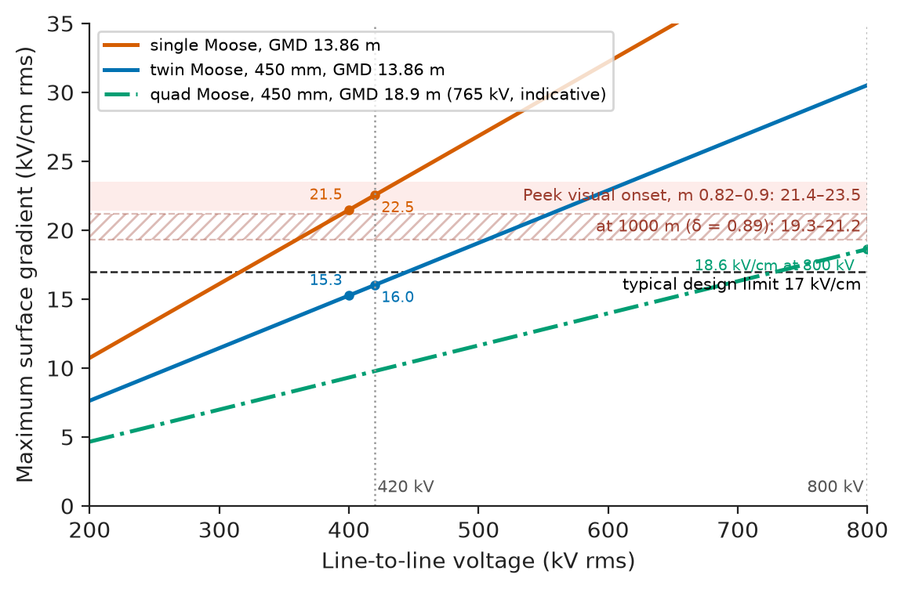
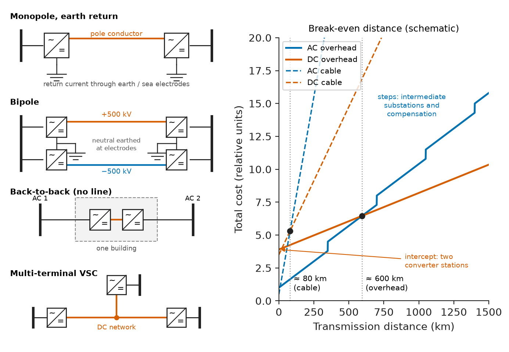

# Chapter 21 — Transmission Lines

*Part VI · Transmission, Distribution, and Protection*

A utility must bring 3 GW from a cluster of hydro and wind plants to a city 1000 km away. A planner sketches the obvious answer, a 400 kV double-circuit AC line, and runs into trouble at once. At night, when the line is lightly loaded, its own capacitance would push the receiving-end voltage 10 % or more above the sending end unless large reactors are switched in. At full load, the angle across the line would approach the point at which the two ends fall out of step after a fault. The loss alone, at a few percent of 3 GW for every hour of the year, would cost tens of millions of dollars a year. The alternatives each carry their own numbers: more circuits, a higher voltage, series capacitors halfway along, or a high-voltage DC link with converter stations at each end. Choosing among them requires knowing how a line's resistance, inductance and capacitance follow from its conductors and towers, how those parameters set voltage regulation, efficiency and transfer capability, what limits corona places on the conductor, and where DC wins.

> **How do the conductors and the tower geometry fix a line's resistance, inductance and capacitance?**
> **How much power can a line of given length carry, at what voltage regulation and efficiency, and how is it compensated?**
> **When should power be transmitted as high-voltage AC, and when as HVDC?**

| Concept | Engineering destination |
|---|---|
| Line parameters | Conductor and tower selection, data for power-flow, fault and stability studies |
| Resistance, inductance and capacitance | Losses, reactance, charging current, bundle design |
| Short, medium and long line models | Choosing the right model for planning and protection studies |
| Voltage regulation | Receiving-end voltage at light and heavy load, transfer limits |
| Efficiency | Loss evaluation, conductor economics, loss capitalisation |
| Ferranti effect | Shunt-reactor sizing, line energisation, cable charging |
| Corona | Conductor size and bundling, losses, audible noise and radio interference |
| Compensation | Shunt reactors, series capacitors, SVC and STATCOM |
| High-voltage AC transmission | Voltage classes, loadability, right-of-way, dynamic ratings |
| HVDC fundamentals | Long-distance bulk links, submarine cables, asynchronous interconnections |

**Roadmap.** What sets the parameters of a real line (21.1) → resistance, inductance and capacitance from conductors and geometry (21.2) → which line model to use, and how large its error is (21.3) → voltage regulation and transfer capability (21.4) → losses and efficiency (21.5) → the Ferranti effect and its control (21.6) → corona as a limit on conductor design (21.7) → compensation (21.8) → the practice of high-voltage AC transmission (21.9) → HVDC (21.10).

> **Boundary.** The wave theory of lines is owned by *Circuits, Signals and Communications*, [Ch. 14](https://github.com/The-Studio-of-Sadiq/Circuits-Signals-and-Communications/blob/main/part-3-advanced-network-theory/14-transmission-lines.md): the distributed $RLGC$ model and telegrapher's equations (§14.1–14.2), characteristic (surge) impedance and surge impedance loading (§14.3), the propagation constant and electrical length (§14.4), and the exact ABCD constants $A=\cosh\gamma\ell$, $B=Z_c\sinh\gamma\ell$, $C=\sinh(\gamma\ell)/Z_c$ of a long line (§14.9). The nominal-π model, with a worked 150 km, 220 kV example of sending-end conditions, efficiency, regulation and the Ferranti effect, is in [Ch. 12 §12.10](https://github.com/The-Studio-of-Sadiq/Circuits-Signals-and-Communications/blob/main/part-3-advanced-network-theory/12-two-port-networks.md). This chapter uses those results without re-deriving them and supplies what a power engineer adds: parameters from hardware, model choice, loadability, losses, corona, compensation and HVDC.

---

## 21.1 Line parameters

### The physical line

An overhead transmission line consists of phase conductors, usually stranded aluminium around a steel core, hung from insulator strings on steel lattice towers 30–60 m high, with one or two earthed **shield wires** at the top to intercept lightning. Spans are 300–450 m. At 220 kV and above each phase is usually a **bundle** of two, three, four or more sub-conductors held 400–450 mm apart by spacers. Each of these choices, made for mechanical, thermal and insulation reasons, also fixes the electrical parameters.

The **primary line constants** per unit length are the series resistance $R$, series inductance $L$, shunt capacitance $C$ and shunt conductance $G$. For overhead lines $G$ (leakage over insulators and corona loss) is negligible for voltage calculations and is accounted for separately as a loss (Section 21.7).

### Conductors

| Conductor (code name) | Construction | Overall diameter | DC resistance at 20 °C | Typical use |
|---|---|---|---|---|
| ACSR "Zebra" | 54 Al / 7 steel, 428 mm² Al | 28.6 mm | 0.0674 Ω/km | 132–220 kV single, 400 kV twin |
| ACSR "Moose" | 54 Al / 7 steel, 528 mm² Al | 31.8 mm | 0.0560 Ω/km | 400 kV twin, 765 kV quad (India) |
| ACSR "Drake" | 26 Al / 7 steel, 403 mm² Al | 28.1 mm | 0.0718 Ω/km | 115–345 kV (North America) |
| AAAC (all-aluminium alloy) | Alloy strands, no steel | 20–40 mm | Slightly higher than ACSR of same area | Coastal lines (no galvanic corrosion), distribution |
| HTLS (ACCC, ACSS, GZTACSR) | Composite or annealed-aluminium designs | As the conductor replaced | Similar or lower | Reconductoring: 1.5–2 × ampacity at 150–210 °C |

Values are typical manufacturer data. The **ampacity** (thermal rating) of a conductor is set by a heat balance between Joule heating and solar gain on one side, and convection and radiation on the other, at a maximum conductor temperature (75–100 °C for ACSR) chosen so that the hot conductor's sag keeps the statutory clearance to ground. IEEE 738 and CIGRE TB 601 give the calculation; a single Moose conductor carries about 800–900 A at 75 °C in typical summer conditions.

> **Boundary.** The resistivity of aluminium and its temperature dependence come from transport theory (*Engineering Physics*, [Ch. 13 §13.4](https://github.com/The-Studio-of-Sadiq/Engineering-Physics/blob/main/CHAPTERS/CHAPTER%2013.md)); the heat-balance physics behind ampacity is in [Ch. 19 §19.6](https://github.com/The-Studio-of-Sadiq/Engineering-Physics/blob/main/CHAPTERS/CHAPTER%2019.md).

### Geometry

The second ingredient is geometry: the distances between phases and the size and arrangement of each bundle. A 400 kV single-circuit line with a horizontal (flat) phase arrangement typically has 11–12 m between adjacent phases, the conductors 15–25 m above ground at mid-span, and a twin bundle with 450 mm sub-conductor spacing. Figure 21.1 shows this tower; it is the reference line used in the worked examples of this chapter.

<!-- FIGURE 21.1 | figures/ch21/fig-21-1-400kv-tower-geometry.png | cross-section | Cross-section of the reference 400 kV single-circuit horizontal tower with twin-Moose bundles and two shield wires. | Content: lattice tower outline, height about 40 m; three phase positions a, b, c on a horizontal crossarm at 11 m spacing (a to c 22 m), conductor attachment at about 27 m with mid-span ground clearance 15 m marked; each phase a twin bundle of ACSR Moose (31.77 mm diameter) at 450 mm spacing shown enlarged in an inset with GMR 12.85 mm and bundle GMR 76.0 mm; V-string or I-string insulators about 3.5 m long; two shield wires above the outer phases at about 35 m. Annotations: GMD = 13.86 m, right-of-way width about 46 to 52 m. -->

*Figure 21.1 — Cross-section of the reference 400 kV single-circuit horizontal tower with twin-Moose bundles and two shield wires.*

---

## 21.2 Resistance, inductance, and capacitance

### Resistance

The DC resistance of a stranded conductor is that of its aluminium cross-section, increased by 1–2 % because the strands spiral and are therefore longer than the conductor. Two corrections raise it further in service. Temperature:

$$
R_T=R_{20}\left[1+\alpha_{20}(T-20)\right],\qquad \alpha_{20}=0.00403\ \mathrm{K^{-1}}\ \text{for hard-drawn aluminium}
$$

so a conductor at 75 °C has 22 % more resistance than at 20 °C. And alternating current: the skin effect, together with the magnetisation of the steel core in conductors with an odd number of aluminium layers, raises the AC resistance at 50 Hz by 2–10 % for large ACSR. For the Moose conductor at 75 °C, $R=0.0560\times(1+0.00403\times55)=0.0684$ Ω/km, and with a 2 % AC correction 0.0697 Ω/km; a twin bundle per phase has half of this, **0.0349 Ω/km**.

> **Status of the principle: Linear temperature coefficient of resistance**
> *Empirical.* A linear fit to measured resistivity, accurate within about 1 % between −20 °C and 200 °C for aluminium; it is the reason line losses are 10–20 % higher in summer than in winter at the same current.

### Inductance

The inductance per phase of a three-phase line follows from the flux linking each conductor, counted out to the other conductors. The engineering result, for a transposed line, is

$$
L=2\times10^{-7}\ln\frac{D_m}{D_s}\quad\mathrm{H/m}
$$

where $D_m$ is the **geometric mean distance** (GMD) between phases, $D_m=\sqrt[3]{D_{ab}D_{bc}D_{ca}}$, and $D_s$ is the **geometric mean radius** (GMR) of the phase conductor, an equivalent radius that accounts for flux inside the conductor. For a solid round conductor $D_s=0.7788r$; for stranded conductors manufacturers tabulate it (12.85 mm for Moose, about 0.81 times its radius). For a bundle of $n$ sub-conductors of GMR $D_s'$ on a circle with spacing $d$,

$$
D_s^{(2)}=\sqrt{D_s'd},\qquad D_s^{(3)}=\sqrt[3]{D_s'd^2},\qquad D_s^{(4)}=1.09\sqrt[4]{D_s'd^3}
$$

> **Boundary.** The flux-linkage definition of inductance, $L=\Lambda/I$, and the magnetostatics behind it are in *Engineering Physics*, [Ch. 11 §11.11](https://github.com/The-Studio-of-Sadiq/Engineering-Physics/blob/main/CHAPTERS/CHAPTER%2011.md); the corresponding capacitance definition is in §11.10. This section uses the engineering results.

> **Status of the principle: GMD–GMR inductance formula**
> *Approximate.* Exact for long parallel conductors with uniform current, perfectly transposed and far from the earth; it neglects the earth-return path (which matters only for zero-sequence quantities, Chapter 19) and is within 1–2 % of field calculations for practical lines.

**Transposition** rotates the phase positions at two points along the line so that each phase occupies each position for a third of the length. It equalises the three phase inductances and capacitances; without it a flat line's unequal mutual couplings produce negative-sequence voltages of 1–2 % at full load, enough to load generators with negative-sequence current. Modern long lines are transposed at substations or at a few towers, or are left untransposed and modelled in phase coordinates.

### Capacitance

The capacitance of each phase to neutral uses the same geometric mean distance, but the outer radius of the conductor (or an equivalent bundle radius built with the physical radius $r$ instead of the GMR), because the electric field ends at the conductor surface:

$$
C=\frac{2\pi\varepsilon_0}{\ln(D_m/r_\mathrm{eq})}\quad\mathrm{F/m},\qquad r_\mathrm{eq}^{(2)}=\sqrt{rd}
$$

The earth raises $C$ by 1–3 % for typical heights, a correction usually neglected in planning. The capacitance draws a **charging current** $I_c=\omega CV_\mathrm{ph}$ per unit length and generates reactive power $Q_c=\omega CV_\mathrm{LL}^2$ (three-phase) per unit length whenever the line is energised, whether or not it carries load.

**Worked example — parameters of the reference 400 kV line.** For the line of Figure 21.1: phase spacing 11 m, flat, so $D_m=\sqrt[3]{11\times11\times22}=13.86$ m. Twin Moose bundles: $D_s'=12.85$ mm, $r=15.89$ mm, $d=0.45$ m.

$$
D_s=\sqrt{0.01285\times0.45}=0.0760\ \mathrm m,\qquad L=2\times10^{-7}\ln\frac{13.86}{0.0760}=1.041\ \mathrm{mH/km},\qquad X=\omega L=0.327\ \Omega/\mathrm{km}
$$

$$
r_\mathrm{eq}=\sqrt{0.01589\times0.45}=0.0845\ \mathrm m,\qquad C=\frac{2\pi\times8.854\times10^{-12}}{\ln(13.86/0.0845)}=10.91\ \mathrm{nF/km}
$$

With $R=0.0349$ Ω/km, the surge impedance is $\sqrt{L/C}=309$ Ω if resistance is neglected and $\lvert Z_c\rvert=310$ Ω with it, the surge impedance loading $400^2/310=516$ MW, and the wave speed $1/\sqrt{LC}=2.97\times10^5$ km/s, 99 % of the speed of light. The line generates $Q_c=(400\times10^3)^2\times314.16\times10.91\times10^{-9}=54.8$ MVAr per 100 km, drawing 79 A of charging current per 100 km. For comparison, a single Moose conductor per phase at the same spacing gives $L=1.397$ mH/km ($X=0.439$ Ω/km), $C=8.22$ nF/km and a surge impedance of 412 Ω: bundling reduces the reactance by 25 %, raises the capacitance by 33 % and raises SIL by a third. That increase, together with the reduction of corona (Section 21.7), is why EHV lines are bundled.

### Representative parameters

| Line | $R$ (Ω/km per phase) | $X$ (Ω/km) | $C$ (nF/km) | Surge impedance (Ω) | SIL (MW) |
|---|---|---|---|---|---|
| 132 kV, single ACSR | 0.07–0.16 | 0.38–0.42 | 8.5–9.5 | 370–400 | 44–47 |
| 220 kV, single ACSR | 0.06–0.08 | 0.40–0.42 | 8.8–9.3 | 375–395 | 120–130 |
| 400 kV, twin bundle | 0.03–0.04 | 0.31–0.33 | 10.9–11.6 | 295–310 | 515–545 |
| 765 kV, quad bundle | 0.01–0.015 | 0.27–0.29 | 13–14 | 250–260 | 2250–2350 |
| 1000 kV AC (China), eight-conductor bundle | ≈ 0.008 | ≈ 0.26 | ≈ 14 | ≈ 240 | ≈ 4200 |
| 400 kV XLPE cable, 2500 mm² Cu | ≈ 0.01 | 0.12–0.20 | 150–250 | 30–50 | 3000–5000 (not reachable thermally) |

The surge impedance of overhead lines varies little with voltage, because $D_m$ and the bundle size grow together; SIL therefore rises roughly with the square of voltage. Cables are the opposite case: their thin insulation gives a capacitance 15–25 times that of an overhead line, a surge impedance an order of magnitude lower, and a charging current that dominates their behaviour (Section 21.6).

---

## 21.3 Short, medium, and long line models

### Three models and why they exist

The exact model of a uniform line is the distributed one, expressed through the hyperbolic ABCD constants of Book 3 Ch. 14. Planners still use simpler models because they slot into network programs as ordinary branches and make hand calculation transparent:

- **Short line** (below about 80 km at 50/60 Hz): series impedance $Z=z\ell$ only; capacitance ignored. $A=D=1$, $B=Z$, $C=0$.
- **Medium line** (about 80–250 km): **nominal π**, the total impedance in series with half the total admittance $Y/2$ at each end (Book 3 Ch. 12 §12.10).
- **Long line** (above about 250 km): the **equivalent π**, a π network with corrected elements that reproduces the exact ABCD constants at the line terminals:

$$
Z'=Z\,\frac{\sinh\gamma\ell}{\gamma\ell},\qquad \frac{Y'}2=\frac Y2\,\frac{\tanh(\gamma\ell/2)}{\gamma\ell/2}
$$

> **Status of the principle: Short, medium and long line models**
> *Approximate.* The short and nominal-π models are truncations of the series expansions of the exact hyperbolic functions in powers of $\gamma\ell$; the equivalent π is exact at the terminals at one frequency but says nothing about voltages along the line, and none of the three represents travelling-wave behaviour during switching or lightning surges, which needs frequency-dependent distributed models (Chapter 24).

### How large the errors are

The length thresholds are not arbitrary: they follow from the electrical length $\beta\ell$, which is 6° per 100 km at 50 Hz (7.2° at 60 Hz). Comparing the models with the exact solution for the reference 400 kV line:

| Length | $\beta\ell$ | $\lvert A\rvert$ exact | Error of short model in $\lvert A\rvert$ (relative to exact) | Error of nominal π in $\lvert B\rvert$ | Error of nominal π in $\lvert C\rvert$ |
|---|---|---|---|---|---|
| 80 km | 4.9° | 0.9964 | 0.4 % | +0.1 % | −0.1 % |
| 150 km | 9.1° | 0.9874 | 1.3 % | +0.4 % | −0.2 % |
| 250 km | 15.2° | 0.9652 | 3.6 % | +1.2 % | −0.6 % |
| 400 km | 24.3° | 0.9117 | 9.7 % | +3.1 % | −1.6 % |
| 600 km | 36.4° | 0.8051 | 24.2 % | +7.1 % | −3.7 % |
| 800 km | 48.6° | 0.6629 | 50.9 % | +13.0 % | −7.2 % |

<!-- FIGURE 21.2 | figures/ch21/fig-21-2-line-model-errors.png | plot | Error of the short-line and nominal-pi models relative to the exact distributed model for the reference 400 kV line at 50 Hz. | Content: x-axis line length 0 to 800 km with secondary axis electrical length 0 to 48.6 degrees, y-axis error in percent 0 to 55 (log scale optional). Curves: short-model error in magnitude of A relative to the exact value, 1/abs(A) - 1, the omitted Ferranti rise (0.4, 1.3, 3.6, 9.7, 24.2, 50.9 percent at 80, 150, 250, 400, 600, 800 km), nominal-pi error in magnitude of B (0.1, 0.4, 1.2, 3.1, 7.1, 13.0 percent), nominal-pi error in magnitude of C (0.1, 0.2, 0.6, 1.6, 3.7, 7.2 percent, plotted as magnitude). Shaded zones short (below 80 km), medium (80 to 250 km), long (above 250 km). Horizontal dashed line at 1 percent. -->

*Figure 21.2 — Error of the short-line and nominal-pi models relative to the exact distributed model for the reference 400 kV line at 50 Hz.*

Figure 21.2 plots these errors. The short model's error in $A$, $1/\lvert A\rvert-1$, is the omitted Ferranti rise, and grows roughly as $(\beta\ell)^2/2$; the nominal π's error in $B$ grows as $(\gamma\ell)^2/6$. A 1 % tolerance gives the conventional thresholds. For the 400 km reference line the equivalent-π correction factors are $\sinh\gamma\ell/\gamma\ell=0.970$ and $\tanh(\gamma\ell/2)/(\gamma\ell/2)=1.015$, so the equivalent π has $Z'=13.12+j127.0$ Ω in place of $Z=13.94+j130.8$ Ω, and $Y'/2=j695.9$ µS in place of $j685.5$ µS. Power-flow and stability programs use the equivalent π for every line regardless of length, since it costs nothing extra once the parameters are known.

Two practical caveats matter more than the model choice. First, the thresholds scale with frequency and with $\sqrt{LC}$: an underground cable, with a much larger capacitance, needs a distributed or multi-section model at lengths of a few tens of kilometres, and harmonic studies at the 13th harmonic need one for a 30 km overhead line. Second, the parameter data are rarely better than 2–5 %: conductor temperature, sag and soil resistivity all move them. A model more exact than its data gains nothing.

---

## 21.4 Voltage regulation

### Receiving-end voltage under load

**Voltage regulation** is the rise in receiving-end voltage when full load is removed with the sending-end voltage held constant, expressed as a percentage of the full-load value:

$$
\mathrm{VR}=\frac{V_{R,\mathrm{NL}}-V_{R,\mathrm{FL}}}{V_{R,\mathrm{FL}}}\times100\ \%,\qquad V_{R,\mathrm{NL}}=\frac{V_S}{\lvert A\rvert}
$$

For a short line the drop at full load is approximately $\Delta V\approx(RP+XQ)/V$, the familiar distribution-feeder estimate (Chapter 22): reactive power, not active power, causes most of the drop on an inductive line. On long lines this estimate fails, because the line's own charging and the phase rotation along it change the picture.

**Worked example — the reference line at 400 km.** For the 400 km reference line the exact constants are $A=0.9116+j0.0093$ and $B=13.12+j127.0$ Ω. Holding the sending end at 400 kV and solving $V_S=AV_R+BI_R$ for constant-power loads gives:

| Load at receiving end | Receiving-end voltage | Angle across line |
|---|---|---|
| No load | 1.097 pu | 0.5° |
| 0.5 SIL (258 MW), unity power factor | 1.052 pu | 11.8° |
| 0.5 SIL, 0.95 lagging | 0.972 pu | 12.3° |
| SIL (516 MW), unity power factor | 0.930 pu | 26.7° |
| SIL, 0.95 lagging | No operating point | — |

At half SIL the regulation is $(1.097-1.052)/1.052=4.3\ \%$; at SIL it is $(1.097-0.930)/0.930=18\ \%$; and a lagging load of SIL cannot be supplied at all from a sending end held at 1.0 pu. No long line is operated this way. Both ends are held near 1.0 pu by reactive sources (generators, reactors, capacitors, SVCs), and the regulation problem becomes a reactive-power problem: how many MVAr must each end supply or absorb at each loading.

### Power transfer with both ends regulated

For a lossless line, with $B=jZ_c\sin\beta\ell$, the active power transferred between ends at voltages $V_S$ and $V_R$ separated by angle $\delta$ is

$$
P=\frac{V_SV_R}{Z_c\sin\beta\ell}\sin\delta
$$

> **Status of the principle: Power-angle relation of a long line**
> *Derived.* Follows from the exact ABCD constants of a lossless line; for a short line $Z_c\sin\beta\ell\to X$ and it reduces to the familiar $P=V_SV_R\sin\delta/X$ of Chapter 7. Losses reduce the receiving-end power by a few percent and shift the maximum slightly.

Neglecting resistance, with both ends at 1.0 pu, the 400 km line transfers SIL at $\delta=24.3°$ (exactly the electrical length, because a matched line rotates the phase by $\beta\ell$), 1.5 SIL at 38.1°, and 2 SIL at 55.4°. Its theoretical maximum is $\mathrm{SIL}/\sin\beta\ell=2.43$ SIL, or 1255 MW. The reactive power the receiving-end bus must supply to hold 1.0 pu rises with loading: at no load it must *absorb* 111 MVAr (half the line's charging); at SIL, nothing; at 1.5 SIL it must *supply* 156 MVAr. With the line's resistance included the numbers grow: SIL needs 25.1°, and the receiving end must supply about 61 MVAr at SIL and 267 MVAr at 1.5 SIL. Figure 21.3 shows the receiving-end voltage with a fixed sending end and the reactive requirement with both ends fixed.

<!-- FIGURE 21.3 | figures/ch21/fig-21-3-receiving-end-voltage.png | plot | Receiving-end behaviour of the 400 km, 400 kV reference line: voltage with the sending end fixed, and reactive power needed to hold both ends at 1.0 pu. | Content: left panel: x-axis receiving-end power as fraction of SIL 0 to 1.3, y-axis receiving-end voltage 0.6 to 1.15 pu; curves for unity power factor (1.097 at no load, 1.052 at 0.5 SIL, 0.930 at 1.0 SIL, nose shortly beyond) and 0.95 lagging (0.972 at 0.5 SIL, nose before 1.0 SIL); horizontal band 0.95 to 1.05 pu. Right panel (lossless line, resistance neglected): x-axis P/SIL 0 to 2, y-axis reactive power supplied at the receiving end from -150 to +400 MVAr; curve passing through -111 MVAr at 0, 0 at 1.0 SIL, +156 MVAr at 1.5 SIL; secondary axis angle across line, 24.3 deg at 1.0 SIL, 38.1 deg at 1.5 SIL, 55.4 deg at 2.0 SIL. -->

*Figure 21.3 — Receiving-end behaviour of the 400 km, 400 kV reference line: voltage with the sending end fixed, and reactive power needed to hold both ends at 1.0 pu.*

### Loadability

How much power a line may carry in practice depends on which limit binds first, and that depends on length:

- **Short lines** (up to about 80 km) are limited **thermally**, by the conductor's ampacity.
- **Medium lines** (80–300 km) are limited by **voltage drop**, typically 5 % between the ends.
- **Long lines** are limited by **steady-state stability margin**: the angle across the line plus the reactances of the systems at each end must leave a margin (typically 30–35 %) below the maximum transfer, so that the system survives a fault and the loss of a circuit (Chapter 20).

The resulting **St. Clair curve**, first published in 1953 and generalised for EHV lines by Dunlop, Gutman and Marchenko in 1979, gives loadability in multiples of SIL:

| Line length | Loadability (multiple of SIL) | Binding limit |
|---|---|---|
| 80 km | ≈ 3.0 | Thermal |
| 160 km | ≈ 2.0 | Voltage drop |
| 320 km | ≈ 1.3 | Voltage drop and stability |
| 480 km | ≈ 1.0 | Stability |
| 640 km | ≈ 0.8 | Stability |

> **Status of the principle: St. Clair loadability curve**
> *Empirical.* Fitted to the experience of North American utilities with assumed terminal system strengths, a 5 % voltage-drop criterion and a 30 % stability margin; it is a planning guide, and specific lines are rated by studies of their own systems.

For comparison, a 30° angle across the lossless line alone corresponds to 3.0 SIL at 160 km, 1.5 SIL at 320 km and 1.0 SIL at 480 km; the curve lies below this at short and medium lengths because thermal and voltage-drop limits bind first, and its stability margin includes the reactances of the networks behind each terminal. Figure 21.4 plots the curve. It explains why long AC lines are compensated or replaced by HVDC: an uncompensated 400 kV line 640 km long carries only about 400 MW, a fraction of what its conductors could carry thermally (about 1200 MW for twin Moose).

<!-- FIGURE 21.4 | figures/ch21/fig-21-4-st-clair-loadability.png | plot | Line loadability in multiples of surge impedance loading versus line length (St. Clair curve), showing the thermal, voltage-drop and stability regions. | Content: x-axis line length 0 to 800 km, y-axis loadability 0 to 3.5 times SIL. Solid curve through 3.0 at 80 km, 2.0 at 160 km, 1.3 at 320 km, 1.0 at 480 km, 0.8 at 640 km, about 0.65 at 800 km. Shaded regions labelled thermal limit (below about 80 km), voltage-drop limit (80 to 300 km), stability limit (above 300 km). Dashed reference curve: lossless line alone with 30 degree angle, sin 30 / sin(beta l) with 6.07 degrees per 100 km. Right-hand axis gives MW for a 400 kV twin-bundle line (SIL 516 MW). -->

*Figure 21.4 — Line loadability in multiples of surge impedance loading versus line length (St. Clair curve), showing the thermal, voltage-drop and stability regions.*

---

## 21.5 Efficiency

### Where the losses are

Transmission **efficiency** is the ratio of receiving-end to sending-end active power. Three loss mechanisms contribute:

- **Joule ($I^2R$) loss** in the conductors, proportional to the square of current and therefore to the square of load. It dominates.
- **Corona loss**, nearly independent of load, small in fair weather and much larger in rain, snow and fog (Section 21.7).
- **Insulator leakage**, negligible except on polluted insulators in wet weather.

For a fixed power and power factor, $I^2R$ loss falls as $1/V^2$, which is the oldest argument for high transmission voltage (Book 3 Ch. 2 makes it for a single circuit). Reactive power flow also costs losses: current carrying reactive power heats conductors as much as current carrying active power, which is why reactive power is compensated close to where it is consumed.

**Worked example — losses and their cost on the 400 km line.** With the receiving end held at 400 kV and unity power factor, the exact ABCD solution gives:

| Receiving-end power | Sending-end power | Loss | Efficiency | Sending-end voltage needed |
|---|---|---|---|---|
| 0.5 SIL, 258 MW | 265.1 MW | 6.8 MW | 97.4 % | 0.957 pu |
| SIL, 516 MW | 539.8 MW | 23.3 MW | 95.7 % | 1.042 pu |
| 1.5 SIL, 775 MW | 825.4 MW | 50.7 MW | 93.9 % | 1.158 pu (needs reactive support at the receiving end) |

At SIL, the loss is about 1.1 % per 100 km, a figure close to practice for 400 kV lines. Over a year the line is not at SIL all the time. With a peak loading of SIL and a **loss load factor** (ratio of average to peak loss) of 0.45, the $I^2R$ energy loss is $23.3\times0.45\times8760=91.8$ GWh per year; average corona loss of 3 kW/km over 400 km adds 10.5 GWh. At an energy value of USD 60 per MWh the losses cost 6.1 million dollars per year. Doubling the aluminium (a quad bundle of the same conductor) would halve the $I^2R$ loss, saving 45.9 GWh and 2.75 million dollars a year; over a 40-year life at 8 % discount rate (present-worth factor 11.9) that is worth 32.8 million dollars today, to be compared with the extra cost of conductor, heavier towers and foundations.

### Economic conductor choice

The comparison in the example is **Kelvin's law** in modern form: the economic conductor is the one that minimises the present worth of capital cost plus capitalised losses. Because energy prices and interest rates change, utilities define a **loss capitalisation** figure (dollars per kW of peak loss) and compare conductor options with it. IEC 60287-3-2 formalises the same idea for cables. Typical results are that economic current densities are well below thermal limits: overhead conductors are often loaded to 0.5–1.0 A/mm² on average against a thermal capability of 1.5–2 A/mm². System-wide, transmission losses are typically 1.5–3 % of energy delivered, and transmission plus distribution losses 5–10 % in well-run systems; Chapter 28 treats loss reduction as an efficiency measure.

---

## 21.6 Ferranti effect

### The light-load voltage rise

The open-ended long line has a receiving-end voltage $V_S/\cos\beta\ell$ above its sending end (Book 3 Ch. 14 §14.3): the **Ferranti effect**, caused by the line's charging current flowing through its own series inductance. For the 400 km reference line, $1/\lvert A\rvert=1.097$: a 9.7 % rise, so a line energised at 400 kV from one end sits at 439 kV at the far end, above the 420 kV maximum operating voltage of IEC 60038. The rise grows roughly with the square of length: 0.4 % at 80 km, 3.6 % at 250 km, 24 % at 600 km.

Two practical aggravations matter. First, the sending end is not an infinite bus. The charging current flows through the source impedance and raises the sending-end voltage as well. If the 400 km line is energised from a substation with a fault level of 4000 MVA (source reactance 40 Ω), the sending-end voltage rises to 1.062 times the source EMF and the open end to 1.165 times: the Ferranti rise compounds with the source rise. Line energisation from the weaker end, or from a single generator during black-start restoration, is therefore planned carefully, sometimes with generators absorbing reactive power at reduced voltage. Second, a sudden load rejection at the receiving end of a long, heavily loaded line produces a temporary overvoltage that combines the Ferranti rise with the generators' internal voltage before their excitation can reduce it, often 1.3–1.5 pu for a few hundred milliseconds, which sets the duty of surge arresters (Chapter 24).

### Shunt reactors

The standard remedy is the **shunt reactor**, connected at one or both ends of the line (directly on the line side of the breaker, so that it is energised with the line) or on the tertiary winding of a substation transformer. It absorbs reactive power and cancels part of the line's charging. The degree of shunt compensation, the ratio of reactor MVAr to line charging MVAr, is typically 50–80 % on long EHV lines.

**Worked example — reactor for the reference line.** The 400 km line generates $4\times54.8=219$ MVAr. A shunt reactor admittance $Y_r$ at the open receiving end changes the receiving-end voltage to $V_R=V_S/\lvert A+BY_r\rvert$. With the sending end at 1.0 pu:

| Reactor at receiving end | Degree of compensation | Open-end voltage |
|---|---|---|
| None | 0 % | 1.097 pu |
| 100 MVAr | 46 % | 1.009 pu |
| 150 MVAr | 68 % | 0.970 pu |
| 200 MVAr | 91 % | 0.934 pu |

A 100 MVAr reactor brings the open-end voltage to about 1.01 pu. In practice the compensation is split between the two ends (for example 2 × 63 MVAr or 2 × 80 MVAr, both standard 420 kV ratings) so that either end can energise the line. The reactors stay connected at full load, where they are not wanted, unless they are switched; switched reactors or controllable reactors (thyristor-controlled or saturable types) are used where the loading swings widely. A further benefit of line reactors is in single-pole auto-reclosing: a **neutral reactor** in the star point of the line reactor bank is tuned to cancel the inter-phase capacitive coupling that otherwise keeps a secondary arc burning in the de-energised phase.

### Cables

Cables show the Ferranti effect and charging far more severely. A 400 kV XLPE cable with 0.2 µF/km generates $(400\times10^3)^2\times314.16\times0.2\times10^{-6}=10.1$ MVAr per kilometre and draws 14.5 A/km of charging current. Fed from one end, a cable with a thermal rating of 1500 A would be fully occupied by its own charging current at about 103 km, leaving nothing for load. This is the practical limit of AC cable transmission: long AC cables need reactors at both ends and at intermediate points (the Hornsea offshore wind farm connections in the North Sea use an offshore reactive compensation station halfway along their 220 kV export cables), and beyond about 80–100 km at high voltage, HVDC becomes the only option (Section 21.10).

---

## 21.7 Corona

### What corona is and why it limits design

When the electric field at the surface of a conductor exceeds the breakdown strength of air (about 30 kV/cm peak, 21 kV/cm RMS, at sea level for a smooth surface), the air immediately around it ionises. The result is **corona**: a faint violet glow visible at night, a hissing and crackling audible under the line especially in rain, radio-frequency noise, ozone, and an energy loss. Corona does not short-circuit the line (the ionised region is confined to a thin layer where the field is high), but it limits conductor design: the field at the surface must be held below the corona onset level in fair weather, and the losses, noise and interference in foul weather must be acceptable.

The surface field depends on the charge per unit length, $q=CV_\mathrm{ph}$, and on the conductor radius. For a bundle of $n$ sub-conductors of radius $r$ on a circle of radius $R_b$, the average and maximum surface gradients are approximately

$$
E_\mathrm{av}=\frac{q}{2\pi\varepsilon_0nr},\qquad E_\mathrm{max}=E_\mathrm{av}\left[1+\frac{(n-1)r}{R_b}\right]
$$

### Peek's formulas

Peek's experiments in the 1910s gave the formulas still used for onset. The **visual corona onset gradient** (RMS) for a conductor of radius $r$ in centimetres is

$$
E_v=21.1\,m\,\delta\left(1+\frac{0.3}{\sqrt{\delta r}}\right)\ \mathrm{kV/cm}
$$

and the **critical disruptive voltage** to neutral is $V_d=21.1\,m\,\delta\,r\ln(D/r)$ kV, where $\delta$ is the relative air density (1.0 at 25 °C and sea level, 0.89 at 1000 m altitude) and $m$ is the **surface irregularity factor** (1.0 for a polished cylinder, 0.82–0.9 for weathered stranded conductors, lower for wet or dirty ones). Peek's fair-weather loss formula is

$$
P=\frac{241}{\delta}(f+25)\sqrt{\frac rD}\,(V_\mathrm{ph}-V_d)^2\times10^{-5}\ \mathrm{kW/km\ per\ phase}
$$

> **Status of the principle: Peek's corona formulas**
> *Empirical.* Fitted to laboratory measurements on single smooth and stranded conductors; they predict onset well but overestimate loss for bundled EHV conductors and say nothing about foul weather, for which utilities use measured loss and noise data (EPRI, CIGRE) for the specific conductor and climate.

**Worked example — why 400 kV lines are bundled.** At the maximum operating voltage of 420 kV, the reference twin-Moose line carries $q=CV_\mathrm{ph}=10.91\times10^{-12}\times242.5\times10^3$ C/m per phase. The average gradient on each sub-conductor is 15.0 kV/cm and the maximum, with $R_b=0.225$ m, is $15.0\times(1+0.01589/0.225)=16.0$ kV/cm RMS, below a typical design limit of 17 kV/cm. A single Moose conductor per phase at the same spacing would carry 22.5 kV/cm, above its visual onset gradient of 21.4 kV/cm (Peek, $m=0.82$, $\delta=1$). Peek's critical disruptive voltage for the single conductor with $m=0.85$ is 192.9 kV to neutral (334 kV line-to-line), so at 400 kV it would be in continuous corona; the fair-weather loss from Peek's formula is 26.5 kW/km for the three phases at 400 kV and 45 kW/km at 420 kV, compared with 1–5 kW/km measured on well-designed 400 kV twin bundles. At high altitude ($\delta=0.89$ at 1000 m) every margin shrinks by about 11 %, which is why lines crossing the Andes or the Tibetan plateau use larger or more numerous sub-conductors.

<!-- FIGURE 21.5 | figures/ch21/fig-21-5-corona-surface-gradient.png | plot | Maximum conductor surface gradient versus line voltage for single, twin and quad Moose bundles, compared with the corona onset gradient. | Content: x-axis line-to-line voltage 200 to 800 kV, y-axis maximum surface gradient 0 to 35 kV/cm RMS. Straight lines through the origin: single Moose at 13.86 m GMD (21.5 kV/cm at 400 kV, 22.5 at 420 kV), twin Moose 450 mm spacing (15.3 at 400 kV, 16.0 at 420 kV), quad Moose 450 mm spacing at 765 kV geometry, flat 15 m phase spacing, GMD 18.9 m (about 18.6 kV/cm at 800 kV, drawn as indicative). Horizontal band 21 to 23.5 kV/cm labelled Peek visual onset, m = 0.82 to 0.9; dashed horizontal at 17 kV/cm labelled typical design limit; second dashed band reduced by 11 percent labelled 1000 m altitude. Vertical markers at 420 and 800 kV. -->

*Figure 21.5 — Maximum conductor surface gradient versus line voltage for single, twin and quad Moose bundles, compared with the corona onset gradient.*

Figure 21.5 shows the comparison.

### Audible noise, radio interference and the environment

The visible and measurable consequences of corona set environmental limits that often bind before losses do. **Audible noise**, a broadband crackle with a 100 Hz (120 Hz) hum component, is typically limited to 40–55 dB(A) at the edge of the right-of-way in wet conditions, depending on national regulations. **Radio interference** in the AM broadcast band is assessed under CISPR 18. Both scale steeply with surface gradient (audible noise rises roughly 3–4 dB per kV/cm), so the gradient limit of 16–18 kV/cm used in EHV design is really a noise limit. Insulator fittings and spacers have their own corona rings to keep their gradients down. The ionised air also produces small amounts of ozone and nitrogen oxides, well below health limits at ground level.

---

## 21.8 Compensation

### Why compensate

A line's reactive behaviour is set by two numbers, its surge impedance and its electrical length. Compensation changes both. **Shunt reactors** (inductive shunt compensation) reduce the effective shunt capacitance; **shunt capacitors** increase it; **series capacitors** reduce the effective series inductance. If the compensation is spread uniformly along the line (an idealisation that a few concentrated banks approximate), with a degree of shunt compensation $k_\mathrm{sh}$ and series compensation $k_\mathrm{se}$,

$$
Z_c'=Z_c\sqrt{\frac{1-k_\mathrm{se}}{1-k_\mathrm{sh}}},\qquad \beta'\ell=\beta\ell\sqrt{(1-k_\mathrm{se})(1-k_\mathrm{sh})},\qquad \mathrm{SIL}'=\mathrm{SIL}\sqrt{\frac{1-k_\mathrm{sh}}{1-k_\mathrm{se}}}
$$

> **Status of the principle: Effective parameters of a compensated line**
> *Approximate.* Exact only for uniformly distributed compensation; with two or three lumped banks the terminal behaviour is close to these values, but the voltage along the line deviates locally, and the series capacitors introduce a subsynchronous resonance that no fundamental-frequency formula captures.

Applied to the 400 km reference line:

| Compensation | Effective $Z_c$ | Effective SIL | Electrical length | Maximum transfer (lossless, 1.0 pu ends) |
|---|---|---|---|---|
| None | 310 Ω | 516 MW | 24.3° | 1255 MW |
| 70 % shunt reactors | 566 Ω | 283 MW | 13.3° | 1229 MW |
| 50 % series capacitors | 219 Ω | 730 MW | 17.2° | 2470 MW |
| 70 % shunt and 50 % series | 400 Ω | 400 MW | 9.4° | 2450 MW |

The table separates the roles. Shunt reactors solve the light-load voltage problem by lowering the natural load to match the actual load, but do nothing for transfer capability. Series capacitors almost double the maximum transfer, because they shorten the line electrically, and with it the angle across the line for a given power.

### Series capacitors

Series capacitors are installed in banks on insulated platforms at line ends or at mid-line switching stations, typically compensating 25–70 % of the line reactance. They are protected against fault currents by metal-oxide varistors in parallel, a triggered spark gap and a bypass breaker. Their large-scale use (in Brazil, Sweden, western North America, India and China) has made it possible to carry power over 800–1000 km with AC. Two complications follow from their resonance with the line inductance at a frequency $f_0\sqrt{k_\mathrm{se}}$, below 50 Hz (35 Hz for 50 % compensation): **subsynchronous resonance** with turbine shafts (Chapter 20) and **subsynchronous control interaction** with wind-turbine converters, first seen in Texas in 2009 when a series-compensated line was left radial with a wind farm. The cures are thyristor-controlled series capacitors (TCSC), which make the capacitor's apparent impedance inductive at subsynchronous frequencies, and filters or damping controllers at the affected plants. Series capacitors also complicate distance protection, because a fault behind a capacitor appears closer than it is (Chapter 23).

### Static and dynamic shunt compensation

Fixed and mechanically switched shunt capacitors and reactors provide steady compensation cheaply. Fast-acting devices handle contingencies and stability:

| Device | Principle | Response | Typical rating |
|---|---|---|---|
| Mechanically switched reactor or capacitor | Breaker-switched fixed bank | Seconds (with switching limits) | 20–200 MVAr |
| Static VAR compensator (SVC) | Thyristor-controlled reactor plus thyristor-switched capacitors | 2–3 cycles | ±100–400 MVAr |
| STATCOM | Voltage-source converter (now modular multilevel) acting as a controlled voltage source | 1–2 cycles | ±50–400 MVAr |
| Synchronous condenser | Unloaded synchronous machine with fast excitation | Inherent subtransient response, then excitation control | 50–350 MVA |

An SVC's output falls with the square of voltage (it is a controlled susceptance), so it supports least when voltage is lowest. A STATCOM's current is limited rather than its susceptance, so its reactive output falls only linearly with voltage, a decisive advantage for voltage stability. Synchronous condensers add short-circuit strength and inertia, which converters do not. A mid-point STATCOM or SVC on a long line also raises transfer capability: holding the midpoint voltage effectively splits the line into two lines of half the electrical length, nearly doubling the theoretical maximum transfer. The converter internals of SVCs and STATCOMs belong to *Electronics & Computing*.

---

## 21.9 High-voltage AC transmission

### Voltage classes

AC transmission voltages are standardised (IEC 60038, with highest voltages for equipment in IEC 60071):

| Nominal voltage | Highest equipment voltage | Typical surge impedance loading | Typical thermal rating per circuit | Typical right-of-way width |
|---|---|---|---|---|
| 132 kV | 145 kV | ≈ 45 MW | 150–250 MVA | 25–30 m |
| 220–230 kV | 245 kV | ≈ 125 MW | 300–600 MVA | 35 m |
| 345 kV (North America) | 362 kV | ≈ 400 MW | 800–1500 MVA | 40–45 m |
| 400 kV | 420 kV | ≈ 520 MW | 1000–2200 MVA | 46–52 m |
| 500 kV | 550 kV | ≈ 850–950 MW | 1500–3000 MVA | 50–60 m |
| 765 kV | 800 kV | ≈ 2300 MW | 3000–5000 MVA | 60–70 m |
| 1000 kV (China, UHV AC) | 1100 kV | ≈ 4200 MW | Up to ≈ 9000 MVA | 75–90 m |

Raising the voltage raises SIL roughly as $V^2$ and therefore the power a long line can carry, while the right-of-way grows only modestly; MW per metre of corridor width therefore rises steeply with voltage. Against that, higher voltages need larger towers, longer insulator strings, larger substations and transformers, and more reactive compensation. The voltage class chosen for a new corridor is the one that minimises the total cost of lines, substations and losses over the planned power and distance, subject to reliability (a single 765 kV circuit carrying 2.5 GW is a single contingency of 2.5 GW, which the frequency criteria of Chapter 20 must allow).

### Insulation and clearances

Line insulation is designed for three stresses: continuous power-frequency voltage in polluted conditions, switching overvoltages (dominant above about 300 kV) and lightning (dominant below). Insulator strings are sized by **specific creepage distance**, the length of surface path per kV of line-to-line voltage: about 16 mm/kV for light pollution, 25 mm/kV for heavy and 31 mm/kV for very heavy (IEC TS 60815), which is why coastal and desert lines have longer strings or composite (silicone rubber) insulators. Air clearances and tower dimensions follow from switching-surge withstand, which is reduced by closing resistors or controlled switching of breakers. Insulation coordination is the subject of Chapter 24.

### Ratings in operation

The thermal rating of a line is not a fixed number. Conductor temperature depends on ambient temperature, wind speed and direction, and solar radiation; a static seasonal rating assumes conservative values (for example 0.6 m/s wind, 35 °C, full sun). **Dynamic line rating** (DLR) measures or estimates the actual weather and conductor sag in real time and typically finds 10–30 % more capacity for most of the year, more on windy days, which coincides usefully with high wind-farm output. Reconductoring with HTLS conductors raises the thermal rating by 50–100 % on existing towers. Both are among the cheapest ways to increase transmission capacity, but they help only on lines limited thermally, which by the loadability curve of Section 21.4 means short ones.

### Underground and gas-insulated alternatives

Underground XLPE cables at 220–400 kV are used in cities, river crossings and sensitive landscapes, at a cost typically 5–15 times that of overhead lines per kilometre, and with the charging limits of Section 21.6. **Gas-insulated lines** (GIL), conductors in SF₆/N₂-filled tubes, have lower capacitance than cables and very high ratings (2–4 GW) for short tunnel or substation connections. For long submarine and underground connections, the answer is DC.

---

## 21.10 HVDC fundamentals

### Why DC

A DC line has no inductive reactance and no capacitive charging in steady state. Three consequences follow, and they are the reasons HVDC exists:

1. **No distance limit from reactive power or stability.** The power transferred is set by controls, not by an angle across the line. A DC line's capability is its thermal rating at any length.
2. **Cables of any length.** Without charging current, submarine and underground DC cables of hundreds of kilometres are routine (NordLink, 623 km between Norway and Germany; the 720 km North Sea Link between Norway and Britain).
3. **Asynchronous connection.** A DC link connects systems at different frequencies (50 and 60 Hz in Japan; back-to-back links between the US Eastern and Western interconnections) or unsynchronised systems of the same frequency, and its power can be controlled precisely and quickly, including to damp oscillations in the AC systems around it.

### Conductor utilisation and losses

For the same insulation (set by the peak voltage to earth, $V_p$) and the same conductor current $I$, a three-conductor AC circuit carries $3(V_p/\sqrt2)I$ while a two-conductor DC bipole carries $2V_pI$. The DC line carries 94 % of the AC power with two-thirds of the conductors, and its loss as a fraction of power transmitted is $(2/0.943)/3=71\ \%$ of the AC line's.

> **Status of the principle: Conductor utilisation of DC versus AC**
> *Approximate.* Assumes that insulation is dimensioned by peak voltage to earth and conductors by RMS current; in practice DC insulators need 30–50 % more creepage because DC fields attract and hold pollution, and AC lines are rarely loaded to their thermal limit at long distances, so the real comparison is made on total cost.

The DC line has other advantages: no skin effect, narrower towers and right-of-way for the same power, and a continued ability to operate one pole with earth or metallic return when the other is out. Its cost is in the terminals. Each converter station costs as much as hundreds of kilometres of line, loses 0.6–1 % of the power converted, and needs filters (for LCC) and transformers designed for DC stresses. The total cost falls more slowly with distance than AC's, giving a **break-even distance** beyond which DC is cheaper: roughly 500–800 km for overhead lines and 50–100 km for submarine or underground cables.

**Worked example — a 1000 km, 3 GW bulk link.** A bipole carries 3000 MW over 1000 km on overhead lines with four large ACSR sub-conductors per pole, giving 0.009 Ω/km per pole. At ±500 kV, the pole current is $3000/(2\times0.5)=3000$ A and the line loss is $2\times3000^2\times(0.009\times1000)=162$ MW, 5.4 % of the power. Two LCC converter stations at about 0.7 % each add 42 MW, for a total of about 6.8 %. At ±800 kV on the same conductors, the current falls to 1875 A and the line loss to 63.3 MW (2.1 %): raising the DC voltage pays for itself on long links exactly as it does for AC, which is why China built its long links at ±800 kV and ±1100 kV. The AC alternative at 1000 km would need at least two 765 kV circuits with about 50 % series compensation, intermediate switching stations every 300–400 km and large shunt reactors, on a corridor twice as wide; the decisive differences are corridor width, controllability and the size of the single contingency, not the loss alone.

<!-- FIGURE 21.6 | figures/ch21/fig-21-6-hvdc-configurations-breakeven.png | schematic | HVDC configurations and the break-even distance between AC and DC transmission. | Content: left: four small single-line sketches: monopole with earth return (converter, one pole conductor, earth electrodes), bipole (two converters per station, +500 kV and -500 kV poles, neutral grounded at electrode), back-to-back (two converters in one building, no line), multi-terminal VSC (three stations on one DC network). Right: plot of total cost versus distance 0 to 1500 km: AC line starts low and rises steeply (includes compensation and intermediate substations), DC line starts high (two converter stations) and rises slowly; crossing marked at about 600 km for overhead lines; second, dashed pair for cables crossing at about 80 km. Axes in relative cost units. -->

*Figure 21.6 — HVDC configurations and the break-even distance between AC and DC transmission.*

Figure 21.6 sketches the configurations and the break-even comparison.

### Two converter technologies

| | Line-commutated converter (LCC) | Voltage-source converter (VSC) |
|---|---|---|
| Switching device | Thyristor valves, 12-pulse bridges | IGBT modules in a modular multilevel converter (MMC) |
| Commutation | Needs an AC voltage to turn off valves | Self-commutated |
| Reactive power | Consumes 50–60 % of the active power; supplied by filters and capacitor banks | Controls reactive power independently in each station |
| AC system strength needed | Short-circuit ratio above about 2.5–3 | Works into weak systems, can black-start a dead network |
| Power reversal | By reversing DC voltage | By reversing DC current; suits multi-terminal grids |
| Converter losses per station | ≈ 0.6–0.8 % | ≈ 0.8–1.0 % (MMC) |
| Largest ratings in service | ±1100 kV, 12 GW (Changji–Guquan, 3293 km) | ±525 kV, 1.4–2 GW per link |
| Typical use | Bulk overhead links, very long distance | Offshore wind, submarine and underground cables, interconnectors, multi-terminal |

The **short-circuit ratio** (SCR), the AC system's fault level at the converter bus divided by the converter rating, is a direct use of Chapter 19's fault levels. An LCC link needs a stiff AC system because its valves commutate with the AC voltage; a fault that depresses that voltage causes **commutation failure** and a momentary collapse of DC power, which a weak system feels as a large disturbance. VSC links avoid this and are the technology of choice for connecting offshore wind farms (the German North Sea clusters at ±320 kV and the 2 GW, ±525 kV standard platforms now being built) and for the multi-terminal DC grids under development. Their remaining obstacle is DC fault interruption: there is no current zero, so a multi-terminal DC grid needs DC circuit breakers (hybrid mechanical–semiconductor designs that interrupt in 2–5 ms) or converters that can block fault current (Chapter 23).

| Project | Configuration | Rating | Length | Technology | In service |
|---|---|---|---|---|---|
| Itaipu (Brazil) | Two bipoles | ±600 kV, 6.3 GW | ≈ 800 km overhead | LCC | 1984–1987 |
| Xiangjiaba–Shanghai (China) | Bipole | ±800 kV, 6.4 GW | 1907 km overhead | LCC | 2010 |
| Changji–Guquan (China) | Bipole | ±1100 kV, 12 GW | 3293 km overhead | LCC | 2019 |
| NordLink (Norway–Germany) | Bipole | ±525 kV, 1.4 GW | 623 km, mostly submarine | VSC | 2021 |
| North Sea Link (Norway–Britain) | Bipole | ±515 kV, 1.4 GW | 720 km submarine | VSC | 2021 |

The converter circuits themselves, from thyristor valve design to MMC submodules, belong to *Electronics & Computing*; their effect on harmonics is treated in Chapter 25 and their role in grid integration in Chapter 27.

---

## What remains open

| Open question | Where it is answered |
|---|---|
| How are telegrapher's equations, surge impedance and the exact ABCD constants derived? | *Circuits, Signals and Communications*, [Ch. 14](https://github.com/The-Studio-of-Sadiq/Circuits-Signals-and-Communications/blob/main/part-3-advanced-network-theory/14-transmission-lines.md) |
| How are lines represented in network studies in per unit? | Chapters 17 and 18 |
| How do line zero-sequence parameters set earth-fault currents? | Chapter 19 (Fault Analysis) |
| How do transfer limits from line reactance and compensation affect stability? | Chapter 20 (Power-System Stability) |
| How is power delivered from the transmission substation to customers, and how is feeder voltage controlled? | Chapter 22 (Distribution Systems) |
| How are lines and series-compensated lines protected? | Chapter 23 (Power-System Protection) |
| How are line insulation, lightning shielding and switching overvoltages coordinated? | Chapter 24 (High-Voltage Engineering) |
| How do HVDC converters and SVCs affect harmonics? | Chapter 25 (Power Quality) |
| How do converter controls of HVDC and wind farms interact with the AC grid? | Chapter 27 (Grid Integration of Renewable Energy) |
| How do the converter valves and MMC submodules work inside? | *Electronics & Computing* |

**Next:** Chapter 22 follows the power from the transmission substation into the distribution network, where radial feeders, voltage drop and distributed generation set the problems.
