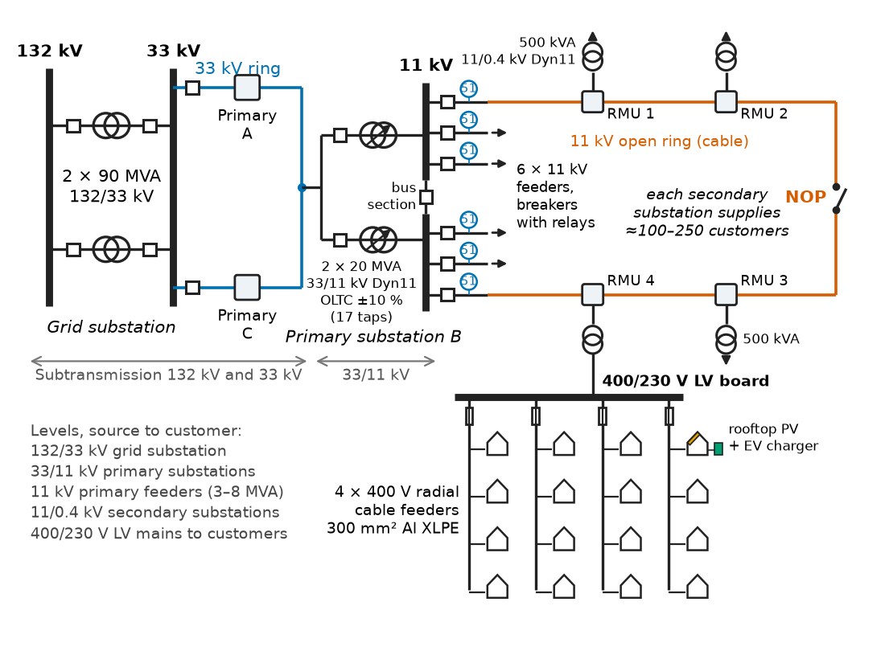
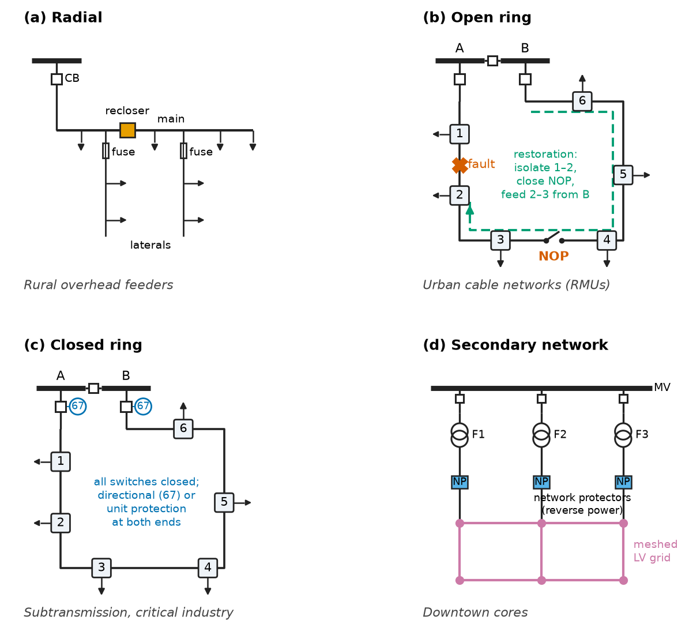
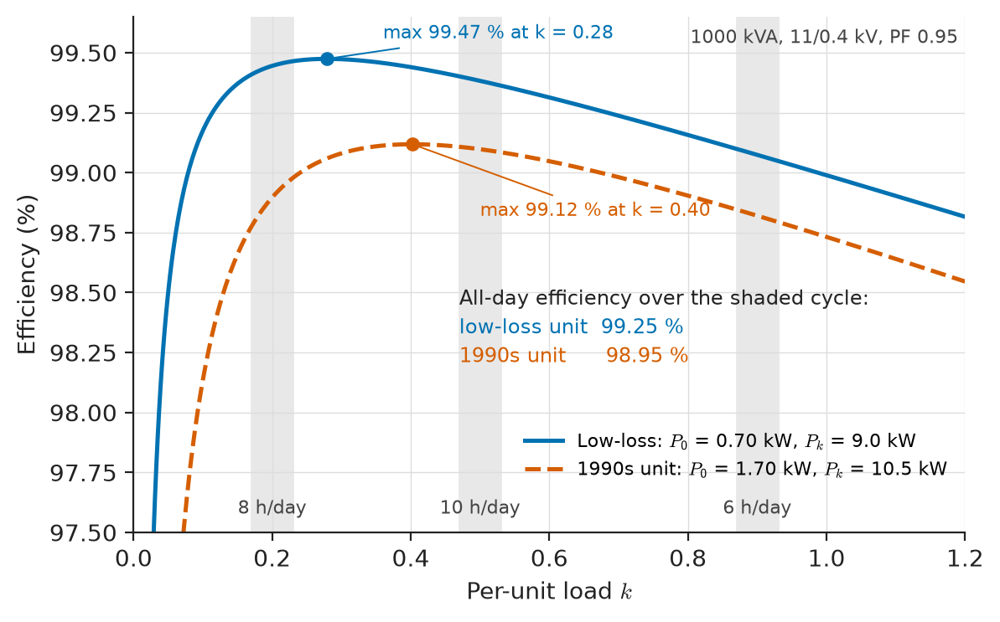
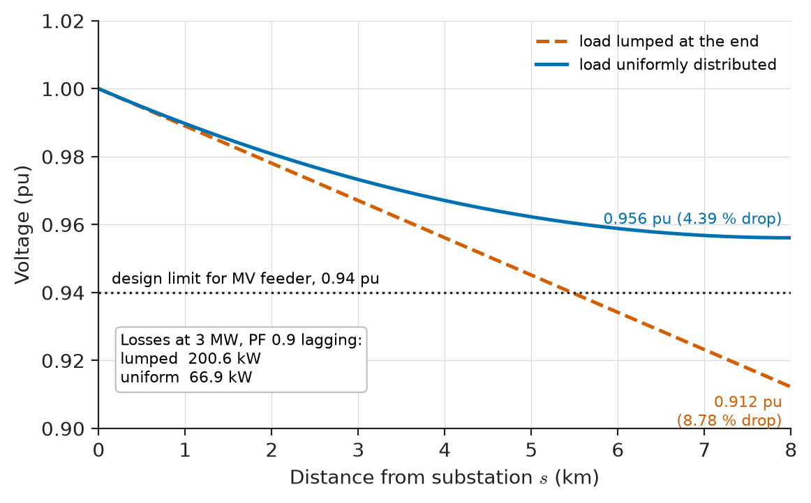
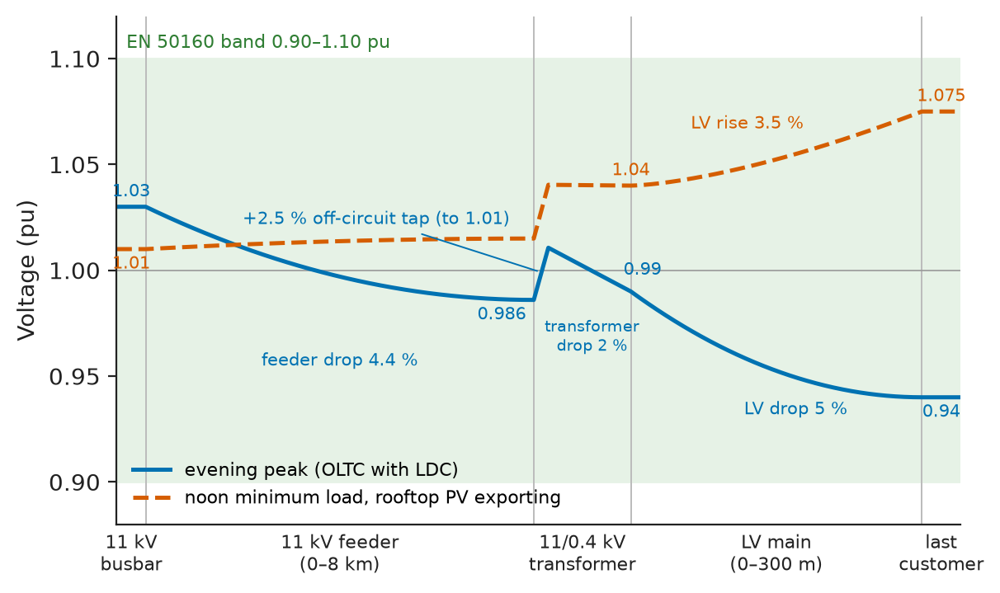
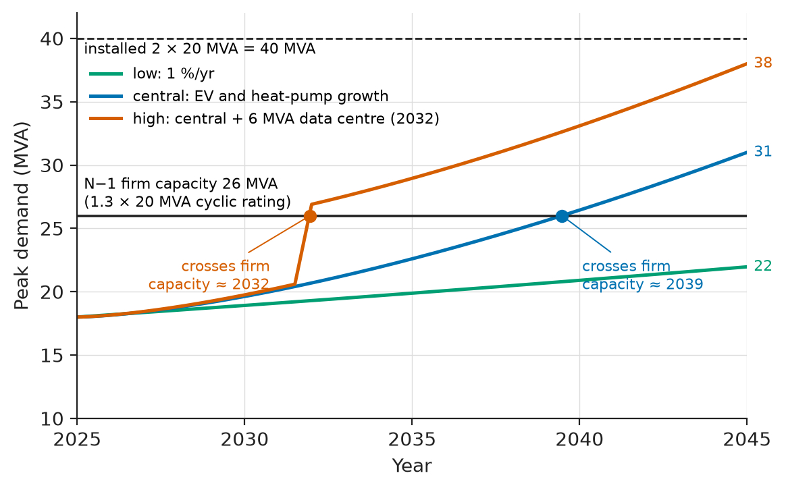

# Chapter 22 — Distribution Systems

*Part VI · Transmission, Distribution, and Protection*

Every weekday at about seven in the evening the customers at the far end of an 11 kV rural feeder phone the utility: lights dim, a borehole pump trips on undervoltage, a heat pump refuses to restart. The substation voltmeter reads a healthy 11.2 kV. Eight kilometres away, the same feeder is delivering 10.2 kV. Twelve hours later the problem reverses on the low-voltage side of a suburban street: at noon, with fifty rooftop photovoltaic systems exporting into a lightly loaded cable, the end-of-street voltage climbs past 253 V and the inverters disconnect one by one on overvoltage, throwing away the energy their owners paid for. Both complaints come from the part of the power system that most engineers never see on a single-line diagram of the grid: the distribution network, where most of the conductor length, most of the transformers, most of the interruptions and the larger share of the losses actually are. This chapter treats distribution as an engineering system in its own right: how it is laid out, how its feeders and transformers are modelled, why its voltage drops and where its energy goes, how its voltage is held inside the band the standards require, and what happens when generation appears at the wrong end of it.

> **How are distribution networks laid out, and why does a utility choose radial, ring or meshed operation for a given load?**
> **How much voltage and energy is lost along a feeder, how is the voltage held inside its statutory band, and what changes when distributed generation reverses the power flow?**

| Concept | Engineering destination |
|---|---|
| Distribution architectures | Utility networks, industrial plants, data centres, mines, ships |
| Radial and ring systems | Rural feeders, urban ring-main units, hospital and data-centre dual supplies |
| Distribution transformers | Pole-mounted and ground-mounted substations, loss-evaluated procurement |
| Feeder analysis | Ladder (backward–forward sweep) load flow, unbalance studies, connection assessments |
| Voltage drop | Conductor sizing, cable selection in buildings, statutory voltage compliance |
| Distribution losses | Loss factor, loss capitalisation, regulatory loss targets |
| Voltage regulation | On-load tap changers, line-drop compensation, step regulators, capacitor banks |
| Distributed generation | Rooftop PV hosting capacity, reverse power flow, volt–var control |
| Distribution planning | Load forecasts, diversity, firm capacity, EV and heat-pump growth |

**Roadmap.** Where distribution sits and what voltages it uses (22.1) → how feeders are connected and operated (22.2) → the transformers that step down to utilisation voltage (22.3) → modelling a feeder (22.4) → voltage drop along it (22.5) → where the energy goes (22.6) → holding the voltage in its band (22.7) → generation inside the network (22.8) → planning the network for the next twenty years (22.9).

---

## 22.1 Distribution architectures

### Where distribution begins and ends

Transmission (Chapter 21) moves bulk power at 132–765 kV over meshed networks operated by a system operator. Distribution begins at the **bulk supply point** or **grid substation**, where power is stepped down to subtransmission or primary distribution voltage, and ends at the customer's meter. A typical European chain is 132/33 kV at the grid substation, 33/11 kV at **primary substations**, 11 kV primary feeders, and 11/0.4 kV **secondary substations** feeding 400/230 V low-voltage (LV) mains along the streets (Figure 22.1). North American practice merges the middle levels: substations step 69–138 kV down to 12.47–34.5 kV primary feeders, and small single-phase pole-mounted transformers (10–100 kVA) supply a few customers each at 120/240 V split phase.

<!-- FIGURE 22.1 | figures/ch22/fig-22-1-distribution-chain.png | single-line | A typical European-style distribution chain from the grid substation to the customer, with representative ratings at each level. | Content: single-line diagram left to right. 132 kV busbar with two 90 MVA 132/33 kV transformers (grid substation). 33 kV ring to three primary substations; one detailed: two 20 MVA 33/11 kV Dyn11 transformers with OLTC (plus or minus 10 percent, 17 taps), 11 kV split busbar with bus-section breaker, six outgoing 11 kV feeders (breakers with relays). One feeder drawn as an open ring through four ring-main units (RMU) with a normally open point marked NOP; each RMU feeds a 500 kVA 11/0.4 kV Dyn11 transformer. One LV board with four 400 V radial cable feeders (300 mm2 Al) supplying houses; one house with a rooftop PV symbol and an EV charger. Voltage labels at each level and typical customer counts: about 100 to 250 per 500 kVA substation. -->

*Figure 22.1 — A typical European-style distribution chain from the grid substation to the customer, with representative ratings at each level.*

Representative voltage levels are summarised in Table 22.1. Nominal values follow IEC 60038 in most of the world and ANSI C84.1 in North America.

**Table 22.1 — Representative distribution voltage levels (nominal, line-to-line unless stated).**

| Level | IEC practice | North American practice | Typical function |
|---|---|---|---|
| Subtransmission | 33, 66, 110, 132 kV | 34.5, 46, 69, 115, 138 kV | Grid substation to primary substations; large industry |
| Primary (MV) | 6.6, 10, 11, 20, 22 kV | 4.16, 12.47, 13.2, 13.8, 24.9, 34.5 kV | Feeders to secondary transformers; mines; large buildings |
| Secondary (LV) | 400/230 V three-phase four-wire | 120/240 V split phase; 208Y/120, 480Y/277 V | Homes, commercial, light industry |
| Industrial LV | 690 V, 1000 V | 600 V (Canada), 480 V | Large drives, mining machinery, wind turbines |
| Typical primary-substation rating | 2 × 10 to 2 × 40 MVA | 1 × 20 to 3 × 50 MVA | |
| Typical feeder load | 3–8 MVA at 11 kV | 5–15 MVA at 12.47–13.8 kV | |

### Overhead and underground construction

Rural networks are overhead: bare aluminium conductor steel-reinforced (ACSR) or all-aluminium alloy conductors on wood or concrete poles, cheap to build (a few tens of thousands of dollars per km at 11 kV) and quick to repair, but exposed to wind, trees, lightning and vehicles. Urban networks are underground: XLPE-insulated aluminium or copper cables in ducts or direct-buried, typically five to ten times the cost per km, nearly immune to weather, but with fault-location and repair times measured in hours or days. Cables have far more capacitance than overhead lines (about 0.3–0.5 µF/km for an 11 kV XLPE cable against 0.01 µF/km for an overhead line), so a cable network generates a noticeable amount of reactive power at light load and its earth-fault currents are larger (Chapter 23).

### Neutral and earthing arrangement

Distribution systems differ sharply in how the neutral is treated. European MV networks are three-wire, with the transformer neutral earthed through a resistor or a Petersen (arc-suppression) coil, or left isolated; every load is three-phase or phase-to-phase. North American MV networks are four-wire multi-grounded: the neutral is carried along the feeder and earthed at every pole transformer, so single-phase laterals can branch off to supply customers. The choice determines how earth faults are detected (Chapter 23 §23.5) and how much current the neutral carries. At LV the IEC 60364 system classes (TN-S, TN-C-S, TT, IT) set how exposed metalwork is connected to earth; they are a safety topic and return in Chapters 29 and 30.

### Other distribution systems

The same architectures appear outside utilities. An **industrial plant** takes a 33 or 66 kV supply into its own main substation and distributes at 6.6 or 11 kV to motor control centres and unit substations. A **data centre** of 30 MW typically takes two independent utility feeds, runs dual "A" and "B" MV rings or radials, and supplies each server rack from two separate UPS-backed paths, so that any single component can fail without dropping load. An **underground mine** distributes at 11 kV or 3.3 kV through trailing cables to mobile substations, with resistance-earthed (often IT-type) systems that limit earth-fault current to a few amperes for shock and ignition safety. A **ship** or offshore platform distributes at 6.6 or 11 kV from its own generators with integrated electric propulsion, and an **aircraft** uses 115/200 V at 400 Hz (or variable frequency, 360–800 Hz) to save transformer and generator mass. All of them face the same trade-offs between cost, losses, voltage drop and the consequences of a single failure.

> **Boundary.** Three-phase phasor relations, star and delta connections and per-phase equivalents are taken from *Circuits, Signals and Communications*, [Ch. 10](https://github.com/The-Studio-of-Sadiq/Circuits-Signals-and-Communications/blob/main/part-2-transient-and-ac-analysis/10-three-phase-circuits.md); active, reactive and complex power from [Ch. 9](https://github.com/The-Studio-of-Sadiq/Circuits-Signals-and-Communications/blob/main/part-2-transient-and-ac-analysis/09-ac-power.md). The per-unit system and network models used below come from Chapter 17 of this book.

---

## 22.2 Radial and ring systems

### Radial feeders

In a **radial** system every load has exactly one path to the source. A primary feeder leaves the substation through a circuit breaker, runs as a **main** (trunk) along a road, and splits into **laterals** protected by fuses or reclosers. Radial networks are cheap, simple to protect (current flows one way, so time-graded overcurrent relays and fuses discriminate naturally, Chapter 23) and simple to analyse. Their weakness is that a fault anywhere on the main interrupts every customer downstream of the operating device until it is repaired or bypassed. Rural overhead networks accept this, using **auto-reclosers** to restore supply after the 80–90 % of overhead faults that are transient (lightning flashover, a branch touching the line), and **sectionalisers** to isolate the faulted section of permanent faults.

### Open rings and ring-main units

Urban cable networks are built as rings but operated radially. Each 11 kV feeder runs from one substation (or one busbar section) through a chain of **ring-main units** (RMUs) and returns to another, with one switch in the chain left open: the **normally open point** (NOP). Under normal conditions the two halves are two radial feeders. When a cable section faults, the feeder breaker trips, the faulted section is isolated by opening the RMU switches on either side, the breaker is reclosed, and the NOP is closed to restore the customers beyond the fault from the other end. With manual switching this takes 30–90 minutes; with remotely controlled RMUs and fault-passage indicators it takes one to three minutes; with automatic **fault location, isolation and service restoration** (FLISR, Chapter 26) it can take under a minute. The ring costs more cable than a radial (each half must be able to carry the whole ring's load) but customer minutes lost drop by an order of magnitude.

### Closed rings and meshed networks

Running the ring closed means every load always has two paths and a single cable fault interrupts nobody, but it needs protection that can tell which of two infeeds is feeding a fault: directional overcurrent, distance, or unit (differential) protection with communication (Chapter 23). Closed rings are standard at 33–132 kV subtransmission and in industrial plants with critical processes. At LV, the dense downtown cores of some North American cities use **secondary networks**: a meshed 208Y/120 V or 480Y/277 V grid fed from several primary feeders through **network protectors**, reverse-power relays that open a transformer's LV breaker if power flows back toward a faulted primary feeder. Such networks give reliability approaching that of transmission, at a high price.

<!-- FIGURE 22.2 | figures/ch22/fig-22-2-radial-ring-network.png | single-line | Four ways to connect distribution loads: radial, open ring with a normally open point, closed ring, and a meshed secondary network with network protectors. | Content: four panels in a 2 x 2 grid. (a) Radial: substation breaker, main with four load points, two laterals with fuses, one recloser on the main. (b) Open ring: two substation breakers (bus sections A and B), six RMUs in a loop, NOP between RMU 3 and RMU 4 shown as an open switch; a fault X between RMU 1 and RMU 2 with arrows showing the restoration path. (c) Closed ring: same loop with all switches closed and directional relay symbols at both ends. (d) Secondary network: three primary feeders, each with transformers and network-protector symbols (NP), feeding a meshed LV grid of six nodes. Label each panel with typical use: rural overhead, urban cable, subtransmission and critical industry, downtown cores. -->

*Figure 22.2 — Four ways to connect distribution loads: radial, open ring with a normally open point, closed ring, and a meshed secondary network with network protectors.*

Figure 22.2 compares the four arrangements. The choice is an economic one: the cost of the extra cable, switchgear and protection against the value placed on interruptions avoided.

### Measuring reliability

Utilities and regulators measure the result with the indices of IEEE 1366:

$$
\mathrm{SAIFI}=\frac{\sum N_i}{N_T},\qquad \mathrm{SAIDI}=\frac{\sum r_iN_i}{N_T},\qquad \mathrm{CAIDI}=\frac{\mathrm{SAIDI}}{\mathrm{SAIFI}}
$$

where $N_i$ is the number of customers interrupted by event $i$, $r_i$ its duration and $N_T$ the number of customers served. SAIFI counts interruptions per customer per year, SAIDI minutes lost per customer per year, CAIDI the average restoration time. Interruptions shorter than 5 minutes (IEEE 1366) or 3 minutes (European practice) are counted separately as momentary events.

**Table 22.2 — Typical reliability of distribution arrangements (excluding major-event days; values vary widely between utilities).**

| Arrangement | SAIFI (per year) | SAIDI (min per year) | Typical setting |
|---|---|---|---|
| Rural overhead radial with reclosers | 1.5–4 | 150–600 | Farmland, mining towns |
| Suburban mixed overhead/cable, open ring, manual switching | 0.5–1.5 | 60–150 | Suburbs |
| Urban cable, open ring, remote-controlled RMUs | 0.2–0.6 | 15–60 | City centres in Europe and East Asia |
| Secondary network (meshed LV) | below 0.1 | below 10 | Downtown cores, hospitals |
| Dual-fed data centre with UPS (at the IT load) | effectively 0 | effectively 0 | Tier III–IV facilities |

> **Status of the principle: Reliability indices**
> *Empirical.* SAIFI and SAIDI are defined bookkeeping quantities; their values come from outage records, and the figures above are typical observations, not predictions. Planning studies predict them from component failure rates and repair times, which are themselves empirical.

---

## 22.3 Distribution transformers

### Construction and ratings

A distribution transformer is the device studied in Chapter 4 built in very large numbers: a utility with five million customers may own half a million of them. Three-phase ground-mounted units are typically 200–2500 kVA, 11 or 22 kV to 400 V, connected **Dyn11** (delta primary, earthed-star secondary, 30° phase shift) so that the LV side has a neutral for single-phase loads, triplen harmonic currents circulate in the delta rather than in the MV network, and an earth fault on the LV side is not seen as zero-sequence current upstream. Pole-mounted units are smaller: 25–315 kVA three-phase in Europe, 10–167 kVA single-phase in North America. Most are oil-immersed with natural cooling (ONAN); dry-type cast-resin units are used inside buildings, ships and wind-turbine towers where oil is a fire hazard. Tappings are **off-circuit**: typically ±2 × 2.5 % on the HV winding, set once at installation to suit where the transformer sits on its feeder.

### Losses, efficiency and loss evaluation

The no-load (core) loss $P_0$ flows 8760 hours a year whatever the load; the load (copper) loss $P_k$ at rated current scales with the square of the per-unit load $k$. Efficiency at load $k$ and power factor $\cos\varphi$ is

$$
\eta=\frac{kS_r\cos\varphi}{kS_r\cos\varphi+P_0+k^2P_k},
$$

with its maximum at $k_{\max}=\sqrt{P_0/P_k}$ (Chapter 4). Because distribution transformers are lightly loaded on average (mean loads of 20–40 % of rating are common), the no-load loss dominates their annual energy loss, which is why amorphous-metal and high-grade grain-oriented steel cores pay back. Minimum efficiencies are now regulated: in the European Union by the Ecodesign regulation (EU) 548/2014 with its Tier 2 limits, in the United States by the Department of Energy rules (10 CFR 431), and in many other countries by equivalent standards. Utilities buy transformers on **capitalised loss** rather than first price, adding $A\cdot P_0+B\cdot P_k$ to the tender price, with $A$ and $B$ (in USD per kW) set by the present value of the energy cost.

**Table 22.3 — Typical three-phase oil-immersed distribution transformers, 11 kV/400 V, 50 Hz (ranges span ordinary to low-loss designs).**

| Rating | Short-circuit impedance | No-load loss $P_0$ | Load loss $P_k$ (75 °C) | Efficiency at 50 % load, PF 1 |
|---|---|---|---|---|
| 100 kVA | 4 % | 0.15–0.32 kW | 1.3–2.1 kW | 98.4–99.0 % |
| 400 kVA | 4 % | 0.40–0.93 kW | 3.3–4.6 kW | 99.0–99.4 % |
| 630 kVA | 4–6 % | 0.55–1.3 kW | 5.4–6.5 kW | 99.1–99.4 % |
| 1000 kVA | 6 % | 0.70–1.7 kW | 9–13 kW | 99.0–99.4 % |
| 2500 kVA | 6 % | 1.5–3.2 kW | 22–27 kW | 99.2–99.4 % |

**Worked example — All-day efficiency and the value of a low-loss core.** A 1000 kVA, 11/0.4 kV transformer supplies a commercial district with a daily cycle of 6 hours at 0.9 per unit, 10 hours at 0.5 per unit and 8 hours at 0.2 per unit, all at power factor 0.95. Compare a low-loss unit ($P_0=0.70$ kW, $P_k=9.0$ kW) with a 1990s unit ($P_0=1.70$ kW, $P_k=10.5$ kW).

Energy delivered per day: $1000\times0.95\times(6\times0.9+10\times0.5+8\times0.2)=11\,400$ kWh.

Low-loss unit: no-load energy $24\times0.70=16.8$ kWh; load-loss energy $9.0\times(6\times0.81+10\times0.25+8\times0.04)=9.0\times7.68=69.1$ kWh; total 85.9 kWh. All-day efficiency $11\,400/(11\,400+85.9)=99.25\,\%$.

Old unit: no-load energy $24\times1.70=40.8$ kWh; load-loss energy $10.5\times7.68=80.6$ kWh; total 121.4 kWh; all-day efficiency 98.95 %.

The difference is 35.5 kWh per day, or about 13 000 kWh per year, worth roughly USD 1000–1300 a year at USD 0.08–0.10 per kWh, for a transformer that will be in service for 30–40 years. Two-thirds of the saving comes from the core. The maximum-efficiency load of the low-loss unit is $\sqrt{0.70/9.0}=0.28$ per unit, close to its overnight load. Figure 22.3 shows the two efficiency curves.

<!-- FIGURE 22.3 | figures/ch22/fig-22-3-transformer-efficiency.png | plot | Efficiency versus load of two 1000 kVA distribution transformers: a low-loss design and an older design. | Content: x-axis per-unit load 0 to 1.2, y-axis efficiency 97.5 to 99.6 percent, power factor 0.95. Curve 1 (solid): P0 = 0.70 kW, Pk = 9.0 kW, maximum 99.47 percent near k = 0.28. Curve 2 (dashed): P0 = 1.70 kW, Pk = 10.5 kW, maximum near k = 0.40. Shaded vertical bands at k = 0.2, 0.5 and 0.9 labelled with hours per day (8 h, 10 h, 6 h). Annotate all-day efficiencies 99.25 percent and 98.95 percent. -->

*Figure 22.3 — Efficiency versus load of two 1000 kVA distribution transformers: a low-loss design and an older design.*

### Loading beyond nameplate

A distribution transformer's rating is thermal: IEC 60076-7 and IEEE C57.91 give the hot-spot temperature as a function of load and ambient temperature, and the ageing rate of the paper insulation doubles for every 6 K of hot-spot rise above 98 °C (Chapter 9). A unit that runs at 0.5 per unit most of the day can carry 1.3–1.5 per unit for two hours in a winter evening without exceeding its normal life consumption. This cyclic rating is what makes the after-diversity planning of Section 22.9 work, and it is also what EV charging threatens: a long, flat overnight peak removes the cool-down periods that the cyclic rating relies on.

> **Status of the principle: Insulation ageing doubles per 6 K**
> *Empirical.* The Arrhenius-based ageing law of IEC 60076-7 for non-upgraded kraft paper (thermally upgraded paper ages more slowly and is referenced to 110 °C) is fitted to accelerated-ageing tests; it holds between about 80 °C and 140 °C hot-spot and says nothing about mechanical or moisture-driven failure.

---

## 22.4 Feeder analysis

### The per-phase feeder model

A distribution feeder is short compared with a wavelength (an 11 kV feeder of 10 km is 0.003 of the 50 Hz wavelength), so the short-line model of Chapter 21 (§21.3) applies: a series impedance $z=r+jx$ per km and, for overhead lines, negligible shunt admittance. Cables add shunt capacitance that matters for reactive balance at light load but rarely for voltage drop. Typical parameters are given in Table 22.4.

**Table 22.4 — Representative feeder parameters at 50 Hz (positive sequence, conductor at about 50 °C for overhead, 70 °C for cable).**

| Conductor | $r$ (Ω/km) | $x$ (Ω/km) | $x/r$ | Thermal rating |
|---|---|---|---|---|
| 11 kV ACSR 50 mm² ("Rabbit") | 0.60 | 0.37 | 0.6 | 190 A |
| 11 kV ACSR 100 mm² ("Dog") | 0.27–0.30 | 0.35 | 1.2–1.3 | 300 A |
| 33 kV ACSR 150 mm² ("Wolf") | 0.19–0.21 | 0.38 | 1.9 | 400 A |
| 11 kV XLPE 3 × 185 mm² Al cable | 0.21 | 0.10 | 0.5 | 330 A |
| 11 kV XLPE 3 × 300 mm² Al cable | 0.13 | 0.09 | 0.7 | 430 A |
| 0.4 kV XLPE 4 × 95 mm² Al cable | 0.32–0.41 | 0.075 | 0.2 | 210 A |
| 0.4 kV XLPE 4 × 300 mm² Al cable | 0.10–0.13 | 0.07 | 0.6 | 400 A |

Two facts in the table drive almost everything that follows. First, distribution conductors have $x/r$ of order one or less, against 5–15 for transmission lines, so the active power flow affects voltage as strongly as the reactive flow; the decoupling between $P$ and $\delta$ and between $Q$ and $V$ that underlies fast-decoupled load flow (Chapter 18) does not hold. Second, resistance depends on temperature, rising about 0.4 % per kelvin in aluminium and copper (*Engineering Physics*, [Ch. 14 §14.1](https://github.com/The-Studio-of-Sadiq/Engineering-Physics/blob/main/CHAPTERS/CHAPTER%2014.md)), so a cable at 90 °C has 28 % more resistance than at 20 °C, and voltage-drop and loss figures must state the conductor temperature.

### Loads on a feeder

A feeder serves hundreds of transformers whose individual loads are rarely metered in real time. Analysis therefore starts with **load allocation**: the measured feeder-head demand is shared among the transformers in proportion to their kVA rating or their customers' metered monthly energy. Each load is then modelled as constant power, constant current or constant impedance (the **ZIP** model, Chapter 18), the mix chosen from measurements: residential loads behave roughly as a blend with active power varying about as $V^{1}$ to $V^{1.5}$, motors as constant power, and resistive heating as constant impedance.

### The ladder (backward–forward sweep) method

Newton–Raphson load flow works for distribution networks but is wasteful: radial feeders have no loops, and their high $r/x$ ratios make the Jacobian poorly conditioned. Distribution engineers use the **ladder** or **backward–forward sweep** method instead:

1. Assume all node voltages equal to the substation voltage.
2. **Backward sweep:** compute each load current from its voltage; walking from the feeder ends toward the substation, add currents with KCL to obtain every branch current.
3. **Forward sweep:** walking from the substation outward, subtract each branch's voltage drop with KVL to obtain new node voltages.
4. Repeat until the voltage at every node changes by less than a tolerance (typically $10^{-4}$ per unit).

The method converges in a handful of iterations for normally loaded radial feeders and handles weakly meshed networks by breaking loops at chosen points and injecting compensating currents. Real feeders are **unbalanced**: single-phase laterals, single-phase loads and untransposed conductors make the three phases carry different currents. Distribution analysis software therefore carries three-phase (or four-wire) phase-frame models with full $3\times3$ or $4\times4$ impedance matrices for each line section (Carson's equations with Kron reduction of the neutral), rather than the positive-sequence per-phase model of transmission studies.

> **Status of the principle: Backward–forward sweep load flow**
> *Derived.* A fixed-point iteration of KCL and KVL on a radial graph; it converges for radial and weakly meshed networks at normal loading, and slows or fails near voltage collapse or with many loops, where Newton-type methods are used instead.

---

## 22.5 Voltage drop

### The approximate drop formula

For a line section of impedance $R+jX$ carrying a balanced three-phase load $P+jQ$ at the receiving end of line voltage $V$, the phasor drop per phase is $\mathbf I(R+jX)$. Projecting it onto the receiving-end voltage gives the familiar approximation for the magnitude drop,

$$
\Delta V\approx I\,(R\cos\varphi+X\sin\varphi)\quad\text{(per phase)},\qquad
\frac{\Delta V}{V}\approx\frac{RP+XQ}{V^2}\quad\text{(per unit, three-phase)}
$$

The second form is the one engineers use most: $R$ and $X$ in ohms per phase, $P$ and $Q$ in W and var for all three phases, $V$ line-to-line. It neglects the quadrature component of the drop, which adds a correction of order $\big((XP-RQ)/V^2\big)^2/2$, under 0.5 % of $V$ for drops up to about 10 %.

> **Status of the principle: Approximate voltage-drop formula**
> *Approximate.* Valid for short lines with negligible shunt capacitance, balanced load and drops below about 10 %; it underestimates the true drop slightly, and fails for long cables at light load (where capacitive rise dominates) and for unbalanced feeders, where each phase must be computed separately and neutral voltage drop added.

### Lumped and distributed loads

Real feeders tap off load continuously. If a total current $I$ is drawn uniformly along a feeder of length $\ell$ and impedance $z$ per unit length, the current at distance $s$ from the source is $I(1-s/\ell)$, and the drop to distance $s$ is

$$
\Delta V(s)=I\,z\left(s-\frac{s^2}{2\ell}\right),\qquad \Delta V(\ell)=\frac{I\,z\,\ell}{2}.
$$

A uniformly distributed load causes the same end-of-feeder voltage drop as the whole load lumped at the **midpoint**. The power loss, which goes with the square of the current, is $\int_0^\ell I^2(1-s/\ell)^2 r\,ds=I^2r\ell/3$: the same as the whole load lumped at **one third** of the length. These two rules of thumb are used every day to size feeders before any software is opened.

**Worked example — Voltage drop and losses on a rural 11 kV feeder.** An 11 kV overhead feeder of 8 km uses ACSR "Dog" conductor ($r=0.273$ Ω/km, $x=0.35$ Ω/km). It supplies 3 MW at power factor 0.9 lagging. Find the voltage drop and losses (a) with all the load at the far end, (b) with the load uniformly distributed.

Line current: $I=3\times10^6/(\sqrt3\times11\,000\times0.9)=175.0$ A. Feeder impedance: $R=2.184$ Ω, $X=2.80$ Ω. With $Q=P\tan\varphi=1.453$ Mvar,

$$
\frac{\Delta V}{V}\approx\frac{2.184\times3.0\times10^6+2.80\times1.453\times10^6}{(11\,000)^2}=\frac{6.552+4.068}{121}=8.78\,\%.
$$

(a) Lumped at the end: drop 8.78 % (557 V per phase). The exact phasor calculation, holding the receiving end at 11 kV, gives 8.86 %, confirming the approximation. Losses: $3I^2R=3\times175.0^2\times2.184=200.6$ kW, 6.7 % of the load.

(b) Uniformly distributed: drop $8.78/2=4.39\,\%$; losses $200.6/3=66.9$ kW, 2.2 % of the load.

Most rural feeders lie between these limits, with load concentrated in villages. A design limit of about 6 % on the 11 kV feeder (leaving room for the transformer and LV drops within the ±10 % band at the customer) is met only if the load is spread out; a new 1 MW cold store at the feeder end would push the drop beyond it. Figure 22.4 shows both profiles.

<!-- FIGURE 22.4 | figures/ch22/fig-22-4-feeder-voltage-profile.png | plot | Voltage profile along an 8 km, 11 kV feeder carrying 3 MW at power factor 0.9, with the load lumped at the end and uniformly distributed. | Content: x-axis distance from substation 0 to 8 km; y-axis voltage 0.90 to 1.02 per unit (source 1.00 pu). Curve 1 (dashed): straight line from 1.000 to 0.912 pu (load lumped at end, 8.78 percent drop). Curve 2 (solid): parabola 1 - 0.0878 (s/8 - s^2/128), ending at 0.956 pu (uniform load). Horizontal dotted line at 0.94 pu labelled design limit for MV feeder. Annotate losses: 200.6 kW lumped, 66.9 kW uniform. -->

*Figure 22.4 — Voltage profile along an 8 km, 11 kV feeder carrying 3 MW at power factor 0.9, with the load lumped at the end and uniformly distributed.*

### Voltage drop in the low-voltage network and in buildings

The customer sees the sum of MV drop, transformer drop and LV drop. A typical European voltage budget at peak load allows about 2–5 % on the MV feeder, 2–3 % across the secondary transformer (whose 4 % impedance is mostly reactive), and 4–6 % on the LV mains and service cable, with the off-circuit tap and the substation tap changer lifting the no-load voltage to make room. Inside the customer's installation, IEC 60364-5-52 Annex G recommends a further maximum of 3 % for lighting and 5 % for other uses (6 % and 8 % when supplied from a private LV substation); the US National Electrical Code (NFPA 70) recommends 3 % for a branch circuit and 5 % for feeder plus branch. The customer-terminal limits are set by EN 50160 (±10 % of 230 V for 95 % of 10-minute averages over a week) or by ANSI C84.1 (Range A: ±5 % of nominal, 114–126 V on a 120 V base). Table 22.5 collects these limits; the design procedure for cables inside a plant is in Chapter 30.

**Table 22.5 — Voltage limits and drop allowances used in distribution design.**

| Quantity | Typical value | Source |
|---|---|---|
| LV supply voltage band (Europe) | 230 V ±10 % (207–253 V), 95 % of 10-min means | EN 50160, IEC 60038 |
| MV supply voltage band (Europe) | $U_c$ ±10 %, 95 % of 10-min means | EN 50160 |
| Service voltage, Range A (North America) | ±5 % (114–126 V on 120 V) | ANSI C84.1 |
| Service voltage, Range B (North America) | −8.3 % to +5.8 % (110–127 V) | ANSI C84.1 |
| Drop inside installation, lighting | 3 % (6 % private substation) | IEC 60364-5-52 Annex G |
| Drop inside installation, other loads | 5 % (8 % private substation) | IEC 60364-5-52 Annex G |
| Branch circuit / feeder plus branch | 3 % / 5 % (recommendation) | NFPA 70 informational notes |
| Motor starting dip at motor terminals | 10–15 % typical design limit | Practice; Chapter 6 |

---

## 22.6 Distribution losses

### Where the energy goes

Distribution networks lose far more energy than transmission networks because they carry the same power at lower voltage over far more conductor. In a well-run European or East Asian system, total network losses are 4–8 % of energy delivered, two-thirds of it in distribution; in systems with old networks, long rural feeders or widespread theft, the figure reaches 15–25 %.

**Table 22.6 — Typical breakdown of technical losses in a utility distribution network (share of total network losses; varies with network design).**

| Component | Share | Character |
|---|---|---|
| LV mains and service cables | 25–40 % | Load-dependent ($I^2R$), high on long rural LV |
| Distribution transformer no-load (core) losses | 15–30 % | Constant, 8760 h/yr |
| Distribution transformer load losses | 10–15 % | Load-dependent |
| MV feeders | 15–25 % | Load-dependent |
| Primary substation transformers and subtransmission | 10–15 % | Mostly load-dependent |
| Meters, capacitor banks, dielectric losses in cables, corona | 1–3 % | Constant |

Losses are split into **technical losses** (physics: $I^2R$, core loss, dielectric loss) and **non-technical losses** (theft, unmetered supplies, billing and metering errors). Smart meters (Chapter 26) have made the second class measurable by comparing the energy entering each secondary substation with the sum of its customers' meters.

### Load factor and loss factor

A feeder's peak loss is easy to compute from its peak current; its annual energy loss is not, because loss goes as $I^2$ and the current varies through the day and year. Two ratios are defined from the load curve:

$$
\mathrm{LF}=\frac{\text{average load}}{\text{peak load}},\qquad \mathrm{LsF}=\frac{\text{average loss}}{\text{peak loss}}=\frac{\overline{I^2}}{I_{\text{peak}}^2}.
$$

Because $\overline{I^2}\ge\bar I^2$, the loss factor lies between $\mathrm{LF}^2$ (a load that is flat at its average value except for a brief peak) and $\mathrm{LF}$ (a load that is either at peak or zero). When only the load factor is known, the empirical Buller–Woodrow relation is used:

$$
\mathrm{LsF}\approx0.3\,\mathrm{LF}+0.7\,\mathrm{LF}^2
$$

with coefficients ranging from 0.15/0.85 to 0.3/0.7 in different utilities' fits. With half-hourly smart-meter or SCADA data the loss factor is simply computed from the measured curve.

> **Status of the principle: Loss-factor formula**
> *Empirical.* The coefficients are fitted to typical utility load curves; the relation is a bracketed interpolation between the exact limits $\mathrm{LF}^2$ and $\mathrm{LF}$ and should be replaced by direct integration of $I^2$ when interval data exist.

**Worked example — Annual energy loss of the rural feeder.** The 8 km feeder of Section 22.5 with uniformly distributed load has a peak loss of 66.9 kW at its 3 MW peak. Its annual load factor is 0.55. Estimate the annual energy loss and its cost at USD 0.08 per kWh.

$\mathrm{LsF}=0.3\times0.55+0.7\times0.55^2=0.165+0.212=0.377$.
Annual energy loss $=66.9\times0.377\times8760=220.9$ MWh, costing about USD 17 700 a year.
Energy delivered $=3\times0.55\times8760=14\,454$ MWh, so the feeder loses 1.53 % of its energy, although its peak loss is 2.2 % of peak load. Reconductoring with a conductor of half the resistance would save about 110 MWh a year; worth about USD 8 800 a year over a 25-year life at 7 % discount rate (annuity factor 11.65) that justifies about USD 103 000 of investment, roughly the cost of restringing 2–3 km of line. Losses alone rarely pay for reconductoring a whole feeder; losses plus a voltage-drop problem often do.

### Reducing losses

Technical losses are reduced by raising voltage (converting 6.6 kV networks to 11 kV quarters the $I^2R$ loss for the same power), shortening LV circuits by adding more, smaller secondary substations, balancing load across phases (an unbalanced LV feeder carries neutral current and higher peak-phase current, both raising loss), correcting power factor locally with capacitors, replacing old transformers with low-loss ones, and reconfiguring meshed networks so that normally open points sit where losses are minimised. The economic assessment, with the life-cycle cost of a kilowatt of loss, is part of Chapter 28.

---

## 22.7 Voltage regulation

### The regulation problem

The voltage at a customer must stay inside its band at peak load, when drops are largest, and at minimum load, when drops are smallest and, with distributed generation, may become rises. The total drop from substation busbar to the farthest customer at peak might be 12 %, against a band of 20 % (±10 %); the job of voltage regulation is to place that 12 % inside the band at all times. The tools, from source to load, are the on-load tap changer at the primary substation, line-drop compensation, feeder voltage regulators, shunt capacitors, off-circuit taps on the secondary transformers, and increasingly the reactive power of inverters (Section 22.8).

### On-load tap changers and line-drop compensation

Primary substation transformers carry an **on-load tap changer** (OLTC) on the HV winding, typically giving ±10 % in 17 or 19 steps of about 1.25 %. An automatic voltage control (AVC) relay compares the busbar voltage with a set point; if it stays outside a deadband of ±1–1.5 % for a time delay (30–120 s, longer at upstream levels so that tap changers at different levels do not "hunt" against each other), it commands one tap step. The deadband must be wider than one tap step or the controller would oscillate.

Holding the busbar voltage constant is not what customers need: at peak load the busbar should be higher to offset the feeder drop. **Line-drop compensation** (LDC) adds to the measured voltage a simulated drop $\mathbf I(R_{set}+jX_{set})$ computed from the transformer current, so that the controller regulates the voltage at a notional load centre:

$$
V_{\text{regulated}}=\big\lvert\mathbf V_{\text{bus}}-\mathbf I\,(R_{set}+jX_{set})\big\rvert
$$

LDC works well when all feeders from the busbar have similar load shapes. It fails when one feeder carries reverse power from a solar farm while the others import: the controller then sees a reduced net current, lowers the busbar voltage, and drops the voltage at the ends of the load feeders. This interaction is one of the first symptoms of high DG penetration.

### Step voltage regulators

On long rural feeders, especially in North America, single-phase **step voltage regulators** (autotransformers with a 32-step tap changer giving ±10 % in steps of 5/8 %) are installed part-way along the feeder, each with its own controller and LDC. A regulator at the point where the voltage has fallen to 0.95 per unit can lift the downstream section back to 1.03 per unit at peak. Two or three regulators in cascade allow feeders of 30–60 km, with time delays graded (for example 30, 45, 60 s) from the substation outward.

### Shunt capacitors

A shunt capacitor bank of $Q_C$ reduces the reactive flow upstream of it, raising the voltage at its point of connection by approximately

$$
\frac{\Delta V}{V}\approx\frac{Q_C\,X}{V^2},
$$

where $X$ is the reactance from the source to the bank. A 600 kvar bank 6 km along the feeder of Section 22.5 ($X=2.10$ Ω) raises the voltage there by $600\times10^3\times2.10/11\,000^2=1.04\,\%$, and reduces losses by cutting the reactive current upstream. Feeder banks of 300–1200 kvar are either fixed (sized for the minimum load) or switched by time, voltage, temperature or var controllers. On feeders with $x/r$ below one, capacitors are much less effective for voltage support than tap changers, but still useful for losses and power factor; the sizing and power-factor penalty economics are in Chapter 25.

### Conservation voltage reduction

Many loads consume less power at lower voltage. **Conservation voltage reduction** (CVR) runs feeders deliberately near the bottom of the band. The CVR factor, the percentage change in energy per percentage change in voltage, is typically 0.5–1.0 for residential feeders, so lowering the average voltage by 3 % saves 1.5–3 % of energy. It requires good knowledge of the lowest voltage on the feeder, which smart meters now provide (Chapter 26), and is less effective where loads are dominated by constant-power electronics and thermostatically controlled heaters.

<!-- FIGURE 22.5 | figures/ch22/fig-22-5-voltage-band-profile.png | plot | Voltage from primary substation to the last customer at evening peak and at noon minimum load with rooftop PV, showing how tap settings place the profile inside the plus-or-minus 10 percent band. | Content: x-axis is a schematic distance with segments labelled 11 kV busbar, 11 kV feeder (0 to 8 km), 11/0.4 kV transformer, LV main (0 to 300 m), customer; y-axis voltage 0.88 to 1.12 per unit. Evening peak curve: busbar 1.03 pu (OLTC with LDC), falling to 0.986 at feeder end (4.4 percent drop), +2.5 percent off-circuit tap boost to 1.01, transformer drop 2 percent to 0.99, LV drop 5 percent to 0.94 pu at the last customer. Noon PV curve: busbar 1.01 pu, feeder rise 0.5 percent, transformer and tap to 1.04, LV rise 3.5 percent to 1.075 pu. Shaded band 0.90 to 1.10 pu labelled EN 50160. -->

*Figure 22.5 — Voltage from primary substation to the last customer at evening peak and at noon minimum load with rooftop PV, showing how tap settings place the profile inside the plus-or-minus 10 percent band.*

Figure 22.5 shows the regulation problem end to end: the evening profile must stay above 0.90 per unit and the noon profile below 1.10, with the same off-circuit tap position for both.

---

## 22.8 Distributed generation

### Reverse power flow and voltage rise

Distribution networks were designed for power flowing one way. **Distributed generation** (DG), from rooftop PV (3–10 kW per house) and commercial PV (50–500 kW) to 1–20 MW solar and wind farms, combined heat and power and small hydro on MV feeders, and battery storage at every scale, sends power the other way for part of the day. The voltage-drop formula of Section 22.5 then changes sign. For a generator exporting $P_G$ and absorbing $Q_G$ at the end of a line,

$$
\frac{\Delta V}{V}\approx\frac{R\,P_G-X\,Q_G}{V^2}
$$

is a voltage **rise** toward the generator. On LV cables with $R/X$ of 2–5, it is the active power that raises the voltage, and absorbing reactive power is a weak remedy.

**Worked example — Voltage rise on a suburban LV feeder at noon.** A 250 m, 400 V feeder of 4 × 95 mm² Al XLPE cable ($r=0.320$ Ω/km, $x=0.075$ Ω/km) serves 20 houses. At noon on a spring day the local load is 5 kW and the rooftop PV produces 75 kW, so 70 kW is exported, concentrated by geography toward the far end. The LV busbar sits at 1.04 per unit (239 V) because the off-circuit tap was raised to support the evening peak. Find the end-of-feeder voltage with inverters at unity power factor and at power factor 0.90 absorbing.

Cable impedance: $R=0.080$ Ω, $X=0.01875$ Ω, $R/X=4.3$.

Unity power factor: $\Delta V=(0.080\times70\,000)/400=14.0$ V line-to-line, a 3.50 % rise. End voltage $1.04+0.035=1.075$ per unit, 247 V.

At power factor 0.90 absorbing: $Q_G=70\times\tan(\cos^{-1}0.9)=33.9$ kvar,
$\Delta V=(0.080\times70\,000-0.01875\times33\,900)/400=12.4$ V, a 3.10 % rise. Absorbing 34 kvar buys only 0.4 % of voltage on the cable. The same reactive flow through the 400 kVA, 4 % secondary transformer ($R=1.15\,\%$, $X=3.83\,\%$) lowers the busbar by a further $3.83\times33.9/400-1.15\times70/400=0.12\,\%$ net, versus a 0.20 % rise at unity power factor, so the total gain is about 0.7 %.

At 247 V the feeder is inside the EN 50160 limit, but the inverters' own overvoltage protection (EN 50549-1 sets a 10-minute mean limit of 1.10 per unit by default) leaves little margin, and on a hotter, lighter-load day with the MV busbar at 1.05 per unit the end voltage reaches 1.085–1.10. Fixes, in increasing cost: lower the off-circuit tap by one step in summer (at the price of the evening margin), enable volt–watt curtailment in the inverters, add a battery, fit an on-load tap-changing secondary transformer, or reinforce the cable.

### Hosting capacity

The **hosting capacity** of a feeder is the amount of DG it can accept before some limit is violated: overvoltage (usually the first limit on long LV and rural MV feeders), thermal rating of cables and transformers under reverse flow (first on short, stiff urban feeders), protection mis-operation, or power-quality limits on harmonics and flicker. Typical deterministic studies give LV hosting capacities of 30–80 % of the secondary transformer rating for PV at unity power factor; volt–var and volt–watt control can roughly double the voltage-limited figure. Because the result depends on where the DG is, probabilistic (Monte Carlo) hosting-capacity studies are now standard for large-scale connection planning.

### Inverter voltage control

Modern grid codes require inverters to help. IEEE 1547-2018 (Category B) and EN 50549-1 specify **volt–var** curves (absorb reactive power above about 1.03 per unit, inject below about 0.97, with a deadband between), **volt–watt** curves (reduce active output linearly from about 1.06 to 1.10 per unit), and fixed power factor or $Q(P)$ modes. These are local, autonomous and fast; the full treatment of inverter control and grid-code compliance belongs to Chapter 27.

### Protection and fault-level effects

DG also disturbs protection designed for one-way flow:

- **Protection blinding:** a generator between the substation and a fault supplies part of the fault current, so the feeder relay sees less current and may not trip, or trips late.
- **Sympathetic tripping:** a generator on a healthy feeder feeds a fault on an adjacent feeder through the common busbar; a non-directional relay on the healthy feeder may trip.
- **Fuse-recloser miscoordination:** extra fault current can make a lateral fuse melt before the recloser's fast shot, defeating fuse saving.
- **Unintentional islanding:** a section of feeder disconnected from the substation may remain energised by DG, endangering line crews and causing out-of-phase reclosing. Anti-islanding detection is required by IEEE 1547 and EN 50549 (Chapter 27).

Synchronous machines contribute 4–7 times rated current to a fault; inverter-based DG contributes only 1.1–1.5 times rated current, so the blinding problem is mainly a synchronous-DG problem, while islanding and voltage rise are universal. These effects are taken up in Chapter 23.

> **Status of the principle: Voltage rise from distributed generation**
> *Approximate.* The same short-line approximation as the voltage-drop formula with the sign of $P$ and $Q$ reversed; it assumes a stiff upstream source and balanced injection, and must be replaced by a three-phase load flow when single-phase PV is unevenly spread across phases, which is common and raises the worst phase voltage further.

---

## 22.9 Distribution planning

### What a plan must answer

Distribution planning decides, five to twenty years ahead, which substations, transformers, feeders and switchgear to build or reinforce so that demand is met within voltage, thermal, fault-level and reliability limits at minimum life-cycle cost. Its inputs are a load forecast, the existing network model, planning standards (security of supply, voltage limits, ratings), unit costs and the value of losses and of lost load. Its outputs are reinforcement projects with dates.

### Diversity and after-diversity maximum demand

No two customers peak at the same moment. The **diversity factor** is the ratio of the sum of individual maximum demands to the maximum demand of the group; its inverse is the **coincidence factor**. For planning, utilities use the **after-diversity maximum demand** (ADMD) per customer, which falls with the number of customers and settles toward a constant for large groups. Typical values for gas-heated European homes are 1.5–2.5 kW per home for groups of 100 or more; for all-electric homes with heat pumps 3–6 kW; for North American homes with air conditioning 4–7 kW.

> **Status of the principle: After-diversity maximum demand**
> *Empirical.* ADMD curves are fitted to measured coincident demand of customer groups; they shift when the load mix changes (heat pumps, EVs, PV) and must be re-measured rather than extrapolated.

**Worked example — Sizing a secondary substation for a new estate with EV charging.** A new estate of 200 gas-heated homes has an ADMD of 2.0 kW per home at the evening peak. Eighty homes will have 7 kW chargers; measured charging diversity at the evening peak is about 0.25 for groups of this size. Choose the transformer rating, assuming power factor 0.95 at peak.

Domestic demand: $200\times2.0=400$ kW. EV demand: $80\times7\times0.25=140$ kW. Total $540$ kW, or $540/0.95=568$ kVA. A 630 kVA unit at 90 % peak loading leaves cyclic-rating headroom (Section 22.3); a 500 kVA unit, sufficient before EVs, would run at 114 % for several hours each evening, which is acceptable only if the overnight period is cool and short. If the estate's homes switch to heat pumps in the next decade (ADMD rising to perhaps 4 kW), the same group reaches about 940 kW, or 990 kVA, and the plan should reserve space and duct routes for a second transformer now. Smart charging that shifts EV demand past midnight (Chapter 26) can defer that reinforcement by years.

### Security standards

Planning standards state how much of the load must be supplied after outages. A common rule for primary substations is **N−1**: with any one transformer or incoming circuit out, the remaining equipment, using its emergency cyclic rating, must carry the peak demand. A primary substation with two 20 MVA transformers whose emergency rating is 1.3 per unit therefore has a **firm capacity** of 26 MVA, not 40. Smaller groups of load (a few MW) may be allowed N−0 with restoration by switching in a stated time, which is why open rings with remote control are planned for urban cable networks. In the UK this is codified in Engineering Recommendation P2; other utilities have equivalent internal standards.

### Feeder and conductor selection

A planner chooses, for each feeder, a voltage, a route, a conductor size and the switch positions, against several limits at once: thermal rating (normal and after a ring is closed), voltage drop at peak and rise at minimum load with DG, fault-level withstand of cables and switchgear (Chapter 19), and the economic conductor size, at which the capitalised cost of losses over the life of the asset balances the extra cost of a larger conductor. In practice utilities standardise on a few sizes (for example 95, 185 and 300 mm² Al cable at 11 kV) and lay the largest economic size at first construction, because digging a street twice costs far more than the extra aluminium.

### The changing load

Planning methods built on slowly growing, predictable residential and commercial load are being stretched by electrification. EV charging, heat pumps and rooftop PV change both the size and the timing of the peak; data centres request 50–500 MW connections with two-year lead times; mines and ports electrify their haul trucks and cranes; railways add 25 kV traction supplies. Planners respond with scenario-based forecasts, probabilistic load flow, flexibility contracts (paying customers to reduce load at peak instead of building), and active network management that curtails DG at a few critical hours rather than reinforcing for them. These tools belong to the smart grid of Chapter 26, and the design procedures for an individual installation to Chapter 30.

<!-- FIGURE 22.6 | figures/ch22/fig-22-6-planning-load-forecast.png | plot | Peak demand forecast for a 2 x 20 MVA primary substation under three electrification scenarios, against its N-1 firm capacity. | Content: x-axis year 2025 to 2045; y-axis peak demand 10 to 40 MVA. Three curves starting at 18 MVA in 2025: low scenario (1 percent per year, 22 MVA in 2045), central (EV and heat-pump growth, 31 MVA in 2045), high (central plus a 6 MVA data-centre step in 2032, 38 MVA in 2045). Horizontal lines at 26 MVA (N-1 firm capacity, 1.3 pu cyclic rating of one 20 MVA unit) and 40 MVA (installed). Mark the year each scenario crosses firm capacity: central about 2039, high 2032. -->

*Figure 22.6 — Peak demand forecast for a 2 x 20 MVA primary substation under three electrification scenarios, against its N-1 firm capacity.*

Figure 22.6 shows how the choice of scenario moves the reinforcement date of a single primary substation by a decade or more: the firm capacity is exceeded in 2032 in the high scenario, about 2039 in the central one, and not before 2045 in the low one.

---

## What remains open

| Open question | Where it is answered |
|---|---|
| How are the overcurrent relays, fuses and reclosers of a radial feeder set and graded? | Chapter 23 |
| How are distribution networks earthed, and how are earth faults detected in resistance- and coil-earthed systems? | Chapter 23 §23.5; Chapter 24 §24.6 |
| How do harmonics, flicker, sags and unbalance arise and propagate on distribution feeders? | Chapter 25 |
| How do smart meters, FLISR and active network management change distribution operation? | Chapter 26 |
| How must inverter-based DG behave under grid codes (volt–var, ride-through, anti-islanding)? | Chapter 27 |
| How is the life-cycle cost of losses used to justify efficiency investments? | Chapter 28 |
| How are cables inside a plant or building sized for voltage drop, current and fault withstand? | Chapter 30 |
| How are fault levels on distribution busbars computed? | Chapter 19 (back) |
| Where do the per-unit models of feeders and transformers come from? | Chapter 17 (back); Chapter 4 (back) |

**Next:** Chapter 23 turns from carrying power to interrupting it, asking how a protection system finds a fault among thousands of kilometres of feeder and clears it in a fraction of a second without disconnecting anything healthy.
