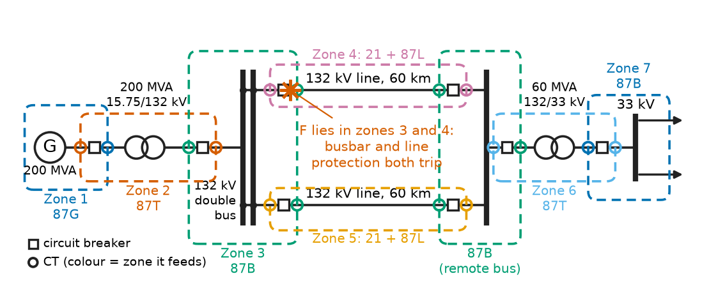
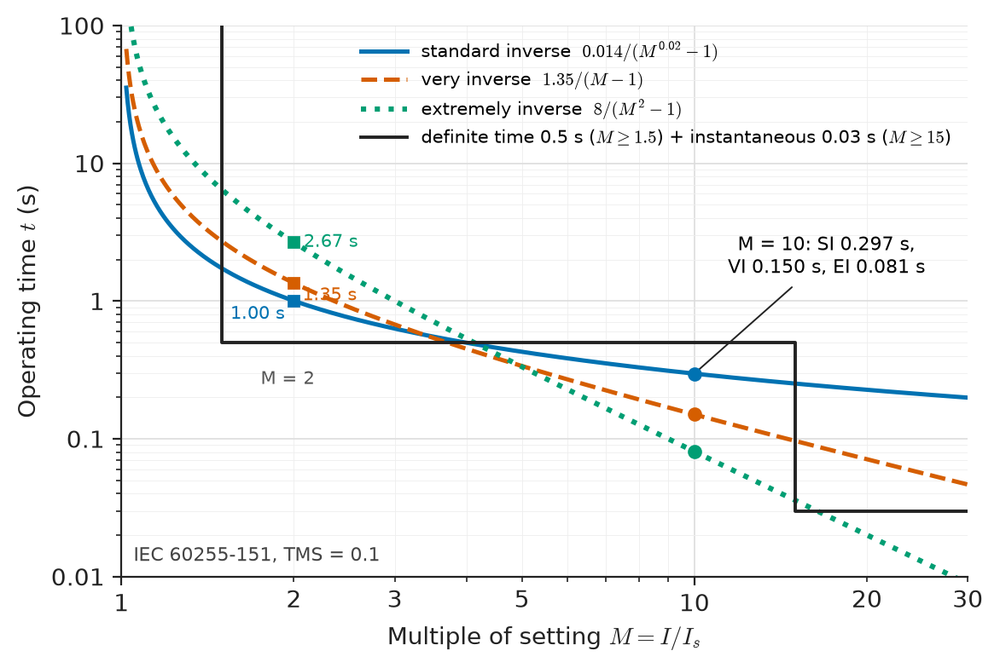
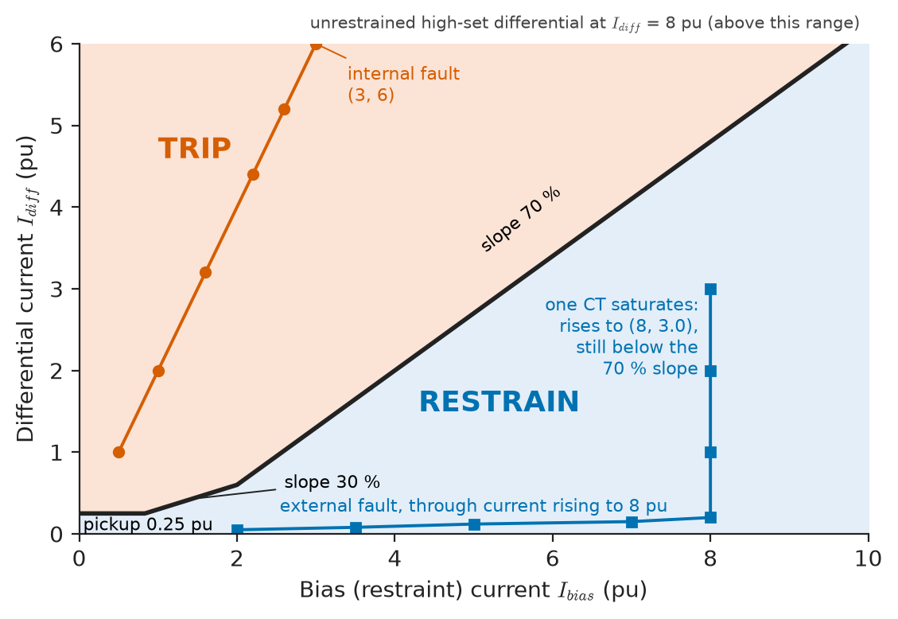
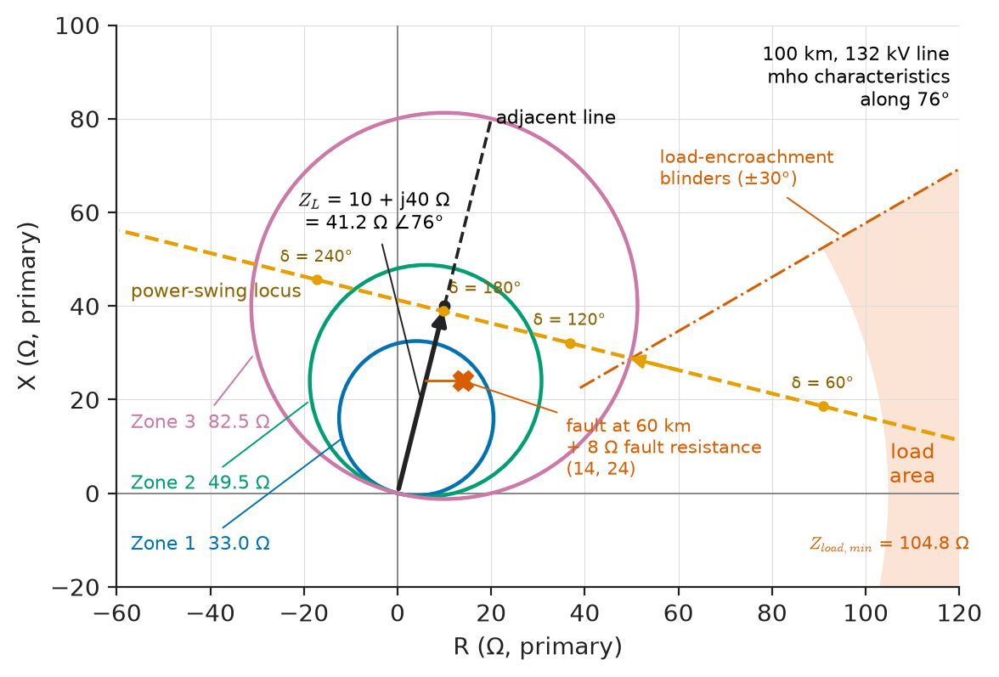
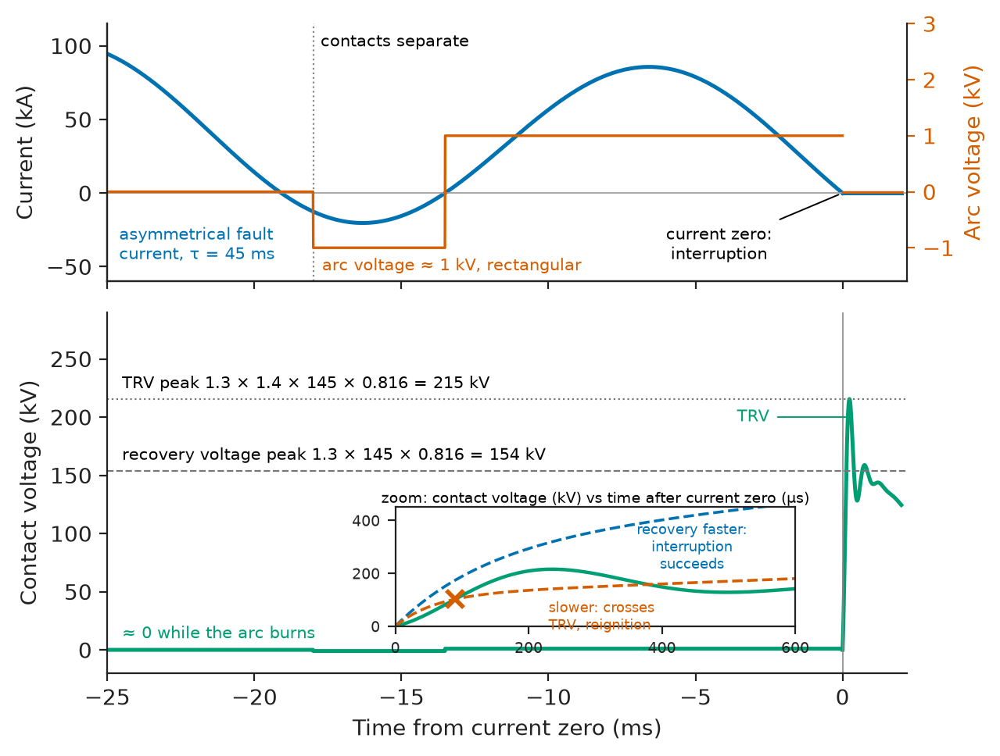
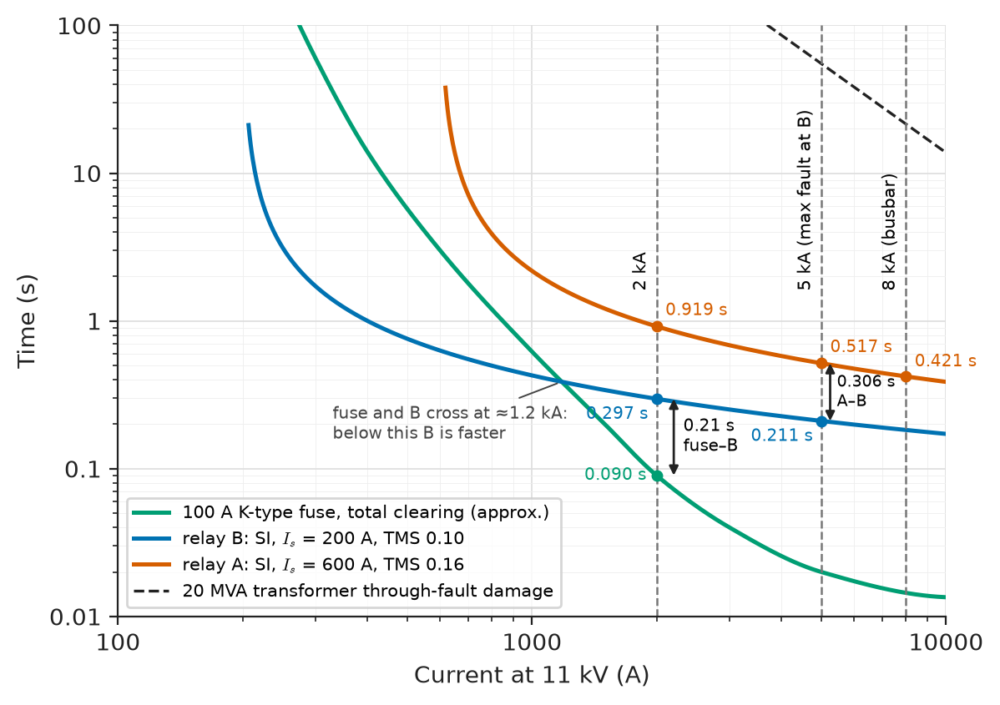

# Chapter 23 — Power-System Protection

*Part VI · Transmission, Distribution, and Protection*

At 14:07 on a summer afternoon a tree limb falls across one phase of an 11 kV feeder, 5 km from the substation. The fault current, about 4 kA, is twenty times the feeder's normal load. Within 0.3 s a relay at the substation has measured it, recognised it as a fault on its own feeder and not on one of the five healthy feeders beside it, and opened a circuit breaker; two seconds later it recloses, the limb has burnt clear, and most customers notice only a flicker. Had the relay been set a little too sensitive it would have tripped every winter morning on the inrush of cold loads; a little too slow, and the 33/11 kV transformer upstream would have tripped first, blacking out 12 000 customers instead of 1500; slower still, and the arc at the fault would have burnt down the conductor and set the field alight. On a 400 kV line the same story plays out in under 80 ms, because a slower clearance would let the generators nearby swing out of synchronism (Chapter 20). Protection is the part of the power system that does nothing for years and then must act correctly within milliseconds. This chapter explains how it decides what to trip, how fast, and how the devices that detect and interrupt faults are rated.

> **How does a protection system detect a fault, decide whether it is inside its own zone, and remove it without tripping anything healthy?**
> **How are relays, fuses, circuit breakers and instrument transformers chosen and set so that protection is fast, sensitive and selective at the same time?**

| Concept | Engineering destination |
|---|---|
| Protection principles | Zones of protection, main and backup, clearing-time budgets |
| Overcurrent protection | Radial distribution feeders, motor and transformer backup, LV switchboards |
| Differential protection | Transformers, generators, busbars, cables and short lines |
| Distance protection | Transmission and subtransmission lines, interconnectors |
| Earth-fault protection | Resistance- and coil-earthed MV networks, mines, generator stator earth faults |
| Circuit breakers | Switchgear ratings at 0.4–800 kV, generator breakers, DC breakers |
| Fuses and relays | LV distribution, MV laterals, numerical IEDs, IEC 61850 substations |
| Instrument transformers | CT saturation, accuracy-limit factor, CVT transients |
| Protection coordination | Grading of relays, fuses and reclosers; time-current studies |
| Selectivity and sensitivity | Pickup settings, high-impedance faults, arc-flash reduction |

**Roadmap.** What protection must do and how it is organised in zones (23.1) → the oldest and commonest principle, overcurrent (23.2) → comparing currents in and out, differential (23.3) → measuring impedance to the fault, distance (23.4) → faults to earth (23.5) → the circuit breaker that interrupts (23.6) → fuses and the relays that make the decisions (23.7) → the instrument transformers that feed them (23.8) → making devices in series work together (23.9) → the trade-off between catching every fault and tripping only the right breaker (23.10).

---

## 23.1 Protection principles

### What protection must do

A 25 kA arcing fault in 11 kV switchgear dissipates tens of megawatts in the arc. Left uncleared it melts conductors, ruptures switchgear, burns people and, on a transmission system, destabilises the generators. Protection must **detect** the fault from measurements, **locate** it to a zone, and **disconnect** the smallest part of the system that removes it. The requirements are usually listed as five:

- **Reliability**, divided into *dependability* (it trips for every fault in its zone) and *security* (it never trips for anything else). The two pull against each other: duplicated protections increase dependability and decrease security.
- **Selectivity** (discrimination): only the devices nearest the fault operate.
- **Speed**: short enough to limit damage and keep the system stable.
- **Sensitivity**: it detects the smallest fault current that can occur in its zone, including high-resistance faults.
- **Economy**: the protection costs a small fraction of what it protects. A 400 kV line or a 500 MVA generator justifies duplicated schemes; a 100 kVA pole transformer gets a fuse.

### The protection chain

Every protection scheme is a chain: **instrument transformers** (CTs and VTs) scale the primary current and voltage down to 1 or 5 A and 100–120 V; a **relay** (now usually a numerical intelligent electronic device, IED) samples them, applies the protection algorithm and closes a trip contact; a **DC auxiliary supply** (a 110 or 125 V substation battery, independent of the AC system it protects) energises the **trip coil**; and the **circuit breaker** separates its contacts and interrupts the current at a current zero. Any weak link defeats the chain, which is why trip-circuit supervision, battery monitoring and breaker-failure protection exist.

### Zones of protection

The system is divided into overlapping **zones**: each generator, transformer, busbar, line, cable and large motor sits inside at least one zone, bounded by the CTs that feed its protection and the breakers that its protection trips (Figure 23.1). Adjacent zones overlap around each breaker, by placing the CTs for each zone on the far side of the breaker, so that no fault falls into a gap between zones. A fault in an overlap trips more breakers than strictly necessary, which is the accepted price.

<!-- FIGURE 23.1 | figures/ch23/fig-23-1-protection-zones.png | single-line | Overlapping zones of protection around a generator, step-up transformer, 132 kV busbars, two lines and a 33 kV busbar. | Content: single-line diagram left to right: 200 MVA generator G (zone 1, generator differential 87G), 200 MVA 15.75/132 kV step-up transformer (zone 2, 87T), 132 kV double busbar (zone 3, 87B), two 132 kV lines each 60 km with breakers at both ends (zones 4 and 5, distance 21 and line differential 87L), the remote 132 kV busbar at the far end of the lines (unnumbered zone, 87B, labelled remote bus, so that no gap is left between the line zones and the transformer zone), 132/33 kV 60 MVA transformer and 33 kV busbar (zones 6 and 7, 87T and 87B). Dashed rounded rectangles for zones, each overlapping its neighbour across a circuit breaker; CT symbols drawn on the far side of each breaker relative to the zone they feed. A fault F in an overlap region near one 132 kV breaker is marked with a note that both zones trip. -->

*Figure 23.1 — Overlapping zones of protection around a generator, step-up transformer, 132 kV busbars, two lines and a 33 kV busbar.*

### Main and backup protection

**Main** (primary) protection is set to clear faults in its zone as fast as possible. **Backup** protection covers the failure of the main protection or its breaker. *Local backup* duplicates the main protection on separate CTs, relays and trip coils (at transmission level, "main 1" and "main 2" from different manufacturers or principles); *breaker-failure* protection (ANSI 50BF) trips all breakers around a stuck breaker if current is still flowing 150–250 ms after a trip command; *remote backup* is provided by slower protection one zone upstream, such as zone 3 of a distance relay or a time-graded overcurrent relay at the substation incomer.

**Table 23.1 — Typical fault-clearing times (relay operating time plus breaker interrupting time).**

| System | Main protection | Backup | What sets the limit |
|---|---|---|---|
| 400–765 kV transmission | 50–80 ms (2.5–4 cycles) | 250–500 ms (breaker failure, zone 2) | Transient stability (Chapter 20), grid code |
| 132–220 kV | 70–120 ms | 300–600 ms | Stability, equipment damage |
| 11–33 kV distribution | 0.05–1 s (graded) | 0.4–1.5 s | Selectivity, cable thermal withstand |
| LV switchboards and final circuits | 5–100 ms (fuses, MCBs) | 0.1–1 s | Shock protection (IEC 60364-4-41), arc flash |
| Generator and transformer internal faults | 20–40 ms relay, plus breaker | Overcurrent, 0.5–1 s | Winding and core damage |

> **Boundary.** Fault currents, sequence networks and symmetrical-component analysis are developed in Chapter 19 of this book, building on the first look at symmetrical components in *Circuits, Signals and Communications*, [Ch. 10](https://github.com/The-Studio-of-Sadiq/Circuits-Signals-and-Communications/blob/main/part-2-transient-and-ac-analysis/10-three-phase-circuits.md). Here the fault currents are taken as given; this chapter is about what is done with them.

---

## 23.2 Overcurrent protection

### Definite-time and inverse-time relays

The simplest fault indicator is current magnitude. An **overcurrent relay** (ANSI 51 for time-delayed, 50 for instantaneous) picks up when the current exceeds a **setting** $I_s$ and trips after a delay. In **definite-time** relays the delay is fixed. In **inverse definite minimum time** (IDMT) relays the delay falls as the current rises, because large currents mean close-in faults that must be cleared fast, while small overloads can be tolerated longer. IEC 60255-151 standardises the curves as

$$
t=\mathrm{TMS}\times\frac{k}{M^{\alpha}-1},\qquad M=\frac{I}{I_s}
$$

with the time multiplier setting (TMS) shifting the whole curve vertically. IEEE C37.112 defines similar curves with an additive constant.

**Table 23.2 — IEC 60255-151 inverse-time characteristics and operating time at $M=10$.**

| Curve | $k$ | $\alpha$ | $t$ at $M=10$, TMS = 1 | Typical use |
|---|---|---|---|---|
| Standard inverse (SI) | 0.14 | 0.02 | 2.97 s | General distribution feeders where fault level varies with source |
| Very inverse (VI) | 13.5 | 1 | 1.50 s | Feeders where fault current falls strongly with distance |
| Extremely inverse (EI) | 80 | 2 | 0.81 s | Grading with fuses; feeders with cold-load inrush |
| Long-time inverse (LTI) | 120 | 1 | 13.3 s | Earth-fault backup, thermal-type protection |

> **Status of the principle: Inverse-time overcurrent curves**
> *Empirical.* The curve shapes were chosen historically to mimic induction-disc relays and to grade conveniently with fuses; they are standardised conventions, not laws, and are valid from about $M=1.1$ to $M=20$, beyond which numerical relays clamp the curve to a definite minimum time.

**Worked example — Operating time of an IDMT relay.** An 11 kV feeder relay is fed from a 400/1 A CT, with $I_s=400$ A (100 % setting), standard-inverse curve and TMS = 0.1. A fault draws 4000 A. Then $M=10$ and

$$
t=0.1\times\frac{0.14}{10^{0.02}-1}=0.1\times\frac{0.14}{0.04713}=0.297\ \mathrm{s}.
$$

With a very-inverse curve at the same TMS, $t=0.1\times13.5/9=0.150$ s; extremely inverse, $0.1\times80/99=0.081$ s. Figure 23.2 shows the three curves at TMS = 0.1. The steeper curves trip faster for close-in faults but much slower for small overcurrents ($M=2$: SI 1.00 s, VI 1.35 s, EI 2.67 s), which is why EI curves tolerate the cold-load pickup of a feeder re-energised after a long outage.

<!-- FIGURE 23.2 | figures/ch23/fig-23-2-idmt-curves.png | plot | IEC standard-inverse, very-inverse and extremely-inverse relay curves at TMS 0.1, with a definite-time characteristic for comparison. | Content: log-log axes; x-axis multiple of setting M from 1 to 30; y-axis operating time 0.01 to 100 s. Curves: SI t = 0.014/(M^0.02 - 1) solid, 0.297 s at M = 10, 1.00 s at M = 2; VI t = 1.35/(M - 1) dashed, 0.150 s at M = 10; EI t = 8/(M^2 - 1) dotted, 0.081 s at M = 10, 2.67 s at M = 2. Horizontal line at 0.5 s for a definite-time element picking up at M = 1.5, and a vertical step to 0.03 s at M = 15 for an instantaneous element. Point marked at M = 10 for the worked example. -->

*Figure 23.2 — IEC standard-inverse, very-inverse and extremely-inverse relay curves at TMS 0.1, with a definite-time characteristic for comparison.*

### Instantaneous elements

A high-set **instantaneous** element (50) trips with no intentional delay (20–40 ms relay time) when the current exceeds a level that can only occur for faults close to the relay. On a feeder supplying a distribution transformer, it is set above the maximum fault current on the transformer's LV side (times a factor of 1.2–1.3 for DC-offset overreach), so that it never trips for faults that the transformer's own fuse or LV breaker should clear. Where the source impedance is small compared with the feeder impedance, fault current falls steeply along the feeder and the instantaneous element covers a useful fraction of it; where the source is weak, it covers almost nothing and is set off.

### Directional overcurrent

In a closed ring, a parallel feeder pair or a feeder with DG, fault current can flow either way through a relay. **Directional overcurrent** (67) adds a polarising quantity, usually a voltage phasor shifted by a **characteristic angle** (typically 30° or 45° for phase faults), and allows tripping only if the current lies in the forward half-plane. For a three-phase close-in fault the voltage collapses to near zero; numerical relays use pre-fault voltage memory for a few cycles to keep a valid direction.

---

## 23.3 Differential protection

### The Kirchhoff principle

For any healthy piece of equipment with no internal source or sink of current, the currents entering it sum to zero at every instant: Kirchhoff's current law. A **differential relay** (87) compares the currents at all terminals of its zone, via CTs, and trips when their phasor sum, the **differential** or **operating** current, exceeds a threshold. A through fault (outside the zone) produces large but equal currents in and out, and no differential current; an internal fault produces a differential current equal to the fault current. The zone is precisely bounded by the CT positions, and no time grading with other zones is needed, so differential protection is both fast (one to two cycles) and absolutely selective. It is **unit protection**: it protects one unit and gives no backup to anything else.

> **Status of the principle: Differential protection**
> *Fundamental.* Rests on charge conservation (KCL) for the protected zone; its practical accuracy is limited not by the principle but by CT errors, magnetising current, charging current and communication delays.

### Biased (percentage) differential

Real CTs do not match: ratio errors of a few per cent at load grow to tens of per cent when one CT saturates during a heavy through fault. A **biased** differential relay therefore makes its threshold rise with the through current. It computes

$$
I_{\text{diff}}=\Big\lvert\sum_k\mathbf I_k\Big\rvert,\qquad I_{\text{bias}}=\frac12\sum_k\lvert\mathbf I_k\rvert
$$

and trips when $I_{\text{diff}}$ exceeds a minimum pickup (typically 0.2–0.3 per unit) plus a slope times $I_{\text{bias}}$. A dual-slope characteristic (Figure 23.3) uses a gentle first slope (20–30 %) for sensitivity to internal faults at load currents and a steep second slope (60–80 %) above about 2 per unit bias to ride through CT saturation on heavy external faults. A saturating CT's output both shrinks and shifts in phase, and the phase shift alone is enough to create a large spurious differential: two 8 pu terminal currents of equal magnitude but 22° apart give $I_{\text{bias}}=8$ pu and $I_{\text{diff}}=2\times8\sin11^\circ=3.0$ pu.

<!-- FIGURE 23.3 | figures/ch23/fig-23-3-biased-differential.png | plot | Dual-slope biased differential characteristic, with the trajectories of an internal fault and an external fault with CT saturation. | Content: x-axis bias (restraint) current 0 to 10 pu; y-axis differential current 0 to 6 pu. Characteristic: horizontal at 0.25 pu up to bias 0.83 pu, slope 30 percent to bias 2.0 pu (Idiff 0.6 pu), then slope 70 percent to bias 10 pu (Idiff 6.2 pu, clipped at 6). Region above labelled TRIP, below RESTRAIN. Internal fault trajectory: points along Idiff = 2 Ibias line reaching (3, 6). External fault: through current rising to 8 pu along the bottom (small Idiff from ratio error), then one CT saturating, trajectory rising vertically to (8, 3.0), staying below the 70 percent slope; with Ibias = half the sum of magnitudes, a vertical rise at Ibias = 8 pu means the saturated CT's error is mainly in phase angle (about 22 degrees between equal 8 pu currents). Note above the plot: unrestrained high-set differential at Idiff = 8 pu, above the plotted range. -->

*Figure 23.3 — Dual-slope biased differential characteristic, with the trajectories of an internal fault and an external fault with CT saturation.*

### Transformer differential

A transformer differential relay must cope with three things that a line or busbar relay does not:

- **Ratio and vector-group mismatch.** Currents on the HV and LV sides differ by the turns ratio and, for a Dyn11 transformer, by 30°. Numerical relays correct both in software; older schemes connected the CTs in delta on the star side. Zero-sequence currents must also be removed on an earthed-star winding, otherwise an external earth fault would produce a false differential.
- **Tap-changer range.** An OLTC of ±10 % shifts the ratio, adding a standing differential that the first slope must cover.
- **Magnetising inrush.** Energising a transformer can draw 6–10 times rated current, mostly on one side and containing a large second harmonic (typically 15–60 % of the fundamental) because the core saturates asymmetrically (Chapter 4). The relay **blocks** when the second harmonic in the differential current exceeds about 15–20 % of the fundamental. Overexcitation, from high voltage or low frequency, produces a strong fifth harmonic and is blocked or alarmed in the same way.

A separate **restricted earth fault** (REF, 64REF) element compares the neutral current with the residual of the phase currents on one winding; it detects earth faults close to the neutral end of a star winding, where the fault current is too small for the overall differential.

### Busbar, line and generator differential

**High-impedance busbar differential** connects all the CTs of a busbar in parallel across a relay with a high stabilising resistor. On an external fault with one CT fully saturated, the saturated CT behaves as its winding resistance alone, and the healthy CTs drive current through it; the voltage across the relay is at most $V_s=I_f(R_{CT}+2R_L)$, where $I_f$ is the secondary fault current. Setting the relay voltage above $V_s$ guarantees stability; an internal fault drives the CTs to their knee point, far above it.

**Worked example — Setting a high-impedance busbar scheme.** A 33 kV busbar has six circuits, each with a 2000/1 A class PX CT of secondary resistance $R_{CT}=6$ Ω, and a maximum lead-loop resistance $2R_L=3$ Ω. The maximum through-fault current is 40 kA. Set the scheme and estimate its primary sensitivity, given a relay operating current of 0.1 A and CT magnetising current of 0.02 A each at the setting voltage.

Secondary fault current: $40\,000/2000=20$ A. Stability voltage: $V_s=20\times(6+3)=180$ V; choose a setting of 200 V. The CTs must have a knee-point voltage of at least $2V_s$, about 400 V, so that an internal fault reliably drives the relay. Primary operating current: $2000\times(0.1+6\times0.02)=440$ A, about 1.1 % of the maximum fault current, sensitive enough for any phase fault and for earth faults on a solidly or low-resistance earthed system. A non-linear resistor (metrosil) across the relay clamps the very high voltages (several kV peak) that an internal fault would otherwise develop across the high-impedance circuit.

**Line differential** (87L) compares the currents at both ends of a cable or line through a communication channel, now almost always dedicated fibre or a multiplexed digital link, with time alignment by GPS or by echo timing of channel delays. It is the main protection for short lines, cables (where distance protection struggles with the low and variable impedance), and for lines with tapped loads. **Generator differential** (87G) compares the neutral-end and terminal-end currents of each stator phase with settings as low as 5–10 % of rated current.

---

## 23.4 Distance protection

### Measuring impedance to the fault

On a meshed transmission network, fault currents vary with the generation pattern and flow in both directions, so overcurrent grading fails. A **distance relay** (21) measures the voltage and current at its terminal and computes the apparent impedance $\mathbf Z=\mathbf V/\mathbf I$. For a bolted fault at distance $d$ along a line of impedance $z_1$ per km, $\mathbf Z=d\,z_1$, independent of the source strength. The relay trips when the measured impedance falls inside its **reach**. Because the line impedance is a fixed property of the line, the reach is fixed in kilometres even when the fault level changes.

For phase-to-phase and three-phase faults the relay uses phase-to-phase voltages and the difference of phase currents. For earth faults the measured loop includes the return path, so the current is compensated with the **residual compensation factor**

$$
k_0=\frac{Z_0-Z_1}{3Z_1},\qquad \mathbf Z=\frac{\mathbf V_a}{\mathbf I_a+k_0\,3\mathbf I_0},
$$

where $Z_0$ and $Z_1$ are the zero- and positive-sequence line impedances (Chapter 19). For a typical overhead line with $Z_0\approx3Z_1$, $k_0\approx0.67$.

> **Status of the principle: Distance measurement**
> *Approximate.* The apparent impedance equals the impedance to the fault only for a homogeneous line, a solid (zero-resistance) fault and no infeed between relay and fault; fault resistance, intermediate infeed, mutual coupling with parallel lines, series compensation and CVT transients all distort it, and settings leave margins for these errors.

### Characteristics and zones

The trip region is drawn on the $R$–$X$ plane. The classic **mho** characteristic is a circle through the origin, directional by construction; **quadrilateral** characteristics allow independent resistive reach, needed to cover arc and tower-footing resistance on short lines and earth faults. Distance relays use stepped zones (Figure 23.4):

- **Zone 1**: 80–85 % of the line, instantaneous. Not 100 %, because errors in CTs, VTs, line data and CVT transients could make the relay overreach into the next line.
- **Zone 2**: 120 % of the line, or 100 % plus 50 % of the shortest adjacent line, delayed 0.3–0.4 s. Covers the last 15–20 % of the line and gives backup for the remote busbar.
- **Zone 3**: remote backup for adjacent lines, often 100 % plus 120 % of the longest adjacent line, delayed 0.8–1.5 s. Its large reach is dangerous under heavy load and power swings, and zone-3 trips on load featured in the 2003 North American blackout; modern practice limits it with **load-encroachment** blinders.

### Teleprotection

A fault in the last 15–20 % of a line is cleared instantly by the far-end relay's zone 1 but only in zone-2 time by the near end. **Teleprotection** schemes send a signal over fibre, power-line carrier or microwave so that both ends trip at high speed for any fault on the line: in **permissive underreach transfer trip** (PUTT) a zone-1 operation at one end lets the other end trip on zone 2 without delay; in **permissive overreach** (POTT) each end trips only if both see the fault forward; in **directional comparison blocking** (DCB) a reverse-looking element sends a blocking signal. Transmission lines at 220 kV and above normally use teleprotected distance plus line differential as main 1 and main 2.

### Power swings and fault resistance

After a disturbance the generator angles oscillate (Chapter 20), and the apparent impedance at a line terminal moves across the $R$–$X$ plane. A swing that passes through zone 1 looks like a fault. **Power-swing blocking** (68) detects the slow movement of the impedance (a fault jumps into the characteristic in milliseconds, a swing takes tens or hundreds of milliseconds to cross between two concentric characteristics) and blocks the distance zones; **out-of-step tripping** (78) deliberately separates the system at chosen points when a swing is unstable. Fault resistance, by contrast, pushes the apparent impedance to the right: an arc is typically a few ohms or less (an empirical formula, Warrington's, gives about 0.6 Ω for a 5 kA arc across 3 m), but an earth fault through a tree or high tower-footing resistance can reach tens of ohms, which only quadrilateral characteristics with generous resistive reach detect.

**Worked example — Distance relay settings for a 132 kV line.** A 100 km, 132 kV line has positive-sequence impedance $z_1=0.10+j0.40$ Ω/km. The relay is fed from a 600/1 A CT and a 132 kV/110 V VT. The maximum load is 150 MVA at 0.95 per unit voltage. Find the zone reaches in secondary ohms and check zone 3 against load.

Line impedance: $\mathbf Z_L=10+j40=41.2\angle76.0^\circ$ Ω primary. The relay sees secondary impedance $Z_{\text{sec}}=Z_{\text{pri}}\times\mathrm{CTR}/\mathrm{VTR}=Z_{\text{pri}}\times600/1200=0.5\,Z_{\text{pri}}$, so the line is 20.6 Ω secondary.

Zone 1 (80 %): $33.0$ Ω primary, $16.5$ Ω secondary, instantaneous.
Zone 2 (120 %): $49.5$ Ω primary, $24.7$ Ω secondary, 0.35 s.
Zone 3 (200 %, say): $82.5$ Ω primary, $41.2$ Ω secondary, 1.0 s.

Minimum load impedance: $Z_{\text{load}}=V^2/S=(0.95\times132)^2/150=104.8$ Ω primary (52.4 Ω secondary), at a power-factor angle of up to about 30°. A mho circle with diameter 82.5 Ω along 76° reaches $82.5\cos(76^\circ-30^\circ)=57.3$ Ω in the 30° direction, well inside 104.8 Ω, so the margin against load encroachment is a factor of 1.8. Raising the line loading to 250 MVA would cut $Z_{\text{load}}$ to 62.9 Ω and the margin to 1.1, at which point a load blinder becomes essential.

<!-- FIGURE 23.4 | figures/ch23/fig-23-4-distance-zones.png | plot | Three-zone mho distance characteristic on the R-X plane for a 100 km, 132 kV line, with the load area and a power-swing trajectory. | Content: R axis -60 to 120 ohm primary, X axis -20 to 100 ohm. Line impedance vector from origin to (10, 40) at 76 degrees, and adjacent line continuing to (20, 80). Mho circles through the origin with diameters along 76 degrees: zone 1 33.0 ohm, zone 2 49.5 ohm, zone 3 82.5 ohm. Load area: sector between plus and minus 30 degrees beyond radius 104.8 ohm, shaded. Load-encroachment blinder lines. A dashed power-swing locus moving from right to left across the plane, crossing zone 3 and zone 2. A point for a fault at 60 km with 8 ohm fault resistance at (14, 24). -->

*Figure 23.4 — Three-zone mho distance characteristic on the R-X plane for a 100 km, 132 kV line, with the load area and a power-swing trajectory.*

---

## 23.5 Earth-fault protection

### Why earth faults need their own protection

Between 70 % and 90 % of faults on overhead lines involve earth. How much current an earth fault draws depends on how the system neutral is earthed, which ranges from solid connection (fault current comparable with phase faults) to no connection at all (fault current only through the network's capacitance to earth). Earth-fault current is often far below load current, so phase overcurrent relays cannot see it. Earth-fault relays (50N/51N) respond instead to the **residual current** $3\mathbf I_0=\mathbf I_a+\mathbf I_b+\mathbf I_c$, which is zero for balanced load and equal to the earth-fault current during a fault. It is measured either by summing three phase CTs (the residual connection, sensitive down to about 5–10 % of CT rating because of CT mismatch) or by a single **core-balance CT** around all three phase conductors (sensitive down to a few amperes).

### Neutral earthing methods

**Table 23.3 — System earthing methods and their earth-fault behaviour.**

| Method | Typical earth-fault current | Where used | Protection approach |
|---|---|---|---|
| Solidly earthed | 1–1.5 × three-phase fault current | Transmission ≥ 110 kV; LV TN systems; North American MV multi-grounded | Distance and overcurrent earth elements; fuses at LV |
| Low-resistance earthed | 300–2000 A (limited by resistor) | Industrial and utility MV networks (6.6–33 kV) | Residual or core-balance overcurrent, graded |
| High-resistance earthed | 1–10 A (just above capacitive current) | Generators, industrial plants needing continuity, mines | Alarm, or trip on neutral voltage or sensitive EF |
| Resonant (Petersen coil) | Residual current of a few A after compensation | Central and Northern European MV, rural overhead | Transient or admittance-based directional EF, wattmetric EF |
| Isolated (unearthed) | Capacitive current, 1–100 A depending on network size | Small industrial networks, ships, IT systems at LV | Insulation monitoring, neutral displacement alarm |

A **neutral earthing resistor** (NER) is sized to limit the fault current to a chosen value, typically around the full-load current of the transformer: for an 11 kV system limited to 1000 A, $R=6351/1000=6.35$ Ω. The resistor limits damage and touch voltage and keeps the fault current large enough for selective relaying. With an earth-fault setting of 40 A primary on a 400/1 A CT, the relay detects faults with total resistance up to $6351/40=159$ Ω, that is a fault resistance of up to about 152 Ω.

### Resonant earthing

An isolated network has a capacitive earth-fault current $I_C=3\omega C_0V_{\text{ph}}$, where $C_0$ is each phase's capacitance to earth. An 11 kV cable network with $C_0=10$ µF per phase gives $I_C=3\times314.2\times10\times10^{-6}\times6351=59.9$ A. Arcs of this size do not extinguish themselves and can escalate through repeated restrikes to overvoltages of 3–4 per unit. A **Petersen coil** (arc-suppression coil) in the neutral, tuned to $L=1/(3\omega^2C_0)=0.338$ H, draws an equal inductive current that cancels the capacitive current at the fault, leaving only a few amperes of resistive and harmonic residual, at which most arcing faults on overhead lines self-extinguish. The system can run with a sustained earth fault for hours while it is located. Detecting *which* feeder is faulted is then hard, because the fault current is tiny; relays use the transient at fault inception, the active component of residual current (wattmetric), or a short-time injection of a parallel resistor.

### Restricted, sensitive and LV earth-fault protection

**Sensitive earth fault** (SEF) elements with settings of a few amperes detect high-impedance faults such as a conductor lying on dry ground (5–50 A), a major cause of wildfires and electrocutions; they must be time-delayed to ride through load unbalance. **Restricted earth fault** protection of transformer windings was introduced in Section 23.3. For generators, 100 % stator earth-fault protection combines a fundamental-frequency neutral overvoltage element (covering the outer 90–95 % of the winding) with a third-harmonic or injection element for the part near the neutral. At LV, protection against indirect contact is provided by fuses and circuit breakers in TN systems and by **residual-current devices** (RCDs, 30 mA for personal protection, IEC 60364-4-41) in TT systems and final circuits; these belong to Chapter 29.

---

## 23.6 Circuit breakers

### Interrupting at current zero

A circuit breaker carries rated current continuously, closes onto a fault, and interrupts fault current. When its contacts part under load an arc forms, a column of plasma at 10 000–20 000 K whose conductance keeps the current flowing. In AC the current passes through zero every half-cycle, and at each zero the arc input power vanishes. Whether the gap recovers depends on a race: the **dielectric recovery** of the gap, as the arc channel cools and is replaced by fresh insulating medium, against the **transient recovery voltage** (TRV) that the network impresses across the opening contacts. If the dielectric strength wins, the current is interrupted; if not, the arc reignites and the race repeats at the next zero. Every AC breaker therefore interrupts at a current zero, and the art of breaker design is to cool and deionise the gap within microseconds of that zero.

> **Status of the principle: Arc models of interruption**
> *Empirical.* Cassie's and Mayr's arc equations, and the black-box arc models used to design and test breakers, are fitted to measured arc voltages and conductances; they describe the thermal and dielectric recovery well near current zero but carry no first-principles prediction of a new interrupting medium.

### Transient recovery voltage

The TRV is the network's response to the sudden removal of current, a damped oscillation between the source inductance and the stray capacitances at the breaker (Figure 23.5). Its peak and its rate of rise (RRRV) set the duty. For a three-phase ungrounded terminal fault the first pole to clear sees the highest voltage, raised by the **first-pole-to-clear factor** (1.5 for non-effectively earthed systems, 1.3 for effectively earthed systems at 72.5 kV and above), and the oscillation overshoots by an **amplitude factor** of about 1.4. For a 145 kV breaker the standard TRV peak is

$$
u_c=k_{pp}\,k_{af}\,U_r\sqrt{\tfrac23}=1.3\times1.4\times145\times0.816=215\ \mathrm{kV},
$$

reached in a few hundred microseconds. A **short-line fault**, a few kilometres down the line, is harder still: the line side of the breaker produces a sawtooth travelling-wave TRV (Chapter 24) with an initial rate of rise of several kV/µs.

<!-- FIGURE 23.5 | figures/ch23/fig-23-5-current-zero-trv.png | plot | Fault current interruption at a current zero and the transient recovery voltage across the first pole to clear of a 145 kV breaker. | Content: two stacked panels sharing a time axis -10 to +2 ms around current zero, plus an inset zoom 0 to 600 microseconds. Top: asymmetrical fault current decaying, arc voltage small and rectangular, current reaching zero at t = 0. Bottom: voltage across the contacts, near zero during arcing, then after current zero a 1-cosine oscillation rising to 215 kV peak (1.3 x 1.4 x 145 x 0.816) and settling to the recovery voltage of about 154 kV peak (1.3 x 145 x 0.816). Dashed curve labelled dielectric recovery of the gap rising faster than the TRV: interruption succeeds; second dashed curve rising slower and crossing the TRV: reignition. -->

*Figure 23.5 — Fault current interruption at a current zero and the transient recovery voltage across the first pole to clear of a 145 kV breaker.*

### Interrupting media

**Table 23.4 — Circuit-breaker technologies and typical ratings.**

| Type | Voltage range | Rated short-circuit breaking current | Notes |
|---|---|---|---|
| Air circuit breaker (ACB) | LV, up to 1 kV | 40–150 kA | Main LV switchboards; arc chutes |
| Moulded-case (MCCB) and miniature (MCB) | LV | 6–150 kA | Current-limiting designs; IEC 60947-2, IEC 60898 |
| Vacuum | 3.6–52 kV (now up to 145 kV) | 16–63 kA | Dominant at MV; long contact life, low maintenance |
| SF₆ puffer and self-blast | 72.5–800 kV (also MV) | 31.5–80 kA | Dominant at HV; SF₆ has a global warming potential about 23 500 times CO₂ |
| SF₆-free (fluoronitrile mixtures, "clean air" with vacuum) | 12–420 kV, growing | 31.5–63 kA | Replacing SF₆ under F-gas rules |
| Generator circuit breaker | 15–33 kV | 63–300 kA | Very high X/R; IEC/IEEE 62271-37-013 |
| DC breaker (hybrid, mechanical with resonant circuit) | 1.5–3 kV traction; 320–525 kV HVDC | 10–25 kA | No natural current zero; must create one |

Oil and air-blast breakers, once standard, survive only in old installations.

### Ratings

IEC 62271-100 and IEEE C37.04 define a breaker's duty. The main ratings are the rated voltage, rated normal current, rated short-circuit breaking current (the RMS AC component it can interrupt, for example 31.5 or 40 kA), the DC component it can tolerate at contact separation, the rated short-circuit making current (peak), the rated short-time withstand (1 or 3 s), the TRV, the operating sequence (for example O–0.3 s–CO–3 min–CO for auto-reclosing), and the break time (typically 3 cycles at HV, 2 cycles at EHV).

**Worked example — Making current and DC component.** A 145 kV breaker is rated 40 kA at 50 Hz, with the IEC standard DC time constant $\tau=45$ ms ($X/R=\omega\tau=14.1$). Find the peak current it must close onto and the DC component at contact separation 40 ms after fault inception.

The worst-case peak occurs about half a cycle (10 ms) after a fault at voltage zero:

$$
i_p\approx\sqrt2\,I_k\left(1+e^{-0.010/0.045}\right)=\sqrt2\times40\times1.80=101.9\ \mathrm{kA},
$$

so the peak factor is 2.55; IEC 62271-100 rounds this to a rated making current of $2.5\times40=100$ kA at 50 Hz (2.6 at 60 Hz). At contact separation the DC component, as a fraction of the AC peak, is $e^{-0.040/0.045}=41\,\%$. Near large generators, where $X/R$ may reach 50–100, the DC component can exceed the AC peak, and the current may not pass through zero for several cycles: the "delayed current zero" problem that generator breakers are specifically designed for.

---

## 23.7 Fuses and relays

### Fuses

A **fuse** is the simplest and cheapest protective device: a silver or copper element in a sand-filled body that melts, arcs and quenches. High-rupturing-capacity (HRC) fuses to IEC 60269 interrupt 50–120 kA at LV and are **current limiting**: they melt so quickly on a large fault that the current is cut off before it reaches its first prospective peak. A 100 A gG fuse facing a 50 kA prospective fault typically limits the peak let-through current to about 10 kA, against an unlimited peak of over 100 kA, and limits the let-through energy $I^2t$ to tens of kA²s. Downstream equipment need withstand only these let-through values, and arc-flash energy falls dramatically.

Fuse classes are named by letters: **gG** (general purpose, full-range breaking), **aM** (motor circuits, short-circuit only, tolerates starting current), **gR/aR** (semiconductor protection, very fast). Two gG fuses in series discriminate if the upstream rating is at least 1.6 times the downstream rating (IEC 60269 selectivity ratio). At MV, **expulsion fuses** on overhead laterals and pole transformers (11–33 kV) interrupt by gas generated from the fuse tube, and current-limiting MV fuses protect ground-mounted transformers in RMUs. Fuses are single-shot, cannot be set, and can leave a three-phase motor single-phasing unless backed by a relay.

### From electromechanical to numerical relays

Single-function **electromechanical** relays (induction discs, attracted armatures) survive in older substations, and **static** electronic relays followed in the 1970s–1990s. Today's **numerical** relays, or IEDs, sample CT and VT signals at 1–4 kHz, compute phasors by discrete Fourier filtering (*Circuits, Signals and Communications*, [Ch. 22](https://github.com/The-Studio-of-Sadiq/Circuits-Signals-and-Communications/blob/main/part-5-digital-signal-processing/22-discrete-fourier-transform.md)), and run many protection functions, fault recording, metering and self-supervision in one box. Functions are identified by ANSI/IEEE C37.2 device numbers.

**Table 23.5 — Common ANSI device numbers in protection.**

| Number | Function | Number | Function |
|---|---|---|---|
| 21 | Distance | 59 | Overvoltage |
| 25 | Synchronism check | 64 | Earth fault (REF, stator earth fault) |
| 27 | Undervoltage | 67 / 67N | Directional phase / earth overcurrent |
| 32 | Reverse or directional power | 68 / 78 | Power-swing blocking / out-of-step trip |
| 46 | Negative-sequence current | 79 | Auto-recloser |
| 49 | Thermal overload | 81 | Under/over frequency (load shedding) |
| 50 / 51 | Instantaneous / time overcurrent | 86 | Lockout relay |
| 50N / 51N | Earth (residual) overcurrent | 87 | Differential (87T, 87G, 87B, 87L) |
| 50BF | Breaker failure | 24 | Overexcitation (volts per hertz) |

Modern substations built to **IEC 61850** replace much of the copper wiring with Ethernet: process-bus merging units digitise CT and VT signals and publish **sampled values**, and relays exchange trips and interlocks as **GOOSE** messages with transfer times under 4 ms. This brings flexibility and supervision, and also cybersecurity requirements (Chapter 26).

### Reclosers and sectionalisers

An **auto-recloser** (79) is a breaker with built-in relay that trips and recloses typically up to three times (for example fast trip, 0.5 s dead time, fast trip, 15 s, delayed trip, 15 s, delayed trip, lockout). Because most overhead faults are transient, 80–90 % are cleared by the first reclose. **Sectionalisers** downstream count the recloser's interruptions and open during a dead time after a set count, isolating a permanently faulted section without needing fault-interrupting capability themselves.

---

## 23.8 Instrument transformers

### The protection duty

Chapter 4 developed the current and voltage transformer as devices, and *Circuits, Signals and Communications* [Ch. 9 §9.9](https://github.com/The-Studio-of-Sadiq/Circuits-Signals-and-Communications/blob/main/part-2-transient-and-ac-analysis/09-ac-power.md) showed their ratio and phase errors at normal load. Protection asks a different question: does the CT reproduce a fault current of 20–50 times rating, possibly with a large DC offset, long enough for the relay to decide? Metering CTs are designed to saturate early to protect meters; protection CTs are designed not to.

### Accuracy classes

IEC 61869-2 specifies protection CTs by a composite-error class and an **accuracy-limit factor** (ALF): a **5P20, 15 VA** CT has composite error within 5 % up to 20 times rated current when connected to its rated burden of 15 VA. Class **PX** CTs are specified instead by turns ratio, knee-point voltage $E_k$, magnetising current at $E_k$ and secondary resistance, the data needed for high-impedance differential schemes. Classes **TPX, TPY, TPZ** add transient performance with DC offset. IEEE C57.13 uses C-classes: a **C800** CT delivers 800 V at its terminals at 20 times rated current (100 A for a 5 A CT) without exceeding 10 % ratio error.

**Table 23.6 — Typical protection CT specifications.**

| Application | Typical specification | Secondary |
|---|---|---|
| Distribution feeder overcurrent | 5P20, 10–15 VA (IEC); C200 (IEEE) | 1 A or 5 A |
| Transformer and line differential | 5P20 or PX; C400–C800 | 1 A preferred |
| High-impedance busbar differential | Class PX, $E_k$ 300–1500 V, equal ratios | 1 A |
| Transmission distance | TPY or 5P20 with transient check; C800 | 1 A |
| Generator differential | PX or TPY with matched ratios | 1 A or 5 A |
| Revenue metering (for comparison) | Class 0.2S or 0.5, security factor FS ≤ 5 | 1 A or 5 A |

### Burden, effective ALF and saturation

The CT's ability to drive current depends on the voltage it must develop, which is the secondary current times the total loop resistance (CT winding plus leads plus relay). If the connected burden is smaller than the rated burden, the CT can reproduce a correspondingly higher current. The **effective ALF** is

$$
\mathrm{ALF}'=\mathrm{ALF}\times\frac{R_{\text{rated}}+R_{CT}}{R_{\text{actual}}+R_{CT}}.
$$

**Worked example — Will the CT saturate?** A 400/1 A, 5P20, 10 VA CT ($R_{\text{rated}}=10$ Ω at 1 A) with $R_{CT}=3$ Ω feeds a numerical relay (0.1 VA, so 0.1 Ω) over a 50 m run of 2.5 mm² copper ($7.41$ Ω/km, loop 0.741 Ω). The maximum fault current is 20 kA with $X/R=20$.

Actual burden: $0.1+0.741=0.841$ Ω. Effective ALF: $20\times(10+3)/(0.841+3)=67.7$, so the CT reproduces symmetrical currents up to about $67.7\times400=27$ kA without exceeding 5 % error, comfortably above 20 kA. With a fully offset fault, however, the flux needed to avoid saturation is larger by a transient factor of about $1+X/R=21$: the CT would have to reproduce $50\times21=1050$ times rated current, far beyond its capability. It will saturate, typically within one to two cycles. This is acceptable because numerical relays complete their measurement within the first cycle and include saturation detection; where it is not acceptable (high-impedance busbar schemes, generator protection, transmission distance with long DC time constants) the CTs are sized with transient classes or the scheme is designed to be stable with a saturated CT, as in Section 23.3. Remanent flux left in the core after a fault can add up to 80 % of saturation flux and makes the next saturation earlier, which is why TPY and TPZ cores have air gaps.

> **Status of the principle: Effective accuracy-limit factor**
> *Approximate.* Treats burden and CT winding as resistive and the core as linear up to a sharp saturation point; it ignores DC offset, remanence and the curved knee of the magnetising characteristic, which transient-performance calculations (IEC 61869-2 TPx classes, IEEE C37.110) add.

### Voltage transformers and CVTs

At 132 kV and above, voltage is usually measured by **capacitor voltage transformers** (CVTs): a capacitive divider down to about 10–20 kV followed by a small tuned magnetic transformer. CVTs are cheap and double as coupling capacitors for power-line carrier, but after a sudden voltage collapse their output contains a decaying transient lasting one to two cycles that can make a distance relay overreach for faults just beyond its zone-1 reach. This is one of the reasons zone 1 is set to 80 % rather than 95 %. Non-conventional optical CTs and Rogowski coils with digital outputs, which do not saturate, are increasingly used in IEC 61850 process-bus substations.

---

## 23.9 Protection coordination

### Grading in time

In a radial network, relays and fuses in series must operate in sequence: the device nearest the fault first, each upstream device only if the one below fails. With inverse-time relays this is arranged by choosing settings so that at every fault current the upstream relay is slower by a **grading margin**. The margin must cover the downstream breaker's interrupting time (40–100 ms), the upstream relay's overshoot after the current disappears (10–50 ms for electromechanical, near zero for numerical), timing errors of both relays (a few per cent of operating time), CT errors and a safety margin. Typical values are 0.4 s with electromechanical relays and 0.25–0.3 s with numerical relays and vacuum breakers.

> **Status of the principle: Grading margin**
> *Empirical.* The 0.25–0.4 s margins are accumulated from manufacturer tolerances and field experience rather than derived; they are checked at the maximum fault current at the downstream relay, where the curves are closest.

**Worked example — Grading two IDMT relays on a radial feeder.** A 33/11 kV substation incomer relay A (CT 600/1 A, $I_s=600$ A) backs up feeder relay B (CT 200/1 A, $I_s=200$ A, TMS 0.10). Both use standard-inverse curves. The maximum fault current at B's location is 5 kA and at the 11 kV busbar 8 kA. Set A with a 0.3 s margin.

Relay B at 5 kA: $M_B=25$, $t_B=0.10\times0.14/(25^{0.02}-1)=0.211$ s.
Relay A must operate at 5 kA in at least $0.211+0.3=0.511$ s. With $M_A=5000/600=8.33$, the time at TMS 1 is $0.14/(8.33^{0.02}-1)=3.23$ s, so TMS$_A\ge0.511/3.23=0.158$; choose 0.16.

Check: at 5 kA $t_A=0.517$ s (margin 0.306 s); at a 2 kA fault far down the feeder $t_B=0.297$ s and $t_A=0.919$ s (margin larger, because the curves diverge at low multiples); for a busbar fault at 8 kA, only A sees the current and trips in 0.421 s. The same pattern continues upward: the 33 kV relay must be slower than A at the 11 kV busbar fault level, and so on, so the clearing time accumulates toward the source exactly where the fault level is highest. Figure 23.6 shows the time-current curves. An instantaneous element on B set at, say, 1.3 times the maximum fault current at the downstream transformer's LV side, and an instantaneous on A blocked by a signal from B (logic selectivity, Section 23.10), remove most of this accumulation.

<!-- FIGURE 23.6 | figures/ch23/fig-23-6-coordination-curves.png | plot | Time-current coordination of a feeder relay B, an incomer relay A and a 100 A lateral fuse on an 11 kV radial feeder. | Content: log-log axes; x-axis current at 11 kV from 100 A to 10 kA; y-axis time 0.01 to 100 s. Relay B: SI, Is 200 A, TMS 0.10, 0.297 s at 2 kA, 0.211 s at 5 kA. Relay A: SI, Is 600 A, TMS 0.16, 0.919 s at 2 kA, 0.517 s at 5 kA, 0.421 s at 8 kA. 100 A expulsion fuse (K-type) total-clearing curve, approximate, from about 230 A: 0.090 s at 2 kA, 0.21 s below B there (arrow labelled fuse-B), crossing B at about 1.2 kA with a note that below this B is faster, so the SI relay and the fuse are selective only above about 1.2 kA. Vertical dashed lines at 2 kA, 5 kA (max fault at B) and 8 kA (busbar). Arrow between A and B labelled 0.306 s grading margin at 5 kA. Transformer damage curve (dashed) above relay A. -->

*Figure 23.6 — Time-current coordination of a feeder relay B, an incomer relay A and a 100 A lateral fuse on an 11 kV radial feeder.*

### Fuses, reclosers and relays together

Grading a relay with a downstream fuse needs care because the fuse curve is much steeper than an SI relay curve: the fuse is very fast at high currents and slow at low ones, so the margin must hold over the whole range of fault currents the fuse sees, not only at its maximum. Figure 23.6 shows the difficulty. A 100 A K-type lateral fuse under relay B clears a 2 kA fault in about 0.09 s, 0.21 s ahead of B, but the two curves cross at about 1.2 kA, and a lateral fault below that would trip the whole feeder before the fuse blows. The remedies are an EI curve on the relay, which follows the fuse's shape, a higher relay pickup or time multiplier, or a smaller fuse. On overhead feeders a recloser and the lateral fuses are coordinated by one of two philosophies. In **fuse saving**, the recloser's first fast trip clears the fault before the fuse melts, giving transient faults a chance to clear without blowing the fuse; if the fault persists, the recloser's delayed curve lets the fuse blow. In **fuse blowing**, preferred where momentary interruptions of the whole feeder are unwelcome (for example, feeders with many data centres or industrial process loads), the fuse clears first. Distributed generation raises the fault current through fuses and can destroy fuse-saving coordination (Chapter 22).

### Coordination studies

A coordination study combines fault levels (Chapter 19), equipment damage curves (transformer through-fault curves to IEEE C57.109, cable withstand $I^2t=k^2S^2$ from IEC 60364-4-43, motor starting curves) and every device's curve, and is revised whenever the fault level changes, for instance when inverter-based generation displaces synchronous machines.

---

## 23.10 Selectivity and sensitivity

### The setting window

A relay's pickup must lie in a window bounded below by the largest current it must not trip on and above by the smallest current it must trip on:

$$
k_1\,I_{\text{load,max}}\ \le\ I_s\ \le\ \frac{I_{\text{f,min}}}{k_2}
$$

with $k_1\approx1.2$–$1.5$ (to allow for overload, cold-load pickup and the relay's drop-off ratio) and $k_2\approx1.5$–$2$ (so that the minimum fault, usually a phase-to-phase fault at the end of the backup zone under minimum generation, operates the relay reliably). If the window is empty, overcurrent protection cannot both carry the load and see the fault, and another principle is needed: voltage-controlled or voltage-restrained overcurrent, negative-sequence overcurrent (unbalanced faults produce negative sequence, balanced load does not), distance or differential.

> **Status of the principle: Setting window**
> *Empirical.* The factors $k_1$ and $k_2$ are conventions from utility practice and standards guidance; the existence of a window is a property of the network, and its absence is the signal that the protection principle must change.

**Sensitivity** is the ratio of minimum fault current to pickup, sometimes required to be at least 1.5 for main protection and 1.3 for backup. On long rural feeders with weak sources, and on inverter-dominated networks where fault current is only 1.1–1.5 times rated, sensitivity is the binding constraint. Earth faults through high resistance, such as a broken conductor on asphalt or sand, may draw less current than the load unbalance and are found only by sensitive earth-fault elements with long delays, or by specialised high-impedance fault detection algorithms using harmonic and arc signatures.

### Methods of achieving selectivity

| Method | Principle | Where it is used | Limitation |
|---|---|---|---|
| Time | Upstream devices slower by a grading margin | Radial feeders, LV switchboards | Clearing time accumulates toward the source |
| Current | Upstream instantaneous set above downstream fault level | Feeders feeding transformers, MCB/MCCB cascades | Needs a large impedance (transformer, long cable) between devices |
| Logic (zone-selective interlocking) | Downstream relay that sees the fault blocks the upstream fast element by a signal | MV switchboards, LV main boards, data centres | Needs wiring or GOOSE messages and supervision |
| Directional | Trip only for faults in the forward direction | Rings, parallel feeders, DG feeders | Needs VTs; close-in three-phase faults need voltage memory |
| Unit (differential) | Compare currents at all boundaries of a zone | Transformers, generators, busbars, cables | Protects only its zone; needs backup |
| Distance (impedance) | Trip when impedance to fault is inside reach | Transmission and subtransmission | Fault resistance, infeed, swings |

### Speed, selectivity and arc flash

Time grading buys selectivity with time, and time costs energy at the fault. The incident energy of an arc flash at a switchboard is roughly proportional to the clearing time (IEEE 1584, Chapter 29): an incomer relay graded at 0.5 s may expose a worker at the main switchboard to 20–40 cal/cm², while an instantaneous trip at 50 ms would cut it tenfold. Engineers reconcile selectivity with safety by zone-selective interlocking, bus differential protection on switchboards, arc-flash relays that combine a light sensor with a current check and trip in 2–5 ms, and maintenance switches that temporarily enable fast settings while people work on live equipment. The protection of a whole installation, from source to final circuit, is drawn together in the design procedure of Chapter 30.

---

## What remains open

| Open question | Where it is answered |
|---|---|
| How are the fault currents used for settings computed, for balanced and unbalanced faults? | Chapter 19 (back) |
| How fast must transmission faults be cleared to keep generators in synchronism? | Chapter 20 (back) |
| What insulation, surge arresters and earthing does the protected system need against overvoltages? | Chapter 24 |
| How do substation earth grids limit touch and step voltage during an earth fault? | Chapter 24 §24.6 |
| How do inverter-based resources change fault current, grid-code ride-through and anti-islanding? | Chapter 27 |
| How are RCDs, shock protection and arc-flash incident energy treated for personnel safety? | Chapter 29 |
| How is protection selected and documented when designing an installation? | Chapter 30 |
| How are CTs and VTs built and analysed as transformers? | Chapter 4 (back) |
| How are communication-assisted protection and IEC 61850 substations secured against cyber attack? | Chapter 26 |

**Next:** Chapter 24 turns from currents to voltages, asking how insulation is designed and tested to survive the lightning and switching surges that every protected system must also withstand.
