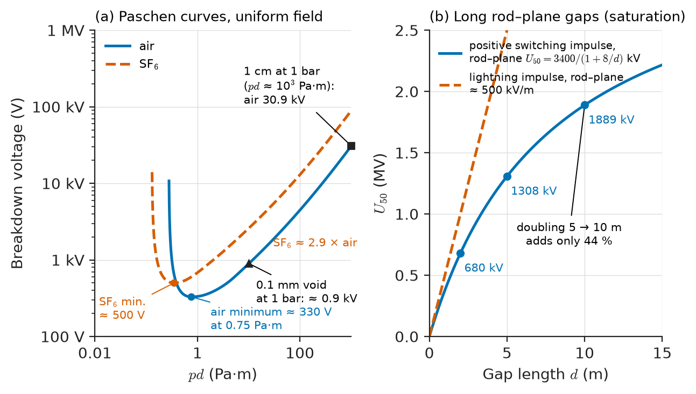
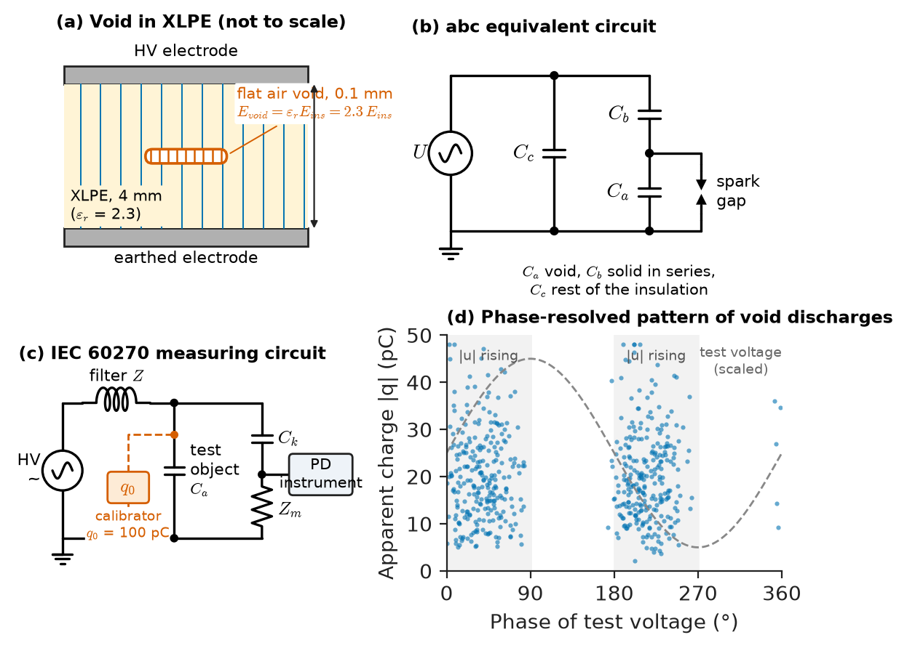
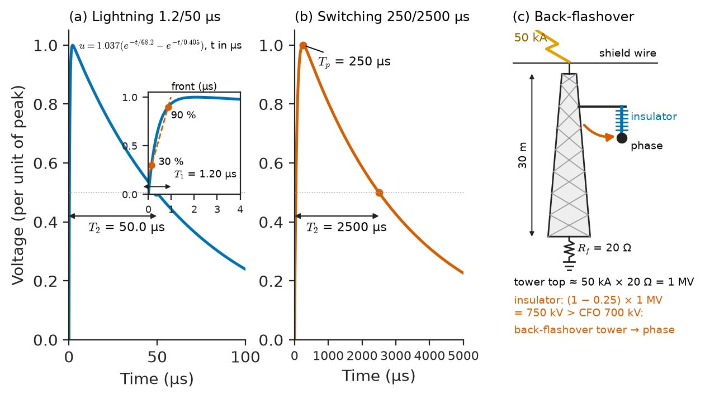
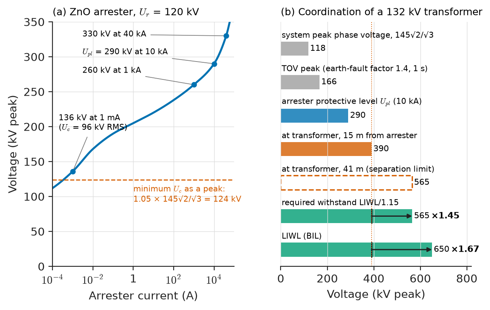
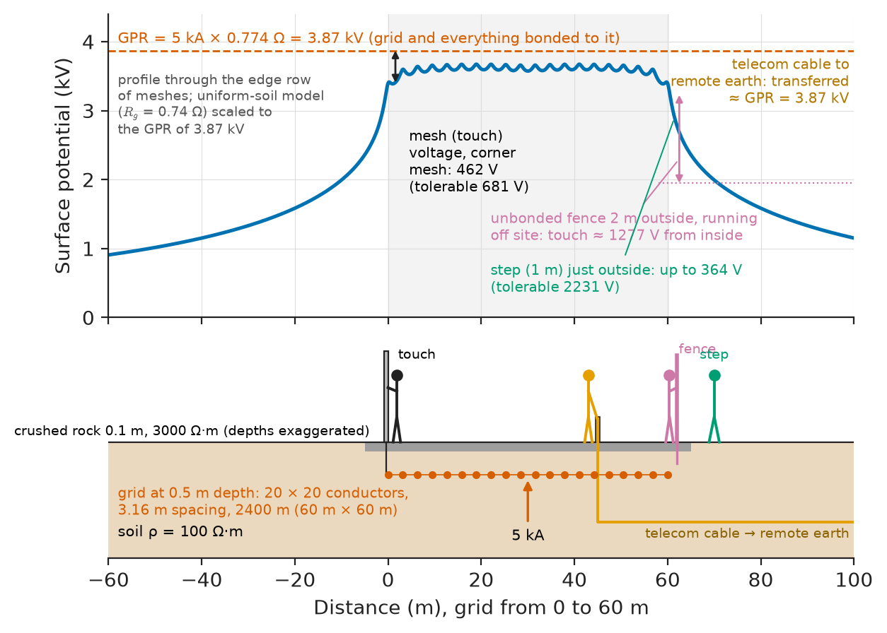
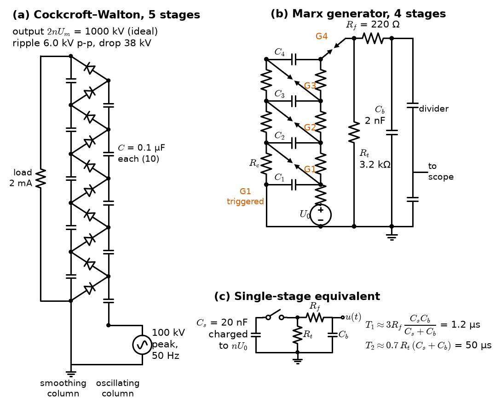

# Chapter 24 — High-Voltage Engineering

*Part VI · Transmission, Distribution, and Protection*

A 132 kV substation in a tropical region loses its main 90 MVA transformer in the first thunderstorm of the wet season. The post-mortem finds a flashover between turns near the line end of the HV winding. The transformer had passed its factory impulse test at 650 kV, and the surge arrester at the line entrance had operated correctly, limiting the incoming lightning surge to under 300 kV at the arrester. But the arrester stood 35 m away from the transformer bushing, on the far side of a disconnector, and over that distance the steep surge front reflected from the transformer's high impedance and built up a voltage well above the arrester's residual voltage. A few metres of busbar decided whether a USD 3 million transformer survived. Meanwhile, at a cable factory, a 132 kV XLPE cable fails its routine partial-discharge test because a single 0.1 mm void near the conductor screen discharges at a third of the test voltage; left in service, it would have grown an electrical tree and punctured within a few years. High-voltage engineering is the discipline that makes such decisions predictable: what electric stress each insulation can bear, what overvoltages the system will impose on it, how the two are matched with the help of arresters and earthing, and how the result is proved by test without endangering the people doing the testing.

> **Why does insulation fail, and how are the overvoltages from lightning and switching matched to the strength of every piece of equipment?**
> **How are high voltages generated, measured and applied in tests, and how is high-voltage work made safe?**

| Concept | Engineering destination |
|---|---|
| Dielectric breakdown | Clearances in air, SF₆ pressure in GIS, cable and bushing stress design |
| Partial discharge | Factory acceptance of cables, transformers and GIS; online condition monitoring |
| Lightning and switching surges | Shield wires, tower footing resistance, line arresters, breaker closing resistors |
| Insulation coordination | Selection of LIWL, SIWL and clearances for every voltage class |
| Surge arresters | Transformer protection, arrester ratings and placement |
| Grounding | Substation earth grids, touch and step voltages, tower footings |
| High-voltage generation and measurement | Test transformers, resonant sets, voltage multipliers, impulse generators, dividers |
| High-voltage testing | Type, routine, commissioning and diagnostic tests |
| Safety procedures | Test-area design, earthing and discharge, the five safety rules, approach distances |

**Roadmap.** How insulation fails (24.1) → the local discharges that precede failure in solid and liquid insulation (24.2) → the overvoltages that stress it (24.3) → matching stress to strength (24.4) → the arresters that cut the stress (24.5) → the earthing that carries surge and fault currents safely into the ground (24.6) → generating and measuring test voltages (24.7) → the tests themselves (24.8) → the procedures that keep people alive while doing all of this (24.9).

---

## 24.1 Dielectric breakdown

### Stress and strength

An insulation system fails when the local electric field somewhere exceeds what the material can bear for the duration and waveshape applied. High-voltage design is therefore two calculations: the **stress**, the field distribution set by geometry and permittivities, and the **strength**, an empirical property of the material that depends on gap length, pressure, temperature, waveshape, time under stress, area and volume stressed, and contamination. The field calculation itself is electrostatics, and the polarisation of a dielectric is described by its permittivity.

> **Boundary.** Electrostatics, the constitutive relation $\mathbf D=\varepsilon\mathbf E$ and the polarisation of matter are taken from *Engineering Physics*, [Ch. 11 §11.9–11.10](https://github.com/The-Studio-of-Sadiq/Engineering-Physics/blob/main/CHAPTERS/CHAPTER%2011.md). The microscopic structure of insulating materials belongs to the Materials Core. Neither describes breakdown: discharge physics and the engineering data below are the subject of this section.

The ratio of mean to maximum field, the **field utilisation factor** $\eta=E_{\text{mean}}/E_{\max}$, measures how well a geometry uses its insulation: $\eta=1$ for parallel plates, about 0.5–0.7 for well-designed GIS conductors, and below 0.1 for a sharp point against a plane. For a coaxial geometry (cable, GIS busbar) with inner radius $r$ and outer radius $R$,

$$
E(x)=\frac{U}{x\,\ln(R/r)},\qquad E_{\max}=\frac{U}{r\,\ln(R/r)}\quad\text{at }x=r,
$$

and for a fixed outer radius $E_{\max}$ is smallest when $R/r=e$. A 132 kV XLPE cable with $U_0=76$ kV phase-to-earth, conductor-screen radius 15 mm and insulation-screen radius 32 mm has $E_{\max}=76/(15\ln 2.133)=6.7$ kV/mm at the conductor screen and 3.1 kV/mm at the insulation screen: typical design stresses for HV extruded cables.

### Breakdown in gases

In a gas, free electrons accelerated by the field ionise neutral molecules, each new electron starting its own avalanche. Breakdown in a uniform field occurs when each avalanche regenerates at least one new starting electron through secondary processes (Townsend's criterion), and its voltage depends only on the product of pressure $p$ and gap $d$: **Paschen's law** (Figure 24.1). For air the curve has a minimum of about 330 V near $pd\approx0.75$ Pa·m; no gap in air, however small, breaks down below this. On the right-hand branch, where all power equipment operates, breakdown voltage rises nearly linearly with $pd$. For air at standard conditions (20 °C, 101.3 kPa) and uniform field an empirical fit is

$$
U_b\approx24.4\,\delta d+6.53\sqrt{\delta d}\ \ \mathrm{kV}\qquad(d\ \text{in cm}),
$$

where $\delta$ is the relative air density. It gives 30.9 kV for a 1 cm gap and 265 kV for a 10 cm gap: the familiar "3 kV/mm" of air, slowly falling with gap length.

> **Status of the principle: Paschen's law and the air breakdown formula**
> *Empirical.* Paschen's similarity law follows from Townsend's avalanche model with empirical ionisation coefficients; the formula above is a fit to uniform-field data for 0.1–10 cm gaps and does not apply to non-uniform fields, very small gaps (field emission), or long gaps where leader discharges dominate.

<!-- FIGURE 24.1 | figures/ch24/fig-24-1-paschen-curves.png | plot | Paschen curves for air and SF6, and breakdown voltage of long rod-plane air gaps under switching impulse. | Content: left panel log-log, x-axis pd from 1e-2 to 1e3 Pa m, y-axis breakdown voltage 100 V to 1 MV; air curve with minimum about 330 V at pd 0.75 Pa m, SF6 curve with minimum about 500 V and right branch about 2.9 times higher than air at large pd; marker at pd = 1e3 Pa m (1 cm at 1 bar) for air 30.9 kV. Right panel linear, x-axis gap 0 to 15 m, y-axis U50 0 to 2.5 MV: positive switching impulse rod-plane U50 = 3400/(1 + 8/d) kV (680 kV at 2 m, 1308 kV at 5 m, 1889 kV at 10 m) with dashed straight line of 500 kV/m showing lightning impulse rod-plane for comparison, showing saturation of the switching curve. -->

*Figure 24.1 — Paschen curves for air and SF6, and breakdown voltage of long rod-plane air gaps under switching impulse.*

**SF₆** is electronegative: its molecules capture free electrons and quench avalanches, giving a critical field of about 89 kV/cm per bar, roughly three times that of air. At 4–6 bar it lets gas-insulated switchgear (GIS) occupy 10–20 % of the volume of an air-insulated substation; its global warming potential of about 23 500 is driving replacement by fluoronitrile mixtures, pressurised dry air and vacuum interrupters.

### Long air gaps and the saturation problem

Gaps longer than about 1 m in non-uniform fields break down by a **streamer–leader** mechanism, a hot conducting channel growing in steps at a much lower average field. Positive switching impulses, with fronts of a few hundred microseconds, give the leader most time to develop and are the most dangerous. The empirical Gallet formula for rod-plane gaps,

$$
U_{50}\approx\frac{3400\,k_g}{1+8/d}\ \ \mathrm{kV}\qquad(d\ \text{in m}),
$$

with gap factor $k_g=1$ for rod-plane and 1.2–1.5 for conductor-to-tower geometries, gives 1.31 MV at 5 m and only 1.89 MV at 10 m. Doubling the gap adds only 45 % to the strength. This **saturation** is why switching surges, not lightning, dimension the towers of 500 kV and higher lines, and why limiting switching overvoltages (Section 24.3) is worth so much money at EHV and UHV.

**Atmospheric correction.** Air strength falls with density. External insulation for installations above 1000 m is corrected by the altitude factor of IEC 60071-2,

$$
K_a=e^{\,m\,H/8150},
$$

with $H$ in metres and $m=1$ for lightning impulse and power frequency (less for switching impulse on long gaps). At 2000 m (mining sites in the Andes, substations in Ethiopia or Tibet) $K_a=1.28$: external insulation must be designed for 28 % more withstand than at sea level.

### Liquids and solids

The strength of mineral oil and esters is limited by moisture, fibres and bubbles, which align in the field and bridge the gap: a standard IEC 60156 cell (2.5 mm) gives 30 kV for poor oil and over 70 kV for dried, filtered oil, while transformer ducts are designed for 5–10 kV/mm.

Solid insulation rarely reaches its **intrinsic** strength of hundreds of kV/mm. It fails thermally, when dielectric loss ($\omega CU^2\tan\delta$) heats it faster than it cools and $\tan\delta$ rises with temperature, or, far more often, by long-term **ageing**: partial discharges erode voids (Section 24.2), electrical trees grow from defects, and in wet cables **water trees** grow over years. The empirical inverse-power law

$$
t_{\text{life}}\propto E^{-n},\qquad n\approx9\text{–}15\ \text{for XLPE}
$$

means that a 10 % increase in stress shortens life by a factor of $1.1^{n}$, 2.4 to 4.2.

> **Status of the principle: Inverse-power life law**
> *Empirical.* Fitted to accelerated-ageing tests at elevated stress and extrapolated to service stress; the exponent depends on material, temperature and test method, and the extrapolation is the main source of uncertainty in cable and machine-insulation life prediction.

**Table 24.1 — Representative insulating materials (room temperature, 50 Hz, short-term strength in uniform field unless noted).**

| Material | Relative permittivity | $\tan\delta$ | Short-term strength | Typical design stress |
|---|---|---|---|---|
| Air, 1 bar | 1.0 | ~0 | 3 kV/mm (1 cm gap) | 0.3–0.5 kV/mm in non-uniform fields |
| SF₆, 5 bar abs. | 1.0 | ~0 | 40 kV/mm (approx.) | 10–20 kV/mm |
| Mineral oil (treated) | 2.2 | 0.001 | 20–30 kV/mm (2.5 mm cell) | 5–10 kV/mm in ducts |
| Oil-impregnated paper | 3.3–3.6 | 0.002–0.003 | 40–60 kV/mm | 10–15 kV/mm (cables) |
| XLPE | 2.3 | 0.0002–0.0005 | 50–100 kV/mm (thin samples) | 3–7 kV/mm MV/HV, up to 15 kV/mm EHV |
| Epoxy resin (filled) | 3.5–5 | 0.005–0.02 | 20–30 kV/mm | 2–5 kV/mm |
| Electrical porcelain | 5.5–6.5 | 0.02 | 15–25 kV/mm (puncture) | Set by surface flashover |
| Mica-epoxy (machine windings) | 4–5 | 0.005–0.02 | 30–50 kV/mm | 2–3 kV/mm |
| Vacuum (contacts, 1–10 mm) | 1.0 | 0 | 10–40 kV/mm | Set by conditioning |

### Surface flashover and pollution

Outdoor insulators rarely puncture; they flash over along a surface layer of salt or dust wetted by fog, at normal operating voltage. The design variable is **creepage distance**: IEC TS 60815 recommends unified specific creepage distances of roughly 22 to 53 mm per kV of phase-to-earth voltage from "very light" to "very heavy" pollution, so a coastal 132 kV string needs over 3.5 m. Hydrophobic silicone-rubber insulators and washing are the usual remedies.

---

## 24.2 Partial discharge

### What a partial discharge is

A **partial discharge** (PD) is a breakdown that bridges only part of the insulation between conductors: a spark in a gas-filled void inside a cable, in a delamination of a machine winding, along the surface of a bushing, or a corona glow from a sharp point in air. Each discharge transfers a small charge, from below 1 pC to thousands of pC, in nanoseconds. A single discharge does no harm; millions of them, at every half-cycle for years, erode polymers chemically and by bombardment, start electrical trees, and end in complete breakdown. PD is therefore both a cause of insulation failure and its earliest measurable symptom.

### The void model

A void in solid insulation sees an enhanced field. For a flat void normal to the field, continuity of $D$ gives $E_{\text{void}}=\varepsilon_r E_{\text{ins}}$, and the gas in the void has a lower strength than the solid. The void is modelled by the **abc** (three-capacitance) circuit of Figure 24.2: $C_a$ for the void, $C_b$ for the solid in series with it, and $C_c$ for the rest of the insulation in parallel. When the void voltage reaches its breakdown value it collapses, and the charge redistribution is seen at the terminals as an **apparent charge** $q\approx C_b\,\Delta U_a$, much smaller than the true charge in the void. Apparent charge is what IEC 60270 instruments measure, calibrated by injecting a known charge at the terminals.

<!-- FIGURE 24.2 | figures/ch24/fig-24-2-pd-void-model.png | circuit | Partial discharge in a void: cross-section, the abc equivalent circuit, and the IEC 60270 measuring circuit with a phase-resolved pattern. | Content: three panels. (a) Cross-section of 4 mm XLPE between electrodes with a flat 0.1 mm air void, field lines concentrated in the void. (b) abc circuit: Ca (void) with a parallel spark gap, in series with Cb, both in parallel with Cc, connected to source U. (c) Measuring circuit: HV source through filter impedance Z, test object Ca, coupling capacitor Ck in parallel, measuring impedance Zm in series with Ck feeding a PD instrument; calibrator symbol injecting q0 = 100 pC. Inset: phase-resolved PD pattern, x-axis phase 0 to 360 degrees, y-axis apparent charge 0 to 50 pC, clusters on the rising quadrants of the sinusoid (0 to 90 and 180 to 270 degrees), typical of void discharges. -->

*Figure 24.2 — Partial discharge in a void: cross-section, the abc equivalent circuit, and the IEC 60270 measuring circuit with a phase-resolved pattern.*

**Worked example — Inception field of a void in XLPE.** A flat air void 0.1 mm thick sits inside XLPE ($\varepsilon_r=2.3$) at atmospheric pressure. At what insulation stress does it start to discharge?

The void has $pd=101.3\ \mathrm{kPa}\times10^{-4}\ \mathrm m\approx10$ Pa·m (7.6 torr·cm), on the right-hand branch of the Paschen curve, where the Paschen expression with standard air coefficients gives a breakdown voltage of about 0.87 kV, or 8.7 kV/mm across the void. With $E_{\text{void}}=2.3\,E_{\text{ins}}$, discharges start when the field in the surrounding XLPE reaches $8.7/2.3=3.8$ kV/mm. The 132 kV cable of Section 24.1 runs at 6.7 kV/mm at its conductor screen: such a void there would discharge continuously, which is why HV insulation is extruded and degassed under clean-room conditions and every length is PD-tested. A 10 µm void ($pd\approx1$ Pa·m, near the Paschen minimum of about 330 V) needs about 33 kV/mm in the gas, or 14 kV/mm in the XLPE, before it discharges: the breakdown field of a gas rises steeply as the gap shrinks, which is how clean cable survives its design stress.

> **Status of the principle: abc model of a void**
> *Approximate.* A lumped-capacitance picture that relates true and apparent charge and explains the phase-resolved pattern; it ignores surface charge on the void walls, statistical time lags and changes in the gas over time, so apparent charge is a comparative quality measure, not a direct measure of damage.

### Measuring and judging PD

IEC 60270 defines the conventional measuring circuit: a coupling capacitor in parallel with the test object, a measuring impedance, a band-pass detector (typically 100–400 kHz), and calibration with a known charge before every test. Acceptance limits are set per product: MV extruded cables must show no discharge above 10 pC at $1.73U_0$ (IEC 60502-2); large power transformers are typically limited to 100–250 pC at about 1.5–1.6 times rated phase voltage during a long-duration induced test (IEC 60076-3); GIS and cable accessories to a few pC.

In service, PD is detected without an outage by **UHF** antennas in GIS and transformer tanks, **acoustic** sensors for locating sources, **transient earth voltage** probes on MV switchgear and **high-frequency CTs** on cable earth bonds. The **phase-resolved pattern** (Figure 24.2) identifies the defect: void discharges cluster on the rising quarter of each half-cycle, corona from a sharp point appears first near the negative peak. Online PD monitoring is now part of condition-based maintenance of generators, GIS and critical cables (Chapter 9).

---

## 24.3 Lightning and switching surges

### Classes of overvoltage

IEC 60071-1 classifies the voltage stresses on insulation by shape and duration:

**Table 24.2 — Classes of overvoltage and their standard test shapes (IEC 60071-1, IEC 60060-1).**

| Class | Typical origin | Duration and shape | Standard test shape |
|---|---|---|---|
| Continuous (power frequency) | Normal operation | Continuous, up to $U_m/\sqrt3$ | Power-frequency, long duration |
| Temporary (TOV) | Earth faults, load rejection, Ferranti effect, ferroresonance | 0.03 s to hours, 1.0–1.7 pu (higher with resonance) | Short-duration power-frequency, 1 min |
| Slow-front | Switching of lines, capacitors, faults and their clearing | Front 20–5000 µs, tail to 20 ms; 1.5–3.5 pu | Switching impulse 250/2500 µs |
| Fast-front | Lightning | Front 0.1–20 µs, tail to 300 µs; up to several MV | Lightning impulse 1.2/50 µs |
| Very-fast-front | Disconnector operation in GIS, vacuum-breaker restrikes | Front 3–100 ns, oscillations 0.3–100 MHz | No general standard shape |

### Lightning

A cloud-to-ground lightning flash typically consists of a downward stepped leader, an upward connecting leader from the struck object, and a **return stroke** that drains the charge, often followed by subsequent strokes down the same channel. Measured stroke currents are statistically distributed; the first negative return stroke has a median peak of about 31 kA, a median front of a few microseconds, and 5 % of strokes exceed about 96 kA. An empirical fit commonly used in line design (IEEE Std 1243 and 1410) is

$$
P(I_p>i)=\frac{1}{1+(i/31\ \mathrm{kA})^{2.6}}.
$$

The rate of flashes to ground per km² per year, the **ground flash density** $N_g$, is measured by lightning location networks: below 0.1 in polar and some desert regions, 1–4 over much of Europe and North America, and 10–50 in parts of central Africa, Southeast Asia, Florida and northern South America. The number of flashes intercepted by a line of height $h$ (m) is estimated by Eriksson's model as $N_L=N_g(28h^{0.6}+b)/10$ per 100 km per year, $b$ being the separation of the outer conductors.

> **Status of the principle: Lightning statistics**
> *Empirical.* The stroke-current distribution and the attractive-radius models are fits to measurements on instrumented towers and lightning location data; they vary with latitude, terrain and stroke polarity and carry factor-of-two uncertainties in tails that dominate design.

### Surges as travelling waves

A lightning surge on a line is a travelling wave: it propagates at close to the speed of light (300 m/µs on overhead lines, 150–200 m/µs in cables), with voltage and current related by the line's **surge impedance** $Z_0$, about 300–450 Ω for overhead conductors and 20–60 Ω for cables. At every junction it reflects and refracts with the coefficients $\Gamma=(Z_2-Z_1)/(Z_2+Z_1)$ and $\tau=2Z_2/(Z_1+Z_2)$. An open end or a transformer (whose surge impedance is thousands of ohms) nearly doubles the voltage; a surge passing from a 400 Ω line into a 40 Ω cable is transmitted at only $2\times40/440=0.18$ of its amplitude, which is why a short cable entry can shield a substation.

> **Boundary.** Wave propagation, surge impedance, reflection coefficients and lattice diagrams are developed in *Circuits, Signals and Communications*, [Ch. 14 §14.3 and §14.5](https://github.com/The-Studio-of-Sadiq/Circuits-Signals-and-Communications/blob/main/part-3-advanced-network-theory/14-transmission-lines.md), from the field picture in *Engineering Physics*, [Ch. 12 §12.7.3](https://github.com/The-Studio-of-Sadiq/Engineering-Physics/blob/main/CHAPTERS/CHAPTER%2012.md). Steady-state line models are in Chapter 21. Here they are used, not rederived.

A stroke of current $I$ that terminates on a phase conductor divides into two waves of $I/2$ travelling in each direction, each producing a voltage $U=Z_0I/2$. **Shield wires** (overhead earth wires) above the phase conductors intercept strokes and carry them to earth through the towers. A stroke to a tower or shield wire raises the tower-top potential by roughly the stroke current times the tower footing resistance (plus an inductive term for tall towers); if the difference between tower and phase conductor exceeds the insulator strength, the insulator flashes over from the tower to the phase, a **back-flashover**. Footing resistance is therefore the main design variable for shielded lines.

**Worked example — Lightning performance of a 132 kV line.** A 132 kV line on 30 m towers ($b=10$ m) crosses a region with $N_g=4$ flashes/km²/yr. Its insulator strings have a critical flashover voltage (CFO) of 700 kV and its conductors $Z_0=400$ Ω.

*Unshielded.* A stroke to a phase conductor produces $U=400I/2=200I$; flashover occurs for $I>2\times700/400=3.5$ kA. With $P(I_p>3.5\ \mathrm{kA})=1/(1+(3.5/31)^{2.6})=0.997$, practically every stroke to a phase causes an outage. The line intercepts $N_L=4\times(28\times30^{0.6}+10)/10=90$ flashes per 100 km per year, so an unshielded line would trip about 90 times per 100 km per year: unacceptable.

*Shielded.* With a shield wire the main risk is back-flashover. Crudely, the insulator sees $(1-c)IR_f$, where $c\approx0.25$ is the coupling factor between shield wire and phase. With footing resistance $R_f=20$ Ω flashover needs $I>700/(0.75\times20)=46.7$ kA, exceeded by 25.7 % of strokes; with $R_f=10$ Ω, $I>93.3$ kA, exceeded by 5.4 %. Taking about 60 % of the intercepted strokes as terminating near enough to a tower, the back-flashover rate is about $0.6\times90\times0.257=13.9$ per 100 km per year at 20 Ω and 2.9 at 10 Ω. This model ignores the tower surge impedance and reflections from adjacent towers, which reduce the voltage, so it overestimates; detailed simulation gives lower numbers but the same lesson. Halving footing resistance with counterpoise wires or deep rods cuts outages roughly fivefold, and where soil resistivity makes 10 Ω impossible (rocky mountain routes), line surge arresters across the insulators of every tower or every few towers are fitted instead. Typical utility targets are 0.5–2 outages per 100 km per year.

<!-- FIGURE 24.3 | figures/ch24/fig-24-3-impulse-waveshapes.png | plot | Standard lightning and switching impulse waveshapes, and the tower-top voltage of a back-flashover. | Content: left panel, x-axis time 0 to 100 microseconds, y-axis per unit 0 to 1.05: lightning impulse 1.2/50 microseconds double exponential (u = 1.037(exp(-t/68.2) - exp(-t/0.405)) in microseconds), with the virtual front T1 = 1.2 microseconds marked by 30 and 90 percent points and the time to half value T2 = 50 microseconds. Right panel, x-axis 0 to 5000 microseconds: switching impulse 250/2500 microseconds with time to peak 250 microseconds and time to half 2500 microseconds. Inset sketch: 30 m tower with shield wire struck by 50 kA stroke, footing resistance 20 ohm, tower-top voltage 1 MV, insulator voltage 750 kV against CFO 700 kV, arrow showing back-flashover from tower to phase. -->

*Figure 24.3 — Standard lightning and switching impulse waveshapes, and the tower-top voltage of a back-flashover.*

Figure 24.3 shows the standard impulse shapes used to represent these stresses in tests.

### Switching surges and temporary overvoltages

Energising a line launches a voltage step that doubles at the open far end, giving about 2 per unit; **high-speed reclosing** onto trapped charge can give 3–3.5 per unit. At 300 kV and above, where switching surges set tower clearances (Section 24.1), they are cut to 1.5–2 per unit by **pre-insertion resistors** (a few hundred ohms for 8–12 ms before the main contacts close), **controlled (point-on-wave) switching** and line-end arresters. Capacitor-bank energisation, restrikes, current chopping by vacuum breakers (hence RC snubbers on motors) and disconnector transients in GIS are other sources.

Temporary overvoltages are long enough to stress arresters thermally rather than insulation dielectrically. A single-line-to-earth fault raises the healthy-phase voltages by the **earth-fault factor**: at most 1.4 on effectively earthed systems ($X_0/X_1\le3$, $R_0/X_1\le1$) and up to 1.73 or more on isolated and resonant-earthed systems (Chapter 23). Load rejection at a long line end and ferroresonance between a transformer's magnetising inductance and cable capacitance (a classic risk when a single fuse of an unloaded cable-fed transformer blows) can cause larger TOVs.

---

## 24.4 Insulation coordination

### The principle

**Insulation coordination** is the selection of the dielectric strength of equipment in relation to the voltages that can appear on the system, taking into account the protective devices and the environment, so that the probability of insulation failure is economically and operationally acceptable (IEC 60071-1). It is a matching problem: the stress distribution (overvoltages, after arresters have limited them) on one side, the strength distribution (withstand of insulation) on the other, and the overlap between them gives the risk of failure.

### Standard insulation levels

Equipment is tested and specified by standard withstand voltages, chosen from tables by the highest system voltage $U_m$. In Range I ($U_m\le245$ kV) these are the short-duration power-frequency withstand and the **lightning impulse withstand level** (LIWL, also called the basic insulation level, BIL); in Range II ($U_m>245$ kV) they are the **switching impulse withstand level** (SIWL) and the LIWL. Table 24.3 lists common choices.

**Table 24.3 — Typical standard insulation levels (IEC 60071-1; one of several standardised combinations per voltage).**

| $U_m$ (kV RMS) | Typical system | Power-frequency withstand, 1 min (kV RMS) | SIWL (kV peak) | LIWL (kV peak) |
|---|---|---|---|---|
| 12 | 10–11 kV | 28 | — | 75 |
| 24 | 20–22 kV | 50 | — | 125 |
| 36 | 33 kV | 70 | — | 170 |
| 72.5 | 66 kV | 140 | — | 325 |
| 145 | 132 kV | 275 | — | 650 |
| 245 | 220 kV | 460 | — | 1050 |
| 420 | 400 kV | — | 1050 | 1425 |
| 550 | 500 kV | — | 1175 | 1550 |
| 800 | 765 kV | — | 1425 | 2100 |

### The procedure

IEC 60071-2 proceeds in four steps:

1. Determine the **representative overvoltages** $U_{rp}$ of each class at each location, from system studies and arrester protective levels.
2. Apply a **coordination factor** $K_c$ to obtain the coordination withstand voltage $U_{cw}=K_cU_{rp}$. In the deterministic method $K_c$ covers modelling uncertainty (1.0–1.1 for lightning with arresters, larger to account for the distance effect); in the statistical method $K_c$ follows from a chosen risk of failure, typically $10^{-3}$ to $10^{-4}$ per switching operation.
3. Multiply by a **safety factor** $K_s$ (1.15 for internal insulation, which cannot be tested to destruction and ages; 1.05 for external, self-restoring insulation) and, for external insulation, by the altitude factor $K_a$, to obtain the **required withstand voltage** $U_{rw}$.
4. Select the next standard level at or above $U_{rw}$.

> **Status of the principle: Insulation coordination procedure**
> *Approximate.* A structured margin calculation; the statistical method assumes Gaussian-like distributions of overvoltage and withstand whose tails are poorly known, and the deterministic factors are conventions. It gives an acceptable risk, not zero risk.

Self-restoring insulation (air) recovers after a flashover, and its strength is described statistically by a 50 % flashover voltage $U_{50}$ and a standard deviation (about 3 % for lightning and 6 % for switching impulses), with withstand defined at 10 % flashover probability. Non-self-restoring insulation (oil-paper, XLPE, windings) is permanently damaged by breakdown, so its withstand is proved only by tests without breakdown.

The ratio between the withstand level and the protective level of the arrester is the **protective ratio**. IEEE C62.22 recommends margins of at least 20 % for lightning (LIWL at least 1.2 times the voltage at the protected equipment) and 15 % for switching; practice for important transformers often uses 1.4 or more, which leaves room for the separation effect of Section 24.5 and for ageing. Figure 24.4 sets the levels side by side for a 132 kV system.

---

## 24.5 Surge arresters

### Metal-oxide arresters

A **surge arrester** is a non-linear resistor from phase to earth that conducts negligible current at operating voltage and diverts surge current with a limited **residual voltage**. Modern arresters are **gapless metal-oxide (ZnO) varistors** whose current varies roughly as $U^{\alpha}$ with $\alpha$ of 30–50: about 1 mA (mostly capacitive) at continuous voltage, and at 10 kA a peak voltage of about 2.3–2.6 times the rated voltage, rising only 15–30 % for a further tenfold current.

### Ratings and selection

IEC 60099-4 and IEEE C62.11 specify:

- **Continuous operating voltage** $U_c$ (IEEE: MCOV): the RMS voltage the arrester can carry indefinitely. It must exceed the highest phase-to-earth operating voltage, $U_m/\sqrt3$, with a margin of a few per cent for harmonics.
- **Rated voltage** $U_r$: the RMS voltage it can withstand for 10 s after a surge; it sets TOV capability. Typically $U_c\approx0.8U_r$.
- **Nominal discharge current** (5, 10 or 20 kA, 8/20 µs) and **residual voltages** (lightning protective level $U_{pl}$ at nominal current; switching protective level $U_{ps}$ at 0.5–2 kA, 30/60 µs).
- **Energy or charge rating**: thermal energy rating $W_{th}$ in kJ/kV of $U_r$, or charge transfer rating, determining which line-discharge and capacitor-switching duties it survives.
- **TOV capability**: a curve of allowed power-frequency overvoltage versus time (for example 1.15–1.2 $U_r$ for 1 s).

A higher $U_r$ survives TOVs better but protects worse; a lower $U_r$ risks thermal runaway during a long earth fault.

### The separation effect

An arrester limits voltage at its own terminals. Equipment some distance away sees more, because a surge with steepness $S$ (kV/µs) travels to the equipment and reflects back from its high impedance before the arrester's limiting action reaches it. For a line of length $L$ between arrester and an open-circuit-like transformer, the peak at the transformer is approximately

$$
U_t\approx U_{pl}+\frac{2\,S\,L}{v},
$$

where $v\approx300$ m/µs. The arrester's own leads to earth add $L\,\mathrm di/\mathrm dt$ in the same way (about 1 µH/m, so a 10 kA/µs surge adds 10 kV per metre of lead), which is why arrester earth leads are short and straight.

> **Status of the principle: Separation-distance formula**
> *Approximate.* Assumes a linearly rising surge, lossless lines, a purely capacitive or open-circuit termination and an ideal arrester; it is conservative for short distances and loses accuracy when the travel time is comparable with the surge front, when transformer capacitance resonates with lead inductance, or when corona attenuates the incoming surge. Detailed studies use electromagnetic transient (EMT) simulation.

**Worked example — Protecting a 132 kV transformer.** A 132 kV system ($U_m=145$ kV) is effectively earthed with an earth-fault factor of 1.4 and fault clearance within 1 s. The transformer has LIWL 650 kV. Select an arrester and find the maximum separation distance for an incoming surge of steepness 1000 kV/µs.

*Rating.* $U_c\ge1.05\times145/\sqrt3=87.9$ kV. TOV during earth faults: $1.4\times145/\sqrt3=117$ kV for up to 1 s. A station-class arrester with $U_r=120$ kV has $U_c\approx96$ kV and a 1 s TOV capability of about $1.15\times120=138$ kV, both adequate. Its lightning protective level at 10 kA is about $2.42U_r=290$ kV.

*Margin.* The required withstand for internal insulation is the LIWL divided by $K_s=1.15$: $650/1.15=565$ kV. With the arrester 15 m from the transformer, $U_t\approx290+2\times1000\times15/300=390$ kV, a protective ratio of $565/390=1.45$, or $650/390=1.67$ against the LIWL. The largest separation that still meets 565 kV is $L_{\max}=(565-290)\times300/(2\times1000)=41$ m. In the opening story the arrester stood 35 m away: on paper inside the limit, but with a lead length of 8 m and a steeper surge from a close stroke (2000 kV/µs halves $L_{\max}$ to 21 m), the margin vanished. The lesson is the one every substation designer learns: mount transformer arresters on the tank or within a few metres of the bushings.

<!-- FIGURE 24.4 | figures/ch24/fig-24-4-arrester-coordination.png | plot | Metal-oxide arrester V-I characteristic and the insulation coordination of a 132 kV transformer. | Content: left panel, x-axis current 1e-4 to 1e5 A (log), y-axis voltage 0 to 350 kV peak: ZnO characteristic for Ur = 120 kV, about 136 kV peak (Uc 96 kV RMS) at 1 mA, 260 kV at 1 kA, 290 kV at 10 kA, 330 kV at 40 kA; dashed horizontal at peak continuous operating voltage 124 kV. Right panel, bar chart of voltage levels in kV peak: system peak phase voltage 118, TOV peak 166, arrester Upl 290, voltage at transformer with 15 m separation 390, required withstand 565 (LIWL/1.15), LIWL 650; arrows showing protective margins 1.45 and 1.67, and a dashed bar at 41 m separation limit. -->

*Figure 24.4 — Metal-oxide arrester V-I characteristic and the insulation coordination of a 132 kV transformer.*

### Where arresters are used

Besides transformers, arresters protect substation line entrances, cable terminations, rotating machines (together with surge capacitors that slow the front), PV and wind plants on both AC and DC sides (surge protective devices to IEC 61643), railway catenaries and data-centre LV intakes. **Line arresters** across insulators reduce back-flashover where footing resistance is high (Section 24.3).

---

## 24.6 Grounding

### Why earthing matters

A grounding (earthing) system carries fault and surge currents into the earth so that protection operates (Chapter 23), arresters work, and the voltages on metalwork and on the ground surface during a fault are too low to injure people. The last requirement usually binds in substations; it is a problem of current spreading in a resistive medium, the soil.

### Soil resistivity and electrode resistance

Soil resistivity spans five orders of magnitude.

**Table 24.4 — Typical soil resistivities (vary strongly with moisture, temperature and salt content).**

| Soil | Resistivity (Ω·m) |
|---|---|
| Seawater | 0.2–0.3 |
| Wet organic soil, marsh | 10–50 |
| Clay, moist loam | 20–100 |
| Sand and gravel, moist | 100–1000 |
| Dry sand, gravel | 1000–10 000 |
| Granite, weathered rock | 1000–10 000 and above |
| Crushed rock surface layer (dry) | 3000–10 000 |

Resistivity is measured with the **Wenner** four-electrode method: four equally spaced probes at spacing $a$, current through the outer pair and voltage across the inner pair, giving the apparent resistivity $\rho=2\pi aR$. Repeating at several spacings reveals layered soil, which is common and important: a dry top layer over wet clay, or soil over rock.

A single vertical rod of length $L$ and diameter $d$ in uniform soil has resistance (Dwight's formula)

$$
R=\frac{\rho}{2\pi L}\left[\ln\frac{8L}{d}-1\right].
$$

A 3 m rod of 16 mm diameter in 100 Ω·m soil has $R=33.5$ Ω. Rods in parallel help only if spaced by more than about their length, because their potential fields overlap. Substations therefore use a buried **grid** of bare copper (or copper-clad steel) conductors at 0.5–1 m depth, meshed at 3–10 m spacing, supplemented by rods. Its resistance is estimated by Sverak's formula (IEEE 80):

$$
R_g=\rho\left[\frac{1}{L_T}+\frac{1}{\sqrt{20A}}\left(1+\frac{1}{1+h\sqrt{20/A}}\right)\right],
$$

with $L_T$ the total buried conductor length, $A$ the grid area and $h$ the depth. A 60 m × 60 m grid with 2400 m of conductor at 0.5 m depth in 100 Ω·m soil has $R_g=0.77$ Ω. The grid resistance is dominated by its area, roughly $\rho/(4\sqrt{A/\pi})$, and adding conductor beyond a point mainly improves the voltage distribution inside the grid rather than its resistance.

> **Status of the principle: Electrode resistance formulas**
> *Approximate.* Derived from current spreading in a uniform, isotropic half-space with idealised electrode shapes; real soils are layered and seasonal, so formulas give first estimates and two-layer or multilayer computer models fitted to Wenner data are used for final design.

### Ground potential rise, touch and step voltage

When an earth-fault current $I_G$ flows into the grid, the whole grid rises to the **ground potential rise** $\mathrm{GPR}=I_GR_g$ relative to remote earth, while the soil surface potential falls away from the grid conductors. A person touching earthed metal while standing on the surface between conductors bridges a **touch voltage**; a person walking bridges a **step voltage** between their feet; a person touching a fence or a telecom cable connected to remote earth may be exposed to a **transferred potential** close to the full GPR (Figure 24.5).

IEEE 80 sets the tolerable voltages from the empirical body-current limit $I_B=0.116/\sqrt{t_s}$ A for a 50 kg person (Dalziel), a body resistance of 1000 Ω, and the foot resistance contributed by the surface layer:

$$
E_{\text{touch}}=(1000+1.5\,C_s\,\rho_s)\frac{0.116}{\sqrt{t_s}},\qquad
E_{\text{step}}=(1000+6\,C_s\,\rho_s)\frac{0.116}{\sqrt{t_s}},
$$

where $\rho_s$ is the surface-layer resistivity, $C_s$ a derating factor for a thin layer and $t_s$ the fault duration. The European approach (EN 50522, IEC 60479-1) uses a curve of permissible touch voltage versus duration that leads to similar values.

> **Status of the principle: Tolerable touch and step voltage**
> *Empirical.* Built on Dalziel's fibrillation threshold fitted to animal experiments and on body-resistance statistics; IEC 60479-1 gives a different, current-path-dependent model, and the two methods can differ by a factor of two at some durations.

**Worked example — Is the substation safe to touch?** The grid above carries $I_G=5$ kA (the part of a 132 kV earth-fault current that returns through earth rather than through shield wires and cable sheaths) for $t_s=0.5$ s. Soil resistivity is 100 Ω·m; the surface is covered by a 0.1 m layer of crushed rock with $\rho_s=3000$ Ω·m.

$\mathrm{GPR}=5000\times0.774=3.87$ kV. Surface-layer factor: $C_s=1-0.09(1-100/3000)/(2\times0.1+0.09)=0.700$.

Tolerable touch voltage: $(1000+1.5\times0.700\times3000)\times0.116/\sqrt{0.5}=681$ V.
Tolerable step voltage: $(1000+6\times0.700\times3000)\times0.116/\sqrt{0.5}=2231$ V.
Without the crushed-rock layer ($\rho_s=100$ Ω·m, $C_s=1$), tolerable touch voltage falls to 189 V.

The GPR is nearly six times the tolerable touch voltage, so safety depends on how evenly the grid holds the surface potential. The worst touch voltage is the **mesh voltage**, at the centre of a corner mesh. For this grid (20 × 20 conductors of 10 mm diameter at 3.16 m spacing) IEEE 80's mesh-voltage formula gives about 440 V and a numerical uniform-soil model about 460 V (Figure 24.5), 11–12 % of GPR: below the 681 V limit with the crushed rock, but far above the 189 V limit without it. The crushed-rock layer, which raises the tolerable touch voltage 3.6-fold, is what makes this grid safe. Mesh voltages of 10–25 % of GPR are typical: a coarser 6 m mesh using only 1320 m of conductor would reach about 17–19 % (680–730 V), at or above the limit, so every design is checked and, where needed, refined with closer conductor spacing at the corners and periphery and rods around the perimeter. The perimeter fence is bonded to the grid with a conductor buried 1 m outside it, and communication circuits leaving the site are isolated against the transferred GPR. The full IEEE 80 design procedure is part of Chapter 30.

<!-- FIGURE 24.5 | figures/ch24/fig-24-5-gpr-touch-step.png | cross-section | Ground potential rise of a substation grid during an earth fault, with touch, step, mesh and transferred voltages. | Content: cross-section through soil (100 ohm m) with the 60 m x 60 m grid of the worked example at 0.5 m depth (20 x 20 conductors at 3.16 m spacing, 2400 m) and a 0.1 m crushed-rock layer (3000 ohm m). Above, a plot of surface potential versus distance from -60 m to +100 m along a cut through the edge row of meshes, computed by a numerical (method-of-moments) uniform-soil model of the grid and scaled to the worked example's GPR of 3.87 kV: about 3.4 to 3.65 kV over the grid with small dips between conductors, falling outside the grid toward zero at remote earth. Annotated figures: person touching an earthed structure at the corner mesh (mesh touch voltage about 460 V against 681 V tolerable, consistent with the IEEE 80 estimate of about 440 V), person walking just outside the perimeter (1 m step voltage about 360 V against 2231 V tolerable), person 2 m outside the grid touching an unbonded fence that runs off site (touch about 1.3 kV, above the limit), and a telecom cable to remote earth (transferred potential near the full 3.87 kV GPR). Fault current 5 kA injected into grid. -->

*Figure 24.5 — Ground potential rise of a substation grid during an earth fault, with touch, step, mesh and transferred voltages.*

### Earthing of lines, LV systems and special installations

Transmission towers are earthed with rods or counterpoise wires to reach the 10–20 Ω footing resistance needed for lightning performance (Section 24.3). LV earthing follows the TN/TT/IT arrangements of Chapters 29 and 30. Wind farms interconnect all turbine foundations, PV plants bond structures over square kilometres, and building lightning protection (IEC 62305) shares the same electrode.

---

## 24.7 High-voltage generation and measurement

### Alternating voltages

Power-frequency test voltages up to about 600–800 kV are generated by single-unit **test transformers** with a low-loss, low-PD design and an excitation winding fed from a regulating transformer. Higher voltages use **cascaded** transformers, each stage's tertiary winding exciting the next, to 2–3 MV. Testing large capacitive objects (cables, GIS, generator stators) with a test transformer would require a source rated at the full reactive power of the object. **Series resonant** test sets avoid this: a variable reactor in series with the capacitive test object is tuned to resonance, either by varying the inductance at fixed frequency or, more commonly for cables, by using a fixed reactor and varying the frequency between 20 and 300 Hz. The source then supplies only the losses, about $1/Q$ of the reactive power, with quality factors $Q$ of 40–200.

**Worked example — Resonant test of a 132 kV cable.** A 5 km, 132 kV XLPE cable has capacitance 0.2 µF/km per phase, 1.0 µF in total. It is to be tested at $2U_0=152$ kV with a 20 H reactor and a variable-frequency source. Find the test frequency, the reactive power, the current and the supply power for $Q=80$.

$f=1/(2\pi\sqrt{LC})=1/(2\pi\sqrt{20\times1.0\times10^{-6}})=35.6$ Hz, inside the 20–300 Hz band allowed by IEC 60840 for after-installation tests. Current $I=2\pi fCU=2\pi\times35.6\times10^{-6}\times152\,000=34.0$ A. Reactive power $2\pi fCU^2=5.17$ Mvar. Supply power $5.17/80\approx65$ kW, which a trailer-mounted set can provide; a 50 Hz test transformer would need to be rated for 7.3 Mvar at 152 kV.

### Direct voltages

High direct voltages for testing HVDC cables, insulation-resistance measurements and research are generated by rectifier circuits, usually the **Cockcroft–Walton** voltage multiplier: a ladder of $n$ stages of capacitors and diodes fed from a transformer of peak voltage $U_m$, giving an ideal no-load output of $2nU_m$. Under a load current $I$ at supply frequency $f$ with stage capacitance $C$, the output ripple and the voltage drop are

$$
2\delta U=\frac{I}{fC}\,\frac{n(n+1)}{2},\qquad
\Delta U=\frac{I}{fC}\left(\frac{2n^3}{3}+\frac{n^2}{2}-\frac{n}{6}\right).
$$

> **Status of the principle: Cockcroft–Walton ripple and regulation**
> *Derived.* Follows from charge balance on the stage capacitors with ideal diodes and equal capacitances, and assumes the ripple is small compared with the stage voltage; it explains why stage count, not voltage per stage, limits practical multipliers.

**Worked example — A 1 MV DC test set.** A five-stage multiplier with $C=0.1$ µF per stage is fed at 50 Hz from a transformer of 100 kV peak, and loaded with 2 mA. The ideal output is $2\times5\times100=1000$ kV. With $I/(fC)=0.002/(50\times10^{-7})=400$ V, the ripple is $400\times15=6.0$ kV peak-to-peak and the drop is $400\times(83.3+12.5-0.83)=38$ kV, so the output is 962 kV with 0.6 % ripple. Feeding the multiplier at 500 Hz from a frequency converter cuts both tenfold, to 0.6 kV and 3.8 kV, which is why modern DC test sets use medium-frequency supplies. Because $\Delta U$ grows as $n^3$, doubling the number of stages at the same current increases the drop roughly eightfold.

### Impulse voltages

Lightning and switching impulses are produced by the **Marx generator** (Figure 24.6): $n$ capacitors charged in parallel to a DC voltage $U_0$ through high resistors, then switched into series by triggered spark gaps to give nearly $nU_0$. The waveshape is set by a **front resistor** $R_f$ in series with the load capacitance $C_b$ (test object plus divider) and a **tail resistor** $R_t$ discharging the generator capacitance $C_s$. Approximately,

$$
T_1\approx3R_f\frac{C_sC_b}{C_s+C_b},\qquad T_2\approx0.7\,R_t\,(C_s+C_b),
$$

so for $C_s=20$ nF (erected) and $C_b=2$ nF, a 1.2/50 µs impulse needs $R_f\approx220$ Ω and $R_t\approx3.2$ kΩ, and the voltage efficiency is about $C_s/(C_s+C_b)\approx0.9$. Large laboratories have Marx generators of 3–6 MV and 200–500 kJ; switching impulses use larger front and tail resistors, or the test transformer itself driven by a capacitor discharge.

<!-- FIGURE 24.6 | figures/ch24/fig-24-6-cw-and-marx.png | circuit | A five-stage Cockcroft-Walton multiplier and a Marx impulse generator with its single-stage equivalent circuit. | Content: (a) Cockcroft-Walton: AC transformer 100 kV peak, 50 Hz; ladder of 5 stages, each with two 0.1 microfarad capacitors (oscillating column on left, smoothing column on right) and two diodes; output 1000 kV ideal, load 2 mA; labels ripple 6.0 kV and drop 38 kV. (b) Marx generator: DC charging source U0, charging resistors Rc, 4 stage capacitors in a column with spark gaps G1 to G4 (G1 triggered), front resistor Rf = 220 ohm, tail resistor Rt = 3.2 kilo-ohm, load Cb = 2 nF and capacitive divider to oscilloscope. (c) Equivalent circuit: Cs = 20 nF charged to nU0, switch, Rf, Rt across Cs, Cb at output, with formulas T1 = 3 Rf Cs Cb/(Cs + Cb) = 1.2 microseconds and T2 = 0.7 Rt (Cs + Cb) = 50 microseconds. -->

*Figure 24.6 — A five-stage Cockcroft-Walton multiplier and a Marx impulse generator with its single-stage equivalent circuit.*

### Measuring high voltages

IEC 60060-2 requires approved measuring systems with an expanded uncertainty of 3 % or better for peak values. AC is measured with **capacitive dividers** (compressed-gas capacitors as the HV arm) and DC with **resistive dividers**. Impulses need **damped capacitive** or **mixed RC dividers** with response times of tens of nanoseconds, calibrated together with their leads and digital recorder (IEC 61083-1). **Sphere gaps** (IEC 60052), which break down at a known peak voltage for a given diameter and spacing, serve as an independent check to about 3 %.

---

## 24.8 High-voltage testing

### Kinds of tests

High-voltage tests are grouped by purpose. **Type tests** on one unit prove a design (full impulse withstand, temperature rise, short-circuit withstand). **Routine tests** on every unit find manufacturing defects (power-frequency withstand, PD, capacitance and $\tan\delta$). **Commissioning tests** prove that transport and installation did no damage. **Diagnostic tests** in service track ageing ($\tan\delta$ and PD trends, polarisation index, dissolved gas analysis of transformer oil). Techniques are standardised in IEC 60060-1 and IEEE Std 4; levels come from IEC 60071-1 and the product standards.

**Table 24.5 — Representative high-voltage tests.**

| Test | Typical object | Waveshape and duration | Acceptance |
|---|---|---|---|
| Power-frequency withstand | All equipment | 50/60 Hz, 1 min at the short-duration withstand level | No breakdown or flashover |
| Lightning impulse withstand | Transformers, switchgear, bushings | 1.2/50 µs, 3 or 15 shots per polarity; chopped waves for transformers | No breakdown; waveform comparison with reduced-level reference shots |
| Switching impulse withstand | Equipment with $U_m>245$ kV | 250/2500 µs, 15 shots | ≤ 2 flashovers in 15 on self-restoring insulation |
| Partial discharge | Cables, transformers, GIS, instrument transformers | AC at 1.1–1.8 times phase voltage | Product limits, e.g. ≤ 10 pC at $1.73U_0$ for MV cables |
| Capacitance and $\tan\delta$ | Bushings, CTs, cables, machines | AC at 2–12 kV or rated phase voltage | Absolute value and trend; e.g. $\tan\delta$ rising with voltage indicates PD or moisture |
| Insulation resistance and polarisation index | Machines, transformers, cables | DC 0.5–10 kV, 1 and 10 min | PI ≥ 2 for class F/H machine windings (IEEE 43) |
| AC after-installation test | HV and EHV cables | 20–300 Hz, about 1.4–2 $U_0$ for up to 1 h | No breakdown, optionally with PD |
| VLF test | MV cables | 0.1 Hz cosine-rectangular or sine, about 3 $U_0$ (IEEE 400.2), 15–60 min | No breakdown; $\tan\delta$ criteria |

### Testing transformers and cables

A power transformer's **induced voltage test** runs at 100–200 Hz, so that the core is not overfluxed at about twice rated voltage, with PD measured throughout. In its **lightning impulse test**, winding faults are found by comparing the neutral-current waveforms of reduced-level (50–75 %) and full-level shots: a change of shape means an internal turn or section breakdown.

Extruded (XLPE) cables should not be tested with DC, which leaves space charge that can cause failure when AC is reapplied. On-site tests use resonant AC (Section 24.7) or VLF at 0.1 Hz, which needs 500 times less reactive power than 50 Hz at the cost of a less representative stress.

Test voltages on external insulation are corrected to standard atmosphere (20 °C, 101.3 kPa, 11 g/m³) by IEC 60060-1 factors; wet and pollution tests qualify outdoor insulators.

---

## 24.9 Safety procedures

### Why high-voltage work is different

High voltage kills without contact: air breaks down, and approaching a 132 kV conductor within about a metre can draw an arc to the body. Capacitive objects stay charged after disconnection: a 5 km cable charged to 150 kV DC stores about $\tfrac12CU^2=11$ kJ, enough to kill, and can recover a dangerous voltage after being briefly earthed, through dielectric absorption. Induced voltages from adjacent energised lines appear on de-energised conductors. Every procedure is built around these three facts.

### The five safety rules

European practice (EN 50110-1) codifies the sequence for making equipment safe before work, which, under different names, is universal:

1. **Disconnect completely** from all sources, including backfeeds from DG, generators, VTs and parallel circuits.
2. **Secure against reconnection**: lock out and tag the isolating devices (lockout/tagout, Chapter 29).
3. **Verify the absence of voltage** with an approved detector, tested on a known live source before and after use.
4. **Earth and short-circuit** all phases at the point of work with rated portable earthing equipment, connecting the earth end first and the line end last with an insulated stick.
5. **Protect against adjacent live parts** with barriers, covers and marked boundaries.

Removal follows the reverse order, under the control of the person in charge, with a formal permit-to-work system recording who is working where and on what.

### Approach distances

Standards define zones around exposed live parts that only authorised and equipped people may enter. NFPA 70E (and OSHA 1910.269 in the US, EN 50110 in Europe) gives approach boundaries that rise with voltage.

**Table 24.6 — Approximate shock approach boundaries for exposed fixed AC conductors (NFPA 70E; check the current edition for exact values).**

| Nominal voltage, phase-to-phase | Limited approach boundary | Restricted approach boundary |
|---|---|---|
| 751 V – 15 kV | 1.5 m | 0.66 m |
| 15.1 – 36 kV | 1.8 m | 0.78 m |
| 46.1 – 72.5 kV | 2.5 m | 1.0 m |
| 138 – 145 kV | 3.0 m | 1.2 m |
| 230 – 242 kV | 4.0 m | 1.7 m |
| 345 – 362 kV | 4.7 m | 2.8 m |
| 500 – 550 kV | 5.8 m | 3.6 m |
| 765 – 800 kV | 7.2 m | 4.9 m |

Arc-flash boundaries, often larger than shock boundaries at medium voltage, are determined by incident-energy analysis (Chapter 29).

### High-voltage test areas

Test areas add interlocked fences or barriers that remove supply when a gate opens, "energised" and "safe" warning lights, earthing switches and sticks at the test object, emergency stops outside the area, clearances scaled with test voltage, and a single person in charge of energising. After a DC or VLF test a cable is discharged through a resistor, then solidly earthed and kept earthed for several times the test duration so that absorbed charge drains. On site, the far end of a cable, often kilometres away and out of sight, must be confirmed isolated and guarded.

Most high-voltage accidents are failures of procedure, not of insulation: a wrong circuit isolated, an earth removed early, a far end left unguarded. Authorisation by role, written switching programmes, two-person verification and the rule that no conductor is dead until it is earthed are the defences; Chapter 29 develops them with the shock and arc-flash hazards behind them.

---

## What remains open

| Open question | Where it is answered |
|---|---|
| How do transient overvoltages, notches and switching transients appear as power-quality disturbances at customers' terminals? | Chapter 25 |
| How do inverter-based plants contribute to TOV and how do grid codes limit it? | Chapter 27 |
| What current through the body is dangerous, and how are shock and arc-flash hazards assessed and controlled? | Chapter 29 |
| How are substation earthing grids, cable insulation levels and surge protection specified in a full design? | Chapter 30 |
| How are relays and earthing methods chosen for earth-fault detection? | Chapter 23 §23.5 (back) |
| How do insulation ageing and partial discharges limit machine life and rating? | Chapter 9 (back) |
| How are corona and the Ferranti effect handled on transmission lines? | Chapter 21 §21.6–21.7 (back) |
| How do travelling waves reflect and refract at junctions? | *Circuits, Signals and Communications*, [Ch. 14](https://github.com/The-Studio-of-Sadiq/Circuits-Signals-and-Communications/blob/main/part-3-advanced-network-theory/14-transmission-lines.md) |

**Next:** Chapter 25 opens Part VII by following voltage disturbances, from slow variations through harmonics and flicker to sags and transients, to the customers who feel them, and asks how power quality is measured and improved.
