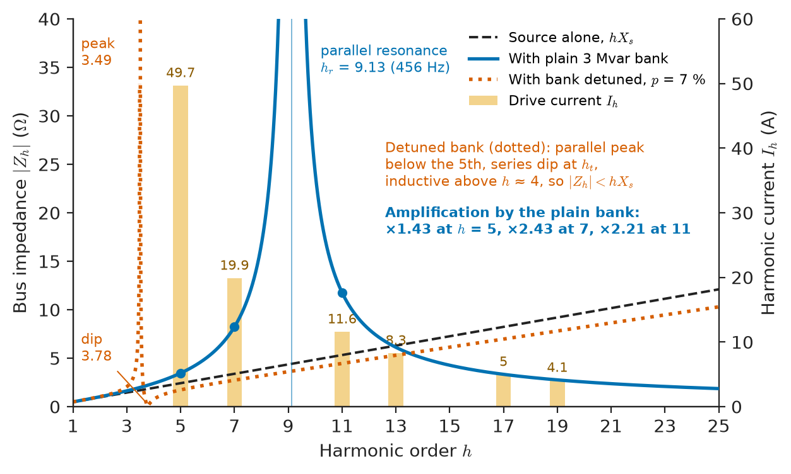
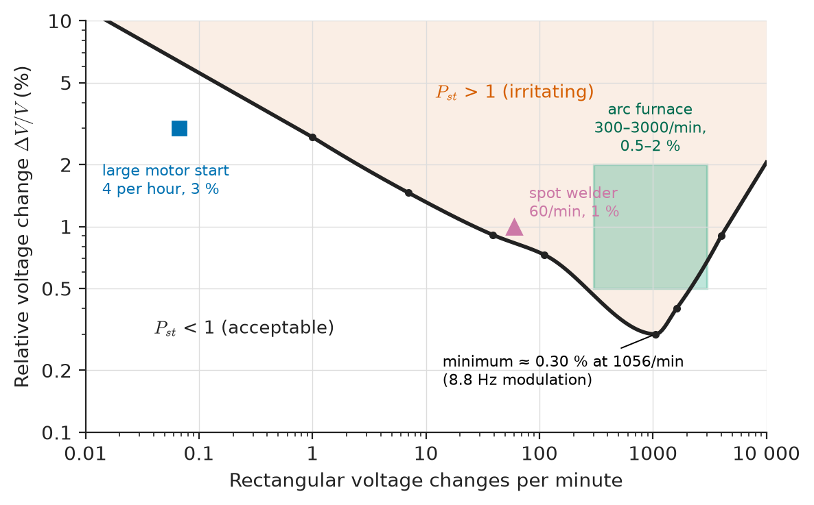
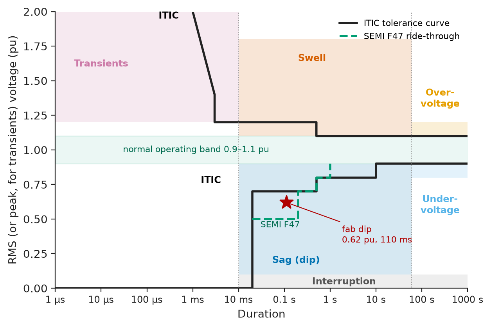
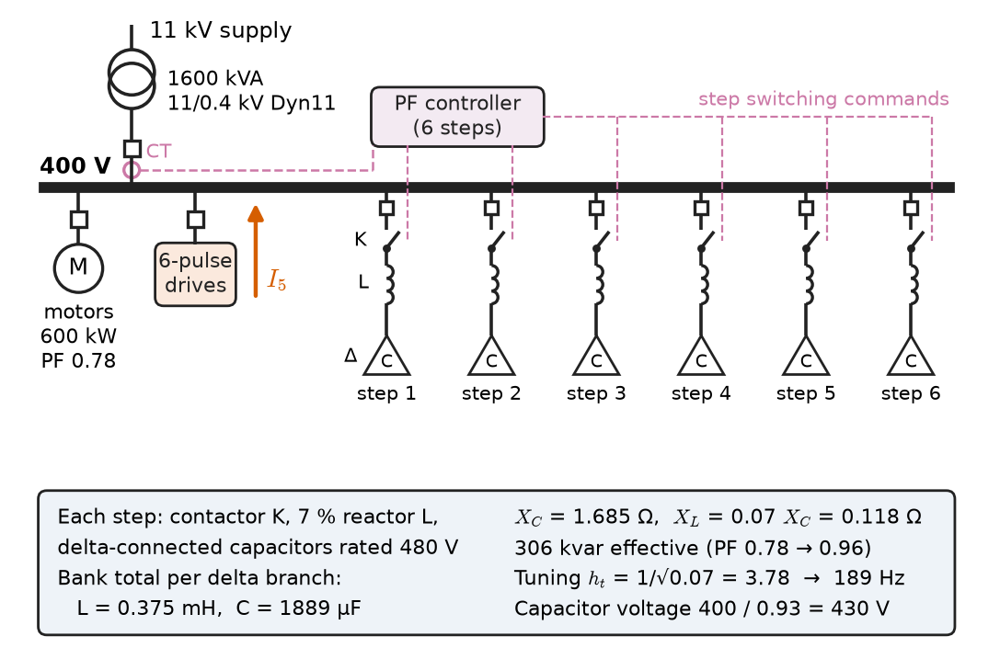
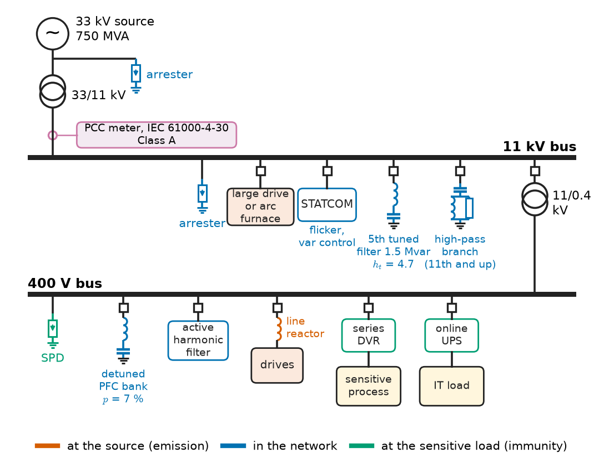

# Chapter 25 — Power Quality

*Part VII · Power Quality and Grid Modernization*

A semiconductor fab in an industrial park loses a day of production twice a year, and each time the utility's records show that the supply was never interrupted. What the fab's monitor recorded was a dip to 62 % of nominal voltage lasting 110 ms, caused by a lightning flashover on a 33 kV line feeding a different town and cleared by protection in under six cycles; the fab's vacuum pumps and process support systems dropped out. In the same park a plastics plant has installed new variable-speed drives on its extruders, and since then a 3 Mvar capacitor bank that had worked for twenty years blows fuses every few weeks. Across the road a steelworks' arc furnace makes the lights in the neighbouring housing estate flicker visibly in the evening. In each case the energy was delivered; what failed was its *quality*, the departure of the waveform from a balanced sinusoid at nominal magnitude and frequency, and each costs real money.

> **What are the standard ways in which supply voltage departs from the ideal sinusoid, and what limits do standards set on each?**
> **How are disturbances such as harmonics, sags, flicker and unbalance predicted from network data, and how are they measured and mitigated at the source, in the network or at the sensitive load?**

| Concept | Engineering destination |
|---|---|
| Voltage variation | Statutory supply limits, tap-changer and regulator settings, motor and lighting performance |
| Frequency variation | Generator and motor protection, island and marine systems, aircraft 400 Hz supplies |
| Harmonics | IEEE 519 compliance of drive installations, transformer derating, capacitor-bank failures |
| Flicker | Arc furnaces, welders, wind farms, compensation with SVC and STATCOM |
| Transients | Capacitor switching, breaker duty, drive overvoltage trips, surge protection |
| Voltage sags and swells | Process ride-through, SEMI F47 compliance, contactor drop-out, DVR and UPS selection |
| Unbalance | Traction supplies, motor derating, negative-sequence protection |
| Power-factor correction | Tariff penalties, detuned capacitor banks, static compensators |
| Measurement and mitigation | IEC 61000-4-30 monitoring, filters, active front ends, custom power devices |

**Roadmap.** Slow deviations of voltage (25.1) and frequency (25.2) → waveform distortion by harmonics (25.3) → flicker (25.4) → transients (25.5) → sags and swells (25.6) → unbalance (25.7) → power-factor correction in a harmonic-rich plant (25.8) → measurement and mitigation (25.9).

> **Boundary.** The circuit theory of this chapter is taken from *Circuits, Signals and Communications*: the Fourier series of a periodic waveform ([Ch. 18](https://github.com/The-Studio-of-Sadiq/Circuits-Signals-and-Communications/blob/main/part-4-signals-and-systems/18-frequency-domain-system-analysis.md)), THD, active power as a sum over harmonics, and the split of power factor into displacement and distortion factors ([Ch. 9 §9.8](https://github.com/The-Studio-of-Sadiq/Circuits-Signals-and-Communications/blob/main/part-2-transient-and-ac-analysis/09-ac-power.md)), capacitor sizing for power-factor correction ([Ch. 9 §9.6](https://github.com/The-Studio-of-Sadiq/Circuits-Signals-and-Communications/blob/main/part-2-transient-and-ac-analysis/09-ac-power.md)), triplen harmonics as zero sequence and the first look at symmetrical components and unbalance ([Ch. 10 §10.6, §10.9](https://github.com/The-Studio-of-Sadiq/Circuits-Signals-and-Communications/blob/main/part-2-transient-and-ac-analysis/10-three-phase-circuits.md)), the inrush of a single capacitor bank and the resonance $f_r=f_1\sqrt{S_{sc}/Q_C}$ ([Ch. 7 §7.7–7.8](https://github.com/The-Studio-of-Sadiq/Circuits-Signals-and-Communications/blob/main/part-2-transient-and-ac-analysis/07-second-order-circuits.md)), and DFT measurement with harmonic grouping ([Ch. 22](https://github.com/The-Studio-of-Sadiq/Circuits-Signals-and-Communications/blob/main/part-5-digital-signal-processing/22-discrete-fourier-transform.md)). They are used here, not re-derived. Rectifier and inverter circuits are outlined in *Engineering Physics*, [Ch. 18 §18.8](https://github.com/The-Studio-of-Sadiq/Engineering-Physics/blob/main/CHAPTERS/CHAPTER%2018.md); their internals belong to *Electronics & Computing*.

---

## 25.1 Voltage variation

### What is being regulated

Power quality is overwhelmingly a property of **voltage**. The customer controls the current it draws; a distorted or fluctuating current becomes a problem when it flows through the supply impedance and distorts the voltage seen by everyone else. The point where the network operator's responsibility meets the customer's is the **point of common coupling** (PCC), and almost every limit in this chapter is stated there.

The slowest departure is a change of the RMS magnitude itself, lasting minutes to hours: the evening sag at the end of a long rural feeder, the noon rise on a feeder full of rooftop PV, the drift as an on-load tap changer hunts between steps. IEEE 1159 calls an RMS deviation lasting more than one minute an **undervoltage** (0.8–0.9 pu) or **overvoltage** (1.1–1.2 pu). Supply standards define the acceptable band statistically, because the voltage at any customer varies continuously with load (Table 25.1).

**Table 25.1 — Steady-state voltage limits in common supply standards.**

| Standard | System | Limit | Assessment |
|---|---|---|---|
| EN 50160 (Europe) | LV and MV public supply | $U_n\pm10\,\%$ | 95 % of 10-min means in each week; all 10-min means within $+10\,\%/-15\,\%$ at LV |
| ANSI C84.1 (North America) | 120 V service | Range A 114–126 V ($\pm5\,\%$); Range B 110–127 V | Range A normal; Range B infrequent, must be corrected |
| Typical transmission grid code | 400 kV, 220 kV | $\pm5\,\%$ to $\pm10\,\%$ | Continuous operating range |
| IEC 60092 (ships) | Shipboard AC | $+6\,\%/-10\,\%$ steady state | Main switchboard |

The bands are wider than any one piece of equipment would like. They exist because the voltage drop $\Delta V\approx(RP+XQ)/V$ along a feeder (Chapter 22) must be shared between the MV network, the distribution transformer, the LV feeder and the service cable, and each takes a few per cent.

### Consequences for equipment

The bands reflect how equipment responds. An induction motor's torque scales roughly as $V^2$: at 90 % voltage it develops 81 % of its torque at a given slip, so a loaded motor runs at higher slip and current and its windings run hotter (Chapter 6); at 110 % the core saturates and magnetising current rises steeply. A 3 kW heater gives 2.43 kW at 90 % voltage. LED drivers and electronic power supplies regulate their output and are insensitive inside the band, but they draw constant power, so their current rises as voltage falls and deepens the drop on a weak feeder. Capacitor kvar rises as $V^2$ and sustained overvoltage shortens capacitor life (IEC 60831 permits 1.10 pu for 8 h in 24 h).

### Control

Sustained voltage is controlled by on-load tap changers, line regulators, switched feeder capacitors and, increasingly, inverter reactive power (Chapters 18, 22 and 27). Power-quality engineering adds the statistics: a voltage inside $\pm10\,\%$ on average but outside it for two hours every evening is a compliance problem even if nobody complains.

---

## 25.2 Frequency variation

### Why frequency is a system-wide quantity

Voltage varies from bus to bus; frequency, in an interconnected AC system in steady state, is the same everywhere. It is set by the balance between mechanical power into the synchronous generators and electrical power out, through the inertia of every rotating mass on the system (Chapter 20). A frequency deviation is therefore never a local power-quality problem in a large grid. It is a symptom of a generation–load imbalance that the whole system's governors, reserves and, ultimately, under-frequency load shedding are working to correct.

**Table 25.2 — Frequency limits in representative systems.**

| System | Normal range | Wider range |
|---|---|---|
| Continental Europe (EN 50160, synchronous) | 50 Hz $\pm1\,\%$ (49.5–50.5 Hz) for 99.5 % of a year | 47–52 Hz (+4 %/−6 %) for 100 % of the time |
| Island system (EN 50160, not synchronously connected) | 50 Hz $\pm2\,\%$ for 95 % of a week | 42.5–57.5 Hz ($\pm15\,\%$) for 100 % of the time |
| Ships (IEC 60092-101) | $\pm5\,\%$ steady state | $\pm10\,\%$ transient, recovery in 5 s |
| Aircraft (MIL-STD-704F, 400 Hz fixed frequency) | 393–407 Hz steady state | Variable-frequency systems 360–800 Hz |

In a large interconnection frequency rarely leaves $\pm0.1$ Hz, well inside Table 25.2. Frequency variation is a genuine quality problem in small systems: island grids (a Pacific island, a mining camp, an oil platform), microgrids in islanded mode (Chapter 26), ships with a few diesel generators where starting a 1 MW bow thruster swings the frequency by a hertz, and grids with low inertia, where the rate of change of frequency after a large loss of infeed is fast (Chapter 27).

### Who notices

Motors change speed in proportion to frequency, and pumps and fans change power roughly as its cube. Transformers and motors are flux-limited by $V/f$ (Chapters 4 and 6), so low frequency at rated voltage over-fluxes them; generator protection includes a volts-per-hertz element alarming at 1.05–1.10 pu. Steam-turbine blades have resonances near running speed, and operation outside about 47.5–51.5 Hz is time-limited by the turbine maker, which often sets the frequency protection of conventional plant. Inverters and loss-of-mains relays trip on frequency and on rate of change of frequency (ROCOF), and their mass tripping during an excursion is a stability problem in its own right (Chapter 27). Frequency is measured and reported as a power-quality parameter (IEC 61000-4-30 Class A: $\pm10$ mHz over 10 s), but it is controlled by the balancing machinery of Chapters 20, 26 and 27, not by anything a single customer can install.

---

## 25.3 Harmonics

### Sources and their spectra

*Circuits, Signals and Communications* (Ch. 9 §9.8) analysed one distorted current; the engineer needs the spectra of real sources, because the spectrum decides which limits are violated and which filters work. The workhorse source is the **six-pulse bridge rectifier** at the front of most drives, UPS units, chargers and DC traction substations. With a balanced supply and smooth DC current its line current contains only the **characteristic harmonics**

$$
h=kp\pm1,\qquad k=1,2,3,\ldots
$$

where $p$ is the pulse number. For $p=6$ these are the 5th, 7th, 11th, 13th, 17th, 19th, … Ideally $I_h\approx I_1/h$; commutation overlap and finite DC inductance modify this (Table 25.3). Twelve-pulse converters, two bridges fed through star and delta windings 30° apart, cancel the 5th, 7th, 17th and 19th, leaving $h=11,13,23,25,\ldots$

**Table 25.3 — Typical harmonic current spectra, % of fundamental.**

| Source | 3rd | 5th | 7th | 11th | 13th | THD$_I$ |
|---|---|---|---|---|---|---|
| Ideal six-pulse ($1/h$) | 0 | 20 | 14.3 | 9.1 | 7.7 | 30 (to 50th) |
| Six-pulse drive, DC choke or 3 % AC reactor | 0–2 | 30–40 | 8–15 | 5–8 | 3–6 | 33–45 |
| Twelve-pulse drive | 0–1 | 2–5 | 1–3 | 6–9 | 4–6 | 10–15 |
| Active-front-end drive (PWM rectifier) | <1 | 1–3 | 1–2 | <1 | <1 | 3–5 |
| Single-phase SMPS without PFC | 70–85 | 45–60 | 25–40 | 5–10 | 5–8 | 80–150 |
| Arc furnace, melting phase | 4–8 | 3–6 | 2–4 | 1–2 | 1 | 5–15, plus interharmonics |

Other sources produce non-characteristic or non-integer components: arc furnaces and cycloconverters produce **interharmonics** between the harmonic lines; transformer energisation produces a decaying inrush rich in the 2nd harmonic (used to block differential relays, Chapter 23); and PV and wind inverters inject little at low order but emit at their switching frequencies, in the **supraharmonic** range of 2–150 kHz.

### Harmonic voltage at the PCC

The harmonic current from a non-linear load is, to a first approximation, independent of the supply: the load is modelled as a **harmonic current source** $I_h$ at each order. The harmonic voltage it produces at the PCC is that current times the network's harmonic impedance. For a network dominated by inductive source impedance,

$$
V_h\approx h\,X_s\,I_h,\qquad X_s=\frac{V^2}{S_{sc}}
$$

so harmonic voltage distortion grows with harmonic order, with the load's harmonic current, and inversely with fault level. A drive that is harmless on a 500 MVA bus can be a nuisance on a 50 MVA one.

> **Status of the principle: Current-source model of harmonic loads with inductive network impedance**
> *Approximate.* Valid when the load's harmonic current depends weakly on supply distortion and the network is a lumped inductance; it fails near network resonances, at high orders where cable capacitance matters, and for rectifier–capacitor loads, whose harmonics partly cancel when many are aggregated.

### Limits

**Equipment** limits cap what a product may emit (IEC 61000-3-2 up to 16 A per phase, IEC 61000-3-12 for 16–75 A). **System** limits cap what an installation may inject at the PCC and the voltage distortion the network must keep; the most widely used is IEEE 519-2022 (Tables 25.4 and 25.5), with IEC/TR 61000-3-6 following similar logic and EN 50160 limiting public-supply THD$_V$ to 8 %.

**Table 25.4 — IEEE 519-2022 voltage distortion limits at the PCC.**

| Bus voltage at PCC | Individual harmonic (%) | THD$_V$ (%) |
|---|---|---|
| $V\le1$ kV | 5.0 | 8.0 |
| 1 kV $<V\le$ 69 kV | 3.0 | 5.0 |
| 69 kV $<V\le$ 161 kV | 1.5 | 2.5 |
| $V>161$ kV | 1.0 | 1.5 |

**Table 25.5 — IEEE 519-2022 current distortion limits, 120 V to 69 kV, in % of maximum demand current $I_L$ (odd harmonics; even harmonics limited to 25 % of these).**

| $I_{sc}/I_L$ | $3\le h<11$ | $11\le h<17$ | $17\le h<23$ | $23\le h<35$ | $35\le h\le50$ | TDD |
|---|---|---|---|---|---|---|
| < 20 | 4.0 | 2.0 | 1.5 | 0.6 | 0.3 | 5.0 |
| 20–50 | 7.0 | 3.5 | 2.5 | 1.0 | 0.5 | 8.0 |
| 50–100 | 10.0 | 4.5 | 4.0 | 1.5 | 0.7 | 12.0 |
| 100–1000 | 12.0 | 5.5 | 5.0 | 2.0 | 1.0 | 15.0 |
| > 1000 | 15.0 | 7.0 | 6.0 | 2.5 | 1.4 | 20.0 |

The current limits are normalised to the **maximum demand current** $I_L$ (the average of monthly peak demands), and the summary quantity is the **total demand distortion** $\mathrm{TDD}=\sqrt{\sum I_h^2}/I_L$, so a lightly loaded plant does not fail merely because its fundamental is small. The limits grow with $I_{sc}/I_L$ because a customer small relative to the network takes a small share of its distortion budget.

> **Status of the principle: IEEE 519 harmonic limits**
> *Empirical.* Engineering consensus, set so that many compliant customers together keep network distortion below the levels at which equipment heating and malfunction become common; assessed statistically (95th and 99th percentiles), not as instantaneous caps.

**Worked example — An 11 kV drive installation against IEEE 519.** A plastics plant takes supply at 11 kV from a bus with a three-phase fault level of 250 MVA. Its maximum demand is 8 MVA. A new extruder line adds six-pulse drives (with DC chokes) totalling 3 MW at a displacement power factor of 0.95, drawing the spectrum $I_5=30\,\%$, $I_7=12\,\%$, $I_{11}=7\,\%$, $I_{13}=5\,\%$, $I_{17}=3\,\%$, $I_{19}=2.5\,\%$ of the drives' fundamental. Assess compliance, first without, then with, the plant's existing 3 Mvar capacitor bank on the 11 kV bus.

*Currents.* The drives' fundamental apparent power is $3/0.95=3.158$ MVA, so $I_1=3.158\times10^6/(\sqrt3\times11\,000)=165.7$ A. The maximum demand current is $I_L=8\times10^6/(\sqrt3\times11\,000)=419.9$ A and the fault current $I_{sc}=250\times10^6/(\sqrt3\times11\,000)=13.12$ kA, so $I_{sc}/I_L=31.2$: the 20–50 row of Table 25.5 applies.

| $h$ | $I_h$ (A) | % of $I_L$ | Limit (%) |
|---|---|---|---|
| 5 | 49.7 | 11.8 | 7.0 |
| 7 | 19.9 | 4.7 | 7.0 |
| 11 | 11.6 | 2.8 | 3.5 |
| 13 | 8.3 | 2.0 | 3.5 |
| 17 | 5.0 | 1.2 | 2.5 |
| 19 | 4.1 | 1.0 | 2.5 |

$$
\mathrm{TDD}=\frac{\sqrt{49.7^2+19.9^2+11.6^2+8.3^2+5.0^2+4.1^2}}{419.9}=13.3\,\%>8.0\,\%
$$

The installation fails on the 5th harmonic and on TDD.

*Voltage without the capacitor.* $X_s=11^2/250=0.484\ \Omega$ per phase; the phase voltage is 6351 V. The 5th-harmonic voltage is $5\times0.484\times49.7=120$ V, or 1.9 %; the 7th is 1.1 %, the 11th 1.0 %. Summing all six in quadrature gives THD$_V=2.7\,\%$, inside the 5 % limit of Table 25.4. The network operator's concern is the current; the voltage is still acceptable.

*With the capacitor bank.* The bank's reactance is $X_C=11^2/3=40.3\ \Omega$ at 50 Hz, $X_C/h$ at order $h$. Seen from the drive, it is in parallel with the source, and the parallel combination of $jhX_s$ and $-jX_C/h$ has magnitude $hX_s(X_C/h)/\lvert hX_s-X_C/h\rvert$. The resonance is at $h_r=\sqrt{X_C/X_s}=\sqrt{250/3}=9.13$ (the 456 Hz of *Circuits, Signals and Communications*, Ch. 7 §7.8). At the 7th the bus impedance rises from 3.39 Ω to 8.22 Ω (×2.43), at the 11th from 5.32 Ω to 11.78 Ω (×2.21), at the 5th from 2.42 Ω to 3.46 Ω (×1.43). The 5th, 7th and 11th voltages become 2.7 %, 2.6 % and 2.2 %, and THD$_V$ rises to 4.4 %, close to the limit. The capacitor also takes most of the 7th and 11th harmonic currents itself, since it is the lower-impedance branch above resonance: its RMS current and peak voltage rise, its internal fuses see the extra heating, and this is the plant's blown-fuse problem. The remedies, a detuned bank or a tuned filter, are developed in Sections 25.8 and 25.9.

<!-- FIGURE 25.1 | figures/ch25/fig-25-1-bus-harmonic-impedance.png | plot | Harmonic impedance of an 11 kV, 250 MVA bus with and without a 3 Mvar capacitor bank, with the drive spectrum overlaid. | Content: x-axis harmonic order 1 to 25, y-axis impedance 0 to 40 ohm. Dashed: source alone, h times 0.484 ohm. Solid: source in parallel with the plain 3 Mvar bank (Xc 40.3 ohm), parallel resonance peak at h = 9.13 (456 Hz). Dotted: bank detuned with 7 percent reactor, series dip at h = 3.78 and parallel peak near h = 3.5, below the source line above h = 4. Bars on a right axis 0 to 60 A at h = 5, 7, 11, 13, 17, 19: 49.7, 19.9, 11.6, 8.3, 5.0, 4.1 A. Annotate amplification 1.43, 2.43, 2.21 at h = 5, 7, 11. -->

*Figure 25.1 — Harmonic impedance of an 11 kV, 250 MVA bus with and without a 3 Mvar capacitor bank, with the drive spectrum overlaid.*

### Effects on equipment

Harmonics damage equipment by heating, dielectric stress and malfunction. Induction motors suffer extra rotor loss (the 5th, 11th, … are negative sequence and brake the rotor) and torque pulsation at $6f_1$; capacitors, whose admittance rises with $h$, attract harmonic current and are limited by IEC 60831 to 1.3 pu RMS current; standby generators feeding drive loads are derated for rotor heating; peak-sensing relays and zero-crossing controls misoperate. The most expensive and most calculable effect is transformer heating.

**Transformer derating.** IEEE C57.110 quantifies transformer heating with the **harmonic loss factor**

$$
F_{HL}=\frac{\sum_h (I_h/I_1)^2\,h^2}{\sum_h (I_h/I_1)^2}
$$

which multiplies the winding eddy-current loss. If $P_{EC\text{-}R}$ is the rated eddy loss as a fraction of rated $I^2R$ loss, the maximum permissible RMS load current in per unit of rating, keeping total winding loss at its rated value, is

$$
I_{max}=\sqrt{\frac{1+P_{EC\text{-}R}}{1+F_{HL}\,P_{EC\text{-}R}}}
$$

For the office load of *Circuits, Signals and Communications*, Ch. 9 §9.8 ($I_3/I_1=0.8$, $I_5/I_1=0.6$, $I_7/I_1=0.4$, $I_9/I_1=0.2$), $\sum(I_h/I_1)^2=2.20$ and $\sum h^2(I_h/I_1)^2=26.84$, so $F_{HL}=12.2$. A dry-type transformer with $P_{EC\text{-}R}=8\,\%$ may then carry only $\sqrt{1.08/1.976}=0.74$ pu of its rated current, and one with 15 % only 0.64 pu. This is the origin of **K-rated** transformers (UL 1561 defines the K-factor, numerically equal to $F_{HL}$ when the currents are normalised to the RMS value): a K-13 transformer is built with subdivided, transposed conductors and an oversized neutral so that it can carry such a load at nameplate.

> **Status of the principle: Harmonic loss factor and transformer derating**
> *Approximate.* Assumes winding eddy loss scales exactly as $h^2$ (true when the conductor is thin compared with the skin depth at each harmonic) and that other stray losses scale as $h^{0.8}$, as IEEE C57.110 prescribes; for large conductors at high orders the $h^2$ law overestimates the loss, so the derating is conservative.

---

## 25.4 Flicker

### From voltage fluctuation to visible flicker

A load whose current fluctuates at a few hertz modulates the supply voltage through the source impedance. The relative voltage change produced by a change $\Delta S$ in a load's apparent power is approximately

$$
d=\frac{\Delta V}{V}\approx\frac{\Delta S}{S_{sc}}\cos(\psi_k-\varphi)
$$

where $\psi_k$ is the network impedance angle and $\varphi$ the angle of the load change; for the common worst case of a mainly reactive change on an inductive network the cosine is near 1 and $d\approx\Delta S/S_{sc}$. Fluctuations of half a per cent are harmless to motors and electronics; they matter because of the human eye, which is most sensitive to luminance fluctuation near 8.8 Hz, where a sinusoidal modulation of only about 0.25 % of a 230 V lamp's voltage irritates half of observers. What is regulated is therefore a **perceptibility index**.

IEC 61000-4-15 specifies the **flickermeter**: a model of a 60 W, 230 V incandescent lamp (120 V version for 60 Hz systems) followed by a weighting filter that reproduces the eye's frequency response, a squaring and smoothing stage that models the brain's memory, and a statistical classifier. Its output is the **short-term flicker severity** $P_{st}$, computed every 10 minutes, and the **long-term severity**

$$
P_{lt}=\sqrt[3]{\frac{1}{12}\sum_{i=1}^{12}P_{st,i}^3}
$$

over 2 hours. $P_{st}=1$ is the threshold of irritability. The incandescent reference lamp is disappearing, but the index is kept as a reproducible measure of fluctuation; LED lamps range from much less sensitive to, with some cheap drivers, more.

The $P_{st}=1$ curve of Figure 25.2 shows the amplitude of rectangular voltage changes that gives $P_{st}=1$ at each repetition rate. It falls from about 2.7 % at one change per minute to a minimum of about 0.3 % near 1000 changes per minute (8.8 Hz) and rises again at higher rates, where the lamp's thermal inertia filters the fluctuation.

<!-- FIGURE 25.2 | figures/ch25/fig-25-2-pst-unity-curve.png | plot | The Pst = 1 curve for rectangular voltage changes on a 230 V lamp, with typical fluctuating loads. | Content: log x-axis changes per minute 0.1 to 10000, log y-axis dV/V 0.1 to 10 percent. Curve through about (1, 2.72), (7, 1.46), (39, 0.91), (110, 0.73), (1056, 0.30 minimum), (1620, 0.40), (4000, 0.9); region above shaded Pst greater than 1. Points: motor start 4 per hour at 3 percent, spot welder 60 per minute at 1 percent, arc furnace band 300 to 3000 per minute at 0.5 to 2 percent. -->

*Figure 25.2 — The Pst = 1 curve for rectangular voltage changes on a 230 V lamp, with typical fluctuating loads.*

### Sources and assessment

The classic flicker source is the **electric arc furnace**, whose arcs strike moving, collapsing scrap so that its reactive power fluctuates randomly between near zero and near short-circuit, with energy concentrated between 1 and 15 Hz. Others are welders, crushers, large motor starts, rolling mills and wind turbines (tower-shadow modulation at three times rotor speed).

For an arc furnace, the empirical planning formula is

$$
P_{st,99\,\%}\approx K_{st}\,\frac{S_{scf}}{S_{sc}}
$$

where $S_{scf}$ is the furnace's short-circuit power (the apparent power drawn with the electrodes shorted on the scrap, roughly twice the transformer rating) and $K_{st}$ is an emission coefficient, typically 48–85 for AC furnaces (about 60–70 for most), lower for DC furnaces and ladle furnaces. Wind turbines have an analogous coefficient: IEC 61400-21 gives $P_{st}=c(\psi_k,v_a)\,S_n/S_k$ with flicker coefficients $c$ of typically 2–10 for modern variable-speed machines.

> **Status of the principle: Arc-furnace flicker coefficient**
> *Empirical.* The $K_{st}$ values are fitted to measurements on operating furnaces; the linear scaling with $S_{scf}/S_{sc}$ holds because $P_{st}$ is linear in modulation depth, but the coefficient depends on scrap quality, furnace operation and control and has a scatter of $\pm30\,\%$.

Limits come from IEC/TR 61000-3-7 planning levels (indicative $P_{st}=0.9$, $P_{lt}=0.7$ at MV; $P_{st}=0.8$, $P_{lt}=0.6$ at HV and EHV), EN 50160 ($P_{lt}\le1$ for 95 % of a week at LV and MV), and for small equipment IEC 61000-3-3 ($P_{st}\le1.0$, $P_{lt}\le0.65$, maximum relative voltage change 4 %).

**Worked example — Siting an arc furnace.** A steelmaker plans a 60 MVA AC arc furnace with a short-circuit power $S_{scf}=110$ MVA, to be connected at a 220 kV substation whose minimum fault level is 5000 MVA. Take $K_{st}=70$. Is the planning level $P_{st}=0.8$ met, and what can be done?

$$
P_{st}\approx70\times\frac{110}{5000}=1.54
$$

The emission is nearly twice the planning level. Meeting 0.8 by fault level alone would require $S_{sc}\ge70\times110/0.8=9625$ MVA, a much stronger connection point, typically at 400 kV and possibly many kilometres away. The alternative is compensation at the furnace. A thyristor-controlled **SVC** reduces flicker by a factor of typically 1.5–2.5, limited by its half-cycle response; a **STATCOM**, with a response of a few milliseconds, achieves reduction factors of 3–5. With a STATCOM giving a factor of 3, $P_{st}\approx0.51$. The compensator, rated at roughly the furnace MVA, doubles as the furnace's power-factor and filter installation; the choice is an economic one between network reinforcement and equipment.

---

## 25.5 Transients

### Categories

A transient is a departure lasting less than about one cycle, from nanoseconds to tens of milliseconds. IEEE 1159 divides transients into **impulsive** (unidirectional, such as the 1.2/50 µs lightning impulse) and **oscillatory** (bipolar ringing), as summarised in Table 25.6; sags (0.1–0.9 pu), swells (1.1–1.8 pu) and interruptions (below 0.1 pu) are the RMS events of Section 25.6. Figure 25.3 locates them on the magnitude–duration map together with the RMS events of Section 25.6.

**Table 25.6 — IEEE 1159 categories of transients.**

| Category | Typical spectral content | Typical duration | Typical magnitude |
|---|---|---|---|
| Impulsive transient, µs | 5 ns–0.1 ms rise | 50 ns–1 ms | Up to several pu |
| Oscillatory transient, low frequency | < 5 kHz | 0.3–50 ms | 0–4 pu |
| Oscillatory transient, medium frequency | 5–500 kHz | 20 µs | 0–8 pu |
| Oscillatory transient, high frequency | 0.5–5 MHz | 5 µs | 0–4 pu |

<!-- FIGURE 25.3 | figures/ch25/fig-25-3-disturbance-map.png | plot | Magnitude-duration map of power-quality disturbances after IEEE 1159, with the ITIC and SEMI F47 tolerance curves. | Content: log x-axis duration 1 microsecond to 1000 s, y-axis 0 to 2.0 pu. Regions: transients below 10 ms above 1.2 pu; interruption below 0.1 pu; sags 0.1 to 0.9 pu and swells 1.1 to 1.8 pu from 10 ms to 60 s; under- and overvoltage beyond 60 s. ITIC lower bound 0 pu to 20 ms, 0.70 pu to 0.5 s, 0.80 pu to 10 s, 0.90 pu beyond; upper bound 2.0 pu at 1 ms, 1.2 pu 3 ms to 0.5 s, 1.1 pu beyond. SEMI F47 dashed: 0.50 pu to 200 ms, 0.70 pu to 0.5 s, 0.80 pu to 1 s. Mark the fab dip at 0.62 pu, 110 ms. -->

*Figure 25.3 — Magnitude-duration map of power-quality disturbances after IEEE 1159, with the ITIC and SEMI F47 tolerance curves.*

### Sources

**Lightning** produces impulsive transients by direct strikes and by induction into lines; its travelling-wave behaviour and the surge arresters that limit it are the subject of Chapter 24. On a customer's LV installation, residual lightning surges of a few kilovolts are limited by surge-protective devices coordinated to IEC 61643 and IEC 60364-5-53.

**Capacitor switching** is the most common oscillatory transient on distribution systems, and the one most often behind unexplained drive trips. Energising an isolated bank gives an inrush oscillating at $f_1\sqrt{S_{sc}/Q_C}$, typically 300–1000 Hz, and a voltage overshoot towards 2 pu (*Circuits, Signals and Communications*, Ch. 7 §7.7). Two variants matter in practice:

- **Back-to-back switching.** When a second bank is energised next to one already charged, the inrush is fed from the first bank through only the small inductance of the bus and cables between them, not through the source. The inrush is far larger and its frequency far higher (worked example below).
- **Voltage magnification.** When an MV bank is energised, its 1–2 pu ringing at several hundred hertz can excite the resonance of a downstream LV capacitor (a power-factor bank or a drive's DC-link filter) with the step-down transformer. If the two resonant frequencies are close, the LV overvoltage can reach 3–4 pu, enough to trip drives on DC-bus overvoltage or fail LV surge devices. Utility switching of feeder banks at 7:00 every morning, followed by a plant's drives tripping at 7:00 every morning, is the classic signature.

Other switching transients include line energisation (Chapter 24), current chopping by vacuum breakers on small inductive currents, and **notching** of the voltage by thyristor-rectifier commutation, whose depth IEEE 519 also limits.

**Worked example — Back-to-back capacitor switching at 11 kV.** The 11 kV bus of Section 25.3 has a 3 Mvar bank in service. A second, identical 3 Mvar bank is added in the same switchroom and energised while the first is charged. The inductance of the bus and cable between the two banks is 20 µH per phase. Find the inrush peak and frequency, and the series inductance needed to keep it below 6 kA peak.

Each bank has $C=3\times10^6/(2\pi\cdot50\times11\,000^2)=78.9\ \mu$F per phase (star equivalent). In the back-to-back circuit the charged bank discharges into the uncharged one through $L$, and the effective capacitance is the series combination $C_{eq}=C_1C_2/(C_1+C_2)=39.5\ \mu$F. Worst case is closing at the voltage peak, $V_{pk}=11\,000\sqrt{2/3}=8.98$ kV. Treating the circuit as an undamped series LC (as in the Book 3 analysis of the isolated case),

$$
\hat I=V_{pk}\sqrt{\frac{C_{eq}}{L}}=8981\sqrt{\frac{39.5\times10^{-6}}{20\times10^{-6}}}=12.6\ \mathrm{kA},\qquad f=\frac{1}{2\pi\sqrt{LC_{eq}}}=5.67\ \mathrm{kHz}
$$

Against the isolated bank's 2.03 kA at 456 Hz, that is six times the current at twelve times the frequency. The product $\hat I f$ (here $7.1\times10^{7}$ A/s) is what erodes breaker contacts, and IEEE C37.04/C37.06 definite-purpose capacitor-switching breakers are rated for back-to-back inrush of typically 15–20 kA peak at up to 4–6 kHz. To limit the peak to 6 kA, the total inductance must be

$$
L=C_{eq}\left(\frac{V_{pk}}{\hat I}\right)^2=39.5\times10^{-6}\times\left(\frac{8981}{6000}\right)^2=88\ \mu\mathrm H
$$

so a 70 µH air-core **inrush-limiting reactor** is added in series with each bank. The inrush frequency falls to 2.7 kHz. Alternatives are pre-insertion resistors and **point-on-wave (synchronous) closing**, which closes each pole near its voltage zero and can reduce the inrush to a small fraction of the worst case.

> **Status of the principle: Back-to-back inrush from lumped LC model**
> *Approximate.* Assumes the source is stiff during the few-kilohertz ringing (so only the inter-bank inductance matters), neglects damping, and treats each phase independently; real inrush is somewhat lower because of resistance and the closing instant, and for long cables between banks the travelling-wave behaviour of Chapter 24 replaces the lumped inductance.

---

## 25.6 Voltage sags and swells

### The most costly disturbance

A **sag** (IEC: **dip**) is a reduction of RMS voltage to between 0.1 and 0.9 pu for half a cycle to one minute; a **swell** is an increase to 1.1–1.8 pu for the same duration. Sags cause most of industry's power-quality losses: a typical MV customer sees 10–100 per year below 0.9 pu against 1–5 interruptions, and a sag that resets a production line costs nearly as much as an interruption.

### Causes and magnitude

Almost all deep sags are caused by **short circuits** somewhere in the network, and the sag lasts until the protection clears the fault. A smaller number come from starting large motors and energising transformers (shallow, longer sags with slow recovery). The depth at a given bus follows from the **voltage divider model**: with $Z_s$ the source impedance at the PCC and $Z_f$ the impedance from the PCC to the fault (along a feeder that branches off at the PCC), the retained voltage during a three-phase fault is

$$
V_{sag}=\frac{Z_f}{Z_s+Z_f}\ \mathrm{pu}
$$

> **Status of the principle: Voltage-divider model of sag magnitude**
> *Approximate.* Assumes pre-fault voltage of 1 pu, neglects load current and the contribution of motors and generators downstream, and assumes a bolted three-phase fault on a radial branch; for unbalanced faults the same idea is applied to the sequence networks of Chapter 19, and motor back-feed makes real sags somewhat shallower at first and slower to recover.

**Worked example — Sags at a fab from faults on neighbouring feeders.** The fab of the chapter opening takes supply from a 33 kV bus whose fault level is 750 MVA. Several 33 kV overhead lines leave the same bus to other towns, each with a positive-sequence reactance of 0.4 Ω/km (resistance neglected). Find the sag depth for three-phase faults at various distances along these lines, and the "area of vulnerability" for equipment that drops out below 0.5 pu and 0.7 pu.

$$
Z_s=\frac{33^2}{750}=1.452\ \Omega
$$

| Fault distance | $Z_f$ (Ω) | $V_{sag}$ (pu) |
|---|---|---|
| 1 km | 0.4 | 0.22 |
| 2 km | 0.8 | 0.36 |
| 5 km | 2.0 | 0.58 |
| 10 km | 4.0 | 0.73 |
| 20 km | 8.0 | 0.85 |

The critical distance for a retained voltage $V$ is $d=\dfrac{V}{1-V}\dfrac{Z_s}{0.4}$: 3.6 km for 0.5 pu, 8.5 km for 0.7 pu and 32.7 km for 0.9 pu, so equipment tripping at 0.7 pu is exposed to the first 8.5 km of every line. With five such lines, a fault rate of 5 per 100 km per year gives about $5\times8.5\times0.05=2.1$ trips per year from three-phase faults alone; single-line-to-ground faults, more frequent but producing shallower sags at the fab behind a delta–star transformer, add more. The duration is the protection's clearing time: about 100 ms for instantaneous protection near the bus, 300–500 ms for time-graded protection further out. The opening's 0.62 pu, 110 ms event is a fault about 6 km out, cleared by instantaneous protection.

### Sag type, phase shift and swell

Unbalanced faults produce unbalanced sags, altered by the transformers between fault and load: a single-line-to-ground fault on the MV side of a Dyn transformer appears at LV as a two-phase sag without zero sequence (Chapter 19). Sags also carry a **phase-angle jump** of up to tens of degrees, which upsets thyristor converters and phase-locked loops.

**Swells** are mostly the healthy-phase voltage rise during a single-line-to-ground fault. On a solidly earthed system the rise is small (up to about 1.2–1.3 pu, set by the earth-fault factor of Chapter 24); on an ungrounded or resonant-earthed system the healthy phases rise towards $\sqrt3=1.73$ pu for the duration of the fault. Load rejection and capacitor energisation produce smaller swells.

### Equipment sensitivity

Equipment tolerance is expressed as a voltage–duration curve (Figure 25.3). The **ITIC curve** (successor to the CBEMA curve) describes what 120 V information-technology equipment should tolerate: zero voltage for 20 ms, 70 % for 0.5 s, 80 % for 10 s. **SEMI F47** demands that semiconductor process tools ride through 50 % for 200 ms, 70 % for 0.5 s and 80 % for 1 s. IEC 61000-4-11 (up to 16 A) and IEC 61000-4-34 (above 16 A) set the corresponding immunity test levels.

Table 25.7 gives representative sensitivities, and explains the fab's problem: the dip to 0.62 pu for 110 ms is inside SEMI F47, so the tools themselves should have survived, but the AC contactors, auxiliary relays and older drives in the support systems did not.

**Table 25.7 — Typical sag sensitivity of equipment.**

| Equipment | Drop-out threshold | Time |
|---|---|---|
| AC contactor or relay coil | 0.5–0.75 pu | 10–20 ms (some ride through up to 100 ms) |
| PLC, power supply without hold-up | 0.5–0.8 pu | 10–50 ms |
| Variable-speed drive (default settings) | 0.7–0.85 pu (DC-bus undervoltage) | 5–20 ms |
| Variable-speed drive with kinetic buffering | 0.5 pu or lower | Several seconds while load inertia lasts |
| Induction motor (direct-on-line) | Rides through most sags; re-acceleration current on recovery | — |

### Mitigation of sags

In order of increasing cost per kVA protected: make the process tolerant (DC-fed or held-in contactor coils, drive ride-through and automatic restart, SEMI F47 equipment), which is the cheapest step and the one most often omitted; protect only the control power with a small UPS; protect the critical load with an online UPS, a **dynamic voltage restorer** (DVR, a series converter that injects the missing voltage for a few hundred milliseconds from stored energy) or a **static transfer switch** between two independent feeders; or change the network with faster protection, fewer exposed kilometres and loop supply.

---

## 25.7 Unbalance

### Measuring it properly

The decomposition of an unbalanced three-phase set into positive-, negative- and zero-sequence components was introduced in *Circuits, Signals and Communications*, Ch. 10 §10.6, together with the quick NEMA definition (maximum deviation from the average line voltage, divided by the average). The quantity that standards actually regulate is the **voltage unbalance factor**

$$
\mathrm{VUF}=\frac{\lvert V_2\rvert}{\lvert V_1\rvert}\times100\,\%
$$

It can be computed from the three line-voltage magnitudes alone (line voltages contain no zero sequence), which is how many meters do it:

$$
\mathrm{VUF}=\sqrt{\frac{1-\sqrt{3-6\beta}}{1+\sqrt{3-6\beta}}},\qquad \beta=\frac{V_{ab}^4+V_{bc}^4+V_{ca}^4}{\left(V_{ab}^2+V_{bc}^2+V_{ca}^2\right)^2}
$$

For the line voltages 400, 396 and 388 V of the Book 3 example, $\beta$ gives VUF $=1.78\,\%$, against 1.69 % by the NEMA approximation. The difference is small here, but the two definitions diverge for large unbalance, and contracts should state which one applies.

Limits are typically 2 % VUF for 95 % of 10-minute values at LV and MV (EN 50160, with up to 3 % in areas with many single-phase loads), and 1–1.4 % planning levels at HV (IEC/TR 61000-3-13).

### Sources

Unbalance comes from unequal single-phase loads, single-phase 25 kV traction supplies connected phase-to-phase on the HV grid, induction furnaces and welders, untransposed lines and open phases. A single-phase load of apparent power $S_L$ connected line-to-line produces a negative-sequence current equal in magnitude to its positive-sequence current, and so a VUF at its connection point of approximately

$$
\mathrm{VUF}\approx\frac{S_L}{S_{sc}}
$$

> **Status of the principle: Unbalance from a single-phase load, VUF ≈ S_L / S_sc**
> *Approximate.* Assumes equal positive- and negative-sequence source impedances (true for networks dominated by lines and transformers, less so near rotating machines, whose negative-sequence impedance is lower) and a load small compared with the fault level.

### Effects on induction motors

The negative-sequence voltage drives a field rotating backwards relative to the rotor, at a slip of nearly 2. The motor's impedance to it is close to its locked-rotor impedance, so the negative-sequence current is

$$
\frac{I_2}{I_{rated}}\approx\mathrm{VUF}\times\frac{I_{start}}{I_{rated}}
$$

A motor with a starting current of 6 pu therefore draws 6 % negative-sequence current per 1 % of voltage unbalance. At about 100 Hz in the rotor, skin effect makes it heat the bars out of proportion to its size. NEMA MG 1 derating factors are 0.98 at 1 %, 0.95 at 2 %, 0.88 at 3 %, 0.82 at 4 % and 0.75 at 5 % unbalance, and operation above 5 % is not recommended. Generators carry negative-sequence relays set against their $I_2^2t$ capability (Chapter 23).

**Worked example — A traction supply.** A high-speed rail operator connects a 30 MVA single-phase 25 kV traction transformer phase-to-phase on a 132 kV bus with a minimum fault level of 2500 MVA. Estimate the VUF and the effect on a large induction motor fed from the same bus through a transformer.

$$
\mathrm{VUF}\approx\frac{30}{2500}=1.2\,\%
$$

This is within the 2 % public-supply limit but above a typical 1 % emission allocation for a single customer at HV, and it adds to the background unbalance already present. A motor with 6 pu starting current sees $I_2\approx6\times1.2=7.2\,\%$ negative-sequence current, and by NEMA MG 1 should be derated to about 0.97 of nameplate. Remedies are to rotate successive substations around the phase pairs, connect at a higher fault level, or install a balancer: the static **Steinmetz circuit** (for a resistive load $P$ between two lines, a capacitor and an inductor of $P/\sqrt3$ var each across the other two line pairs) or, for a varying traction load, a STATCOM.

---

## 25.8 Power-factor correction

### Why it is still a power-quality topic

The arithmetic of power-factor correction, $Q_C=P(\tan\varphi_1-\tan\varphi_2)$, and the reasons for stopping at 0.95–0.98 are in *Circuits, Signals and Communications*, Ch. 9 §9.6; the tariff and energy-management side is in Chapter 28. This section turns a kvar figure into hardware that survives harmonic resonance and switching in a modern plant.

### Where and how

Correction is applied individually at large motors (limited to about 90 % of no-load magnetising kvar to avoid self-excitation), at motor control centres, or centrally by automatic banks whose controller switches steps of 25–50 kvar (LV) or 0.5–3 Mvar (MV) to follow the load. Central correction is cheapest per kvar and is the norm. In a plant with harmonic sources, a plain capacitor bank creates a parallel resonance with the supply transformer and network at $h_r=\sqrt{S_{sc}/Q_C}$ (Section 25.3), and because the bank's steps switch in and out, the resonance sweeps over a range of harmonic orders during the day. Somewhere in that range there is usually a characteristic harmonic. The standard remedy is the **detuned** bank: each step has a series reactor sized so that the step's own series resonance lies below the lowest significant harmonic. The reactor is specified by its **detuning factor** $p=X_L/X_C$ at the fundamental, giving a series tuning order

$$
h_t=\frac{1}{\sqrt p}
$$

Common values are $p=7\,\%$ ($h_t=3.78$, 189 Hz at 50 Hz), $p=5.67\,\%$ ($h_t=4.2$, 210 Hz) and $p=14\,\%$ ($h_t=2.67$, 134 Hz, used where third-harmonic currents are significant). Above $h_t$ the step is inductive, so it cannot form a parallel resonance with the network at any characteristic harmonic, and it draws only a modest share of the harmonic current. Figure 25.1 shows the bus impedance with such a bank.

Two consequences of the series reactor must be designed in. The capacitor's fundamental voltage rises to $V/(1-p)$, and its fundamental kvar for a given capacitance rises by $1/(1-p)$; and harmonic currents still flowing in the step add to the capacitor's RMS current and peak voltage. Capacitors in detuned banks are therefore rated well above the system voltage.

> **Status of the principle: Detuned capacitor bank**
> *Approximate.* The design rests on the current-source harmonic model and a single dominant network inductance; it guarantees the absence of parallel resonance above $h_t$ only if all the plant's capacitance (including drive input filters and other banks) is detuned, and $h_t$ drifts upward as capacitors age and lose capacitance, which is why $p$ is chosen with margin below the 5th.

<!-- FIGURE 25.4 | figures/ch25/fig-25-4-detuned-bank.png | single-line | A 400 V automatic detuned power-factor-correction bank in a plant with drives. | Content: 11/0.4 kV 1600 kVA Dyn11 transformer to a 400 V switchboard; 600 kW motor load at PF 0.78 and six-pulse drives with a 5th-harmonic arrow. Six-step bank, each step contactor, 7 percent series reactor and delta capacitors rated 480 V (total 0.375 mH and 1889 microfarad per branch); controller with CT on the incomer. Labels: 306 kvar effective, tuning 189 Hz, capacitor voltage 430 V. -->

*Figure 25.4 — A 400 V automatic detuned power-factor-correction bank in a plant with drives.*

**Worked example — A detuned bank for a 400 V plant.** A plant draws 600 kW at a power factor of 0.78 lagging from a 400 V, 50 Hz supply and has a significant drive load. Size a detuned bank with $p=7\,\%$ to correct to 0.96.

*Reactive power.* $\tan\varphi_1=\tan(\arccos0.78)=0.802$ and $\tan\varphi_2=\tan(\arccos0.96)=0.292$, so the effective compensation required is

$$
Q_{eff}=600\,(0.802-0.292)=306\ \mathrm{kvar}
$$

The apparent power falls from 769 kVA to 625 kVA and the line current from 1110 A to 902 A.

*Per-branch reactances (delta, line voltage across each branch).* The effective branch reactance is $X_C-X_L=X_C(1-p)$:

$$
X_C(1-p)=\frac{3V^2}{Q_{eff}}=\frac{3\times400^2}{306\,000}=1.567\ \Omega\quad\Rightarrow\quad X_C=\frac{1.567}{0.93}=1.685\ \Omega,\quad X_L=0.07X_C=0.118\ \Omega
$$

so $C=1/(2\pi\cdot50\times1.685)=1889\ \mu$F and $L=0.118/(2\pi\cdot50)=0.375$ mH per delta branch (the total bank, split across the six steps).

*Capacitor voltage and rating.* The fundamental voltage across the capacitor is $400/(1-0.07)=430$ V. Allowing for the harmonic voltage and normal overvoltage, capacitors rated at 480 V are chosen; at their rated voltage this capacitance is $3\times480^2/1.685=410$ kvar of nameplate, which is why a detuned "306 kvar" bank is built from about 410 kvar of 480 V capacitors.

*Behaviour at harmonics.* At the 5th harmonic the branch reactance is $5X_L-X_C/5=0.590-0.337=+0.253\ \Omega$, inductive; at the 7th $+0.585\ \Omega$. The bank cannot resonate with the supply at any characteristic harmonic. Correcting the last 4 % to unity power factor would need a further $600\times0.292=175$ kvar: 57 % more equipment for a negligible current reduction.

### Beyond capacitors

Where reactive demand fluctuates quickly (welders, crushers, furnaces, wind farms), switched capacitors are too slow. **SVCs** give continuous control within one to two cycles, **STATCOMs** (Chapter 27) respond in milliseconds and hold rated current down to low voltage, and **synchronous condensers** add inertia and fault current as well (Chapter 7). Inside equipment, active front ends and active PFC correct both displacement and distortion at the source.

---

## 25.9 Measurement and mitigation

### Instruments and standards

Power-quality data are only comparable if they are measured the same way. IEC 61000-4-30 defines the methods, and its **Class A** instruments agree within stated uncertainty regardless of manufacturer ($\pm0.1\,\%$ of declared voltage, $\pm10$ mHz). The basic measurement is over 10 cycles at 50 Hz (12 at 60 Hz), about 200 ms, aggregated to 3 s, 10 minutes and 2 hours; the 10-minute values, usually as a weekly 95th percentile, are what EN 50160 and most contracts assess. The window is locked to the measured mains frequency and harmonics are computed by the grouped DFT of IEC 61000-4-7 (*Circuits, Signals and Communications*, Ch. 22). Sags, swells and interruptions are detected from the RMS value updated every half cycle, and intervals containing them are **flagged** so that a fault's transients do not contaminate the frequency and harmonic statistics.

Transients are outside IEC 61000-4-30 and need separate high-speed capture (MS/s sampling). System-level sag performance is summarised by indices such as **SARFI-$X$**, the number of sags per year with retained voltage below $X\,\%$ per customer served (SARFI-70, SARFI-90), and by tables of events by residual voltage and duration as in EN 50160 and IEC/TR 61000-2-8.

Monitors are placed at the PCC for compliance, at sensitive loads to correlate trips with events, and at suspected emitters to allocate responsibility.

### The mitigation toolkit

Mitigation follows a hierarchy that applies to every phenomenon in this chapter: reduce the **emission** at the source, increase the **immunity** of the sensitive equipment, or change the **network** between them (Table 25.8). The cheapest point of intervention is usually the equipment specification, before anything is bought.

**Table 25.8 — Mitigation options by phenomenon.**

| Phenomenon | At the source | In the network | At the sensitive load |
|---|---|---|---|
| Harmonics | 12/18-pulse rectifiers, AC/DC chokes, active front ends, active PFC | Tuned or high-pass passive filters, active harmonic filters, detuned banks, higher fault level, zigzag transformers for triplens | K-rated transformers, oversized neutrals, derating |
| Flicker | Furnace electrode control, series reactors, soft starters | SVC, STATCOM, connection at higher fault level | — (lighting with low-sensitivity drivers) |
| Transients | Point-on-wave switching, pre-insertion resistors, inrush reactors | Surge arresters, avoiding tuned LV/MV capacitor pairs | Surge-protective devices, drive line reactors |
| Sags | Faster protection, fewer faults (covered conductors, cables) | Fault-current limiters, loop supply, static transfer switch | Ride-through settings, coil hold-in, UPS, DVR |
| Unbalance | Phase rotation of single-phase loads, balanced traction connection | Steinmetz balancer, STATCOM | Motor derating, negative-sequence protection |
| Low power factor | Correct motor sizing, synchronous motors | Detuned banks, SVC, STATCOM, synchronous condensers | — |

**Passive filters.** A **single-tuned filter** is a series LC branch tuned slightly below a target harmonic, usually 4.7 for the 5th, so that it presents a low impedance at that order and diverts the harmonic current from the network. It is also a capacitor bank at the fundamental and supplies reactive power. Sized at 1.5 Mvar effective on the 11 kV bus of Section 25.3 and tuned to $h_t=4.7$, it needs $X_C=84.5\ \Omega$ ($C=37.7\ \mu$F) and $X_L=3.82\ \Omega$ ($L=12.2$ mH) per phase. With the 0.484 Ω source, the filter creates a parallel resonance at

$$
h_p=\sqrt{\frac{X_C}{X_s+X_L}}=\sqrt{\frac{84.5}{0.484+3.82}}=4.43
$$

which lies safely between harmonics that the six-pulse drives produce. This is the general rule: every shunt filter introduces a parallel resonance below its tuning frequency, and filters are applied from the lowest significant harmonic upward (5th, then 7th, then a high-pass branch for the 11th and above). Tuning a little below the target allows for capacitor ageing and network frequency variation, which would otherwise move the series resonance above the harmonic and the parallel resonance onto it.

**Active and custom-power devices.** An **active harmonic filter** is a shunt voltage-source converter that measures the load's harmonic current and injects the opposite, up to about the 50th, within a cycle. It cannot create a resonance and adapts to load, at the price of cost, 2–3 % losses and its own switching emission; units of 100–600 A are common at LV in buildings and data centres, while passive filters still dominate at MV. The DVR, the STATCOM and the unified power-quality conditioner (series plus shunt) are its relatives, and all share the converter control of Chapter 27.

<!-- FIGURE 25.5 | figures/ch25/fig-25-5-mitigation-locations.png | single-line | Where power-quality mitigation devices sit in an MV/LV industrial supply. | Content: 33 kV source (750 MVA) via 33/11 kV transformer to an 11 kV bus with PCC meter (IEC 61000-4-30 Class A); on it a large drive or furnace with STATCOM, a 5th tuned filter (1.5 Mvar, h 4.7) and a high-pass branch. 11/0.4 kV transformer to a 400 V bus with detuned PFC bank, active harmonic filter, drives with line reactors, a sensitive process behind a series DVR and an IT load on an online UPS. Arresters at 33 and 11 kV, SPDs at 400 V. Colour code source, network and load measures. -->

*Figure 25.5 — Where power-quality mitigation devices sit in an MV/LV industrial supply.*

**Worked example — Choosing a remedy for the extruder drives.** The plant of Section 25.3 fails IEEE 519 on its 5th harmonic (11.8 % against 7 %) and TDD (13.3 % against 8 %), and its plain capacitor bank is failing. Three options are costed:

1. *Detune the existing bank* with 7 % reactors. This stops the fuse failures but not the injection; the plant still fails.
2. *Replace the bank by a 1.5 Mvar 5th-harmonic tuned filter plus a 1.5 Mvar 7 % detuned bank.* At the 5th the filter branch has a reactance of $5\times3.82-84.5/5=2.23\ \Omega$ against the network's 2.42 Ω (it is tuned at 4.7, not at 5, for the reasons above), so together with the detuned bank it diverts 56 % of the 49.7 A: 21.9 A reaches the PCC, 5.2 % of $I_L$. The 7th and 11th fall to 3.5 % and 2.2 % of $I_L$ because the detuned branch and the filter are now both inductive there and take a modest share, and TDD falls to 7.0 %. The installation passes, with little margin; a second branch tuned to the 7th would add some. Reactive compensation is kept at 3 Mvar.
3. *Specify active-front-end drives* (THD$_I$ 3–5 %), removing the problem at source at higher drive cost and losses.

For a new installation option 3 is usually right; for a retrofit, option 2. Option 1 alone is the common mistake: it saves the capacitors and passes the problem to the network operator.

---

## What remains open

| Open question | Where it is answered |
|---|---|
| How are tap changers, regulators and feeder capacitors set to hold steady-state voltage? | [Chapter 22](../part-6-transmission-distribution-and-protection/22-distribution-systems.md); reactive-power management in [Chapter 18](../part-5-power-system-analysis/18-power-flow-analysis.md) |
| How is system frequency held, and what happens after a large loss of infeed? | [Chapter 20](../part-5-power-system-analysis/20-power-system-stability.md); low-inertia grids in [Chapter 27](27-grid-integration-of-renewable-energy.md) |
| How are unbalanced fault currents and sag types computed with sequence networks? | [Chapter 19](../part-5-power-system-analysis/19-fault-analysis.md) |
| How do lightning and switching surges travel, and how are arresters coordinated? | [Chapter 24](../part-6-transmission-distribution-and-protection/24-high-voltage-engineering.md) |
| How do grid-connected inverters control current, inject reactive power and ride through sags? | [Chapter 27](27-grid-integration-of-renewable-energy.md) |
| How are power-quality monitors and smart meters networked and their data used? | [Chapter 26](26-smart-grids.md) |
| What is power-factor correction worth on a tariff, and how is it justified alongside other efficiency measures? | [Chapter 28](28-energy-efficiency-and-management.md) |

**Next:** Chapter 26 turns from the quality of the delivered waveform to the information layer that now surrounds it: smart meters, grid communications, automation and the control of distributed resources.
