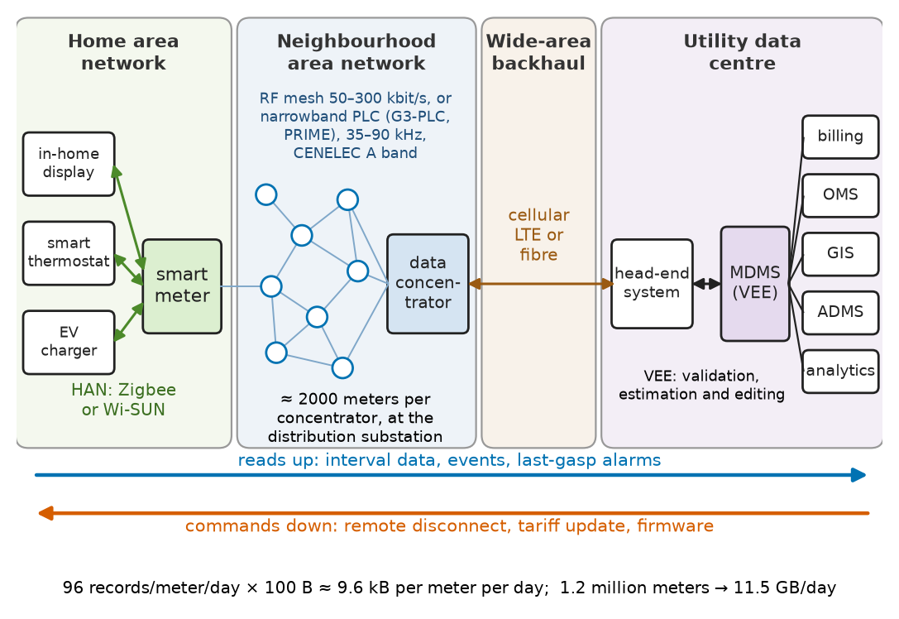
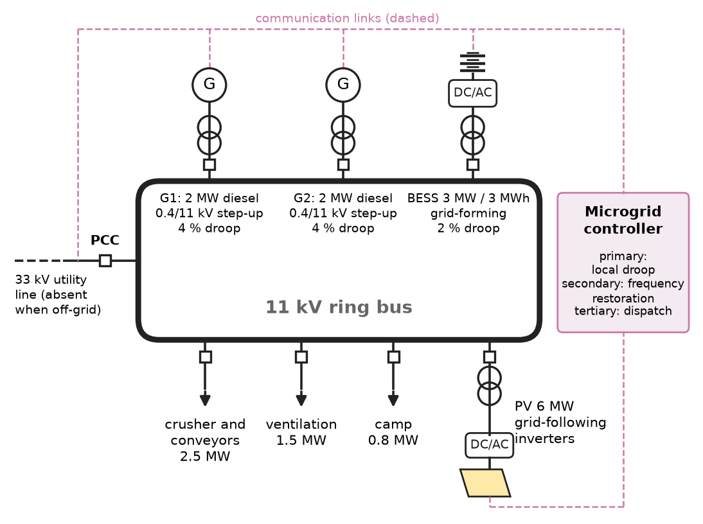
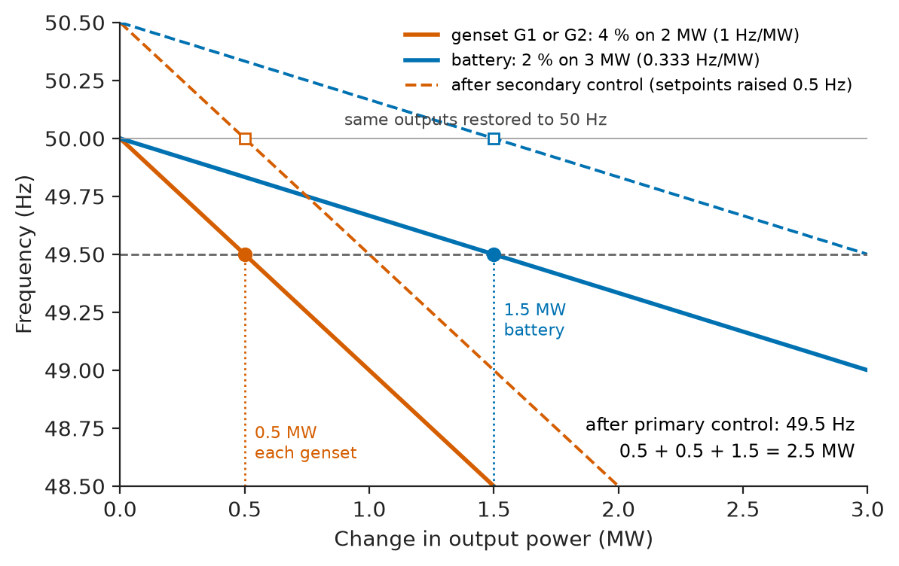
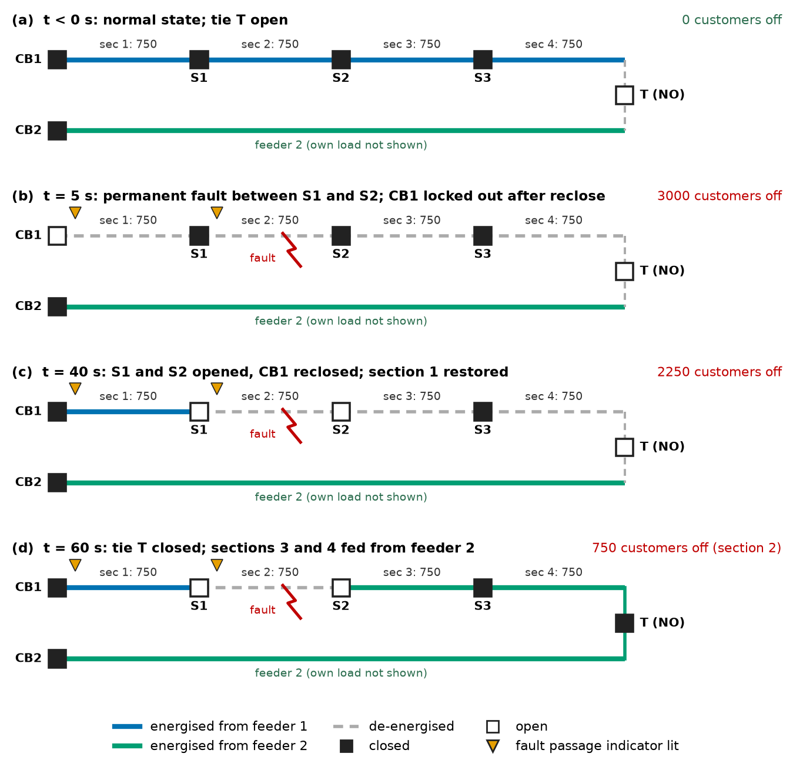
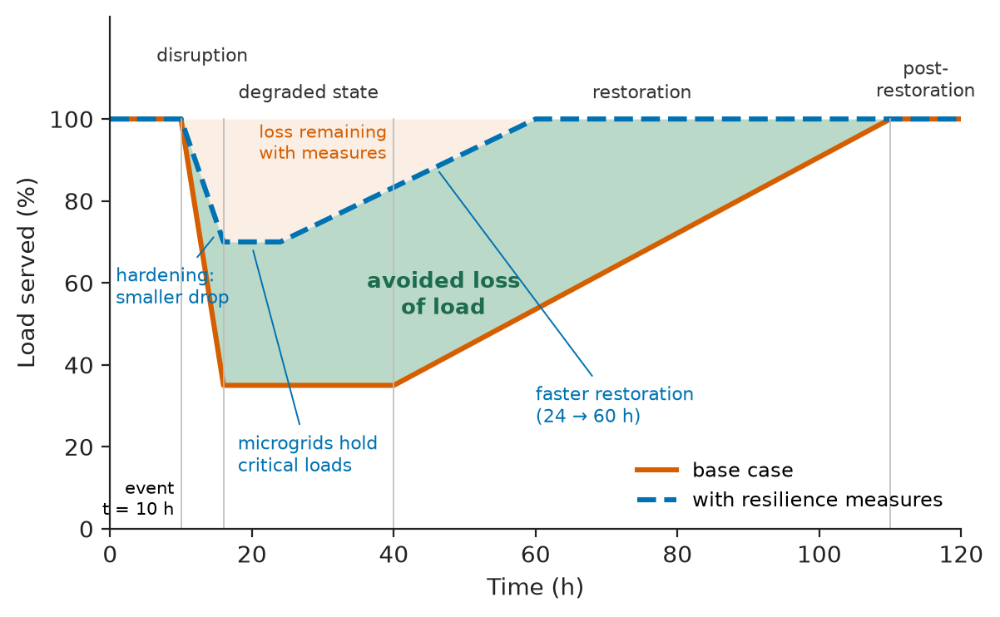

# Chapter 26 — Smart Grids

*Part VII · Power Quality and Grid Modernization*

At 02:40 on a winter night a tree falls across an 11 kV overhead feeder serving 3000 customers in a suburban district. Twenty years ago the first sign at the control room would have been the telephone: customers calling in, a crew sent to patrol the line with binoculars, sections isolated by hand one switch at a time, power restored to most customers after an hour and a half and to the rest after the repair. Today the substation breaker trips and recloses, the fault persists, and within a minute automated switches on the feeder have reported which section saw fault current, opened around it, and closed a normally open tie to an adjacent feeder; three quarters of the customers never notice more than a flicker. The smart meters in the faulted section send "last gasp" messages as their supply collapses, the outage-management system draws the outage on a map, and the crew drives straight to the span. The copper, the transformers and the physics of the feeder are the same as twenty years ago. What has changed is that the network can now measure itself, communicate and act.

> **What does it take, in sensors, communications and software, for a power network to observe and control itself down to the customer level?**
> **How do distributed resources, microgrids and flexible demand change the way the grid is operated, and what new risks, from cyberattack to loss of observability, come with that change?**

| Concept | Engineering destination |
|---|---|
| Smart-metering systems | Interval billing, outage detection, LV voltage monitoring, theft detection |
| Grid communication | Protection signalling, SCADA, AMI backhaul, DER control |
| Distributed energy resources | Rooftop PV, home batteries, EV charging, virtual power plants |
| Microgrids | Campuses, hospitals, mines, islands, military bases |
| Demand response | Peak reduction, reserves from load, tariff design |
| Grid automation | Substation automation, FLISR, volt/var optimisation |
| Grid observability | State estimation, PMUs, distribution-system visibility |
| Energy management systems | AGC, economic dispatch, ADMS, DERMS, building EMS |
| Cybersecurity fundamentals | IEC 62351, IEC 62443, NERC CIP compliance, secure architectures |
| Resilience | Storm hardening, black start, islanding of critical loads |

**Roadmap.** The sensing layer first: smart meters (26.1) and the communication networks that carry their data and every other signal (26.2). Then the new actors at the edge: distributed resources (26.3), microgrids (26.4) and responsive demand (26.5). Then the control layer: automation (26.6), observability (26.7) and the energy management systems that close the loop (26.8). Two cross-cutting concerns finish the chapter: cybersecurity (26.9) and resilience (26.10).

> **Boundary.** The communication theory this chapter relies on (channels, modulation, link budgets, fading, fibre, error control) is in *Circuits, Signals and Communications*, [Ch. 25](https://github.com/The-Studio-of-Sadiq/Circuits-Signals-and-Communications/blob/main/part-6-communication-theory/25-communication-system-fundamentals.md), [Ch. 27](https://github.com/The-Studio-of-Sadiq/Circuits-Signals-and-Communications/blob/main/part-6-communication-theory/27-digital-communication.md), [Ch. 30](https://github.com/The-Studio-of-Sadiq/Circuits-Signals-and-Communications/blob/main/part-6-communication-theory/30-wireless-and-mobile-communications.md) and [Ch. 31](https://github.com/The-Studio-of-Sadiq/Circuits-Signals-and-Communications/blob/main/part-6-communication-theory/31-optical-communications.md); digital power and energy measurement is in [Ch. 9 §9.9](https://github.com/The-Studio-of-Sadiq/Circuits-Signals-and-Communications/blob/main/part-2-transient-and-ac-analysis/09-ac-power.md); feedback and digital control in [Ch. 34–35](https://github.com/The-Studio-of-Sadiq/Circuits-Signals-and-Communications/blob/main/part-7-control-system-fundamentals/35-control-design-fundamentals.md). This chapter uses those results to design and operate power networks. Meter and controller electronics belong to *Electronics & Computing*.

---

## 26.1 Smart-metering systems

### From meter reading to metering infrastructure

An electromechanical meter integrated energy on a spinning disc and was read by a person once a month or once a quarter. It answered one question: how many kilowatt-hours since the last visit. A **smart meter** is a sampled-data power analyser (the signal chain of *Circuits, Signals and Communications*, Ch. 9 §9.9) with a clock, memory, a communication module and, usually, a remotely operable disconnect switch. The system around it is **advanced metering infrastructure** (AMI): meters, a **neighbourhood network** to data concentrators, a **backhaul** to the utility, a **head-end system** that manages communication, and a **meter data management system** (MDMS) that validates, estimates and stores the data and passes it to billing, outage management and network planning (Figure 26.1). Automatic meter reading (AMR), its predecessor, was one-way and served billing only; AMI is two-way.

<!-- FIGURE 26.1 | figures/ch26/fig-26-1-ami-architecture.png | block-diagram | Architecture of an advanced metering infrastructure. | Content: left to right. Home area: smart meter with HAN link (Zigbee or Wi-SUN) to an in-home display, smart thermostat and EV charger. Neighbourhood area network: 2000 meters on RF mesh at 50 to 300 kbit/s or narrowband PLC (G3-PLC, PRIME, 35 to 90 kHz CENELEC A band) to a data concentrator at the distribution substation. Wide area backhaul: cellular LTE or fibre to the utility. Utility data centre: head-end system, MDMS with validation, estimation and editing, then interfaces to billing, outage management system, GIS, ADMS and analytics. Annotate data rates: 96 interval records per meter per day, about 9.6 kB per meter per day, 11.5 GB per day for 1.2 million meters. Arrows show two-way traffic: reads up, commands (disconnect, tariff update, firmware) down. -->

*Figure 26.1 — Architecture of an advanced metering infrastructure.*

### What the meter measures

Modern meters record, at intervals of 15 or 30 minutes (5 minutes in some markets), active import and export energy, reactive energy in four quadrants, RMS voltage per phase (average, minimum and maximum), and event logs: supply interruptions with time stamps, voltage sags and swells, tamper alarms and cover openings. Accuracy is specified by IEC 62053 (class 1 or 0.5S for residential and commercial meters, 0.2S for large customers and grid exchange points) or ANSI C12.20 (accuracy classes 0.5 and 0.2). The data model is standardised in IEC 62056 (DLMS/COSEM) or ANSI C12.19, so that meters and head-ends from different vendors can work together.

### What the utility does with the data

- **Billing and tariffs.** Interval data make time-of-use and dynamic tariffs possible (Section 26.5) and end estimated bills.
- **Remote operations.** Connection, disconnection and load limiting without a site visit.
- **Outage management.** A meter's "last gasp" message, sent from the energy stored in its power-supply capacitor as voltage collapses, and its "power restored" message locate outages and confirm restoration, including the single customer whose service fuse remains blown after the feeder is re-energised.
- **Voltage monitoring.** Thousands of meter voltage readings give the first real view of LV voltage profiles, revealing where rooftop PV lifts voltage at noon (Chapter 27) and where evening load pulls it below the statutory band.
- **Network model correction.** Correlating meter voltage time series reveals which customers are on which phase and transformer, correcting the connectivity errors that plague every distribution GIS.
- **Loss and theft detection.** Comparing the energy through a distribution transformer with the sum of its customers' meters exposes non-technical losses, which exceed 10–20 % of energy in some networks.

**Worked example — Data volume of an AMI.** A utility deploys 1.2 million meters reading every 15 minutes. Each interval record (four channels of energy and voltage, time stamp, status flags and protocol overhead) occupies about 100 bytes. Estimate the daily data volume and the average throughput needed at a data concentrator serving 2000 meters.

Per meter per day: $96\times100=9600$ bytes. For the fleet:

$$
1.2\times10^6\times9.6\ \mathrm{kB}=11.5\ \mathrm{GB/day}\approx4.2\ \mathrm{TB/year}
$$

before events, power-quality logs and redundancy. At the concentrator, $2000\times9600\times8=153.6$ Mbit per day, an average of only 1.8 kbit/s. If the utility wants the previous day's data collected in a four-hour night window, the requirement rises to 10.7 kbit/s of *useful* throughput. That looks modest, but an RF mesh or narrowband PLC network delivers a small fraction of its raw rate after multi-hop relaying, retries and medium-access contention, and the same network must also carry on-demand reads, firmware updates (hundreds of kilobytes per meter) and outage messages that arrive all at once. Sizing an AMI network is therefore dominated by the peaks: a feeder outage generates thousands of last-gasp messages in the same second, most of which are lost, and the system is designed to infer the outage from the few that get through.

---

## 26.2 Grid communication

### Requirements set by the application

Every function in a smart grid is a control loop with a communication link in it, and the loop's timing sets what the link must do. Table 26.1 groups the main applications by their latency and reliability needs; the spread is six orders of magnitude, from protection at a few milliseconds to billing at a day.

**Table 26.1 — Communication requirements of grid applications (typical).**

| Application | Latency | Data rate per node | Availability | Typical medium |
|---|---|---|---|---|
| Line differential and teleprotection | 2–10 ms | 64 kbit/s–1 Mbit/s | 99.999 % | Fibre (OPGW), dedicated channels |
| IEC 61850 GOOSE trip within a substation | ≤ 3 ms (transfer class TT6) | Bursty, 10–100 Mbit/s LAN | 99.999 % with redundancy (PRP/HSR) | Substation Ethernet |
| Sampled values from merging units | < 3 ms | 5–10 Mbit/s per stream | 99.999 % | Process-bus Ethernet |
| Synchrophasor (PMU) data | 20–100 ms | 10–100 kbit/s | 99.9–99.99 % | Fibre, MPLS networks |
| SCADA telemetry and control | 1–4 s | 1–10 kbit/s | 99.9–99.99 % | Fibre, microwave, radio, cellular |
| Distribution automation (FLISR) | 0.1–10 s | 10–100 kbit/s | 99.9 % | Private LTE, RF mesh, fibre |
| DER and demand-response dispatch | 1 s–5 min | 1–10 kbit/s | 99–99.9 % | Cellular, internet (OpenADR, IEEE 2030.5) |
| AMI meter reading | Minutes–hours | 0.1–10 kbit/s | 99–99.5 % | RF mesh, narrowband PLC, cellular |

### Media

- **Optical fibre** is the backbone of transmission utilities, often run inside the earth wire of overhead lines (optical ground wire, OPGW) or wrapped on phase conductors. It is immune to electromagnetic interference, supports protection-grade latency over hundreds of kilometres, and its link budget is computed as in *Circuits, Signals and Communications*, Ch. 31.
- **Power-line carrier (PLC)** uses the power conductors themselves. On HV lines, analogue PLC at 30–500 kHz has carried teleprotection and voice since the 1930s. In distribution, narrowband PLC in the CENELEC A band (3–95 kHz) at tens of kbit/s (G3-PLC, PRIME) reads meters, especially in Europe; it is cheap because the channel already exists, but it is attenuated by capacitor banks and noisy loads and blocked by transformers.
- **Radio**: licensed point-to-point microwave for backhaul; 900 MHz and 2.4 GHz RF mesh for meters and feeder devices; private LTE (in dedicated utility bands) and public 4G/5G cellular for distribution automation and DER. Fading and outage are handled with the margins of *Circuits, Signals and Communications*, Ch. 30.
- **Satellite** for remote substations, mines and island systems where nothing else reaches.

A utility rarely chooses one: it builds a layered network, with fibre and microwave in the core, MPLS routing across it, and a mix of field-area technologies at the edge.

### Protocols

The protocols define what the bits mean. In substations, **IEC 61850** defines an object model of every device (logical nodes such as XCBR for a breaker, MMXU for measurements), the MMS client–server protocol for SCADA, **GOOSE** multicast messages for fast peer-to-peer trips and interlocks, and **sampled values** that replace copper CT and VT wiring with Ethernet from merging units. Between substations and control centres, **DNP3** (North America) and **IEC 60870-5-104** (Europe and much of Asia) dominate SCADA, with **ICCP/TASE.2** between control centres. **IEEE C37.118** carries synchrophasors. At the edge, **OpenADR** and **IEEE 2030.5** carry demand-response and DER signals, **IEC 61850-7-420** and **SunSpec Modbus** describe inverters, and **DLMS/COSEM** carries meter data.

> **Status of the principle: Latency budgeting of grid control loops**
> *Approximate.* A loop is stable and effective if total delay (measurement, communication, computation, actuation) is a small fraction of the time constant of the process controlled, as feedback theory requires; worst-case rather than average delay must be used, and packet-switched networks with retransmission and queuing have delay distributions with long tails that must be bounded by engineering (priority tagging, dedicated bandwidth), not assumed.

---

## 26.3 Distributed energy resources

### What counts as a DER

A **distributed energy resource** is any generation, storage or controllable load connected to the distribution network or behind a customer's meter: rooftop and commercial PV (typically 3 kW to 5 MW), small wind, combined heat and power units, standby diesel generators, home and commercial batteries, EV chargers (7–22 kW AC at home, 50–350 kW DC on highways), heat pumps, and controllable industrial processes. Table 26.2 gives typical sizes and controllability.

**Table 26.2 — Typical distributed energy resources.**

| Resource | Typical size | Interface | Controllable quantities |
|---|---|---|---|
| Residential PV | 3–15 kW | Single- or three-phase inverter | Active-power curtailment, reactive power, volt-var |
| Commercial and industrial PV | 50 kW–5 MW | Three-phase inverters | As above, plus ramp limits, remote setpoints |
| Home battery | 5–15 kWh, 3–10 kW | Hybrid or AC-coupled inverter | Charge/discharge schedule, P and Q |
| EV charger (AC / DC) | 7–22 kW / 50–350 kW | On-board / off-board charger | Charging rate; bidirectional (V2G) on some |
| Heat pump, water heater | 1–10 kW | Motor drive or element | On/off, setpoint shifting |
| CHP engine | 50 kW–5 MW | Synchronous generator | Active and reactive power, island capability |
| Standby diesel | 100 kW–3 MW | Synchronous generator | Peak lopping, emergency supply |

### Why DERs change the network

Distribution networks were designed for one-way power flow from substation to customer. DERs bring four changes, each treated in its own chapter:

1. **Reverse power flow** and voltage rise on feeders at times of high generation and low load, which limit a feeder's **hosting capacity** (Chapters 22 and 27).
2. **Protection problems**: DER fault contribution can blind feeder relays or cause sympathetic tripping, and inverter-based DER contribute only 1.1–1.5 pu fault current (Chapters 23 and 27).
3. **Invisibility**: behind-the-meter PV masks load, so the substation sees "net load" and the operator does not know how much generation would vanish if a disturbance tripped it (Section 26.7).
4. **New controllability**: a million inverters and chargers that can respond to signals within seconds are a resource that conventional plant cannot match in speed, if they can be coordinated.

### Aggregation and the virtual power plant

A single home battery is too small to bid in a wholesale or reserve market, which typically has minimum bids of 0.1–1 MW. An **aggregator** combines thousands into a **virtual power plant** (VPP), forecasts their available flexibility, bids it as one unit and dispatches each device. A fleet of 5000 home batteries of 5 kW and 13.5 kWh offers 25 MW for up to about 2.7 hours, less the reserve each owner keeps for backup, and can reach full output within a second. VPPs of this kind provide frequency reserves in Australia, Germany and the UK, and peak capacity in California.

The utility side of the same coordination is the **DER management system** (DERMS), which knows where each resource is connected and ensures that the aggregator's dispatch does not violate local voltage and thermal limits (Section 26.8). Interconnection rules define what every DER must do automatically: in North America, IEEE 1547-2018 specifies voltage and frequency ride-through, volt-var and frequency-watt functions and communication interfaces, in categories (I, II, III) of increasing capability; in Europe the requirements follow the Requirements for Generators network code (EU 2016/631) and national standards such as VDE-AR-N 4105. The control behind these functions is the subject of Chapter 27.

---

## 26.4 Microgrids

### Definition and forms

A **microgrid** is a group of interconnected loads and distributed resources within clearly defined electrical boundaries that acts as a single controllable entity with respect to the grid and can connect and disconnect from it, operating either grid-connected or islanded (the definition used by IEEE 2030.7 and the US Department of Energy). The defining capability is the controlled transition to and from **island** operation, which distinguishes a microgrid from a site that merely has generation.

Microgrids appear wherever continuity is worth more than its cost or no grid exists:

- **Campuses and hospitals** with CHP, PV, batteries and standby generators, islanding during grid outages.
- **Military bases and data centres**, for mission continuity.
- **Remote mines and islands**, which are permanently islanded diesel systems progressively displaced by PV, wind and batteries; a mine at 50 MW and an island at 5 MW face the same control problems.
- **Ships and aircraft**, which are, electrically, islanded microgrids with tight frequency and voltage limits (IEC 60092, MIL-STD-704).
- **Community microgrids** on utility feeders, created by sectionalising a feeder around a substation battery.

Figure 26.2 shows a typical architecture. Microgrids may be AC (most), DC (data centres, some PV-plus-storage sites, ships with DC distribution) or hybrid.

<!-- FIGURE 26.2 | figures/ch26/fig-26-2-mine-microgrid.png | single-line | Single-line diagram of an islanded mine microgrid with diesel, PV and battery. | Content: 11 kV ring bus. Two 2 MW diesel gensets (each with 0.4/11 kV step-up, droop 4 percent), a 3 MW / 3 MWh battery system with grid-forming inverter (droop 2 percent), a 6 MW PV array with grid-following inverters, and loads: 2.5 MW crusher and conveyors, 1.5 MW ventilation, 0.8 MW camp. Point of common coupling breaker to a 33 kV utility line shown dashed (absent for the off-grid case). Microgrid controller block linked by dashed communication lines to every source and to the PCC breaker, with labels primary (local droop), secondary (frequency restoration), tertiary (dispatch). -->

*Figure 26.2 — Single-line diagram of an islanded mine microgrid with diesel, PV and battery.*

### Control hierarchy

Microgrid control is organised in three layers, separated by time scale:

- **Primary control** (milliseconds to seconds) acts locally at each source without communication, sharing load changes and holding voltage and frequency. With synchronous generators this is the governor and AVR droop of Chapter 7; inverters emulate it with **frequency–active-power** and **voltage–reactive-power droop** (Chapter 27).
- **Secondary control** (seconds to minutes) restores frequency and voltage to nominal after a load change by shifting the droop setpoints, through a central microgrid controller or by distributed consensus.
- **Tertiary control** (minutes to hours) dispatches the units economically, manages battery state of charge, schedules generator starts and stops, and handles the import/export with the main grid.

In **islanded** mode at least one source must be **grid-forming**: it must set the voltage and frequency for the others. That role was always played by synchronous generators; in a high-renewable microgrid a grid-forming battery inverter takes it over, allowing all diesels to stop on sunny days.

**Worked example — Droop sharing in an islanded mine microgrid.** The mine microgrid of Figure 26.2 is islanded at 50 Hz with both 2 MW gensets (4 % droop) and the 3 MW battery (2 % droop) on line. The ventilation fans start a further stage, adding 2.5 MW of load in a few seconds. Find the steady-state frequency after primary control and the share taken by each unit.

A droop $R$ in per unit means that a change of the unit's rated power produces a frequency change of $R$ pu. Each unit's response is therefore $\Delta P_i=-(P_{rated,i}/R_i)\,\Delta f_{pu}$, and the "stiffness" of each is

$$
K_{genset}=\frac{2\ \mathrm{MW}}{0.04}=50\ \mathrm{MW/pu},\qquad K_{BESS}=\frac{3\ \mathrm{MW}}{0.02}=150\ \mathrm{MW/pu}
$$

for a total of $50+50+150=250$ MW/pu. The frequency falls by

$$
\Delta f_{pu}=\frac{2.5}{250}=0.01\ \mathrm{pu}=0.5\ \mathrm{Hz}
$$

to 49.5 Hz. The gensets each pick up $50\times0.01=0.5$ MW and the battery $150\times0.01=1.5$ MW: power is shared in proportion to rating divided by droop. The battery takes the largest share by design, because it responds in milliseconds and its smaller droop makes it stiffer; the diesels take less of the fast transient, which avoids their black-smoke and turbo-lag limitations. Secondary control then raises the setpoints to bring the frequency back to 50 Hz over 10–30 s, and the tertiary layer may start a third genset or let the battery carry the load until its state of charge reaches a floor. Figure 26.3 shows the droop lines. The same arithmetic applies to voltage–reactive-power droop, with the complication that reactive power sharing is also affected by the impedance between sources, so it is less exact.

<!-- FIGURE 26.3 | figures/ch26/fig-26-3-droop-sharing.png | plot | Frequency-power droop characteristics of two gensets and a battery sharing a 2.5 MW load step. | Content: x-axis output change 0 to 3 MW, y-axis frequency 48.5 to 50.5 Hz. Three lines from 50 Hz at zero change: each genset falling with slope 1 Hz per MW (4 percent on 2 MW, 2 Hz at 2 MW), the battery falling with slope 0.333 Hz per MW (2 percent on 3 MW, 1 Hz at 3 MW). Horizontal dashed line at 49.5 Hz intersecting genset lines at 0.5 MW and the battery line at 1.5 MW; annotation sum 2.5 MW. Second dashed set of lines shifted up by secondary control so that the same outputs occur at 50 Hz. -->

*Figure 26.3 — Frequency-power droop characteristics of two gensets and a battery sharing a 2.5 MW load step.*

> **Status of the principle: Steady-state droop sharing**
> *Derived.* Follows directly from the linear droop laws and the common steady-state frequency of a synchronous island; it neglects governor and inverter limits, frequency-dependent load and the transient (inertia and damping) behaviour, which govern the first seconds (Chapter 20).

### Transitions and protection

Planned islanding (opening the PCC breaker after reducing the exchange to near zero) is easy. Unplanned islanding after a grid fault requires the microgrid to survive a voltage dip, detect the loss of grid, open the PCC within a few cycles and pick up the full island load on its own sources; batteries and grid-forming inverters make this seamless, while diesel-only microgrids usually black out and restart. Reconnection requires synchronisation across the PCC breaker, exactly as for a generator (Chapter 7). Protection is the hardest part of microgrid design: in grid-connected mode the fault current is high, in islanded mode with inverter sources it may be only 1.2–2 times load current, so overcurrent relays set for one mode fail in the other. Adaptive protection with switched setting groups, differential protection and voltage-based schemes are used (Chapter 23).

---

## 26.5 Demand response

### Load as a resource

Demand response (DR) is the deliberate change of electricity consumption in response to price or to a signal from the system operator. It has always existed for large industrial customers on interruptible contracts; what is new is that controllable residential and commercial loads, now numbered in millions, can be aggregated and dispatched like a generator. The value is large because peaks are short: in many systems the top 1 % of hours (about 88 hours a year) accounts for 8–15 % of peak capacity, which is built and maintained for those hours alone.

DR programmes divide into two families:

- **Price-based**: time-of-use tariffs (fixed peak and off-peak prices), critical-peak pricing (a very high price on 10–15 announced days a year), and real-time pricing that follows the wholesale price. Customers or their devices respond voluntarily.
- **Incentive-based**: direct load control (the utility cycles water heaters or air conditioners by radio or internet signal), interruptible and curtailable contracts for large customers, and participation of aggregated loads in capacity, energy and reserve markets.

The best DR resources have **thermal or energy storage built in**: water heaters, space heating and cooling, refrigeration and cold stores, EV charging, pumping (water utilities, irrigation), and industrial processes with buffer storage (cement mills, electrolysers, aluminium smelters, which can shed hundreds of megawatts for an hour). Their consumption can be shifted in time without loss of service.

### Payback and verification

Deferred energy is not saved; it is moved, and it comes back. When a group of water heaters or air conditioners is released after a control period, their thermostats all call for heat or cooling at once and the aggregate load rises above its normal level, the **payback** or **rebound** peak. Poorly managed, the rebound can create a new peak an hour after the old one.

**Worked example — Direct control of water heaters.** A utility controls 20,000 residential water heaters of 3 kW. At the evening peak, on average 25 % are on at any instant. The utility switches them all off for 2 hours. Estimate the peak reduction, the deferred energy and the rebound if, on release, 60 % switch on together.

Load removed at the peak: $20\,000\times3\ \mathrm{kW}\times0.25=15$ MW.

Deferred energy (ignoring the extra standing losses saved while tanks cool): $15\ \mathrm{MW}\times2\ \mathrm h=30$ MWh.

On release, $0.6\times20\,000\times3\ \mathrm{kW}=36$ MW is drawn, 21 MW above the normal 15 MW, for about $30/21=1.4$ hours until the deferred energy is recovered. A 15 MW peak reduction has been bought at the cost of a 21 MW rebound. In practice the utility releases the heaters in groups staggered over an hour or two, so that the rebound is spread below the original peak, and it can make the control period itself rotate between groups (each heater off for 30 minutes in turn) to deliver a smaller but flat reduction.

Measuring what a customer *would* have consumed without the DR event, the **baseline**, is the central problem of paying for DR. Baselines are computed from recent similar days (for example the average of the highest 5 of the last 10 working days, adjusted for the morning of the event), and they can be gamed. Direct load control with device-level telemetry, and statistical control groups, are the more robust methods. **OpenADR 2.0** and **IEEE 2030.5** are the standard signalling protocols between operators, aggregators and devices.

---

## 26.6 Grid automation

### Substation automation

A modern substation replaces the hard-wired relay panels, mimic boards and RTUs of the past with intelligent electronic devices (IEDs) on an IEC 61850 network. The architecture has three levels: the **process level** (merging units and breaker interface units in the yard, connected by a process bus carrying sampled values and trip commands over fibre), the **bay level** (protection and control IEDs), and the **station level** (station computer, HMI and gateway to the control centre). Benefits are less copper wiring between yard and control building (a 400 kV substation may have thousands of kilometres of it), self-supervision of every link, and engineering by configuration files (SCL) rather than wiring diagrams. The cost is a new class of failure: a misconfigured network switch can disable protection, so redundancy (PRP, HSR) and rigorous testing are mandatory.

### Distribution automation and FLISR

Most customer interruptions originate on the distribution network, so automating it has the largest effect on reliability indices. The key function is **fault location, isolation and service restoration** (FLISR). On a feeder with remotely controlled sectionalising switches or reclosers and normally open ties to neighbouring feeders, the sequence after a permanent fault is:

1. The feeder breaker or recloser trips; reclosing fails.
2. Fault passage indicators at each switch report whether fault current passed through it. The fault lies between the last switch that saw it and the first that did not.
3. The switches either side of the faulted section open.
4. The feeder breaker recloses to restore the upstream sections; the normally open tie to an adjacent feeder closes to restore the downstream sections, after checking that the adjacent feeder has capacity.

This can be centralised (in the ADMS), distributed (switches communicating peer to peer) or local (reclosers using voltage and time logic, without communication). Completion within one to three minutes is typical. Figure 26.4 shows the sequence.

<!-- FIGURE 26.4 | figures/ch26/fig-26-4-flisr-sequence.png | single-line | Fault location, isolation and service restoration on two 11 kV feeders with a normally open tie. | Content: two feeders from substation breakers CB1 and CB2, each with four sections of 750 customers separated by remote switches S1, S2, S3 on feeder 1, joined at the far end by normally open tie switch T. Four panels: (a) normal state, (b) permanent fault between S1 and S2, CB1 tripped, all 3000 customers off, fault passage indicators lit at CB1 and S1 only, (c) S1 and S2 open, CB1 reclosed restoring section 1, (d) T closed restoring sections 3 and 4 from feeder 2; only section 2 (750 customers) remains off. Time stamps 0 s, 5 s, 40 s, 60 s. -->

*Figure 26.4 — Fault location, isolation and service restoration on two 11 kV feeders with a normally open tie.*

**Worked example — Reliability benefit of FLISR.** An 11 kV feeder serves 3000 customers in four equal sections, and suffers 2 permanent faults per year. Without automation, after a fault the unfaulted three quarters of the customers are restored by manual switching after 1.5 h on average, and the faulted quarter after repair, 4 h. With FLISR the unfaulted sections are restored within one minute. Compare the feeder's contribution to SAIDI and SAIFI.

Without automation, customer-hours of interruption per year:

$$
2\times\left(2250\times1.5+750\times4\right)=2\times(3375+3000)=12\,750\ \mathrm{customer\cdot h}
$$

SAIDI for these customers $=12\,750\times60/3000=255$ minutes per year; SAIFI $=2$ interruptions per customer per year.

With FLISR, the 2250 unfaulted customers see a one-minute interruption, which under IEEE 1366 is a momentary event (less than 5 minutes) and does not count in SAIDI or SAIFI. Customer-hours $=2\times750\times4=6000$, SAIDI $=120$ minutes; SAIFI $=2\times750/3000=0.5$. FLISR halves SAIDI and cuts SAIFI by three quarters, without touching the fault rate. The momentary-interruption index MAIFI rises, which matters to customers with sensitive processes (Chapter 25), so FLISR complements, and does not replace, fault reduction.

### Volt/var optimisation and conservation voltage reduction

The second major automation function is **volt/var optimisation** (VVO): coordinated control of substation tap changers, line regulators, switched capacitors and inverter reactive power to hold every customer's voltage inside the band while minimising losses or demand. A common objective is **conservation voltage reduction** (CVR): operating in the lower half of the statutory band, because many loads draw less power at lower voltage. The **CVR factor** is the percentage energy reduction per percentage voltage reduction, measured at 0.5–1.0 for typical residential and commercial feeders (lower where loads are constant-power electronics or thermostatic). A 3 % voltage reduction on a feeder delivering 40 GWh per year with a CVR factor of 0.8 saves $0.8\times3=2.4\,\%$, or 0.96 GWh per year. CVR depends on knowing the voltage at the end of every feeder, which is exactly what AMI voltage data now provide.

> **Status of the principle: CVR factor**
> *Empirical.* Fitted from field trials on specific feeders; it reflects the voltage dependence of the load mix (resistive and motor loads respond, electronic and thermostatically controlled loads largely do not, or recover energy later) and is falling as constant-power electronic loads replace resistive ones.

---

## 26.7 Grid observability

### What an operator can see

A power system is **observable** when the available measurements are sufficient to determine the complex voltage at every bus. Transmission systems have been observable since the 1970s: SCADA RTUs report breaker states, flows and voltages every 2–4 seconds, and a **state estimator** fits a consistent network solution to these redundant, noisy measurements by weighted least squares, detects and rejects bad data, and provides the base case for contingency analysis and security assessment (Section 26.8). Redundancy, typically 1.5 to 3 measurements per state variable, is what allows bad data to be identified.

Distribution networks were, until recently, almost unobservable below the substation: a feeder head current and perhaps a few line-sensor readings for hundreds of transformers and thousands of customers. Load was inferred from monthly energy and typical load profiles (**pseudo-measurements**). AMI voltage and interval data, line sensors, and inverter telemetry are changing this, but data latency (meters report hours later) and the cost of real-time communication to millions of points mean that distribution state estimation still mixes a few real-time measurements with many forecasts and pseudo-measurements.

The hardest blind spot is **behind-the-meter generation**. A substation that sees 20 MW of net load may be serving 35 MW of gross load with 15 MW of rooftop PV hidden behind it. If a voltage dip trips that PV (older inverters disconnect on small disturbances), the load seen by the grid jumps by 15 MW at once. Estimating hidden PV from irradiance data, sample metering and inverter fleet data is now a routine operating task.

### Synchrophasors

A **phasor measurement unit** (PMU) samples voltages and currents, estimates their phasors (magnitude and angle) and stamps each estimate with GPS-derived time accurate to better than 1 µs, so that phasors from substations hundreds of kilometres apart can be compared directly. Reporting rates are 10–60 per second (25 or 50 at 50 Hz, 30 or 60 at 60 Hz), against one sample per 2–4 s for SCADA. Accuracy is specified by IEEE C37.118.1 through the **total vector error**

$$
\mathrm{TVE}=\frac{\lvert\hat{\mathbf X}-\mathbf X\rvert}{\lvert\mathbf X\rvert}
$$

with a steady-state limit of 1 %. A 1 % TVE corresponds to a pure angle error of 0.573°, which at 50 Hz is a time error of only $0.573/360\times20\ \mathrm{ms}=31.8\ \mu$s (26.5 µs at 60 Hz); this is why GPS or IEEE 1588 precision time is essential.

PMUs made possible what SCADA could not: direct observation of angle differences across a grid (the stress indicator behind the power-angle relationship of Chapter 7), real-time detection of inter-area oscillations at 0.1–1 Hz (Chapter 20), linear state estimation at the reporting rate, post-event analysis with exact timing, and wide-area protection schemes. **Distribution PMUs** (micro-PMUs), with angle resolution of 0.01° or better, extend the idea to feeders, where angle differences are tiny.

> **Status of the principle: Total vector error as a PMU accuracy measure**
> *Derived.* TVE combines magnitude, phase and timing errors into a single vector distance; it is exact as a definition, but a TVE limit says nothing about which component dominates, so frequency and ROCOF accuracy are specified separately, and dynamic performance (during ramps and oscillations) has its own, looser limits.

---

## 26.8 Energy management systems

### At the transmission control centre

An **energy management system** (EMS) is the software suite with which a transmission operator runs the bulk power system. Its layers are:

- **SCADA**: telemetry, alarms and remote control of breakers and setpoints.
- **Network analysis**: topology processing, state estimation (Section 26.7), power flow (Chapter 18), **contingency analysis** that tests every credible outage ($N-1$) against thermal and voltage limits every few minutes, and online stability assessment (Chapter 20).
- **Generation control**: **automatic generation control** (AGC) and **economic dispatch**, and in market systems the security-constrained unit commitment and dispatch that set prices.

AGC is the secondary frequency control of a whole interconnection. Each balancing area computes its **area control error**

$$
\mathrm{ACE}=(NI_A-NI_S)-10B\,(F_A-F_S)
$$

where $NI_A$ and $NI_S$ are the actual and scheduled net interchange (MW, export positive), $F_A$ and $F_S$ the actual and scheduled frequency, and $B$ the area's frequency bias (negative, in MW per 0.1 Hz, as defined in NERC practice). AGC adjusts the setpoints of participating generators every 2–6 s to drive ACE towards zero. The two terms are arranged so that each area corrects only its own imbalance while all areas share the primary frequency response.

> **Status of the principle: Tie-line bias control (area control error)**
> *Approximate.* Assumes each area's frequency response is linear and correctly represented by its bias $B$; when $B$ differs from the area's true response, areas partly correct each other's imbalances, and the scheme takes no account of the dynamics within the first seconds, which belong to primary control (Chapter 20).

**Worked example — Area control error after a generator trip.** A balancing area has a frequency bias of $B=-120$ MW/0.1 Hz and a scheduled export of 500 MW. After one of its own units trips, the actual export falls to 460 MW and the interconnection frequency to 59.97 Hz (scheduled 60.00 Hz). Find the ACE.

$$
\mathrm{ACE}=(460-500)-10\times(-120)\times(59.97-60.00)=-40-36=-76\ \mathrm{MW}
$$

A negative ACE means the area is short of generation: AGC raises its units' output by 76 MW. The 40 MW drop in export is the help the area is receiving from its neighbours through their primary response; the 36 MW term is the area's own share of the frequency deviation. Had the trip occurred in a *neighbouring* area, this area's export would have *risen* by about its own response (36 MW, to 536 MW), and ACE $=36-36=0$: correctly, this area's AGC would do nothing, leaving the neighbour to correct its own loss.

### In distribution, buildings and microgrids

The distribution counterpart is the **advanced distribution management system** (ADMS), which combines distribution SCADA, the outage management system fed by AMI and customer calls, the network model from GIS, FLISR, VVO, distribution state estimation and, increasingly, a **DERMS** that forecasts, monitors and dispatches distributed resources within network limits. The ADMS is the platform on which most of Sections 26.1–26.7 come together.

At smaller scales the same functions recur. A **microgrid controller** performs dispatch, state-of-charge management and island transitions. A **building energy management system** (BEMS) schedules HVAC, lighting, storage and EV charging against tariffs and comfort constraints, and is how commercial buildings participate in demand response; data centres and industrial plants use the same principles with process constraints (Chapter 28). A **home EMS** coordinates PV, battery, heat pump and EV. Every one of them is an optimiser with a forecast at its input and a control loop at its output, and every one depends on the communication and observability layers beneath it.

---

## 26.9 Cybersecurity fundamentals

### Why the grid is a target

Connecting protection relays, substations, meters and millions of inverters to communication networks exposes the grid to remote attack. The threat is not hypothetical. In December 2015, attackers who had spent months inside three Ukrainian distribution companies' networks opened breakers remotely through the companies' own SCADA systems, interrupting about 225,000 customers for several hours, and overwrote the firmware of serial-to-Ethernet converters to prevent remote restoration. In December 2016 the Industroyer (CrashOverride) malware, which spoke IEC 60870-5-104, IEC 61850 and OPC natively, opened breakers at a Kyiv transmission substation. Stuxnet (discovered 2010) showed that malware could manipulate industrial controllers while reporting normal values to operators.

### Security for operational technology

Information security is usually summarised as **confidentiality, integrity and availability**. In operational technology (OT), the priorities are reversed: **availability** and **integrity** of control come first, confidentiality last. A protection IED must never be delayed by a security check: GOOSE trips must arrive within 3 ms, which rules out many conventional cryptographic handshakes. Field devices last 20–30 years and cannot be patched weekly. Many legacy protocols (Modbus, early DNP3, IEC 60870-5-101/104) have no authentication: any device that can reach them can issue commands.

Defences follow a few principles:

- **Defence in depth and segmentation.** Networks are divided into zones by function and criticality, connected only through controlled conduits (IEC 62443's zones and conduits; the layered "Purdue model" of enterprise, operations and control networks), with demilitarised zones between corporate IT and OT. No direct path from the internet or the corporate network to a protection relay.
- **Authentication and integrity of commands.** IEC 62351 adds TLS to MMS and IEC 60870-5-104, authentication codes to GOOSE and sampled values, and role-based access control; DNP3 Secure Authentication adds challenge–response to critical commands.
- **Least functionality.** Unused ports and services disabled; firmware signed; engineering access through jump hosts with multi-factor authentication.
- **Monitoring.** OT-aware intrusion detection that knows what normal SCADA traffic looks like, logging of every configuration change, and the ability to operate manually if networks are compromised.
- **Supply chain and DER.** Inverter and charger fleets controlled through vendor clouds are a new attack surface: a compromised cloud platform could, in principle, change the settings of a gigawatt of inverters at once, which is a larger and faster disturbance than any single generator trip. Standards (IEEE 1547.3, UL 2941) and regulators increasingly address this.

Regulation makes some of this mandatory: NERC CIP standards in North America for the bulk electric system, the EU NIS2 directive and network codes on cybersecurity, and national equivalents. They define asset categorisation, electronic and physical perimeters, access management, incident response and recovery planning.

---

## 26.10 Resilience

### Reliability and resilience

**Reliability** describes performance under routine, credible events: the frequency and duration of interruptions caused by ordinary faults, measured by SAIFI and SAIDI (Chapter 13). **Resilience** describes the ability to withstand, adapt to and recover rapidly from high-impact, low-probability events: hurricanes, ice storms, floods, wildfires, earthquakes, geomagnetic storms, extreme cold or heat, and coordinated physical or cyberattack. These events are usually excluded from reliability statistics as "major event days", yet they cause most of the customer-hours lost in many systems. Examples are Hurricane Maria in Puerto Rico (2017), which left most of the island without power for months; the February 2021 Texas cold snap, when tens of gigawatts of generation were forced out by cold and fuel shortages and rotating outages lasted days; and the 2016 South Australian blackout, when a storm brought down transmission towers and a cascade of wind-farm protection settings tripped 456 MW.

### The resilience trapezoid

Resilience is often pictured with the **resilience trapezoid** (Figure 26.5): system performance (for example the fraction of load served) during an event falls (disruption), stays degraded (the post-disruption state) and is restored (recovery). The quantities that matter are how far performance falls, how long it stays low, and how fast it recovers, and the area of lost performance is the measure of total impact. Each phase has its own engineering measures.

<!-- FIGURE 26.5 | figures/ch26/fig-26-5-resilience-trapezoid.png | plot | The resilience trapezoid: performance of a network during and after an extreme event, with and without resilience measures. | Content: x-axis time in hours 0 to 120, y-axis load served 0 to 100 percent. Base case solid: 100 percent until event at t = 10 h, falls over 6 h to 35 percent, stays at 35 percent until 40 h, recovers linearly to 100 percent at 110 h. Improved case dashed: falls to 70 percent over 6 h (hardening), critical loads held by microgrids, recovery starts at 24 h and completes at 60 h (operational and restoration measures). Shade area between curves labelled avoided loss of load. Phases labelled: disruption, degraded state, restoration, post-restoration. -->

*Figure 26.5 — The resilience trapezoid: performance of a network during and after an extreme event, with and without resilience measures.*

- **Withstand (reduce the drop).** Hardening: undergrounding in high-risk areas, stronger poles and towers, vegetation management, covered conductors, flood walls around substations, fire-safe designs and pre-emptive de-energisation in wildfire weather (public safety power shut-off).
- **Adapt (sustain critical service).** Microgrids and backup supply for hospitals, water treatment, communications and emergency services; network reconfiguration to supply critical loads; islanding of healthy parts of the grid; demand response to stretch scarce generation; firm fuel supplies and winterised plant.
- **Recover (shorten the outage).** Black-start capability (Chapter 14), restoration plans and drills, mutual aid between utilities, mobile substations and generators, spare transformers, and situational awareness from AMI and drones to direct crews.

Resilience investments are justified differently from reliability investments: by the expected cost of rare, severe events, the value of lost load to critical customers, and scenario analysis, rather than by average indices. A hospital microgrid that does nothing in an average year but keeps an intensive-care unit running through a four-day outage may be worth more than a feeder upgrade that improves SAIDI by ten minutes.

Smart-grid technology cuts both ways here. Automation, microgrids, DER and storage make the grid more adaptable and faster to restore. But the same technology adds dependence on communications, on GPS time, on software and on the electricity supply of the communication network itself (cellular base stations typically have only 2–8 hours of battery), and it adds the cyber exposure of Section 26.9. A resilient smart grid is one that is designed to degrade gracefully to manual and local operation when its information layer fails.

---

## What remains open

| Open question | Where it is answered |
|---|---|
| How do grid-connected inverters synchronise, control P and Q, and meet grid codes? | [Chapter 27](27-grid-integration-of-renewable-energy.md) |
| How is the voltage rise from distributed PV calculated, and what limits hosting capacity? | [Chapter 22](../part-6-transmission-distribution-and-protection/22-distribution-systems.md), [Chapter 27](27-grid-integration-of-renewable-energy.md) |
| How do inertia, governor droop and reserves determine frequency after a disturbance? | [Chapter 20](../part-5-power-system-analysis/20-power-system-stability.md), [Chapter 27](27-grid-integration-of-renewable-energy.md) |
| How are batteries in VPPs and microgrids rated, managed and protected? | [Chapter 16](../part-4-power-generation/16-energy-storage.md) |
| How is protection adapted to low fault currents from inverter sources? | [Chapter 23](../part-6-transmission-distribution-and-protection/23-power-system-protection.md) |
| How are reliability indices defined and used in planning? | [Chapter 13](../part-4-power-generation/13-power-system-structure.md), [Chapter 22](../part-6-transmission-distribution-and-protection/22-distribution-systems.md) |
| How do building and industrial energy management translate into measured savings? | [Chapter 28](28-energy-efficiency-and-management.md) |
| How are channels, modulation and link budgets designed for grid communications? | *Circuits, Signals and Communications*, [Ch. 25–31](https://github.com/The-Studio-of-Sadiq/Circuits-Signals-and-Communications/blob/main/part-6-communication-theory/25-communication-system-fundamentals.md) |

**Next:** Chapter 27 goes inside the inverters that most distributed and renewable resources connect through, and asks what they must do to keep the grid stable as they replace synchronous machines.
