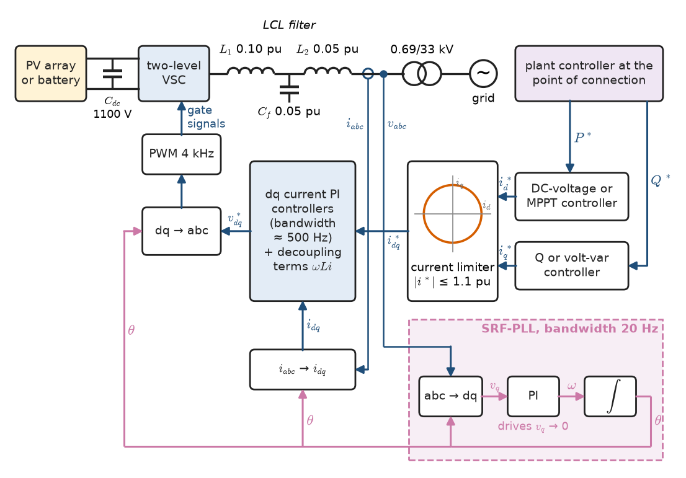
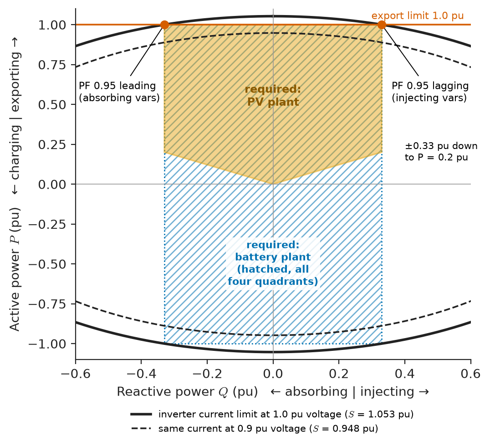
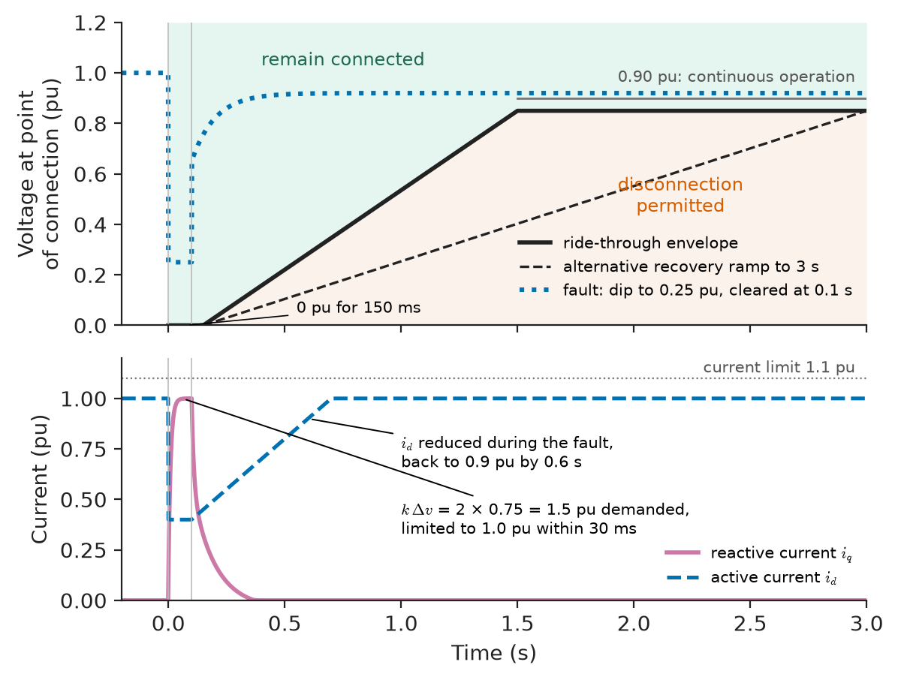
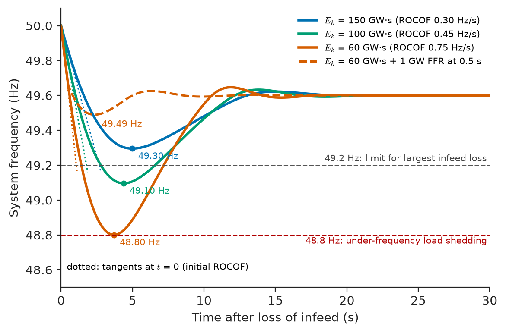
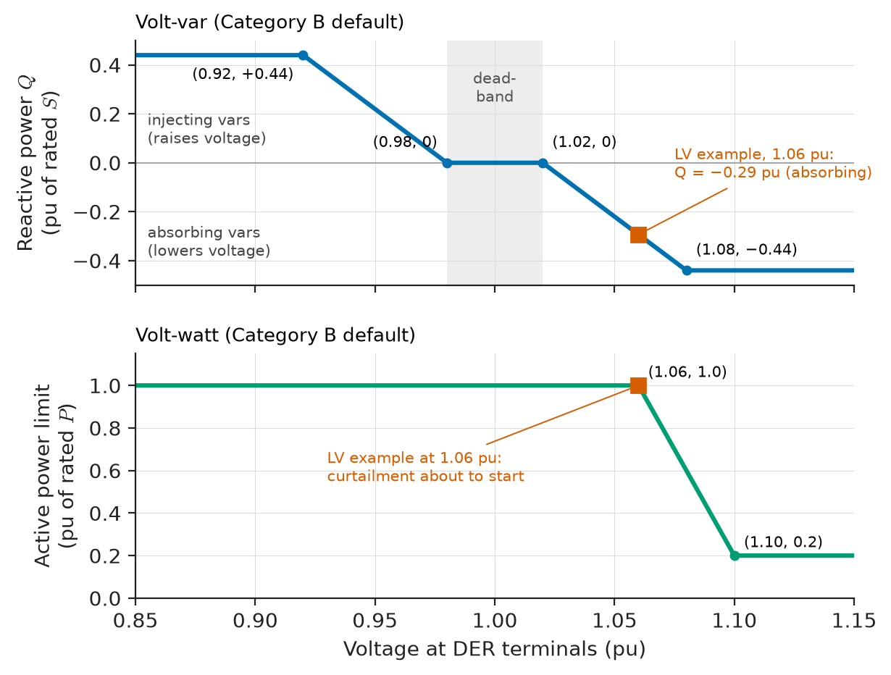
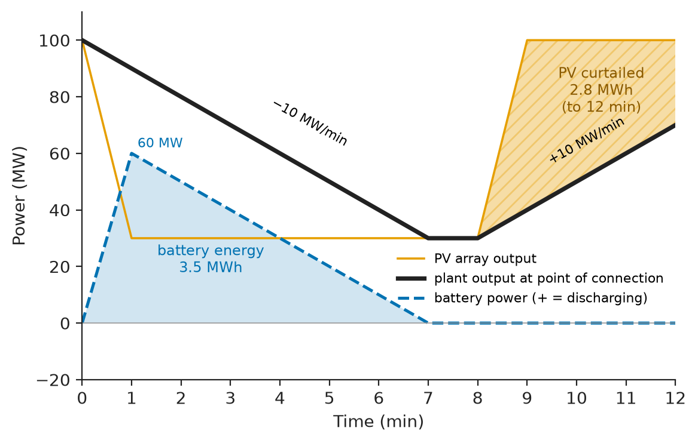

# Chapter 27 — Grid Integration of Renewable Energy

*Part VII · Power Quality and Grid Modernization*

On 9 August 2019 a lightning strike on a transmission line north of London caused a routine fault, cleared in under 100 ms. Within the next second an offshore wind farm's control system reacted badly to the voltage dip and reduced its output by more than 700 MW, a gas-fired plant tripped a steam turbine, and around 500 MW of small distributed generation disconnected because its loss-of-mains protection mistook the system's rate of change of frequency for an island. Frequency fell to 48.8 Hz, automatic demand disconnection shed about a million customers, and trains across the south-east stopped. No equipment was damaged and nothing was overloaded; the system lost more power faster than its inertia and reserves could absorb, and much of what it lost was connected through inverters whose behaviour during a disturbance had not been specified, or not tested, well enough. The incident is a compact summary of this chapter: renewable plants are now large enough that how their inverters behave in the first second after a fault matters as much as how much energy they produce in a year.

> **How does a grid-connected inverter synchronise to the grid and control the active and reactive power it delivers, and what do grid codes require it to do in normal operation and during disturbances?**
> **What limits the share of inverter-based generation a power system can accept, and how do frequency support, voltage support, storage and forecasting push that limit back?**

| Concept | Engineering destination |
|---|---|
| Grid-connected inverters | PV plants, wind turbines, battery systems, HVDC and STATCOM converters |
| Synchronization | Phase-locked loops, weak-grid stability, grid-forming control |
| Active and reactive power control | Plant controllers, curtailment, reactive capability at the point of connection |
| Grid-code fundamentals | IEEE 1547, IEEE 2800, ENTSO-E RfG, compliance testing |
| Anti-islanding | Rooftop PV, distribution protection, utility worker safety |
| Frequency support | Fast frequency response, synthetic inertia, frequency-watt functions |
| Voltage support | Volt-var control, fault-current injection, hosting capacity |
| Storage coordination | Ramp-rate control, firming, co-located PV and battery plants |
| Forecasting | Reserve sizing, unit commitment, curtailment planning |
| Renewable penetration limits | Inertia floors, system strength, SNSP limits, synchronous condensers |

**Roadmap.** The device first: what a grid-connected inverter is as a power-system component (27.1), and how it locks onto the grid (27.2) and controls P and Q (27.3). Then the rules it must follow: grid codes (27.4) and anti-islanding (27.5). Then the services the system needs from it: frequency support (27.6) and voltage support (27.7), and the storage that makes those services firm (27.8). Finally the system view: forecasting (27.9) and the limits to renewable penetration (27.10).

> **Boundary.** Inverter circuits, PWM and switching devices are outlined in *Engineering Physics*, [Ch. 18 §18.8](https://github.com/The-Studio-of-Sadiq/Engineering-Physics/blob/main/CHAPTERS/CHAPTER%2018.md), and belong in detail to *Electronics & Computing*; PWM inverters for drives are treated in Chapter 12. Three-phase phasors and complex power are from *Circuits, Signals and Communications*, [Ch. 9](https://github.com/The-Studio-of-Sadiq/Circuits-Signals-and-Communications/blob/main/part-2-transient-and-ac-analysis/09-ac-power.md) and [Ch. 10](https://github.com/The-Studio-of-Sadiq/Circuits-Signals-and-Communications/blob/main/part-2-transient-and-ac-analysis/10-three-phase-circuits.md); the feedback theory behind PLLs and current controllers is in [Ch. 34–35](https://github.com/The-Studio-of-Sadiq/Circuits-Signals-and-Communications/blob/main/part-7-control-system-fundamentals/34-feedback-and-stability.md). The rotating kinetic energy that inertia refers to is the rigid-body result of *Engineering Physics*, [Ch. 9 §9.7](https://github.com/The-Studio-of-Sadiq/Engineering-Physics/blob/main/CHAPTERS/CHAPTER%209.md); the swing equation is in Chapter 20 of this book.

---

## 27.1 Grid-connected inverters

### The inverter as a power-system component

A synchronous generator is a voltage source behind a reactance whose frequency is fixed by a spinning rotor and whose internal voltage is set by its field current (Chapter 7). A grid-connected **voltage-source converter** (VSC) is, at the fundamental frequency, the same thing without the rotor: a three-phase voltage $\mathbf E$ synthesised by pulse-width modulation from a DC link, connected to the grid voltage $\mathbf V$ through a filter inductance (or an LCL filter) and usually a step-up transformer, together a reactance $X$. The power it delivers follows the same power-angle relations as for the synchronous machine:

$$
P=\frac{EV}{X}\sin\delta,\qquad Q=\frac{EV\cos\delta-V^2}{X}
$$

Two differences matter. First, $E$ and $\delta$ are not physical states of a rotor but outputs of a control algorithm, updated every switching period (tens to hundreds of microseconds); the converter has no inertia and no natural tendency to stay synchronised. Second, its semiconductors have almost no thermal capacity, so its current is strictly limited, typically to 1.0–1.2 pu continuously and 1.1–1.5 pu for a few seconds. A synchronous machine can deliver 5–7 pu fault current for a few cycles; an inverter cannot.

> **Status of the principle: Inverter as a controlled voltage source behind a reactance**
> *Approximate.* Valid for the fundamental-frequency, averaged behaviour over many switching periods when the DC link is stiff and the converter is within its current limit; it fails for harmonic and switching-frequency phenomena, during current limiting (when the converter becomes a current source), and on time scales comparable with its control bandwidth.

### Architectures in renewable plants

Table 27.1 summarises how the main renewable and storage technologies connect.

**Table 27.1 — Grid interfaces of renewable and storage plants.**

| Plant | Typical unit size | Converter arrangement | Grid side |
|---|---|---|---|
| Residential PV | 3–10 kW | String or micro-inverters | 230 V single-phase or 400 V |
| Utility PV | 3–5 MW blocks, plants to 1 GW | 1500 V DC strings, central or string inverters (630–800 V AC) | MV transformers, HV substation |
| Wind, Type 3 (DFIG) | 2–5 MW | Partial-rated converter (about 30 %) in rotor circuit | 690 V stator direct, MV transformer |
| Wind, Type 4 (full converter) | 3–15 MW | Full-rated back-to-back converter, PMSG or induction generator | 690 V–3.3 kV, MV transformer |
| Battery storage | 1–5 MW blocks, plants to several GWh | Bidirectional inverter, DC- or AC-coupled | MV transformers, HV substation |
| HVDC (VSC) | 0.5–2 GW | Modular multilevel converter | 220–525 kV AC |

Utility-scale plants have a **power plant controller** at the point of connection that measures P, Q, V and f there and sends setpoints to the hundreds of inverters below it, so that the plant behaves as one unit; grid codes are written for this point, not for the individual inverter.

**Worked example — Converter voltage needed for reactive capability.** A 690 V wind-turbine converter is rated 1.0 pu active power and must deliver $\pm0.33$ pu reactive power at full output over a grid-voltage range of 0.9–1.1 pu. The filter and transformer reactance is $X=0.15$ pu. Find the internal voltage $E$ the converter must synthesise, and hence the DC-link voltage.

With $\mathbf V$ as reference and $S=P+jQ=\mathbf V\mathbf I^*$, the current is $\mathbf I=(P-jQ)/V$ and $\mathbf E=\mathbf V+jX\mathbf I$.

At $V=1.0$, $P=1$, $Q=+0.33$ (supplying vars): $\mathbf I=1-j0.33$, $\mathbf E=1+j0.15(1-j0.33)=1.0495+j0.150$, so $E=1.060$ pu at $\delta=8.1°$.

At $V=1.1$, $P=1$, $Q=-0.33$ (absorbing vars at high grid voltage): $\mathbf I=(1+j0.33)/1.1$, $\mathbf E=1.1+j0.15\mathbf I=1.055+j0.136$, so $E=1.064$ pu.

At $V=0.9$, $P=1$, $Q=+0.33$: $E=0.969$ pu, but the current rises to $\lvert\mathbf I\rvert=1.17$ pu, so the converter must either be rated for 1.17 pu current or reduce P at low voltage.

The largest $E$ is 1.064 pu, a line-to-line RMS voltage of $1.064\times690=734$ V. With space-vector modulation the peak line-to-line voltage a converter can synthesise in the linear range equals its DC-link voltage, so

$$
V_{dc}\ge\sqrt2\times734=1038\ \mathrm V
$$

and with margin for control headroom and harmonic compensation, 690 V converters run DC links of 1050–1200 V. This is one reason the PV industry moved from 1000 V to 1500 V string voltages: higher AC output voltage per inverter, less current and less copper for the same power.

<!-- FIGURE 27.1 | figures/ch27/fig-27-1-grid-following-control.png | block-diagram | Control structure of a grid-following inverter. | Content: left, DC source (PV array or battery) and DC-link capacitor at 1100 V; three-phase two-level VSC with PWM; LCL filter (converter-side L 0.10 pu, capacitor 0.05 pu, grid-side L 0.05 pu) and transformer 0.69/33 kV to the grid. Measurements: grid voltage vabc to a synchronous-reference-frame PLL (abc to dq, PI controller driving vq to zero, integrator giving theta, bandwidth 20 Hz); currents iabc to dq. Outer loops: DC-voltage or MPPT controller giving id reference; Q or volt-var controller giving iq reference; current limiter circle 1.1 pu. Inner loop: dq current PI controllers with bandwidth about 500 Hz, decoupling terms, dq to abc using theta, to PWM at 4 kHz. Plant controller at the point of connection sends P and Q setpoints. -->

*Figure 27.1 — Control structure of a grid-following inverter.*

---

## 27.2 Synchronization

### The phase-locked loop

To deliver current in a defined phase relation to the grid voltage, an inverter must know the grid voltage's phase angle at every instant. The standard method is the **synchronous-reference-frame phase-locked loop** (SRF-PLL). The three measured voltages are transformed into a frame rotating at the PLL's estimated angle $\theta$; if $\theta$ equals the true grid angle, the quadrature component $v_q$ is zero. A PI controller adjusts the estimated frequency to drive $v_q$ to zero, and an integrator turns frequency into angle. Locked, the PLL delivers $\theta$, the frequency and the voltage magnitude $v_d$. The current controller then works in the same rotating frame, where the d-axis current sets active power and the q-axis current reactive power (Section 27.3). An inverter controlled this way is called **grid-following**: it measures the grid voltage and injects a current relative to it, and it needs an existing voltage to follow.

PLL design is a feedback-design problem of the kind treated in *Circuits, Signals and Communications*, Ch. 34–35. A fast PLL (bandwidth of 50–100 Hz) tracks phase jumps quickly, which helps fault ride-through, but passes harmonics and noise into the angle estimate and interacts with the current controller and the grid. A slow PLL (5–20 Hz) is smooth but lags during disturbances. Under unbalanced faults the negative-sequence voltage produces a 100 Hz ripple in $v_q$; practical PLLs separate the sequences (DSOGI-PLL, decoupled double-frame PLL) so that they lock onto the positive sequence.

### Weak grids and the short-circuit ratio

A PLL locks onto the voltage at the inverter's terminals, but that voltage is itself moved by the inverter's own current through the grid impedance. On a stiff grid the effect is negligible. On a **weak grid** (high impedance, low fault level) the inverter is partly locking onto itself, the loop gains change with operating point, and grid-following plants can oscillate (sub-synchronous oscillations at 5–40 Hz have been observed at wind farms in Texas, China and Australia) or lose synchronism after a fault. Grid strength at the connection point is expressed by the **short-circuit ratio**

$$
\mathrm{SCR}=\frac{S_{sc}}{P_{rated}}
$$

where $S_{sc}$ is the three-phase fault level at the point of connection without the plant's own contribution. Above about 3 the grid is considered strong; between 2 and 3 weak; below 2 very weak, and conventional grid-following control generally needs special tuning or supplementary equipment. Where several plants are electrically close, a weighted SCR that accounts for their interaction is used.

**Worked example — Is the connection point strong enough?** A developer proposes a 200 MW solar plant at a remote 132 kV substation whose fault level, with the minimum generation dispatch, is 600 MVA. Find the SCR and the voltage sensitivity of the bus to the plant's reactive power.

$$
\mathrm{SCR}=\frac{600}{200}=3.0
$$

which is at the boundary of "weak". The bus voltage changes by about $\Delta V/V\approx\Delta Q/S_{sc}$, i.e. 0.17 % per Mvar, or 1 % per 6 Mvar. A plant swinging its reactive output by $\pm66$ Mvar ($\pm0.33$ pu) moves the voltage by $\pm11\,\%$: voltage control must be slow, coordinated and carefully tuned to avoid oscillation with other controllers nearby. If a second plant of the same size connects at the same bus, the effective SCR halves to 1.5, and the network operator will require either a synchronous condenser (which raises the fault level), grid-forming inverters, or detailed electromagnetic-transient studies before connection.

> **Status of the principle: Short-circuit ratio as a measure of grid strength**
> *Empirical.* The thresholds of about 3 and 2 come from experience with HVDC and inverter plants; SCR is a static measure that ignores control design, the X/R ratio and interactions with nearby converters, so it is a screening index, and a low SCR calls for electromagnetic-transient studies rather than deciding the matter.

### Grid-forming control

A **grid-forming** inverter reverses the logic: it controls the magnitude and phase of its own internal voltage $\mathbf E$, like a synchronous machine, and lets the current follow from the network. It synchronises not by a PLL but by a power–frequency relation: if it delivers more power than its setpoint, it slows its internal frequency (droop control), or it emulates the swing equation of a synchronous machine with a chosen virtual inertia (**virtual synchronous machine**). Because it sets a voltage, it can energise an island, it stiffens weak grids, it responds instantly to a change of grid frequency or phase angle with a change of current (providing inertia-like response without measurement delay), and it shares load with other grid-forming sources as in Section 26.4. Its constraint is current: during a fault it must switch to a current-limiting mode without losing synchronism. Grid-forming batteries are now specified by system operators in Australia and Great Britain for system-strength and inertia services, and are mandatory in many microgrids.

---

## 27.3 Active and reactive power control

### Current control in the rotating frame

In the PLL-aligned frame, the grid voltage is $v_d=V$, $v_q=0$, and the power delivered is

$$
P=\tfrac32v_di_d,\qquad Q=-\tfrac32v_di_q
$$

(with amplitude-invariant transformation; the sign of $Q$ depends on the convention adopted). Active and reactive power are therefore controlled independently by the d- and q-axis current references. Fast PI current controllers (bandwidths of a few hundred hertz to about 1 kHz) make the actual currents follow these references. The references in turn come from outer loops:

- **Active power**: for PV, the maximum-power-point tracker sets the DC voltage that extracts maximum power, and a DC-link voltage controller sets $i_d$ to export whatever the array delivers; for wind, the turbine's speed and pitch control decides the power; for batteries, the dispatch setpoint.
- **Reactive power**: a fixed $Q$ or power-factor setpoint, a volt-var characteristic (Section 27.7), or a voltage setpoint from the plant controller.

A **current limiter** caps the magnitude of the reference vector, with a priority rule: in normal operation active current usually has priority; during voltage disturbances many grid codes require reactive current to take priority.

### Capability chart

The P–Q capability of an inverter plant is bounded by its apparent-power (current) limit, a circle of radius $S_{max}$, and by the available primary power. Unlike a synchronous generator, whose capability chart is limited by field heating and stability (Chapter 7), the inverter's chart is nearly a full circle and is the same in every quadrant; a battery can operate in all four. Grid codes specify a required reactive range as a function of active output and voltage. A common requirement is reactive power of $\pm0.33P_{max}$ (power factor 0.95 at full output) available down to 20 % or 10 % of active output, and many codes require reactive capability even at zero output, including at night for PV plants ("Q at night"). Meeting $\pm0.33$ pu at full active output requires an inverter rating of $\sqrt{1+0.33^2}=1.053$ pu, so PV plants are typically built with inverter capacity 5–10 % above their export limit (Figure 27.2).

<!-- FIGURE 27.2 | figures/ch27/fig-27-2-pq-capability.png | plot | P-Q capability of an inverter-based plant compared with a grid-code requirement. | Content: x-axis reactive power Q from -0.6 to +0.6 pu (absorbing left, injecting right), y-axis active power P from -1.1 to 1.1 pu. Circle of radius 1.053 pu labelled inverter current limit at 1.0 pu voltage; smaller dashed circle of radius 0.947 at 0.9 pu voltage. Shaded required region: rectangle Q from -0.33 to +0.33 for P from 0.2 to 1.0 pu, tapering triangle to Q = 0 at P = 0 (PV-only plant), and full rectangle extended to negative P for a battery plant shown hatched. Horizontal line at P = 1.0 labelled export limit; points marking PF 0.95 lagging and leading at full output. -->

*Figure 27.2 — P-Q capability of an inverter-based plant compared with a grid-code requirement.*

### Plant-level functions

The plant controller adds functions that individual inverters cannot provide: **curtailment** to a setpoint ordered by the system operator or to an export limit; **ramp-rate limits** on active power (typically 10 % of capacity per minute, Section 27.8); **frequency response** (Section 27.6); and **voltage or reactive-power control** at the point of connection with a slope (droop) that coordinates the plant with nearby voltage controllers. Response times are specified: for example, 90 % of a step change in reactive power within 1–2 s at plant level, and active-power frequency response within a few seconds.

---

## 27.4 Grid-code fundamentals

### Why grid codes exist and who writes them

A **grid code** is the set of technical rules that any generator, storage plant or large load must meet to connect to a network. For synchronous generators many of the rules were implicit in the physics of the machine; inverter behaviour is entirely set by software and must therefore be specified. Codes are written by system operators and regulators, increasingly harmonised by standards:

- **IEEE 1547-2018** (and test standard IEEE 1547.1-2020) for distributed resources connected to distribution systems in North America.
- **IEEE 2800-2022** for inverter-based resources connected to transmission and sub-transmission in North America.
- **ENTSO-E Requirements for Generators** (Commission Regulation EU 2016/631), which classifies plants from Type A (800 W to 1 MW) to Type D (above 75 MW or connected at 110 kV and above in continental Europe), with requirements growing by type; national implementations (VDE-AR-N 4105/4110/4120 in Germany, the GB Grid Code and EREC G99, and others) fill in the parameters.
- **National Electricity Rules** in Australia with their generator performance standards, and national grid codes across Asia, Africa and South America, often adapted from these.

### What they require

Table 27.2 summarises the main requirements with representative values. They divide into requirements for **normal operation** (ranges of voltage and frequency for continuous operation, reactive capability, power quality, controllability) and for **disturbances** (ride-through, fast fault current, frequency response, ROCOF withstand).

**Table 27.2 — Typical grid-code requirements for large inverter-based plants (representative values).**

| Requirement | Typical specification | Example source |
|---|---|---|
| Continuous frequency range | 49.0–51.0 Hz unlimited; 47.5–48.5 Hz for at least 30 min | ENTSO-E RfG (continental Europe) |
| Continuous voltage range | 0.90–1.10 pu (some to 1.118 pu at 400 kV) | RfG, IEEE 2800 |
| ROCOF withstand | 2 Hz/s (500 ms window) typical; 5 Hz/s in IEEE 2800 | RfG implementations, IEEE 2800 |
| Reactive capability | $\pm0.33P_{max}$ (PF 0.95) at full output; voltage-dependent profile | RfG Type D, IEEE 2800, national codes |
| Low-voltage ride-through | Remain connected for retained voltage 0–0.15 pu for 140–250 ms, recovery to 0.85 pu within about 1.5–3 s | RfG Type D (TSO-chosen parameters) |
| High-voltage ride-through | 1.2 pu for about 1 s; 1.1 pu for longer | IEEE 2800, national codes |
| Fast fault current | Additional reactive current $\Delta i_q=k\,\Delta v$, $k\approx2$, rise time below 30–60 ms | VDE-AR-N 4120, IEEE 2800 |
| Active power recovery after fault | 90 % of pre-fault power within 0.5–1 s | Various |
| Over-frequency response (LFSM-O) | Reduce power above 50.2 Hz with 2–12 % droop (default 5 %) | RfG |
| Primary frequency response | Droop 2–5 %, deadband about ±17–36 mHz | IEEE 2800, NERC, national codes |
| Power quality | Harmonics, flicker and unbalance emission limits at the PCC | IEC/TR 61000-3-6/-7, IEEE 519 |

### Fault ride-through

The most consequential requirement is **fault ride-through** (FRT). Early wind turbines and PV inverters were required to disconnect at any voltage dip, on the reasoning that small generators should get out of the way of protection. Once wind and solar reached gigawatts, that rule became dangerous: a single transmission fault depresses voltage over hundreds of kilometres, and if every plant in that area disconnected, the system would lose more generation than its largest single unit, which is the event its reserves are sized for. Codes now require plants to stay connected for any voltage–time trajectory above a specified **FRT curve** (Figure 27.3), to inject reactive current during the dip to support the voltage, and to restore active power quickly afterwards. The August 2019 event of the chapter opening was, in part, a failure of plants to behave as their FRT and control requirements intended.

<!-- FIGURE 27.3 | figures/ch27/fig-27-3-frt-curve.png | plot | Low-voltage ride-through envelope for a large inverter-based plant, with a fault event and the required reactive current. | Content: upper panel: x-axis time -0.2 to 3 s, y-axis voltage at point of connection 0 to 1.2 pu. Solid envelope: 0.0 pu from 0 to 0.15 s, linear rise to 0.85 pu at 1.5 s (dashed alternative to 3 s), then 0.85 pu, then 0.90 pu continuous line. Region above labelled remain connected, region below disconnection permitted. Dotted trajectory of a fault: voltage drops to 0.25 pu at t = 0, cleared at 0.1 s, recovers to 0.92 pu by 0.5 s. Lower panel: reactive current iq in pu 0 to 1.2 versus same time axis, showing iq stepping to 1.0 pu within 30 ms (k = 2 times the 0.75 pu dip, capped at the current limit), returning to pre-fault value after clearance; active current id reduced during fault and recovering to 90 percent by 0.6 s. -->

*Figure 27.3 — Low-voltage ride-through envelope for a large inverter-based plant, with a fault event and the required reactive current.*

### Compliance

Compliance is demonstrated by **type testing** of inverters (certified test reports per IEEE 1547.1, IEC 62116 or national schemes), by **plant-level simulation models** (positive-sequence RMS models for power-flow and stability studies, and detailed electromagnetic-transient models for weak-grid and control-interaction studies), validated against measurements, and by **commissioning tests** at the point of connection. Increasingly, operators also require ongoing performance monitoring with high-resolution recorders so that the plant's behaviour in real disturbances can be compared with its models.

> **Status of the principle: Grid-code ride-through and response envelopes**
> *Empirical.* The numbers are engineering choices by system operators, calibrated by studies of their own system's fault clearing times, largest infeed loss and stability margins; they differ between systems and are revised as the generation mix changes, so the code of the actual connection point always governs.

---

## 27.5 Anti-islanding

### Why unintentional islands are unwanted

An **island** forms when part of a distribution network is disconnected from the main grid (a feeder breaker opens for a fault or for maintenance) while the distributed generation on it continues to supply its loads. An unintentional island is dangerous and harmful: line workers may find a supposedly dead line live; voltage and frequency in the island are uncontrolled and may damage customer equipment; and when the utility's breaker recloses onto an island that has drifted out of phase, the out-of-phase closure can damage generators, motors and the breaker itself. Planned islands with a designated grid-forming source and proper protection are microgrids (Section 26.4); unplanned ones must be detected and shut down. IEEE 1547-2018 requires DER to **cease to energize** within 2 s of island formation; IEC 62116 defines the corresponding inverter test.

### Passive methods and the non-detection zone

The simplest detection uses the over/under-voltage and over/under-frequency trips that every inverter has. If the local generation and load are mismatched when the island forms, voltage or frequency moves outside the trip band and the inverter disconnects. But if they are closely matched, nothing changes enough. For a constant-current inverter feeding a parallel RLC load, the island voltage and frequency settle where the load absorbs exactly the inverter's active and reactive power:

$$
\frac{V_{island}}{V_n}=\sqrt{\frac{P_{inv}}{P_{load}}},\qquad \frac{Q_{inv}-Q_{load}}{P}\approx Q_f\left[1-\left(\frac{f_n}{f_{island}}\right)^2\right]
$$

where $Q_f$ is the load's quality factor (the ratio of reactive power stored in its inductance or capacitance to its active power at resonance). The set of mismatches that leaves voltage and frequency inside the trip limits is the **non-detection zone** (NDZ).

**Worked example — Non-detection zone of passive protection.** A PV inverter supplying a feeder section is set to trip at 0.88 and 1.10 pu voltage and at 59.3 and 60.5 Hz (the classic IEEE 1547-2003 thresholds). The load is modelled as a parallel RLC with $Q_f=1$, the test value of IEEE 1547.1. Find the NDZ.

*Voltage.* The island voltage stays within $0.88\le V\le1.10$ pu when $P_{inv}/P_{load}$ lies between $0.88^2=0.774$ and $1.10^2=1.21$. Expressed as the active-power mismatch the grid was supplying before the island, $\Delta P/P_{inv}=P_{load}/P_{inv}-1$, the NDZ spans

$$
\frac{1}{1.21}-1=-17.4\,\%\quad\text{to}\quad\frac{1}{0.774}-1=+29.1\,\%
$$

*Frequency.* The reactive mismatch that keeps $59.3\le f\le60.5$ Hz spans $Q_f[1-(60/59.3)^2]=-2.4\,\%$ to $Q_f[1-(60/60.5)^2]=+1.6\,\%$ of $P$.

So if, at the moment the feeder breaker opens, the local load happens to absorb within about $-17$ to $+29\,\%$ of the inverter's active power and within about 2 % of its reactive power, passive protection will not detect the island. On a residential feeder with high PV at midday, that coincidence is not rare.

> **Status of the principle: Non-detection zone from the parallel RLC load model**
> *Approximate.* The RLC model with a single quality factor is the agreed test load, not a description of real feeders, whose motors and electronics behave differently in an island; real NDZs depend on load composition, and multiple inverters with different active methods can interfere with each other.

### Active methods and communication

**Active** methods deliberately perturb the inverter's output so that an island, lacking a stiff grid to hold voltage and frequency, drifts away quickly: active frequency drift and **Sandia frequency shift** (a small, positively fed-back phase shift of the current that pushes the island frequency away from nominal), Sandia voltage shift, and impedance measurement by injected harmonic or pulse. They shrink the NDZ to near zero for a single inverter, at the cost of slight power-quality degradation and the risk of interaction among many inverters. **Communication-based** methods (direct transfer trip from the feeder breaker, or loss of a power-line carrier signal) have no NDZ and are used for large DER, at the cost of a communication channel.

### The tension with ride-through

Anti-islanding and ride-through pull in opposite directions: anti-islanding wants DER to disconnect on abnormal voltage or frequency; ride-through wants them to stay connected through the same abnormalities when the grid is still there. Loss-of-mains protection based on rate of change of frequency, set at 0.125 Hz/s on older small generators in Great Britain, tripped hundreds of megawatts in the August 2019 event when the whole grid's frequency fell faster than that. The British settings were subsequently raised to 1 Hz/s, and vector-shift protection was removed. IEEE 1547-2018 likewise moved from "trip fast" to "ride through, then cease to energize if islanded", relying on active methods to tell the two cases apart.

---

## 27.6 Frequency support

### The declining inertia of the system

When a generator trips, the immediate deficit is supplied by the kinetic energy of every synchronous machine on the system, and frequency starts to fall at a rate set by the system's inertia (the swing equation of Chapter 20). The **rate of change of frequency** immediately after a loss of infeed $\Delta P$ is

$$
\mathrm{ROCOF}=\frac{\Delta P\,f_0}{2\,E_k}
$$

where $E_k=\sum H_iS_i$ is the total stored kinetic energy of the synchronised machines (GW·s, from inertia constants $H$ of typically 2–9 s on machine rating). Inverter-based generation contributes nothing to $E_k$ unless it is deliberately controlled to. As wind and solar displace synchronous plant at times of high output, $E_k$ falls and ROCOF rises. Governors take several seconds to respond, so the **frequency nadir**, the lowest point reached, depends on how much energy the system loses before primary response arrives (Figure 27.4).

> **Status of the principle: Initial ROCOF from aggregate inertia**
> *Derived.* Follows from the aggregate swing equation at the instant after the disturbance, before any governor or load response; it assumes a single coherent system frequency, whereas in reality machines near the disturbance decelerate faster and ROCOF measured over short windows varies by location.

**Worked example — ROCOF in a low-inertia system.** A 50 Hz system's largest credible loss is 1.8 GW. Find the initial ROCOF when the synchronous kinetic energy is 150, 100 and 60 GW·s, the time to reach the 48.8 Hz under-frequency load-shedding threshold if nothing responded, and the minimum kinetic energy to keep ROCOF below 1 Hz/s.

$$
\mathrm{ROCOF}=\frac{1.8\times50}{2E_k}:\qquad 0.30\ \mathrm{Hz/s}\ (150\ \mathrm{GW\cdot s}),\quad0.45\ \mathrm{Hz/s}\ (100),\quad0.75\ \mathrm{Hz/s}\ (60)
$$

The 1.2 Hz margin to 48.8 Hz is used up in 4.0 s, 2.7 s and 1.6 s respectively. Conventional primary response delivers its full output in about 10 s; with low inertia it is far too slow, and **fast frequency response** (full output within about 0.5–1 s) is needed. Keeping ROCOF at or below 1 Hz/s requires

$$
E_k\ge\frac{1.8\times50}{2\times1}=45\ \mathrm{GW\cdot s}
$$

System operators in small, renewable-rich systems (Ireland, Great Britain, South Australia) set exactly such minimum inertia or ROCOF constraints and dispatch synchronous plant or synchronous condensers to meet them when wind and solar are high.

<!-- FIGURE 27.4 | figures/ch27/fig-27-4-frequency-after-infeed-loss.png | plot | System frequency after a 1.8 GW loss of infeed for three levels of inertia, with and without fast frequency response. | Content: x-axis time 0 to 30 s, y-axis frequency 48.5 to 50.1 Hz. Three solid curves for Ek = 150, 100, 60 GW.s with initial slopes -0.30, -0.45, -0.75 Hz/s, primary response ramping to 1.8 GW over 10 s, load damping 2 percent per Hz; nadirs about 49.3, 49.1 and 48.8 Hz at 6 to 8 s, settling near 49.6 Hz. Dashed curve for Ek = 60 GW.s with 1 GW of fast frequency response delivered at 0.5 s: nadir about 49.4 Hz. Horizontal dashed lines at 49.2 Hz (statutory limit for large loss) and 48.8 Hz (load-shedding threshold). Tangent lines at t = 0 showing ROCOF values. -->

*Figure 27.4 — System frequency after a 1.8 GW loss of infeed for three levels of inertia, with and without fast frequency response.*

### What inverters can provide

Inverter-based resources can support frequency in several ways, all specified in modern grid codes:

- **Over-frequency curtailment** (LFSM-O in ENTSO-E codes; frequency-watt in IEEE 1547). Above a threshold (50.2 Hz in Europe), active power is reduced along a droop of typically 5 %. This is cheap, because it only spills energy, and is mandatory for nearly all new generation. Its origin is instructive: in the early 2010s, German rules had required all small PV to trip at 50.2 Hz, so that a frequency excursion could have disconnected several gigawatts at once; tens of thousands of inverters were retrofitted to the droop characteristic.
- **Under-frequency response**. Raising output requires headroom: a PV or wind plant must be curtailed in advance (operating below its available power, at an energy cost), or it must be a battery. Batteries are the natural provider, with response in under a second and droops of 1–5 %.
- **Fast frequency response** (FFR). A step or proportional increase of active power within 0.15–1 s of a frequency trigger, from batteries, HVDC links or curtailed renewables. FFR arrests the fall before conventional primary response arrives.
- **Synthetic (virtual) inertia**. Power proportional to ROCOF ($\Delta P=-2H_{virtual}S\,\mathrm{d}f/\mathrm{d}t/f_0$), emulated by grid-following controls with a measurement delay, or provided intrinsically, without measurement, by grid-forming inverters. A wind turbine can also release the kinetic energy of its rotor for a few seconds, at the cost of a recovery period with reduced output.

---

## 27.7 Voltage support

### Voltage rise from distributed generation

Active power injected at the end of a feeder raises the local voltage by approximately

$$
\Delta V\approx\frac{RP+XQ}{V}
$$

(Chapter 22). On transmission and MV overhead networks, $X$ is comparable to or larger than $R$, so reactive power is an effective lever on voltage. On LV cable networks, $R/X$ is typically 2–5, and reactive power is a weak lever: voltage there is dominated by active power, which is why rooftop PV hits voltage limits before thermal limits on many LV feeders.

**Worked example — Reactive power against PV voltage rise, LV versus MV.**

*LV feeder.* 100 kW of PV is concentrated near the end of a 300 m, 400 V cable with $R=0.32$ Ω/km and $X=0.075$ Ω/km, so $R=0.096$ Ω and $X=0.0225$ Ω. At unity power factor, $\Delta V=0.096\times100\,000/400=24$ V, a rise of 6.0 % of 400 V, which together with the transformer's no-load voltage setting would exceed the +10 % limit. With the inverters absorbing reactive power at power factor 0.9 ($Q=-0.484P=-48.4$ kvar), $\Delta V=(9600-1090)/400=21.3$ V, or 5.3 %. Absorbing 48 kvar, and the extra current and losses that come with it, buys only 0.7 percentage points.

*MV feeder.* 3 MW of PV at the end of a 10 km, 11 kV overhead line with $R=3.0$ Ω and $X=3.3$ Ω. At unity power factor, $\Delta V=3.0\times3\times10^6/11\,000=818$ V, 7.4 %. At power factor 0.95 absorbing ($Q=-0.986$ Mvar), $\Delta V=(9.0\times10^6-3.25\times10^6)/11\,000=522$ V, 4.7 %: a reduction of more than a third.

The contrast explains grid-code practice: reactive voltage support (volt-var) is effective and standard at MV and above, while on LV networks it helps somewhat and is combined with **volt-watt** curtailment, which reduces active power when voltage approaches the limit, and with network measures (on-load tap-changing distribution transformers, phase balancing, export limits).

### Volt-var and related functions

IEEE 1547-2018 defines a family of voltage-support functions for DER, selectable by the utility: constant power factor, constant reactive power, **volt-var** (reactive power as a piecewise-linear function of local voltage), **watt-var** (reactive power as a function of active output) and **volt-watt**. The default volt-var curve for Category B equipment injects up to 44 % of rated apparent power as reactive power at 0.92 pu voltage and below, has a deadband between 0.98 and 1.02 pu, and absorbs up to 44 % at 1.08 pu and above (Figure 27.5). Because each inverter reacts only to its own terminal voltage, volt-var is a decentralised droop control; its slope must be gentle enough that thousands of inverters on the same feeder, each reacting to the others' effect, do not oscillate.

<!-- FIGURE 27.5 | figures/ch27/fig-27-5-volt-var-curve.png | plot | Default IEEE 1547-2018 Category B volt-var characteristic and a volt-watt characteristic. | Content: upper panel: x-axis voltage 0.85 to 1.15 pu, y-axis reactive power -0.5 to +0.5 pu of rated apparent power (positive injecting). Piecewise line: +0.44 below 0.92 pu, linear to 0 at 0.98 pu, zero (deadband) to 1.02 pu, linear to -0.44 at 1.08 pu, -0.44 above. Lower panel: volt-watt, active power limit 1.0 pu up to 1.06 pu, linear to 0.2 pu at 1.10 pu (Category B default). Mark the operating point of the LV example at 1.06 pu. -->

*Figure 27.5 — Default IEEE 1547-2018 Category B volt-var characteristic and a volt-watt characteristic.*

### Dynamic voltage support during faults

During a fault, voltage support means injecting reactive current quickly. Codes (VDE-AR-N 4120 in Germany, IEEE 2800, others) require additional reactive current proportional to the voltage deviation, $\Delta i_q=k\,\Delta v$ with $k$ typically 2 (adjustable 0–10), up to the converter's current limit, with a rise time of 30–60 ms. A 50 % dip with $k=2$ requires 1.0 pu reactive current, which with a 1.1 pu current limit leaves only $\sqrt{1.1^2-1.0^2}=0.46$ pu for active current during the fault. Because inverter fault current is limited to 1.1–1.5 pu and is controlled rather than physical, protection relays that rely on large fault currents and on the negative-sequence behaviour of synchronous machines may misoperate as inverter penetration grows; IEEE 2800 now also specifies negative-sequence current injection during unbalanced faults, to keep directional and distance protection working (Chapter 23).

---

## 27.8 Storage coordination

### What storage does for a renewable plant

Battery energy storage co-located with or near wind and solar plants performs several functions that differ in the ratio of power to energy they need:

| Function | Duration | Typical sizing (power, energy) |
|---|---|---|
| Fast frequency response, synthetic inertia | Seconds to minutes | High power, 0.25–1 h energy |
| Ramp-rate control | Minutes | High power, 0.1–0.5 h |
| Firming and forecast-error correction | Tens of minutes to hours | 1–2 h |
| Energy time-shifting (solar to evening peak) | Hours | 2–4 h, increasingly 4–8 h |
| Black start and grid forming | Minutes to hours | Depends on restoration plan |

Plants may be **AC-coupled** (battery and PV with separate inverters on a common MV bus) or **DC-coupled** (battery connected through a DC/DC converter to the PV inverter's DC bus). DC coupling captures PV energy that would otherwise be clipped when the array's DC output exceeds the inverter rating (PV plants are commonly built with DC/AC ratios of 1.2–1.4), and shares one inverter; AC coupling is simpler to retrofit and lets the battery operate independently. In both, the **point-of-connection limit** (the export capacity agreed with the network operator) is shared, and the plant controller must coordinate PV and battery to stay within it while meeting frequency, ramp and voltage obligations. **State-of-charge management** is the key coordination problem: a battery committed to frequency response must stay away from full and empty, so its energy-shifting schedule leaves headroom in both directions (Chapter 16).

**Worked example — Sizing a battery for ramp-rate control.** A 100 MW solar plant must limit ramps to 10 % of capacity per minute (10 MW/min), as several island and Australian grid codes require. A cloud front drops the array output from 100 MW to 30 MW linearly over one minute, and it stays at 30 MW. Find the battery power and energy needed.

The plant output may fall no faster than $100-10t$ MW ($t$ in minutes), reaching 30 MW at $t=7$ min. The array delivers $100-70t$ for $t\le1$, then 30 MW. The battery supplies the difference:

- At $t=1$ min, $(100-10)-30=60$ MW: the maximum power.
- Energy: $\int_0^1 60t\,\mathrm dt+\int_1^7(70-10t)\,\mathrm dt=30+180=210$ MW·min $=3.5$ MWh.

The battery needs 60 MW but only 3.5 MWh (a 3.5-minute battery at full power), plus margins for state-of-charge range, degradation and repeated events: in practice about 60 MW / 10–15 MWh. Ramp control is a power-intensive service, unlike energy shifting. Two refinements reduce the requirement: an upward ramp limit can be met by curtailment alone, with no battery; and a short-term irradiance forecast from sky cameras lets the plant start ramping down before the cloud arrives, which can halve the battery's energy (Figure 27.6).

<!-- FIGURE 27.6 | figures/ch27/fig-27-6-ramp-rate-control.png | plot | Ramp-rate control of a 100 MW PV plant by a battery during a cloud passage. | Content: x-axis time 0 to 12 min, y-axis power -20 to 110 MW. PV array output (thin solid): 100 MW until t = 0, linear fall to 30 MW at t = 1 min, flat at 30 MW until 8 min, then rises to 100 MW at 9 min. Plant output at point of connection (thick solid): falls at 10 MW per minute from 100 MW at t = 0 to 30 MW at t = 7, flat, then rises at 10 MW per minute from t = 8 (PV curtailed during the rise). Battery power (dashed, positive discharging): rises linearly to 60 MW at t = 1, falls linearly to 0 at t = 7; shaded area 3.5 MWh. Curtailed PV energy during the up-ramp shaded differently. -->

*Figure 27.6 — Ramp-rate control of a 100 MW PV plant by a battery during a cloud passage.*

---

## 27.9 Forecasting

### Horizons and uses

Wind and solar output is variable but increasingly predictable, and the value of a forecast depends on its horizon:

| Horizon | Uses | Main methods | Typical error (normalised MAE, % of capacity) |
|---|---|---|---|
| Seconds–minutes | Ramp control, battery dispatch, FFR readiness | Persistence, sky cameras, turbine SCADA | Small, but large for single-site solar in broken cloud |
| 15 min–6 h (intraday) | Real-time dispatch, reserve activation, intraday trading | Satellite cloud motion, statistical and machine-learning models on live data | 3–8 % |
| Day-ahead | Unit commitment, market bids, reserve procurement | Numerical weather prediction plus statistical post-processing | Wind 6–12 %, solar 4–8 % (portfolio) |
| Weeks–seasons | Maintenance, hydro scheduling, fuel planning | Climatology, seasonal ensembles | Large; probabilistic only |

Errors fall sharply with **aggregation**: a single wind farm's day-ahead error may be 15 % of its capacity, a national fleet's 4–6 %, because errors at sites hundreds of kilometres apart are only partly correlated. Errors also depend on the weather regime: frontal passages, convective storms, fog, snow on panels and icing on blades produce the largest misses, and **ramp events** (large changes of wind output over a few hours) are what operators fear most. Modern forecasts are **probabilistic**, giving quantiles or ensembles rather than a single value, so that the operator can size reserves for a chosen risk.

### Forecasts and reserves

Reserves cover the combined uncertainty of load, renewable output and generator outages. If the forecast errors are independent and approximately normal, their standard deviations add in quadrature, and reserve is set to cover a chosen number of standard deviations (or a chosen percentile of the combined distribution).

**Worked example — Reserve requirement from forecast errors.** A system has 10 GW of load (day-ahead error standard deviation 2 %), 2000 MW of wind (8 % of capacity) and 1500 MW of solar (5 % of capacity). Estimate the reserve needed to cover forecast error at the $3\sigma$ level, assuming independent errors.

$$
\sigma_{load}=200\ \mathrm{MW},\quad\sigma_{wind}=160\ \mathrm{MW},\quad\sigma_{solar}=75\ \mathrm{MW}
$$

$$
\sigma_{total}=\sqrt{200^2+160^2+75^2}=267\ \mathrm{MW},\qquad 3\sigma=800\ \mathrm{MW}
$$

Adding the three $3\sigma$ values arithmetically would give 1305 MW; treating errors as independent saves about 500 MW of reserve. The saving is real only if the independence assumption holds: wind and load errors are often correlated in cold, windy weather, and real error distributions have heavier tails than the normal, so operators use empirical distributions of their own past errors. Forecast improvement translates directly into less reserve held, less fuel burned in part-loaded plant, and less curtailment.

> **Status of the principle: Quadrature addition of forecast errors**
> *Approximate.* Valid for independent, approximately normal errors; real errors are skewed, heavy-tailed and partly correlated (by weather systems that affect load, wind and solar together), so the quadrature sum understates extreme requirements and is used as a first estimate before empirical analysis.

---

## 27.10 Renewable penetration limits

### What limits the share

Annual energy share and instantaneous share are different things. Denmark obtains more than half its annual electricity from wind with strong interconnection to its neighbours; South Australia regularly runs on more than 100 % instantaneous renewable output, exporting the surplus; Ireland operates with up to 75 % of instantaneous demand from non-synchronous sources. The limits that bind are technical and specific to each system:

1. **Inertia and frequency stability.** Minimum synchronous kinetic energy or maximum ROCOF constraints (Section 27.6) require some synchronous machines on line.
2. **System strength.** Grid-following inverters need a minimum fault level to remain stable (Section 27.2); protection needs fault current to detect faults (Chapter 23).
3. **Voltage control.** Synchronous plant provides dynamic reactive power at transmission level; displacing it requires reactive capability from inverters, STATCOMs or condensers.
4. **Thermal and congestion limits.** Renewables are built where the resource is, often far from load and on weak networks, so curtailment for congestion rises long before system-wide limits are reached.
5. **Ramping and the net-load profile.** High solar creates the "duck curve": net load falls at midday and rises steeply at sunset, requiring flexible plant, storage or demand response to follow ramps of several gigawatts per hour (California's evening ramp exceeds 15 GW in three hours).
6. **Minimum generation.** Must-run plant (for inertia, voltage, heat supply, or contractual reasons) occupies part of demand at low-load times, so renewables beyond the remainder are curtailed.

Ireland's operator expresses the binding constraint as the **system non-synchronous penetration**,

$$
\mathrm{SNSP}=\frac{P_{wind}+P_{solar}+P_{HVDC,import}}{P_{demand}+P_{HVDC,export}}
$$

held below a limit that has been raised in steps from 50 % (2010) to 75 % as studies, new ROCOF standards (1 Hz/s), fast frequency services and synchronous condensers made each step secure. With demand at 5000 MW, 500 MW of HVDC export and 4000 MW of wind, SNSP is $4000/5500=72.7\,\%$: just inside the 75 % limit, and any further wind would be curtailed.

> **Status of the principle: Instantaneous penetration limits such as SNSP**
> *Empirical.* The limit values come from system studies and operating experience specific to each grid, its largest infeed, its protection and the capabilities of its inverter fleet; they move as those capabilities change, and are operating constraints rather than physical laws.

### Pushing the limits back

Each limit has known remedies, and the history of high-penetration systems is the history of applying them:

- **Synchronous condensers** (Chapter 7) supply inertia, fault current and dynamic reactive power without burning fuel; South Australia installed four large units in 2021, and converting retired thermal generators to condensers is common.
- **Grid-forming inverters**, especially on batteries, provide inertia-like response, system strength and black-start capability, and are the long-run path to systems that can run at 100 % instantaneous inverter-based generation, already demonstrated in island systems such as Kauai, King Island and parts of the Hawaiian grid.
- **Storage and demand flexibility** absorb midday surplus and supply evening ramps.
- **Transmission and interconnection** spread variability over larger areas and relieve congestion; HVDC links with VSC converters add controllability.
- **Better forecasts and faster markets** (5-minute dispatch, intraday trading) reduce reserve needs and let flexible resources respond.
- **Updated grid codes and protection** so that inverters ride through disturbances, support frequency and voltage, and are modelled accurately.

The engineering question has shifted from "how much variable renewable energy can the grid accept?" to "which services does a stable grid need, which devices can provide them, and how are they procured?" The services (inertia or fast frequency response, fault current, voltage control, balancing, black start) are the same as they always were; what is new is that they must be specified, paid for and verified explicitly, because they no longer come for free with the spinning machines that used to supply the energy.

---

## What remains open

| Open question | Where it is answered |
|---|---|
| How are the swing equation, inertia and frequency nadir modelled in stability studies? | [Chapter 20](../part-5-power-system-analysis/20-power-system-stability.md) |
| How do PWM inverters and their current control work inside, for drives? | [Chapter 12](../part-3-motor-drives/12-ac-motor-drives.md); circuit internals in *Electronics & Computing* |
| How are PV, wind and their capacity factors and resource assessment treated? | [Chapter 15](../part-4-power-generation/15-renewable-energy-systems.md) |
| How are batteries rated, and how are SOC and SOH managed? | [Chapter 16](../part-4-power-generation/16-energy-storage.md) |
| How does protection cope with low, controlled inverter fault currents? | [Chapter 23](../part-6-transmission-distribution-and-protection/23-power-system-protection.md) |
| How is PV voltage rise and hosting capacity assessed on distribution feeders? | [Chapter 22](../part-6-transmission-distribution-and-protection/22-distribution-systems.md) |
| How are VSC-HVDC links and FACTS devices applied in transmission? | [Chapter 21](../part-6-transmission-distribution-and-protection/21-transmission-lines.md) |
| What harmonic and flicker emission limits apply at the point of connection? | [Chapter 25](25-power-quality.md) |
| How are DER aggregated, dispatched and secured? | [Chapter 26](26-smart-grids.md) |

**Next:** Chapter 28 turns from the supply side to the demand side: how energy use in plants and buildings is audited, managed and reduced, and how efficiency investments are judged over their life.
