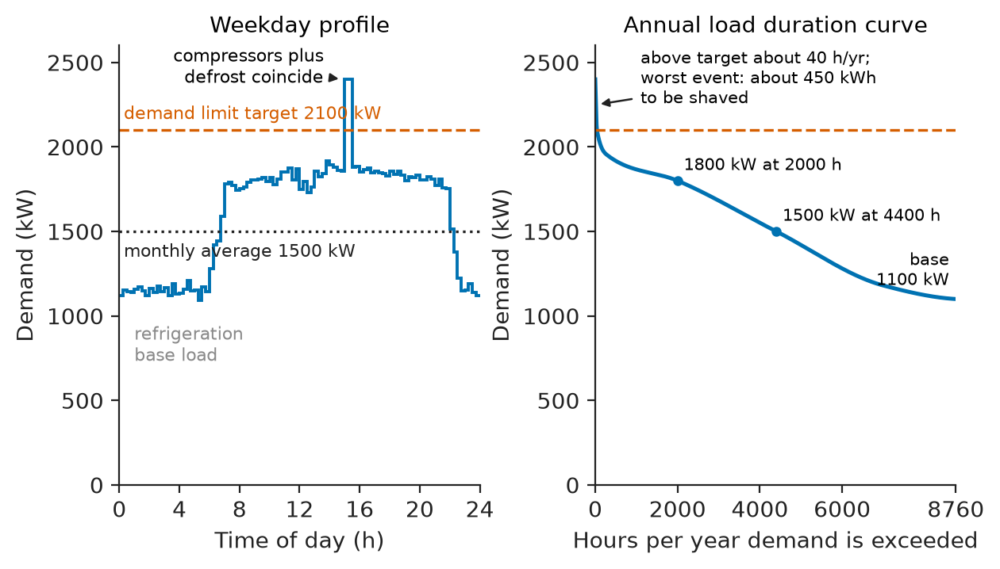
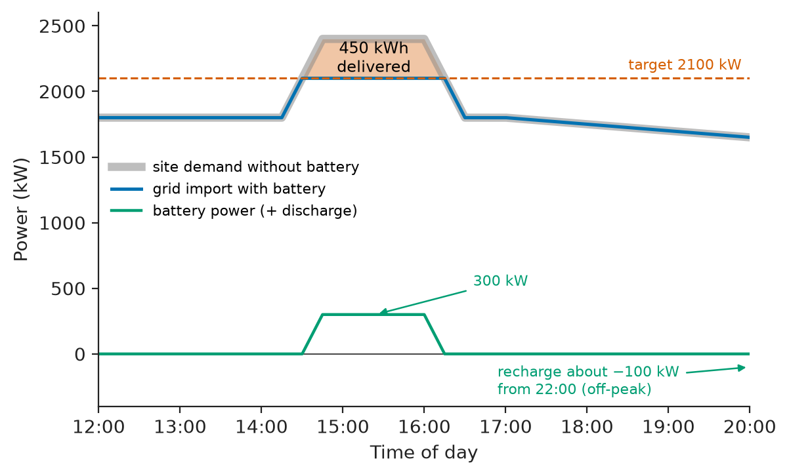
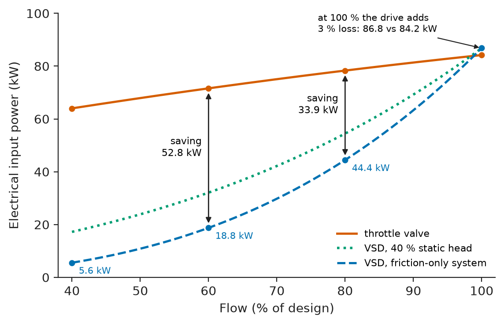
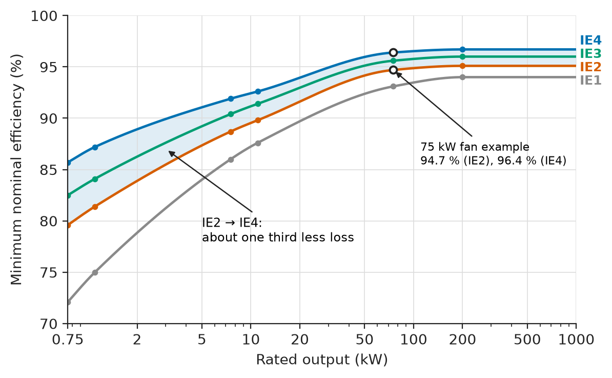
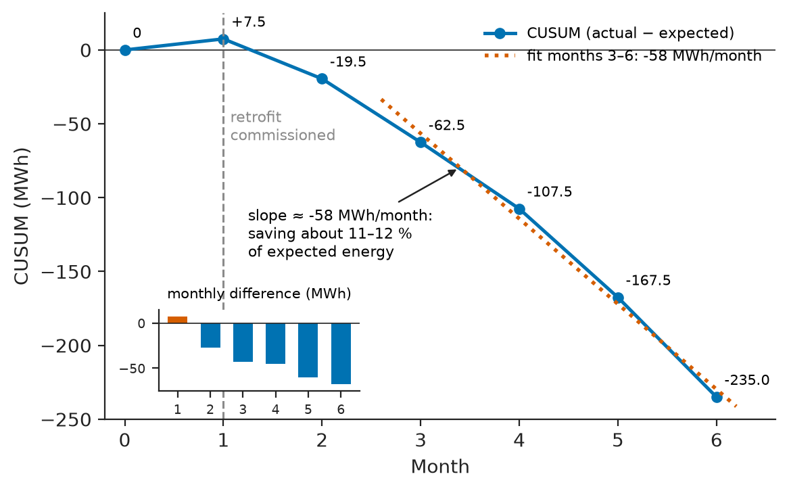
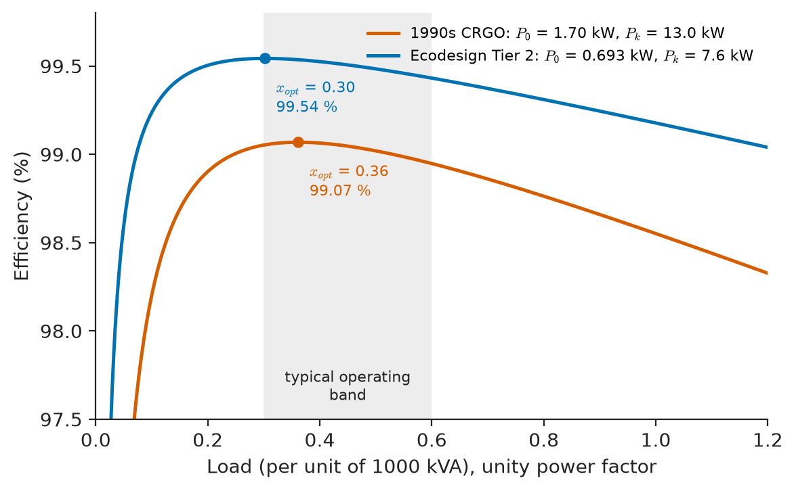

# Chapter 28 — Energy Efficiency and Management

*Part VII · Power Quality and Grid Modernization*

A frozen-food plant receives its monthly electricity bill and the finance director asks a simple question: why did it go up by 9 % when production went up by only 2 %? The answer is not on the bill. The bill shows 1080 MWh of energy, a peak demand of 2400 kW and a reactive-energy surcharge, but it does not show that the peak was set by three compressors and a defrost cycle that happened to coincide for twenty minutes on one afternoon, that a 90 kW chilled-water pump runs flat out against a half-closed valve for 6000 hours a year, that a 1990s transformer in the yard wastes 15 MWh a year doing nothing at all, or that a compressed-air ring main leaks a quarter of everything the compressors make. Each of these is an electrical-engineering problem with a number attached: a load factor, an affinity law, a no-load loss, a leak rate. Energy management is the discipline of finding those numbers, ranking them by what they cost, fixing the worthwhile ones and proving afterwards that the saving is real.

> **How do we find out where the energy in a plant, building or network actually goes, and which of the losses are worth removing?**
> **How are savings measured, valued over the life of the equipment and sustained once the project team has gone home?**

| Concept | Engineering destination |
|---|---|
| Energy auditing | ISO 50002 audits of factories, hospitals, data centres, mines and ports |
| Load profiles | Tariff selection, transformer and generator sizing, storage sizing |
| Demand management | Peak-demand charges, capacity limits on weak supplies, EV-depot charging |
| Industrial energy efficiency | Pumps, fans, compressed air, process heat, lighting, refrigeration |
| Motor efficiency | IE3/IE4 motor replacement, right-sizing, rewind policy |
| Power-factor correction | Reactive-energy charges, cable and transformer losses, freed capacity |
| Energy monitoring | Submetering, energy performance indicators, PUE, CUSUM tracking |
| Loss reduction | Transformer replacement, cable upsizing, voltage optimisation |
| Life-cycle energy cost | Total-owning-cost tenders for transformers, motors, drives and cables |
| Efficiency improvement strategies | Energy-management systems (ISO 50001), measurement and verification |

**Roadmap.** How an audit is organised and what it measures (28.1) → reading load profiles and the factors that describe them (28.2) → shaving and shifting the peak (28.3) → the big industrial end uses: pumps, fans, compressed air, heat and light (28.4) → the motor itself (28.5) → power-factor correction as an energy measure (28.6) → monitoring, baselines and CUSUM (28.7) → losses in the plant's own network (28.8) → valuing all of it over a life cycle (28.9) → how the pieces become a strategy that lasts (28.10).

---

## 28.1 Energy auditing

### Purpose and levels

An energy audit is a systematic account of where the energy entering a site goes, how much of it does useful work, and what it would cost to waste less. It is an engineering survey, not a financial one: its output is a list of measures, each with an estimated saving in kWh and kW, a cost, and a confidence level. ISO 50002 describes the process; ASHRAE (for buildings) and most national energy agencies grade audits into three levels of increasing depth (Table 28.1).

**Table 28.1 — Audit levels and what they deliver (typical).**

| Level | Name | Data used | Accuracy of savings | Typical effort for a 5 GWh/yr site |
|---|---|---|---|---|
| 1 | Walk-through | 12–36 months of bills, nameplates, a site visit | ±30–50 % | 1–3 days |
| 2 | Energy survey and analysis | Bills plus interval data, spot measurements, end-use breakdown | ±15–25 % | 1–3 weeks |
| 3 | Investment-grade audit | Logged measurements on each major system, process models, vendor quotes | ±5–10 % | 1–3 months |

A walk-through finds the obvious: lights on in empty warehouses, compressors running at weekends, steam traps blowing, capacitor banks switched off since a fuse failed. A level-2 survey quantifies the end uses. A level-3 audit is what a bank or an energy-services company needs before financing a project whose repayments come out of the savings.

### The energy balance

The backbone of every audit is a balance: metered input equals the sum of the end uses plus losses. In a typical industrial site the electrical end-use split looks like Table 28.2; the balance is built by measuring the largest consumers directly and estimating the rest from nameplate, run hours and load factor, then checking that the total matches the utility meter within a few per cent. A balance that does not close indicates an unmetered load, a wrong run-hour assumption, or a meter fault, and finding it is often the first saving.

**Table 28.2 — Typical share of electricity by end use (indicative ranges).**

| Sector | Motor-driven systems | Lighting | Process heat and electrolysis | HVAC and refrigeration | IT and electronics |
|---|---|---|---|---|---|
| General manufacturing | 60–70 % | 5–10 % | 5–20 % | 10–20 % | 2–5 % |
| Food and cold storage | 40–50 % (incl. refrigeration compressors) | 5–8 % | 5–10 % | 30–45 % | 2–4 % |
| Office building | 15–25 % (fans, pumps) | 15–25 % | under 5 % | 30–45 % | 15–30 % |
| Data centre | 10–15 % (fans, pumps) | 1–2 % | — | 15–35 % (cooling) | 50–75 % |
| Underground mine | 60–80 % (ventilation, hoisting, pumping, crushing) | 2–5 % | — | 5–15 % (cooling at depth) | under 2 % |

Motors dominate. Worldwide, electric motor systems take roughly 45 % of all electricity, which is why Sections 28.4 and 28.5 receive the most space.

### Measurement in an audit

An audit lives on measurements that are good enough, not perfect. Portable three-phase power analysers (IEC 61000-4-30 Class S or A) logged for one to two weeks on each major feeder give the load shape and the power factor. Clamp-on current loggers are cheaper but miss the voltage and power factor and so overstate kW on lightly loaded motors. Ultrasonic flow meters, thermal imaging of panels and steam lines, and pressure loggers on compressed-air mains supply the process side. The audit report converts every finding into the same currency: annual kWh, peak kW, cost, and payback.

> **Boundary.** The definitions of active, reactive and apparent power, power factor with and without harmonics, kWh and kvarh metering and the structure of demand charges are in *Circuits, Signals and Communications*, [Ch. 9](https://github.com/The-Studio-of-Sadiq/Circuits-Signals-and-Communications/blob/main/part-2-transient-and-ac-analysis/09-ac-power.md) (§9.2–9.9), and three-phase power measurement in [Ch. 10](https://github.com/The-Studio-of-Sadiq/Circuits-Signals-and-Communications/blob/main/part-2-transient-and-ac-analysis/10-three-phase-circuits.md) (§10.7–10.8). They are used here without derivation.

---

## 28.2 Load profiles

### What a profile shows

A load profile is the site's demand plotted against time, usually as 15- or 30-minute averages from the revenue meter. It is the single most informative document in an audit, because it shows not just how much energy is used but *when*, and therefore what the tariff charges for and what the supply equipment must carry. Figure 28.1 shows a weekday profile for the frozen-food plant of the opening and, on the right, the same year of data sorted into a **load duration curve**: demand on the vertical axis, the number of hours per year for which that demand is exceeded on the horizontal.

<!-- FIGURE 28.1 | figures/ch28/fig-28-1-load-profile-duration.png | plot | Weekday load profile of a frozen-food plant (left) and its annual load duration curve (right). | Content: Left panel: x-axis time of day 0 to 24 h, y-axis demand 0 to 2600 kW, 15-minute steps. Base load about 1150 kW overnight (refrigeration), rising at 06:00 to about 1600 kW, production plateau 1600 to 1900 kW from 07:00 to 22:00, a spike to 2400 kW at 15:00 to 15:30 labelled "compressors plus defrost coincide", dashed horizontal line at 2100 kW labelled "demand limit target", dotted line at 1500 kW labelled "monthly average". Right panel: x-axis hours per year 0 to 8760, y-axis demand 0 to 2600 kW; monotonically falling curve from 2400 kW at 0 h, to 2100 kW at about 40 h, about 1800 kW at 2000 h, 1500 kW at 4400 h, base 1100 kW at 8760 h; shade the small area above 2100 kW and label "energy to be shaved, about 450 kWh per event". -->

*Figure 28.1 — Weekday load profile of a frozen-food plant (left) and its annual load duration curve (right).*

The profile is summarised by a few ratios. With $P_{max}$ the maximum demand over the period, $\bar P$ the average demand, $P_{conn}$ the sum of nameplate ratings and $\sum P_{max,i}$ the sum of the individual maximum demands of the sub-loads:

$$
\text{load factor}=\frac{\bar P}{P_{max}},\qquad \text{demand factor}=\frac{P_{max}}{P_{conn}},\qquad \text{diversity factor}=\frac{\sum_i P_{max,i}}{P_{max}}\ge1
$$

The load factor measures how well the site uses the capacity it pays for. A continuous-process plant or a data centre runs at 0.75–0.9; a single-shift workshop at 0.25–0.35; an EV fast-charging hub, before storage, often below 0.15. A low load factor means a large demand charge per kWh and supply equipment idle most of the time. The diversity factor says how unlikely it is that every sub-load peaks at once; it is what allows a transformer to be smaller than the sum of the feeders it supplies (Chapter 30).

**Table 28.3 — Representative load factors (annual, typical).**

| Facility | Load factor | Remarks |
|---|---|---|
| Hyperscale data centre | 0.80–0.90 | IT load nearly flat; cooling varies with weather |
| Aluminium smelter | 0.95–0.98 | Potline is a constant DC load |
| Three-shift paper mill | 0.75–0.85 | Dips during maintenance shutdowns |
| Frozen-food plant | 0.55–0.70 | Refrigeration base plus daytime production |
| Office building | 0.30–0.45 | Day-only HVAC and lighting |
| Single-shift engineering workshop | 0.25–0.35 | Little base load |
| EV fast-charging hub (no storage) | 0.08–0.20 | Short, high peaks |

> **Status of the principle: Load, demand and diversity factors**
> *Empirical.* The definitions are exact, but the values used for planning are statistics of past behaviour; they hold only while the mix and scheduling of loads stay as they were when the data were collected.

**Worked example — Reading a plant's bill through its profile.** The frozen-food plant used 1080 MWh in a 30-day month (720 h) with a maximum 15-minute demand of 2400 kW. Its connected load is 4800 kW, and the sum of the maximum demands of its five main feeders, read from submeters, is 3300 kW. The tariff includes a demand charge of 12 USD per kW of monthly maximum demand.

Average demand is $1\,080\,000/720=1500$ kW, so the load factor is $1500/2400=0.625$. The demand factor is $2400/4800=0.50$ and the diversity factor $3300/2400=1.375$. The demand charge is $2400\times12=28\,800$ USD for the month. The profile in Figure 28.1 shows that the plant exceeds 2100 kW for only about 40 hours a year; holding the peak at 2100 kW would save $300\times12=3600$ USD per month, or 43 200 USD per year, without saving a single kWh. That is the subject of the next section.

### Profiles in different sectors

Profiles are signatures. A data centre is flat with a small afternoon bump from chillers. An office rises at 07:00, plateaus, and falls at 19:00, with a weekend base that should be 25–35 % of the weekday peak; if it is 60 %, something is running that should not be. A mine hoist produces a saw-tooth of 5–10 MW pulses every two minutes. An electric bus depot shows a huge evening peak when 100 buses plug in at 150 kW each. A cruise ship in port has a hotel load of 8–12 MW that shore power must supply. In each case the profile tells the engineer which equipment to look at first.

---

## 28.3 Demand management

### What demand management is, and what it is not

Demand management is the customer-side control of *when* and *how fast* energy is drawn, to cut peak-related charges, stay within a capacity limit, or avoid reinforcing a supply. It differs from demand response (Chapter 26), in which the grid operator or an aggregator asks the customer to change consumption for the grid's benefit and pays for it. The same equipment often does both.

The tools are, in order of cost:

- **Scheduling.** Staggering start-up of production lines, running batch processes such as grinding, pumping to storage or charging forklifts at night, separating defrost cycles in cold stores.
- **Demand limiting.** A controller reads the revenue meter's pulse output, predicts the demand at the end of the current 15-minute interval and, if it will exceed the target, sheds pre-agreed non-critical loads (water heaters, HVAC set-points, EV chargers, snow-melt) for a few minutes.
- **Thermal storage.** Ice banks or chilled-water tanks charged at night supply the afternoon cooling peak; cold stores themselves can be pre-cooled by 2–3 K and allowed to drift.
- **Electrical storage.** A battery discharges during the peak and recharges off-peak (Chapter 16). Batteries also serve as UPS, reactive-power sources and frequency-response assets, and stacking these revenues is what usually makes the economics work.
- **On-site generation.** Diesel or gas gensets run for the few peak hours; increasingly constrained by emissions permits.

**Table 28.4 — Demand-management measures (typical characteristics).**

| Measure | Peak reduction | Energy effect | Capital cost | Response time |
|---|---|---|---|---|
| Load scheduling | 5–15 % | Neutral | Very low | Planned |
| Automatic demand limiter | 5–10 % | Neutral to slight loss | Low | Minutes |
| Ice or chilled-water storage | 10–30 % of cooling peak | 5–10 % loss | Medium | Minutes |
| Battery storage (Li-ion) | Sized to need | 8–15 % round-trip loss | High | Under 1 s |
| Peak-lopping genset | Sized to need | Fuel use, emissions | Medium | 10–60 s |
| Managed EV charging | 30–60 % of charging peak | Neutral | Low | Seconds |

<!-- FIGURE 28.2 | figures/ch28/fig-28-2-battery-peak-shaving.png | plot | Battery peak shaving on the plant's worst afternoon: site demand without and with the battery, and the battery's power. | Content: x-axis time 12:00 to 20:00, y-axis power -400 to 2600 kW. Grey curve: site demand without battery rising from 1800 kW to a plateau of 2400 kW between 14:45 and 16:15 with ramps either side, back to 1800 kW by 17:00. Solid curve: grid import with battery, clipped flat at 2100 kW. Lower trace on the same axis: battery power, positive (discharge) up to 300 kW during the clip, negative (charging) about -100 kW from 22:00 onwards indicated by an arrow off the right edge. Shade the clipped area and label "450 kWh delivered". Horizontal dashed line at 2100 kW labelled "target". -->

*Figure 28.2 — Battery peak shaving on the plant's worst afternoon: site demand without and with the battery, and the battery's power.*

**Worked example — Sizing a peak-shaving battery.** For the plant of Section 28.2, the worst afternoon (Figure 28.2) requires 450 kWh to be delivered above the 2100 kW target, at up to 300 kW. The lithium-iron-phosphate battery may be cycled over 90 % of its nameplate energy, and the inverter efficiency is 95 % one way. Peak-shaving events occur on about 25 days a year (the 40 hours above target in Figure 28.1); most are smaller than the worst afternoon. The battery costs 350 USD per kWh installed; off-peak energy costs 0.08 USD per kWh.

Nameplate energy needed: $450/(0.90\times0.95)=526$ kWh; a standard 300 kW / 600 kWh unit leaves margin for ageing (Chapter 16). With a round-trip efficiency of 0.88, recharging 450 kWh draws $450/0.88=511$ kWh, a loss of at most 61 kWh per event, or at most $61\times25=1525$ kWh per year costing about 120 USD. Net saving: $43\,200-120\approx43\,100$ USD per year. Capital: $600\times350=210\,000$ USD. Simple payback: 4.9 years.

Two cautions temper this. The demand charge is set by the *single* worst interval, so a battery that is empty on the one day when two peaks occur back to back saves nothing that month; the controller needs a load forecast, and the energy rating needs margin. And a battery that only shaves peaks is idle 95 % of the time; adding frequency response or backup service shortens the payback considerably.

> **Status of the principle: Peak shaving with storage**
> *Approximate.* Sizing from a historical worst day assumes future peaks resemble past ones; the saving is a step function of the monthly maximum, so a single forecasting failure can remove a month's benefit.

---

## 28.4 Industrial energy efficiency

### Systems, not components

The largest savings in industry come from looking at whole systems — motor, drive, transmission, pump or fan, pipework or ductwork, and the process need — rather than at any single component. A premium-efficiency motor driving a pump that pushes water against a throttling valve to supply a process that needs half the flow wastes far more than any motor can save. The order of attack is: reduce the demand (does the process need this flow, this pressure, this temperature?), match the supply to the demand (speed control, right-sized machines), then improve component efficiencies.

### Pumps and fans

Centrifugal pumps and fans take roughly 40 % of industrial motor energy. When the flow is controlled by a throttle valve or damper, the machine runs at full speed and the excess head is burned across the valve. When it is controlled by speed, the affinity laws — flow proportional to speed, head to speed squared, power to speed cubed, taken from *Engineering Physics*, [Ch. 19 §19.7.3](https://github.com/The-Studio-of-Sadiq/Engineering-Physics/blob/main/CHAPTERS/CHAPTER%2019.md) — give a power that falls steeply with flow. In a system dominated by friction, $P\propto Q^3$; at 80 % flow the shaft power is about half, at 60 % about one fifth. Figure 28.3 compares the two control methods.

<!-- FIGURE 28.3 | figures/ch28/fig-28-3-throttle-vs-vsd.png | plot | Electrical input power of a 90 kW pump set against flow for throttle control and for variable-speed control. | Content: x-axis flow 40 to 100 % of design, y-axis input power 0 to 100 kW. Throttle curve (solid) through the points (100 %, 84.2 kW), (80 %, 78.3 kW), (60 %, 71.6 kW), (40 %, 64 kW). VSD curve, friction-only system (dashed): input = 86.8 kW times (Q/100)^3, i.e. 86.8, 44.4, 18.8, 5.6 kW at 100, 80, 60, 40 %. Third curve (dotted): VSD with 40 % static head, lying between the two, about 86.8, 57, 36, 22 kW. Vertical arrows at 80 % and 60 % labelled with the savings 33.9 kW and 52.8 kW. Note: VSD curve at 100 % lies 3 % above throttle because of drive losses. -->

*Figure 28.3 — Electrical input power of a 90 kW pump set against flow for throttle control and for variable-speed control.*

**Worked example — Speed control of a chilled-water pump.** A pump needs 80 kW of shaft power at design flow and runs 6000 h/yr: 20 % of the time at 100 % flow, 40 % at 80 % and 40 % at 60 %. At present it is throttled; from the pump curve the shaft power is 100 %, 93 % and 85 % of 80 kW at those flows. The motor efficiency is 95 %. A variable-frequency drive (efficiency 97 %) would replace the valve; the system is a closed loop with negligible static head. Electricity costs 0.10 USD per kWh.

Throttled input powers: $80\times(1.00,\,0.93,\,0.85)/0.95=84.2,\ 78.3,\ 71.6$ kW. Variable-speed input powers: $80\times(1,\ 0.8^3,\ 0.6^3)/(0.95\times0.97)=86.8,\ 44.4,\ 18.8$ kW. Annual energy:

$$
E_{thr}=6000\,(0.2\times84.2+0.4\times78.3+0.4\times71.6)=460.8\ \mathrm{MWh}
$$

$$
E_{VSD}=6000\,(0.2\times86.8+0.4\times44.4+0.4\times18.8)=255.9\ \mathrm{MWh}
$$

The saving is 204.9 MWh, 44 % of the pump's energy, worth about 20 500 USD per year. A 90 kW low-voltage drive installed costs roughly 12 000–18 000 USD, so the payback is under a year. Two caveats: at full flow the drive *adds* 3 % loss, so a pump that genuinely runs at design flow all year should not get one; and in systems with large static head (lifting water to a reservoir, boiler feed) the head does not fall with speed, and the saving is much smaller (the dotted curve of Figure 28.3).

> **Status of the principle: Cube-law savings from speed control**
> *Approximate.* The affinity laws hold for a fixed impeller at constant efficiency on a friction-only system curve; static head, efficiency drift away from the best-efficiency point and minimum-speed limits (cooling, bearings, NPSH) reduce the savings.

### Compressed air

Compressed air is the most expensive utility in most factories: of the electrical energy into a compressor, only about 10 % reaches the tool as useful work, the rest leaving as heat. A typical system wastes 20–30 % of its output in leaks; a single 3 mm hole at 7 bar costs roughly 3 kW of compressor input, continuously. The standard measures are leak surveys with ultrasonic detectors, reducing the generation pressure (every 1 bar reduction saves about 6–8 % of compressor energy), variable-speed trim compressors, sequencing controllers, and heat recovery from oil-cooled compressors (up to 70–90 % of input power recoverable as hot water at 50–70 °C).

### Process heat, refrigeration and lighting

Electric process heat (resistance, induction, arc and infrared) is already near 100 % efficient at the point of conversion; the savings are in insulation, scheduling and avoiding idle holding. Where low-temperature heat is needed, an industrial heat pump with a coefficient of performance of 3–5 replaces resistance heating at a third to a fifth of the electricity — the thermodynamic limit is in *Engineering Physics*, [Ch. 19 §19.5.5](https://github.com/The-Studio-of-Sadiq/Engineering-Physics/blob/main/CHAPTERS/CHAPTER%2019.md). Refrigeration plants save through floating head pressure, variable-speed compressors and evaporator fans, and closing doors and strip curtains. Lighting is now almost entirely an LED question: LED high-bay luminaires reach 150–200 lm/W against 80–100 lm/W for metal halide and 85–100 lm/W for T8 fluorescent, and add instant restart, dimming and occupancy control.

**Table 28.5 — Typical industrial efficiency measures (indicative).**

| Measure | Typical saving in the system | Typical simple payback |
|---|---|---|
| VSD on variable-flow pump or fan | 20–50 % | 0.5–3 years |
| Compressed-air leak repair | 10–25 % of air energy | Under 0.5 year |
| Reduce compressor pressure by 1 bar | 6–8 % | Immediate |
| LED retrofit with controls | 50–70 % of lighting | 1–4 years |
| IE2 to IE4 motor at replacement | 30–35 % of motor losses | 2–5 years |
| Heat pump instead of resistance heating | 65–80 % | 2–6 years |
| Compressor heat recovery | Displaces fuel | 1–3 years |
| Power-factor correction | Removes kvarh charges | 0.2–2 years |

---

## 28.5 Motor efficiency

### Efficiency classes

The motor itself converts 85–97 % of its input to shaft power; the rest is stator and rotor copper loss, core loss, friction and windage, and stray load loss (Chapters 6 and 9). Because a motor running 6000 h/yr consumes its own purchase price in electricity in a few weeks, small differences in efficiency are worth a lot. IEC 60034-30-1 defines efficiency classes IE1 (standard) to IE4 (super premium) for line-operated motors; IE5 (ultra premium, about 20 % lower losses than IE4) is defined for converter-fed motors in IEC TS 60034-30-2 and is typically reached with permanent-magnet or synchronous-reluctance rotors (Chapter 8). Efficiencies are measured by the loss-segregation method of IEC 60034-2-1 (Chapter 9). Table 28.6 gives representative minimum values and Figure 28.4 plots them.

**Table 28.6 — Minimum nominal efficiencies, 4-pole 50 Hz motors (approximate, per IEC 60034-30-1).**

| Rated output | IE1 | IE2 | IE3 | IE4 |
|---|---|---|---|---|
| 0.75 kW | 72.1 % | 79.6 % | 82.5 % | 85.7 % |
| 1.1 kW | 75.0 % | 81.4 % | 84.1 % | 87.2 % |
| 7.5 kW | 86.0 % | 88.7 % | 90.4 % | 91.9 % |
| 11 kW | 87.6 % | 89.8 % | 91.4 % | 92.6 % |
| 75 kW | 93.1 % | 94.7 % | 95.6 % | 96.4 % |
| 200–1000 kW | 94.0 % | 95.1 % | 96.0 % | 96.7 % |

<!-- FIGURE 28.4 | figures/ch28/fig-28-4-ie-efficiency-classes.png | plot | Minimum efficiency against rated output for IE1 to IE4 four-pole 50 Hz motors. | Content: x-axis rated output 0.75 to 1000 kW on a logarithmic scale, y-axis efficiency 70 to 100 %. Four rising, flattening curves through the Table 28.6 points: IE1 (72.1, 75.0, 86.0, 87.6, 93.1, 94.0 %), IE2 (79.6, 81.4, 88.7, 89.8, 94.7, 95.1 %), IE3 (82.5, 84.1, 90.4, 91.4, 95.6, 96.0 %), IE4 (85.7, 87.2, 91.9, 92.6, 96.4, 96.7 %) at 0.75, 1.1, 7.5, 11, 75 and 200 kW, flat beyond 200 kW. Shade the band between IE2 and IE4 and annotate "about one third less loss". Mark with a dot the 75 kW example (94.7 % and 96.4 %). -->

*Figure 28.4 — Minimum efficiency against rated output for IE1 to IE4 four-pole 50 Hz motors.*

Regulation has moved the market: in the European Union the Ecodesign regulation (EU) 2019/1781 has required IE3 for 0.75–1000 kW motors since 2021 and IE4 for 75–200 kW since 2023; the US DOE rules require levels equivalent to IE3 (NEMA Premium). The gap between classes is larger in small motors, where losses are proportionally higher, but the energy at stake is larger in big ones.

> **Status of the principle: IE efficiency classes**
> *Empirical.* The class limits are fitted to the best practical designs of their time and are defined at rated load, voltage and frequency; part-load efficiency, supply unbalance, harmonics and converter supply are outside the class definition.

**Worked example — IE2 or IE4 for a 75 kW fan motor?** A 75 kW, 4-pole motor driving a process fan runs 6000 h/yr at 75 % load (56.25 kW shaft). Assume the efficiency at 75 % load equals the nominal value (true within a few tenths of a per cent for these motors). Electricity costs 0.10 USD per kWh; the IE4 motor costs 2500 USD more than the IE2.

Input power: $56.25/0.947=59.40$ kW for IE2 and $56.25/0.964=58.35$ kW for IE4. The difference, 1.05 kW, over 6000 h is 6285 kWh, worth 628 USD per year: a payback of four years on a machine that lasts fifteen to twenty. In loss terms the IE4 motor dissipates $(1/0.964-1)/(1/0.947-1)=0.67$ of the IE2 motor's losses, so it also runs about a third cooler, which extends insulation and bearing life (Chapter 9).

### Part load and oversizing

Motor efficiency is roughly flat from 50 % to 100 % load and falls quickly below about 40 %, because the core and friction losses become a large fraction of a small output; the power factor falls even faster as the magnetising current stays while the active current shrinks. Surveys regularly find a third of industrial motors running below 50 % load because they were sized for a worst case, then given a "safety margin", then the next frame size up. Right-sizing at replacement, or adding a VSD, recovers both efficiency and power factor.

### Rewind or replace

A failed motor may be rewound for perhaps 50–60 % of the price of a new one. A careless rewind — stripping the old winding by burning at too high a temperature, which damages the interlaminar insulation, or using fewer turns of thinner wire — can add 1–2 percentage points of loss. Good practice (IEC 60034-23 and the EASA/AEMT rewind guide) holds efficiency within 0.1–0.5 point. A common policy: replace rather than rewind below about 30–50 kW, and always replace with IE3 or better when the motor runs more than 4000 h/yr.

---

## 28.6 Power-factor correction

### Correction as an energy measure

The circuit theory of power-factor correction — the capacitor kvar $Q_C=P(\tan\phi_1-\tan\phi_2)$, the hazards of over-correction, self-excitation and harmonic resonance, and the effect on the bill — is developed in *Circuits, Signals and Communications*, [Ch. 9 §9.6–9.7](https://github.com/The-Studio-of-Sadiq/Circuits-Signals-and-Communications/blob/main/part-2-transient-and-ac-analysis/09-ac-power.md); the power-quality side, with detuned filters and harmonic interaction, is in Chapter 25 of this book. From the energy manager's side three questions remain: where to put the capacitors, how much energy the correction saves (as opposed to how much money it saves on the tariff), and when correction is the wrong answer.

### Where to correct

**Central correction** at the main LV switchboard with an automatic multi-step bank removes the utility's reactive charges and relieves the transformer, but not the cables inside the plant. **Group correction** at motor control centres also relieves the main distribution feeders. **Individual correction** at large, long-running motors relieves everything up to the motor terminals and switches with the motor, so it can never over-correct — but must be limited to about 90 % of the motor's no-load kvar to avoid self-excitation. Variable-speed drives with diode front ends already present a displacement power factor near 0.95–0.98 to the supply (their problem is harmonics, Chapter 25), and active-front-end drives can run at unity or even supply reactive power. In plants where more than about 15–20 % of the load is non-linear, every capacitor bank should be detuned (typically 7 % reactor, tuned near 189 Hz on a 50 Hz system) so that it is inductive at the 5th harmonic and above.

> **Status of the principle: Loss reduction by local correction**
> *Approximate.* Losses scale with $I^2$ only for sinusoidal currents; with harmonics present the RMS current and therefore the loss depend on the distortion, which an undetuned capacitor can make worse.

**Worked example — Correcting at the motor control centre.** A group of compressors drawing 250 kW at a power factor of 0.80 is supplied from the main switchboard of a 400 V plant through a 150 m run of 240 mm² copper cable per phase. Its resistance is 0.0754 Ω/km at 20 °C; take the operating temperature as 70 °C. The plant already has central correction, so the utility sees no reactive charge. Is it worth adding 125 kvar of correction at the MCC to raise the group's power factor to 0.97? The group runs 6000 h/yr.

Cable resistance per phase: $R=0.150\times0.0754\times(1+0.00393\times50)=0.01353\ \Omega$. Current before and after:

$$
I_1=\frac{250\,000}{\sqrt3\times400\times0.80}=451.1\ \mathrm A,\qquad I_2=\frac{250\,000}{\sqrt3\times400\times0.97}=372.0\ \mathrm A
$$

Loss: $3I_1^2R=8.26$ kW before, $3I_2^2R=5.62$ kW after, a saving of 2.64 kW or 15.8 MWh per year (about 1600 USD at 0.10 USD/kWh). The required kvar is $250(\tan\arccos0.80-\tan\arccos0.97)=124.8$ kvar, and a detuned 125 kvar bank costs perhaps 5000–7000 USD installed, a payback of three to four years from losses alone. It also lowers the voltage drop on the feeder, frees about 18 % of its thermal capacity for new load, and lets the central bank shrink. The tariff saving was already captured by the central bank; the local bank's justification is energy and capacity.

---

## 28.7 Energy monitoring

### The metering hierarchy

What is not measured cannot be managed, but what is measured badly is managed wrongly. A good monitoring system has a hierarchy: the revenue meter at the point of supply (Class 0.5S or 0.2S, IEC 62053-22, read by the utility); main-feeder and large-load submeters (IEC 61557-12 power metering and monitoring devices, Class 0.5 or 1 for active energy); and process-level meters on individual machines, often built into drives and motor protection relays. The rule of thumb is to submeter every load or group above about 5–10 % of site consumption, so that the sum of submeters accounts for at least 80–90 % of the main meter. Data are collected at 1–15 minute intervals over Modbus, BACnet or IEC 61850 and stored in an energy-management information system.

### Energy performance indicators

Raw kWh mean little because they move with production, weather and occupancy. Energy performance indicators (EnPIs, ISO 50006) normalise them: kWh per tonne of product, kWh per m³ of water pumped, kWh per m² per year for a building, kWh per kilometre for an electric bus fleet, kWh per tonne of ore hoisted. For data centres the standard indicator is **power usage effectiveness** (ISO/IEC 30134-2):

$$
\mathrm{PUE}=\frac{E_{facility}}{E_{IT}}
$$

A legacy enterprise data centre runs at 1.6–2.0, a modern colocation site at 1.3–1.4, a hyperscale site with free cooling at 1.1–1.2. For a 1 MW IT load, improving the PUE from 1.6 to 1.3 removes 0.3 MW of overhead continuously: 2628 MWh per year.

### Baselines and CUSUM

To prove a saving, consumption after a measure must be compared with what it *would have been* without the measure under the same conditions. The usual tool is a regression baseline fitted to 12 or more months of pre-measure data, with the drivers that matter — production, degree-days, occupancy — as variables. For many plants a straight line is adequate:

$$
E_{expected}=E_0+k\,X
$$

with $E_0$ the fixed (production-independent) energy and $k$ the specific energy per unit of driver $X$. The cumulative sum of the differences between actual and expected consumption, **CUSUM**, makes trends visible that monthly noise would hide: a flat CUSUM means performance is unchanged; a steadily falling one, a sustained saving; a sudden rise, a fault (a stuck damper, a failed trap, a VSD put on bypass). The International Performance Measurement and Verification Protocol (IPMVP) formalises this as "Option C, whole facility" when savings are large compared with the noise of the main meter, and "Option B, retrofit isolation" when the measure is metered on its own.

> **Status of the principle: Regression baseline**
> *Empirical.* The baseline is a statistical fit valid only within the range of the drivers it was fitted to and only while nothing else about the site changes; a new product line or a new building wing requires a baseline adjustment.

**Worked example — CUSUM after a refrigeration retrofit.** A cold store's baseline, fitted to two years of monthly data, is $E_{expected}=180\ \mathrm{MWh}+0.35\ \mathrm{MWh/t}\times X$ where $X$ is tonnes of product frozen. Variable-speed compressors and floating head pressure were commissioned at the end of month 1. Table 28.7 gives the monitoring data.

**Table 28.7 — Monitoring a refrigeration retrofit.**

| Month | Production (t) | Expected (MWh) | Actual (MWh) | Difference (MWh) | CUSUM (MWh) |
|---|---|---|---|---|---|
| 1 | 950 | 512.5 | 520 | +7.5 | +7.5 |
| 2 | 1020 | 537.0 | 510 | −27.0 | −19.5 |
| 3 | 980 | 523.0 | 480 | −43.0 | −62.5 |
| 4 | 1100 | 565.0 | 520 | −45.0 | −107.5 |
| 5 | 1000 | 530.0 | 470 | −60.0 | −167.5 |
| 6 | 1050 | 547.5 | 480 | −67.5 | −235.0 |

Month 2 shows a partial saving while the controls were tuned; from month 3 the CUSUM falls by 43–68 MWh per month, settling near 65 MWh; the average slope over months 3–6 is about 58 MWh per month, 11–12 % of expected consumption. Note that actual consumption in month 4 (520 MWh) equals month 1, yet the measure is clearly working: production rose 16 %. Without the baseline, the saving would be invisible. Figure 28.5 shows the CUSUM line; its slope is the saving rate.

<!-- FIGURE 28.5 | figures/ch28/fig-28-5-cusum.png | plot | CUSUM of actual minus expected energy for the cold-store retrofit; the slope after commissioning is the saving rate. | Content: x-axis month 0 to 6, y-axis CUSUM -250 to +25 MWh. Points and connecting line at (0, 0), (1, 7.5), (2, -19.5), (3, -62.5), (4, -107.5), (5, -167.5), (6, -235). Vertical dashed line at month 1 labelled "retrofit commissioned". Dotted straight-line fit through months 3 to 6 with slope about -57 MWh per month, annotated "saving about 12 %". Small inset bar chart of monthly difference values (+7.5, -27, -43, -45, -60, -67.5). -->

*Figure 28.5 — CUSUM of actual minus expected energy for the cold-store retrofit; the slope after commissioning is the saving rate.*

---

## 28.8 Loss reduction

### Where a plant's own network loses energy

Between the revenue meter and the loads, a well-designed industrial network loses 2–4 % of the energy it carries: roughly half in transformers and half in cables, busbars and switchgear. In a poorly designed or overloaded one it can be 6–8 %. For a site using 20 GWh/yr, each percentage point is 200 MWh. The utility network upstream loses more: 6–8 % in a typical developed-country transmission and distribution system and 15–20 % or more where non-technical losses (theft and metering errors) are high (Chapter 22).

### Transformer losses

A transformer has two losses (Chapter 4): the **no-load loss** $P_0$ in the core, present every hour it is energised, independent of load; and the **load loss** $P_k$ at rated current, scaling with the square of the per-unit load $x$. Efficiency at load $x$ and power factor $\cos\phi$ is

$$
\eta(x)=\frac{x\,S_r\cos\phi}{x\,S_r\cos\phi+P_0+x^2P_k}
$$

and is maximum where the two losses are equal, $x_{opt}=\sqrt{P_0/P_k}$. Modern low-loss distribution transformers have $x_{opt}$ around 0.3–0.45, which suits distribution duty where the average load is well below rating. Annual loss energy is $P_0\times8760+P_k\,\overline{x^2}\times8760$, with $\overline{x^2}$ the mean square per-unit load (the square of the RMS loading).

> **Status of the principle: Maximum efficiency at equal fixed and variable loss**
> *Derived.* Follows from differentiating $\eta(x)$ with $P_0$ and $P_k$ constant; holds only while core loss is independent of load (constant voltage) and load loss follows $I^2$ (no significant harmonic or stray-loss increase).

**Table 28.8 — Losses of 1000 kVA oil-immersed distribution transformers (typical).**

| Design | No-load loss $P_0$ | Load loss $P_k$ | Annual loss at RMS load 0.5 |
|---|---|---|---|
| 1990s conventional CRGO | 1.70 kW | 13.0 kW | 43.4 MWh |
| EU Ecodesign Tier 1 (2015) | 0.77 kW | 10.5 kW | 29.7 MWh |
| EU Ecodesign Tier 2 (2021) | 0.69 kW | 7.6 kW | 22.7 MWh |
| Amorphous core | 0.30–0.45 kW | 8–10 kW | 19–25 MWh |

<!-- FIGURE 28.6 | figures/ch28/fig-28-6-transformer-efficiency.png | plot | Efficiency against load of a 1990s 1000 kVA transformer and an Ecodesign Tier 2 replacement, at unity power factor. | Content: x-axis per-unit load 0 to 1.2, y-axis efficiency 97.5 to 99.8 %. Curve A (old, P0 = 1.7 kW, Pk = 13 kW): 98.20 % at 0.1, 99.01 % at 0.25, peak 99.07 % at 0.36, 99.02 % at 0.5, 98.81 % at 0.75, 98.55 % at 1.0. Curve B (Tier 2, P0 = 0.693 kW, Pk = 7.6 kW): 99.24 % at 0.1, 99.54 % at 0.25, peak 99.54 % at 0.30, 99.48 % at 0.5, 99.34 % at 0.75, 99.18 % at 1.0. Mark each maximum with a dot and label x_opt. Shade the typical operating band 0.3 to 0.6 per unit. -->

*Figure 28.6 — Efficiency against load of a 1990s 1000 kVA transformer and an Ecodesign Tier 2 replacement, at unity power factor.*

Figure 28.6 shows why replacing an old transformer can pay even when it still works: across the typical operating band the new unit is about 0.5 percentage point more efficient, which for a 1000 kVA unit is roughly 20 MWh per year (worked out in Section 28.9). Other transformer measures: switching off one of two parallel transformers at light load (when $x$ for the remaining unit stays below about $\sqrt{2P_0/P_k}$), and de-energising seasonal-load transformers such as irrigation or grain-drying supplies out of season.

### Cables, busbars and voltage

Cables are sized for current-carrying capacity and voltage drop (Chapter 30), which gives a cross-section at which the conductor runs hot — up to 70 °C for PVC and 90 °C for XLPE insulation — and loses 2–4 % of the power it carries on a long run. Choosing the next size up halves nothing but reduces loss by roughly the ratio of cross-sections, and because copper resistance rises 0.393 % per kelvin, the cooler cable gains again. IEC 60287-3-2 formalises **economic cable sizing**, which minimises purchase cost plus discounted loss cost; on loads with high utilisation it usually selects one or two sizes above the thermal minimum (worked example in Chapter 30).

Other network losses are in poor joints and terminations (found by thermography, and a fire risk as well as a loss), circulating currents in incorrectly bonded single-core cables, eddy-current heating in steel enclosures around single-core conductors, and harmonic currents, which add $I_h^2R$ loss in every conductor and extra eddy loss in transformers (Chapter 25).

**Voltage optimisation** — lowering the supply voltage within the statutory band — saves energy only on loads whose power falls with voltage: resistive heating that is not thermostatically controlled, older lighting, and induction motors that are lightly loaded (where reduced magnetising current lowers core loss). It does nothing for thermostatic heaters, which simply run longer, nor for switch-mode supplies and drives, which draw constant power. Claims of 10–15 % savings on whole sites should be treated with caution; 1–4 % is typical where it works.

---

## 28.9 Life-cycle energy cost

### Discounting

Energy-consuming equipment costs money to buy and much more to run. Comparing options fairly requires putting future costs on the same footing as present ones. With a discount rate $r$ and a life of $n$ years, an annual cost $C$ has a present value $C\times\mathrm{PWF}$, where the present-worth factor is

$$
\mathrm{PWF}=\frac{1-(1+r)^{-n}}{r}
$$

At $r=6$ % the PWF is 9.71 for 15 years, 12.78 for 25 years and 13.76 for 30 years. The **life-cycle cost** is then

$$
\mathrm{LCC}=C_{capital}+C_{install}+\mathrm{PWF}\,(C_{energy}+C_{maintenance})-\mathrm{PV}(\text{residual value})
$$

Energy-price escalation can be folded in by using a reduced effective discount rate. Simple payback (capital divided by annual saving) is easy to explain but ignores everything after the payback date, and so systematically undervalues long-lived efficient equipment.

> **Status of the principle: Present-worth evaluation**
> *Derived.* Exact arithmetic for a constant annual cost and constant discount rate; the result is only as good as the assumed energy price, operating hours and life, which is why sensitivity to each should be reported.

### The motor example

For the 75 kW IE4 fan motor of Section 28.5, the annual energy bill is $58.35\times6000\times0.10=35\,000$ USD. Over 15 years at 6 % its present value is $35\,000\times9.71=340\,000$ USD. Against a purchase price of perhaps 7000 USD and maintenance of 3000 USD present value, energy is 97 % of the life-cycle cost. The purchase price, which dominates procurement discussions, is 2 %.

### Loss capitalisation for transformers

Utilities and large industrial buyers evaluate transformer tenders by the **total owning cost**:

$$
\mathrm{TOC}=C_{price}+A\,P_0+B\,P_k
$$

where $A$ (in USD per kW of no-load loss) is the present value of a kilowatt lost for every hour of the life, $A=c_e\times8760\times\mathrm{PWF}$, and $B=A\,\overline{x^2}$ weights the load loss by the mean-square loading. A manufacturer can then trade more core steel (lower $P_0$) or copper (lower $P_k$) against price in a way the buyer has priced in advance.

**Worked example — Replace a working 1990s transformer?** A 1000 kVA transformer with $P_0=1.70$ kW and $P_k=13.0$ kW feeds a plant whose RMS loading is 0.5 per unit. A Tier 2 replacement ($P_0=0.693$ kW, $P_k=7.6$ kW) costs 17 000 USD installed. Energy costs 0.10 USD/kWh, the evaluation period is 30 years at 6 %.

$\mathrm{PWF}=13.765$, so $A=0.10\times8760\times13.765=12\,058$ USD/kW and $B=0.25\,A=3014$ USD/kW. Keeping the old unit (no price): $\mathrm{TOC}=12\,058\times1.70+3014\times13.0=59\,690$ USD. The new unit: $17\,000+12\,058\times0.693+3014\times7.6=48\,270$ USD. Replacing it is worth about 11 400 USD in present value, with annual loss energy falling from 43.4 to 22.7 MWh. The case is real but not overwhelming; it becomes compelling if the old unit also needs a refurbishment, if the plant runs heavier, or if carbon is priced. The same calculation explains why utilities with thousands of transformers specify loss-capitalisation factors in every tender.

**Table 28.9 — Share of life-cycle cost due to energy (typical, 6 % discount, long running hours).**

| Equipment | Typical life | Energy share of LCC |
|---|---|---|
| Industrial motor, over 4000 h/yr | 15–20 years | 95–98 % |
| Centrifugal pump set | 15–20 years | 80–90 % |
| Air compressor | 10–15 years | 75–85 % |
| Distribution transformer (losses only) | 30–40 years | 50–70 % |
| LED lighting installation | 15 years | 60–75 % |
| Power cable on a heavily loaded feeder | 30–40 years | 30–60 % |

---

## 28.10 Efficiency improvement strategies

### A hierarchy of measures

A sustained programme follows a hierarchy:

1. **Avoid.** Switch off what is not needed: idle conveyors, lighting in unoccupied zones, compressed air at weekends, transformers out of season. Typically 5–10 % of site energy for almost no capital.
2. **Reduce the need.** Lower pressure set-points, wider temperature dead-bands, better insulation, fewer process steps.
3. **Match supply to need.** Variable-speed drives, right-sized motors, sequencing of multiple compressors or chillers, demand-controlled ventilation.
4. **Improve conversion efficiency.** IE4 motors, low-loss transformers, LED lighting, heat pumps, high-efficiency UPS (98–99 % in eco mode against 92–95 % for older double-conversion units).
5. **Recover and reuse.** Compressor and process heat recovery, regenerative drives on hoists, cranes, lifts and test rigs (Chapter 10), data-centre waste heat into district heating.
6. **Supply cleanly.** On-site solar PV, power purchase agreements, storage to shift renewable energy (Chapters 15 and 16).

The order matters: speed control of a fan that need not run at all saves nothing, and recovering heat from a compressor whose air is leaking away recovers waste from waste.

### Energy-management systems

Technical measures decay. Set-points drift back, drives are put on bypass after a fault and left there, leaks reappear. ISO 50001 provides a management framework (policy, energy review, baseline, EnPIs, objectives, action plans, monitoring, internal audit, management review) on the same plan–do–check–act cycle as ISO 9001 and ISO 14001. Sites that implement it typically find 10–20 % savings over the first three to five years, much of it from operational changes the monitoring system reveals. Large companies in the EU must audit at least every four years (Energy Efficiency Directive) unless they run a certified ISO 50001 system.

### Pitfalls

- **Double counting.** A VSD and an IE4 motor on the same pump do not each save their stand-alone percentages; savings in series multiply, they do not add.
- **Rebound.** Cheaper lighting tends to be left on longer; quote savings from measured, not assumed, hours.
- **Power-quality side effects.** Drives and LED drivers add harmonic current, which can overheat neutrals and resonate with capacitor banks (Chapter 25). An efficiency programme should include a harmonic study.
- **Reliability.** A higher-efficiency motor with lower slip runs slightly faster, so a fan or pump on a fixed-speed drive draws *more* power ($P\propto n^3$); a 0.5 % speed increase costs 1.5 % more power and can eat the efficiency gain unless the impeller is trimmed or the pulley changed.

**Worked example — Ranking a programme.** The audit of the frozen-food plant produced these measures (savings already corrected for interaction): compressed-air leak repair, 150 MWh/yr for 4000 USD; pump VSD, 205 MWh/yr for 15 000 USD; LED retrofit, 260 MWh/yr for 90 000 USD; battery peak shaving, 43 100 USD/yr net for 210 000 USD; transformer replacement, 20.6 MWh/yr for 17 000 USD. At 0.10 USD/kWh the simple paybacks are 0.27, 0.73, 3.5, 4.9 and 8.2 years. The leak repair and the VSD fund themselves within a year and should be done first; their savings then help to finance the LED retrofit. The battery is a demand-charge project, not an energy project — it uses *more* energy — and should be justified on its stacked revenues. The transformer replacement, poor on simple payback, is positive on life-cycle cost (Section 28.9) and should be scheduled for the next outage or failure. Together the first three measures cut site energy by 615 MWh, about 4.7 % of the plant's 13 GWh annual use, before the monitoring system finds the operational savings.

---

## What remains open

| Open question | Where it is answered |
|---|---|
| How are motor losses separated and measured, and how do temperature and insulation life depend on them? | Chapter 9 (loss calculations, thermal limits, performance testing) |
| How does a variable-frequency drive control an induction or PM motor, and what are its own losses? | Chapter 12 (VFDs, scalar and vector control); Chapter 10 (drive efficiency) |
| How are battery energy and power ratings, state of charge and cycle life related, and how are batteries kept safe? | Chapter 16 (energy storage) |
| How do harmonics from drives and LED drivers interact with capacitor banks, and how are detuned filters designed? | Chapter 25 (harmonics, power-factor correction, mitigation) |
| How do smart meters, demand response and microgrids extend site energy management to the grid? | Chapter 26 (smart grids) |
| How are cables, transformers and protective devices actually selected for a new installation, including economic sizing? | Chapter 30 (electrical system design) |
| What are the losses of a feeder or a utility distribution network, and how are they reduced at network scale? | Chapter 22 (distribution losses) |
| How does the measurement of power and energy work in revenue meters and analysers? | *Circuits, Signals and Communications*, [Ch. 9 §9.9](https://github.com/The-Studio-of-Sadiq/Circuits-Signals-and-Communications/blob/main/part-2-transient-and-ac-analysis/09-ac-power.md) |

**Next:** Chapter 29 opens Part VIII by turning from the energy that equipment wastes to the energy it can release into a person — shock, arc flash and the protective systems and working practices that keep electrical work survivable.
