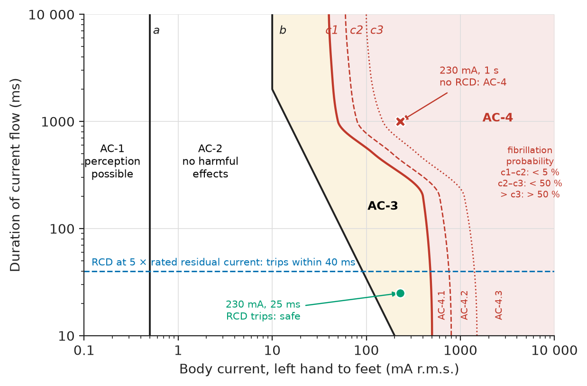
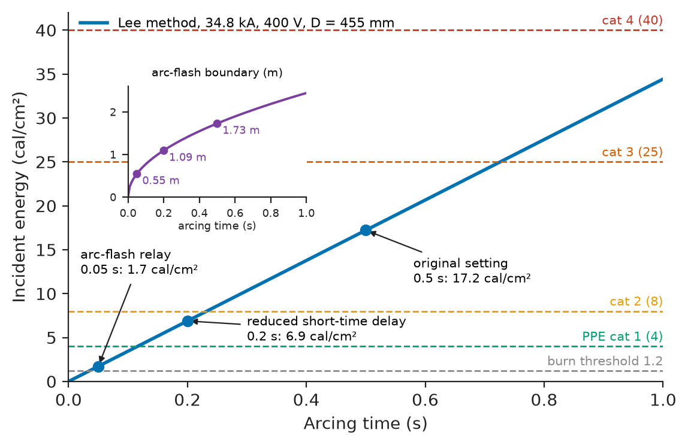
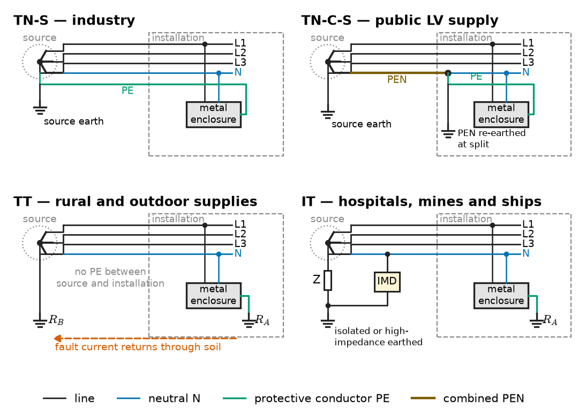
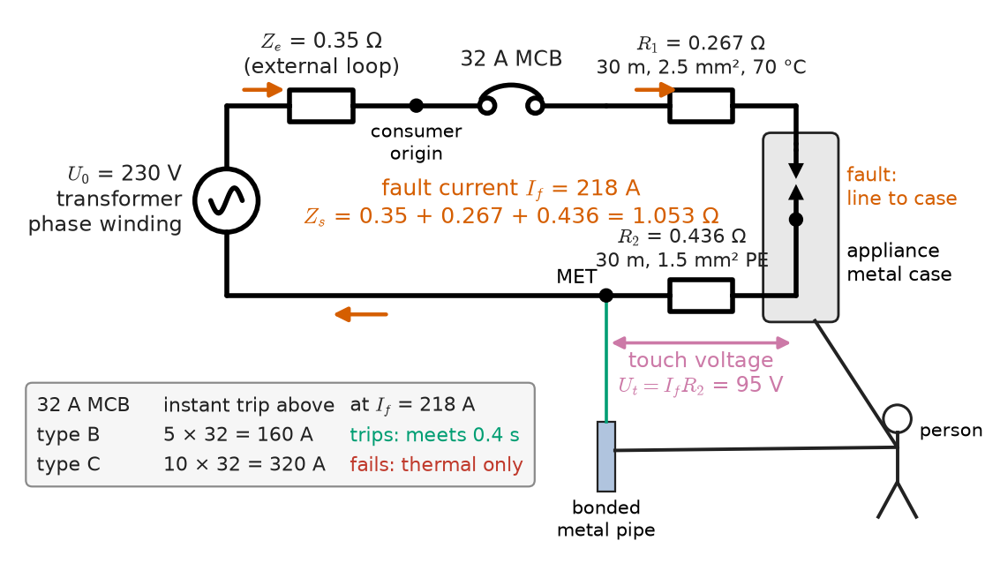
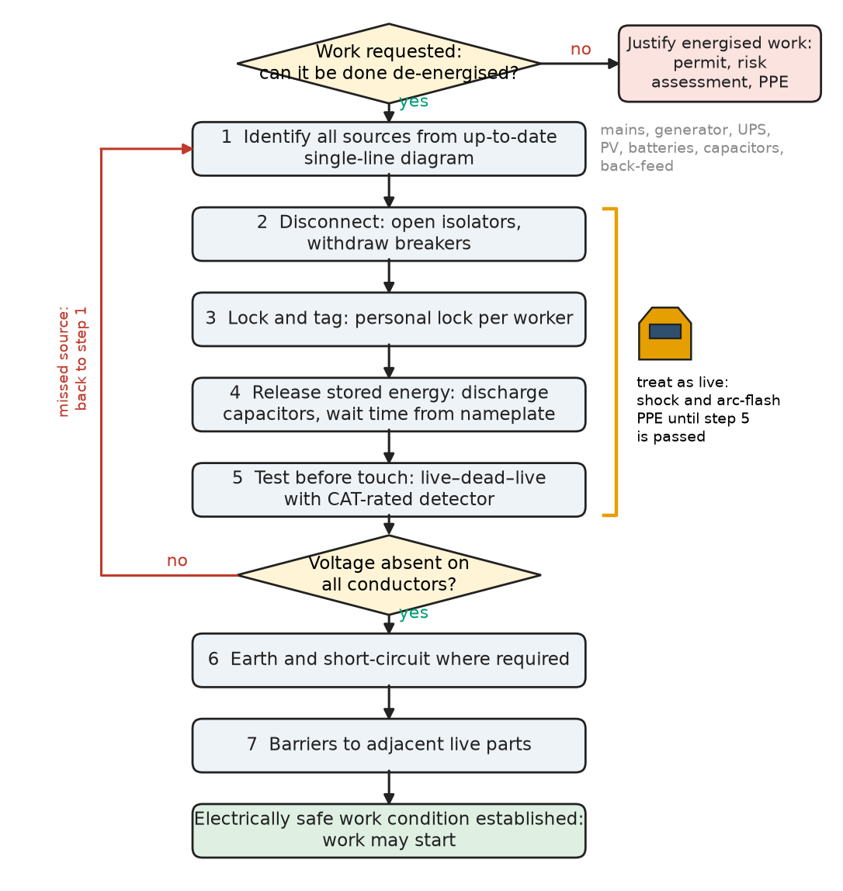
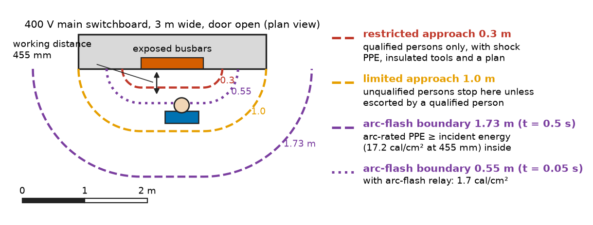

# Chapter 29 — Electrical Safety

*Part VIII · Electrical Safety and Engineering Practice*

Two incidents from the same industrial estate, a year apart. In the first, a maintenance electrician opens the door of a 400 V main switchboard to tighten a loose busbar connection that thermography had flagged. The board is live because the plant cannot stop. A dropped spanner bridges two phases; the resulting arc burns for half a second, until the upstream breaker's short-time delay expires, and releases about 17 cal/cm² at his face and chest. He was wearing a cotton shirt rated for nothing. In the second, an apprentice replacing a light fitting in a farm workshop isolates the lighting circuit at the board, but the fitting has been wired from a different circuit by a previous owner. He touches the line conductor with one hand while kneeling on a damp concrete floor. The 6 A miniature circuit breaker on that circuit never trips — the current through him is a fraction of an ampere — but a 30 mA residual-current device at the origin does, in about 25 ms, and he walks away. The two cases bracket the subject: electricity injures by current through the body and by the energy of an arc, and the difference between an injury and a near miss is almost always an engineering decision made long before the incident — a protective device, a clearing time, an isolation procedure, a test before touch.

> **How much current, for how long, injures a person, and how much arc energy burns one?**
> **Which installation measures and working practices keep those quantities below their limits, and how is the remaining risk assessed?**

| Concept | Engineering destination |
|---|---|
| Shock hazards | Touch-voltage limits, RCD ratings, disconnection times, special locations |
| Arc-flash hazards | Incident-energy studies, labels, PPE, arc-flash relays, arc-resistant switchgear |
| Grounding and bonding | TN, TT and IT systems, protective conductors, substation earth grids |
| Protective devices | MCBs, fuses, RCDs, AFDDs, insulation monitors, surge protective devices |
| Isolation and lockout | Five safety rules, LOTO procedures, stored-energy discharge |
| Safe testing | Measurement categories, test-before-touch, insulation and loop tests |
| Overcurrent protection | Cable–device coordination, adiabatic withstand, automatic disconnection |
| Electrical installation safety | IEC 60364 and NEC compliance, IP ratings, hazardous areas, EV and PV installations |
| Hazard assessment | Shock and arc-flash risk assessment, approach boundaries, hierarchy of controls |

**Roadmap.** What current does to the body (29.1) → what an arc does (29.2) → how earthing and bonding turn faults into disconnections (29.3) → the devices that disconnect (29.4) → how those devices are coordinated with cables (29.5) → making equipment dead and keeping it dead (29.6) → proving it is dead and testing safely (29.7) → the installation rules that build all this in (29.8) → how the remaining hazard is assessed and controlled (29.9).

> **Boundary.** The residual-current device as a hardware form of Kirchhoff's current law is introduced in *Circuits, Signals and Communications*, [Ch. 2](https://github.com/The-Studio-of-Sadiq/Circuits-Signals-and-Communications/blob/main/part-1-circuit-fundamentals/02-fundamental-circuit-laws.md), and neutral currents in [Ch. 10 §10.9](https://github.com/The-Studio-of-Sadiq/Circuits-Signals-and-Communications/blob/main/part-2-transient-and-ac-analysis/10-three-phase-circuits.md). Prospective fault currents come from Chapter 19, protective-device characteristics and coordination from Chapter 23, and high-voltage earthing grids, surges and high-voltage test safety from Chapter 24. This chapter uses those results to set and check safety limits.

---

## 29.1 Shock hazards

### Current, not voltage

The physiological effect of an electric shock is set by the current through the body, its path, its frequency and its duration. Voltage matters only because it drives that current through the body's impedance. IEC 60479-1 (with IEC TS 60479-2 for other frequencies and impulses) is the reference used by every installation standard; its values, summarised in Table 29.1, come from measurements on cadavers and volunteers and from animal experiments, and are statistical.

**Table 29.1 — Effects of 50/60 Hz current on the body, left hand to feet (approximate, after IEC 60479-1).**

| Current | Effect |
|---|---|
| 0.5 mA | Threshold of perception (line a) |
| 5–10 mA | Threshold of let-go: above this the hand cannot release a gripped conductor |
| 20–40 mA for seconds | Respiratory paralysis possible, strong muscular contraction, pain |
| 40–50 mA for over 1 s | Ventricular fibrillation becomes possible (curve c1) |
| 500 mA for 10 ms | Fibrillation possible even for very short exposure |
| Several amperes | Cardiac arrest, deep burns at entry and exit, tissue damage along the path |

Fibrillation, the uncoordinated quivering of the heart's ventricles that stops blood circulation, is the main cause of death from low-voltage shock. It is most likely when the shock overlaps the vulnerable period of the cardiac cycle (the T-wave), which is why the threshold falls sharply when the shock lasts longer than one heartbeat (about 0.75–1 s). Figure 29.1 shows the time–current zones.

<!-- FIGURE 29.1 | figures/ch29/fig-29-1-iec60479-zones.png | plot | Time-current zones for 50/60 Hz current, left hand to feet, after IEC 60479-1. | Content: log-log axes, x-axis body current 0.1 to 10000 mA, y-axis duration 10 to 10000 ms. Line a vertical at 0.5 mA. Curve b from about 200 mA at 10 ms falling to 10 mA at about 2000 ms and vertical at 10 mA beyond. Curve c1 approximately 500 mA at 10 ms, 400 mA at 200 ms, falling steeply to about 50 mA at 1000 ms and 40 mA at 10000 ms. Curves c2 and c3 to the right of c1 (about 5 and 50 percent fibrillation probability). Zones labelled AC-1 (left of a), AC-2 (a to b), AC-3 (b to c1), AC-4 (right of c1) with AC-4.1, AC-4.2, AC-4.3. Overlay points: 230 mA at 25 ms (RCD trip, marked safe) and 230 mA at 1000 ms (no RCD, marked AC-4); horizontal dashed line at 40 ms labelled "RCD at 5 x rated residual current". -->

*Figure 29.1 — Time-current zones for 50/60 Hz current, left hand to feet, after IEC 60479-1.*

> **Status of the principle: IEC 60479-1 time–current zones**
> *Empirical.* The boundaries are statistical fits to animal experiments and limited human data for adults in normal health; they apply to 15–100 Hz sinusoidal current along the stated path and are scaled for other paths by heart-current factors.

### Body impedance and current path

The body's impedance is a skin impedance at entry and exit (resistive and capacitive, falling sharply once the skin breaks down above about 50–100 V) in series with an internal impedance of roughly 500 Ω hand to hand. At 230 V, for a large dry contact area, the total hand-to-hand impedance is about 1000 Ω for the 5 % of the population with the lowest values, 1350 Ω for the median, and 2100 Ω for the 95th percentile; at 50 V the median is about 2500 Ω, and in wet conditions the values fall by 25–50 %. Shoes, floor and gloves add resistance in series, which is why dry, insulating floors and footwear matter.

The path matters through the heart-current factor $F$: the same current is about as dangerous left hand to feet ($F=1.0$), somewhat less right hand to feet ($F=0.8$), much less hand to hand ($F=0.4$), and more chest to left hand ($F=1.5$). The equivalent left-hand-to-feet current is $F$ times the actual current.

### Touch voltage limits

Installation standards turn these data into a **conventional touch-voltage limit** $U_L$: 50 V AC or 120 V ripple-free DC in normal dry conditions (IEC 60364-4-41, IEC 61140), reduced to 25 V AC in agricultural buildings, medical locations and other places where the body impedance is lower. A touch voltage at or below $U_L$ may persist indefinitely. Above it, the protective device must disconnect within a time that keeps the body current outside the dangerous zone: 0.4 s for 230 V final circuits in TN systems and 0.2 s in TT systems (IEC 60364-4-41, Table 41.1), and 5 s (TN) or 1 s (TT) for distribution circuits, where people are less likely to be in contact.

### DC and other frequencies

For DC the thresholds are higher: perception at about 2 mA, no clear let-go threshold (the muscle reacts at make and break rather than continuously), and fibrillation thresholds two to four times the AC values for long exposures. This is why 120 V DC is treated like 50 V AC. With 400–1500 V DC now common in PV strings, battery storage, EV charging and traction, DC shock is a mainstream hazard, not a niche one. At higher frequencies (400 Hz in aircraft, kilohertz in induction heating) the fibrillation threshold rises but burns become more likely, and at radio frequencies current flows near the skin surface (IEC TS 60479-2).

**Worked example — Why the MCB cannot protect a person.** A person touches a 230 V line conductor with the left hand while standing barefoot on a wet floor, so that the only significant impedance is the body's, taken as 1000 Ω (5th percentile, conservatively). The circuit is protected by a 16 A type B MCB and, in a second case, also by a 30 mA RCD.

Body current: $230/1000=230$ mA. The MCB's instantaneous trip begins at $5\times16=80$ A; at 230 mA it will never operate, since the person draws less current than a light bulb. From Figure 29.1, 230 mA lies in zone AC-3 for durations below about 0.3 s and in AC-4 beyond, so a sustained contact carries a high risk of fibrillation. The RCD sees a residual current of 230 mA, more than five times its 30 mA rating, and must trip within 40 ms (IEC 61008-1/61009-1); typical devices take 15–30 ms. At 230 mA for 40 ms the point is well left of c1. If the person wore dry shoes on dry concrete adding about 2000 Ω, the current would be $230/3000=77$ mA: still above the let-go threshold and dangerous, still above $2\times30=60$ mA, so the RCD would trip within its 150 ms limit at twice rated current.

The conclusion is general: overcurrent devices protect cables and equipment; only residual-current devices, extra-low voltage, insulation and isolation protect people from direct contact.

---

## 29.2 Arc-flash hazards

### What an arc releases

When a fault current flows through air instead of metal — a tool dropped across busbars, a racking failure, an insulation breakdown on contaminated surfaces, a rodent — the arc column reaches 10 000–20 000 K, vaporises copper (which expands about 67 000 times in volume), and radiates intense heat and ultraviolet light. The effects are burns from radiation and from molten metal, a pressure wave that can throw a worker and rupture eardrums, shrapnel, and toxic copper oxide. Burns, not shock, are the dominant arc injury. The quantity used to rate the hazard is the **incident energy** $E$ received on a surface at the worker's working distance, in J/cm² or cal/cm² (1 cal/cm² = 4.184 J/cm²). The onset of a just-curable second-degree burn on bare skin is taken as 1.2 cal/cm² (5.0 J/cm²), the Stoll-curve value used by NFPA 70E and IEEE 1584.

Incident energy grows with three quantities the engineer controls:

- the **arcing current** — at low voltage typically 40–70 % of the bolted fault current because of the arc's own voltage, at medium voltage closer to 90 %;
- the **arcing time**, set almost entirely by the protective device that clears the fault;
- the **distance** from the arc, which enters roughly as $1/D^2$ in open air and as $1/D^{1.5}$–$1/D^{2}$ in a box that focuses the energy outward.

### Estimating incident energy

The theoretical upper bound is due to Ralph Lee (1982), who assumed the arc delivers the maximum possible power (half the bolted fault MVA) radiating spherically. In its IEEE 1584 form,

$$
E=2.142\times10^{6}\,V\,I_{bf}\,\frac{t}{D^{2}}\quad\mathrm{J/cm^2}
$$

with $V$ the system voltage in kV, $I_{bf}$ the bolted three-phase fault current in kA, $t$ the arcing time in s and $D$ the distance in mm. It is conservative at low voltage and is now used mainly for open-air arcs above 15 kV. For 208 V–15 kV equipment the standard method is IEEE 1584-2018, whose empirical equations were fitted to some 1800 laboratory tests. They take as inputs the voltage, bolted fault current, electrode gap, enclosure size and one of five electrode configurations (vertical electrodes in a box, with or without a barrier below; horizontal electrodes in a box; and the two open-air cases), and compute first the arcing current, then the incident energy at the working distance and the **arc-flash boundary**: the distance at which $E$ falls to 1.2 cal/cm². Because a lower arcing current may delay the protective device, the method also repeats the calculation with a reduced arcing current and keeps the worse result. Standard working distances are 455 mm for low-voltage panelboards and MCCs, 610 mm for low-voltage switchgear and 910 mm for medium-voltage switchgear.

> **Status of the principle: Arc-flash incident-energy equations**
> *Empirical.* IEEE 1584-2018 equations are regressions on tests within stated ranges (208 V–15 kV, three-phase, 50/60 Hz, bolted fault 0.5–106 kA at low voltage, specified gaps and enclosures); the Lee equation is a theoretical upper bound. Neither covers single-phase arcs, DC arcs or the blast pressure.

**Worked example — Incident energy at a main switchboard.** A 1600 kVA, 11/0.4 kV transformer with 6 % impedance, supplied from an 11 kV network of 250 MVA fault level, feeds a main switchboard. The worker stands 455 mm from the busbars in an MCC-style section. The upstream breaker clears faults in the board with a short-time delay giving an arcing time of 0.5 s. Estimate the incident energy by the Lee method and the effect of reducing the clearing time.

Source impedance on the transformer base: $1.6/250=0.0064$ pu. Bolted fault current:

$$
I_{bf}=\frac{1600}{\sqrt3\times0.4\times(0.06+0.0064)}=34.8\ \mathrm{kA}
$$

At $t=0.5$ s:

$$
E=2.142\times10^{6}\times0.4\times34.8\times\frac{0.5}{455^{2}}=72.0\ \mathrm{J/cm^2}=17.2\ \mathrm{cal/cm^2}
$$

and the arc-flash boundary, where $E=5.0$ J/cm², is $D_B=\sqrt{2.142\times10^{6}\times0.4\times34.8\times0.5/5.0}=1726$ mm. With the short-time delay reduced so that $t=0.2$ s: 28.8 J/cm² (6.9 cal/cm²), boundary 1.09 m. With an arc-flash relay (light plus overcurrent) tripping the breaker in a total of 0.05 s: 7.2 J/cm² (1.7 cal/cm²), boundary 0.55 m. Energy is proportional to clearing time, so a tenfold faster clearance takes the task from the PPE category 3 range to category 1, and this — not heavier clothing — is the engineering answer.

<!-- FIGURE 29.2 | figures/ch29/fig-29-2-incident-energy-time.png | plot | Incident energy at 455 mm for a 34.8 kA, 400 V bolted fault against arcing time, with PPE category thresholds. | Content: x-axis arcing time 0 to 1.0 s, y-axis incident energy 0 to 40 cal/cm2. Straight line from origin (Lee method) with marked points 0.05 s 1.7 cal/cm2, 0.2 s 6.9 cal/cm2, 0.5 s 17.2 cal/cm2. Horizontal dashed lines at 1.2 (second-degree burn onset), 4, 8, 25 and 40 cal/cm2 labelled "burn threshold", "PPE cat 1", "cat 2", "cat 3", "cat 4". Annotations at the points: "arc-flash relay", "reduced short-time delay", "original setting". Secondary inset: arc-flash boundary 0.55 m, 1.09 m, 1.73 m against the same times. -->

*Figure 29.2 — Incident energy at 455 mm for a 34.8 kA, 400 V bolted fault against arcing time, with PPE category thresholds.*

### Reducing the hazard

In order of effectiveness:

- **Do not work live.** De-energising (Section 29.6) removes the arc-flash hazard except during the test for absence of voltage.
- **Clear faster.** Arc-flash relays with optical sensors (trip in 2–5 ms, total clearing 35–60 ms with the breaker), zone-selective interlocking between breakers, energy-reducing maintenance switches that temporarily set the instantaneous trip low while someone works (required by NEC 240.87 for breakers of 1200 A and above), and current-limiting fuses, which clear high faults within a half-cycle.
- **Reduce the fault current** with transformer impedance or by splitting buses, recognising that this conflicts with voltage regulation and motor starting (Chapter 30) and that a lower current may lengthen the clearing time.
- **Increase the distance.** Remote racking devices, remote switching, and infrared windows that let thermography be done with doors closed.
- **Contain the arc.** Arc-resistant switchgear tested to IEC 62271-200 (internal arc classification) or IEEE C37.20.7 vents the arc products away from the operator when doors are closed. It offers no protection with the doors open.

DC arcs in battery rooms, PV combiner boxes and traction systems are harder to extinguish, because DC has no current zero, and are not covered by IEEE 1584; NFPA 70E gives simplified methods, and the field is still developing.

---

## 29.3 Grounding and bonding

### Two different jobs

**Earthing** (grounding) connects parts of the installation to the general mass of the earth through electrodes. **Bonding** connects conductive parts to each other so that they stay at nearly the same potential whatever the earth does. Most electrical shock protection depends on bonding more than on earthing: a person touching a faulty appliance and a water pipe is safe if the two are at the same potential, whatever their potential relative to remote earth. A building's **main equipotential bonding** joins the protective conductors, the main earthing terminal, metallic water and gas pipes, structural steel and lightning-protection down-conductors at the point of entry; **supplementary bonding** does the same locally in bathrooms, swimming pools, agricultural buildings and medical locations.

### Earthing systems

IEC 60364-1 classifies low-voltage systems with two letters (Figure 29.3). The first describes the source: T, one point (usually the neutral) directly earthed; I, all live parts isolated from earth or earthed through a high impedance. The second describes the exposed conductive parts of the installation: T, earthed locally and independently of the source earth; N, connected to the source's earthed point by a protective conductor. TN systems are subdivided by whether the neutral and protective functions share a conductor: TN-S (separate throughout), TN-C (combined PEN conductor) and TN-C-S (combined in the supply network, separate inside the installation — the common arrangement known as protective multiple earthing in the UK).

<!-- FIGURE 29.3 | figures/ch29/fig-29-3-earthing-systems.png | schematic | The four low-voltage earthing systems: TN-S, TN-C-S, TT and IT. | Content: four panels, each with a star-connected transformer secondary L1, L2, L3, N on the left and a consumer with one exposed metal enclosure on the right. TN-S: neutral earthed at source, separate PE conductor run to the enclosure. TN-C-S: combined PEN conductor from source to the service position, split there into N and PE with the PEN re-earthed. TT: neutral earthed at source electrode RB, enclosure earthed at a separate consumer electrode RA, no PE between them, earth path through soil drawn as dashed arrow. IT: neutral isolated or earthed through high impedance Z, enclosure earthed locally, insulation monitoring device IMD between neutral and earth. Label each panel with its two letters and typical use: industry, public LV supply, rural and outdoor, hospitals and mines and ships. -->

*Figure 29.3 — The four low-voltage earthing systems: TN-S, TN-C-S, TT and IT.*

**Table 29.2 — Low-voltage earthing systems compared.**

| System | First earth fault | Fault current | Protection | Typical use |
|---|---|---|---|---|
| TN-S | Line-to-PE short circuit | Hundreds of A to kA | Overcurrent device or RCD | Industrial plants, data centres, buildings with own substation |
| TN-C-S | As TN-S inside installation | Hundreds of A to kA | Overcurrent device or RCD; risk if PEN breaks | Public LV supply in UK, Europe, Australia |
| TT | Current returns through soil | A few A to tens of A | RCD essential | Rural supplies, outdoor installations, EV chargers on some networks |
| IT | Small capacitive current only; operation continues | mA to a few A | Insulation monitor alarms; second fault must trip | Hospitals (operating theatres), mines, ships, continuous processes |

The TN-C and TN-C-S systems carry one particular hazard: if the PEN conductor breaks upstream, every exposed conductive part bonded to the PE downstream rises toward line voltage through the load. Multiple re-earthing of the PEN by the utility limits this; for EV chargers outdoors, where a person stands on true earth beside a car bonded to the PE, IEC 60364-7-722 requires extra measures such as PEN-loss detection or a TT arrangement.

### Automatic disconnection in TN systems

In a TN system an insulation fault from line to an exposed part is a short circuit through the line conductor and the protective conductor. The fault current must be large enough to operate the protective device within the required time:

$$
Z_s\,I_a\le U_0
$$

where $Z_s$ is the earth-fault loop impedance (source, line conductor and protective conductor), $I_a$ the current that operates the device within the required disconnection time, and $U_0$ the nominal line-to-earth voltage. In practice a factor $C_{min}=0.95$ is applied to $U_0$ for the lowest supply voltage, and conductor resistances are taken at their operating temperature.

> **Status of the principle: Automatic disconnection of supply (TN)**
> *Approximate.* The condition treats the fault as a bolted connection with negligible fault resistance and neglects reactance in small conductors; an arcing or high-resistance fault produces less current and may not be cleared in time, which is one reason RCDs are added.

<!-- FIGURE 29.4 | figures/ch29/fig-29-4-tn-fault-loop.png | circuit | Earth-fault loop in a TN-S final circuit and the resulting touch voltage. | Content: transformer secondary phase winding with external loop impedance Ze = 0.35 ohm to the consumer origin; line conductor R1 = 0.267 ohm (30 m, 2.5 mm2 at 70 C) through a 32 A MCB to an appliance with metal case; fault from line to case; protective conductor R2 = 0.436 ohm (30 m, 1.5 mm2) back to the main earthing terminal and the source neutral. Arrows show fault current If = 218 A circulating. A person touching the case and a bonded metal pipe at the main earthing terminal potential: touch voltage Ut = If x R2 = 95 V marked across R2. Inset table: type B 32 A trips instantaneously above 160 A (meets 0.4 s), type C 32 A needs 320 A (fails). -->

*Figure 29.4 — Earth-fault loop in a TN-S final circuit and the resulting touch voltage.*

**Worked example — Touch voltage and disconnection in a TN-S circuit.** A 230 V final circuit in a TN-S installation is 30 m long, with a 2.5 mm² copper line conductor (7.41 mΩ/m at 20 °C) and a 1.5 mm² protective conductor (12.10 mΩ/m). The external loop impedance $Z_e$ is 0.35 Ω. Resistances are multiplied by 1.20 for the 70 °C operating temperature. Check the circuit with a 32 A type B MCB and with a 32 A type C MCB (Figure 29.4).

$R_1=7.41\times30\times1.20=267$ mΩ, $R_2=12.10\times30\times1.20=436$ mΩ, so

$$
Z_s=0.35+0.267+0.436=1.053\ \Omega,\qquad I_f=\frac{230}{1.053}=218\ \mathrm A
$$

The type B MCB operates instantaneously (within 0.1 s) above $5\times32=160$ A, so the condition is met; the maximum allowed loop impedance is $0.95\times230/160=1.37$ Ω. The type C MCB needs $10\times32=320$ A, permitting at most 0.68 Ω: the circuit fails, because at 218 A the type C device would rely on its thermal element and could take several seconds. While the fault persists, the case rises to $U_t=I_fR_2=218\times0.436=95$ V above the main earthing terminal. For 0.1 s that is acceptable by Figure 29.1; for several seconds it is not. The remedies are a type B device, a larger protective conductor, a shorter run, or an RCD.

### Automatic disconnection in TT systems

In a TT system the fault current returns through the consumer's electrode $R_A$ and the source electrode $R_B$, and is usually too small to trip an overcurrent device. An RCD is used instead, and the condition is that the touch voltage at the operating current stays within $U_L$:

$$
R_A\,I_{\Delta n}\le50\ \mathrm V
$$

**Worked example — Why a TT installation needs an RCD.** A farm workshop is supplied TT with $R_A=50$ Ω and $R_B=10$ Ω. An insulation fault occurs in a 230 V machine protected by a 20 A MCB.

Fault current: $230/(50+10)=3.83$ A — a fifth of the MCB's rating, so it never trips. The machine frame rises to $3.83\times50=192$ V and stays there. With a 30 mA RCD the condition requires $R_A\le50/0.03=1667$ Ω (easily met), and with a 300 mA time-delayed RCD at the origin, $R_A\le167$ Ω. The RCD trips at a few milliamperes of the 3.83 A fault, within 0.2 s.

### Substation earthing: step and touch voltages

At high-voltage substations the earth-fault current is kiloamperes and returns partly through the soil, so the ground surface around the grid rises in potential. A person touching a structure (**touch voltage**) or straddling a gradient with the feet 1 m apart (**step voltage**) is exposed. IEEE 80 sets tolerable limits from Dalziel's fibrillation criterion $I_B=0.116/\sqrt{t_s}$ A for a 50 kg person (valid for 0.03–3 s), giving for touch and step respectively

$$
E_{touch,50}=(1000+1.5\,C_s\rho_s)\frac{0.116}{\sqrt{t_s}},\qquad E_{step,50}=(1000+6\,C_s\rho_s)\frac{0.116}{\sqrt{t_s}}
$$

where 1000 Ω is the assumed body resistance, $\rho_s$ the surface-layer resistivity and $C_s$ a derating factor for a thin surface layer. The grid design itself, its resistance and the ground-potential rise belong to Chapter 24.

**Worked example — Value of a crushed-rock surface.** A 132 kV substation clears earth faults in 0.5 s. The native soil is 100 Ω·m. Find the tolerable touch voltage with a 0.1 m layer of 3000 Ω·m crushed rock ($C_s=1-0.09(1-\rho/\rho_s)/(2h_s+0.09)=0.70$) and without it.

With rock: $(1000+1.5\times0.70\times3000)\times0.116/\sqrt{0.5}=681$ V; tolerable step voltage 2231 V. Without rock ($\rho_s=100$ Ω·m, $C_s=1$): $(1000+150)\times0.164=189$ V. The 10 cm of gravel raises the allowed touch voltage 3.6 times, which is why every outdoor substation has it.

> **Status of the principle: IEEE 80 tolerable touch and step voltages**
> *Empirical.* Based on Dalziel's fibrillation data for a 50 kg (or 70 kg) person, a 1000 Ω body and a 0.03–3 s shock; it is a design criterion with deliberate conservatism, not a prediction for an individual.

---

## 29.4 Protective devices

### The family of devices

Each protective device answers a different question about the current in a circuit. Table 29.3 summarises them.

**Table 29.3 — Low-voltage protective devices (typical characteristics).**

| Device | Senses | Protects against | Key ratings | Standard |
|---|---|---|---|---|
| Miniature circuit breaker (MCB) | Overcurrent (thermal and magnetic) | Overload, short circuit, earth fault in TN | In 0.5–125 A; type B 3–5 In, C 5–10 In, D 10–20 In; Icn 6–25 kA | IEC 60898-1 |
| Moulded-case / air circuit breaker | Overcurrent, often earth fault, electronic trip | Feeders, mains, motors | In 16–6300 A; Icu up to 150 kA; Icw for air breakers | IEC 60947-2 |
| Fuse (gG, aM, gR) | Overcurrent (melting) | Short circuit with current limitation; gG also overload | In up to 1250 A; breaking 50–120 kA | IEC 60269 |
| Residual-current device (RCD) | Residual (earth-leakage) current | Shock, earth-fault fire | IΔn 10, 30, 100, 300, 500 mA; types AC, A, F, B | IEC 61008, 61009, 62423 |
| Arc-fault detection device (AFDD) | Arc signature in current waveform | Series and parallel arcing faults, fire | Final circuits up to 63 A | IEC 62606 |
| Insulation monitoring device (IMD) | Insulation resistance to earth in IT systems | First fault (alarm) | Response value typically 50–100 Ω/V | IEC 61557-8 |
| Surge protective device (SPD) | Overvoltage | Lightning and switching surges | Type 1, 2, 3; Up, In, Iimp | IEC 61643-11 |
| Motor protection relay | Current, thermal image, unbalance | Motor overload, stall, phase loss | Trip classes 10, 20, 30 | IEC 60947-4-1 |

### RCD types and DC leakage

An RCD of type AC detects only sinusoidal residual current. Type A also detects pulsating DC (from single-phase rectifiers); type F adds mixed frequencies from single-phase drives; type B detects smooth DC as well, which appears with three-phase rectifiers in drives, EV chargers and PV inverters. A smooth DC residual current of only a few milliamperes can saturate the core of a type A device and blind it. EV chargers therefore need either a type B RCD or a type A RCD together with a 6 mA DC residual-current detector (IEC 62955) in the charger, and the RCD selection for PV inverters depends on whether the inverter itself guarantees no DC leakage.

RCDs at 30 mA are required as additional protection for socket-outlets up to 32 A, mobile equipment outdoors, bathrooms and many special locations (IEC 60364-4-41 and Part 7). Time-delayed (type S) RCDs of 100–500 mA upstream provide fire protection and selectivity with the 30 mA devices below. Too many circuits on one RCD cause nuisance tripping from the sum of normal leakage currents (filters in IT equipment leak 0.5–3.5 mA each); good design keeps the standing leakage below about 30 % of $I_{\Delta n}$.

### Insulation monitoring in IT systems

An IT system tolerates a first earth fault without tripping, because the only fault-current path is the system's capacitance to earth. The insulation monitoring device injects a measuring signal between the system and earth and alarms when the insulation resistance falls below a set value, so the fault can be found (with insulation-fault location systems) and repaired before a second fault on another phase creates a line-to-line short circuit through two earthed frames. This is why operating theatres (medical IT, IEC 60364-7-710), ships and mines use IT: continuity of supply through the first fault.

---

## 29.5 Overcurrent protection

### Two duties

Overcurrent protection has two separate duties, which IEC 60364-4-43 and NEC Article 240 treat separately. **Overload protection** prevents a cable from running persistently above its maximum insulation temperature (70 °C for PVC, 90 °C for XLPE), which halves its life for roughly every 8–10 K of excess (Chapter 9). **Short-circuit protection** interrupts a fault before the conductor reaches its short-time limit (160 °C for PVC, 250 °C for XLPE) and before the electromagnetic forces damage equipment.

### Overload coordination

With $I_B$ the design current of the circuit, $I_n$ the rated (or set) current of the device, $I_Z$ the current-carrying capacity of the cable under its installation conditions, and $I_2$ the current that ensures operation of the device within its conventional time (1 or 2 h):

$$
I_B\le I_n\le I_Z,\qquad I_2\le1.45\,I_Z
$$

For MCBs to IEC 60898-1, $I_2=1.45I_n$, so the second condition is automatically met when $I_n\le I_Z$. For gG fuses $I_2=1.6I_n$, so $I_n$ must not exceed $1.45/1.6=0.906$ of $I_Z$. A 40 A MCB on a cable rated 41 A gives $I_2=58$ A against a limit of $1.45\times41=59.5$ A and is acceptable; a 40 A gG fuse on the same cable would require $I_Z\ge44.1$ A.

> **Status of the principle: Overload coordination**
> *Empirical.* The factor 1.45 reflects test experience that a cable can carry 45 % overload for the conventional time without serious damage; it presumes infrequent overloads and does not protect against long-term moderate overloads below $I_2$.

### Short-circuit withstand: the adiabatic equation

During a short circuit lasting less than about 5 s, the heat cannot leave the conductor and all goes into raising its temperature. The conductor survives if

$$
I^2t\le k^2S^2\qquad\Longleftrightarrow\qquad S\ge\frac{\sqrt{I^2t}}{k}
$$

with $S$ the cross-section in mm², $I^2t$ the energy let through by the protective device in A²s, and $k$ a constant combining the conductor's resistivity, heat capacity and the initial and final temperatures (IEC 60364-4-43 and -5-54). Representative values: copper with PVC insulation 115, copper with XLPE 143, aluminium with PVC 76, aluminium with XLPE 94, and 143 for a separate PVC-insulated copper protective conductor starting at 30 °C. The underlying adiabatic heating is the heat-capacity limit of a thermal RC network whose time constant is long compared with the fault (*Engineering Physics*, [Ch. 14 §14.7.3](https://github.com/The-Studio-of-Sadiq/Engineering-Physics/blob/main/CHAPTERS/CHAPTER%2014.md)).

> **Status of the principle: Adiabatic short-circuit withstand**
> *Approximate.* Assumes no heat loss to the insulation or surroundings during the fault and constant material properties; it is conservative for faults over about 0.1 s in small conductors and unsafe for durations over 5 s, where heat loss and different limits apply.

**Worked example — Is a 16 mm² sub-main protected?** A 16 mm² copper/PVC sub-main ($k=115$) can see a prospective fault of 5 kA at its origin. Case (a): it is protected by an upstream breaker with a 0.2 s short-time delay. Case (b): a current-limiting MCCB whose let-through $I^2t$ at 5 kA is 0.3 MA²s.

(a) $I^2t=5000^2\times0.2=5\times10^6$ A²s, so $S\ge\sqrt{5\times10^6}/115=19.4$ mm²: the 16 mm² cable would be overheated and its insulation damaged. (b) $S\ge\sqrt{0.3\times10^6}/115=4.8$ mm²: well protected. The same cable is safe or unsafe depending only on the device in front of it. For the final circuit of Section 29.3, $I_f=218$ A cleared in 0.1 s requires $S\ge\sqrt{218^2\times0.1}/115=0.60$ mm² for the 1.5 mm² protective conductor, which passes.

### Selectivity and back-up

Overcurrent devices in series must be selective: the device nearest the fault should operate and those upstream should not (Chapter 23 for relays; Chapter 30 for low-voltage breakers and fuses). Where a downstream breaker's breaking capacity is below the prospective fault current, an upstream current-limiting device can provide **back-up** (cascading) protection, verified only by tested manufacturer combinations. Back-up and selectivity often conflict — cascading relies on both devices opening — and the designer must decide which matters more for each circuit, a question of safety and continuity together.

---

## 29.6 Isolation and lockout

### The five safety rules

Most work on electrical equipment should be done dead. EN 50110-1, which governs the operation of electrical installations in Europe, sets out the five safety rules, to be applied in this order:

1. **Disconnect completely** — open every source: main supply, generator, UPS, PV, battery, back-feed through control or auxiliary circuits, interconnections.
2. **Secure against reconnection** — lock the isolating devices open, attach a personal lock and tag for each worker, remove fuses, block motorised operators.
3. **Verify the absence of operating voltage** — on every conductor, with a tested detector of the right category and voltage range, proven on a known live source immediately before and after.
4. **Carry out earthing and short-circuiting** — mandatory at high voltage and on long LV cables or overhead lines, so that induced voltages, capacitive charge or an accidental re-energisation is diverted through a short circuit that trips the protection.
5. **Provide protection against adjacent live parts** — barriers, insulating covers, defined work zones.

The same logic is expressed in North America as establishing an **electrically safe work condition** (NFPA 70E Article 120) and as lockout/tagout under OSHA 29 CFR 1910.147 and 1910.333. Until step 3 is complete, the equipment must be treated as live, with the shock and arc-flash precautions of Section 29.9. Figure 29.5 summarises the sequence.

<!-- FIGURE 29.5 | figures/ch29/fig-29-5-isolation-sequence.png | flowchart | Establishing an electrically safe work condition: the five safety rules with decision points. | Content: vertical flowchart. Start "Work requested; can it be done de-energised?" (no branch to "Justify energised work, permit, risk assessment, PPE" box). Yes branch: 1 "Identify all sources from up-to-date single-line diagram" (side notes: mains, generator, UPS, PV, batteries, capacitors, back-feed); 2 "Disconnect: open isolators, withdraw breakers"; 3 "Lock and tag: personal lock per worker"; 4 "Release stored energy: discharge capacitors, wait time from nameplate"; 5 "Test before touch: live-dead-live with CAT-rated detector" (decision diamond "voltage absent on all conductors?" no branch loops back to step 1); 6 "Earth and short-circuit where required"; 7 "Barriers to adjacent live parts"; end "Electrically safe work condition established; work may start". Use PPE icon beside steps 2 to 5 to show the equipment is treated as live until step 5 is passed. -->

*Figure 29.5 — Establishing an electrically safe work condition: the five safety rules with decision points.*

### Stored and back-fed energy

Opening a switch does not remove every source of energy. The most common surprises are:

- **Capacitors** in drives, UPS DC links, power-factor-correction banks and cable capacitance after insulation testing. Bleeder resistors are required to bring a PFC capacitor below 75 V within 3 minutes (IEC 60831-1), and drive manufacturers specify waiting times of 5–15 minutes.
- **PV arrays**, which generate whenever light falls on them; a string cannot be switched off at the module, which is why module-level rapid shutdown (NEC 690.12) exists.
- **Batteries**, which cannot be isolated internally; their terminals are always live and capable of tens of kiloamperes.
- **Back-feed** from standby generators, neighbouring feeders through open points, or a UPS output feeding back into a "dead" distribution board through a bypass.
- **Induced voltages** on de-energised overhead lines and cables running parallel to live circuits, which can reach hundreds or thousands of volts — the reason for working earths.

**Worked example — How long to wait before opening a drive.** A 690 V drive has a DC link of 975 V and a total capacitance of 4.7 mF, discharged by bleeder resistors totalling 47 kΩ. How long after isolation does the DC-link voltage fall below 50 V?

Time constant $\tau=RC=47\,000\times0.0047=221$ s. The voltage falls as $V(t)=975\,e^{-t/\tau}$, so $t=\tau\ln(975/50)=221\times2.97=656$ s, about 11 minutes. The stored energy at the start, $\tfrac12CV^2=2.23$ kJ, is enough to cause serious burns and a lethal shock. A drive with a failed bleeder never discharges, which is why rule 3 — test, do not assume — applies to the DC link too.

---

## 29.7 Safe testing

### Measurement categories

A meter used on a power system must survive not only the system voltage but the transient overvoltages that appear on it. IEC 61010-1 assigns measurement categories by location (Table 29.4): CAT II for circuits fed from socket-outlets, CAT III for the fixed installation (distribution boards, busbars, permanently connected motors), CAT IV for the origin of the installation (service entrance, meters, overhead lines). A CAT IV 600 V meter withstands an 8 kV impulse; a cheap CAT II meter on a main switchboard may fail explosively during a switching surge, starting an arc in the user's hand.

**Table 29.4 — Rated impulse withstand of test instruments by measurement category (IEC 61010-1).**

| Line-to-earth voltage | CAT II | CAT III | CAT IV |
|---|---|---|---|
| 150 V | 1500 V | 2500 V | 4000 V |
| 300 V | 2500 V | 4000 V | 6000 V |
| 600 V | 4000 V | 6000 V | 8000 V |
| 1000 V | 6000 V | 8000 V | 12 000 V |

Leads and probes must carry the same category, with fused leads, shrouded connectors and probe tips with no more than 4 mm of exposed metal. For the test of absence of voltage, purpose-built two-pole voltage detectors (IEC 61243-3) are preferred over multimeters, which can be left in the wrong range or have a blown fuse. The test itself is **live–dead–live**: prove the detector on a known source, test every conductor combination (line–line, line–neutral, line–earth), prove the detector again.

### Verification tests of an installation

Before an installation is energised, and periodically afterwards, IEC 60364-6 (and NEC/NFPA 70B for maintenance) requires inspection and tests in a fixed sequence, dead tests before live:

1. Continuity of protective conductors and bonding (low-resistance ohmmeter, 200 mA or more).
2. Insulation resistance between live conductors and between live conductors and earth, at 250 V DC for SELV/PELV circuits (limit 0.5 MΩ), 500 V for circuits up to 500 V (limit 1 MΩ) and 1000 V above (limit 1 MΩ). Surge protective devices and electronic equipment are disconnected first, and long cables are discharged afterwards.
3. Polarity and phase sequence.
4. Earth-electrode resistance (TT systems).
5. Earth-fault loop impedance, measured live, compared with the maximum $Z_s$ of Section 29.3 corrected to operating temperature.
6. Prospective fault current at each board, compared with the devices' breaking capacities.
7. RCD operation at $I_{\Delta n}$ and $5I_{\Delta n}$, checking trip times against IEC 61008/61009.
8. Functional tests of switchgear, interlocks and emergency stops.

For motors and generators, polarisation index (ratio of 10-minute to 1-minute insulation resistance, at least 2 for class F and H insulation per IEEE 43) and, for high-voltage plant, the tests of Chapter 24. High-voltage testing — AC withstand, VLF and partial-discharge tests on cables — creates its own hazard zone and requires barriers, earthing sticks and a written test procedure.

---

## 29.8 Electrical installation safety

### Design rules that build safety in

The installation standards — IEC 60364 (and national versions such as BS 7671), NFPA 70 (the National Electrical Code) in North America, AS/NZS 3000 in Australia — are collections of engineering solutions to recurring hazards. Their core structure is common: protection against electric shock (basic protection by insulation, barriers and enclosures; fault protection by automatic disconnection, double insulation, electrical separation or extra-low voltage), protection against thermal effects and fire, protection against overcurrent, protection against overvoltage, and selection and erection rules for equipment. Part 7 of IEC 60364 adds rules for special locations: bathrooms, swimming pools, construction sites, agricultural premises, medical locations, marinas, PV systems (712), EV charging (722), data-processing installations and others.

### Enclosures and environments

Enclosures are rated for ingress protection by IEC 60529: the first digit for solids (2 = finger-safe, 5 = dust-protected, 6 = dust-tight) and the second for water (4 = splashing, 5 = jets, 7 = temporary immersion). Switchboards are tested as assemblies under IEC 61439, including temperature rise, short-circuit withstand and internal separation forms (Form 1 to Form 4b) that limit how much of a board is exposed when one compartment is open.

In **hazardous areas** where flammable gas or dust may be present — refineries, chemical plants, mines, grain handling, battery rooms, hydrogen installations — IEC 60079 classifies zones by the likelihood of an explosive atmosphere (Zone 0, 1, 2 for gas; 20, 21, 22 for dust) and requires equipment with a matching protection concept: flameproof enclosures (Ex d), increased safety (Ex e), intrinsic safety (Ex i), pressurisation (Ex p). Underground coal mines add firedamp requirements (Group I equipment). North America uses the Class/Division system of NEC Articles 500–506, with zones as an alternative.

### Sector practice

- **Data centres**: high fault levels at 400–480 V with many parallel sources (utility, generators, UPS), making arc-flash the dominant hazard; remote racking and arc-flash relays are common.
- **Renewable plants**: PV DC circuits at 1000–1500 V that cannot be de-energised in daylight, arc-fault detection on DC (UL 1699B), and wind-turbine towers with medium voltage and confined spaces.
- **Traction and EV charging**: DC traction at 750 V–3 kV with return-current and stray-current corrosion issues (EN 50122); DC fast chargers up to 1000 V with type B residual-current protection and insulation monitoring on the vehicle side.
- **Marine**: IT systems with insulation monitoring, IEC 60092 and classification-society rules, and medium voltage (6.6–11 kV) on large ships with shore connection to IEC/IEEE 80005-1.
- **Mining**: trailing cables with earth-continuity monitoring, restricted earth-fault current through neutral-earthing resistors (typically limited to 5–25 A), and flameproof equipment underground.
- **Aircraft**: 115/200 V 400 Hz and 270 V DC systems, with arc-fault circuit breakers on wiring bundles to prevent fires.

### Fire

Electrical faults cause a substantial share of building fires, mostly through high-resistance connections, damaged cables and overloaded flexible cords rather than through short circuits, which overcurrent devices clear. A loose termination dissipating 20–50 W at a contact the size of a fingernail can reach several hundred degrees without any device noticing. AFDDs, thermography during maintenance, correct torque on terminals and RCDs of 300 mA for fire protection address this gap.

---

## 29.9 Hazard assessment

### Risk assessment before every task

NFPA 70E Article 110 requires an electrical safety program in which every task on or near exposed conductors is preceded by a **shock risk assessment** and an **arc-flash risk assessment**. Each identifies the hazard, estimates the likelihood and severity of injury, decides whether additional protective measures, including PPE, are needed, and records the result. EN 50110-1 and national regulations require the equivalent. The assessment asks first whether the work can be done de-energised; energised work is justified only where de-energising creates a greater hazard (life-support equipment, emergency alarm systems) or is infeasible (diagnostic testing that requires voltage), never merely because an outage is inconvenient.

### Approach boundaries

For shock, NFPA 70E defines two boundaries around exposed live parts (Figure 29.6 and Table 29.5). The **limited approach boundary** is the distance inside which an unqualified person may enter only when escorted by a qualified person. The **restricted approach boundary** is the distance inside which there is an increased likelihood of shock through arc-over or inadvertent movement; only qualified persons with shock-protective equipment and a documented plan may cross it. The arc-flash boundary of Section 29.2 is separate and, at high fault levels, often larger.

**Table 29.5 — Shock approach boundaries for AC systems (after NFPA 70E Table 130.4(E)(a), rounded metric values).**

| Nominal voltage (phase to phase) | Limited approach, exposed movable conductor | Limited approach, fixed circuit part | Restricted approach |
|---|---|---|---|
| 50–150 V | 3.0 m | 1.0 m | Avoid contact |
| 151–750 V | 3.0 m | 1.0 m | 0.3 m |
| 751 V–15 kV | 3.0 m | 1.5 m | 0.7 m |
| 15.1–36 kV | 3.0 m | 1.8 m | 0.8 m |

<!-- FIGURE 29.6 | figures/ch29/fig-29-6-approach-boundaries.png | schematic | Plan view of the approach boundaries around an open 400 V switchboard with the incident energy of Section 29.2. | Content: plan view, switchboard front 3 m wide drawn at the top, exposed busbars marked. Concentric dashed arcs centred on the exposed parts: restricted approach boundary 0.3 m (red), limited approach boundary 1.0 m (orange), arc-flash boundary 1.73 m at 0.5 s clearing (purple) and 0.55 m with arc-flash relay (purple dotted). Working distance 455 mm marked with a worker symbol. Legend explains who may cross each boundary: unqualified persons stop at limited; qualified with PPE inside restricted; arc-rated PPE inside arc-flash boundary. Scale bar 0 to 2 m. -->

*Figure 29.6 — Plan view of the approach boundaries around an open 400 V switchboard with the incident energy of Section 29.2.*

### PPE and labels

Where an arc-flash hazard remains, PPE is selected either from the incident energy calculated for the equipment (the preferred method: arc-rated clothing with an arc rating at least equal to the incident energy) or from the NFPA 70E tables of tasks and PPE categories, which are valid only within stated limits of fault current and clearing time. The categories require minimum arc ratings of 4, 8, 25 and 40 cal/cm² for categories 1 to 4. Above 40 cal/cm² the blast and pressure effects are such that energised work should not be performed; the engineering solution is a faster protective device or de-energising. Equipment likely to be examined or serviced energised must carry a label stating the nominal voltage, the arc-flash boundary and either the incident energy at the working distance or the PPE category, with the date of the study, which must be reviewed at least every five years and whenever the system changes.

### The hierarchy of risk control

PPE is the last line of defence, not the first. NFPA 70E, ISO 45001 and occupational-safety regulations rank controls in order of effectiveness:

1. **Elimination** — de-energise; design the installation so that routine tasks (metering, thermography, setting changes) never need open doors.
2. **Substitution** — lower voltage or lower fault-current systems; 24 V control circuits; current-limiting devices.
3. **Engineering controls** — arc-flash relays, maintenance switches, arc-resistant switchgear, remote racking, finger-safe terminals, infrared windows, insulated tools.
4. **Awareness** — labels, signs, barriers, marking of boundaries.
5. **Administrative controls** — procedures, permits to work, training, qualification, supervision.
6. **PPE** — arc-rated clothing, face shields and hoods, voltage-rated gloves (IEC 60903 / ASTM D120 classes 00 to 4), insulating mats.

**Worked example — Assessing a task on the main switchboard.** A thermographic survey of the 400 V main switchboard of Section 29.2 must be done under load, with doors open, because the board has no infrared windows. The study gives 17.2 cal/cm² at 455 mm with the present 0.5 s clearing time and a 1.73 m arc-flash boundary; the shock boundaries are 1.0 m (limited) and 0.3 m (restricted).

The task is diagnostic and requires energised equipment, so it may be justified. With the present settings it requires arc-rated clothing of at least 17.2 cal/cm² — category 3 PPE (25 cal/cm²), a hood and heavy gloves — and an exclusion zone of 1.73 m around the open door, through a 3 m wide aisle. Applying the hierarchy changes the answer: installing infrared windows (an engineering control) removes the need to open the door at all; an energy-reducing maintenance switch that drops the clearing time to 0.05 s during the survey reduces the energy to 1.7 cal/cm², within category 1 PPE, and shrinks the boundary to 0.55 m. Both cost less than a single serious burn injury, and the assessment should record that they were considered and why they were or were not adopted. Hazard assessment is not a calculation done once for a label; it is the place where the engineering choices of this chapter are tested against a real task.

> **Status of the principle: Arc-flash risk assessment**
> *Approximate.* The incident energy is computed for a specific configuration, fault current and protective-device setting; any change of transformer, source, cable or setting invalidates it, and the human factors — likelihood of the initiating event — are judged, not calculated.

---

## What remains open

| Open question | Where it is answered |
|---|---|
| How are the prospective fault currents that set touch voltages and arc energy calculated, including unsymmetrical faults? | Chapter 19 (fault analysis) |
| How are relays, breakers and fuses coordinated so that only the faulted section is disconnected? | Chapter 23 (protection coordination); Chapter 30 (protection selection) |
| How is a substation earth grid designed to meet IEEE 80 touch and step limits, and how are surges limited? | Chapter 24 (grounding, surge arresters, safety procedures) |
| How are cables, protective devices and earthing systems chosen for a new installation so that the checks of this chapter pass by design? | Chapter 30 (cable sizing, protection selection, grounding design) |
| How do drives, PV inverters and EV chargers produce DC leakage, and how are their converters designed? | *Electronics & Computing*; Chapter 12 (drives) and Chapter 27 (grid-connected inverters) |
| How does the residual-current device follow from Kirchhoff's current law? | *Circuits, Signals and Communications*, [Ch. 2](https://github.com/The-Studio-of-Sadiq/Circuits-Signals-and-Communications/blob/main/part-1-circuit-fundamentals/02-fundamental-circuit-laws.md) |
| How do battery systems fail thermally and how are battery rooms protected? | Chapter 16 (storage economics and safety) |

**Next:** Chapter 30 brings the whole book together in the design of an installation, from the load estimate through transformer, generator, cables, protection and earthing to the documents that prove it complies.
