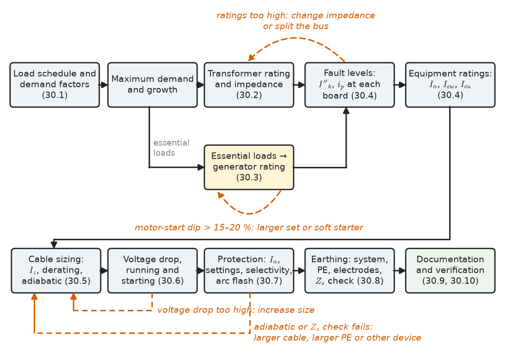
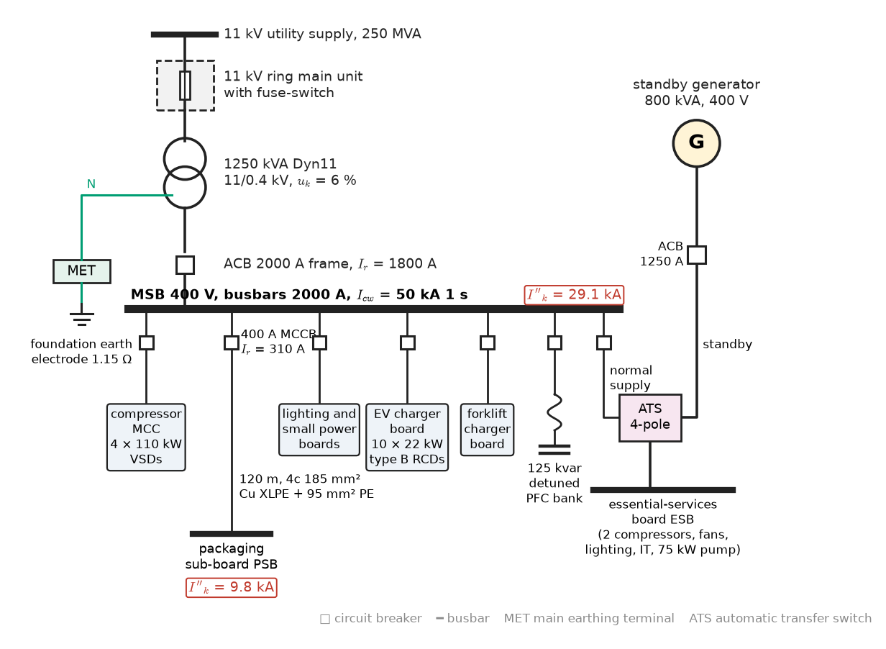
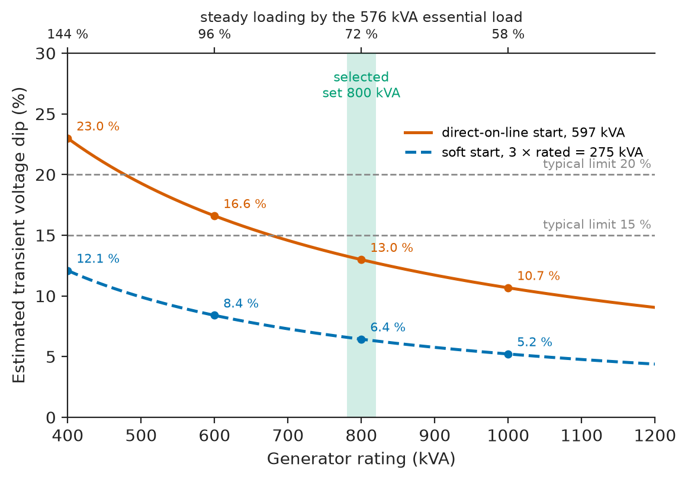
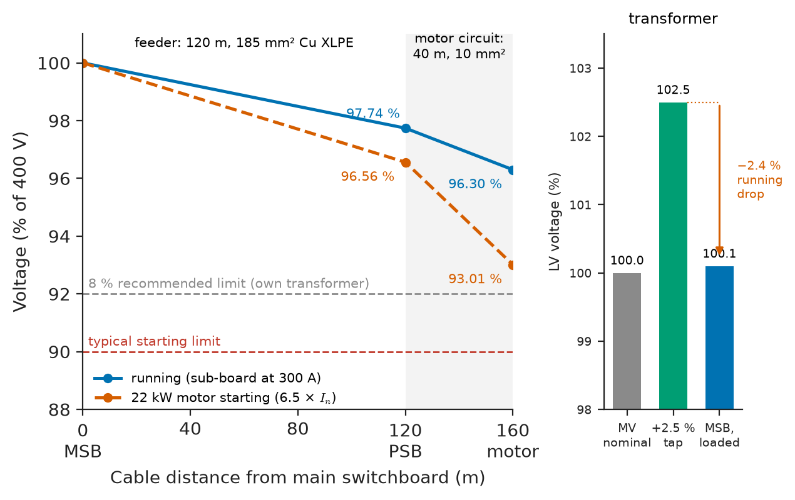
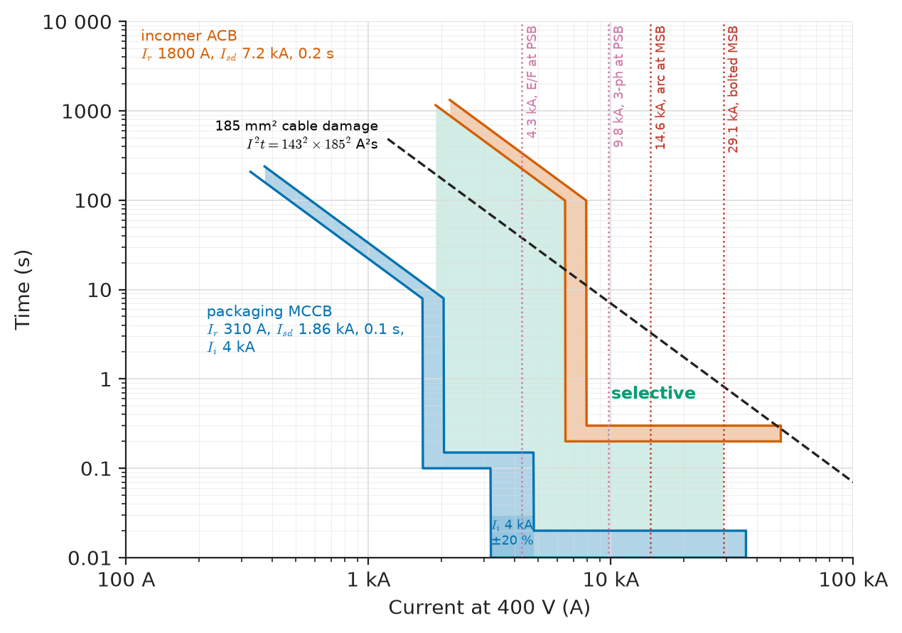
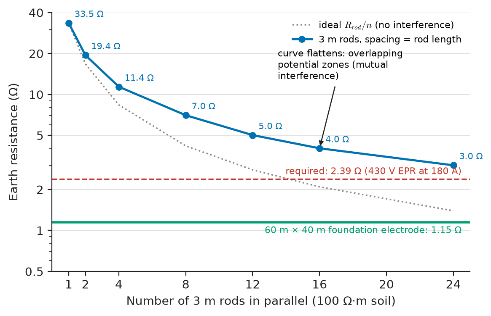

# Chapter 30 — Electrical System Design

*Part VIII · Electrical Safety and Engineering Practice*

A developer has bought land on the edge of a city to build a cold-storage and packaging facility: four 110 kW refrigeration compressors, a hundred evaporator fans and pumps, packaging lines, offices, ten electric-vehicle chargers for the delivery vans, and a standby generator because a four-hour outage would spoil twenty million dollars of frozen stock. The utility offers an 11 kV connection and asks for the maximum demand. The architect asks for the size of the substation room. The insurer asks how the refrigeration survives a utility failure. The fire officer asks where the main isolators are. The contractor asks for cable sizes, breaker settings and an earthing drawing. Every one of these questions has an answer in the earlier chapters of this book, but none of those chapters answers any of them alone. Electrical system design is the craft of putting the answers together in the right order, checking that they are consistent with each other, and writing them down so that the installation can be built, inspected, operated and, years later, safely changed.

> **How is a complete installation designed from a list of loads: which transformer, which generator, which cables, which protective devices, which earthing?**
> **How does the designer prove — to a client, an inspector and a future engineer — that every one of those choices is safe, economical and compliant?**

| Concept | Engineering destination |
|---|---|
| Load estimation | Utility application, maximum demand, substation and generator sizing |
| Transformer selection | Rating, impedance, losses, vector group, cooling, redundancy |
| Generator selection | Standby and prime ratings, motor starting, non-linear loads, autonomy |
| Equipment ratings | Switchboard current and short-circuit ratings, breaking and making capacity |
| Cable sizing | Current-carrying capacity, derating, short-circuit withstand, economic size |
| Voltage-drop calculations | Steady-state and motor-starting voltage at every load |
| Protection selection | Breaker and fuse ratings, settings, selectivity, arc-flash reduction |
| Grounding design | Earthing system, protective conductors, electrodes, combined HV/LV earth |
| Design documentation | Single-line diagrams, schedules, calculation reports, studies, as-builts |
| Standards and compliance | IEC 60364, IEC 61439, NFPA 70, NFPA 70E, IEEE practice, grid codes, verification |

**Roadmap.** Estimate the load (30.1) → choose the transformer (30.2) and the standby generator (30.3) → set the short-circuit and current ratings of the equipment (30.4) → size the cables (30.5) and check voltage drop (30.6) → select and set the protective devices (30.7) → design the earthing (30.8) → document the design (30.9) → demonstrate compliance (30.10). Each step is worked on the same facility, so the numbers carry from one section to the next.

<!-- FIGURE 30.1 | figures/ch30/fig-30-1-design-flow.png | flowchart | The design sequence of a low-voltage installation, with the iteration loops that close it. | Content: left-to-right flowchart with boxes: "Load schedule and demand factors (30.1)" to "Maximum demand and growth" to "Transformer rating and impedance (30.2)" and in parallel "Essential loads to Generator rating (30.3)"; both feed "Fault levels: Ik, ip at each board (30.4)" to "Equipment ratings: In, Icw, Icu (30.4)"; then "Cable sizing: Iz, derating, adiabatic (30.5)" to "Voltage drop, running and starting (30.6)" to "Protection: In, settings, selectivity, arc flash (30.7)" to "Earthing: system, PE, electrodes, Zs check (30.8)" to "Documentation and verification (30.9, 30.10)". Dashed feedback arrows: from voltage drop back to cable size ("increase size"), from protection back to cable ("adiabatic or Zs fails"), from fault level back to transformer ("ratings too high: change impedance or split bus"), from generator motor-start dip back to generator rating. Label each arrow with the check that triggers it. -->

*Figure 30.1 — The design sequence of a low-voltage installation, with the iteration loops that close it.*

> **Boundary.** The circuit theory used throughout — complex power, three-phase power and neutral currents — is from *Circuits, Signals and Communications*, [Ch. 9](https://github.com/The-Studio-of-Sadiq/Circuits-Signals-and-Communications/blob/main/part-2-transient-and-ac-analysis/09-ac-power.md) and [Ch. 10](https://github.com/The-Studio-of-Sadiq/Circuits-Signals-and-Communications/blob/main/part-2-transient-and-ac-analysis/10-three-phase-circuits.md). Transformer and generator models come from Chapters 4 and 7, per-unit and fault calculations from Chapters 17 and 19, protection principles from Chapter 23, safety limits from Chapter 29. Cable ratings rest on the thermal-resistance networks of *Engineering Physics*, [Ch. 14 §14.7](https://github.com/The-Studio-of-Sadiq/Engineering-Physics/blob/main/CHAPTERS/CHAPTER%2014.md) and [Ch. 19 §19.6](https://github.com/The-Studio-of-Sadiq/Engineering-Physics/blob/main/CHAPTERS/CHAPTER%2019.md). This chapter assembles them; it does not re-derive them.

---

## 30.1 Load estimation

### From connected load to maximum demand

Load estimation starts from a **load schedule**: every load or group of loads, its rated power, efficiency, power factor, and an estimate of how it will be used. Connected load — the sum of nameplates — is always much larger than the demand the supply will ever see, because not every load runs at once and few run at full rating. Two factors from Chapter 28 bridge the gap. The **demand factor** of a group is the ratio of its maximum demand to its connected load; the **diversity factor** between groups accounts for their maxima not coinciding. Codes give default values where data are lacking — NEC Article 220 for dwellings, offices and motors; IEC 60364-3 and national guides for European practice — but for industrial plant the designer's knowledge of the process, or measurements from a similar site, are better.

The estimate must be made with active and reactive power separately, not by adding kVA arithmetically, because loads at different power factors do not add in phase. Motor loads are entered at their electrical input ($P_{shaft}/\eta$), not their shaft rating. Drives, EV chargers and LED drivers bring harmonic currents whose RMS value exceeds the fundamental (Chapter 25), so their feeders are sized on the true RMS current.

**Table 30.1 — Load schedule of the cold-storage facility.**

| Load group | Connected input (kW) | Demand factor | Demand (kW) | Power factor | Demand (kvar) | Demand (kVA) |
|---|---|---|---|---|---|---|
| Refrigeration compressors, 4 × 110 kW on VSDs | 463.2 | 0.75 | 347.4 | 0.95 | 114.2 | 365.7 |
| Evaporator fans and pumps, 30 × 4 kW | 136.4 | 0.80 | 109.1 | 0.85 | 67.6 | 128.3 |
| Packaging lines | 250.0 | 0.70 | 175.0 | 0.85 | 108.5 | 205.9 |
| LED lighting | 60.0 | 1.00 | 60.0 | 0.95 | 19.7 | 63.2 |
| Office HVAC | 80.0 | 0.80 | 64.0 | 0.90 | 31.0 | 71.1 |
| EV chargers, 10 × 22 kW (managed) | 220.0 | 0.50 | 110.0 | 0.99 | 15.7 | 111.1 |
| Small power and IT | 100.0 | 0.50 | 50.0 | 0.95 | 16.4 | 52.6 |
| Forklift battery chargers | 60.0 | 0.80 | 48.0 | 0.95 | 15.8 | 50.5 |
| **Sum** | **1369.5** | | **963.5** | **0.93** | **388.8** | **1039.0** |

**Worked example — Maximum demand of the facility.** From Table 30.1 the sum of group demands is $P=963.5$ kW and $Q=388.8$ kvar, so $S=\sqrt{963.5^2+388.8^2}=1039$ kVA at a power factor of 0.927. A diversity factor of 1.10 between the groups — the packaging lines and EV chargers peak at different times of day, and the compressors at full duty mainly on summer afternoons — gives a maximum demand of $1039/1.10=945$ kVA. The client expects to add a fifth compressor and more chargers within ten years, so a 25 % growth allowance is added: $945\times1.25=1181$ kVA. This is the figure for sizing the transformer. The utility application states the present maximum demand, 945 kVA, and the requested capacity, 1250 kVA.

Note how far the result is from the connected load. A designer who simply added nameplates (1370 kW of input, about 1500 kVA) would buy a 1600 kVA transformer, raise the fault level by 25 % (Section 30.4) and the arc-flash energy with it, and run the transformer at 60 % of its rating for a decade.

> **Status of the principle: Demand and diversity factors in design**
> *Empirical.* Factors are drawn from codes or from measurements on comparable sites; they are a judgement about future use and should be revisited with real data (Chapter 28) once the installation is running.

### Growth, spare capacity and redundancy

Three separate margins are often confused. **Growth** allows for load added later (20–30 % is common for industry, more for data centres planned in phases). **Spare capacity** in switchboards — empty ways, spare breakers, space for additional sections — costs little at build time and much later. **Redundancy** is a reliability decision: a hospital or a Tier III data centre is supplied by N+1 transformers and generators so that any one can be lost or maintained without dropping load (Chapter 13). Each margin should be stated explicitly in the design basis, so that it is not added three times.

---

## 30.2 Transformer selection

### Rating

A distribution transformer is selected on its continuous rating under the site's ambient conditions (IEC 60076-1 assumes a 30 °C monthly average and 40 °C maximum), with the load estimate including growth as the target. Standard sizes follow the R10 series: 500, 630, 800, 1000, 1250, 1600, 2000, 2500 kVA. Short-duration overloads are permitted by the thermal loading guide IEC 60076-7 at the cost of accelerated insulation ageing; they are useful for emergencies, not for routine planning. For the facility, 1181 kVA leads to a 1250 kVA unit, loaded to $945/1250=76$ % on day one.

### Impedance: a compromise

The short-circuit impedance $u_k$ sets two things that pull in opposite directions (Chapter 4): the voltage regulation under load and the voltage dip when a large motor starts (both better with low $u_k$), and the fault current on the LV switchboard (lower with high $u_k$). Standard values are about 4 % up to 630 kVA and 5–6 % from 800 to 2500 kVA (IEC 60076-5 minimum values; Ecodesign-compliant units typically 6 % above 630 kVA). Specifying 8 % to keep a 2500 kVA board below 50 kA is a legitimate design choice; so is splitting a large load into two independent 1600 kVA sections with a normally open bus-coupler.

### Other choices

- **Losses**: in the EU, Ecodesign Tier 2 (Regulation 548/2014 as amended) sets maximum $P_0$ and $P_k$; above that, loss capitalisation (Chapter 28) decides.
- **Type**: liquid-immersed (mineral oil, or less-flammable natural or synthetic esters with fire point above 300 °C, IEC 61099/62770) for outdoor and substation rooms; cast-resin dry type (IEC 60076-11, class F1 fire behaviour) indoors near people, in hospitals, high-rise buildings and data centres.
- **Vector group**: Dyn11 for distribution, giving a solidly earthed LV neutral, blocking triplen harmonics in the delta and isolating zero-sequence between voltage levels (Chapter 19).
- **Tappings**: off-circuit $\pm2\times2.5$ % to centre the LV voltage on a high or low MV feeder; on-load tap changers only for larger or voltage-critical sites.
- **Harmonics**: where a large share of load is non-linear, the transformer is derated or specified with a K-factor or to IEC 60076-1 harmonic loss data (Chapter 25).

**Worked example — 1000, 1250 or 1600 kVA?** The 11 kV supply has a fault level of 250 MVA. Each candidate transformer has $u_k=6$ % and $u_r=1.0$ %; the LV system is 400 V.

| Rating | Rated current | Initial symmetrical fault current $I''_k$ (c = 1.05) | Loading today |
|---|---|---|---|
| 1000 kVA | 1443 A | 23.7 kA | 94 % |
| 1250 kVA | 1804 A | 29.1 kA | 76 % |
| 1600 kVA | 2309 A | 36.5 kA | 59 % |

The fault current is $I''_k=c\,S_r/(\sqrt3\,U_n\,(u_k+S_r/S_{k,MV}))$; for the 1250 kVA unit, $1.05\times1250/(\sqrt3\times0.4\times(0.06+0.005))=29.1$ kA. The 1000 kVA unit has no room for growth. The 1600 kVA unit raises the fault level to 36.5 kA, which pushes the main switchboard into a higher (and more expensive) short-circuit rating and raises arc-flash energy in proportion (Chapter 29), while running underloaded. The 1250 kVA unit is chosen. Its regulation at today's load and power factor 0.927 is approximately $0.756\times(1.0\times0.927+5.92\times0.375)=2.4$ %, which the $+2.5$ % tap can offset if the MV supply runs low.

<!-- FIGURE 30.2 | figures/ch30/fig-30-2-facility-single-line.png | single-line | Single-line diagram of the cold-storage facility. | Content: 11 kV utility incomer (250 MVA) to an 11 kV ring main unit with fuse-switch, to a 1250 kVA Dyn11 11/0.4 kV transformer, uk = 6 %. LV side: 2000 A frame ACB (Ir 1800 A) feeding main switchboard MSB (busbars 2000 A, Icw 50 kA 1 s). Standby 800 kVA 400 V generator with its own 1250 A ACB feeding an essential-services board ESB through a 4-pole automatic transfer switch, ESB also fed from MSB. MSB outgoing MCCBs: compressor MCC (4 VSDs of 110 kW), packaging sub-board PSB (400 A MCCB, Ir 310 A, 120 m of 4-core 185 mm2 Cu XLPE plus 95 mm2 PE), lighting and small power boards, EV charger board (10 x 22 kW with type B RCD protection), forklift charger board. 125 kvar detuned capacitor bank on MSB. Earthing: transformer neutral to main earthing terminal MET, MET to foundation earth electrode 1.15 ohm. Mark fault levels: 29.1 kA at MSB, 9.8 kA at PSB. -->

*Figure 30.2 — Single-line diagram of the cold-storage facility.*

---

## 30.3 Generator selection

### Ratings and duty

A standby generator is not rated like a transformer. ISO 8528-1 defines several power ratings for the same engine-alternator set, depending on duty:

- **Emergency standby power (ESP)**: the maximum power available for a variable load during a utility outage, typically limited to 200 h per year with an average load not exceeding 70 % of rating; no overload.
- **Prime power (PRP)**: unlimited hours per year at variable load, average not exceeding 70 % of rating over 24 h.
- **Continuous operating power (COP)**: constant load, unlimited hours.
- Manufacturers also publish **data-centre continuous** ratings, at which the set can carry a constant load for unlimited hours during a long outage.

The ESP rating is typically 10 % above PRP and 20–30 % above COP for the same set. The choice depends on what the outage looks like: a hospital in a city with a reliable grid uses ESP; a mine or island grid with no utility uses PRP or COP; a data centre that must survive a multi-day regional blackout should be sized on continuous ratings. Altitude and temperature derating apply above typically 1000 m and 25–40 °C, by 1–4 % per 300 m and per 5 K depending on the engine.

### What the generator must survive

A generator is a source with a high, time-varying internal impedance (subtransient reactance $x''_d$ about 0.10–0.20 pu, transient $x'_d$ 0.15–0.30 pu, synchronous $x_d$ 1.5–3 pu; Chapter 7), behind an engine whose power cannot rise instantly. Three load cases usually size it more than steady kW:

1. **Motor starting.** A direct-on-line motor draws five to seven times its rated current at a power factor of 0.2–0.4. The voltage dip must stay within what contactors, drives and lighting tolerate (typically 15–20 %) and recover within a few seconds. ISO 8528-5 performance classes G1–G4 specify permissible transient voltage and frequency deviations and recovery times.
2. **Load steps.** Turbocharged diesels accept only 30–60 % of rating as a single block step; emergency loads are applied in stages within the time allowed (10 s for NFPA 110 Type 10, 15 s for hospital safety services in IEC 60364-7-710).
3. **Non-linear and regenerative loads.** UPS rectifiers and drives distort the generator voltage because its impedance is much higher than the utility's; low $x''_d$ and permanent-magnet excitation help. Regenerating hoists and lifts push power back into a generator that cannot absorb it and must be given braking resistors.

A simple screening estimate of the dip models the starting motor as a constant impedance $z_m=S_{gen}/S_{start}$ (per unit on the generator base) in series with an effective generator reactance $x$ between $x''_d$ and $x'_d$:

$$
\Delta V\approx\frac{x}{z_m+x}=\frac{x\,S_{start}}{S_{gen}+x\,S_{start}}
$$

> **Status of the principle: Screening estimate of generator voltage dip**
> *Approximate.* Ignores the existing load, the AVR response and engine speed droop, and treats the motor as a fixed impedance; it is adequate for selecting a frame size, while a time-domain simulation or the manufacturer's motor-start data confirm the final choice.

**Worked example — Sizing the standby generator.** The essential loads that must run during an outage are two compressors (231.6 kW at 0.95), lighting (60 kW), small power and IT (50 kW), the evaporator fans at their 0.8 demand factor (109.1 kW at 0.85) and a 75 kW direct-on-line ammonia-transfer pump with efficiency 0.95 and power factor 0.86. Total steady load: $P=529.6$ kW, $Q=226.7$ kvar, $S=576$ kVA. The pump starts at 6.5 times its rated kVA; the effective generator reactance is 0.20 pu.

The pump's rated input is $75/(0.95\times0.86)=91.8$ kVA, and its starting demand $6.5\times91.8=597$ kVA. For three candidate prime-rated sets:

| Generator | Steady loading | $z_m$ | Estimated dip |
|---|---|---|---|
| 600 kVA | 96 % | 1.005 | 16.6 % |
| 800 kVA | 72 % | 1.340 | 13.0 % |
| 1000 kVA | 58 % | 1.676 | 10.7 % |

The 600 kVA set is too heavily loaded for prime duty and gives a dip above 15 %. The 800 kVA set meets both constraints and leaves headroom for one additional compressor in an extended outage. It is selected, with the pump started last in the load-step sequence. Fitting the pump with a soft starter would allow a smaller set; the trade-off is cost against flexibility. Figure 30.3 plots the dip against generator rating for DOL and soft-start cases. Fuel storage for 48 hours at the average essential load of about 450 kW, at roughly 0.25 L/kWh, is about 5400 L.

<!-- FIGURE 30.3 | figures/ch30/fig-30-3-generator-dip.png | plot | Estimated transient voltage dip when the 75 kW pump starts, against generator rating. | Content: x-axis generator rating 400 to 1200 kVA, y-axis voltage dip 0 to 30 %. Curve 1 (DOL start, starting kVA 597, x = 0.20): dip = 0.2 x 597 / (S + 0.2 x 597), passing 23.0 % at 400, 16.6 % at 600, 13.0 % at 800, 10.7 % at 1000 kVA. Curve 2 (soft start limited to 3 x rated, 275 kVA): lower curve, about 12.1 % at 400 kVA, 8.4 % at 600 kVA, 6.4 % at 800 kVA. Horizontal dashed lines at 15 % and 20 % labelled "typical limits". Vertical shaded band at 800 kVA labelled "selected set". Secondary axis or annotation of steady loading 144 %, 96 %, 72 %, 58 %. -->

*Figure 30.3 — Estimated transient voltage dip when the 75 kW pump starts, against generator rating.*

---

## 30.4 Equipment ratings

### What every item of switchgear must be rated for

Each item of equipment in the installation must withstand, continuously and during faults, what the system can impose on it. The ratings to check (IEC 61439 for assemblies, IEC 60947-2 for breakers, IEC 62271 for medium voltage) are:

- **Rated voltage** $U_e$ and **rated insulation voltage** $U_i$; **impulse withstand** $U_{imp}$ matched to the overvoltage category at that location (Chapter 24).
- **Rated current** $I_n$ (or the assembly's rated diversity factor), derated for ambient temperature above 35 °C, altitude above 2000 m (or 1000 m for MV), enclosure ventilation and harmonic content.
- **Short-time withstand current** $I_{cw}$ (usually for 1 s) of busbars and air circuit breakers: the RMS current they carry without damage while a downstream device clears.
- **Peak withstand current** $I_{pk}$ of busbars and the **making capacity** $I_{cm}$ of breakers: the first asymmetrical peak, set by the X/R ratio of the source.
- **Ultimate and service breaking capacity** $I_{cu}$ and $I_{cs}$ of breakers: $I_{cu}$ is the maximum the breaker can interrupt once; $I_{cs}$ (25–100 % of $I_{cu}$) is what it can interrupt and remain in service. Critical boards should have $I_{cs}=I_{cu}$ above the prospective current.
- **Internal arc classification** (IEC 62271-200 for MV, IEC TR 61641 for LV) and **form of separation**, which govern safety during faults and maintenance (Chapter 29).

The peak current follows from IEC 60909: $i_p=\kappa\sqrt2\,I''_k$, with $\kappa=1.02+0.98\,e^{-3R/X}$ ranging from 1.0 for a resistive source to 2.0 for a purely reactive one.

> **Status of the principle: IEC 60909 short-circuit currents**
> *Approximate.* An equivalent voltage source $cU_n/\sqrt3$ at the fault replaces the pre-fault load flow, and the peak factor $\kappa$ is an empirical fit for a single R–X branch; the method is conservative for design and is not a substitute for a dynamic study where motors or inverters contribute significantly.

**Worked example — Ratings of the main switchboard.** For the 1250 kVA transformer ($u_k=6$ %, $u_r=1$ %), the transformer impedance on a 400 V base is $Z_T=0.06\times0.4^2/1.25=7.68$ mΩ, with $R_T=1.28$ mΩ and $X_T=7.57$ mΩ; the 250 MVA source adds $0.4^2/250=0.64$ mΩ, almost all reactive. Then $R/X=1.28/(7.57+0.64)=0.156$, so

$$
\kappa=1.02+0.98\,e^{-3\times0.156}=1.634,\qquad i_p=1.634\times\sqrt2\times29.1=67.2\ \mathrm{kA}
$$

Motor contribution is small here, because the compressors are on VSDs that contribute little fault current. The main switchboard is specified as 2000 A, $I_{cw}=50$ kA for 1 s, $I_{pk}=105$ kA, form 3b, with an ACB of $I_{cs}=I_{cu}=50$ kA, giving margin for a future second transformer only if the bus-coupler is interlocked so that the two never run in parallel (two such units in parallel would raise the fault level to about 54 kA).

**Table 30.2 — Typical LV equipment ratings by transformer size (400 V, $u_k$ as shown, infinite MV source).**

| Transformer | $u_k$ | Rated current | $I''_k$ approx. | Typical board rating |
|---|---|---|---|---|
| 630 kVA | 4 % | 909 A | 24 kA | 1000 A, 25–36 kA |
| 1000 kVA | 6 % | 1443 A | 25 kA | 1600 A, 36 kA |
| 1250 kVA | 6 % | 1804 A | 32 kA | 2000 A, 50 kA |
| 1600 kVA | 6 % | 2309 A | 40 kA | 2500 A, 50 kA |
| 2500 kVA | 6 % | 3608 A | 63 kA | 4000 A, 65–80 kA |

(The values in Table 30.2 are upper bounds with an infinite source and $c=1.05$; a real MV source reduces them, as the worked example shows.)

---

## 30.5 Cable sizing

### Three independent criteria

A cable must satisfy, at once:

1. **Current-carrying capacity**: under its installation conditions, its conductor must not exceed the insulation's maximum continuous temperature (70 °C PVC, 90 °C XLPE/EPR) when carrying the design current $I_B$, and it must be protected against overload ($I_B\le I_n\le I_Z$, Chapter 29).
2. **Short-circuit withstand**: $S\ge\sqrt{I^2t}/k$ for the energy let through by its protective device (Chapter 29).
3. **Voltage drop**: within the limits of Section 30.6, running and starting.

A fourth, economic sizing, often selects a larger size still, and a fifth, the earth-fault loop impedance of the protective conductor (Section 30.8), can force a larger PE or a different device.

### Current-carrying capacity and derating

The tabulated current-carrying capacities in IEC 60364-5-52 (and in NEC Table 310.16 and its successors) are calculated by IEC 60287, which models the cable and its surroundings as a thermal-resistance network — conductor, insulation, sheath, the air or soil around it — through which the conductor's $I^2R$ loss must flow at a temperature rise the insulation can tolerate. That network is the heat-conduction model of *Engineering Physics*, [Ch. 14 §14.7](https://github.com/The-Studio-of-Sadiq/Engineering-Physics/blob/main/CHAPTERS/CHAPTER%2014.md), applied to a cylinder in a medium. The tables are given for reference conditions (30 °C in air, 20 °C in ground, soil thermal resistivity 2.5 K·m/W, one circuit), and **correction factors** adjust them:

- **Ambient temperature**: for XLPE in air, 1.0 at 30 °C, 0.96 at 35 °C, 0.91 at 40 °C, 0.87 at 45 °C.
- **Grouping**: several loaded circuits heat each other; four multicore cables touching on a perforated tray, about 0.77; six, about 0.73; nine bunched in conduit, about 0.50.
- **Soil thermal resistivity and depth** for buried cables, which can reduce capacity by 10–30 % in dry sand.
- **Harmonics**: when triplen harmonics exceed 15 % of the phase current, the neutral carries current and the cable is sized on the neutral (IEC 60364-5-52 Annex E).

The required tabulated capacity is $I_t\ge I_B/(C_a\,C_g\,C_s\cdots)$.

**Table 30.3 — Current-carrying capacity of multicore copper XLPE cables, three loaded conductors, on a perforated tray in free air at 30 °C (approximate, after IEC 60364-5-52, method E).**

| Cross-section | 16 mm² | 35 mm² | 70 mm² | 95 mm² | 120 mm² | 150 mm² | 185 mm² | 240 mm² |
|---|---|---|---|---|---|---|---|---|
| Capacity | 100 A | 158 A | 246 A | 298 A | 346 A | 399 A | 456 A | 538 A |
| R at 20 °C (Ω/km) | 1.15 | 0.524 | 0.268 | 0.193 | 0.153 | 0.124 | 0.0991 | 0.0754 |

**Worked example — The packaging sub-board feeder.** The packaging sub-board has a design current $I_B=300$ A at a power factor of 0.85. Its feeder is a 120 m four-core copper XLPE cable on a perforated tray shared with three other loaded circuits, in a plant room at 40 °C. The prospective fault at the main switchboard is 29.1 kA; the feeder's MCCB clears high faults in under 20 ms.

Correction factors: grouping 0.77, ambient 0.91. Required tabulated capacity: $300/(0.77\times0.91)=428$ A. From Table 30.3, 185 mm² ($456$ A) is the smallest that qualifies; its corrected capacity is $456\times0.77\times0.91=320$ A. A 400 A frame MCCB with its electronic trip set to $I_r=310$ A satisfies $300\le310\le320$ A.

Short circuit: with $k=143$, a 29.1 kA fault at the feeder's origin cleared in 0.02 s requires at most $S\ge\sqrt{29\,100^2\times0.02}/143=28.8$ mm² (a current-limiting MCCB lets through less); even if the upstream ACB's 0.2 s short-time delay had to clear it, $S\ge91$ mm². 185 mm² passes. The protective conductor, from IEC 60364-5-54 ($S_{PE}=S/2$ for phase conductors above 35 mm²), is 95 mm². Voltage drop is checked in Section 30.6.

> **Status of the principle: Tabulated current-carrying capacities**
> *Approximate.* The tables come from steady-state thermal-network calculations (IEC 60287) for idealised installations; correction factors are treated as independent and multiplicative, which is conservative in some combinations and not in others, and cyclic loading or intermittent duty can justify higher ratings.

### Economic sizing

The thermal minimum is the cheapest cable to buy, not to own. IEC 60287-3-2 minimises purchase cost plus the present value of losses. **Worked example — Upsizing the feeder.** At 300 A the 185 mm² cable runs at about 84 °C, with a resistance of 0.124 Ω/km and losses of $3\times300^2\times0.124\times0.12=4.02$ kW. A 240 mm² cable at the same current runs at about 72 °C, $R=0.0907$ Ω/km, losing 2.94 kW. With a loss-load factor of 0.4 the saving is $1.08\times0.4\times8760=3780$ kWh per year, worth 378 USD at 0.10 USD/kWh, or 4830 USD present value over 25 years at 6 % (PWF 12.78). If the larger cable and its glands cost less than about 4800 USD more for the 120 m run, it is the economic choice; typically it costs 2500–3500 USD more, so it is selected. Economic sizing is most powerful on long, heavily loaded feeders — which is also where voltage drop bites.

---

## 30.6 Voltage-drop calculations

### The engineering formula

For a three-phase feeder of length $L$ with resistance $r$ and reactance $x$ per unit length carrying current $I$ at power factor $\cos\phi$, the voltage drop (line-to-line) is, to within a fraction of a per cent for drops below about 10 %,

$$
\Delta V\approx\sqrt3\,I\,L\,(r\cos\phi+x\sin\phi)
$$

This is the projection of the series impedance drop on the sending-end voltage phasor; its derivation from the phasor diagram is the short-line model of Chapter 21. Resistance is taken at the conductor's operating temperature; reactance of multicore LV cables is 0.07–0.09 Ω/km, of single-core cables in trefoil about 0.10 Ω/km, and of single cores spaced apart up to 0.2 Ω/km. For single-phase circuits, replace $\sqrt3$ by 2.

> **Status of the principle: Approximate voltage-drop formula**
> *Approximate.* Neglects the quadrature component of the drop and the shunt capacitance of the cable; it is accurate for LV and short MV circuits and underestimates the drop only when $x/r$ is large and the angle across the circuit is several degrees.

### Limits

IEC 60364-5-52 Annex G recommends maximum drops from the origin of the installation to any load of 3 % for lighting and 5 % for other uses when the supply is from a public LV network, and 6 % and 8 % when the installation has its own transformer (as the facility does), excluding the transformer. NFPA 70 recommends (in informational notes) 3 % for a branch circuit and 5 % for feeder plus branch. Equipment standards set the real limit: motors are designed for ±5 % at rated output (IEC 60034-1 zone A) and must start at the reduced voltage of the starting dip; contactor coils may drop out below 65–80 % of rated voltage; drives trip on undervoltage around 80–85 % of nominal DC-link voltage. During motor starting a drop of 10–15 % at the motor terminals is usually acceptable if the motor's torque at reduced voltage (proportional to $V^2$, Chapter 6) still exceeds the load torque.

**Worked example — Voltage at a packaging-line motor, running and starting.** A 22 kW motor (efficiency 0.91, power factor 0.86) on the packaging sub-board is fed by 40 m of 10 mm² copper XLPE cable ($r=2.33$ Ω/km at 90 °C, $x=0.08$ Ω/km). The motor starts direct on line at 6.5 times rated current at power factor 0.30.

Feeder (Section 30.5), running: with $r=0.124$ Ω/km at the estimated 84 °C operating temperature and $x=0.075$ Ω/km,

$$
\Delta V_{feeder}=\sqrt3\times300\times0.12\times(0.124\times0.85+0.075\times0.527)=9.0\ \mathrm V\ (2.26\ \%)
$$

Motor circuit, running: $I=22\,000/(\sqrt3\times400\times0.86\times0.91)=40.6$ A, so $\Delta V=\sqrt3\times40.6\times0.04\times(2.33\times0.86+0.08\times0.51)=5.8$ V (1.44 %). The total running drop from the main switchboard is 3.7 %, well within the 8 % recommendation.

Starting: the motor circuit carries $6.5\times40.6=264$ A at power factor 0.30, a drop of $\sqrt3\times264\times0.04\times(2.33\times0.30+0.08\times0.954)=14.2$ V (3.5 %). The feeder carries the rest of the sub-board's load plus the starting current, phasor-summed to about 491 A at a lower power factor, a drop of 13.8 V (3.4 %). Total at the motor terminals during starting: about 7.0 %, plus the transformer's own dip. Acceptable: the motor sees 93 % of voltage and 86 % of its rated starting torque. Figure 30.4 shows the voltage profile.

<!-- FIGURE 30.4 | figures/ch30/fig-30-4-voltage-profile.png | plot | Voltage profile from the transformer terminals to the 22 kW packaging-line motor, running and while the motor starts. | Content: x-axis cable distance from main switchboard 0 to 160 m (0 to 120 m feeder, 120 to 160 m motor circuit), y-axis voltage 88 to 101 % of 400 V. Running profile (solid): 100 % at the main switchboard, falling linearly to 97.74 % at 120 m (sub-board), then to 96.30 % at 160 m (motor). Starting profile (dashed): 100 % at 0, 96.56 % at 120 m, 93.01 % at 160 m. Horizontal dashed lines at 92 % ("8 % recommended limit for own-transformer installations") and 90 % ("typical starting limit"). Small inset showing that the transformer adds about 2.4 % running drop, offset by the +2.5 % tap. -->

*Figure 30.4 — Voltage profile from the transformer terminals to the 22 kW packaging-line motor, running and while the motor starts.*

---

## 30.7 Protection selection

### Requirements

Protective devices are chosen to satisfy, simultaneously:

1. **Protection of the cable** against overload and short circuit (Section 30.5 and Chapter 29).
2. **Protection of people** by automatic disconnection within the times of IEC 60364-4-41 and by RCDs where required.
3. **Breaking capacity** at least equal to the prospective fault current at the point of installation, or a tested back-up combination.
4. **Selectivity** (discrimination): for any fault, only the device immediately upstream should operate.
5. **Arc-flash reduction** where people may work on or near energised equipment (Chapter 29).
6. **Equipment-specific protection**: transformer (Buchholz relay, winding temperature, MV fuses or relay), generator (overcurrent with voltage restraint, reverse power, earth fault, loss of excitation), motors (thermal overload class, stall, phase loss), capacitor banks (unbalance, overcurrent).

### Selectivity between low-voltage breakers

Low-voltage selectivity is achieved by three mechanisms, often combined:

- **Current selectivity**: the upstream device's instantaneous threshold is above the maximum fault current at the downstream device's location. Simple, but limited when fault currents are high and close together.
- **Time selectivity**: the upstream breaker has a short-time delay (0.1–0.4 s) and a short-time withstand $I_{cw}$ high enough to wait while the downstream one clears. Typical of air circuit breakers on main boards.
- **Energy selectivity**: a current-limiting downstream MCCB lets through so little energy that the upstream device, though in its instantaneous range, does not trip. Valid only from manufacturer tables.

For fuses, selectivity holds when the upstream rating is at least 1.6 times the downstream one (gG fuses to IEC 60269), and for overload regions of breakers a ratio of setting currents of at least 1.5–2 is usual. **Zone-selective interlocking** passes a restraint signal from the downstream breaker that sees a fault to the upstream one; an upstream breaker that sees the fault but receives no restraint knows the fault is in its own zone and trips without its delay — selectivity and fast clearing together.

**Worked example — Settings at the main switchboard.** The transformer's rated LV current is 1804 A. The incomer is a 2000 A ACB; the packaging feeder a 400 A MCCB at $I_r=310$ A (Section 30.5).

**Table 30.4 — Settings chosen for the main incomer and the packaging feeder.**

| Device | Long time $I_r$ | Short time $I_{sd}$, delay | Instantaneous $I_i$ | Earth fault |
|---|---|---|---|---|
| Incomer ACB, 2000 A | 1800 A (0.9) | 4 × Ir = 7.2 kA, 0.2 s | Off (or above 50 kA) | 1200 A, 0.4 s |
| Packaging MCCB, 400 A | 310 A | 6 × Ir = 1.86 kA, 0.1 s | 10 × In = 4 kA | Via short-time |

Checks:

- **Overload ratio**: $1800/310=5.8$, ample selectivity in the long-time region.
- **Short circuit at the sub-board**: the three-phase fault at the end of the 120 m feeder is about 9.8 kA (from the source, transformer and feeder impedances); the MCCB clears it instantaneously in under 20 ms, while the ACB's short-time element picks up at 7.2 kA but waits 0.2 s. Time selectivity is achieved, and the 0.2 s × 9.8 kA is far inside the ACB's 50 kA 1 s withstand.
- **Earth fault at the sub-board**: loop impedance through the transformer, the 185 mm² phase conductor and the 95 mm² PE is about 51 mΩ, giving $0.95\times230/0.051=4.3$ kA. This is only marginally above the MCCB's 4 kA instantaneous setting (tolerance ±20 %), so instantaneous operation is not guaranteed; the short-time element at 1.86 kA and 0.1 s clears it well within the 5 s permitted for a distribution circuit. A designer who relied on the instantaneous setting alone would have missed this.
- **Arc flash at the main board**: an arcing fault on the main busbar (about 50 % of 29.1 kA, i.e. 14.6 kA) is above $I_{sd}$ and is cleared in about 0.25 s including breaker opening. The Lee estimate of Chapter 29 gives about 7.2 cal/cm² at 455 mm for 0.25 s, still category 2 PPE. Zone-selective interlocking between the incomer and the outgoing MCCBs would let the ACB trip without delay for busbar faults and cut this to about 1.5 cal/cm²; it is specified.

<!-- FIGURE 30.5 | figures/ch30/fig-30-5-time-current-coordination.png | plot | Time-current curves of the main incomer ACB and the packaging feeder MCCB, showing selectivity and the fault currents at each board. | Content: log-log, x-axis current 100 A to 100 kA, y-axis time 0.01 to 10000 s. ACB curve: long-time band starting at 1800 A (pickup 1.05 to 1.2 x Ir) with inverse I2t slope reaching about 100 s at 7.2 kA region, short-time flat band at 0.2 to 0.3 s from 7.2 kA to 50 kA. MCCB curve: long-time from 310 A, short-time band 0.1 to 0.15 s from 1.86 kA, instantaneous band 0.01 to 0.02 s from 4 kA (with tolerance band 3.2 to 4.8 kA shaded). Cable 185 mm2 damage curve (I2t = 143^2 x 185^2) dashed. Vertical markers: 4.3 kA (earth fault at sub-board), 9.8 kA (three-phase at sub-board), 14.6 kA (arcing at MSB), 29.1 kA (bolted at MSB). Shade the gap between MCCB and ACB curves labelled "selective". -->

*Figure 30.5 — Time-current curves of the main incomer ACB and the packaging feeder MCCB, showing selectivity and the fault currents at each board.*

---

## 30.8 Grounding design

### Choosing the earthing system

The earthing system (Chapter 29) is a design decision with consequences for safety, continuity and equipment:

- **TN-S** for sites with their own transformer: high fault currents allow overcurrent devices to provide fault protection, a separate PE keeps load current off the protective conductors (important for EMC in data centres and control rooms), and neutral currents are measurable.
- **TN-C-S** is the usual arrangement where the supply is a public LV network; inside the installation it is TN-S.
- **TT** where the supply earth cannot be relied upon (rural overhead networks, some EV-charging and outdoor installations), with RCDs everywhere.
- **IT** where a first earth fault must not interrupt supply: operating theatres, process plants with continuous processes, mines, ships, some data-centre UPS outputs.

For the facility, with its own 11/0.4 kV substation, TN-S is chosen. Where a standby generator feeds part of the installation through a transfer switch, the neutral must be switched (4-pole changeover) or earthed at only one point; otherwise neutral current returns through parallel neutral and PE paths, upsetting earth-fault relays and RCDs.

### Protective conductors

The cross-section of a protective conductor is either taken from IEC 60364-5-54 Table 54.2 — equal to the phase conductor up to 16 mm², 16 mm² for phase conductors of 16–35 mm², and half the phase conductor above that — or calculated from the adiabatic equation for the actual let-through energy, which often allows smaller sizes. The loop-impedance check of Chapter 29 must then be met with the chosen PE. Bonding conductors to extraneous metalwork are sized as half the largest PE, with a minimum of 6 mm² copper and a maximum of 25 mm² in IEC practice.

### Earth electrodes

The earth electrode connects the system's earthing point to the soil. Its resistance depends almost entirely on soil resistivity (from 10–50 Ω·m in wet clay to 1000–10 000 Ω·m in dry rock and sand) and on the electrode's size. For a single vertical rod of length $L$ and diameter $d$ in uniform soil of resistivity $\rho$, the classic engineering result (Dwight) is

$$
R_{rod}=\frac{\rho}{2\pi L}\left(\ln\frac{8L}{d}-1\right)
$$

and for a mesh or foundation electrode of area $A$ with total buried conductor length $L_T$, Laurent's approximation

$$
R_{grid}\approx\frac{\rho}{4r}+\frac{\rho}{L_T},\qquad r=\sqrt{A/\pi}
$$

Rods in parallel interfere with each other because their potential zones overlap. With spacing equal to the rod length, $n$ rods give $R_n\approx F\,R_{rod}/n$ with multiplying factors $F$ of about 1.16 for 2 rods, 1.36 for 4 and 1.68 for 8 (IEEE 142).

> **Status of the principle: Earth-electrode resistance formulas**
> *Approximate.* Assume homogeneous soil, which real sites rarely have; layered soil, seasonal moisture and frost change $\rho$ by factors of two to ten, so designs are based on measured resistivity (Wenner four-pin method) and verified by measurement after construction.

**Worked example — Earthing the facility's substation.** The site's soil resistivity, measured by the Wenner method, is 100 Ω·m. The 11 kV network is resistance-earthed; for an MV earth fault at the substation, after current returning via cable sheaths is deducted, 180 A flows into the local electrode. For a combined HV/LV earth (the LV neutral and the MV equipment earthed to the same electrode, as is normal in urban substations), the earth potential rise must stay within the national limit derived from IEC 61936-1/EN 50522; take 430 V. What electrode is needed?

Required resistance: $R_E\le430/180=2.39$ Ω. A single 3 m rod of 16 mm diameter gives

$$
R_{rod}=\frac{100}{2\pi\times3}\left(\ln\frac{8\times3}{0.016}-1\right)=5.31\times6.31=33.5\ \Omega
$$

Four rods give about 11.4 Ω and eight rods 7.0 Ω (Figure 30.6): rods alone cannot reach 2.4 Ω in this soil without dozens of them. The building's reinforced-concrete foundation, however, covers 60 m × 40 m. Bonded into a foundation earth electrode with 400 m of conductor in a mesh, its resistance is $r=\sqrt{2400/\pi}=27.6$ m, $R\approx100/(4\times27.6)+100/400=0.91+0.25=1.15$ Ω. The substation earth mat is connected to it, and the combined earth meets the limit with margin. This is why foundation earth electrodes are required in new buildings in several European countries (DIN 18014, for example) and are the first choice for any large building.

<!-- FIGURE 30.6 | figures/ch30/fig-30-6-earth-electrode-resistance.png | plot | Earth resistance of rod groups and of a foundation electrode in 100 ohm-metre soil, against the 2.39 ohm requirement. | Content: x-axis number of 3 m rods 1 to 24 (log or linear), y-axis resistance 0.5 to 40 ohm on a log scale. Rod-group curve: 33.5 ohm (1 rod), 19.4 ohm (2), 11.4 ohm (4), 7.0 ohm (8), about 5.0 ohm (12), about 4.0 ohm (16), about 3.0 ohm (24), using factors 1.16, 1.36, 1.68, 1.80, 1.92, 2.16. Horizontal dashed line at 2.39 ohm labelled "required for 430 V EPR at 180 A". Horizontal solid marker at 1.15 ohm labelled "60 m x 40 m foundation electrode". Annotate that the rod curve flattens because of mutual interference. -->

*Figure 30.6 — Earth resistance of rod groups and of a foundation electrode in 100 ohm-metre soil, against the 2.39 ohm requirement.*

---

## 30.9 Design documentation

### Why documentation is part of the design

An installation outlives its designers. The documents are how the contractor builds it, how the inspector verifies it, how the operator switches it safely, and how the engineer who extends it in fifteen years knows what the fault level is and which breaker protects which cable. NFPA 70E and EN 50110 both rely on up-to-date single-line diagrams for isolation; arc-flash labels are invalid the moment the system changes without the study being updated. Documentation is a safety device.

**Table 30.5 — Typical design deliverables.**

| Document | Content | Used by |
|---|---|---|
| Design basis | Supply data, earthing system, design standards, ambient conditions, margins, redundancy philosophy | Everyone; the reference for every later decision |
| Single-line diagram | Every source, transformer, board, feeder, device rating and setting, cable size, earthing points | Contractor, operator, inspector, isolation planning |
| Load schedule | Each load with rating, demand and diversity factors, maximum demand per board | Utility application, transformer and generator sizing |
| Cable schedule | Each cable: from, to, type, size, length, route, installation method, derating, voltage drop | Contractor, cable pulling, verification |
| Short-circuit study | $I''_k$, $i_p$ and minimum fault current at every board (IEC 60909 or IEEE C37/ANSI method) | Equipment ratings, protection settings |
| Protection coordination study | Time-current curves, settings table, selectivity analysis | Commissioning, future modifications |
| Arc-flash study | Incident energy and boundaries at each location, labels (IEEE 1584) | Safety programme, PPE selection |
| Earthing design | Earthing system, electrode design and calculations, bonding schedule | Contractor, inspector |
| Layout drawings | Substation, switchrooms (with clearances and escape routes), containment routes | Architect, contractor, fire officer |
| Specifications | Equipment technical requirements and test requirements | Procurement, factory tests |
| Verification records | Test results to IEC 60364-6, commissioning records, certificates | Owner, insurer, authority |
| As-built and O&M manuals | Final drawings, settings, manuals, maintenance schedules | Operator for the life of the installation |

### Conventions

Drawings follow IEC 60617 graphical symbols and IEC 61082 documentation rules; equipment is identified with reference designations to IEC 81346 so that "=MSB-Q12" means the same breaker on every drawing, label and maintenance record. Calculations are done in recognised software (power-system analysis packages implementing IEC 60909, IEC 60364 and IEEE 1584) but must still be checked by hand for a few points, as the worked examples of this chapter do, because an input error propagates silently through every result. Increasingly the design lives in a building information model (BIM), from which schedules and drawings are generated, which makes consistency easier and errors in the model more far-reaching.

---

## 30.10 Standards and compliance

### The role of standards

Standards encode the accumulated failures of the industry into rules that can be checked. They do not replace engineering judgement — every standard has scope limits and many leave choices to the designer — but they define the minimum, make designs reviewable by others, and in most jurisdictions are made legally binding through building regulations, electricity safety regulations and insurance conditions. A design that complies with the applicable standards and documents how is defensible; one that departs from them needs a documented engineering justification.

**Table 30.6 — Principal standards in low- and medium-voltage installation design.**

| Subject | IEC / international | North America | Notes |
|---|---|---|---|
| LV installations | IEC 60364 series (BS 7671, NF C 15-100, AS/NZS 3000 as national versions) | NFPA 70 (NEC), CSA C22.1 | Shock, overcurrent, selection and erection, verification |
| Work safety | EN 50110-1 | NFPA 70E, OSHA 29 CFR 1910 Subpart S | Safe work practices, arc-flash assessment |
| Short-circuit calculation | IEC 60909 | IEEE C37.010, IEEE 551 | Equivalent-source method |
| Arc-flash calculation | — | IEEE 1584 | Used internationally |
| LV switchboards | IEC 61439 | UL 891, UL 1558 | Temperature rise, short-circuit, forms |
| Breakers and fuses | IEC 60947-2, IEC 60898-1, IEC 60269 | UL 489, UL 248 | Breaking capacity, characteristics |
| Transformers | IEC 60076 series | IEEE C57 series | Ratings, losses, thermal loading |
| Generator sets | ISO 8528 series | NFPA 110, IEEE 446 | Ratings, performance classes, emergency supply |
| Cable ratings | IEC 60287, IEC 60364-5-52 | NEC Article 310, IEEE 835 | Ampacity, derating, economic sizing |
| Industrial practice | — | IEEE 3000 series (formerly the "Color Books": 141, 142, 242, 399, 446, 493) | Design guidance |
| MV installations | IEC 61936-1, EN 50522 | IEEE C2 (NESC), IEEE 80 | Clearances, earthing |
| Hazardous areas | IEC 60079 | NEC Articles 500–506 | Zones and equipment protection |
| Marine | IEC 60092, IEC/IEEE 80005 | ABS, DNV, Lloyd's rules | IT systems, shore power |
| Grid connection | National grid and distribution codes, IEC 61727, EN 50549 | IEEE 1547 | Generators and inverters on the network (Chapter 27) |

### Demonstrating compliance

Compliance is demonstrated, not asserted, through four layers:

1. **Design review** against the design basis and standards, ideally by an engineer independent of the designer.
2. **Type-tested and certified equipment**: switchboards verified to IEC 61439 by test or by the standard's design rules, breakers with test certificates for their declared ratings, Ex equipment with IECEx or ATEX certification.
3. **Inspection and testing** of the completed installation to IEC 60364-6 (or the NEC and local authority inspection), in the dead-then-live sequence of Chapter 29, with every result recorded against its limit.
4. **Certification and handover**: an electrical installation certificate signed by the designer, the installer and the inspector, with the schedule of test results, the as-built documents and the arc-flash labels in place. Periodic inspection then repeats the tests at intervals set by the risk (typically one to five years for industrial sites).

Grid-connected generation and storage add a fifth layer: compliance tests and simulation models to the grid code, witnessed by the network operator before the plant may export (Chapter 27).

**Worked example — The facility, summarised.** The design of this chapter can be stated in one paragraph: a maximum demand of 945 kVA (1181 kVA with growth) supplied by a 1250 kVA Dyn11 6 % transformer giving 29.1 kA and 67.2 kA peak at a 2000 A, 50 kA main switchboard; an 800 kVA prime-rated generator limiting the worst motor-start dip to 13 %; a 185 mm² feeder (240 mm² pays back on losses and is the recommended option; the voltage-drop and fault figures here are for 185 mm²), with 3.7 % running and 7.0 % starting voltage drop at the furthest motor; selectivity by time grading with zone-selective interlocking reducing busbar arc energy to category 1; a TN-S system with a 1.15 Ω foundation earth electrode satisfying a 430 V earth-potential-rise limit. Each figure in that paragraph traces back to a calculation in this chapter, and each calculation back to a model in an earlier chapter. That traceability — from a number on a drawing to the physics that justifies it — is what distinguishes engineering design from assembling equipment.

---

## What remains open

| Open question | Where it is answered |
|---|---|
| How are transformer impedance, losses and regulation derived from the equivalent circuit? | Chapter 4 (transformers) |
| How does a synchronous generator respond to a sudden load, and what sets $x''_d$ and $x'_d$? | Chapter 7 (synchronous machines); Chapter 20 (stability) |
| How are induction-motor starting current and torque related to voltage, and which starting methods reduce the dip? | Chapter 6 (starting methods); Chapter 10 (drive selection) |
| How are fault currents computed for unsymmetrical faults and networks with many sources? | Chapters 17 and 19 (per-unit modelling, fault analysis) |
| How do relays protect MV feeders, transformers and generators, and how are they coordinated? | Chapter 23 (power-system protection) |
| How are substation earth grids designed against step and touch voltages, and how is insulation coordinated? | Chapter 24 (high-voltage engineering) |
| How do harmonics from drives and chargers affect cable, transformer and generator sizing? | Chapter 25 (power quality) |
| How are inverter-based generation and storage connected under grid codes? | Chapter 27 (grid integration of renewable energy) |
| How are losses valued over the life of the installation, and how is the design kept efficient in operation? | Chapter 28 (energy efficiency and management) |
| How do the converters inside drives, UPS and EV chargers work, and what are their device limits? | *Electronics & Computing* |
| How do conductor and insulation materials age, and how are their properties set by their structure? | *The Materials Core* |

This is where the book ends and practice begins: from the flux in a single core in Chapter 1 to a complete installation that is safe, efficient and documented, every result has been a step in following energy from where it is converted to where it is used — and the engineer who can trace each number on a drawing back to the physics behind it is ready to design the systems that will carry the energy transition.
